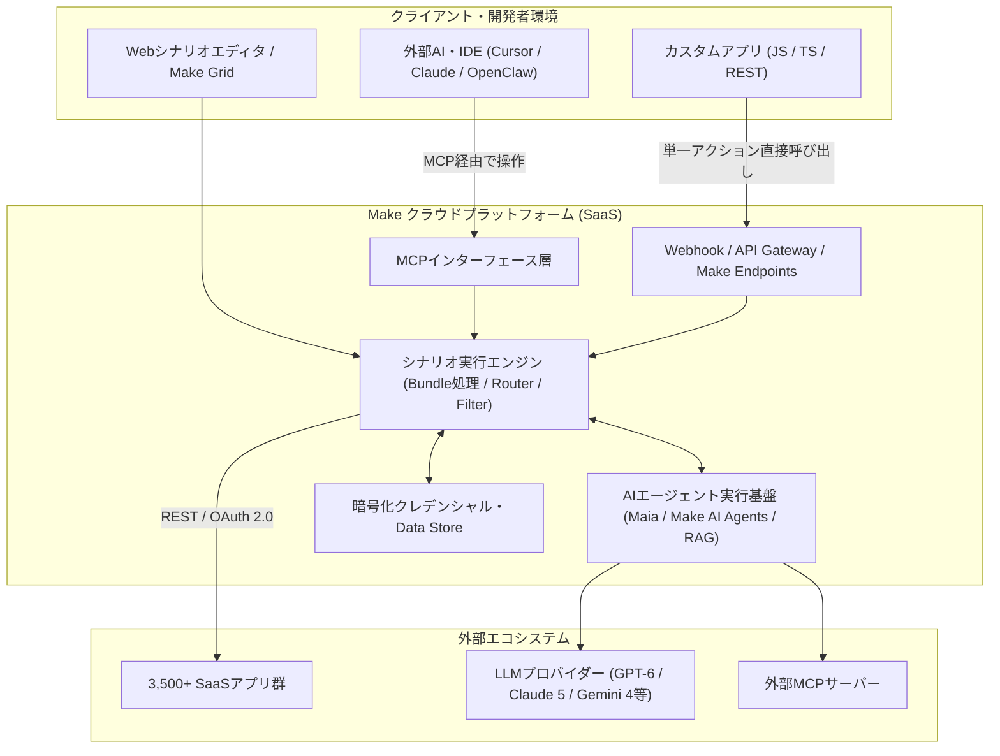

# **Make 調査レポート**

## **1. 基本情報**

* **ツール名**: Make (旧 Integromat)
* **ツールの読み方**: メイク
* **開発元**: Celonis (Make部門)
* **公式サイト**: [https://www.make.com/](https://www.make.com/)
* **関連リンク**:
  * ドキュメント: [https://help.make.com/](https://help.make.com/)
  * レビューサイト: [G2](https://www.g2.com/products/make/reviews) | [Capterra](https://www.capterra.com/p/231688/Make/) | [ITreview](https://www.itreview.jp/products/integromat/reviews)
* **カテゴリ**: ワークフローエンジン
* **概要**: Makeは、3,500以上のアプリ、サービス、システムを視覚的に統合できるビジュアルオートメーションプラットフォームです。単純なタスクから複雑なエンタープライズワークフロー、自律型のAIエージェント（Make AI Agents）まで、ドラッグ＆ドロップのインターフェースおよび会話型AIアシスタント「Maia by Make」を通じて構築できます。さらに、Make Gridによる全体可視化やMake Process Intelligenceによる業務分析にも対応しています。以前は「Integromat」として知られていました。

## **2. 目的と主な利用シーン**

* **解決する課題**:
  * 異なるSaaS間のデータの分断（サイロ化）の解消。
  * 反復的な手作業（データ入力、通知、ファイル移動など）の削減およびプロセスマイニングによる自動化対象の特定。
  * 開発リソースを抑えつつ、カスタムバックエンドロジックやAPI連携、自律型AIエージェントを構築したいニーズへの対応。
* **想定利用者**:
  * ノーコード/ローコード開発者
  * マーケティング担当者（リード管理、SNS自動化）
  * eコマース運営者（注文処理、在庫管理）
  * スタートアップ、SMB、およびエンタープライズ業務改革チーム
* **利用シーン**:
  * **リード管理**: Facebook Lead Adsで獲得したリードをGoogleスプレッドシートに追加し、Slackで営業チームに通知、Mailchimpでウェルカムメールを送信する。
  * **eコマース**: Shopifyで注文が入ったら、Xeroで請求書を作成し、Googleドライブに保存する。
  * **APIバックエンド / Make Endpoints**: Webhookを受け取りデータを加工して返す簡易APIサーバーや、カスタムコード（JS/TS/REST）から直接アプリ操作を呼び出す基盤として利用する。
  * **自律型AIエージェント構築**: Make AI Agents（およびSub-Agents）とMCP連携を使用し、複数のツールを自律的に操作して複雑なタスクをこなすエージェントワークフローを構築する。

### **2.1 代表的な利用フロー**

```mermaid
swimlane-beta TB
  subgraph User["ユーザー / 開発者"]
    A["Maiaまたはエディタでシナリオを設計"]
    F["Make Gridや実行ログで結果を確認"]
  end
  subgraph MakeCloud["Make クラウド基盤"]
    B["トリガー受信・バンドル生成"]
    C["Router / Filter・データ変換を実行"]
    E["結果を記録・エラーハンドリング"]
  end
  subgraph AIAndExternal["AI・外部サービス (MCP / SaaS)"]
    D["AIエージェント推論・外部API実行"]
  end
  A --> B
  B --> C
  C --> D
  D --> E
  E --> F
```

* **代表的な流れ**: ユーザーはビジュアルエディタや会話型AI「Maia」でシナリオを設計し、Makeクラウドが外部からのWebhookや定期トリガーを受信してデータ（バンドル）を生成します。条件分岐やデータ変換を経た後、AIエージェントや3,500以上の外部サービス（MCPサーバー含む）と連携して処理を実行し、結果と依存関係はMake Gridや実行ログ上で可視化されます。

## **3. 主要機能**

* **Make AI Agents / Sub-Agents**: キャンバス上でツール呼び出しや意思決定プロセスを可視化しながら、自律的に思考し行動するAIエージェントを構築できる機能。RAG用ナレッジベース（PDF/TXT/CSV等）の参照、サブエージェントの呼び出し、プロンプトキャッシュにも対応しています。
* **Maia by Make**: シナリオビルダーに統合された会話型AIコワーカー。自然言語の指示からシナリオを自動構築する「Build Mode」、構成や権限を事前検証する「Plan Mode」、エラーログ解析による自動修復「Resolve Error」、チャット間のメモリ機能を備えています。
* **Make Grid**: 組織内の全シナリオ、データストア、連携アプリ、さらには外部AIエージェント（n8nやClaude等）を含む依存関係とエラー状況をリアルタイムに近い形で俯瞰・管理できるビジュアルマップ機能。
* **Make Process Intelligence**: Celonisのプロセスインテリジェンス技術を基盤とし、プロセスマイニングとタスクマイニングを組み合わせて業務ボトルネックと自動化すべき高価値領域を特定する機能。
* **Make Endpoints & MCP連携**: カスタムコード（JavaScript/TypeScript/REST）からチーム管理下のMake接続を通じてアプリ操作を直接呼び出せる「Make Endpoints」や、Model Context Protocol（MCP）による外部AI（Claude、Cursor、OpenClaw等）との双方向連携を提供。
* **ビジュアルシナリオエディタ**: キャンバス上でバブル状のモジュールを繋ぎ合わせ、データの流れを視覚的に設計可能。Undo/Redo（`Cmd+Z`/`Cmd+Y`）、ダークモード、グローバル検索、インラインOAuth再認証などにも対応しています。
* **3,500以上のアプリ連携 & HTTP/Webhook**: 主要SaaSの事前定義モジュールに加え、専用アプリがないサービスでもREST/SOAP APIやEvent Subscriptions経由で柔軟に連携可能。
* **Router / Filter / Error Handling / Data Store**: 条件分岐（Router/Filter）、自動リトライやスキップを行う例外処理（Retry / Skip）、シナリオ間でデータを永続化する簡易DB（Data Store）、配列処理（Iterator / Aggregator）を標準装備しています。

## **4. 動作原理・システム構成**

* **アーキテクチャ**: Makeは完全クラウド完結型のマルチテナントSaaS（AWS/GCP等のクラウドインフラ上で稼働、EnterpriseではEU/USリージョン選択可）として設計されています。内部のソースコードやインフラ詳細は非公開ですが、Webベースのビジュアルクライアントとクラウド上のシナリオ実行エンジンが分離された構成をとっています。
* **主要コンポーネントとデータフロー**:
  * **トリガーとキュー管理**: ポーリング（定期監視）またはWebhook（即時通知・Event Subscriptions）によって外部イベントを受信し、データを「バンドル（Bundle）」と呼ばれる構造化データ単位に正規化して実行キューへ投入します。シナリオ非アクティブ時でもMCP経由でWebhookキューを管理できます。
  * **実行エンジンとモジュールパイプライン**: 実行エンジンがシナリオの定義（JSONブループリント）に従い、各モジュールを順番に処理します。RouterやFilterはエンジン内で評価され（クレジット消費なし）、各アプリモジュールはOAuth 2.0やAPIキーなどの暗号化されたクレデンシャルを用いて外部APIへリクエストを送信します。
  * **AIオーケストレーション層**: Make AI Agentsは、Make独自のAI Providerまたはユーザー自身のAPIキー（OpenAI GPT-6系、Anthropic Claude 5系、Google Gemini 3.8/4系等）を呼び出し、登録されたシナリオや外部MCPサーバーをツールとして動的に実行します。
  * **可観測性・統制層 (Make Grid / Make Endpoints)**: Make Gridはワークスペース全体のシナリオ・アプリ・データストア間のトポロジーを自動生成し、Make Endpointsはシナリオ全体を起動せず単一アクションをAPIゲートウェイ的に外部コードへ公開します。
* **特筆すべき要素技術**:
  * **データ機密保護 ("Data is confidential" モード)**: 実行時のペイロードデータをサーバー上に永続保存せず、メモリ上で処理して破棄するオプションを備えています。
  * **Model Context Protocol (MCP)**: 外部LLMクライアント（Cursor、Claude等）とMakeシナリオを標準プロトコルで接続し、AIからシナリオの検索・検証・実行を安全に制御します。



## **5. 開始手順・セットアップ**

* **前提条件**:
  * 有効なメールアドレスまたはGoogle/Facebook/GitHubアカウント。
  * Webブラウザ（Chrome, Firefox, Safariなど）。
* **サインアップ**:
  * 公式サイト [make.com](https://www.make.com/) にアクセスし、「Get started free」をクリックしてアカウントを作成する。
* **初期設定**:
  * ダッシュボードから「Create a new scenario」をクリックしてエディタを開く。
  * 連携したいアプリのアイコン（例: Google Sheets）を選択し、接続設定（Connection）を行う。
* **クイックスタート**:
  1. トリガーとなるモジュール（例: Watch Rows）を設定するか、「Maia by Make」に作りたい自動化を自然言語で指示して雛形を生成する。
  2. アクションとなるモジュール（例: Send a message to Slack）を追加・調整する。
  3. 「Run once」ボタンを押して動作テストを行い、データバンドルの流れを確認する。
  4. 問題なければスケジュール設定をONにして保存する。

## **6. 特徴・強み (Pros)**

* **圧倒的な視覚的操作性と全体俯瞰**: 処理の流れが左から右へアニメーションで可視化され、データの動きを直感的に理解しやすい。さらに「Make Grid」により大規模環境でもシナリオ間の依存関係やエラー箇所を即座に把握できる。
* **自律型AIと会話型構築の統合**: 「Make AI Agents（Sub-Agents・Prompt Caching対応）」と「Maia by Make（Plan/Buildモード・自動エラー修復）」により、ノーコードでのシナリオ構築から自律エージェント運用まで一気通貫で加速できる。
* **高い柔軟性と開発者親和性**: JSON/XMLパース、正規表現、配列操作に加え、「Make Endpoints」やCursor/OpenClaw向けプラグイン、MCP対応などエンジニアがコードと組み合わせて使う機能も充実している。
* **コストパフォーマンス**: Zapierと比較して、同等の処理量でもコストが抑えられる傾向にある（特にRouter/Filterがクレジット消費ゼロである点や大量データ処理において有利）。
* **プロセスマイニングとの融合**: Celonis連携による「Make Process Intelligence」により、属人的な勘ではなくデータに基づいて自動化すべき業務を発見できる。

## **7. 弱み・注意点 (Cons)**

* **学習コスト**: Zapierのような直線的な「トリガー→アクション」だけのツールに比べ機能が多岐にわたるため、複雑なロジックを組むにはデータ構造（配列やJSON）やAPIの知識が必要になる（Maiaにより緩和されつつあるが、細部の調整には理解が必要）。
* **クレジット消費の見積もり**: 旧「オペレーション」から「クレジット制」へ移行し、通常のモジュール実行（1クレジット/バンドル）に加え、ポーリング監視、Make Code（実行時間に応じた課金）、ネイティブAI機能（トークン・処理に応じた課金）などで消費量が変動するため、設計時の最適化が求められる。
* **日本語対応**: UIは英語ベースであり（一部日本語化やMaiaでの日本語指示は可能）、公式ドキュメントやコミュニティも英語が中心。

## **8. 料金プラン**

Makeは従来の「オペレーション（Ops）」単位から**クレジット（Credits）制**の料金体系を採用しています。有料プランは機能レベルで分かれており、必要な月間クレジット量に応じて料金がスケールします（以下は月間10,000クレジット基準・年払いの目安）。

| プラン名 | 料金（年払い目安） | 主な特徴 |
|---------|------|---------|
| **Free** | 無料 | 1,000クレジット/月, 2アクティブシナリオ, 最小実行間隔15分, 最大ファイルサイズ5MB |
| **Core** | $9/月〜 | 10,000クレジット/月〜, 無制限シナリオ, 最小実行間隔1分, Make APIアクセス |
| **Pro** | $16/月〜 | 10,000クレジット/月〜, フルテキストログ検索, カスタム変数, 優先実行 |
| **Teams** | $29/月〜 | 10,000クレジット/月〜, チーム管理機能, カスタムロール・権限設定, 共有テンプレート |
| **Enterprise** | 要問い合わせ | エンタープライズセキュリティ, SSO, 監査ログ, 専任サポート, カスタムクレジット枠 |

* **課金体系**: 月間の「クレジット数」に基づく（通常モジュールは1実行=1クレジット、Router/Filterは0クレジット、Make CodeやMake AI Providerは実行時間やトークンに応じたクレジット消費）。年払いの場合、月払いより約15〜18%割安になります。超過時は追加クレジットパックの購入が可能ですが、割高（約25%増）になるため上位クレジット枠への変更が推奨されます。
* **無料トライアル**: Freeプランは期限なしで利用可能（Maia等の新機能も一部トライアル提供あり）。

## **9. 導入実績・事例**

* **導入企業**: Meta, Spotify, Heineken, Zalando, Uberなど、世界中の大手企業やスタートアップで利用されている。
* **導入事例**:
  * **Fintech企業**: 顧客オンボーディングプロセスを自動化し、手作業を90%削減。
  * **Eコマース**: 注文処理から配送手配、顧客通知までを完全自動化し、人的ミスをゼロに。
* **対象業界**: Eコマース、マーケティング代理店、SaaS開発、金融など多岐にわたる。

## **10. サポート体制**

* **ドキュメント**: [Make Help Center](https://help.make.com/) に詳細なマニュアル、チュートリアル、ビデオガイドがある（主に英語）。
* **コミュニティ**: [Make Community](https://community.make.com/) は非常に活発で、ユーザー同士の助け合いやエキスパートによる回答が得られる。
* **公式サポート**: チケット制のサポートデスクを提供。プランによって優先度が異なる。Coreプラン以上で優先サポートあり。

## **11. エコシステムと連携**

### **11.1 API・外部サービス連携**

* **API / Make Endpoints**: Make APIを利用してシナリオ管理や実行をプログラムから操作できるほか、Make Endpointsによりカスタムコード（JS/TS/REST）からMake上の接続済みアプリアクションを直接呼び出せます。
* **MCP (Model Context Protocol) 連携**: Make AI Agentsから外部MCPサーバーを呼び出せるほか、Make Plugin for Cursor / OpenClaw等を通じて外部AIからMakeのシナリオを構築・実行・Webhookキュー管理できます。
* **外部サービス連携**: **3,500以上**のアプリに加え、汎用的なHTTP, Webhook, SOAP, JSONモジュールを駆使することで、API公開されているあらゆるサービスと連携可能。

### **11.2 技術スタックとの相性**

| 技術スタック | 相性 | メリット・推奨理由 | 懸念点・注意点 |
|:---|:---:|:---|:---|
| **Node.js / TypeScript** | ◎ | Make EndpointsやWebhook経由でバックエンド処理やアプリ操作を直接連携可能 | 認証周りの実装・APIキー管理が必要 |
| **Python (Django/FastAPI)** | ◎ | データ処理パイプラインの一部として連携しやすく、Make CodeでもPython実行に対応 | 大量データの転送や長時間実行はクレジット消費に注意 |
| **React / Next.js** | ◯ | フォーム送信先や簡易APIとして利用可能 | クライアントサイドからの直接呼び出しはCORSやAPIキー管理に注意 |
| **NoCode (Bubble/Webflow)** | ◎ | ネイティブ連携やWebhookでバックエンド機能を補完 | 特になし |

## **12. セキュリティとコンプライアンス**

* **認証**: SSO (Single Sign-On) 対応 (Enterprise等)、カスタムロールによる細かな権限管理 (Teams以上)、2段階認証 (2FA) は全プランで利用可能。
* **データ管理**: 保存データの暗号化（AES-256）、通信のTLS暗号化、EUまたはUSリージョンの選択が可能（Enterprise）。GDPR対応のDPA（データ処理契約）発行や、ペイロードを永続保存しない「Data is confidential」設定に対応。
* **準拠規格**: ISO 27001認証取得、SOC 2 Type II、SOC 3、GDPR準拠（標準マルチテナント環境ではHIPAAのBAA締結には非対応）。

## **13. 操作性 (UI/UX) と学習コスト**

* **UI/UX**: モダンで洗練されたUI。シナリオエディタはズームイン・アウト、Undo/Redo、ダークモード、グローバル検索、サブフォルダ・ラベル整理に対応し、大規模なワークフローも「Make Grid」で全体を俯瞰しやすい。
* **学習コスト**: Iterator/Aggregatorや複雑な関数を使いこなすにはプログラミング的思考が必要で中級者向けだが、会話型AI「Maia by Make」のPlan/Buildモードとエラー自動修復により、初心者の立ち上げハードルが大きく下がっている。

## **14. ベストプラクティス**

* **効果的な活用法 (Modern Practices)**:
  * **WebhookとEvent Subscriptionsの活用**: ポーリング（定期確認）ではなくWebhookを使うことで、即時実行を実現しつつ無駄なクレジット消費を節約する。
  * **エラーハンドリングの実装**: 「Retry（旧Break）」や「Skip（旧Ignore）」ディレクティブを活用し、API一時エラー時の自動リトライや安全な継続処理を組み込む。
  * **AIエージェントのプロンプトキャッシュ活用**: 固定のシステム指示やツール定義にはPrompt Cachingを利用し、入力トークンと処理レイテンシを削減する。
  * **モジュール化とMake Grid管理**: 巨大なシナリオを分割し、サブシナリオやMake Endpointsとして呼び出し、Make Gridで全体の依存関係を定期監査する。
* **陥りやすい罠 (Antipatterns)**:
  * **無限ループ**: Webhookトリガーと更新アクションを適切にフィルタリングせずに繋ぐと、無限ループが発生しクレジットを大量消費する。
  * **過剰なポーリング**: 更新頻度の低いサービスに対して短い間隔（1分など）でポーリング設定を行うと、データがなくてもクレジットを消費し続ける。

## **15. ユーザーの声（レビュー分析）**

* **調査対象**: G2, Capterra, ITreview
* **総合評価**: 4.7/5.0 (G2)
* **ポジティブな評価**:
  * 「視覚的にロジックを組めるのが最高。何が起きているか一目瞭然でデバッグもしやすい」
  * 「Zapierより安くて高機能。複雑な条件分岐ができるので乗り換えて正解だった」
  * 「APIさえあれば何でも繋げられる柔軟性が素晴らしい」
* **ネガティブな評価 / 改善要望**:
  * 「サポートのレスポンスが遅いことがある。特に無料・下位プランの場合」
  * 「エラーログが少し読みづらく、深い階層のデータエラー原因特定に時間がかかる場合がある」
  * 「初心者には少し難しすぎるかもしれない。学習曲線がある」
* **特徴的なユースケース**:
  * 「自社SaaSのプロトタイプバックエンドとしてMakeを使用し、MVP開発期間を劇的に短縮した」

## **16. 直近半年のアップデート情報**

* **2026-11**: **Make Endpoints / 開発者プラグイン / グローバル検索強化**: カスタムコードからMake上の接続済みアプリアクションを直接呼び出せる「Make Endpoints」、Cursor・OpenClaw向けプラグイン、シナリオ・実行履歴のグローバル検索、Event Subscriptions、Airtable新モジュール12種が展開。
* **2026-10-20**: **Waves '26開催 & Make Process Intelligence発表**: プラハで開催された年次イベントWaves '26にて、Celonis技術を活用した「Make Process Intelligence（タスクマイニング・プロセスマイニング）」や「Make Grid」の拡張を発表。
* **2026-10**: **Maia by Make大幅強化 & 最新モデル対応**: Maiaに「Plan Mode」「メモリ機能」「画像アップロード」「エラー自動修復（Resolve Error）」を追加。あわせてOpenAI **GPT-6.1 Terra**、Anthropic **Claude Haiku 5.5**（およびBrowser Useツールセット）、Google **Gemini 4 Argon**（Vertex AI）に対応。
* **2026-09**: **GPT-6 Sol / Luna、Claude Opus 5.5、Sub-Agents & Prompt Caching**: OpenAIのGPT-6 Sol / GPT-6 Luna、Claude Opus 5.5 / Fable 5.1、Gemini 3.8 Flash、Grok 4.7に対応。さらにMake AI Sub-Agents、AIエージェント向けプロンプトキャッシュ、MCP経由のWebhookキュー管理、シナリオのサブフォルダ/ラベル機能をリリース（OpenAI Soraモジュールは9月24日に提供終了）。
* **2026-08**: **ダークモード・カスタムロール・Undo/Redo対応**: シナリオビルダーのダークモード、Undo/Redo、チーム向けカスタムロール、Plytix等の新規アプリ連携をリリース。
* **2026-07**: **Gemini 3.6 Flash サポート**: 高スループットなAI自動化向けにGemini 3.6 Flashに対応。
* **2026-05-27**: **Gemini 3.5 Flash サポート**: GoogleのAIモデル Gemini 3.5 Flash が利用可能になり、より高速で複雑なAIワークフローが構築可能に。
* **2026-05-26**: **エラーハンドラーの名称変更と改善**: エラーハンドラーの名称が直感的に改善（Break -> Retry、Ignore -> Skip）され、モジュール内の説明もアップデートされた。
* **2026-05-07**: **Make Skills for Claude (Open Beta)**: Claudeから直接Makeのシナリオブループリントを生成したり、設定を行ったりできる新機能がリリースされた。
* **2026-02-13**: **Make AI Agents リリース**: キャンバス上でネイティブに動作し、ツール呼び出しや推論の過程を可視化できる自律型AIエージェント構築機能が公開された。
* **2025-12-15**: **Enterprise Features強化**: 監査ログの詳細化と、より細かい権限管理機能がリリースされた。
* **2025-10-14**: **AI Assistant Beta終了**: 初期のAI Assistant Betaプログラムが終了し、次世代AI機能への移行期間に入った。

(出典: [Make Community News](https://community.make.com/c/news) / [Make Blog](https://www.make.com/en/blog))

## **17. 類似ツールとの比較**

### **17.1 機能比較表 (星取表)**

| 機能カテゴリ | 機能項目 | 本ツール (Make) | Zapier | n8n | Power Automate |
|:---:|:---|:---:|:---:|:---:|:---:|
| **基本機能** | 連携アプリ数 | ◎<br><small>3,500+</small> | ◎<br><small>9,000+</small> | △<br><small>350〜1,000+</small> | ◯<br><small>1,000+</small> |
| **開発機能** | 複雑なロジック | ◎<br><small>視覚的で柔軟</small> | △<br><small>直線的中心</small> | ◎<br><small>コード記述可</small> | ◯<br><small>変数/式利用可</small> |
| **AI機能** | エージェント・MCP連携 | ◎<br><small>AI Agents/Maia/MCP</small> | ◎<br><small>Zapier Agents/MCP</small> | ◎<br><small>HITL・MCP対応</small> | ◯<br><small>Copilot統合</small> |
| **運用** | コスト・課金効率 | ◯<br><small>比較的安価(クレジット制)</small> | △<br><small>やや高め(タスク制)</small> | ◎<br><small>セルフホスト無料</small> | ◯<br><small>M365に含まれる</small> |
| **非機能要件** | 日本語対応 | △<br><small>一部のみ</small> | △<br><small>英語中心</small> | △<br><small>英語中心</small> | ◎<br><small>完全対応</small> |

### **17.2 詳細比較**

| ツール名 | 特徴 | 強み | 弱み | 選択肢となるケース |
|---------|------|------|------|------------------|
| **本ツール (Make)** | 視覚的で柔軟なフロー・エージェント・全体可視化基盤 | 複雑なロジック可視化、Make Grid、Maiaによる生成・修復、コスパ、MCP/Endpoints | 初心者にはデータ構造の学習曲線がある | 複雑な分岐や自律型AI、プロセス分析を活用した自動化をコスパ良く構築したい場合。 |
| **Zapier** | 業界最大級の連携数を誇る簡単自動化ツール | 9,000以上の圧倒的な連携数、非エンジニアでも即座に使える、AI Guardrails/MCP | コストが高くなりがち、複雑な分岐はUIが煩雑 | シンプルな連携を素早く実装したい場合。ニッチなSaaSを多数連携させたい場合。 |
| **n8n** | オープンソース・セルフホスト対応 | データ管理権限、コード(JS/Python)利用の自由度、HITL対応 | サーバー管理の手間（セルフホスト時） | データを自社管理したい場合。エンジニア中心のチーム。 |
| **Power Automate** | Microsoftエコシステム統合 | M365連携、デスクトップRPA機能、日本語完全対応、ガバナンス | 複雑なフローの可読性が悪い場合がある | M365中心の環境、デスクトップ操作(RPA)が必要な場合。 |

## **18. 総評**

* **総合的な評価**:
  * Makeは、機能性、価格、使いやすさのバランスが非常に優れたプラットフォームである。従来の強みである「視覚的なシナリオ構築」に加え、2026年後半には「Maia by Make」「Make Grid」「Make Process Intelligence」「Make Endpoints」「MCP連携」へと急速に拡張し、単なるiPaaSから自律型AIエージェントとエンタープライズ業務変革の中核基盤へと進化を遂げている。
* **推奨されるチームやプロジェクト**:
  * API連携やMake Endpointsを活用して業務効率化・プロトタイピングを進めたいスタートアップやSMB。
  * Zapierのコストや複雑な分岐の制限に悩んでいるチーム。
  * 自律型AIエージェントやMCP連携を用いた高度な自動化システムを、視覚的な統制を保ちながら構築したいチーム。
* **選択時のポイント**:
  * 「手軽さと連携数（Zapier）」「セルフホストとコード自由度（n8n）」「M365・RPA統合（Power Automate）」と比較し、**視覚的な複雑ロジック設計・AIエージェント活用・コストパフォーマンス**のバランスを重視する場合にMakeが最適解となる。
