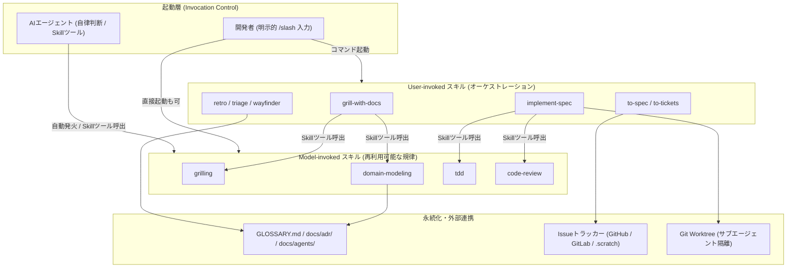

# **Matt Pocock Skills 調査レポート**

## **1. 基本情報**

* **ツール名**: Matt Pocock Skills (`mattpocock/skills`)
* **ツールの読み方**: マット ポコック スキルズ
* **開発元**: Matt Pocock（Total TypeScript / AI Hero 創設者）
* **公式サイト**: [https://www.aihero.dev/skills](https://www.aihero.dev/skills)
* **関連リンク**:
  * GitHub: [https://github.com/mattpocock/skills](https://github.com/mattpocock/skills)
  * ドキュメント: [https://www.aihero.dev/skills](https://www.aihero.dev/skills)
* **カテゴリ**: エージェントスキル/標準仕様
* **概要**: Matt Pocock Skills は、AIコーディングエージェントに「バイブコーディング（感覚任せの実装）」ではなく、規律あるソフトウェアエンジニアリングのプラクティスを適用するためのオープンソース・スキルコレクションです。要件を徹底的に深掘りするインタビュー（`/grill-me`、`/grill-with-docs`）、仕様・チケット分割（`/to-spec`、`/to-tickets`）、Red-Green-RefactorによるTDD（`tdd`）、2軸の並列コードレビュー（`code-review`）など、27種類の構成可能（Composable）なスキルを `SKILL.md` 形式で提供します。Claude Code、OpenAI Codex、GitHub Copilot、Gemini CLI、Cursor など多様なエージェント環境で動作します。

## **2. 目的と主な利用シーン**

* **解決する課題**:
  * **意図の不一致（Misalignment）**: 人間とAIエージェント間のコミュニケーション不足により、期待と異なる実装が作られてしまう問題。
  * **コンテキストの冗長化**: プロジェクト固有の専門用語（ユビキタス言語）をAIが把握できず、冗長なコードや認識齟齬が発生する問題。
  * **フィードバックループの欠如と設計劣化**: テストや型チェックを伴わないコード生成により、技術的負債（Big Ball of Mud）が急速に蓄積する問題。
* **想定利用者**:
  * Claude Code や Codex、GitHub Copilot などを日常的に活用するソフトウェアエンジニア
  * AIエージェントによる開発品質・設計一貫性を高めたいプロダクト開発チーム
  * 仕様駆動開発やTDDをAIワークフローに組み込みたいテックリード・アーキテクト
* **利用シーン**:
  * **新機能の設計と用語整理**: `/grill-with-docs` を使い、エージェントからの質問に答えながら要件の曖昧さを潰し、`GLOSSARY.md` と ADR（Architecture Decision Record）を自動整備する。
  * **仕様から並列実装までの一気通貫開発**: `/to-spec` → `/to-tickets` → `/implement-spec` の流れで、依存関係のあるタスクグラフを構築し、サブエージェントを用いてTDDで実装を進める。
  * **難解なバグの系統的デバッグと振り返り**: `diagnosing-bugs` で再現ループを作って原因を特定し、修正後に `/retro` でリポジトリのガードレール（Linterやステアリング文書）を改善する。

### **2.1 代表的な利用フロー**

```mermaid
swimlane-beta TB
  subgraph User["開発者"]
    U1["変更の目的や要望を入力"]
    U2["設計上の質問に回答し判断を確定"]
    U3["実装結果とレビュー報告を確認"]
  end
  subgraph Agent["AIコーディングエージェント"]
    A1["/grill-with-docs で質問を生成"]
    A2["/to-spec・/to-tickets でタスク化"]
    A3["/implement-spec でサブエージェント実行"]
  end
  subgraph Skills["Matt Pocock Skills (SKILL.md)"]
    S1["grilling / domain-modeling を呼出"]
    S2["tdd / code-review 規律を適用"]
  end
  subgraph Repo["リポジトリ・Issueトラッカー"]
    R1["GLOSSARY.md と ADR を更新"]
    R2["GitHub Issues・統合ブランチへ反映"]
  end
  U1 --> A1
  A1 --> S1
  S1 --> U2
  U2 --> R1
  R1 --> A2
  A2 --> R2
  R2 --> A3
  A3 --> S2
  S2 --> U3
```

* **代表的な流れ**: 開発者が `/grill-with-docs` を起動すると、エージェントが `grilling` と `domain-modeling` の手順に従って質問を繰り返し、合意内容をリポジトリ内の `GLOSSARY.md` や ADR に記録します。その後、仕様書とチケットを Issue トラッカーへ起票し、`/implement-spec` が `tdd` と `code-review` の規律を適用しながら統合ブランチへ実装を完了させます。

## **3. 主要機能**

公式プラグイン（`v1.3.2`）には **Engineering（20種）** と **Productivity（7種）** の計27スキルが含まれており、さらに `skills/in-progress` にて実験的スキル（`software-factory`、`chief-of-staff` 等）も開発されています。

* **1. 初期セットアップ（`/setup-matt-pocock-skills`）**: リポジトリごとに1回実行し、使用する Issue トラッカー（GitHub / GitLab / ローカルMarkdown等）、トリアージ用ラベル、`GLOSSARY.md` や ADR の配置先を対話的に設定し、`docs/agents/` 配下に構成ファイルを生成します。
* **2. ソクラテス式インタビュー（`/grill-me` / `/grill-with-docs` / `grilling`）**: 設計や計画の決定木における全分岐が解決されるまでエージェントが開発者に質問を重ね、曖昧さや見落としを事前に排除します。`/grill-with-docs` は同時に用語集とADRを更新します。
* **3. ユビキタス言語とアーキテクチャ設計（`domain-modeling` / `codebase-design` / `/improve-codebase-architecture`）**: DDDのユビキタス言語（`GLOSSARY.md`）を維持しつつ、John Ousterhout の「深いモジュール（Deep Modules）」理論に基づき、小さなインターフェースの背後に複雑な処理を隠蔽するリファクタリング候補を視覚的HTMLレポートで提示します。
* **4. 仕様化とタスクグラフ分解（`/to-spec` / `/to-tickets` / `/wayfinder`）**: 会話内容を構造化された仕様書として Issue トラッカーへ公開し、ブロッキング関係（依存エッジ）を持つトレーサーバレット型の実装チケット群へ分解します。大規模案件向けには `/wayfinder` が決定チケットのマップを作成します。
* **5. TDD・並列実装エンジン（`/implement` / `/implement-spec` / `tdd`）**: Red-Green-Refactor ループを厳格に強制する `tdd` スキルを軸に、単一チケットを順番に実装する `/implement` と、タスクグラフの実行可能フロンティアに対してGit Worktree上でサブエージェントを並列稼働させる `/implement-spec` を提供します。
* **6. 2軸並列コードレビューとPR作成支援（`code-review` / `pr`）**: 差分に対して「コーディング規約・Fowlerのコードスメル（Standards）」と「仕様・Issueへの忠実度（Spec）」の2つの独立したサブエージェントを走らせ、コンテキスト汚染を防ぎながら網羅的にレビューします。`pr` スキルは変更の可視化サマリーや破壊的変更のリスク評価を含むPR本文を生成します。
* **7. 系統的バグ診断と開発環境レトロスペクティブ（`diagnosing-bugs` / `/retro`）**: バグ再現用のフィードバックループ構築から最小化・仮説検証・回帰テスト追加までを段階的に実行する `diagnosing-bugs` と、セッション終了後に Linter・CI・ステアリング文書などの環境改善を提案する `/retro` を備えています。
* **8. 汎用生産性スキル（`/handoff` / `/teach` / `/to-questionnaire` / `/wait-what` / `writing-for-agents`）**: 別エージェントへの引き継ぎドキュメント生成（`/handoff`）、複数セッションにわたる学習支援（`/teach`）、他者への確認用アンケート生成（`/to-questionnaire`）、専門用語を噛み砕いて再説明する `/wait-what` などを提供します。

## **4. 動作原理・システム構成**

* **アーキテクチャ**: ローカルファーストの**プロンプト＆メタデータ駆動型プラグイン構成**です。特定の常駐サーバーや独自ランタイムを持たず、Agent Skills 標準（`SKILL.md`）と各ハーネス向け設定（`.claude-plugin/plugin.json`、`agents/openai.yaml`）のみで構成されています。
* **主要コンポーネントとデータフロー**:
  * **呼び出し制御の2層構造（Invocation Architecture）**: `.agents/invocation.md` で定義された厳格な不変条件により、スキルは **User-invoked**（ユーザーが明示的に `/skill-name` で起動）と **Model-invoked**（自律判断または `Skill` ツール経由で起動）の2種類に分離されています。
  * **クロススキル呼び出しルール**: User-invoked スキルは `disable-model-invocation: true`（Claude Code）および `policy.allow_implicit_invocation: false`（Codex）によりモデルからの自動発火を禁止し、モデルが勝手にオーケストレーションを暴走させるのを防ぎます。User-invoked スキルは Model-invoked スキルを `Skill` ツールで呼び出せますが、逆や User-invoked 同士の呼び出しは禁止されています。
  * **リポジトリ内永続ステート**: 会話間で知識を引き継ぐため、設定・状態はリポジトリ内のファイル（`docs/agents/issue-tracker.md`、`GLOSSARY.md`、`docs/adr/`、`.scratch/` 等）および GitHub/GitLab Issues に保存されます。



* **特筆すべき要素技術**:
  * **ハーネス非依存の `Skill` ツール明記**: 旧バージョンでは `/tdd` のようなスラッシュ表記をプロンプト内に記述していましたが、AIエージェントがロードに失敗する事例を受け、`Call the Skill tool with "tdd"` のようにツール呼び出しを明示するハーネス中立仕様へ統一されました。
  * **シークレット保護（Redaction）**: `diagnosing-bugs` ではコマンド出力やキャプチャ結果を表示する前に `<REDACTED>` へマスク処理を行い、認証情報を環境変数経由で扱うルールが組み込まれています。

## **5. 開始手順・セットアップ**

* **前提条件**:
  * 対応するAIコーディングエージェント（Claude Code、Codex CLI、GitHub Copilot CLI/VS Code、Gemini CLI、Cursor、OpenCode 等）
  * GitHub Issues 連携を使う場合は `gh` CLI（GitLab の場合は `glab` CLI）が認証済みであること
  * アカウント登録・クレジットカード登録は不要（完全無料・MITライセンス）
* **インストール/導入**:
  利用しているエージェントに応じてプラグイン（自動更新）または `skills.sh`（編集可能なローカルコピー）のいずれか1つを選択します。

  * **Claude Code の場合（自動更新あり）**:
    ```bash
    claude plugin install mattpocock-skills@claude-plugins-official
    ```
  * **Codex の場合（起動時に自動更新）**:
    ```bash
    codex plugin marketplace add mattpocock/skills
    codex plugin add mattpocock-skills@mattpocock
    ```
  * **GitHub Copilot CLI の場合**:
    ```bash
    copilot plugin marketplace add mattpocock/skills
    copilot plugin install mattpocock-skills@mattpocock
    ```
  * **Gemini CLI の場合**:
    ```bash
    gemini skills install https://github.com/mattpocock/skills.git --path skills/engineering
    gemini skills install https://github.com/mattpocock/skills.git --path skills/productivity
    ```
  * **Cursor / OpenCode / Windsurf / Devin 等（`skills.sh` 経由で編集可能コピー）**:
    ```bash
    npx skills@latest add mattpocock/skills -a cursor
    ```

* **初期設定**:
  エージェントを起動した対象リポジトリで、最初に以下のスラッシュコマンドを1回実行します。
  ```text
  /setup-matt-pocock-skills
  ```
  対話形式で「Issue トラッカー（GitHub / GitLab / ローカル `.scratch/` 等）」「トリアージラベル」「ドキュメント保存先」を設定すると、`docs/agents/` 配下に設定ファイルが生成されます。
* **クイックスタート**:
  実装したい機能やアイデアがある状態で、エージェントに `/grill-with-docs`（またはコード外なら `/grill-me`）を実行すると、エージェントが設計の穴を埋めるためのインタビューを開始します。

## **6. 特徴・強み (Pros)**

* **「ブラックボックス化しない」小さく構成可能な設計**: GSD、BMAD、Spec-Kit のようなプロセス全体を丸抱えするフレームワークと異なり、各スキルが独立した小さな Markdown ファイルで構成されているため、必要なスキルだけを選び、自分の `AGENTS.md` やフォークで自由に改変できます。
* **コンテキストウィンドウを浪費しない制御モデル**: 全てのスキルを常時自動発火させるのではなく、オーケストレーション系を `User-invoked` に限定することで、意図しないスキル誤爆やコンテキスト汚染を防いでいます。
* **実戦的なソフトウェア工学の知見が凝縮**: DDD のユビキタス言語（`GLOSSARY.md`）、John Ousterhout の Deep Modules、Martin Fowler のコードスメル、Red-Green-Refactor の TDD など、古典的かつ実績ある設計原則がプロンプトとして即戦力化されています。
* **徹底したマルチハーネス対応**: Claude Code だけでなく、Codex（`agents/openai.yaml` 同梱）、GitHub Copilot、Gemini CLI、Cursor 等で同一のワークフローを再現可能です。

## **7. 弱み・注意点 (Cons)**

* **日本語対応の状況**: リポジトリ内の `SKILL.md`、トリガー記述、テンプレート類はすべて英語で書かれています。日本語での対話や日本語プロジェクトでも動作はしますが、`GLOSSARY.md` や質問の言語トーンを日本語に保つには `CLAUDE.md` / `AGENTS.md` での指示補足や一部調整が必要になる場合があります。
* **テキスト量・ルール遵守によるトークン消費**: `grill-with-docs` や `implement-spec`、2軸の `code-review` は複数のサブエージェントや多段階の対話を行うため、単純なワンショット指示に比べると API トークン消費量と実行時間が増加します。
* **前提ツール・運用規律への依存**: `implement-spec` や `to-tickets` などのエンジニアリング系スキルは、Git Worktree や Issue トラッカー（`gh` / `glab`）、自動テスト環境が整っているリポジトリを前提としており、テスト基盤が全くない環境では効果が半減します。

## **8. 料金プラン**

| プラン名 | 料金 | 主な特徴 |
|---------|------|---------|
| **オープンソース版 (MIT)** | 無料 | 全27スキルおよび実験的スキル、ドキュメントが制限なく利用可能 |

* **課金体系**: 完全無料（MIT License）。ただし、スキルを実行する基盤となる AIコーディングエージェント（Claude Code、Codex、GitHub Copilot 等）や LLM API の利用料金は別途発生します。
* **無料トライアル**: オープンソースのためトライアル制限はありません。

## **9. 導入実績・事例**

* **公開状況**: 特定の導入企業一覧は公式に公開されていません。ただし、GitHub リポジトリは **324,000以上のスター** と **27,000以上のフォーク** を獲得し、公式ニュースレターにも約60,000人の開発者が登録するなど、個人開発者からスタートアップ・プロダクト開発チームまで極めて広範な普及を見せています。
* **活用分野**: TypeScript / React / Next.js をはじめとする Web アプリケーション開発、CLI ツール開発、既存コードベースのアーキテクチャ改善・テスト拡充などで幅広く利用されています。

## **10. サポート体制**

* **ドキュメント**: 公式ポータル（[https://www.aihero.dev/skills](https://www.aihero.dev/skills)）およびリポジトリ内の `docs/engineering/`、`docs/productivity/` に各スキルの詳細な解説ページが整備されています。また、`SCOPE.md` や `.agents/invocation.md` により設計思想も透明に公開されています。
* **コミュニティ**: [GitHub Discussions](https://github.com/mattpocock/skills/discussions) にて質問・議論が行われており、Issue テンプレート（Bug / Idea）を通じたフィードバック受付も活発です。
* **公式サポート**: オープンソースプロジェクトのため商用SLA付きの個別サポート窓口はありません。不具合報告や改善提案は GitHub Issues にて受け付けています（一定の採用基準を `SCOPE.md` で定義）。

## **11. エコシステムと連携**

### **11.1 API・外部サービス連携**

* **API**: 本ツール自体はプロンプト（`SKILL.md`）集であるため独自の REST/GraphQL API は持ちませんが、対応エージェントの `Skill` ツールおよび各 CLI を介して外部サービスと連携します。
* **外部サービス・ツール連携**:
  * **AIコーディングエージェント**: Claude Code、OpenAI Codex、GitHub Copilot（CLI / VS Code）、Gemini CLI、Cursor、OpenCode、Devin、Windsurf、Amp、Pi
  * **Issue トラッカー**: GitHub Issues（`gh` CLI）、GitLab Issues（`glab` CLI）、ローカル Markdown（`.scratch/`）、および自由記述による Jira / Linear 等のカスタムワークフロー
  * **配布基盤**: `skills.sh`（`npx skills`）、Claude Code 公式プラグインマーケットプレイス

### **11.2 技術スタックとの相性**

| 技術スタック / 環境 | 相性 | メリット・推奨理由 | 懸念点・注意点 |
|:---|:---:|:---|:---|
| **Claude Code** | ◎ | 公式プラグインとしてネイティブ対応し、自動更新やサブエージェント並列実行が最も円滑 | サブエージェント起動によるトークン消費が増えやすい |
| **OpenAI Codex** | ◎ | 各スキルに `agents/openai.yaml` が同梱されており、UIメタデータや起動制御が完全同期 | プラグインマーケットプレイスの事前登録が必要 |
| **GitHub Copilot (CLI / VS Code)** | ◎ | プラグイン自動更新に対応し、GitHub Issues 連携との親和性が極めて高い | VS Code外（CLI）では `settings.json` の設定が必要 |
| **Gemini CLI** | ◯ | 公式コマンド（`gemini skills install`）で engineering / productivity を直接導入可能 | 更新時はインストールコマンドの再実行（手動）が必要 |
| **Cursor / Windsurf / OpenCode** | ◯ | `npx skills@latest add mattpocock/skills` でローカルに展開し自由にカスタマイズ可能 | 自動更新されず、`npx skills update` 等の手動管理が必要 |

## **12. セキュリティとコンプライアンス**

* **認証**: ツール独自の認証機構は存在しません。GitHub/GitLab 連携時はローカル環境に認証済みの `gh` / `glab` CLI の権限をそのまま利用します。
* **データ管理**: 全てのスキル定義ファイルはローカル環境またはユーザー自身の Git リポジトリ内に配置され、開発元のサーバーへソースコードが送信されることはありません（データの送信先は利用する AIエージェントの LLM プロバイダーに依存します）。`diagnosing-bugs` スキルには出力前に機密情報を `<REDACTED>` にマスクする指示が組み込まれています。
* **準拠規格**: オープンソースのマークダウン／スクリプト集であるため、SOC2 や ISO27001 などの商用 SaaS 認証は該当しません（リポジトリのライセンスは MIT）。

## **13. 操作性 (UI/UX) と学習コスト**

* **UI/UX**: 専用GUIは持たず、各AIコーディングエージェントのチャットUI・ターミナル上で `/grill-with-docs` や `/to-spec` などのスラッシュコマンドとして操作します。どれを使うべきか迷った際にはルーター役の `/ask-matt` に状況を尋ねるだけで適切なスキルを案内してくれるため、ナビゲーション性に優れています。また、`improve-codebase-architecture` は改善候補を視覚的な HTML レポートとして出力します。
* **学習コスト**:
  * **導入**: インストールと `/setup-matt-pocock-skills` の実行は数分で完了するため極めて低い。
  * **習熟**: スキル数が27種と多く、DDD（ユビキタス言語・ADR）や TDD（Red-Green-Refactor）の概念を前提としているため、これらに馴染みのない開発者には一定の学習コストがあります。ただし、最初は `/grill-me` と `/tdd` の2つだけから段階的に使い始めることが推奨されています。

## **14. ベストプラクティス**

* **効果的な活用法 (Modern Practices)**:
  * **最初はコアスキルから始める**: 全27スキルを一度に使いこなそうとせず、まずは `/grill-with-docs`（または `/grill-me`）で設計を固め、`tdd` でテスト駆動実装を行う基本ループを定着させる。
  * **`GLOSSARY.md` を育てる**: `/grill-with-docs` を継続的に使い、プロジェクト固有の概念に短い名前を付けることで、エージェントの思考トークン削減と命名の一貫性を高める。
  * **セッション後の `/retro` 習慣化**: エージェントが同じミスをした場合、プロンプトで注意するだけでなく `/retro` を走らせて Linter ルールや CI チェック、プロジェクト固有ガイドへ落とし込む。
* **陥りやすい罠 (Antipatterns)**:
  * **プラグインと `skills.sh` の二重インストール**: 両方を同時に導入すると、エージェントに同じスキルが2つずつ登録されてコンテキストや補完が混乱するため、必ず1エージェントにつき1つの導入方法を選ぶ。
  * **`/setup-matt-pocock-skills` の未実行**: 初期設定を行わずに `/to-spec` や `/triage` を使うと、Issue トラッカーやドキュメント保存先が定まらず意図しない場所にファイルが作られる原因になる。
  * **全工程の丸投げ**: ユーザーによる設計判断の対話（`grilling`）をスキップして実装だけ走らせると、従来のバイブコーディングと同じ認識齟齬が発生する。

## **15. ユーザーの声（レビュー分析）**

* **調査対象**: Hacker News (Y Combinator)、Reddit、GitHub Issues/Discussions
* **総合評価**: 定量スコアを提供する商用レビューサイト（G2/Capterra）への掲載はありませんが、GitHub では 32万スター超と非常に高い支持を集めています。
* **ポジティブな評価**:
  * **コンテキスト節約とユーザー主導の制御**: 「バックグラウンドで勝手にスキルが発火するのではなく、明示的なスラッシュコマンドで人間が主導権を握れる点が実用的」（Hacker News より要約）
  * **10万行超の大規模コードベースでの設計維持**: 「AIによるコード生成で肥大化しがちなプロジェクトでも、事前の `grill-with-docs` と厳格な TDD ループにより品質を保てる」（Hacker News / Reddit より要約）
  * **可読性とカスタマイズ性**: 「ブラックボックスなフレームワークではなく平文の Markdown として展開されるため、中身を読んで自分たちのチーム向けに調整しやすい」（開発者コミュニティより要約）
* **ネガティブな評価 / 改善要望**:
  * **プロンプトの肥大化・ルール過多の懸念**: 「パッケージ化された大量の指示文は、LLM の注意力を分散させたり、他人のルールに縛られている感覚を与えたりすることがある」（Hacker News の批判的意見より要約）
  * **既存レガシー環境への適用ハードル**: 「自動テストや明確なモジュール境界がないレガシープロジェクトでは、理想的なワークフローそのままでは適用しにくく取捨選択が必要」（コミュニティレビューより要約）
* **特徴的なユースケース**:
  * ソフトウェア開発だけでなく、非コード領域の企画構成や記事執筆の壁打ちに `/grill-me` 単体を利用するケースや、学習用ワークスペースで `/teach` を使って新しい技術スタックを段階的に習得する使い方が報告されています。

## **16. 直近半年のアップデート情報**

* **2026-11-12**: `in-progress` 領域にて、ソフトウェアファクトリー設計用スキル `software-factory` の開発および表現改善を実施。
* **2026-10-29 (`v1.3.2`)**: `implement-spec` において各チケットの実装ごとに新鮮なコンテキストウィンドウのサブエージェントを起動するよう改善。`chief-of-staff` のメモリ管理を日付・コミット参照付きの LLM Wiki 形式へ刷新し、`code-review` や `diagnosing-bugs`、`ask-matt` の精度を向上。
* **2026-10-04 (`v1.3.0` / `v1.3.1`)**: 仕様全体をタスクグラフとして並列実装する `implement-spec`、PR本文生成の `pr`、環境振り返りの `retro` の3スキルを Engineering 本番カテゴリへ昇格。`CONTEXT.md` の命名規則を `GLOSSARY.md` へ統一し、不要となった `resolving-merge-conflicts` スキルを削除。
* **2026-08-05〜08-06 (`v1.2.0`〜`v1.2.3`)**: `diagnosing-bugs` にシークレットの自動マスク（`<REDACTED>`）機能を追加し、クロススキル呼び出しをハーネス非依存の `Call the Skill tool with "..."` 形式へ標準化。プロンプト全体から em-dash を排除し可読性を改善。
* **2026-07-08 (`v1.1.0`)**: 各種スキルの品質改善およびドキュメント拡充を実施。
* **2026-06-17 (`v1.0.0` / `v1.0.1`)**: 最初のメジャーリリース（`v1.0.0`）として Claude Code プラグインパッケージングを正式公開。

(出典: [GitHub Releases](https://github.com/mattpocock/skills/releases) / [CHANGELOG.md](https://github.com/mattpocock/skills/blob/main/CHANGELOG.md))

## **17. 類似ツールとの比較**

### **17.1 機能比較表 (星取表)**

| 機能カテゴリ | 機能項目 | Matt Pocock Skills | Anthropic Agent Skills | Spec Kit | OpenSpec |
|:---:|:---|:---:|:---:|:---:|:---:|
| **基本機能** | 設計・要件の深掘り対話 | ◎<br><small>grill-me / grill-with-docs が中核</small> | △<br><small>汎用ドキュメント生成中心</small> | ◯<br><small>仕様テンプレート対話あり</small> | ◯<br><small>軽量な仕様・変更提案フロー</small> |
| **基本機能** | 実装・レビュー規律 (TDD等) | ◎<br><small>tdd・2軸code-review・retro完備</small> | △<br><small>開発フロー特化スキルは限定的</small> | ◯<br><small>実装タスク生成に対応</small> | ◯<br><small>仕様に沿った実装支援</small> |
| **拡張性** | 構成の自由度・改変容易性 | ◎<br><small>小さな独立スキルを組合わせ可能</small> | ◎<br><small>SKILL.md 標準で拡張容易</small> | △<br><small>独自ワークフローの枠組みが強い</small> | ◯<br><small>Markdown中心で軽量</small> |
| **対応環境** | マルチエージェント対応 | ◎<br><small>Claude/Codex/Copilot/Gemini等</small> | ◯<br><small>Claude中心だが標準仕様で流用可</small> | ◎<br><small>主要AIエージェントを広くサポート</small> | ◎<br><small>20以上のAIツールと統合</small> |
| **非機能要件** | 日本語対応 | △<br><small>英語プロンプト前提</small> | △<br><small>英語プロンプト前提</small> | △<br><small>英語中心</small> | △<br><small>英語中心</small> |

### **17.2 詳細比較**

| ツール名 | 特徴 | 強み | 弱み | 選択肢となるケース |
|---------|------|------|------|------------------|
| **Matt Pocock Skills** | 実践的なソフトウェア工学手法を27個の独立スキルに凝縮 | 対話による要件定義、TDD、2軸レビューまで一気通貫かつ個別利用も容易 | 英語プロンプト前提で、テスト・Issue運用基盤がないと活かしにくい | - |
| **Anthropic Agent Skills** | `SKILL.md` 標準仕様のリファレンス兼公式スキル集 | コンテキスト節約に優れた公式標準設計と Office 文書生成等の高品質スキル | 日常のアプリ開発工程（TDDやトリアージ等）のワークフローは薄い | エージェントスキルの標準仕様そのものや Office 自動処理を導入したい場合 |
| **Spec Kit** | GitHub製の仕様駆動開発（SDD）ツールキット | 仕様書から計画・実装までを厳格なテンプレートで一貫管理 | フレームワーク主導のプロセスが強く、細かなカスタマイズが難しい | チーム全体で統一された仕様駆動プロセスをトップダウンで導入したい場合 |
| **OpenSpec** | 軽量な仕様駆動型フレームワーク | 20以上のAIアシスタントに対応し、既存コードと仕様のズレを軽量に防止 | テキストベース中心でTDDやバグ診断等の開発工程スキルは含まない | 既存ツールに最小限の仕様管理レイヤーだけを手軽に追加したい場合 |

## **18. 総評**

* **総合的な評価**:
  * **Matt Pocock Skills** は、AIコーディングエージェントの普及によって顕在化した「速く書けるが設計が壊れる」という課題に対し、ユビキタス言語・TDD・ソクラテス式インタビューといった実証済みのエンジニアリング原則で正面から解を提示する極めて実用的なオープンソーススキル集です。特定のフレームワークに開発プロセスを奪われることなく、小さなスキルを自分の環境に合わせて組み合わせられる点が評価され、32万超のスターを獲得する定番リポジトリとなっています。
* **推奨されるチームやプロジェクト**:
  * Claude Code、OpenAI Codex、GitHub Copilot などを活用して中〜大規模アプリケーションを開発しており、AIの出力品質とコードベースの保守性を高めたいエンジニアおよび開発チーム。
  * 「バイブコーディング」から脱却し、仕様・設計合意・テストを重視する AI ネイティブな開発標準を確立したいテックリード。
* **選択時のポイント**:
  * 仕様管理の枠組み全体をツール側に委ねたい場合は **Spec Kit** や **OpenSpec** が適していますが、開発者が主導権を握りつつ「要件の壁打ち（`/grill-with-docs`）」「TDD（`tdd`）」「コードレビュー（`code-review`）」など実践的な開発規律をピンポイントかつ柔軟にエージェントへ組み込みたい場合は **Matt Pocock Skills** が最有力な選択肢となります。
