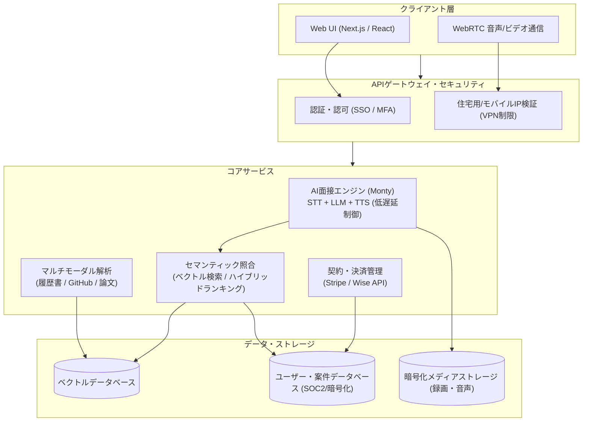

# **Mercor 調査レポート**

## **1. 基本情報**

* **ツール名**: Mercor
* **ツールの読み方**: メルコール
* **開発元**: Mercor Inc.（2023年設立、CEO: Brendan Foody、CTO: Adarsh Hiremath、Board Chairman: Surya Midha）
* **公式サイト**: [https://www.mercor.com/](https://www.mercor.com/)
* **関連リンク**:
  * GitHub: [https://github.com/Mercor-Intelligence](https://github.com/Mercor-Intelligence)（APEX評価ベンチマーク等）
  * ドキュメント: [https://docs.mercor.com/](https://docs.mercor.com/)
  * レビューサイト: [Trustpilot (4.5/5.0)](https://www.trustpilot.com/review/mercor.com)
* **カテゴリ**: 勤怠管理/人事労務
* **概要**: Mercor（メルコール）は、生成AIと大規模言語モデルを活用して人材スクリーニングからマッチング、契約・支払い管理までを一貫して自動化する次世代のAI人材プラットフォームである。求職者の履歴書やGitHub、論文を解析した上で、独自の対話型AIエージェントによる非同期ビデオ面接を実施し、数分間でスキルの定量化とセマンティックインデックス化を行う。OpenAI、Google、Metaをはじめとする先端AI研究所や急成長企業に対し、RLHF（人間からのフィードバックによる強化学習）やモデル評価を担う高度なドメイン専門家（医師・弁護士・金融アナリスト）およびトップエンジニアをオンデマンドで供給する基盤としてデカコーン（企業価値100億ドル）規模に急成長している。

## **2. 目的と主な利用シーン**

* **解決する課題**:
  * 従来の採用プロセスにおける書類選考や一次面接に要する膨大な時間・人件費の削減
  * フロンティアAIモデルの学習・アライメントに必要な高度専門知識（医学、法学、金融工学など）を持つ世界中の人材プールの調達困難
  * 書類上の学歴・経歴バイアスに左右されない、実技・対話を通じた公平かつ客観的なスキル評価の実現
  * 国境を越えたリモート契約・税務コンプライアンスおよび迅速な報酬支払いの複雑さの解消
* **想定利用者**:
  * 先端AIモデルの研究開発企業・AI研究所（RLHF、データアノテーション、ベンチマークテストの専門人材調達）
  * エンジニアリングマネージャー、人事（HR）・採用担当者、スタートアップ経営陣
  * フルリモートまたは副業で高単価案件への参画を目指すソフトウェアエンジニア、データサイエンティスト、各分野の専門家（弁護士、医師、アナリスト等）
* **利用シーン**:
  * **AIモデルトレーニング・RLHFパートナーの調達**: フロンティアモデルの評価や高度な推論タスクの正誤判定を行うドメインエキスパートの即時確保
  * **エンジニアの超高速ソーシング**: 特定の言語・フレームワークに精通したエンジニアを数日以内に選定し、即時プロジェクトにアサイン
  * **自律型AIエージェントの実務性能ベンチマーク**: APEX（AI Productivity Index）を活用したAIモデルやエージェントのオフィス実務遂行能力の検証

### **2.1 代表的な利用フロー**

```mermaid
swimlane-beta TB
  subgraph Candidate["候補者・専門家"]
    A[プロフィール登録・履歴書提出]
    C[AI面接官とのビデオ対話受検]
    F[オファー受諾・リモート業務遂行]
  end
  subgraph Platform["Mercor プラットフォーム"]
    B[レジュメ・公開リポジトリの解析]
    D[スキル評価・ベクトルインデックス化]
    G[業務時間承認・週次自動送金処理]
  end
  subgraph Enterprise["企業・AIラボ"]
    E[プロジェクト要件・スキル条件の提示]
    H[マッチング候補者の確認と即時発注]
  end
  A --> B
  B --> C
  C --> D
  E --> D
  D --> H
  H --> F
  F --> G
```

* **代表的な流れ**: 候補者が履歴書やGitHub連携を行ってプロフィールを作成すると、プラットフォームがバックグラウンドで解析を実施し、独自のAI面接官による対話面接が案内される。AIが対話内容と実績をセマンティックにインデックス化し、企業クライアントが提示したプロジェクト要件と瞬時に照合され、即時オファー（Instant Work Offer）が発行される。合意後はプラットフォーム上で稼働と週次自動支払いが管理される。

## **3. 主要機能**

* **AI対話型非同期面接エンジン（Monty）**:
  候補者の職歴や提出されたコードリポジトリに応じた動的質問をリアルタイムに生成し、発話遅延900ms以内の自然なターン制音声対話で専門知識や論理的思考力を評価するAI面接システム。
* **マルチモーダル・ポートフォリオ解析**:
  PDF形式の履歴書だけでなく、GitHubのコミット履歴・コード品質、Google Scholarに掲載された学術論文、技術ブログなどを横断的に解析し、総合的なスキルプロファイルを自動構築。
* **セマンティック人材検索・即時オファー（Instant Work Offers）**:
  企業の自然言語による曖昧な採用条件（例：「分散システムとRustに精通し、大規模DB障害の対応経験がある人材」）をベクトル検索で照合し、要件合致度の高い候補者へ自動で案件打診を行う機能。
* **フロンティアモデル実務評価ベンチマーク（APEX Suite）**:
  実世界のプロフェッショナルワーク（投資銀行、戦略コンサル、企業法務、医療診断など）を模した長期間・複数ツールの実務タスクを用いてAIエージェントの能力を厳密に測定する評価フレームワーク。
* **グローバル契約・労務コンプライアンス管理**:
  世界各国の独立請負業者（Independent Contractor）契約やW-8BEN/W-9税務手続き、NDA締結を自動処理し、法規制に準拠したオンボーディングを支援。
* **週次自動決済＆タイムトラッキング**:
  プラットフォーム上でのタスク完了や作業時間ログに基づき、StripeまたはWiseを経由して毎週定期的に確実な報酬送金を実行。
* **ドメインエキスパート・プール（Expert-as-a-Service）**:
  AI研究所向けに特化した医療・法務・ファイナンス・数学・バイオ等の有資格者・博士号保持者からなる高精度フィードバック供給体制。

## **4. 動作原理・システム構成**

* **アーキテクチャ**:
  Mercorはクラウド完結型SaaSとして設計されており、候補者ポータル、企業向け管理コンソール、AI面接実行環境、ベクトル検索・マッチングエンジン、バックオフィス決済パイプラインからなる分散マイクロサービス群で構成されている。



* **主要コンポーネントとデータフロー**:
  * **マルチモーダル解析パイプライン**: 候補者がアップロードした履歴書テキストやGitHub API経由で取得したソースコードを埋め込みモデルにより高次元ベクトル化し、スキルタグや経験年数メタデータとともにベクトルDBに格納。
  * **低遅延AI面接パイプライン**: WebRTC経由で受信した候補者の音声をストリーミング音声認識（STT）で即時テキスト化。候補者の過去実績をコンテキストに注入した推論LLMが返答を組み立て、音声合成（TTS）により発話。沈黙検知（約900ms）と最小発話保持時間（120ms）による人間らしいスムーズな割り込み・会話キャッチボールを実現。
  * **ハイブリッドマッチングエンジン**: クライアント企業の求人パラメータと候補者ベクトルの一致度をハイブリッド検索（Dense + Sparse）でスコアリングし、上位候補を自動推薦。
* **特筆すべき要素技術**:
  * **低遅延音声ターンテイキング**: 候補者の思考による自然な沈黙と発話終了を精緻に判別する動的しきい値制御。
  * **不正検知・監査整合性保証**: なりすましやAI回答代行（チーティング）を防止するため、ブラウザ環境の整合性チェックおよび商用VPN・プロキシ接続の遮断を徹底。

## **5. 開始手順・セットアップ**

* **前提条件**:
  * 求職者・専門家: PC端末（Webカメラおよびマイク必須）、安定したブロードバンド回線（VPN経由不可）、本人確認書類。
  * 企業クライアント: 法人アカウント登録、プロジェクト要件定義。
* **求職者・エキスパート向けクイックスタート**:
  1. 公式サイト（[https://www.mercor.com/](https://www.mercor.com/)）にアクセスし、「Apply as a Candidate」からアカウントを作成。
  2. 履歴書（PDF）をアップロードし、LinkedInやGitHubアカウントを連携。
  3. AI面接（Monty）の受検案内を受け取り、静かな環境でブラウザ上のビデオ面接（約15〜30分）を実施。
  4. プロフィールと面接結果がシステムに登録され、条件に合致する案件が発生した際に即時オファー（メールおよびダッシュボード通知）を受信。
* **企業クライアント向け導入手順**:
  1. 公式サイトの「Hire Talent」より商談予約またはパイロット利用を申請。
  2. Mercorの専任アカウントチームと求めるスキル要件、稼働時間、ターゲット単価をすり合わせ。
  3. AIによって事前スクリーニング済みの候補者プールから最適なプロファイルを確認し、契約を締結してアサインを確定。

## **6. 特徴・強み (Pros)**

* **圧倒的な選考・アサインスピード**:
  数週間から数ヶ月を要していた従来の採用プロセスを、AI面接と自動インデックスによって最短数時間〜数日へと劇的に短縮。
* **高度専門職（ドメインエキスパート）に特化した人材層**:
  一般的なデータラベラーにとどまらず、医師、法学修士/弁護士、公認会計士、シニア分散システムエンジニアなど、フロンティアAIモデルの評価に必要な世界トップクラスの知性を集約。
* **実力本位の客観的スクリーニング**:
  学歴や居住地域によるフィルターを排除し、AIとの対話における論理的説明能力や実際の提出コード品質を基準とするため、隠れた優秀層の発掘が可能。
* **ワンストップの労務・決済基盤**:
  国際送金手数料や税務申告の負担をプラットフォーム側が吸収し、Stripe/Wiseを通じた週次の確実な報酬支払いを提供。

## **7. 弱み・注意点 (Cons)**

* **日本語対応の限定性**:
  プラットフォームの管理画面、サポート体制、AI面接官（Monty）の対話インターフェースは基本的に英語を前提としており、日本語のみでの利用には制約がある。
* **AIスクリーニングの不透明性とフィードバック不足**:
  AIによる面接評価アルゴリズムの内部基準が完全には公開されておらず、選考通過・不合格の理由やスコアの詳細なフィードバックが得られにくい。
* **案件供給の変動性と待機時間**:
  契約ワーカーへの案件提供はAIラボの学習プロジェクトのサイクルに大きく依存するため、面接合格後も案件アサインまでに待機期間が生じるケースがある。
* **企業向け料金体系の非公開性**:
  セルフサービス型の月額サブスクリプション料金表は公開されておらず、企業利用はエンタープライズ営業との個別見積もり・マージン契約が基本となる。

## **8. 料金プラン**

Mercorは求職者・コントラクター側には完全無料で提供され、企業クライアント側への手数料またはプロジェクト一括見積もりによって収益化するビジネスモデルを採用している。

| プラン / 利用形態 | 対象ユーザー | 料金体系 | 主な特徴 |
|:---|:---|:---|:---|
| **Candidate / Expert** | エンジニア・各分野の専門家 | **完全無料** | プロフィール作成、AI面接受検、案件マッチング、週次報酬受取（手数料天引きなし） |
| **Enterprise Recruiting** | 人事採用・開発組織 | **要問い合わせ**（成果報酬・マージン制） | 事前スクリーニング済み人材の推薦、スキル評価レポート閲覧、直接雇用移行オプション |
| **AI Labs & RLHF Data** | フロンティアAI研究所・モデル開発企業 | **個別見積もり**（プロジェクト/時給マージン制） | 専任エキスパートプールの構築、APEXベンチマーク連携、大規模データアノテーション管理 |

* **課金体系**: 企業クライアントに対しては、コントラクターの時給に対する上乗せマージン（Mark-up）または成果報酬型のプレースメント手数料。
* **無料トライアル**: 求職者は常時無料。企業向けにはPoC（概念実証）やパイロットプロジェクトの個別相談を受付。

## **9. 導入実績・事例**

* **導入企業**:
  * **先端AI研究所**: OpenAI、Google、Metaをはじめとするグローバルテックジャイアントが基盤モデルのRLHFや性能評価に利用。
  * **急成長フィンテック・スタートアップ**: Rampなど、高度な財務会計業務の自動化ベンチマーク（APEX-Accounting）でMercorと共同開発を実施。
  * **グローバルエンタープライズ**: 多言語ローカライズや専門業界向けAIソリューションを開発するソフトウェア企業群。
* **導入事例**:
  * 大規模言語モデルの推論能力検証において、トップランクの医学部出身者や企業法務弁護士を数百人規模で即時動員し、専門ドメインの正誤判定データセットを短期間で構築。
  * 自律型コーディングエージェントの開発現場において、本番インフラ環境を想定した障害デバッグや複雑なリポジトリ結合タスクのベンチマーク検証を実施。
* **対象業界**: 生成AI・基盤モデル開発、フィンテック、ヘルスケア・バイオインフォマティクス、法務テック、エンタープライズSaaS。

## **10. サポート体制**

* **ドキュメント**:
  公式ドキュメント（[https://docs.mercor.com/](https://docs.mercor.com/)）にて、候補者向けオンボーディングガイド、AI面接の受検要領、支払い受取設定（Stripe/Wise）、企業向け利用規約・セキュリティポリシーを提供。
* **コミュニティ**:
  案件にアサインされたコントラクター向けに専用のプロジェクト別Slackワークスペースが用意されており、プロジェクトマネージャーやレビュアーとリアルタイムなやり取りが可能。Reddit（r/freelance等）でも活発な情報交換が行われている。
* **公式サポート**:
  メール窓口（`support@mercor.com`、セキュリティ関連: `security@mercor.com`）およびプラットフォーム内のチャットサポートを提供（対応言語: 英語）。

## **11. エコシステムと連携**

### **11.1 API・外部サービス連携**

* **API**: 企業クライアント向けの人材データ連携やベンチマーク実行ハーネス（Mercor-Intelligence GitHubリポジトリにて評価スクリプト群を提供）。
* **決済・労務サービス**: Stripe Express、Wise（多通貨での迅速な週次銀行振込）。
* **コミュニケーション・コラボレーション**: Slack（アサイン後の業務連絡）、Google Workspace（ドキュメント作成・検証タスク）。
* **開発プラットフォーム**: GitHub（リポジトリ連携、コミット履歴・コード品質の自動解析）。
* **クラウド基盤**: Amazon Web Services（AWS）、Google Cloud Platform（GCP）。

### **11.2 技術スタックとの相性**

| 技術スタック | 相性 | メリット・推奨理由 | 懸念点・注意点 |
|:---|:---:|:---|:---|
| **Python / PyTorch** | ◎ | AI/ML、RLHF、データ処理案件が最も多く高需要 | プロジェクトごとの環境差異に応じた仮想環境管理が必要 |
| **TypeScript / Next.js** | ◎ | Webフルスタックエンジニア需要が高く、ポートフォリオ評価が容易 | フロントエンド単体よりバックエンド統合スキルの提示が有利 |
| **Go / Rust** | ◎ | 分散システムや高スループットインフラの設計案件で高単価オファー | ニッチ領域のため案件タイミングに応じた待機が発生する場合あり |
| **Docker / Linux** | ◎ | APEXなどのエージェント環境シミュレーション評価で必須 | ローカル実行環境と隔離サンドボックスの適切な理解が必要 |

## **12. セキュリティとコンプライアンス**

* **認証**: 多要素認証（MFA）を標準装備し、エンタープライズ顧客向けにSAML/SSO認証をサポート。
* **データ管理**: すべての通信はTLS 1.3により暗号化され、保存データはAES-256で厳格に暗号化。候補者の面接録画・音声データは安全な独立ストレージに保管され、アクセス権限は最小特権原則（PoLP）に基づき制限。
* **準拠規格**:
  * **SOC 2 Type II**: セキュリティ、機密性、可用性に関する独立監査人による保証レポートを取得済み。
  * **Microsoft SSPA**: マイクロソフトのサプライヤー向けセキュリティ・プライバシー保証プログラムに準拠。
  * **GDPR / CCPA**: 欧州およびカリフォルニア州の個人情報保護法規に準拠し、データ削除要求権や透明性ガイドラインを遵守。
  * **不正防止ネットワークポリシー**: 候補者の監査完全性を担保するため、未承認のプロキシやVPN経由でのログイン・作業を禁止し、正規のレジデンシャル/モバイル接続を義務付け。

## **13. 操作性 (UI/UX) と学習コスト**

* **UI/UX**:
  候補者向けポータルは極めてシンプルに設計されており、履歴書提出からAI面接の開始まで迷わず遷移できる。AI面接の画面インターフェースは滑らかな音声インジケーターとテキストプロンプトを備え、人間とのビデオ通話に近い感覚で受検可能。
* **学習コスト**:
  候補者側の操作学習コストはほぼゼロであり、案内される指示に従って回答を進めるだけで完了する。企業側にとっても、複雑な設定を必要とせず自然言語の要件を提示するだけで事前スクリーニング済み人材が提示されるため、オンボーディングの負担は非常に低い。

## **14. ベストプラクティス**

* **効果的な活用法 (Modern Practices)**:
  * **候補者側: GitHub・公開実績の最新化**: AI解析エンジンは公開リポジトリのコミットやコード構成を重視するため、GitHubに丁寧なREADMEやテストコードを含む代表作を整理しておくことが高スコアへの近道となる。
  * **候補者側: AI面接でのSTARメソッド活用**: 質問に対して「Situation（状況）」「Task（課題）」「Action（行動）」「Result（成果）」のフレームワークで論理的に回答することで、AIの理解度と評価スコアが向上する。
  * **企業側: 明確なタスクルーブリックの提示**: 求める専門性や評価基準（Pass/Failの境界線）を具体的に定義してMercor側に提示することで、極めて精度の高いマッチングが実現する。
* **陥りやすい罠 (Antipatterns)**:
  * **VPNを有効にした状態でのアクセス**: 不正検知システムによりアカウントが制限・凍結されるリスクがあるため、必ず通常の固定回線またはモバイル回線から受検・稼働すること。
  * **AI面接での抽象的な回答の繰り返し**: 具体的な数値や技術的判断理由を伴わない曖昧な回答は、AI評価エンジンによって低スコアと判定される原因となる。

## **15. ユーザーの声（レビュー分析）**

* **調査対象**: Trustpilot、Reddit（r/freelance, r/recruitinghell）、Glassdoor。
* **総合評価**: Trustpilotにおいて4.5 / 5.0（1,000件以上のレビュー）と非常に高い満足度を維持。
* **ポジティブな評価**:
  * **確実な週次支払い**: 「他社プラットフォームでは月払いが多い中、毎週正確にStripe経由で高単価な報酬が振り込まれるためキャッシュフローが安心できる」
  * **魅力的な報酬水準**: 専門スキルを持つエンジニアやドメインエキスパートに対して時給50ドル〜150ドル以上の魅力的な報酬が設定されている点が高評価。
  * **採用活動の省力化**: クライアント企業からは「何百人もの書類選考や一次面接に忙殺されていた工数がゼロになり、即戦力の人材と数日で契約できた」との声。
* **ネガティブな評価 / 改善要望**:
  * **プロジェクトの突発的な終了・一時停止**: 「クライアント（AIラボ側）のデータ収集フェーズ終了に伴い、前触れなく案件がクローズすることがある」
  * **案件待機期間の発生**: AI面接に合格しても、自身の専門分野と完全に合致するプロジェクトがオープンするまで待たされるケースがある。
  * **サポート対応のばらつき**: タスク内容や支払いに関する疑問が生じた際、専任マネージャーが不在のプロジェクトでは問い合わせの返信に時間を要する場合がある。
* **特徴的なユースケース**:
  医師や弁護士などの専門職が、本業の合間や夜間にリモートでAIモデルの回答精度をチェックする高時給副業としてMercorを活用している事例が多数報告されている。

## **16. 直近半年のアップデート情報**

* **2026-09-18**: **APEX-Agents 1.1 のリリース**
  自律型エージェント評価ベンチマークにおいて、モデルが複数の曖昧な回答を同時に提示して正解率を不正に高める「Scattergunning（数撃ちゃ当たる戦略）」を検知・排除するペナルティ機構を導入し、実務基準での評価精度を大幅に向上。
* **2026-08-12**: **APEX-Accounting ベンチマークの発表**
  フィンテック企業のRamp等と連携し、AIエージェントが複雑な財務諸表の作成や月次決算業務を自律遂行できるかを測定する専門評価トラックを開設。
* **2026-06-25**: **APEX-SWE ベンチマークの公開**
  実務におけるソフトウェアエンジニアリング（複雑な依存関係の解消、インフラ障害ログの解析、複数サービス結合デバッグ）に焦点を当てた新しいエンジニア評価環境をオープンソース化。
* **2026-05-15**: **シリーズCラウンドで3億5,000万ドルの資金調達を実施**
  Benchmark、Felicis、General Catalyst等が主導し、評価額100億ドル（デカコーン）を達成。世界規模での専門家ネットワーク拡充とAI面接インフラの強化を加速。

(出典: [Mercor News & Updates](https://www.mercor.com/))

## **17. 類似ツールとの比較**

### **17.1 機能比較表 (星取表)**

| 機能カテゴリ | 機能項目 | Mercor | Scale AI (Outlier) | Turing | HireRoo |
|:---:|:---|:---:|:---:|:---:|:---:|
| **スクリーニング** | AI対話型非同期面接 | ◎<br><small>リアルタイム動的対話</small> | △<br><small>静的テスト中心</small> | ◯<br><small>自動テスト＋一部AI</small> | ◯<br><small>コーディング＋AI評価</small> |
| **ポートフォリオ** | GitHub/論文マルチモーダル解析 | ◎<br><small>公開リポジトリ自動解析</small> | △<br><small>レジュメ主体の判定</small> | ◯<br><small>レジュメ＋スキルテスト</small> | ◯<br><small>自社テスト環境での判定</small> |
| **専門性レンジ** | 法律・医療・金融ドメイン | ◎<br><small>高難度RLHF特化プール</small> | ◯<br><small>広範なアノテーター</small> | △<br><small>主にITエンジニア特化</small> | ×<br><small>エンジニア特化</small> |
| **評価基盤** | AIエージェントベンチマーク | ◎<br><small>APEXシリーズを独自展開</small> | ◯<br><small>SEALリーダーボード等</small> | ×<br><small>非提供</small> | ×<br><small>非提供</small> |
| **労務・支払い** | 週次自動送金・世界対応 | ◎<br><small>Stripe/Wise週次送金</small> | ◯<br><small>週次/隔週支払い</small> | ◯<br><small>月次/隔週支払い</small> | -<br><small>国内正社員/副業採用</small> |
| **対応言語** | 日本語ローカライズ | △<br><small>英語ベースが中心</small> | ◯<br><small>一部日本語タスクあり</small> | △<br><small>英語中心</small> | ◎<br><small>完全日本語対応</small> |

### **17.2 詳細比較**

| ツール名 | 特徴 | 強み | 弱み | 選択肢となるケース |
|:---|:---|:---|:---|:---|
| **Mercor** | AI面接とセマンティック照合による超高速マッチング＆APEX実務ベンチマーク | 医師・弁護士等の高度ドメイン人材プール、低遅延AI面接、週次決済 | 日本語対応が限定的、企業利用の料金が非公開 | 先端LLMの学習・RLHF評価パートナーやグローバルなトップエンジニアを数日で確保したい場合 |
| **Scale AI (Outlier)** | データアノテーション・AIデータエンジニアリングの最大手プラットフォーム | 圧倒的なデータ処理規模と実績、多様なデータ種別対応 | 単純作業から高度タスクまで玉石混交、コントラクター管理の煩雑さ | 大規模なテキスト・画像・マルチモーダルデータのラベリングを一括委託したい場合 |
| **Turing** | AIを活用したグローバルなリモートソフトウェア開発者マッチングSaaS | 世界中のエンジニアを事前審査、長期開発チーム組成に強い | エンジニア以外の専門職（医療・法務等）への対応は手薄 | フルタイムまたは長期契約のリモート開発チームを海外人材で固めたい場合 |
| **HireRoo** | エンジニア採用におけるコーディング試験とAI協働力（SEI）測定ツール | 日本国内企業に最適化されたUI、実務に近い開発環境でのスキル可視化 | 海外人材プールやグローバル労務決済機能は持たない | 日本国内の採用市場でエンジニアのAI活用力や実装力を正確に判定したい場合 |

## **18. 総評**

* **総合的な評価**:
  Mercorは、単なる求人掲示板や旧来の人材斡旋エージェントの枠組みを根底から覆し、「AI面接エージェント」と「セマンティック検索」によって採用業務のボトルネックを解消した画期的なプラットフォームである。特に生成AIの急激な進化に伴い激増した「知性そのものを評価・学習させるための高度専門人材」の需要を完璧に捉え、評価額100億ドルのデカコーン企業へと飛躍した。APEXベンチマークに代表されるように、AIモデルの進化そのものを測定・牽引する基盤としても確固たる地位を確立している。
* **推奨されるチームやプロジェクト**:
  * フロンティアLLMや自律型AIエージェントの研究開発を行っており、高品質なRLHFやベンチマークデータを至急必要としているAI研究チーム。
  * グローバルなリモート環境で即戦力のトップエンジニアやニッチな領域の技術者を迅速にチームへ参画させたい急成長スタートアップ。
  * 英語での業務遂行が可能で、自身の専門知識（コード、法務、金融、医学など）を活かして高単価なグローバル案件にリモート参画したいプロフェッショナル。
* **選択時のポイント**:
  日本国内の正社員採用や完全日本語での採用フローを重視する場合は「HireRoo」などが最適な選択肢となるが、グローバル基準での高度な専門知識の調達、先端AIモデルの評価データ作成、あるいは国境を越えた迅速なエンジニア調達を目指すのであれば、Mercorは第一候補となる。
