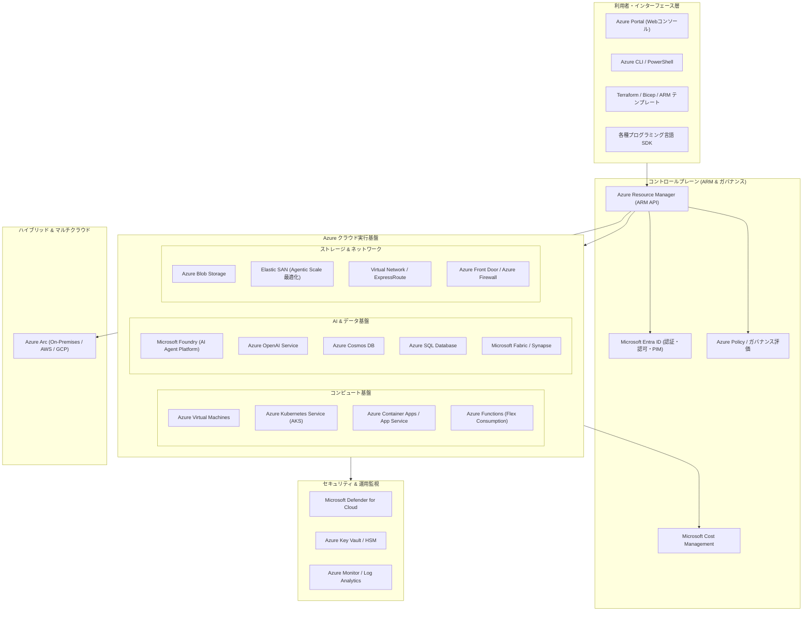

# **Microsoft Azure 調査レポート**

## **1. 基本情報**

* **ツール名**: Microsoft Azure
* **ツールの読み方**: マイクロソフト アジュール
* **開発元**: Microsoft
* **公式サイト**: [https://azure.microsoft.com/](https://azure.microsoft.com/)
* **関連リンク**:
  * ドキュメント: [Microsoft Learn - Azure Documentation](https://learn.microsoft.com/azure/)
  * レビューサイト: [ITreview](https://www.itreview.jp/products/microsoft-azure/reviews) | [G2](https://www.g2.com/products/microsoft-azure/reviews)
* **カテゴリ**: クラウドサービス
* **概要**: Microsoft Azureは、Microsoft社が全世界60以上のデータセンターリージョンで提供するハイパースケール・パブリッククラウドプラットフォームである。仮想マシンやコンテナなどのIaaSから、サーバーレス、データベース、統合データ基盤、そしてOpenAIモデルを中核とする「Microsoft Foundry」などのAI PaaSまで200を超えるサービス群を展開する。エンタープライズの既存システム（Windows Server、Active Directory、Microsoft 365）との親和性が極めて高く、オンプレミスとクラウドを一体管理するハイブリッドクラウド基盤としても業界をリードしている。

## **2. 目的と主な利用シーン**

* **解決する課題**:
  * 自社保有データセンターやオンプレミスインフラにおける運用保守負担、ハードウェア調達遅延、スケーラビリティの限界
  * オンプレミス・AWS・Google Cloudなどに分散したマルチクラウド資産におけるセキュリティポリシー適用や運用管理の分断
  * 生成AIや自律型AIエージェント（Agentic AI）を、エンタープライズ水準のガバナンスとコンプライアンスを維持しながら迅速に業務システムへ組み込む難しさ
  * 大規模トランザクションや基幹業務（SAP、基幹データベース等）の高可用性・ディザスタリカバリ要件の達成
* **想定利用者**:
  * クラウドアーキテクトおよびインフラ・セキュリティエンジニア
  * クラウドネイティブアプリケーションおよびAIエージェント開発者
  * 情報システム部門（情シス）、エンタープライズ企業のIT責任者（CIO/CTO）
  * データエンジニアおよびデータサイエンティスト
* **利用シーン**:
  * **基幹システムおよびWindows Server/SQL Server資産のクラウド移行**: Azure Hybrid Benefitを活用し、既存ライセンス資産を引き継ぎつつコスト最適にクラウドへリフト＆シフト
  * **Agentic AIおよびエンタープライズ生成AIアプリケーションの開発**: Microsoft FoundryとAzure Cosmos DB、Model Context Protocol (MCP) を組み合わせた自律型AIエージェントの構築
  * **Azure Kubernetes Service (AKS) / Container Apps を用いたモダンアプリ運用**: GitHub ActionsやAzure DevOpsと統合したCI/CDパイプラインによる迅速なマイクロサービス配信
  * **Azure Arc を用いたハイブリッド・マルチクラウド統制**: オンプレミスサーバーやエッジデバイス、AWS/GCPリソースをAzure Resource Manager傘下で一元管理

### **2.1 代表的な利用フロー**

```mermaid
swimlane-beta TB
  subgraph User["ユーザー / 開発チーム"]
    Req["インフラ構成・AIワークロード定義"]
    PushCode["Bicep / Terraform コードをリポジトリへPush"]
    AuditOps["Azure Monitor / Cost Management で運用監視"]
  end
  subgraph Management["Azure コントロールプレーン (ARM / Portal)"]
    AuthRBAC["Entra ID 認証 & ロール割り当て (RBAC)"]
    PolicyEval["Azure Policy によるコンプライアンス検証"]
  end
  subgraph ComputeLayer["Azure 実行基盤 (AKS / Foundry / DB)"]
    DeployRes["コンピュート・ストレージを自動配備"]
    RunAgent["コンテナ & AIエージェントを実行"]
    EmitTelemetry["テレメトリ・監査ログを収集"]
  end
  subgraph HybridTarget["ハイブリッド / エッジ環境 (Azure Arc)"]
    SyncEdge["オンプレミス / 他社クラウドの構成を同期"]
  end
  Req --> PushCode
  PushCode --> AuthRBAC
  AuthRBAC --> PolicyEval
  PolicyEval --> DeployRes
  DeployRes --> RunAgent
  RunAgent --> EmitTelemetry
  EmitTelemetry --> AuditOps
  DeployRes --> SyncEdge
```

* **代表的な流れ**: 開発者またはインフラ担当者がIaC（BicepやTerraform）を通じてリソース定義を適用すると、Azure Resource Manager（ARM）がMicrosoft Entra IDによる認証・認可およびAzure Policyのガバナンスルールを検証する。適合したワークロードはクラウドネイティブ基盤（AKSやMicrosoft Foundry）またはAzure Arc経由のエッジ環境へ自動展開され、収集された稼働ログとコスト情報は運用担当者へフィードバックされる。

## **3. 主要機能**

* **コンピュートサービス (Virtual Machines, AKS, Container Apps, Functions)**: 汎用・GPU特化の仮想マシンから、Kubernetesフルマネージドサービス（AKS）、マイクロサービス向けサーバーレスコンテナ（Azure Container Apps）、イベント駆動型Functionsまで多彩な実行基盤を提供。
* **AI・機械学習プラットフォーム (Microsoft Foundry / Azure OpenAI Service)**: OpenAIの最新フロンティアモデル（GPT-4o、o1等）への最速アクセス、11,000種以上のオープン/商用モデルカタログ、自律型AIエージェントを構築・統制する「Foundry Agent Service」を統合提供。
* **ストレージ＆データベース (Blob Storage, Elastic SAN, Azure SQL, Cosmos DB)**: PB級のオブジェクトストレージ、高スループットSAN、ミッションクリティカルなリレーショナルDB（Azure SQL）、グローバル分散型マルチモデルNoSQL（Azure Cosmos DB）を網羅。
* **ハイブリッド＆マルチクラウド (Azure Arc / Azure Stack)**: オンプレミスの物理/仮想サーバー、Kubernetesクラスタ、他社クラウド（AWS、GCP）のインスタンスをAzureの管理プレーンに統合し、単一画面から設定・パッチ・セキュリティを統括。
* **ネットワーク＆コンテンツ配信 (Virtual Network, ExpressRoute, Front Door, Firewall)**: 閉域網接続サービス（ExpressRoute）、グローバル負荷分散・WAF・CDNを兼ねるAzure Front Door、高スループットなクラウドネイティブ次世代ファイアウォール（Azure Firewall）を完備。
* **ID・セキュリティ・ガバナンス (Microsoft Entra ID, Defender for Cloud, Purview, Key Vault)**: クラウド業界標準のアイデンティティ基盤（Entra ID）、マルチクラウド対応CNAPP（Microsoft Defender for Cloud）、統合データガバナンス（Purview）、暗号化鍵管理（Key Vault）によるゼロトラスト環境を提供。
* **統合データ分析 (Microsoft Fabric / Azure Synapse / Databricks)**: OneLakeを中心としたレイクハウスアーキテクチャ、データ統合・エンジニアリング・リアルタイム分析・BI（Power BI）をワンストップで統合する次世代データ分析基盤。
* **開発者支援＆DevOps統合 (Azure DevOps, GitHub統合, Azure Deployment Environments)**: CI/CDパイプライン、アジャイル計画ツール、クラウド開発環境の即時プロビジョニング機能をMicrosoft開発エコシステムと一体化。

## **4. 動作原理・システム構成**



* **アーキテクチャ**:
  * コントロールプレーン（Azure Resource Manager: ARM）とデータプレーンが厳密に論理分離されたハイパースケール分散アーキテクチャ。
  * 利用者やCI/CDからの全リクエストは単一の共通REST APIエンドポイントであるARMを経由し、一貫した認証、認可、ポリシー適用、監査ログ記録が行われる。
* **主要コンポーネントとデータフロー**:
  * **リクエスト処理**: Azure Portal、Azure CLI、Terraform等からのリクエストをARMが受付。Microsoft Entra IDと連携してトークン検証（OAuth 2.0 / OIDC）およびロールベースアクセス制御（Azure RBAC）を実施。
  * **リソースプロバイダー (RP)**: ARMは検証完了後、対象のRP（`Microsoft.Compute`、`Microsoft.Network`、`Microsoft.CognitiveServices` 等）に内部メッセージをディスパッチし、物理データセンター内のインフラを制御。
  * **データプレーン**: 実データ（VM上の処理、BlobへのI/O、データベースクエリ、AI推論など）は、ARMを経由せず各サービスの高速データパスを通じて直接実行される。
* **特筆すべき要素技術**:
  * **SONiC (Software for Open Networking in the Cloud)**: Microsoftが開発しオープンソース化したモジュール式ネットワークOS。Azure全体のグローバルWANおよびデータセンタースイッチの柔軟性と耐障害性を担保。
  * **DPU / SmartNIC によるハードウェアオフロード**: ネットワークパケット処理やストレージ暗号化を専用ハードウェアにオフロードし、ホストVMのCPU負荷低減と超低遅延通信を実現。
  * **Confidential Computing (機密コンピュート)**: AMD SEV-SNPやIntel SGX、NVIDIA H100 Confidential GPU等を活用し、データ使用中（メモリ展開時）のハードウェアレベル暗号化とハードウェアルートオブトラスト（Project Cerberus）を提供。
  * **Agentic Scale 最適化 & Model Context Protocol (MCP)**: 自律型AIエージェントによる高密度かつ大量のAPI・ストレージトランザクションをさばくため、ブロックストレージ「Elastic SAN」のIOPS/スループット最適化と、MCPサーバーの集中ガバナンス機能を標準装備。

## **5. 開始手順・セットアップ**

* **前提条件**:
  * 有効なMicrosoftアカウントまたは職場/学校アカウント（Microsoft Entra ID）
  * サインアップ用の連絡先およびクレジットカード（無料アカウント登録時・本人確認用）
  * ローカル開発環境（Linux、macOS、Windows）
* **インストール/導入**:
  * Azure CLIのインストール（Ubuntu/Debian系の場合）:

  ```bash
  curl -sL https://aka.ms/InstallAzureCLIDeb | sudo bash
  ```

  * または macOS (Homebrew) / Windows (winget):

  ```bash
  # macOS
  brew update && brew install azure-cli

  # Windows (PowerShell)
  winget install -e --id Microsoft.AzureCLI
  ```

* **初期設定**:
  1. Azureアカウントへのログイン:

  ```bash
  az login
  ```

  2. 使用するサブスクリプションの確認と設定:

  ```bash
  az account list --output table
  az account set --subscription "<SUBSCRIPTION_ID>"
  ```

* **クイックスタート (リソース作成例)**:
  1. リソースグループの作成:

  ```bash
  az group create --name rg-sample-prod --location japaneast
  ```

  2. サーバーレスコンテナ環境（Azure Container Apps）の作成とサンプルアプリ展開:

  ```bash
  az containerapp up \
    --name my-fast-app \
    --resource-group rg-sample-prod \
    --location japaneast \
    --ingress external \
    --target-port 80 \
    --image mcr.microsoft.com/azuredocs/aci-helloworld:latest
  ```

  3. コマンド出力に表示されたURLへアクセスし、動作を確認。

## **6. 特徴・強み (Pros)**

* **Microsoftエンタープライズエコシステムとの圧倒的な親和性**: Active Directory、Microsoft Entra ID、Microsoft 365、Windows Server、SQL Server、Visual Studio、GitHubなど、企業に広く普及しているシステムやツールと緊密に連携。既存のID基盤やライセンス資産（Azure Hybrid Benefit）をそのまま活用できる。
* **業界を牽引するAgentic AIおよび生成AI開発基盤**: OpenAIの最新モデルへの優先的・独占的クラウド提供に加え、自社モデルPhiシリーズやオープンモデルを包含した「Microsoft Foundry」を提供。自律型エージェント開発フレームワーク（Microsoft Agent Framework）やMCPへのネイティブ対応が極めて迅速。
* **Azure Arcによる最高水準のハイブリッド・マルチクラウド運用**: オンプレミスのVMware環境、エッジ拠点のK3s/Kubernetes、さらにはAWSやGoogle Cloud上で稼働するインスタンスまで、Azure PortalとARMを通じて一括してポリシー適用・パッチ管理・セキュリティ診断が可能。
* **包括的なセキュリティ・コンプライアンス認証**: 金融機関向けFISC安全対策基準、日本政府のクラウドセキュリティ評価制度（ISMAP）、ISO/IEC 27001、SOC 1/2/3、FedRAMP Highなど、世界100以上の厳格なコンプライアンス要件を網羅。
* **日本国内における手厚いリージョン基盤とサポート体制**: 東日本（東京）・西日本（大阪）の2大リージョンを長年安定運用しており、国内データレジデンシー要件（国内でのデータ保管・処理）に完全対応。日本語ドキュメントおよび国内パートナーネットワークが極めて充実。

## **7. 弱み・注意点 (Cons)**

* **サービスの膨大さとAzure Portal UIの学習コスト**: 200を超えるサービス群が存在し、ポータルの「ブレードUI（横スクロール画面）」は階層が深くなりがちで、目的の設定画面やリソースへの導線を見失いやすい。
* **複雑な課金・コスト見積もり設計**: インスタンスタイプ、ストレージ階層（Hot/Cool/Cold/Archive）、データ送信量（Egress）、APIリクエスト数、AIトークン消費など課金要素が多岐にわたり、適切な予約（Savings PlansやReserved Instances）を行わないと想定外のコスト超過を招きやすい。
* **一部ドキュメントや最新機能の機械翻訳**: Microsoft Learnは日本語化が急速に進んでいるものの、公開直後の最新機能やニッチなAPI仕様では機械翻訳による不自然な表現が残ることがあり、正確な仕様把握には原文（英語）への切り替え確認が推奨される。
* **サポートプランの費用と階層性**: 本番環境での24x7重大障害対応（Standard以上）や専任アドバイザー（Professional Direct / Premier）を利用する場合、月額固定費または利用料に応じた追加サポート契約費用が必要となる。

## **8. 料金プラン**

| プラン / 利用形態 | 料金 | 主な特徴・対象ユーザー |
|:---|:---|:---|
| **無料アカウント (Free Account)** | 無料 | 初回登録時に約$200（日本円で約30,000円）の30日間有効クレジット + 12ヶ月間無料の人気サービス（Linux/Windows VM、SQL Database等） + 55以上の常時無料サービス |
| **従量課金制 (Pay-As-You-Go)** | 初期費用ゼロ（使用分のみ） | 事前契約不要で1秒・1分単位で利用したリソースに対して後払い。開発・検証環境やスパイクのあるワークロード向け |
| **Azure Savings Plans** | 従量課金から最大65%割引 | 1年または3年間の時間あたりコンピュート支出コミットメント。VM、Container Apps、Functions等、リージョンやインスタンス種別を超えて柔軟に適用 |
| **予約インスタンス (Reserved Instances)** | 従量課金から最大72〜80%割引 | 1年または3年間、特定のVMサイズやデータベースリソースをコミット。定常的に稼働する本番システム向け。Azure Hybrid Benefitと併用可能 |
| **Enterprise Agreement (EA) / MCA** | 大規模契約による特別ボリュームディスカウント | 年間支出コミットメントを持つ中堅・大企業向け。一括請求、柔軟なテナント管理、専任アカウントサポートを提供 |

* **課金体系**:
  * コンピュート: 秒単位または分単位の実行時間課金
  * ストレージ: 保存データ容量（GB/月）、読み出し/書き込みトランザクション数
  * ネットワーク: リージョン内通信は無料、インターネット向けデータ送信（Egress）に対する従量課金
  * AI/コグニティブサービス: 入出力トークン数、モデルホスティング時間（PTU: Provisioned Throughput Units）
* **無料トライアル**: 新規登録者向けに約30,000円相当のクレジット（30日間有効）および人気サービスが12ヶ月間無料。App ServiceやAzure Functions（月100万回無料）など55種以上の常時無料枠あり。

## **9. 導入実績・事例**

* **導入企業**:
  * **国内**: ソニー、トヨタ自動車、みずほフィナンシャルグループ、三菱UFJ銀行、三井住友海上火災保険、ANA（全日本空輸）、パナソニック、ソフトバンクなど
  * **グローバル**: Walmart、GE Healthcare、Coca-Cola、FedEx、BMW、ASML、Mercedes-BenzなどFortune 500の95%以上が採用
* **導入事例**:
  * **金融機関の基幹系・アナリティクス基盤**: 厳格なセキュリティ・監査要件が求められるメガバンクにおいて、オンプレミスとAzureをExpressRouteで閉域接続し、ゼロトラストアーキテクチャとハイブリッド運用を実現。
  * **製造業・モビリティのコネクテッドカー基盤**: 車両から収集される膨大なIoTテレメトリデータをAzure Event HubsおよびAzure Data Explorerでリアルタイム処理し、予兆保全や自動運転支援アルゴリズムの高速開発を推進。
  * **全社規模の生成AI・Agentic AIプラットフォーム展開**: 大手小売・金融企業がMicrosoft FoundryおよびAzure OpenAI Serviceを導入し、数万人規模の従業員が安全に活用できる社内ナレッジ検索・自動応答AIエージェントを構築。
* **対象業界**: 金融、保険、製造、ヘルスケア、小売・流通、通信、メディア、官公庁・自治体まで全業界。

## **10. サポート体制**

* **ドキュメント**: [Microsoft Learn](https://learn.microsoft.com/azure/) にて網羅的なAPIリファレンス、実践的チュートリアル、アーキテクチャ設計指針（Cloud Adoption Framework / Well-Architected Framework）、無償サンドボックス環境を提供。
* **コミュニティ**: [Microsoft Q&A](https://learn.microsoft.com/answers/)、Reddit（r/AZURE）、日本国内最大のユーザーコミュニティ「JAZUG（Japan Azure User Group）」による勉強会や知見共有が極めて盛ん。
* **公式サポート**:
  * **Basic (無料)**: サブスクリプション管理および請求関連の24x7サポート。技術サポートは含まれない。
  * **Developer ($29/月)**: 非本番環境向け、営業時間内の日本語・英語メールサポート（重大度C対応）。
  * **Standard ($100/月)**: 本番環境向け、重大度A（システム全面停止）に対して1時間以内の24x7受付・エンジニア対応。
  * **Professional Direct ($1,000/月)**: 専任サポートアカウントマネージャーによるエスカレーション支援、年2回のアーキテクチャレビュー、最短1時間以内応答。
  * **Microsoft Unified Support**: 全社包括契約による専任カスタマーサクセスマネージャー（CSAM）配備、プロアクティブ支援、ミッションクリティカル対応。

## **11. エコシステムと連携**

### **11.1 API・外部サービス連携**

* **API**: Azure Resource Manager (ARM) REST API、Microsoft Graph API、および公式SDK（Python、TypeScript/JavaScript、.NET/C#、Java、Go）をフルサポート。OpenAPI/Swagger仕様に準拠したオープンなインターフェースを提供。
* **外部サービス連携**:
  * **CI/CD・DevOps**: GitHub Actions、Azure DevOps、GitLab CI/CD、Jenkins、Argo CD
  * **IaC・構成管理**: Terraform、OpenTofu、Pulumi、Ansible、Chef、Puppet
  * **監視・APM**: Datadog、Dynatrace、New Relic、Splunk、Grafana Labs
  * **データ・AI連携**: Snowflake、Databricks、Confluent (Kafka)、MongoDB Atlas、Pinecone、Elasticsearch
  * **コラボレーション**: Microsoft 365、Microsoft Teams、Slack、ServiceNow、Jira

### **11.2 技術スタックとの相性**

| 技術スタック | 相性 | メリット・推奨理由 | 懸念点・注意点 |
|:---|:---:|:---|:---|
| **C# / .NET** | ◎ | 公式ファーストパーティとしての完全統合。Visual Studioとのシームレスなデバッグ・発行 | 特になし（業界最高レベルの最適化） |
| **Python** | ◎ | Microsoft Foundry、Azure Functions、Azure ML等で公式SDKが完備。AI/データ分析分野で主力 | ランタイムバージョン追従時にマイナーパッケージの依存性確認が必要 |
| **TypeScript / Node.js** | ◎ | Azure SDK for JS/TSが極めて堅牢。Container AppsやStatic Web Appsとの相性が抜群 | 大規模モノレポでのビルドパイプライン設計に工夫が必要 |
| **Java (Spring Boot)** | ◯ | Azure Spring AppsによるマネージドホスティングやAKSでのエンタープライズ運用実績が豊富 | 一部Azure固有機能のラッパーライブラリでC#より機能追加が僅かに遅れる場合あり |
| **Go** | ◯ | Azure SDK for Go、AKSやクラウドネイティブ基盤との親和性が高く高速動作 | ドキュメント上のコードサンプル数が.NETやPythonに比べやや少ない |
| **Terraform / Bicep** | ◎ | Azure公式のAzureRM/AzAPIプロバイダーが即日アップデートに対応。BicepによるネイティブIaCも強力 | 大規模環境ではState管理やARM APIレート制限（Throttling）への配慮が必要 |

## **12. セキュリティとコンプライアンス**

* **認証・ID管理**:
  * **Microsoft Entra ID**: クラウドネイティブな統合ID・アクセス管理。条件付きアクセス（Conditional Access）、多要素認証（MFA）、FIDO2パスワードレス認証をサポート。
  * **Privileged Identity Management (PIM)**: 特権IDの常時保有を排除し、期限付きの昇格申請・承認ワークフロー（JITアクセス）を実現。
  * **マネージドID (Managed Identities)**: クラウド上のコンピュートリソースにIDを自動付与し、コード内にパスワードやAPIシークレットを埋め込むリスクを完全排除。
* **データ管理・暗号化**:
  * **保存時暗号化 (SSE)**: Blob Storage、Managed Disk、SQL Database等のデータはデフォルトでAES-256暗号化。Azure Key Vaultを通じたカスタマーマネージドキー（CMK / BYOK）に対応。
  * **転送時暗号化**: TLS 1.2/1.3の強制、ポスト量子暗号（PQC）対応ハイブリッド鍵交換の導入推進。
  * **機密コンピューティング (Confidential Computing)**: 実行中データのメモリ保護（Enclave / SEV-SNP）。クラウドプロバイダーの管理者であっても平文データにアクセス不能なハードウェア隔離を担保。
* **準拠規格**:
  * **国内基準**: ISMAP（政府情報システムのためのセキュリティ評価制度）登録、FISC（金融情報システムセンター）安全対策基準対応。
  * **国際規格**: ISO/IEC 27001、ISO/IEC 27017、ISO/IEC 27018、SOC 1/2/3、PCI DSS Level 1。
  * **地域・業界法規制**: GDPR（欧州一般データ保護規則）、HIPAA/HITECH（米国医療情報）、FedRAMP High（米国政府機関）、CCPA（カリフォルニア州プライバシー法）。

## **13. 操作性 (UI/UX) と学習コスト**

* **UI/UX**:
  * **Azure Portal**: 水平方向に展開するブレード（Blade）型UIを採用。リソースグループから個別のリソース、ネットワーク設定、監視メトリクスへと文脈を保ったままドリルダウンできる設計。
  * **Azure Cloud Shell**: ブラウザ内で直接BashやPowerShellが起動し、あらかじめAzure CLIやTerraformが組み込まれた環境から即座にインフラ操作が可能。
  * **検索性とナビゲーション**: ポータル上部のグローバル検索バーから、リソース名、サービス名、ドキュメントを即座に横断検索可能。
* **学習コスト**:
  * 基本的なVM作成やApp Service展開は直感的に行えるが、エンタープライズ規模のネットワーク（Hub & Spoke、Virtual WAN）、セキュリティ境界、ポリシー設計を正しく行うには高い専門知識が必要。
  * ただし、Microsoft Learnが無償で体系的な学習モジュールや実践的ラボ（サンドボックス）を提供しており、認定資格（AZ-900 FundamentalsからAZ-104 Administrator、AZ-305 Solutions Architect、AI-102等）のロードマップが明確であるため、組織的なスキルアップは容易。

## **14. ベストプラクティス**

* **効果的な活用法 (Modern Practices)**:
  * **Cloud Adoption Framework (CAF) & Well-Architected Framework (WAF) の遵守**: 設計初期からCAFの「ランディングゾーン（Landing Zone）」アーキテクチャを採用し、管理グループ（Management Groups）とサブスクリプションを適切に階層化する。
  * **Azure Policy による予防的ガバナンス**: リソース作成可能なリージョン（例: 東日本・西日本のみ）の制限、必須タグ（所有者、環境、コストセンター）の付与強制、パブリックIPの禁止などを自動適用する。
  * **マネージドIDとAzure Key Vaultの徹底**: 接続文字列やAPIトークンをコードや環境変数に直接記載せず、マネージドIDを用いたパスワードレス認証またはKey Vaultからの動的シークレット参照を標準化する。
  * **Bicep / Terraform による完全なIaC化**: 手動操作（ClickOps）を排除し、GitHub ActionsやAzure Pipelinesと連携したPRレビュー・自動デプロイ体制を構築する。
  * **コストのプロアクティブ管理**: Azure Advisorのレコメンデーションを定期チェックし、アイドル状態のリソース停止や、定常負荷に対するSavings Plans / 予約インスタンスの適用を行う。
* **陥りやすい罠 (Antipatterns)**:
  * **単一サブスクリプションへのリソース乱立**: 開発・ステージング・本番リソースを同一サブスクリプションに混在させ、ARMクォータ（API制限やコア数上限）の枯渇や権限管理の破綻を招く。
  * **不必要なパブリックIP付与とセキュリティグループの全開放**: NSG（ネットワークセキュリティグループ）の受信ルールで `0.0.0.0/0` に対してSSH（22）やRDP（3389）を開放し、攻撃対象領域を広げてしまう。Private LinkやAzure Bastionの利用が必須。
  * **孤立リソース（Orphaned Resources）の放置**: VMを削除した際に、紐付いていたManaged Disk、パブリックIPアドレス、ネットワークインターフェース（NIC）の削除が漏れ、課金が継続する。
  * **Egress（データ送信量）の軽視**: リージョン間通信やインターネットへの大容量データ転送コストを考慮せずアーキテクチャを設計し、月末に予想外のネットワーク費用が発生する。

## **15. ユーザーの声（レビュー分析）**

* **調査対象**: G2, Capterra, ITreview
* **総合評価**:
  * G2: **4.4 / 5.0** (評価数 2,500件以上)
  * Capterra: **4.6 / 5.0** (評価数 1,300件以上)
  * ITreview: **4.2 / 5.0** (評価数 500件以上)
* **ポジティブな評価**:
  * **Active Directory・Microsoft 365連携の利便性**: 既存の社内アカウントでシングルサインオン（SSO）でき、Windows ServerやSQL Serverの運用実績がそのまま活きるため、社内稟議や移行が極めてスムーズ（ITreview / G2）。
  * **最先端AIモデルへの最速アクセス**: OpenAIのフロンティアモデルがセキュアな閉域網内で利用でき、Microsoft Foundryを通じてエンタープライズAIアプリのPoCから本番展開までが極めて迅速に行える（G2）。
  * **ハイブリッド運用の柔軟性**: Azure Arcによりオンプレミス環境とクラウドを同一基準で管理できるため、即座にフルクラウド化できない業界において現実的かつ強力な選択肢となる（Capterra）。
  * **日本国内における信頼感**: 国内データセンター（東日本・西日本）での冗長化やFISC/ISMAP準拠により、金融機関や官公庁案件でも安心して選定できる（ITreview）。
* **ネガティブな評価 / 改善要望**:
  * **ポータルUIの複雑さと動作の重さ**: 設定項目が多岐にわたりブレード画面の展開が多重化するため、目的の項目に到達するまでに時間がかかる。画面の読み込みが重い場面がある（G2 / Capterra）。
  * **コスト予測の難しさ**: 課金項目が細かく、ストレージアクセス回数やデータ転送料金が積み重なって事前の見積もりを超過することがある（ITreview / Capterra）。
  * **テクニカルサポートの回答品質のばらつき**: 下位サポートプランでは一次回答が定型文になりやすく、複雑なネットワーク障害などのトラブルシューティングで解決までに時間を要することがある（G2）。
* **特徴的なユースケース**:
  * 金融・公共分野におけるデータ主権（Sovereign Cloud）を保った基幹システムのハイブリッド運用。
  * 既存の社内ドキュメント・データベースをAzure AI SearchとOpenAIモデルに連携させたセキュアな社内専用Copilot・AIエージェントシステムの全社導入。

## **16. 直近半年のアップデート情報**

* **2026-11-04**: **Azure Elastic SAN の Agentic Scale 最適化が一般提供 (GA)**
  * 自律型AIエージェントによる高トランザクション・低遅延ブロックストレージ需要に特化し、マルチテナント環境下でのIOPSとプロビジョニング柔軟性を大幅に向上。
* **2026-10-18**: **Microsoft Foundry Agent Service のエンタープライズ機能拡充**
  * Model Context Protocol (MCP) 連携ツールカタログの統合、および Microsoft Entra ID によるエージェント実行時の厳格なRBAC・監査ロギング機能を一般提供。
* **2026-09-24**: **Azure Backup の Cross-Tenant Restore (CTR) パブリックプレビュー**
  * 高度なサイバー攻撃・ランサムウェア被害からの隔離復旧を目的として、Azure VMのバックアップを完全に別テナントのサブスクリプションへ復元するレジリエンス機能を提供。
* **2026-08-12**: **Microsoft Defender for Cloud の AI セキュリティ大幅強化**
  * AIパイプライン内のモデル依存関係を可視化する「AI-BOM（AI部品表）検出」および「AIワークロード攻撃パス分析」が一般提供（GA）。
* **2026-06-30**: **Azure Firewall パフォーマンス向上 & Front Door ポスト量子暗号 (PQC) 対応**
  * Azure Firewall の侵入検知・防止システム（IDPS）スループットを最大2.2倍に高速化。あわせて Azure Front Door において量子コンピュータ耐性を持つハイブリッドTLS鍵交換の提供を開始。
* **2026-05-21**: **Microsoft Build 2026 に伴う主要アップデート発表**
  * Azure API Center におけるAIエージェント・APIガバナンス機能のGA、および Azure Functions Flex Consumption Plan の一般提供を発表。

(出典: [Azure 製品アップデート情報](https://azure.microsoft.com/en-us/updates/))

## **17. 類似ツールとの比較**

### **17.1 機能比較表 (星取表)**

| 機能カテゴリ | 機能項目 | Microsoft Azure | AWS (Amazon Web Services) | Google Cloud | Alibaba Cloud |
|:---:|:---|:---:|:---:|:---:|:---:|
| **基本機能** | コンピュート & 仮想化 | ◎<br><small>VM, AKS, Container Appsの充実</small> | ◎<br><small>EC2, EKSの圧倒的シェアと実績</small> | ◯<br><small>Compute Engine, GKEの高速性</small> | ◯<br><small>ECS, ACK等の標準的IaaS</small> |
| **基本機能** | ストレージ & DB | ◎<br><small>Blob, Elastic SAN, Azure SQL, Cosmos DB</small> | ◎<br><small>S3, EBS, Aurora, DynamoDB</small> | ◯<br><small>Cloud Storage, Cloud Spanner</small> | ◯<br><small>OSS, PolarDB, ApsaraDB</small> |
| **AI / ML** | 生成AI & Agent基盤 | ◎<br><small>OpenAI独占連携, Foundry, MCP統制</small> | ◯<br><small>Bedrockによるマルチモデル選択</small> | ◎<br><small>Vertex AI & Geminiの最先端統合</small> | ◯<br><small>Model Studio & Qwenファミリー</small> |
| **エンタープライズ** | ID & 業務基盤統合 | ◎<br><small>Entra ID, M365, Windowsの完全統合</small> | ◯<br><small>IAM Identity Center, AWS SSO</small> | ◯<br><small>Cloud Identity, Google Workspace</small> | △<br><small>DingTalk連携等、主に中国圏</small> |
| **ハイブリッド** | オンプレ・他社統合 | ◎<br><small>Azure Arcによるマルチクラウド一元統制</small> | ◯<br><small>AWS Outposts, EKS Anywhere</small> | ◯<br><small>Google Distributed Cloud</small> | △<br><small>Apsara Stack中心</small> |
| **データ分析** | 統合レイクハウス / BI | ◎<br><small>Microsoft Fabric, Power BIネイティブ</small> | ◯<br><small>Redshift, Athena, Glue</small> | ◎<br><small>BigQueryの卓越したクエリ性能</small> | ◯<br><small>MaxCompute, DataWorks</small> |
| **非機能要件** | 日本国内対応 & サポート | ◎<br><small>東西2リージョン, 充実の日本語情報</small> | ◎<br><small>東京・大阪2リージョン, 最大手コミュニティ</small> | ◯<br><small>東京・大阪2リージョン, 技術情報豊富</small> | ◯<br><small>東京リージョンあり, 日本法人対応</small> |

### **17.2 詳細比較**

| ツール名 | 特徴 | 強み | 弱み | 選択肢となるケース |
|:---|:---|:---|:---|:---|
| **Microsoft Azure** (本ツール) | エンタープライズ統合と最先端AI・ハイブリッド基盤を強みとする総合クラウド | Entra ID/M365との完璧な統合、OpenAI優先連携（Foundry）、Azure Arcによるマルチクラウド統制、既存ライセンス特典（AHB） | 200以上のサービスによるポータル画面や課金設計の複雑さ、学習コストの高さ | 既存のWindows/Microsoft資産を抱える企業、セキュアな生成AI/Agentic AI開発を推進するエンタープライズ |
| **AWS (Amazon Web Services)** | パブリッククラウド市場シェア首位のパイオニアであり、最も広範なサービス群を保有 | 圧倒的な導入実績・エコシステム・サードパーティツール連携、豊富なコミュニティ知見 | サービス数が極めて多く設計・権限管理（IAM）が複雑、Microsoft製品のライセンス持ち込みコスト面でAzureに劣る場合あり | グローバル標準のインフラを求める企業、幅広いOSSやサードパーティSaaSとの連携を最優先するWeb企業 |
| **Google Cloud** | ビッグデータ分析、機械学習（Vertex AI / Gemini）、Kubernetes（GKE）に強み | BigQueryの卓越したクエリ性能、GKEの先行開発力、Geminiによる高度なマルチモーダル処理 | エンタープライズ基幹系（Windows/SAP等）の移行実績やサポート規模でAWS/Azureに一歩譲る | 大規模データ分析基盤、AIネイティブなモダンWebサービス、コンテナ中心のマイクロサービス開発 |
| **Alibaba Cloud** | 中国およびアジア太平洋地域において圧倒的なプレゼンスとインフラを持つクラウド | 中国本土での確固たるネットワーク・データセンター、Qwenを中心とした低価格・高性能なAIエコシステム | 欧米市場におけるシェアやサードパーティ連携が限定的、英語・日本語のドキュメントやコミュニティが発展途上 | 中国・APAC市場へのグローバル進出を行う企業、高いコストパフォーマンスを重視するワークロード |

## **18. 総評**

* **総合的な評価**:
  * Microsoft Azureは、エンタープライズIT基盤としての堅牢な信頼性と、急速に進化する生成AI・自律型AIエージェント（Agentic AI）時代の最先端プラットフォームとしての先進性を高次元で両立している。
  * 既存のWindows ServerやActive Directory、Microsoft 365を導入している企業にとっては、認証基盤（Microsoft Entra ID）の共有やAzure Hybrid Benefitによるライセンスコスト削減効果が非常に大きく、移行の第一候補となる。
  * さらに「Microsoft Foundry」を中心とするAIエコシステムは、エンタープライズの厳格なセキュリティ・コンプライアンス（ISMAP、GDPR、金融基準等）を完全に満たした状態でOpenAIやオープンモデルを活用できるため、ビジネス現場での実用的なAI実装において他社クラウドを一歩リードしている。
* **推奨されるチームやプロジェクト**:
  * **エンタープライズ企業の基幹システム移行チーム**: 既存のオンプレミスActive Directory、SQL Server、SAPワークロードを、高可用性かつハイブリッド接続を維持しながら安全にクラウド化したい組織。
  * **AIエージェント・生成AIプロダクト開発チーム**: 最新のOpenAIモデルやMCPツールを組み合わせ、自社の業務データ（Microsoft 365やCosmos DB）と安全に統合したAgentic AIアプリケーションを構築したい開発部隊。
  * **マルチクラウド・ハイブリッド環境を抱える運用統制チーム**: オンプレミス、AWS、Google Cloudなどに点在するサーバーやコンテナを、Azure ArcとDefender for Cloudを用いて単一のガバナンスポリシー下で統合監視したいセキュリティ・情シス部門。
* **選択時のポイント**:
  * 自社のIT資産にMicrosoft製品（Windows、M365、GitHub、Dynamics等）が多く含まれている場合は、迷わずAzureを第一候補とすべきである。
  * 一方で、純粋なOSSエコシステム中心のWebスタートアップや、BigQueryを中心としたアナリティクス特化型プロジェクトの場合は、AWSやGoogle Cloudとの詳細なコスト・機能比較を行った上で、要件に合致する最適なプラットフォームを選定することが推奨される。
