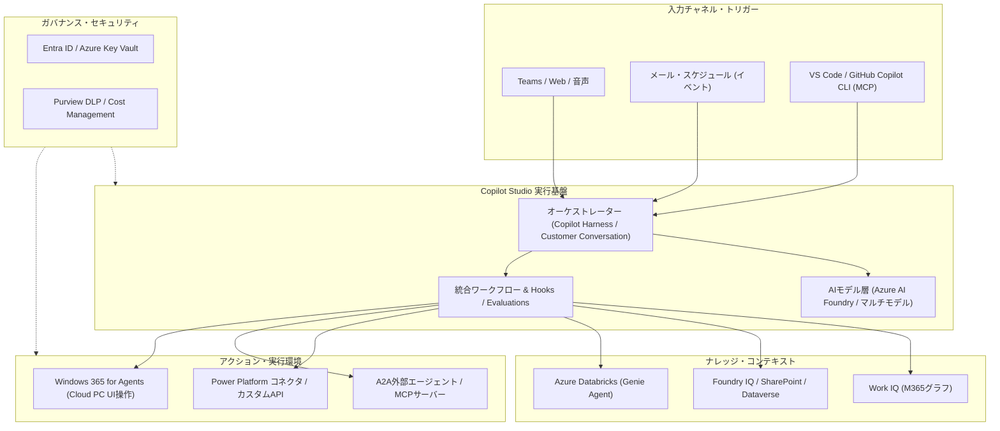

# **Microsoft Copilot Studio 調査レポート**

## **1. 基本情報**

* **ツール名**: Microsoft Copilot Studio
* **ツールの読み方**: マイクロソフト コパイロット スタジオ
* **開発元**: Microsoft Corporation
* **公式サイト**: [https://adoption.microsoft.com/ja-jp/ai-agents/copilot-studio/](https://adoption.microsoft.com/ja-jp/ai-agents/copilot-studio/)
* **関連リンク**:
  * ドキュメント: [https://learn.microsoft.com/ja-jp/microsoft-copilot-studio/](https://learn.microsoft.com/ja-jp/microsoft-copilot-studio/)
  * リリースノート（What's new）: [https://learn.microsoft.com/en-us/microsoft-copilot-studio/whats-new](https://learn.microsoft.com/en-us/microsoft-copilot-studio/whats-new)
  * レビューサイト: [G2](https://www.g2.com/products/microsoft-microsoft-copilot-studio/reviews)
* **カテゴリ**: AIアプリ開発基盤
* **概要**: 組織固有のデータやビジネスプロセスと連携するカスタムAIエージェント、業務ワークフロー、および業務アプリケーションをローコードや自然言語で構築・テスト・公開・管理できるエンドツーエンドのプラットフォーム。旧「Power Virtual Agents」の基盤を発展させ、Microsoft CopilotハーネスやWork IQ、コンピュータ操作（Computer Use）、マルチエージェント連携を統合した自律型エージェント開発の中核を担う。

## **2. 目的と主な利用シーン**

* **解決する課題**: 組織固有のナレッジへのアクセス性の低さ、定型的な社内問い合わせやバックオフィス業務の運用負荷、APIを持たないレガシーシステムを含む複数システム間の手動連携による非効率。
* **想定利用者**: ビジネスユーザー、業務部門の担当者、IT管理者、エンタープライズ開発者。
* **利用シーン**:
  * **社内ヘルプデスク（IT/HR）**: 従業員からの社内規定やITトラブルに関する質問に対し、SharePointやWork IQを通じて社内コンテキストを参照し、自動回答や申請代行を行うエージェント。
  * **自律型・持続的業務エージェント（Persistent Agents）**: メール受信やスケジュールをトリガーに自律起動し、複数日にまたがる承認やオンボーディング等の業務プロセスを継続的に遂行するデジタルワーカー。
  * **レガシーシステムUI自動化（Computer-Using Agents）**: APIが提供されていない業務Webポータルやデスクトップアプリに対し、Windows 365 for Agents上の仮想デスクトップ経由で画面操作を自動実行するエージェント。
  * **カスタマーサポート自動化**: 顧客からの音声・チャット問い合わせに自然言語で対応し、必要に応じて人間のオペレーターへエスカレーションするコンタクトセンター連携ボット。

### **2.1 代表的な利用フロー**

```mermaid
swimlane-beta TB
  subgraph User["ユーザー / トリガー"]
    A[質問入力またはイベント発生]
    F[結果の確認と承認]
  end
  subgraph Studio["Copilot Studio"]
    B[意図解釈と実行計画]
    E[回答生成と出力整形]
  end
  subgraph Grounding["Work IQ / ナレッジ基盤"]
    C[社内データ検索とコンテキスト取得]
  end
  subgraph Action["外部API / Windows 365 for Agents"]
    D[業務システム連携・UI操作実行]
  end
  A --> B
  B --> C
  C --> D
  D --> E
  E --> F
```

* **代表的な流れ**: ユーザーの入力またはメール受信・スケジュール等のイベントを起点に、Copilot Studioが実行計画を立案し、Work IQや各種ナレッジ基盤からコンテキストを取得した上で、Power Platformコネクタ・MCP・Windows 365 for Agents等を通じて外部処理を実行し、結果をユーザーへ返却・承認依頼する。

## **3. 主要機能**

* **統合ビルド体験（アプリ・ワークフロー・エージェント）**: 従来のローコードキャンバスに加え、自然言語での指示だけで業務アプリ、多段階ワークフロー、自律型AIエージェントを単一の設計画面で一体構築できる（2026年9月拡充）。
* **Persistent Agents（持続的・自律型エージェント）**: エージェント専用のMicrosoft Entra IDアカウントやメールボックスを付与し、スケジュールやイベント駆動でプロアクティブに稼働・記憶保持を行う長期業務プロセス対応機能。
* **Computer-Using Agents & Windows 365 for Agents連携**: APIを持たないWebサイトやデスクトップアプリをAIが視覚的に操作する機能（2026年5月GA）。Ignite 2026にてWindows 365 for Agentsがコンピュータ操作ツールとして統合され、永続的なCloud PC上で長時間タスクを実行可能となった。
* **Work IQ / Foundry IQ によるナレッジ統合**: Microsoft 365のメール・会議・チャット・ファイルをリアルタイムに参照するWork IQがMicrosoft Copilotハーネス上の新規エージェントに標準統合され、Azure Databricks（Genie Agent）等のデータ基盤とも連携できる。
* **マルチエージェント連携（A2A / MCP）**: Model Context Protocol（MCP）サーバーとしての公開・外部ツール接続に加え、Agent2Agent（A2A）プロトコルによる外部エージェント（Microsoft FoundryやMicrosoft 365 Agents SDKで構築されたエージェント等）へのタスク委任（プレビュー）をサポート。
* **マルチモデル選択とモデルライフサイクル管理**: デフォルトモデルに加え、Azure AI Foundry経由でOpenAI（GPT-5ファミリー等）やAnthropic（Claude Sonnet等）を含む多様なモデルを選択可能。デフォルトモデル切替後も最大30日間旧モデルを維持できる移行猶予期間を備える。
* **Customer Conversation Harness（プレビュー）とマルチチャネル展開**: Microsoft Teams、Webサイト、モバイルアプリ等への展開に加え、顧客向けの音声・チャット対応と有人エスカレーションに特化したハーネスを提供。
* **エンタープライズガバナンスと評価機能**: Agent Evaluationsによる公開前テスト、知識ソース追加制限、Copilot Studio Cost Management（予算・クレジット消費管理）、Microsoft Purview連携による監査ログ・DLP制御を提供。

## **4. 動作原理・システム構成**

* **アーキテクチャ**: Microsoft AzureおよびMicrosoft Power Platformを基盤とするクラウド完結型マルチテナントSaaSアーキテクチャ。テナントのセキュリティ境界内で動作し、すべてのID・アクセス制御はMicrosoft Entra IDによって統制される。詳細な内部実装はSaaSのため非公開だが、公開ドキュメントに基づく実行構成は以下の通りである。



* **主要コンポーネントとデータフロー**:
  1. **オーケストレーション層**: Microsoft CopilotハーネスまたはCustomer Conversationハーネスがユーザー発話やイベントを受信し、コンテキスト管理・ツール選択・Hooksによる割り込み制御を実行する。
  2. **モデル推論層**: Azure AI Foundry上の基盤モデル群と接続し、テキスト生成、プランニング、およびComputer Use向けの画面認識推論を行う。
  3. **グラウンディング・データ層**: Work IQやSharePoint、Dataverse、Azure Databricksからアクセス権限（Entra ID）を継承した状態でコンテキストを抽出する。
  4. **アクション実行層**: API連携はPower PlatformコネクタやMCP/A2A経由で実行し、API非対応のレガシーアプリ操作はWindows 365 for Agentsの隔離されたCloud PC上で実行される。
* **特筆すべき要素技術**:
  * **エージェント専用ID（Agent Identities）**: Persistent Agentsやオンプレミスアプリ接続（プレビュー）において、人間とは分離された専用Entra IDとAzure Key Vault管理の認証情報を用いることで、最小権限の原則と監査性を両立している。
  * **A2A / MCP標準プロトコル対応**: 独自コネクタだけでなく、業界標準のMCPおよびA2Aプロトコルをネイティブサポートし、異種エージェント間の相互運用性を確保している。

## **5. 開始手順・セットアップ**

* **前提条件**:
  * Microsoft 365のテナントアカウントおよび適切なライセンス（Copilot Studioスタンドアロン、従量課金用Azureサブスクリプション、またはMicrosoft 365 Copilotライセンス）。
* **導入手順**:
  1. Microsoft Copilot Studioポータル（`copilotstudio.microsoft.com`）にEntra IDアカウントでサインインする。
  2. ホーム画面から「エージェント」「ワークフロー」「アプリ（プレビュー）」のいずれかを選択し、自然言語での要件入力またはテンプレートから新規作成を開始する。
  3. 開発者向けにローカルIDE連携を行う場合は、Visual Studio Codeに公式の「Microsoft Copilot Studio」拡張機能をインストールし、MCP経由で接続する。
* **初期設定（ナレッジ・ツール追加）**:
  1. 「ナレッジ」セクションでSharePoint、OneDrive、公開Webサイト、Azure Databricks等のデータソースを指定する（Microsoft CopilotハーネスではWork IQが既定で有効化される）。
  2. 必要に応じてPower Platformコネクタ、MCPツール、またはComputer Useツール（Windows 365 for Agents）を追加する。
* **クイックスタート（テストと公開）**:
  1. 右側のテストキャンバスおよび「Agent Evaluations」でプロンプトの応答品質・ツール呼び出しを検証する。
  2. 「Review Panel」でガバナンス・ポリシー違反がないか確認し、「公開」からMicrosoft TeamsやデモWebサイトへ展開する。

## **6. 特徴・強み (Pros)**

* **Microsoftエコシステムとの圧倒的な統合性**: Microsoft 365（Work IQ、Teams、SharePoint）、Power Platform、Azure AI Foundry、Windows 365まで一気通貫で連携でき、既存の企業データとID基盤をそのまま活用できる。
* **会話ボットから自律型デジタルワーカーへの進化**: Persistent AgentsやWindows 365 for Agentsの統合により、受動的なQ&Aにとどまらず、長期の業務プロセスやAPIのないレガシーシステム操作まで自律完結できる。
* **非エンジニアとプロ開発者の共創**: 業務担当者による自然言語・ローコード構築と、開発者によるVS Code拡張・MCP/A2A連携・Hooks実装の双方を同一基盤上で両立できる。
* **エンタープライズ級の統制とコスト可視化**: Entra IDの権限継承、PurviewによるDLP、知識ソース制限、そしてIgnite 2026で強化されたCost Managementにより、IT部門が安心して全社展開できる。

## **7. 弱み・注意点 (Cons)**

* **Microsoft環境への高い依存度**: 最大の効用を得るにはMicrosoft 365やEntra ID、Power Platformを中心としたIT基盤であることが前提となり、Google Workspace中心の組織等では導入メリットが薄れる。
* **課金体系（Copilot Credits）の複雑さ**: 従来の均一メッセージ課金から機能別のCopilot Credits消費モデルへ移行しており、アクションやTenant Graph Grounding、Windows 365利用時の消費量を見積もる運用設計が必要。
* **高度な実装における学習コスト**: 基本的なナレッジボットは容易に作成できる一方、複雑な変数制御、A2A連携、認証設計、エラーハンドリングにはPower PlatformおよびAzureの知識が求められる。
* **日本語対応と英語先行のタイムラグ**: UIや公式ドキュメント（Microsoft Learn）は充実した日本語対応がなされているが、最新プレビュー機能（Frontierプログラム等）の提供やプロンプト推論精度の最適化は英語圏から先行する傾向がある。

## **8. 料金プラン**

| プラン名 | 料金 | 主な特徴 |
|---------|------|---------|
| **Copilot Studio キャパシティパック** | $200/月 | テナント全体で共有するプリペイド枠。1パックあたり月間 **25,000 Copilot Credits** を含む（年払い）。 |
| **従量課金（Pay-As-You-Go）** | $0.01/クレジット | Azureサブスクリプションと連携し、実消費量に応じて月末に後払い請求。初期固定費なしで開始可能。 |
| **事前購入プラン（Commit Units）** | 要問い合わせ | 年間の大量クレジット事前コミットにより、5%〜20%のボリュームディスカウントを適用可能。 |
| **Microsoft 365 Copilot 付帯利用** | $30/ユーザー/月（M365 Copilot料金） | M365 Copilotライセンス保有者が社内向けエージェントを作成・利用する場合、標準利用範囲では追加クレジット消費なしで活用可能。 |

* **課金体系（Copilot Credits消費目安）**:
  * 処理内容に応じてクレジット消費量が異なる（例：クラシック回答 1クレジット、生成回答 2クレジット、エージェントアクション 5クレジット、Tenant Graph Grounding 10クレジット、エージェントフローアクション 100回あたり13クレジット）。Windows 365 for Agents等の高度な実行基盤もCopilot Creditsの対象となる。
* **無料トライアル**: あり（ポータルから無料試用版を開始可能。ただし恒常的な完全無料プランは非提供）。

## **9. 導入実績・事例**

* **導入企業**: Workdayをはじめとする世界中の数千社以上のエンタープライズ企業。
* **導入事例**:
  * WorkdayはMicrosoftと提携し、Copilot Studioを活用したAIエージェントによって人事・財務ワークフローをMicrosoft 365環境と連携させ、従業員のセルフサービス生産性を向上させている。
  * 大企業のIT部門では、社内ヘルプデスクの一次対応（パスワードリセット、ソフトウェア申請、社内規定照会）をTeams上のエージェントで自動化し、問い合わせ対応工数を削減する事例が広く報告されている。
* **対象業界**: 金融、製造、小売、IT・通信、公共など業界を問わず、Microsoft 365を利用する中規模〜大規模エンタープライズを中心に導入が進んでいる。

## **10. サポート体制**

* **ドキュメント**: [Microsoft Learn](https://learn.microsoft.com/ja-jp/microsoft-copilot-studio/) にて、クイックスタートから参照アーキテクチャ、ガバナンスガイドまで網羅的な公式ドキュメントが日本語で提供されている。
* **コミュニティ**: Power PlatformコミュニティおよびMicrosoft Tech Community内に活発なユーザーフォーラムが存在し、開発者・管理者間のナレッジ共有が盛んである。
* **公式サポート**: Microsoftのエンタープライズサポート契約に基づき、プランに応じたSLAと24時間365日の技術サポート（日本語対応含む）を利用可能。

## **11. エコシステムと連携**

### **11.1 API・外部サービス連携**

* **API・標準プロトコル**: Direct Line APIやエージェント管理APIに加え、**Model Context Protocol（MCP）** サーバー/クライアント機能および **Agent2Agent（A2A）** プロトコルに対応し、外部AIクライアントや他フレームワーク製エージェントと直接連携できる。
* **外部サービス連携**:
  * Power Platformの1,000以上の標準コネクタにより、Salesforce、ServiceNow、Zendesk、SAP、Workday、Jira、Slack等とノーコードで接続可能。
  * OpenAPI（Swagger）定義によるカスタムコネクタ作成、Azure Databricks（Genie Agent）ネイティブ連携、およびエージェントIDを用いたオンプレミスアプリ接続（プレビュー）に対応。

### **11.2 技術スタックとの相性**

| 技術スタック | 相性 | メリット・推奨理由 | 懸念点・注意点 |
|:---|:---:|:---|:---|
| **Microsoft 365 / Work IQ** | ◎ | ネイティブ統合。Entra IDのアクセス権限を継承したまま会議・メール・ファイルを検索可能。 | 過剰共有（Oversharing）の事前権限整理が必要 |
| **Microsoft Teams** | ◎ | ワンクリックで展開でき、SSOやアダプティブカードが標準動作。 | 特になし |
| **Azure AI Foundry / Databricks** | ◎ | 多様な基盤モデルの柔軟な切替やGenie Agentを介したデータレイク分析が可能。 | Azure側のリソース・権限設定知識が必要 |
| **VS Code / GitHub Copilot (MCP)** | ◎ | 公式VS Code拡張機能（GA）とMCP連携により、IDE上からテスト・デプロイ・監視が可能。 | プロ開発者向け機能の理解が必要 |
| **外部Webサイト / A2A対応エージェント** | ◯ | 埋め込みウィジェットやA2Aプロトコルで外部システムと疎結合に連携可能。 | 外部公開時はCopilot Creditsの消費増に注意 |

## **12. セキュリティとコンプライアンス**

* **認証**: Microsoft Entra IDと完全統合され、SSOや多要素認証（MFA）、条件付きアクセスを適用可能。自律型エージェント向けには専用Agent IdentityやAzure Key Vaultによる認証情報保管をサポート。
* **データ管理**: 処理データはMicrosoftのテナント境界内で暗号化・管理され、顧客データが基盤モデルの再学習に使用されることはない。Power Platform管理センターからローカルファイルアップロードや外部Web参照を個別に制限できる。
* **準拠規格**: SOC 1/2/3、ISO 27001、HIPAA、GDPR、ISMAP等、Microsoft Cloudの包括的コンプライアンス基準に準拠。Microsoft PurviewおよびAgent 365と連携し、DLPポリシーや監査ログを一元管理できる。

## **13. 操作性 (UI/UX) と学習コスト**

* **UI/UX**: 自然言語プロンプトからエージェント・ワークフロー・アプリを生成するモダンな入力体験と、視覚的なノードベースのキャンバスエディタを備える。テストチャットとレビューパネルが統合されており、修正から検証までのサイクルが高速。
* **学習コスト**: ドキュメント参照型のQ&Aエージェント作成であれば非エンジニアでも数時間で習得可能。ただし、分岐ロジック、Power Automate連携、MCP/A2A統合、認証設定を含む本格的な業務自動化には一定の学習期間を要する。

## **14. ベストプラクティス**

* **効果的な活用法 (Modern Practices)**:
  * **Work IQとGenerative Answersの活用**: トピックを手動で網羅する従来のチャットボット設計から脱却し、Work IQやSharePointをソースとした動的回答生成を基本とする。
  * **Agent Evaluationsによる品質保証**: 本番公開前に組み込みの評価セットとReview Panelを実行し、回答精度・コンプライアンス準拠・クレジット消費量を定量検証する。
  * **モデル移行猶予期間の活用**: デフォルトモデル更新時は最大30日間の保持機能を使い、既存プロンプトの回帰テストを完了させてから切り替える。
* **陥りやすい罠 (Antipatterns)**:
  * **SharePoint等の権限設計不備**: 社内で全社員閲覧可となっている機密ファイルをエージェントが参照し、意図せず回答に出力してしまうリスク（事前DLP・アクセス棚卸しが必須）。
  * **単一エージェントへの機能詰め込み**: 1つのエージェントに全業務を実装すると保守性が低下するため、マルチエージェントオーケストレーションやA2A委任で役割を分割することが推奨される。

## **15. ユーザーの声（レビュー分析）**

* **調査対象**: G2、Capterra、ITreview、コミュニティフィードバック
* **総合評価**: 4.5/5.0 (G2)
* **ポジティブな評価**:
  * 「コーディング知識がなくても、社内ドキュメントを取り込んだAIエージェントを短期間で構築できた」（G2より要約）
  * 「Microsoft 365やTeamsとの統合が非常にシームレスで、全社への展開とSSO対応が容易」（Capterraより要約）
  * 「単なる質問応答にとどまらず、ワークフローやUI操作まで組み合わせて実業務を完結させられる点が強力」（G2より要約）
* **ネガティブな評価 / 改善要望**:
  * 「Copilot Creditsの消費モデルが機能ごとに細分化されており、事前コスト見積もりが難しい」（G2/コミュニティより要約）
  * 「高度なRAG設定や複雑な権限・外部API連携を組もうとすると、急に技術的ハードルが上がる」（G2/ITreviewより要約）
  * 「大規模なエージェントやデータ連携が増えると、テストやガバナンス設計の運用負荷が高まる」（ITreviewより要約）
* **特徴的なユースケース**:
  * 従業員の入社オンボーディングにおいて、Persistent Agentがスケジュールとメールをトリガーに、アカウント発行申請・社内資料案内・関係者への通知をTeams上で自動完結させるケース。

## **16. 直近半年のアップデート情報**

* **2026-11-17**: Microsoft Ignite 2026にて、**Windows 365 for Agents** をCopilot Studioのコンピュータ操作ツールとして提供開始（Copilot Credits統合・永続的Cloud PC対応）。あわせてM365管理センター向けの **Copilot Studio Cost Management**、およびエージェントIDによるオンプレミスアプリ接続（プレビュー）を発表。
* **2026-11**: 複雑な多段階推論を安定運用するための「Agentic Loops & Reliability Architecture」および多言語ITセルフサービスのリファレンスアーキテクチャを公開。
* **2026-10**: **Persistent Agents**（専用Entra ID・メールボックスによるイベント/スケジュール自律実行）、**Copilot Studio Skills in Cowork**、**Customer Conversation Harness（プレビュー）**、**A2A（Agent2Agent）委任（プレビュー）**、Azure Databricks（Genie Agent）連携GA、MCPツール連携（VS Code / GitHub Copilot CLI）、知識ソース制限ポリシー、モデル移行の30日間猶予期間などを展開。
* **2026-09**: アプリ・ワークフロー・エージェントを自然言語で一体構築できる統合ビルド体験、**Work IQ** の標準統合（GA）、Hooks拡張機能、Foundry IQ連携、Agent EvaluationsおよびReview Panelを提供。
* **2026-05-26**: リアルタイム音声体験、および設計を刷新したワークフローエクスペリエンスの提供が開始。
* **2026-05-13**: **Computer-Using Agents（コンピュータ操作エージェント）** が全商用Power Platformリージョンで一般提供（GA）開始。
* **2026-05-11**: エージェントガバナンス機能の強化、インテリジェントなワークフローが提供開始。
* **2026-05-07**: GPT-5.5 Instant が利用可能に。コンピュータ操作エージェントのパブリックプレビューが開始。
* **2026-01-26**: エンタープライズ規模でのエージェント導入を加速するための6つのコア機能拡張を発表。
* **2025-12-15**: 11月のアップデートとして、テストセットを用いたエージェントの品質評価機能などを追加。
* **2025-12-11**: GPT-5.2 の統合が完了し、より高度な推論と応答が可能に。

(出典: [What's new in Copilot Studio | Microsoft Learn](https://learn.microsoft.com/en-us/microsoft-copilot-studio/whats-new) / [Copilot Studio News and Insights | Microsoft 365 Blog](https://www.microsoft.com/en-us/microsoft-365/blog/product/microsoft-copilot-studio/))

## **17. 類似ツールとの比較**

### **17.1 機能比較表 (星取表)**

| 機能カテゴリ | 機能項目 | Microsoft Copilot Studio | Dify | n8n | Google Workspace Studio | ChatGPT (Enterprise) |
|:---:|:---|:---:|:---:|:---:|:---:|:---:|
| **基本機能** | ローコード / 自然言語構築 | ◎<br><small>統合キャンバス＋自然言語</small> | ◎<br><small>直感的な視覚的WF</small> | ◯<br><small>ノード＋JS/Python</small> | ◎<br><small>自然言語フロー生成</small> | ◯<br><small>自然言語でGPTs作成</small> |
| **知識連携** | 社内データ / RAG統合 | ◎<br><small>Work IQ・SharePoint標準</small> | ◎<br><small>内蔵RAGパイプライン</small> | ◯<br><small>外部VectorDB連携</small> | ◯<br><small>Google Workspace限定</small> | ◯<br><small>ファイル・コネクタ連携</small> |
| **自律実行** | GUI操作 / 持続実行 | ◎<br><small>Windows 365・Persistent</small> | △<br><small>API/ツール呼出中心</small> | △<br><small>スケジュール/Webhook</small> | ×<br><small>Workspace内自動化</small> | △<br><small>社内作業支援中心</small> |
| **拡張・統合** | 外部システム・MCP/A2A | ◎<br><small>1000+コネクタ・MCP/A2A</small> | ◯<br><small>API・MCP・OSS拡張</small> | ◎<br><small>400+ノード・MCP・自由コード</small> | △<br><small>Googleアプリ中心</small> | △<br><small>Actions・アプリ連携</small> |
| **導入形態** | セルフホスト / OSS | ×<br><small>Microsoftクラウド専有</small> | ◎<br><small>OSS・セルフホスト可</small> | ◎<br><small>OSS・セルフホスト可</small> | ×<br><small>Googleクラウド専有</small> | ×<br><small>OpenAIクラウド専有</small> |
| **エンタープライズ** | ガバナンス・ID管理 | ◎<br><small>Entra ID・Purview・予算管理</small> | ◯<br><small>Enterprise版でRBAC</small> | ◯<br><small>自前環境で完全制御</small> | ◯<br><small>Workspace管理コンソール</small> | ◯<br><small>SAML SSO・管理画面</small> |

### **17.2 詳細比較**

| ツール名 | 特徴 | 強み | 弱み | 選択肢となるケース |
|---------|------|------|------|------------------|
| **Microsoft Copilot Studio** | 業務アプリ・ワークフロー・自律型エージェントの統合ローコード基盤。 | Microsoft 365（Work IQ）統合、Windows 365によるUI操作、高度な企業ガバナンス。 | Microsoft環境への依存度が高く、クレジット消費設計が複雑。 | M365基盤上で、レガシー操作や業務システム連携を含む自律型エージェントを統制下で展開したい場合。 |
| **Dify** | OSSのAIアプリ・エージェントワークフロー開発基盤（v1.17系）。 | オープンソースでセルフホスト可能、洗練されたRAGとモデル非依存の柔軟性。 | M365等の業務SaaSとのネイティブ権限統合やUI操作自動化は不得手。 | 特定クラウドにロックインされず、自社環境や低コストで柔軟なLLMアプリ/RAG基盤を構築したい場合。 |
| **n8n** | 開発者向けのAIネイティブ・ワークフロー自動化エンジン。 | ノーコードとJS/Pythonコードの融合、セルフホストによる高い自由度とコスト効率。 | 非エンジニアには学習コストが高く、社内チャットUIや権限継承の標準装備はない。 | 開発チームが外部APIやMCPを柔軟に組み合わせて、複雑なバックエンド自動化を構築したい場合。 |
| **Google Workspace Studio** | Geminiを活用したGoogle Workspace内のノーコード自動化基盤。 | Gmail/Drive/Sheets等とのシームレスな統合と自然言語での手軽なフロー作成。 | Google Workspace外の複雑システム連携や自律的UI操作には非対応。 | Google Workspaceを中心とする組織で、日常業務の定型自動化を手軽に導入したい場合。 |
| **ChatGPT (Enterprise / for Work)** | GPT-5ファミリーを搭載した汎用会話型AIプラットフォーム。 | 最新の推論性能とExcel/Sheets連携、誰でも数分でGPTsを作れる手軽さ。 | 外部Webサイトへの埋め込みや、イベント駆動の持続的自律バックエンド実行には不向き。 | 従業員個々の知的生産性向上や、社内向けの簡易ナレッジ共有アシスタントを迅速に展開したい場合。 |

## **18. 総評**

* **総合的な評価**:
  Microsoft Copilot Studioは、2026年後半のアップデート（Work IQ標準統合、統合ビルド体験、Persistent Agents、そしてIgnite 2026でのWindows 365 for Agents連携とCost Management）を経て、単なるチャットボット作成ツールから「企業内の自律型デジタルワーカーを設計・運用・統制する中核基盤」へと完全に脱皮した。
* **推奨されるチームやプロジェクト**:
  Microsoft 365やAzureを既に運用しており、社内IT/HRヘルプデスクの自動化、部門横断の承認・申請業務の自律化、あるいはAPIのないレガシー業務システムのUI自動化を、厳格なセキュリティ・予算管理のもとで推進したい中規模〜大規模エンタープライズ企業。
* **選択時のポイント**:
  クラウド非依存やOSSでのセルフホスト・低コスト運用を重視する場合はDifyやn8nが優位であり、Google Workspace中心であればGoogle Workspace Studioが自然である。一方、Entra IDやSharePoint等の既存Microsoft資産を最大限に活かし、長期稼働する自律型エージェントをITガバナンス配下で運用したい場合には、Microsoft Copilot Studioが最も強力な選択肢となる。
