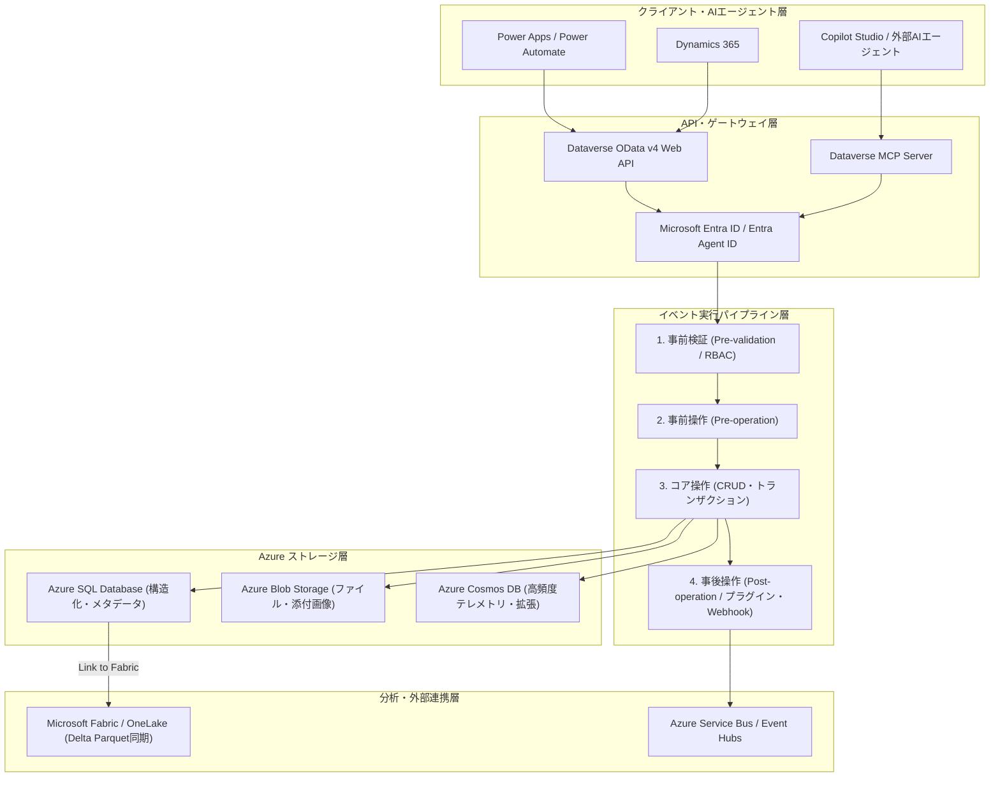

# **Microsoft Dataverse 調査レポート**

## **1. 基本情報**

* **ツール名**: Microsoft Dataverse
* **ツールの読み方**: マイクロソフト データバース
* **開発元**: Microsoft
* **公式サイト**: [https://www.microsoft.com/ja-jp/power-platform/dataverse](https://www.microsoft.com/ja-jp/power-platform/dataverse)
* **関連リンク**:
  * ドキュメント: [https://learn.microsoft.com/ja-jp/power-apps/maker/data-platform/data-platform-intro](https://learn.microsoft.com/ja-jp/power-apps/maker/data-platform/data-platform-intro)
  * ロードマップ: [AI at Work ロードマップ](https://aka.ms/AIatWorkroadmap)
  * レビューサイト（親製品群）: [G2 (Microsoft Power Apps)](https://www.g2.com/products/microsoft-power-apps/reviews)
* **カテゴリ**: データベース/データストレージ
* **概要**: Microsoft Dataverse は、ビジネスアプリケーションおよびAIエージェントで使用するデータを安全に保存し、管理するためのエンタープライズデータプラットフォームである。Power Platform や Dynamics 365 の中核データ基盤として機能し、リレーショナルデータモデリング、ビジネスロジック、強固なRBACセキュリティ、さらに MCP サーバーや Prompt Columns を通じたAI連携をクラウド上で統合的に提供する。

## **2. 目的と主な利用シーン**

* **解決する課題**: アプリケーション間や部門間でデータがサイロ化する問題を防ぎ、エンタープライズ水準のセキュリティ・コンプライアンスを確保しながら一元的なデータ管理と迅速なアプリ・AIエージェント開発を可能にする。
* **想定利用者**: 市民開発者（アプリ作成者）、プロ開発者、IT管理者、AIエージェント開発者。
* **利用シーン**:
  * Power Apps や Copilot Cowork を用いたカスタム業務アプリケーションのデータ基盤としての利用。
  * Copilot Studio や外部コーディングエージェント（GitHub Copilot、Claude、Cursor 等）から Dataverse MCP サーバー経由で業務データを安全に参照・更新するエージェント基盤としての利用。
  * Power Automate による業務自動化フローのトリガーおよびデータ保存先としての利用。
  * Link to Microsoft Fabric を用いた業務データの準リアルタイム分析・レポート基盤連携。

### **2.1 代表的な利用フロー**

```mermaid
swimlane-beta TB
  subgraph User["利用者・開発者"]
    A[業務要件の入力・操作を実行]
    E[アプリ結果・AIインサイトを確認]
  end
  subgraph Client["Power Apps / AIエージェント"]
    B[OData APIまたはMCP経由で要求]
    D[画面表示・回答を生成]
  end
  subgraph Dataverse["Microsoft Dataverse"]
    C1[Entra IDで認証・RBAC検証]
    C2[イベントパイプライン・Custom API実行]
    C3[Azure SQL・Blobへ永続化]
  end
  subgraph Fabric["Microsoft Fabric / 外部基盤"]
    F[OneLakeへ低遅延同期・分析]
  end
  A --> B
  B --> C1
  C1 --> C2
  C2 --> C3
  C3 --> D
  D --> E
  C3 --> F
```

* **代表的な流れ**: 利用者やAIエージェントからの操作は Web API（OData v4）または Dataverse MCP サーバーを通じて受け付けられ、Entra ID 認証とイベント実行パイプライン（ビジネスロジック・Custom API）を経由して Azure ストレージ層へ永続化されると同時に、必要に応じて Microsoft Fabric 等へ同期される。

## **3. 主要機能**

* **リレーショナル データ モデリング**: 標準テーブル（Common Data Model）およびカスタムテーブル、行、列、リレーションシップをGUIまたは自然言語から作成・管理。
* **Prompt Columns（プロンプト列）**: テーブル列に自然言語プロンプトを直接組み込み、レコード内容に基づくAI生成の要約・分類・推奨（複数行テキスト出力対応）を標準データとして永続化。
* **Dataverse MCP サーバー**: Model Context Protocol（MCP）に準拠した公式リモートサーバーを提供し、`search_data`・`describe`・`read_query` などの構造化ツールや Custom API を通じて AI エージェントと安全に連携。
* **ロジックと検証**: 計算列、ビジネスルール、ワークフロー、C# プラグイン、Custom API を定義し、サーバーサイドでのトランザクション整合性とデータ品質を確保。
* **強力なセキュリティモデル**: Microsoft Entra ID（および非人間エージェント向けの Entra Agent ID）と統合し、ビジネスユニット、ロールベース（RBAC）、行・列レベルのきめ細かいアクセス制御を実施。
* **データ統合と仮想テーブル**: Power Query によるオンライン・オンプレミスデータのインポートに加え、仮想テーブルを用いて外部データソースをコピーせずに統合。
* **Link to Microsoft Fabric**: 中間CSV出力を介さず OneLake 上の Delta Parquet 形式へ直接書き込む低遅延同期により、数分以内の準リアルタイム分析を実現。
* **Dynamics 365 統合**: Dynamics 365 アプリケーションと同一のデータストアを共有し、既存のCRM/ERPデータとシームレスに連携・拡張が可能。

## **4. 動作原理・システム構成**

* **アーキテクチャ**: Microsoft Azure 上で稼働するクラウド完結型のマルチテナント SaaS アーキテクチャを採用している。物理インフラやデータベースチューニングは Microsoft 側で完全に抽象化・マネージドされており、利用者は環境単位で論理データストアを利用する（内部実装の詳細は非公開だが、公開アーキテクチャとして以下の層構造が明示されている）。



* **主要コンポーネントとデータフロー**:
  * **Web API / MCP ゲートウェイ**: すべての外部・内部クライアント要求は OData v4 準拠の RESTful Web API または Dataverse MCP サーバーを経由し、Microsoft Entra ID（エージェントの場合は Entra Agent ID）による認証およびスロットリング制御を受ける。
  * **イベント実行パイプライン**: データ操作（CRUD や Custom API）は「事前検証 → 事前操作 → コア操作 → 事後操作」の4段階パイプラインを通過する。各ステージでサンドボックス化された C# プラグインやビジネスルールが同期・非同期で実行される。
  * **ポリグロット永続化層**: リレーショナルデータとメタデータ・権限設定は **Azure SQL Database** に、ファイルや添付画像などのバイナリデータは **Azure Blob Storage** に自動振り分け保存され、高頻度ログや非構造化拡張ワークロードには **Azure Cosmos DB** 等が組み合わされる。
* **特筆すべき要素技術**:
  * **OData v4 / 組織サービス**: 統一されたRESTエンドポイントと .NET SDK の双方から同一のデータモデル・権限モデルにアクセス可能。
  * **Delta Parquet 直接同期**: Link to Microsoft Fabric では変更データキャプチャ（CDC）を直接 OneLake の Delta Parquet へ書き出すことで、分析パイプラインの遅延を大幅に削減している。

## **5. 開始手順・セットアップ**

* **前提条件**:
  * Power Apps、Power Automate、Dynamics 365 等の有効なライセンス（または組織管理者が割り当てた開発者環境）。
  * Microsoft アカウント / Microsoft Entra ID テナント。
  * ※ 2026年11月15日以降、Power Apps Developer Plan での「非管理（Unmanaged）開発者環境」の自動プロビジョニングおよび「Dataverse for Teams」環境の新規作成は終了しており、管理センター等を通じた標準環境または管理（Managed）開発者環境の利用が前提となっている。
* **環境の準備**:
  1. [Power Platform 管理センター](https://admin.powerplatform.microsoft.com/) にアクセスする。
  2. 新しい環境を作成し、「Dataverse データ ストアを追加する」を有効化してリージョン・通貨・言語を設定する。
* **初期設定**:
  * Power Apps Maker Portal（[make.powerapps.com](https://make.powerapps.com/)）にアクセスし、左側のナビゲーションから「テーブル」を選択。
  * 既存の標準テーブルを利用するか、「新しいテーブル」から列（Prompt Columns 含む）やリレーションシップを作成。
  * 開発者向け CLI（Power Platform CLI）を用いる場合は以下のように接続・管理が可能。

  ```bash
  # Power Platform CLI の認証と環境一覧確認
  pac auth create --environment <ENVIRONMENT_URL>
  pac env list
  ```

* **クイックスタート**:
  * テーブルを作成してサンプルデータを追加後、Power Apps で「データから開始」または Copilot Cowork への自然言語プロンプトから業務アプリを自動生成して動作を確認する。

## **6. 特徴・強み (Pros)**

* **Microsoft エコシステムとの圧倒的な親和性**: Power Platform、Dynamics 365、Microsoft 365、Azure、Microsoft Fabric とネイティブに統合されており、中間連携基盤を自作せずにデータ活用が可能。
* **エンタープライズ級のセキュリティとAIガバナンス**: Entra ID に加え、自律型エージェント専用の Entra Agent ID や Microsoft Purview 監査ログ、行・列レベルのアクセス制御を標準搭載。
* **ローコードとプロコードの融合（フュージョン開発）**: 市民開発者は GUI や自然言語（Prompt Columns / Copilot Cowork）で構築し、プロ開発者は C# プラグイン・Custom API・MCP サーバーで拡張できる。
* **フルマネージドによる運用負荷の低さ**: バックアップ、インデックス最適化、スケーリング、暗号化が Microsoft により自動管理される。

## **7. 弱み・注意点 (Cons)**

* **ライセンス体系の複雑さと価格改定**: 単体のクラウドDBとして購入する形態ではなく Power Apps / Power Automate 等のライセンスに依存するため、構成見積もりが複雑になりやすい。なお、Power Apps Premium は 2027年1月1日より $20 から $22/ユーザー/月への値上げが発表されている。
* **ストレージ追加コストの高さ**: ユーザーライセンスに付帯する容量を超過した場合、データベース容量の追加アドオン（約$40/GB/月前後）が一般的な IaaS/PaaS データベースと比較して高価になりやすい。
* **無料・Teams環境の縮小**: 2026年11月15日をもって Dataverse for Teams の新規作成と非管理開発者環境の自動作成が停止されており、小規模テストや無料枠での利用ハードルが上がっている。
* **日本語対応状況**: 管理画面（Power Platform 管理センター / Maker Portal）、公式ドキュメント（Microsoft Learn）、サポート窓口ともに日本語に完全対応している。

## **8. 料金プラン**

Dataverse は単体製品ではなく、主に Power Apps、Power Automate、Copilot Studio、Dynamics 365 等のライセンスに内包される形で提供される。

| プラン名 | 料金 | 主な特徴・含まれる Dataverse 容量 |
|---------|------|---------|
| **Power Apps Premium** | $20/ユーザー/月<br>*(2027年1月より $22/月)* | 無制限のアプリ・ポータル実行が可能。1ユーザーあたり **DB容量 250MB**・**ファイル容量 2GB** がテナントプールに加算。 |
| **Power Automate Premium** | $15/ユーザー/月 | クラウドフローおよび有人RPAを利用可能。1ユーザーあたり **DB容量 50MB**・**ファイル容量 200MB** が加算。 |
| **従量課金制 (Pay-as-you-go)** | Azure サブスクリプション従量課金 | アクティブユーザー数やストレージ使用量に応じた課金。初期固定費なしで開始可能。 |
| **Dataverse 容量アドオン** | 約$40/GB/月 (DB容量目安) | テナントのプール容量を超過した場合の追加データベース・ファイル・ログ容量アドオン。 |
| **Power Apps 開発者プラン** | 無料 *(要管理環境設定)* | 学習・検証用。2026年11月以降は管理（Managed）開発者環境として運用・ライセンス要件に準拠が必要。 |

* **課金体系**: ユーザーライセンス単位（または従量課金）＋ テナント合算ストレージ容量単位（データベース・ファイル・ログの3種類）。
* **無料トライアル**: Power Apps / Power Automate の無料試用版（30日間）が提供されている。

## **9. 導入実績・事例**

* **導入企業**: ZF、Epiq、PwC、Lumen Technologies など多数のグローバル企業。
* **導入事例**:
  * **ZF**: Dataverse のロールベースアクセス制御を活用し、セキュリティを担保した上で42,000以上の業務ソリューションを構築。
  * **PwC**: クライアント支援ツールを Dataverse 基盤で構築し、大幅なコスト削減（85%）と作業時間短縮（30%）を達成。
  * **Epiq**: Power Platform と Dataverse を連携させ、ビジネス部門とIT部門の協業を促進し、月2,000時間の工数削減と年間50万ドルのコスト削減を実現。
* **対象業界**: 製造、コンサルティング、金融、公共、テクノロジーなどエンタープライズ全般。

## **10. サポート体制**

* **ドキュメント**: [Microsoft Learn](https://learn.microsoft.com/ja-jp/power-apps/maker/data-platform/data-platform-intro) 上にアーキテクチャ、APIリファレンス、ベストプラクティスが日本語を含め網羅的に整備されている。
* **コミュニティ**: Microsoft Power Platform Community や Microsoft Tech Community、世界中の MVP による技術ブログ・フォーラムが極めて活発。
* **公式サポート**: Power Platform 管理センターからのサポートチケット発行（メール・電話・チャット、日本語対応）、およびエンタープライズ契約（Unified Support 等）による専任サポートが利用可能。

## **11. エコシステムと連携**

### **11.1 API・外部サービス連携**

* **API**: OData v4 準拠の RESTful Web API、.NET 向け組織サービス SDK、さらに AI エージェント向けの **Dataverse MCP サーバー**（Custom API 呼び出し対応）を提供。
* **外部サービス連携**: Power Platform の 1,000 を超える標準・プレミアムコネクタ、Link to Microsoft Fabric（OneLake 連携）、Azure Event Hubs / Service Bus、Webhooks、仮想テーブルを通じた SQL Server / SharePoint / SAP 等との連携。

### **11.2 技術スタックとの相性**

| 技術スタック | 相性 | メリット・推奨理由 | 懸念点・注意点 |
|:---|:---:|:---|:---|
| **Microsoft Power Platform** | ◎ | ネイティブ統合。Prompt Columns やアプリ生成でファーストクラス対応。 | ライセンス設計の把握が必要 |
| **Microsoft Azure / Fabric** | ◎ | Link to Fabric、Event Hubs、Entra ID 等とシームレスに統合。 | 高度な構成には Azure の知識が必要 |
| **AI エージェント (MCP対応)** | ◎ | 公式 Dataverse MCP サーバー経由で Claude・Cursor・GitHub Copilot から直接操作可能。 | 管理センターでの権限・ツール制御設定が必須 |
| **.NET / C#** | ◯ | 公式 SDK でプラグインや Custom API など高度なサーバーサイドロジックを実装可能。 | サンドボックス実行制約（実行時間上限等）の考慮が必要 |
| **JavaScript / TypeScript** | ◯ | Web API や PCF（Power Apps component framework）でカスタムUI・SPA連携が可能。 | OAuth 2.0 認証フローの実装が必要 |

## **12. セキュリティとコンプライアンス**

* **認証**: Microsoft Entra ID と完全統合（SSO、条件付きアクセス、MFA対応）。さらに自律型AIエージェント向けに **Microsoft Entra Agent ID for Dataverse**（パブリックプレビュー）を導入し、人間のユーザー権限とは分離された最小権限でのエージェント認証・追跡を実現。
* **データ管理**: 保存データ（TDE）および転送中データ（TLS）を標準で暗号化。リージョン指定によるデータレジデンシー管理やカスタマーマネージドキー（CMK）にも対応。
* **準拠規格**: SOC 1/2/3、ISO 27001、GDPR、HIPAA、FedRAMP、ISMAP などの主要コンプライアンス規格に準拠。Microsoft Purview によるデータアクセス・AI操作の監査ログ統合に対応。

## **13. 操作性 (UI/UX) と学習コスト**

* **UI/UX**: Power Apps Maker Portal 上のグラフィカルなテーブルデザイナーやリレーションシップ図により、Excel ライクな感覚で直感的にデータ構造を設計可能。Copilot による自然言語でのテーブル設計支援も充実している。
* **学習コスト**: 基本的なテーブル作成やアプリ接続の学習コストは低いが、ビジネスユニット・セキュリティロール設計、ソリューションによる ALM（アプリケーションライフサイクル管理）、APIスロットリング対策、C# プラグイン開発を習得するには中〜高程度の学習コストがかかる。

## **14. ベストプラクティス**

* **効果的な活用法 (Modern Practices)**:
  * **環境分離と ALM**: 開発・テスト・本番環境を分離し、マネージドソリューションを用いた CI/CD パイプラインで変更を安全に移行する。
  * **標準テーブル（CDM）と Custom API の活用**: 共通データモデルを優先利用しつつ、複雑な業務トランザクションは Custom API としてカプセル化し、アプリと AI エージェント（MCP経由）の双方から再利用する。
  * **Fabric 連携による分析分離**: 大規模集計やBI分析は Dataverse 上で直接負荷をかけず、Link to Microsoft Fabric 経由で OneLake 側へオフロードする。
* **陥りやすい罠 (Antipatterns)**:
  * **ストレージ容量の無計画な消費**: 最適化していない大容量画像やログファイルを無制限に DB/ファイル領域へ保存し、高額な容量アドオン課金を招くケース。
  * **セキュリティ設計の省略**: 開発効率を優先して全ユーザーに「システム管理者」ロールを付与したまま運用し、情報漏洩リスクを高めるケース。
  * **API 制限の無視**: 大量データのバッチ処理時にバルクAPIや適切なリトライ制御を使わず、サービス保護API制限（Throttling）に抵触するケース。

## **15. ユーザーの声（レビュー分析）**

* **調査対象**: G2、Capterra（Dataverse は単体レビューが少ないため、内包製品である Power Apps / Dynamics 365 のレビューを中心に分析）
* **総合評価**: 4.3〜4.5 / 5.0（G2 Power Apps）、4.4 / 5.0（Capterra Dynamics 365、5,800件以上のレビューに基づく）
* **ポジティブな評価**:
  * 「SharePoint リスト等からの脱却先として、リレーショナルなデータモデルと強固なセキュリティを素早く構築できる点が高く評価されている」（G2/Capterra 要約）
  * 「Microsoft 365 や Power BI、Teams との連携に独自ミドルウェアが不要で、ビジネスチームとITチームの協業が加速する」（導入事例・レビュー要約）
  * 「Entra ID と連動したロールベース・行レベルのアクセス制御により、厳格な社内規定を満たしやすい」
* **ネガティブな評価 / 改善要望**:
  * 「ライセンス体系と容量課金の仕組みが非常に複雑で、規模拡大時のコスト予測が難しい」（G2/Capterra 共通の指摘）
  * 「データベースやファイル容量の追加単価が高く、大規模データや大量添付ファイルを扱うと割高になりやすい」
  * 「高度な業務ロジックやパフォーマンス最適化を行う段階になると、結局プロ開発者の知識が必要になる」
* **特徴的なユースケース**:
  * 社内に散在していた Excel や Access、SharePoint リストベースの属人化業務を Dataverse に集約し、Power Apps と Copilot Studio エージェントで全社横断の業務基盤へモダナイズする事例。

## **16. 直近半年のアップデート情報**

* **2026-11-17〜20**: **Microsoft Ignite 2026 でのAIエージェント基盤強化** — Dataverse を自律型AIエージェントのセマンティック・データ基盤として再定義し、Copilot Studio や Copilot Cowork との統合ワークフロー、Entra Agent ID を用いた最小権限ガバナンスの活用事例を公開。
* **2026-11-15**: **Dataverse for Teams 新規作成および非管理開発者環境の自動作成終了** — 新規の Dataverse for Teams 環境作成と、Developer Plan での非管理開発者環境の自動プロビジョニングが終了（既存 Teams 環境は 2027年9月15日に停止、同年10月30日に廃止予定）。標準・管理環境への移行を案内。
* **2026-11**: **Prompt Columns 複数行テキスト出力 GA および MCP Custom API 対応** — テーブル列にAIプロンプトを埋め込む「Prompt Columns」の複数行テキスト出力が一般提供（GA）を開始。あわせて Dataverse MCP サーバーが Custom API のネイティブ検出・実行に対応し、エージェントからサーバーサイド業務ロジックを直接呼び出し可能に。
* **2026-09**: **「AI at Work ロードマップ」への移行（年2回リリース波の終了）** — 従来の Wave 1 / Wave 2 の年2回一括公開モデルを終了し、Power Platform・Dynamics 365・Dataverse の更新計画を常時公開型の「AI at Work ロードマップ」へ統合。
* **2026-07**: **Prompt Columns（プロンプト列）の一般提供（GA）** — ノーコードでテーブル列に自然言語プロンプトを設定し、AIが生成した要約や分類結果を通常データとして永続化できる機能が正式リリース。
* **2026-06**: **Link to Microsoft Fabric 低遅延同期 GA と Dataverse MCP ツール刷新** — 中間CSV出力を廃止し OneLake の Delta Parquet へ直接書き込む低遅延同期が GA。また、Dataverse MCP サーバーのツール構成（`search_data`、`describe`、`read_query` 等）の整理および GitHub Copilot・Claude・Cursor 向けコーディングエージェント用プラグインを拡充。
* **2024-05**: Microsoft Copilot の機能が拡張され、Azure OpenAI LLM を使用し外部ソースに接続することで、Dataverse のデータに基づいた動的プロンプト作成が可能に。
* **2024-03**: Microsoft Purview との連携深化による AI データアクセス監査ログ取得の容易化。
* **2023-11**: Power Apps Maker Portal での Copilot を用いた自然言語テーブル作成・アプリ自動生成機能の強化。

(出典: [AI at Work ロードマップ](https://aka.ms/AIatWorkroadmap) / [Microsoft Power Platform ブログ](https://www.microsoft.com/en-us/power-platform/blog/) / [Microsoft Learn リリース計画](https://learn.microsoft.com/ja-jp/power-platform/release-plan/))

## **17. 類似ツールとの比較**

### **17.1 機能比較表 (星取表)**

| 機能カテゴリ | 機能項目 | 本ツール | Airtable | Kintone | Supabase |
|:---:|:---|:---:|:---:|:---:|:---:|
| **基本機能** | データモデリング | ◎<br><small>高度なリレーショナル・CDM対応</small> | ◯<br><small>直感的なスプレッドシートUI</small> | ◯<br><small>アプリ単位のデータ管理</small> | ◎<br><small>PostgreSQLフル機能・宣言的スキーマ</small> |
| **カテゴリ特定** | ローコード・AI連携 | ◎<br><small>Power Platform / MCP / Prompt Columns</small> | ◯<br><small>AIクレジット・自動化機能あり</small> | ◎<br><small>自社内でのノーコード構築</small> | △<br><small>プロ開発者向けBaaS (pgvector/MCP対応)</small> |
| **エンタープライズ** | セキュリティ・認証 | ◎<br><small>Entra ID / Agent ID, 行・列レベル制御</small> | ◯<br><small>Enterprise Scaleプランで強化</small> | ◯<br><small>細かな権限設定・監査ログ対応</small> | ◯<br><small>RLS (Row Level Security) 対応</small> |
| **非機能要件** | 日本語対応 | ◎<br><small>UI・ドキュメント・サポート完全対応</small> | △<br><small>UIは英語中心</small> | ◎<br><small>日本発ツールで完全対応</small> | △<br><small>公式ドキュメントは英語中心</small> |

### **17.2 詳細比較**

| ツール名 | 特徴 | 強み | 弱み | 選択肢となるケース |
|---------|------|------|------|------------------|
| **本ツール** | Microsoftエコシステムの中核データ・エージェント基盤 | Power Platform・M365・Fabricとの完全統合、MCP対応、エンタープライズ級セキュリティ | ライセンス体系が複雑で、追加容量コストが高め | Microsoft 365 導入企業で、大規模・高セキュリティな業務アプリやAIエージェントを構築する場合 |
| **Airtable** | スプレッドシートの手軽さとDB機能を両立 | 直感的で美しいUI、無料プラン（1,000レコード/base）や豊富なビュー（カンバン等） | 大規模データや複雑な業務トランザクション制御には限界がある | 小〜中規模チームでタスク管理やデータトラッキングを素早く始めたい場合（Team $20/月〜） |
| **Kintone** | 日本市場で圧倒的実績を持つ業務アプリ基盤 | 日本の商習慣に合ったUI、承認ワークフローやコミュニケーション機能が標準充実 | 高度なリレーショナル処理や大規模カスタム開発には不向きな場合がある | 国内企業で部門ごとの業務改善（稟議・顧客管理等）をノーコードで進めたい場合（$24/ユーザー/月、5ユーザー〜） |
| **Supabase** | OSSのPostgreSQL中心BaaSプラットフォーム | オープンソースによる脱ベンダーロックイン、Docker不要のローカル実行、無料枠が充実 | ローコード業務アプリ基盤ではなく、フロントエンド等の開発知識が必須 | プロのエンジニアがWeb・モバイル・AIアプリのバックエンドを迅速に構築したい場合 |

## **18. 総評**

* **総合的な評価**:
  Microsoft Dataverse は、単なるクラウドデータベースの枠を超え、ビジネスロジック、厳格なセキュリティモデル、Fabric 連携による分析基盤、そして Prompt Columns や MCP サーバーを通じた AI エージェント基盤を内包するエンタープライズデータプラットフォームへと進化している。2026年後半のアップデートにより、「業務アプリの裏方」から「企業データを安全にAIエージェントへ接続する中核レイヤー」としての位置づけが一層明確になった。
* **推奨されるチームやプロジェクト**:
  すでに Microsoft 365 や Dynamics 365、Azure を導入している企業。セキュリティ・ガバナンス要件が厳しく、部門横断で業務アプリと自律型AIエージェント（Copilot Studio 等）を安全に展開したい組織。市民開発者とプロ開発者が協業するフュージョン開発チーム。
* **選択時のポイント**:
  Supabase や Azure SQL などの純粋な開発者向けデータベースと比較した場合、Dataverse は「Web API・MCP サーバー・RBAC 権限・業務パイプラインが最初から構築済みのマネージドプラットフォーム」である点が最大の差別化要因となる。一方で、2026年11月の無料・Teams環境縮小や2027年1月の Power Apps Premium 価格改定も踏まえ、導入前にライセンス構成とストレージ容量の見積もりを十分に精査することが推奨される。
