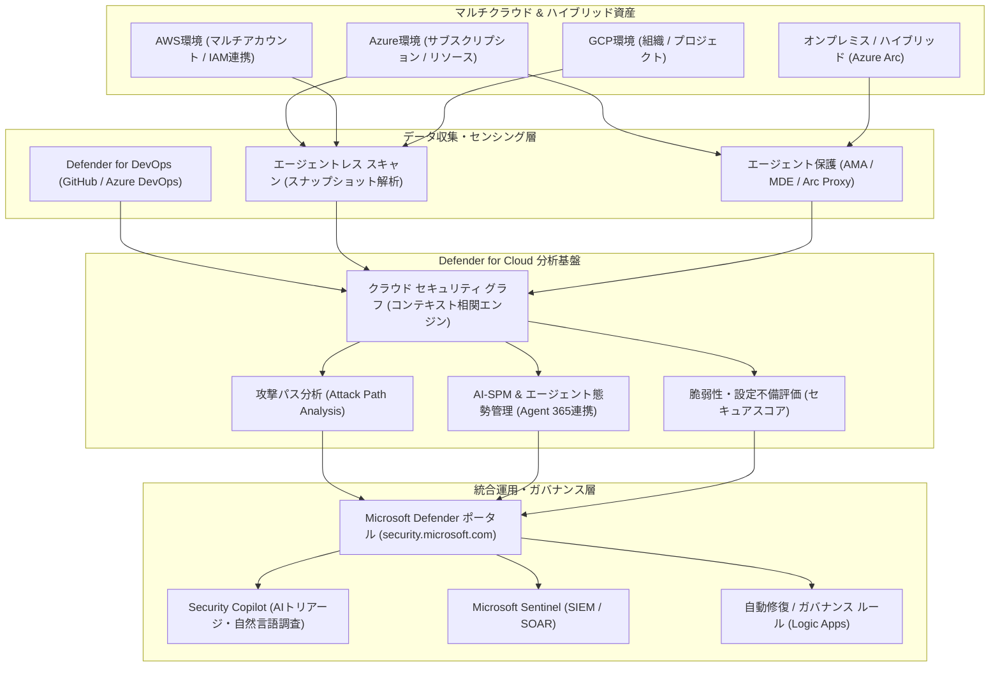

# **Microsoft Defender for Cloud 調査レポート**

## **1. 基本情報**

* **ツール名**: Microsoft Defender for Cloud
* **ツールの読み方**: マイクロソフト ディフェンダー フォー クラウド
* **開発元**: Microsoft
* **公式サイト**: [https://azure.microsoft.com/ja-jp/products/defender-for-cloud/](https://azure.microsoft.com/ja-jp/products/defender-for-cloud/)
* **関連リンク**:
  * ドキュメント: [https://learn.microsoft.com/ja-jp/azure/defender-for-cloud/](https://learn.microsoft.com/ja-jp/azure/defender-for-cloud/)
  * レビューサイト: [G2](https://www.g2.com/products/microsoft-defender-for-cloud/reviews) | [Capterra](https://www.capterra.com/p/211516/Microsoft-Defender-for-Cloud/) | [ITreview](https://www.itreview.jp/products/microsoft-defender-for-cloud/reviews)
* **カテゴリ**: セキュリティ/脆弱性診断
* **概要**: Azure、AWS、Google Cloudなどのマルチクラウドおよびオンプレミス・ハイブリッド環境全体を保護する、統合型のクラウドネイティブアプリケーション保護プラットフォーム (CNAPP) です。クラウドセキュリティ態勢管理 (CSPM)、クラウドワークロード保護 (CWPP)、DevSecOps機能を単一プラットフォームに統合し、コード作成段階からクラウドランタイム、さらにはAIエージェントや生成AIワークロードに至るライフサイクル全体を包括的に保護します。

## **2. 目的と主な利用シーン**

* **解決する課題**:
  * マルチクラウド環境（Azure/AWS/GCP）に分散するリソースの設定ミスやコンプライアンス違反の検知遅れ
  * サーバー、コンテナ、データベース、APIなど多層ワークロードを狙う高度な標的型サイバー攻撃
  * ソースコード、IaC（Infrastructure as Code）、コンテナイメージにおける脆弱性の本番環境への混入（Shift Leftの未達）
  * クラウド内の過剰なアクセス権限（CIEM）やリソース間の複雑な関連性による攻撃経路（Attack Path）の不可視性
  * AIエージェント、MCP（Model Context Protocol）サーバー、LLMアプリケーションなどの生成AIワークロードに伴う新たなセキュリティリスク
* **想定利用者**:
  * CISOおよびセキュリティオペレーションセンター（SOC）チーム
  * クラウドインフラストラクチャ管理者・クラウドアーキテクト
  * DevSecOpsおよびプラットフォームエンジニアリングチーム
  * コンプライアンス・内部統制監査担当者
* **利用シーン**:
  * **マルチクラウド統合態勢管理とガバナンス**: Azure、AWS、GCPの全資産設定とコンプライアンス状況（CIS、NIST、PCI-DSS等）を継続監視し、セキュアスコアに基づいて修復優先度を可視化。
  * **ランタイム脅威防御と自動インシデント対応**: 仮想マシン、Kubernetesクラスタ、サーバーレス、データベースへの不正侵入を検知し、Microsoft SentinelやDefender XDRと連携して自動隔離・対処を実施。
  * **コードからクラウドへの統合DevSecOps**: GitHubやAzure DevOpsのリポジトリと連携し、IaCのセキュリティ欠陥やハードコードされたシークレット、コンテナ脆弱性をビルド時に遮断。
  * **AI-SPM（AIセキュリティポスチャ管理）**: Azure OpenAI ServiceやGoogle Vertex AI、企業内AIエージェントの構成を検出し、プロンプトインジェクションやデータ漏洩リスクを予防。

### **2.1 代表的な利用フロー**

```mermaid
swimlane-beta TB
  subgraph SecurityAdmin["セキュリティ管理者・開発者"]
    A[マルチクラウド環境・リポジトリを接続]
    E[攻撃パス・推奨事項の修復ポリシーを適用]
  end
  subgraph CloudResources["マルチクラウド資産 (Azure/AWS/GCP)"]
    B[API・エージェントレスで構成・資産データを収集]
    D[修正スクリプト実行やガードレール適用]
  end
  subgraph DefenderCore["Defender for Cloud (セキュリティグラフ)"]
    C[リスク相関分析・攻撃パス・脆弱性を評価]
  end
  subgraph UnifiedOps["Defenderポータル / Security Copilot"]
    F[統合トリアージ・AIによる自然言語分析を提供]
  end
  A --> B
  B --> C
  C --> F
  F --> E
  E --> D
```

* **代表的な流れ**: セキュリティ管理者がAzure、AWS、GCP環境やDevOpsリポジトリを接続すると、Defender for CloudがエージェントレスおよびAPI経由で資産データを収集します。クラウドセキュリティグラフが設定ミスや脆弱性を相関分析して攻撃経路を特定し、統合ポータルおよびSecurity Copilotを通じて管理者へ高精度な推奨事項と修復アクションを提示します。

## **3. 主要機能**

* **クラウドセキュリティ態勢管理 (CSPM & Foundational CSPM)**: マルチクラウド環境の資産インベントリを自動把握し、Microsoftクラウドセキュリティベンチマーク（MCSB）等に基づく設定評価を行い、数値化された「セキュアスコア」と改善手順を提供します。
* **クラウドワークロード保護 (CWPP)**: 仮想マシン（Defender for Servers）、Kubernetes/コンテナ（Defender for Containers）、マネージドDB（Defender for Databases）、クラウドストレージ（Defender for Storage）、API（Defender for APIs）など、多層的なランタイム脅威防御を提供します。
* **攻撃パス分析 (Attack Path Analysis) とセキュリティグラフ**: クラウドセキュリティグラフを活用し、インターネットへの露出、脆弱性、過剰権限、重要データへのアクセス経路をグラフ理論で解析し、攻撃者に悪用される現実的な侵入シナリオを特定します。
* **AIセキュリティポスチャ管理 (AI-SPM)**: 生成AIモデル（Azure OpenAI、AWS Bedrock、Vertex AIなど）やAIエージェントの構成を検出し、AI Bill of Materials（AI BOM）の生成、プロンプトインジェクションリスクの可視化、データ保護設定の遵守状況を評価します。
* **クラウドインフラ権限管理 (CIEM)**: マルチクラウドにおけるID、ロール、権限を継続的に評価し、不要な過剰権限や未使用アクセスキーを検出して最小権限の原則（Least Privilege）を適用します。
* **DevSecOps統合 (Defender for DevOps)**: GitHub、Azure DevOps、GitLabのパイプラインにセキュリティスキャンを組み込み、IaCテンプレート（Terraform、Bicep、ARM）、シークレット漏洩、オープンソース依存関係の脆弱性を開発早期に発見します。
* **サーバーレス & コンテナセキュリティ**: Kubernetesクラスタへのセンサーデプロイによるランタイム検知に加え、Docker Hub等の外部レジストリやサーバーレスコンテナ（Azure Container Apps、AWS Lambda/ECS、Cloud Run）の態勢管理に対応します。
* **閉域網・ハイブリッドDB保護（Azure Arcプロキシ対応）**: Azure Arc経由で管理されるSQL Serverにおいてプロキシ接続をサポートし、インターネット直結が制限された閉域網環境下でもセキュアに脆弱性評価と脅威検知を実行できます。
* **統合セキュリティポータル & Security Copilot**: Microsoft Defenderポータル（`security.microsoft.com`）においてXDRとCNAPPを単一画面で運用でき、生成AI「Security Copilot」による自然言語でのインシデント要約や推奨事項の分析が可能です。

## **4. 動作原理・システム構成**

* **アーキテクチャ**: マルチクラウドネイティブなクラウド完結型SaaSプラットフォームであり、エージェントレス（API・スナップショット解析）とエージェントベース（Azure Monitor Agent / Defender for Endpoint / センサー）を組み合わせたハイブリッド検知アーキテクチャを採用しています。
* **主要コンポーネントとデータフロー**:
  * **データ収集層**: 各クラウドアカウント（Azureサブスクリプション、AWS IAMロール、GCPサービスアカウント）とAPI接続し、ディスクスナップショットによるエージェントレスOSスキャン、およびコンテナ/VM上の軽量センサーからテレメトリを収集します。
  * **分析・相関エンジン（Cloud Security Graph）**: 収集した資産構成、ネットワーク露出、脆弱性情報、ID権限、データ重要度をグラフデータベースにマッピングし、複合的なリスク連鎖（攻撃パス）をリアルタイムに計算します。
  * **運用・制御層**: Microsoft Defenderポータルにアラートとインシデントを集約し、Microsoft Sentinel（SIEM）やLogic Apps（SOAR）を通じて自動修復や通知ワークフローを実行します。



* **特筆すべき要素技術**:
  * **エージェントレス・ディスクスキャン**: 稼働中の仮想マシンやコンテナホストに負荷をかけることなく、ストレージスナップショットを作成・マウントしてOSやミドルウェアの脆弱性・マルウェアを短時間で解析。
  * **クラウドセキュリティグラフ（Graph Database）**: リソース単体の設定値だけでなく、ネットワーク経路、IAMロール、公開状態、データ感度をノードとエッジで結びつけ、多段の侵入シナリオを瞬時に評価。
  * **Azure Arc Proxyトンネリング**: インターネットへの直接送信が遮断された基幹データベース環境でも、組織指定のArcプロキシを経由してテレメトリをセキュアに転送。
  * **Microsoft Security Copilot連携**: 大規模言語モデルとセキュリティ特化の推論基盤を活用し、複雑な設定ミスやセキュリティ推奨事項を自然言語で解説し、ワンクリック修正スクリプトを提案。

## **5. 開始手順・セットアップ**

* **前提条件**:
  * アクティブなMicrosoft Azureアカウント（所有者または共同作成者権限）
  * AWSまたはGCPを連携する場合は、各クラウドの管理者権限（AWS IAMロール作成権限、GCPサービスアカウント作成権限）
* **インストール/導入**:
  * Azure Portalにサインインし、「Microsoft Defender for Cloud」または統合「Microsoft Defenderポータル」（`security.microsoft.com`）にアクセスします。
  * Azureサブスクリプションを対象としてDefender for Cloudを有効化します（基本機能は即座に評価開始）。
* **初期設定**:
  * **マルチクラウド環境の接続**: 「環境設定」メニューからAWSアカウントまたはGCPプロジェクトを追加し、提供されるCloudFormationテンプレートまたはTerraformスクリプトを実行してコネクタを設定します。
  * **保護プランの有効化**: 要件に応じて、Defender CSPM、Defender for Servers、Containers、Databases等の有料プランを有効化します（初回30日間無料トライアルあり）。
  * **DevOps連携**: GitHubまたはAzure DevOpsのコネクタを作成し、リポジトリへのセキュリティスキャンアクション（Microsoft Security DevOps）を設定します。
* **クイックスタート**:
  * ダッシュボードを開き、現在の「セキュアスコア」と「攻撃パス（Attack Paths）」を確認します。
  * 最もリスクスコアの高い推奨事項を選択し、組み込みの「修正（Remediate）」ボタンを押して設定を自動修正するか、提示されたCLI/ARMスクリプトを適用します。

## **6. 特徴・強み (Pros)**

* **Microsoftセキュリティエコシステムとの完全統合**: Microsoft Entra ID（認証認可）、Microsoft Sentinel（SIEM/SOAR）、Defender XDR（エンドポイント・ID・SaaS保護）、Microsoft Security Copilot（AI分析）とネイティブに連携し、単一のインシデントキューで対応が完結します。
* **包括的なCNAPP機能のカバレッジ**: CSPM、CWPP、CIEM、DevSecOps、AI-SPM、APIセキュリティを単一製品で網羅しており、複数の専業セキュリティSaaSを個別に調達・運用するオーバーヘッドを削減できます。
* **エージェントレスとエージェント保護のハイブリッド構成**: 迅速なマルチクラウド資産の可視化はエージェントレスで即座に行い、高度なインメモリ検知やリアルタイム防御が必要な重要ワークロードにはセンサーを適用する柔軟な設計が可能です。
* **コンテキスト重視の攻撃パス分析**: 単なるCVE脆弱性一覧の提示にとどまらず、「インターネット公開 × 管理者権限 × 機密データベース接続」といった連鎖リスクを自動判定し、現実的な脅威から優先修復できます。
* **充実した日本語対応とエンタープライズサポート**: UI、アラート内容、公式ドキュメント（Microsoft Learn）が日本語で提供されており、国内エンタープライズ企業での導入障壁が低いです。

## **7. 弱み・注意点 (Cons)**

* **複雑なライセンス体系とコスト予測の難易度**: サーバー台数、vCore数、ストレージトランザクション数、API呼び出し回数など、ワークロードごとに異なる課金体系が混在しており、大規模環境での予算策定に綿密な事前見積もりが必要です。
* **管理画面（Portal）の移行期における導線の二重性**: 従来のAzure Portal上の画面と、統合が進むMicrosoft Defenderポータル（`security.microsoft.com`）の双方が存在し、一部の設定項目やレポート機能の配置に慣れるまでの学習コストが発生します。
* **初期導入時のアラート過多（アラート疲れ）**: デフォルトの推奨事項が非常に多岐にわたるため、自組織のセキュリティポリシーに合わせて抑制ルールや例外設定をチューニングしないと、運用チームがアラートに圧倒されるリスクがあります。
* **AWS/GCP固有の最新マネージドサービスへの追従タイムラグ**: Azureネイティブ機能は即座にサポートされますが、AWSやGCPの新機能・特定PaaSへの対応はサードパーティ専業ツール（Wiz等）と比較してやや時間を要する場合があります。

## **8. 料金プラン**

課金はワークロードの種類と使用規模に応じた従量課金・サブスクリプション制です。有料プランの全機能に対して、初回有効化から30日間の無料トライアルが提供されます。

| プラン名 | 料金目安 | 主な特徴 |
|---------|---------|---------|
| **Foundational CSPM** | 無料 (オプトイン) | Azure、AWS、GCP全体の基本的な継続的評価、セキュリティ推奨事項、セキュアスコア |
| **Defender CSPM** | 約 $5/保護リソース/月 | エージェントレス脆弱性スキャン、攻撃パス分析、CIEM、AI-SPM、ガバナンス自動化 |
| **Defender for Servers (Plan 1/2)** | Plan 1: 約 $5/サーバー/月<br>Plan 2: 約 $15/サーバー/月 | Plan 1: MDE基本保護・脆弱性評価<br>Plan 2: FIM、JITアクセス、ネットワークハードニング、500MB無料ログ取り込み |
| **Defender for Containers** | 約 $7/vCore/月 + イメージスキャン従量 | Kubernetesノードのランタイム保護、アドミッション制御、レジストリ/Docker Hub脆弱性スキャン |
| **Defender for Databases** | 約 $15/インスタンス/月（またはvCore従量） | SQL、Cosmos DB、オープンソースDB（Azure/AWS RDS）への脅威検知・異常クエリ検出 |
| **Defender for Storage** | 約 $10/ストレージアカウント/月 + スキャン従量 | マルウェアのオンデマンド/ニアリアルタイムスキャン、機密データ脅威検出 |
| **Defender for APIs** | APIリクエスト数に応じた従量制 | APIインベントリ自動検出、シャドーAPI監視、不正アクセス・OWASP API Top 10脅威検知 |
| **Defender for DevOps** | 無料（Defender CSPM等と連動） | GitHub/Azure DevOps連携、IaCスキャン、シークレット漏洩防止、ビルド時ガードレール |

* **課金体系**: 仮想マシン数、コンテナvCore数、ストレージアカウント数、APIリクエスト量などに基づく従量課金制。
* **無料トライアル**: 各保護プランごとに30日間の無料評価期間が提供されます。
* **プラン仕様の最新動向**: 新規AzureサブスクリプションにおけるFoundational CSPMのオプトイン提供への移行や、クラシックストレージプラン（トランザクション課金）から現代的ストレージ保護プランへの集約が進められています。

## **9. 導入実績・事例**

* **導入企業**: 国内外のグローバルエンタープライズ、金融機関、製造業、ヘルスケア、公共機関など、Azureおよびマルチクラウドを大規模に活用する組織で標準的に採用されています。
* **導入事例**:
  * **大手金融機関**: マルチクラウド（Azure/AWS）にまたがるハイブリッドクラウド基盤において、規制準拠（FISC/PCI-DSS）状況の自動監査と攻撃パス分析を導入し、セキュリティ監査工数を大幅に削減。
  * **グローバル製造業**: 工場拠点のオンプレミスサーバーにAzure Arcを導入し、クラウドと同一のセキュリティポリシーおよびEDR機能を適用してインシデント検知時間を短縮。
  * **SaaS事業者**: Defender for DevOpsとDefender for Containersを導入し、GitHubパイプラインから本番Kubernetesクラスタまでのエンドツーエンドなサプライチェーンセキュリティを確立。
* **対象業界**: 金融、ヘルスケア、政府自治体、製造業、通信、Eコマースなど、厳格なコンプライアンス遵守とゼロトラストアーキテクチャの実現が求められる業界。

## **10. サポート体制**

* **ドキュメント**: [Microsoft Learn（Defender for Cloud ドキュメント）](https://learn.microsoft.com/ja-jp/azure/defender-for-cloud/) にて、アーキテクチャ設計、デプロイガイド、REST API仕様、トラブルシューティングに関する包括的かつ高精度な日本語ドキュメントが継続更新されています。
* **コミュニティ**: Microsoft Tech Community（Security Forum）やGitHub（Azure/Microsoft-Defender-for-Cloudリポジトリ）にて、コミュニティ主導の自動修復スクリプト（Logic Apps）、ポリシー定義、ベストプラクティスが共有されています。
* **公式サポート**: Azureサポートプラン（Standard、Professional Direct、Premier/Unified Support）を通じて、24時間365日の日本語テクニカルサポートおよびエンジニアリングチームによる障害対応が提供されます。

## **11. エコシステムと連携**

### **11.1 API・外部サービス連携**

* **API**: 包括的なREST APIおよびMicrosoft Graph Security APIが提供されており、セキュアスコア、推奨事項、アラート、セキュリティ態勢データへのプログラマブルなアクセスが可能です。
* **外部サービス連携**:
  * **SIEM / SOAR**: Microsoft Sentinelとシームレスにデータコネクタで結合できるほか、Splunk、IBM QRadar、Sumo Logic、ServiceNowなどのサードパーティSIEM/ITSM製品とEvent Hubs経由で連携。
  * **DevOpsツール**: GitHub Enterprise、Azure DevOps、GitLab CIとネイティブに統合。
  * **コミュニケーション / 通知**: Microsoft Teams、Slack、PagerDuty、メール通知とのWebhook連携。

### **11.2 技術スタックとの相性**

| 技術スタック | 相性 | メリット・推奨理由 | 懸念点・注意点 |
|:---|:---:|:---|:---|
| **Microsoft Azure** | ◎ | ネイティブ統合によりワンクリックで展開可能。新機能が最速で利用可能 | 特になし |
| **AWS / Google Cloud** | ◯ | API/IAM連携によるエージェントレスCSPM・CWPPに対応 | 一部の高度なランタイム保護はAzure環境先行となる場合がある |
| **Kubernetes (AKS/EKS/GKE)** | ◎ | センサーおよびアドミッションコントローラーによる深い可視性とランタイム防御 | ノードやDaemonSetのリソースオーバーヘッドの事前サイジングが必要 |
| **GitHub / Azure DevOps** | ◎ | Defender for DevOpsによるIaCスキャン、シークレット検知が標準提供 | 特になし |
| **オンプレミス / 閉域網 (Arc)** | ◯ | Azure ArcおよびArcプロキシ経由で外部直結のない環境でも管理可能 | Arcエージェントの定期的なバージョン管理が必要 |

## **12. セキュリティとコンプライアンス**

* **認証**: Microsoft Entra IDによる多要素認証（MFA）、条件付きアクセス（Conditional Access）、および特権アクセス管理（PIM）に完全統合。きめ細かな統合ロールベースアクセス制御（Unified RBAC）をサポート。
* **データ管理**: セキュリティイベントおよびログデータは顧客指定リージョンのLog Analyticsワークスペースに保管。保存時暗号化（Customer-Managed Keys対応）および転送時暗号化（TLS 1.3）を徹底。
* **準拠規格**: Microsoft Cloud Security Benchmark（MCSB）、CISベンチマーク、NIST SP 800-53、PCI DSS 4.0、ISO/IEC 27001、SOC 2 Type II、HIPAA、政府統一基準（ISMAP）など、国内外の膨大なコンプライアンス認証に対応した監査レポートを自動生成。

## **13. 操作性 (UI/UX) と学習コスト**

* **UI/UX**: Microsoft Defenderポータル（`security.microsoft.com`）への集約が進み、XDRアラートとクラウドインフラのリスクを一元的に俯瞰できます。セキュアスコアや攻撃パスマップは視覚的に分かりやすく設計されています。
* **学習コスト**: 単純な有効化とスコア確認は極めて容易ですが、組織全体のガバナンスルール定義、KQL（Kusto Query Language）を用いた高度な脅威ハンティング、ワークロード別プランの最適化を推進するためには一定のトレーニング期間が必要です。

## **14. ベストプラクティス**

* **効果的な活用法 (Modern Practices)**:
  * **セキュアスコアのKPI運用**: 単なるアラート対処に終始せず、「セキュアスコア80%以上維持」などの組織目標を設定し、優先度の高い推奨事項から順次解消する継続的改善プロセスを構築する。
  * **攻撃パス（Attack Path）起点のトリアージ**: 脆弱性の数だけを見るのではなく、攻撃パス分析で特定された「侵入可能な経路」を最優先で遮断し、少ない工数で最大のリスク低減効果を得る。
  * **ガバナンスルールの自動化**: 推奨事項の修正期限（SLA）を設定し、期限超過時にリソースオーナーへ自動通知するガバナンス機能や、Logic Appsを用いた自動隔離ワークフローを活用する。
  * **Security Copilotの活用**: アラート調査時に「Analyze with Copilot」を実行し、インシデントの背景や修復コマンドを自然言語で迅速に理解・対応する。
* **陥りやすい罠 (Antipatterns)**:
  * **無計画な全プラン有効化によるコスト急増**: 保護要件の低い検証環境まで高額な有料プランを一括適用するとコストが膨張するため、環境タグやサブスクリプション単位でメリハリをつけて適用する。
  * **アラートの放置とチューニング不足**: 組織の開発特性に合わない推奨事項を放置すると「アラート疲れ」を招くため、不要な推奨事項は免除（Exemption）ルールを適用してノイズを抑制する。
  * **レガシーエージェントの残存**: 旧来のLog Analyticsエージェント（MMA）からAzure Monitor Agent（AMA）やエージェントレス方式への移行を怠ると、サポート終了に伴う監視停止のリスクが生じる。

## **15. ユーザーの声（レビュー分析）**

* **調査対象**: G2、Capterra、ITreview、Gartner Peer Insights
* **総合評価**: 4.5 / 5.0 (G2)
* **ポジティブな評価**:
  * 「マルチクラウド（Azure、AWS、GCP）のセキュリティ状態を1つの画面で可視化でき、各クラウドの個別コンソールを行き来する手間が大幅に削減された。」
  * 「セキュアスコアが経営層や非技術者へのセキュリティ状況報告において極めて直感的で役立っている。」
  * 「Microsoft SentinelやDefender XDRと組み合わせることで、検知からインシデント調査、修復までが自動化され、SOC運用の負担が軽減された。」
* **ネガティブな評価 / 改善要望**:
  * 「プラン体系と従量課金の計算が複雑で、毎月の請求額を正確に予測するのが難しい。」
  * 「Azure PortalとMicrosoft Defenderポータル（security.microsoft.com）に設定やダッシュボードが分かれており、どこで何を設定すべきか迷うことがある。」
  * 「デフォルトの推奨事項数が膨大で、初期導入時のトリアージと除外設定に多くの工数がかかる。」
* **特徴的なユースケース**:
  * Azure Arcを併用してオンプレミスの物理・仮想サーバーを登録し、クラウドと同様のセキュリティポリシーと脆弱性管理を全社インフラへ一貫して適用した事例。

## **16. 直近半年のアップデート情報**

* **2026-11-04**: Defender for SQL Servers on Machines（拡張機能バージョン 2.0.3585.403）においてAzure Arcプロキシ接続のサポートを開始。外部インターネット接続が制限された環境下でもArcプロキシ経由でセキュアなアウトバウンド通信が可能に。
* **2026-10-27**: 新規Azureサブスクリプションにおける無償のFoundational CSPMの提供方式について、従来のデフォルト自動有効からオプトイン形式への段階的移行を開始。
* **2026-10-15**: Microsoft Defenderポータル（`security.microsoft.com`）へのDefender for Cloud機能統合が深化。XDR・SIEM・CNAPP（CSPMおよびCWPP）が一元化されたSOCワークフローを提供。
* **2026-09-15**: Docker Hubコンテナレジストリや外部コンテナイメージに対する脆弱性評価機能が強化され、一般提供（GA）へ拡大。
* **2026-08-20**: Defender for Cloud Appsにおける統合RBAC（ロールベースアクセス制御）が新規テナント向けにデフォルト有効化され、ファイル保護機能のMicrosoft Purview DLP移行計画を発表。
* **2026-07-31**: レガシーなグループ化された推奨事項タイプ（sub-assessments）が完全リタイア。リソース単位のきめ細かな推奨事項モデルへの移行を完了。
* **2026-07-15**: Microsoft Defender CSPMにおいて、ローコードおよびAgentic AIワークフローを支えるサーバーレスコンテナ環境のセキュリティ態勢管理（Serverless Posture Coverage）が一般提供（GA）開始。
* **2026-07-08**: Amazon Web Services（AWS）RDS上のオープンソースリレーショナルデータベース向けMicrosoft Defenderが一般提供（GA）開始。
* **2026-06-18**: ローカルAIエージェントおよびModel Context Protocol（MCP）サーバーへのセキュリティ拡張やプロンプトインジェクション防御機能との連携を拡充。
* **2026-05-26**: Microsoft Defender for StorageにおけるAzure Filesのオンデマンドマルウェアスキャン機能が一般提供（GA）開始。
* **2026-05-01**: 企業向けAIエージェントの統制・観測プラットフォーム「Microsoft Agent 365」が一般提供開始され、Defender for Cloudと連携したAI-SPM（AI資産管理・攻撃パス解析）が強化。

(出典: [What's new in Microsoft Defender for Cloud](https://learn.microsoft.com/ja-jp/azure/defender-for-cloud/release-notes))

## **17. 類似ツールとの比較**

### **17.1 機能比較表 (星取表)**

| 機能カテゴリ | 機能項目 | 本ツール (Defender for Cloud) | AWS Security Hub | Wiz | Prisma Cloud |
|:---:|:---|:---:|:---:|:---:|:---:|
| **マルチクラウド** | CSPMカバレッジ | ◎<br><small>Azure/AWS/GCP標準対応</small> | ◯<br><small>AWS中心 (他クラウドは制限)</small> | ◎<br><small>全主要クラウドを網羅</small> | ◎<br><small>マルチクラウド対応</small> |
| **ワークロード保護** | CWPP / ランタイム防御 | ◎<br><small>VM/コンテナ/DB/API/ストレージ</small> | △<br><small>GuardDuty/Inspector連携</small> | ◯<br><small>エージェントレス主体</small> | ◎<br><small>高度なランタイムエージェント</small> |
| **相関分析** | 攻撃パス・セキュリティグラフ | ◎<br><small>Cloud Security Graph完備</small> | △<br><small>個別ルールの集約中心</small> | ◎<br><small>業界をリードするSecurity Graph</small> | ◯<br><small>攻撃パス解析機能あり</small> |
| **AIセキュリティ** | AI-SPM & エージェント保護 | ◎<br><small>Agent 365 / AI BOM / MCP対応</small> | ◯<br><small>Bedrock保護中心</small> | ◯<br><small>AI-SPM機能提供</small> | ◯<br><small>AIセキュリティ態勢管理</small> |
| **開発連携** | DevSecOps (シフトレフト) | ◎<br><small>GitHub/Azure DevOps統合</small> | △<br><small>パートナー連携中心</small> | ◯<br><small>CLI/CI/CDプラグイン</small> | ◎<br><small>Checkov等によるIaCスキャン</small> |
| **エコシステム** | SIEM / XDR統合 | ◎<br><small>Sentinel / Defender XDR完全統合</small> | ◯<br><small>AWSサービス / OCSF連携</small> | △<br><small>API連携のみ</small> | △<br><small>API連携のみ</small> |
| **非機能要件** | 日本語サポート・UI | ◎<br><small>日本語UI・ドキュメント完備</small> | ◎<br><small>日本語UI・ドキュメント完備</small> | ◯<br><small>日本語対応進行中</small> | ◯<br><small>国内代理店サポート</small> |

### **17.2 詳細比較**

| ツール名 | 特徴 | 強み | 弱み | 選択肢となるケース |
|---------|------|------|------|------------------|
| **本ツール** | Microsoft純正の統合型CNAPP | Microsoftエコシステム（Sentinel/Entra/XDR）との強力な連携、コードからクラウド・AIに至る網羅性 | ワークロードごとのライセンス体系の複雑さ、Azureポータルとの移行期の操作性 | Azureを主力とし、Microsoftセキュリティスタックで運用を一元化したいマルチクラウド企業 |
| **AWS Security Hub** | AWS環境に特化したセキュリティ集約サービス | AWSネイティブサービスとの極めて高い親和性、低コストで迅速な導入 | マルチクラウド（Azure/GCP）対応の弱さ、CWPP機能は他サービス依存 | クラウド環境がAWS単一であり、AWS Organizations内で完結させたい場合 |
| **Wiz** | クラウドネイティブ特化のエージェントレスCNAPP | 100%エージェントレスによる数分での超高速展開、直感的な攻撃パスマップ | 詳細なランタイムメモリ保護やオンプレミスハイブリッド対応に制約 | マルチクラウド環境で迅速にセキュリティリスクを可視化したいクラウドネイティブ企業 |
| **Prisma Cloud** | Palo Alto NetworksによるエンタープライズCNAPP | 深いランタイム防御機能、強力なネットワークセキュリティとコンプライアンス管理 | 導入・運用の複雑さ、運用コスト（価格）が高額 | 大規模で複雑なハイブリッドインフラを抱え、最高水準のランタイム防御が必要なエンタープライズ |

## **18. 総評**

* **総合的な評価**:
  Microsoft Defender for Cloudは、マルチクラウド（Azure、AWS、Google Cloud）およびハイブリッド環境全体にわたって、コードからクラウド、さらには最新のAIエージェントや生成AIワークロードまでを包括的に保護する業界最高水準のCNAPPソリューションです。クラウドセキュリティ態勢管理（CSPM）によるプロアクティブなリスク可視化と、各ワークロードに対する強固なクラウドワークロード保護（CWPP）、そしてMicrosoft SentinelやDefender XDRとのネイティブ統合により、エンタープライズのセキュリティ運用効率を飛躍的に高めます。
* **推奨されるチームやプロジェクト**:
  Azureを中核インフラとして利用している企業、Microsoft Entra IDやSentinelなどのMicrosoftセキュリティスタックに投資している組織、DevSecOpsやコンプライアンス監査（FISC、PCI-DSS、ISO等）をマルチクラウド環境で一元化したいエンタープライズセキュリティチームに最適です。
* **選択時のポイント**:
  エージェントレスの迅速な可視化のみを目的とする場合はWizなどの特化製品も有力な選択肢ですが、ランタイム脅威防御、DevSecOps、AI-SPM、SIEM/XDRとのシームレスな自動対処までを一気通貫で実現したい場合、Microsoft Defender for Cloudは最も投資対効果の高い選択肢となります。ワークロード別の従量課金体系を十分に理解し、無料トライアルを活用して適切な保護プランを段階的に導入することが推奨されます。
