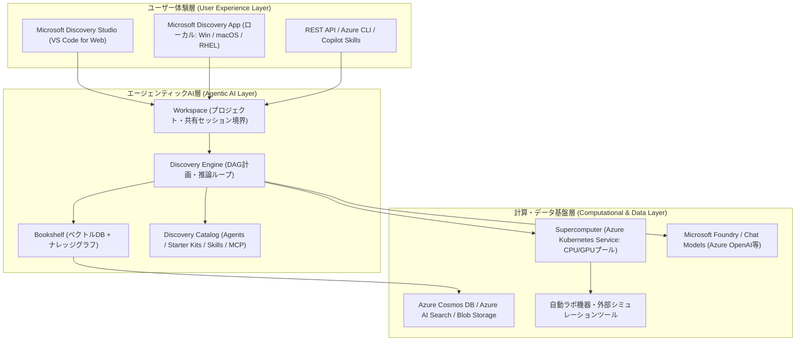

# **Microsoft Discovery 調査レポート**

## **1. 基本情報**

* **ツール名**: Microsoft Discovery
* **ツールの読み方**: マイクロソフト ディスカバリー
* **開発元**: Microsoft
* **公式サイト**: [https://learn.microsoft.com/ja-jp/azure/microsoft-discovery/](https://learn.microsoft.com/ja-jp/azure/microsoft-discovery/)
* **関連リンク**:
  * GitHub（コミュニティ・カタログ・Discovery App）: [https://github.com/microsoft/discovery](https://github.com/microsoft/discovery)
  * DeepWiki: [https://deepwiki.com/microsoft/discovery](https://deepwiki.com/microsoft/discovery)
  * ドキュメント（英語・最新）: [https://learn.microsoft.com/en-us/azure/microsoft-discovery/](https://learn.microsoft.com/en-us/azure/microsoft-discovery/)
  * コミュニティフォーラム: [Microsoft Discovery Discussions](https://techcommunity.microsoft.com/category/azure/discussions/microsoft-discovery-discussions)
* **カテゴリ**: AIアプリ開発基盤
* **概要**: Microsoft Discoveryは、科学的研究とR&Dワークフローを加速するために設計されたエンタープライズ向けエージェンティックAIプラットフォームである。エージェントオーケストレーション（Discovery Engine）、グラフベースのナレッジ基盤（Bookshelf）、およびAzure Kubernetes Service（AKS）ベースのハイパフォーマンスコンピューティング（Supercomputer）を統合し、文献調査から仮説生成、シミュレーション、自動ラボ実験までエンドエンドの研究開発を支援する。Azure上のクラウドサービス版と、個人研究者向けのローカルデスクトップアプリ（Microsoft Discovery app）の2形態で提供されている。

## **2. 目的と主な利用シーン**

* **解決する課題**: 膨大な科学的文献や過去の実験データに基づく迅速な知識統合の困難さ、および仮説立案からシミュレーション・実験計画・検証に至るR&Dサイクルの長期化。
* **想定利用者**: 科学者、研究者、実験・ベンチサイエンティスト、計算エンジニア、IT管理者、R&Dリーダー。
* **利用シーン**:
  * GraphRAGベースのBookshelfを用いた科学文献・特許レビューと社内実験データの統合（知識発見）
  * 自然言語によるAI支援仮説のブレインストーミングと、有向非巡回グラフ（DAG）による構造化された実験・シミュレーション計画
  * AKS上のSupercomputerを用いたハイスループットシミュレーションによる設計候補（創薬分子、新材料、半導体チップ等）のスクリーニング
  * 自動化されたラボやロボット工学の計装と連携した、データ駆動型の閉ループ自動実験

### **2.1 代表的な利用フロー**

```mermaid
swimlane-beta TB
  subgraph Researcher["研究者・開発者"]
    A["研究目標・仮説の入力"]
    F["中間結果の評価・実験承認"]
  end
  subgraph UI["Discovery Studio / ローカルApp"]
    B["Workspace・共有セッション管理"]
    E["タスクグラフ・可視化結果の提示"]
  end
  subgraph Engine["Discovery Engine / Bookshelf"]
    C["タスク分解・グラフ知識検索"]
    D["専門エージェント・MCPツール選定"]
  end
  subgraph Compute["Supercomputer (AKS) / ラボ基盤"]
    G["コンテナ化シミュレーション・実験実行"]
  end
  A --> B
  B --> C
  C --> D
  D --> G
  G --> E
  E --> F
```

* **代表的な流れ**: 研究者がDiscovery Studio（Web）またはローカルのDiscovery Appから研究目標を入力すると、Discovery EngineがBookshelfのナレッジグラフを参照しながらタスクを分解し、適切なエージェントやMCPツールを選定してSupercomputer（AKS）やラボ機器上で計算・実験を実行する。得られた結果はUI上で可視化され、研究者が評価・承認することで次の検証サイクルへ進む。

## **3. 主要機能**

* **Discovery Engine（エージェント駆動型調査）**: 単発のQ&Aにとどまらず、研究目標を有向非巡回グラフ（DAG）やタスクツリーに分解し、仮説生成・シミュレーション・結果評価の連続的な推論ループを自律実行する認知オーケストレーター。
* **Bookshelf & Knowledge Bases（グラフベース知識基盤）**: PDF、論文、表計算データ、コードなどの非構造化データをインデックス化し、ベクトル検索とナレッジグラフ（GraphRAG手法）を組み合わせて組織の知識を永続化・検索する。
* **Microsoft Discovery Studio & 共有セッション**: VS Code for the Webをベースとしたブラウザ上の統合研究環境（クラウド版）。複数の研究者が同一の共有セッションでエージェントの推論過程や解析結果をリアルタイムに確認・協働できる。
* **Supercomputer（AKS / Azure HPC統合）**: Azure Kubernetes Service（AKS）上のCPU/GPUノードプールをマネージド実行基盤として利用し、分子動力学やマルチフィジックス等のコンテナ化された科学計算ツールを安全にスケール実行する。
* **Discovery Catalog & Agent Skills（MCP対応）**: GitHub上の公開カタログを通じて、専門エージェント（`agents/`）、スターターキット（`starter-kits/`）、[Agent Skills](https://agentskills.io)準拠の再利用可能ワークフロー（`skills/`）、検証済みシナリオ（`validated-scenarios/`）を提供する。
* **自動実験オーケストレーション（Lab Integration）**: ロボット工学や自動ラボ機器と連携し、実験プロトコルの生成から物理実験のトリガー、測定データの自動取り込みまでをエンドツーエンドで支援する。
* **エンタープライズガバナンスと透明性**: エージェントの推論ステップやツール呼び出しの監査証跡を保持し、Microsoft Entra IDによるアクセス制御とコンプライアンス要件を満たす。

## **4. 動作原理・システム構成**

* **アーキテクチャ**: Azure Resource Manager（ARM）で管理される**3層構造のエンタープライズクラウドアーキテクチャ**と、ローカルディレクトリ（`.discovery/`）で状態を管理する**ローカルファースト型デスクトップクライアント（Discovery App）**のハイブリッド構成。クラウド版は組織自身のAzureサブスクリプションおよびMicrosoft Entraテナント内にデプロイされるため、データや計算リソースが外部のブラックボックス環境に出ることなく、顧客のセキュリティ境界内で完結する。



* **主要コンポーネントとデータフロー**:
  * **Workspace**: チーム単位で共有する論理境界。クラウド版ではARMリソースとしてネットワーク・Supercomputer・チャットモデル・プロジェクトを束ね、ローカル版ではローカルフォルダ配下の `.discovery/` で状態を管理する。
  * **Discovery Engine とデータ処理**: ユーザーからの目標を受け取ると、Bookshelf（Azure AI Search・Cosmos DB等をバックエンドとする知識グラフ）から関連文献や過去の実験結果を取得してグラウンディングを行い、コンテナ化された計算ツールをSupercomputer（AKS）上の隔離されたポッドで実行する。
* **特筆すべき要素技術**:
  * **AKSベースのSupercomputer**: 計算ツールをコンテナイメージとしてパッケージ化し、CPU最適化・GPUアクセラレーション等のノードプールへ動的にスケジューリングする。2026年11月からはローカルDockerモードでのイメージビルドにも対応した。
  * **オープン標準の採用**: Agent Skills（`SKILL.md`）やMCP（Model Context Protocol）サーバー仕様、JSONスキーマによるエージェント・ツール定義を採用し、GitHub Copilot CLIやVS Code Copilot Chatとの連携を実現している。

## **5. 開始手順・セットアップ**

* **前提条件**:
  * **クラウド版（Microsoft Discovery）**: Azureサブスクリプション、適切な管理者権限、Microsoft Entra IDテナント、クォータ割り当て。
  * **ローカル版（Microsoft Discovery app）**: Windows（x64 / ARM64）、macOS（Apple Silicon / Arm64）、またはRHEL x64環境、およびGitHub Copilotアカウント（SDKやクラウド構築は不要）。
* **インストール/導入**:
  * **ローカル版**: [GitHubのリリースページ](https://github.com/microsoft/discovery/releases)またはREADME記載のダウンロードリンクから、各OS向けインストーラー（`.exe` / `.dmg` / `.rpm`）を取得してインストールする。
  * **クラウド版**: Microsoft Learnのガイドに従い、Azureポータル、Bicepテンプレート、または2026年11月に追加されたTerraformデプロイユーティリティを用いてWorkspace・AKS（Supercomputer）・ストレージ等をデプロイする。
* **初期設定**:
  * **クラウド版**: Microsoft Entra ID（RBAC）のロール割り当て、仮想ネットワーク（VNet）およびプライベートエンドポイントの構成、Blob Storage・Azure AI Search・Microsoft Foundryモデルの接続設定を行う。
  * **ローカル版**: アプリ起動後にGitHub Copilotアカウントでサインインし、作業ディレクトリをWorkspaceとして指定する。
* **クイックスタート**:
  * リポジトリの `starter-kits/` または `validated-scenarios/`（BioPharma、Chemistry and Materials Science、Bookshelf SCLC等）から任意のシナリオを選択し、コピー＆ペースト用プロンプトを用いて最初のエージェント調査を実行する。

## **6. 特徴・強み (Pros)**

* **科学的手法を模倣する自律推論**: 単なるチャットボットではなく、Discovery EngineがDAG構造のタスク計画を立て、仮説立案からシミュレーション実行、失敗時の軌道修正までを自律的に反復できる。
* **企業独自の実験知識の永続化（Bookshelf）**: 社内の過去データ（ネガティブデータを含む）と外部論文をグラフ構造で統合し、部門間・拠点間での重複実験を防止できる。
* **ローカルAppからエンタープライズCloudへのシームレスな移行**: 個人の研究者がWindows/macOS/RHEL上の無料ローカルアプリで手軽に検証を始め、成果が出たワークフローやスターターキットをAzure上の本番環境へスケールさせることが可能。
* **エンタープライズ水準のガバナンス**: 顧客のAzureサブスクリプション・Entraテナント内に展開されるため、厳格な知財保護・コンプライアンス要件を持つ製薬・半導体・素材メーカーでも安心して導入できる。

## **7. 弱み・注意点 (Cons)**

* **Azureエコシステムへの強い依存**: クラウド版はAzureネイティブ（AKS、Cosmos DB、AI Search、Entra ID）で設計されているため、AWSやGoogle Cloud上へ直接デプロイすることはできない。
* **クラウド導入・運用の学習コスト**: 本番用のエンタープライズ環境を構築するには、Azureのネットワーク分離、クォータ設計、Bicep/TerraformによるIaC管理など高度なクラウドインフラ知識が求められる。
* **日本語対応とUIの制約**: Microsoft Learnの公式ドキュメントは日本語でも提供されているが、最新の機能解説やGitHub上のDiscovery Catalog（スターターキットやプロンプト集）、コミュニティ議論は英語が中心となる。また、ローカル版Discovery Appの利用にはGitHub Copilotサブスクリプションが必須である。

## **8. 料金プラン**

| プラン名 | 料金 | 主な特徴 |
|---------|------|---------|
| **Microsoft Discovery (Azureクラウド版)** | ランタイム: $0.20 / 1 User Message<br>＋ Azureインフラ従量課金 | 1 User Message = 10バックエンド操作（作成・更新・実行等）として1時間単位で集計。Supercomputer (AKS)、Cosmos DB、AI Search、モデルトークン等のAzure使用料が別途発生。 |
| **Microsoft Discovery App (ローカル版プレビュー)** | プラットフォーム利用料 無料 | Windows / macOS / RHEL向けデスクトップクライアント。追加のプラットフォーム課金なしで利用可能だが、GitHub Copilotサブスクリプションが別途必要。 |

* **課金体系**:
  * クラウド版のランタイム課金は、作業の作成・更新・削除・実行・キャンセル等の書き込み／実行系操作（10操作＝1 User Message＝$0.20）に対して発生する。
  * 状態確認、ログ取得、一覧表示などの読み取り専用操作（`GET` リクエスト）および制御プレーン管理操作は非課金。
* **無料トライアル**: Discovery専用の無料トライアル枠は公式には明示されていないが、ローカル版のDiscovery Appを通じてプラットフォーム利用料無料で機能を試用できる。クラウド版はAzureの契約・無料クレジット条件に準じる。

## **9. 導入実績・事例**

* **導入企業・研究機関**:
  * **Microsoft Quantum**: 次世代量子チップ「Majorana 2」の開発において、Discoveryを活用し開発期間の短縮と量子ビットのコヒーレンス指標改善に役立てた事例が報告されている。
  * **Pacific Northwest National Laboratory (PNNL)**: 自動ラボ・ロボット工学と連携した仮説検証の閉ループ実験オーケストレーションで協業。
  * **Synopsys**: マルチエージェントAIスタックを活用した半導体チップ設計ワークフローでの連携。
* **導入事例**: バイオ医薬品分野におけるCDKターゲット選定・リード化合物探索、材料科学・化学における分子スクリーニング、半導体設計におけるマルチフィジックスシミュレーションなど。
* **対象業界**: 医薬品・バイオテクノロジー、化学・材料科学、半導体、エネルギー、高度な製造業のR&D部門。

## **10. サポート体制**

* **ドキュメント**: [Microsoft Learn](https://learn.microsoft.com/en-us/azure/microsoft-discovery/)にて、アーキテクチャ、概念解説、計画・デプロイガイド、REST APIリファレンスが体系的に提供されている（一部日本語翻訳あり）。
* **コミュニティ**: Microsoft Community Hub上の[Microsoft Discovery Discussions](https://techcommunity.microsoft.com/category/azure/discussions/microsoft-discovery-discussions)および[GitHubリポジトリ](https://github.com/microsoft/discovery)にて、Q&A、バグ報告、スターターキットやスキルのコントリビューションが活発に行われている。
* **公式サポート**: Azureプラットフォームを通じたエンタープライズサポート契約に基づく技術サポート（SLA含む）およびGitHub Issueでの問題追跡が利用可能。

## **11. エコシステムと連携**

### **11.1 API・外部サービス連携**

* **API**: 調査タスク、エージェント会話、ジョブ実行、Bookshelf管理を操作するREST APIおよびAzure CLI拡張が提供されている。
* **外部サービス連携**: Microsoft Foundry（旧Azure AI Foundry）、Azure OpenAI、Microsoft Fabric、Microsoft 365、GitHub Copilot（CLI / VS Code Chat）、およびMCP（Model Context Protocol）対応の各種外部科学ツール・シミュレーションソフトと連携可能。

### **11.2 技術スタックとの相性**

| 技術スタック | 相性 | メリット・推奨理由 | 懸念点・注意点 |
|:---|:---:|:---|:---|
| **Azure (AKS, Entra ID, Foundry)** | ◎ | 基盤としてネイティブ統合されており、IAM・VNet・Supercomputer管理がシームレス。 | 十分なAzureクォータとネットワーク設計が必要 |
| **Terraform / Bicep** | ◎ | 公式のBicepテンプレートに加え、Terraformデプロイユーティリティがリポジトリで公式提供されている。 | 特になし |
| **Python (科学計算 / RDKit等)** | ◎ | 分子可視化や創薬エージェント等の多くがPythonベースで構築されており、ツール開発と親和性が極めて高い。 | コンテナ化（Docker）の知識があるとより望ましい |
| **GitHub Copilot / VS Code** | ◎ | ローカルAppの認証基盤および`.github/skills/`を通じたFoundryデプロイ連携に対応。 | 有料のCopilotライセンスが推奨される |

## **12. セキュリティとコンプライアンス**

* **認証**: Microsoft Entra ID（旧Azure AD）との統合によるSSO、ロールベースのアクセス制御（RBAC）、およびマネージドIDをサポート。
* **データ管理**: 顧客自身のAzureサブスクリプション・テナント内にデータが保持され、Azure Blob Storage等におけるカスタマーマネージドキー（CMK）暗号化、仮想ネットワーク（VNet）分離、プライベートエンドポイント構成が可能。ローカル版Discovery Appはローカルディレクトリ上で動作し、TLSトラストストア検証にも対応。
* **準拠規格**: Azureの責任共有モデルのもと、基盤インフラとしてISO/IEC 27001・27017・27018、SOC 2 Type 2、HIPAA（BAA提供）、FedRAMP High等のエンタープライズ基準に準拠し、Microsoft Defender for CloudやMicrosoft Purviewでコンプライアンス態勢を監査できる。

## **13. 操作性 (UI/UX) と学習コスト**

* **UI/UX**: クラウド版ではVS Code for the Webをベースとした「Microsoft Discovery Studio」が提供され、研究者はチャット指示・タスクグラフの進捗・コードや分子データの可視化を単一画面で扱える。ローカル版Discovery Appも直感的なデスクトップUIを備える。
* **学習コスト**: 研究者（エンドユーザー）にとっては自然言語とスターターキットを用いることで比較的容易に使い始められる一方、IT管理者・プラットフォームエンジニアにとってはAzureのIAM、VNet、AKSノードプール、クォータ管理など高度な習得コストがかかる。

## **14. ベストプラクティス**

* **効果的な活用法 (Modern Practices)**:
  * **ローカル検証からの段階的スケール**: まずは個人端末のMicrosoft Discovery Appと公式`validated-scenarios/`（検証済みシナリオ）でプロンプトやエージェント構成を検証し、効果が確認できてからクラウド版のSupercomputer（AKS）へ展開する。
  * **早期のBookshelf構築**: 過去の失敗実験（ネガティブデータ）も含めてプロジェクト初期にBookshelfへインデックス化し、重複検証を防ぐ。
* **陥りやすい罠 (Antipatterns)**:
  * **細分化しすぎた書き込み操作**: クラウド版では作成・更新・実行等のバックエンド操作10回につき1 User Message（$0.20）が課金されるため、状態確認にPUTを多用せず、非課金のGET操作でポーリングを行うべきである。
  * **クォータ未確認でのデプロイ**: GPUノードプールやAIモデルのTPMクォータ不足によりデプロイが失敗するケースが多いため、事前チェックとSKU選定を徹底する。

## **15. ユーザーの声（レビュー分析）**

* **調査対象**: Microsoft Tech Community、GitHub（`microsoft/discovery`）、Reddit、技術メディア（Forbes / Redmondmag等）
* **総合評価**: 一般的なSaaSレビューサイト（G2 / Capterra）への登録は現時点で確認されていないが、エンタープライズR&DおよびAI研究者コミュニティから高い技術的注目を集めている。
* **ポジティブな評価**:
  * 単なるコード生成や要約を超え、外部シミュレーションツールやHPCを自律的に呼び出す「Agentic Science（科学のためのエージェンティックAI）」の実用性が高く評価されている。
  * GitHub Copilotアカウントだけでローカル版のDiscovery Appを即座に試せるオンボーディングの手軽さが好評。
  * 顧客自身のAzureテナント内で完結するセキュリティ設計により、機密性の高い創薬・半導体データでも導入検討しやすい。
* **ネガティブな評価 / 改善要望**:
  * クラウド版のフル環境を構築するためのAzureインフラ要件（AKS・ネットワーク・クォータ）が重く、小規模ラボには導入ハードルが高い。
  * ローカル版がGitHub Copilotアカウントに依存している点について、他のモデルプロバイダーやBYOK（Bring Your Own Key）へのさらなる柔軟性を求める声がある。
* **特徴的なユースケース**:
  * 物理的なラボ実験や大規模HPCジョブを回す前段の仮想スクリーニングとしてDiscovery EngineとBookshelfを活用し、候補物質の絞り込み期間を数週間から数日・数時間単位へ短縮した事例。

## **16. 直近半年のアップデート情報**

* **2026-11-19**: GitHubリポジトリにてQuickStartsを「Validated Scenarios」へ名称変更し、Bookshelf SCLCシナリオおよび標準テンプレートを追加。
* **2026-11-17**: 安定版マニフェスト `v1.0.0` (build 6222586) を公開し、オンボーディング時のSKU選択・クォータ回帰テストを追加。
* **2026-11-16**: Microsoft Discovery向けのTerraformデプロイユーティリティを追加し、SupercomputerイメージビルドのローカルDockerモードに対応。
* **2026-11-12**: BioPharma向け検証済みシナリオの凍結参照スナップショット `cdk-frozen-reference-v0.11` をリリース。
* **2026-10-29**: Microsoft Discovery app プレビューリリース（最新 `v0.15.21`、macOS Arm64 / RHEL x64 / Windows x64・ARM64対応）を公開。エージェント・メタデータ・ツール定義のJSONスキーマを追加し、Microsoft Community Hubに公式議論フォーラムを開設。
* **2026-06-02**: Microsoft Build 2026にて、エンタープライズ向けクラウドサービス「Microsoft Discovery」の一般提供（GA）および「Microsoft Discovery app」のプレビューを公式発表。
* **2026-05-28**: Microsoft Discoveryの全体概要とアーキテクチャの公式ドキュメントを公開。
* **2026-04-20**: 主なシナリオに「ラボ統合・自動実験」のユースケースを追加。

(出典: [Microsoft Discovery GitHub Releases](https://github.com/microsoft/discovery/releases) / [Microsoft Learn - Microsoft Discovery](https://learn.microsoft.com/en-us/azure/microsoft-discovery/))

## **17. 類似ツールとの比較**

### **17.1 機能比較表 (星取表)**

| 機能カテゴリ | 機能項目 | Microsoft Discovery | Microsoft Copilot Studio | Gemini Enterprise Agent Platform | Vertex AI Studio | AWS DevOps Agent |
|:---:|:---|:---:|:---:|:---:|:---:|:---:|
| **基本機能** | 自律推論・マルチエージェント | ◎<br><small>DAG計画・科学推論ループ</small> | ◯<br><small>業務向け自律エージェント</small> | ◎<br><small>エンタープライズマルチエージェント</small> | ◯<br><small>プロトタイピング・API統合中心</small> | ◯<br><small>インシデント対応自律化</small> |
| **ドメイン特化** | 科学研究・HPC・ラボ連携 | ◎<br><small>AKS Supercomputer・GraphRAG</small> | ×<br><small>汎用業務・M365連携中心</small> | △<br><small>汎用開発基盤（カスタム構築可）</small> | △<br><small>汎用MLOps・モデル開発</small> | ×<br><small>システム運用・SRE特化</small> |
| **開発・拡張** | ローカル開発 / CLI・SDK | ◎<br><small>Win/macOS/RHEL App・Skills</small> | ◯<br><small>ローコードUI＋Power Platform</small> | ◯<br><small>agents-cli・ADK連携</small> | ◯<br><small>Python SDK・REST API</small> | △<br><small>AWSコンソール・連携ツール中心</small> |
| **エンタープライズ** | IAM・ガバナンス統合 | ◎<br><small>Entra ID・CMK・VNet分離</small> | ◎<br><small>Entra ID・Purview統合</small> | ◎<br><small>Google Cloud IAM・VPC</small> | ◎<br><small>Google Cloud IAM統合</small> | ◯<br><small>AWS IAM統合</small> |
| **非機能要件** | 日本語ドキュメント・UI | ◯<br><small>Learn日本語版あり（一部英語）</small> | ◎<br><small>UI・ドキュメントとも充実</small> | ◯<br><small>公式日本語ドキュメントあり</small> | ◯<br><small>公式日本語ドキュメントあり</small> | ◯<br><small>公式ドキュメントあり</small> |

### **17.2 詳細比較**

| ツール名 | 特徴 | 強み | 弱み | 選択肢となるケース |
|---------|------|------|------|------------------|
| **Microsoft Discovery** | 科学的R&DとHPC・ラボ連携に特化したAzureネイティブAI基盤 | Bookshelf知識グラフ、AKS Supercomputer、ローカルAppからの段階的導入 | Azure専用であり、クラウド本番構築のインフラ要件が高い | 企業のR&D部門で創薬・材料・半導体等の研究を安全に加速したい場合 |
| **Microsoft Copilot Studio** | 業務プロセス自動化向けのローコードAIエージェント構築基盤 | M365・Power Platformとの強力な統合、ビジネスユーザーでも扱いやすいUI | 科学的HPCシミュレーションや研究特化機能は持たない | 社内の一般業務・問い合わせ・ワークフロー自動化を進めたい場合 |
| **Gemini Enterprise Agent Platform** | Google Cloud上の包括的なエンタープライズエージェント構築・運用基盤 | Gemini 3等の最新マルチモーダルモデルとBigQuery等のデータ基盤連携 | 機能が広範で学習コストが高く、科学実験特化ではない | Google Cloud上で汎用的なエンタープライズAIエージェントを統制・運用したい場合 |
| **Vertex AI Studio** | 生成AIモデルのプロトタイピングからMLOpsまでを網羅する開発環境 | Model Gardenによる多様なモデル選択とエンドツーエンドのMLOps | エージェントの自律タスク計画や研究ラボ連携は自前構築が必要 | 独自モデルのファインチューニングやアプリ組み込み用AI基盤を求める場合 |
| **AWS DevOps Agent** | AWS環境における運用監視・インシデント対応の自律型AIエージェント | AWS可観測性ツールとの深い統合による障害診断・修復の高速化 | 科学研究や汎用R&Dワークフローには非対応 | AWS上のシステム運用・SRE業務の自動化と障害対応時間短縮が目的の場合 |

## **18. 総評**

* **総合的な評価**:
  Microsoft Discoveryは、汎用的なチャットAIや業務自動化プラットフォームとは明確に一線を画し、科学研究と高度なR&Dに特化した極めて実践的なエンタープライズソリューションである。2026年6月のGA以降も、macOS・RHELを含むマルチOS対応のローカル版Discovery Appの拡充、Terraformデプロイ対応、Agent Skills/MCP準拠のカタログ整備など急速に成熟を進めており、研究者の個人利用から企業の大規模HPC環境までを繋ぐ完成度の高い基盤となっている。
* **推奨されるチームやプロジェクト**:
  * Azure環境およびMicrosoft Entra IDを導入済みの、製薬・化学・材料・半導体・エネルギー分野の大企業や研究機関のR&D部門。
  * 膨大な過去実験データや文献を統合し、物理テスト・ラボ実験前の仮想スクリーニングを効率化したい研究開発チーム。
* **選択時のポイント**:
  クラウド版の本番運用にはAzureインフラの設計投資と適切なコスト管理（User Message課金およびAKSリソース管理）が不可欠であるため、まずは無料のローカル版Microsoft Discovery Appと公式のValidated Scenariosを用いて研究チーム内で小規模なPoCを実施し、費用対効果を見極めた上でクラウド展開へ進むことが推奨される。
