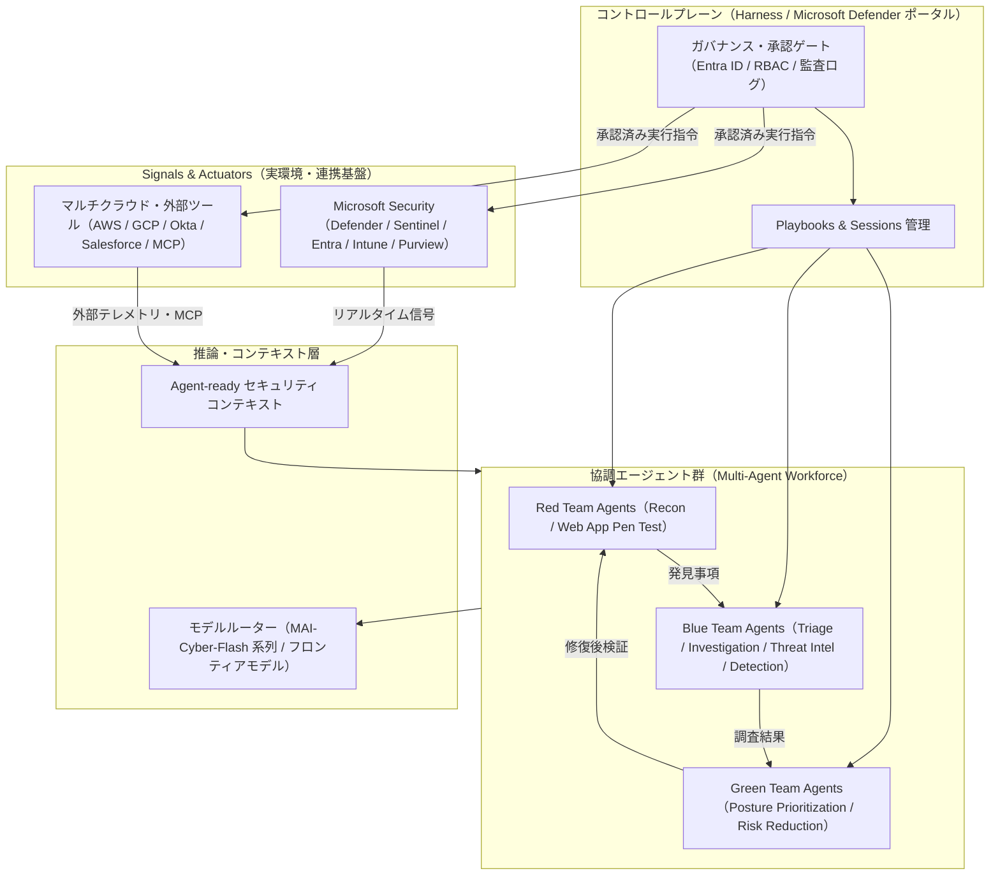

# **Microsoft Perception 調査レポート**

## **1. 基本情報**

* **ツール名**: Microsoft Perception（開発コードネーム・プレビュー時名称: Project Perception）
* **ツールの読み方**: マイクロソフト パーセプション
* **開発元**: Microsoft
* **公式サイト**: [https://www.microsoft.com/ja-jp/security/business/microsoft-perception-agentic-system](https://www.microsoft.com/ja-jp/security/business/microsoft-perception-agentic-system)
* **関連リンク**:
  * ドキュメント: [Microsoft Learn セキュリティ](https://learn.microsoft.com/ja-jp/security/)
  * 公式ブログ: [Microsoft Security Blog](https://www.microsoft.com/en-us/security/blog/)
* **カテゴリ**: セキュリティ
* **概要**: Microsoft Perceptionは、AI駆動で高速化するサイバー攻撃に対抗するため、専門特化したRed・Blue・GreenのAIエージェント群を協調させるエンタープライズ向けエージェンティックセキュリティシステムである。Microsoft Defenderポータルを中核に、脅威の事前検証、アラートのトリアージ・調査、ポスチャ改善と修復までを閉ループで自動化し、人間によるガードレール設定と重要操作の承認を組み合わせた「Human-in-Control」の自律防御を提供する。

## **2. 目的と主な利用シーン**

* **解決する課題**: 攻撃者がAIを活用して脆弱性発見から悪用までの時間を「数ヶ月から数分」へと短縮する中、従来の人手中心かつツール間でサイロ化したSOC（Security Operations Center）では対応速度と人手の限界に達しているという課題を解決する。また、企業内で稼働するAIエージェント自体が広範なデータ・ツールアクセス権を持つ新たな内部脅威（「Agentic Insider」）となるリスクへの統制も担う。
* **想定利用者**: エンタープライズ企業のSOCアナリスト、SecOpsチーム、CISO・セキュリティガバナンス担当者、クラウドセキュリティエンジニア。
* **利用シーン**:
  * **SOCアラートの自律トリアージとインシデント調査**: 大量に発生するDefenderキューの標準アラート（約80%相当とされる定型アラート）をBlue Teamエージェントが自律的に分類・調査し、人間のアナリストを高度な判断に集中させる。
  * **継続的な攻撃シミュレーションと経路特定**: Red Teamエージェント（Recon Agentなど）が環境を継続的に偵察し、攻撃経路、設定ミス、過剰な権限、ボトルネックを攻撃者より先に特定する。
  * **マルチクラウド環境のポスチャ改善と一時防御**: Green TeamエージェントがAzure・AWS・Google Cloud上の優先対応リスクを抽出し、パッチ適用が間に合わない脆弱性に対する一時的な防御（Vulnerability Shielding）や設定強化を提案・実行する。

### **2.1 代表的な利用フロー**

```mermaid
swimlane-beta TB
  subgraph Security_Admin["セキュリティ担当者"]
    A["ガードレール設定・プレイブック起動"]
    F["高影響アクションの承認・結果確認"]
  end
  subgraph Perception["Microsoft Perception"]
    B["Red: 攻撃経路・脆弱性を探索"]
    C["Blue: アラート検知・脅威調査"]
    D["Green: 修復案・防御強化を生成"]
  end
  subgraph External_Stack["Microsoft Security / マルチクラウド"]
    E["テレメトリ提供・修復アクション実行"]
  end
  A --> B
  B -->|"発見事項を共有"| C
  C -->|"調査結果を連携"| D
  D -->|"承認リクエスト"| F
  F -->|"承認"| E
  E -->|"最新状態を還元"| B
```

* **代表的な流れ**: セキュリティ担当者がガードレールとプレイブックを設定すると、Microsoft Perception内のRed・Blue・Greenエージェントが協調して探索・調査・修復案生成の閉ループを実行し、重要度の高い修復アクションのみ人間の承認を経てMicrosoft Securityやマルチクラウド環境へ反映される。

## **3. 主要機能**

* **Playbooks（プレイブック）**: 特定のセキュリティ成果（Outcome）に向けて複数エージェントの連携手順を定義する再利用可能なテンプレート機能。自然言語での目的指示や事前定義プレイブックの選択により、タスク分解から後続エージェントへの引き継ぎまでを自動統制する。
* **Red Team Agents（攻撃シミュレーション）**: Recon Agent（GA）やWeb App Pen Test Agent（パブリックプレビュー）などが攻撃者の視点で環境を偵察し、攻撃経路や設定不備、過剰権限を事前発見する。
* **Blue Team Agents（検知・トリアージ・調査）**: Alert Triage Agent、Attack Investigation Agent、Detection Authoring Agent、Threat Intelligence Agent（いずれもGA）が連携し、アラートの真陽性/誤検知判定、攻撃パターンの抽出、検知ルールの自動作成、Tier 2相当のインシデント調査を自律実行する。
* **Green Team Agents（ポスチャ改善・修復）**: Posture Prioritization（GA）やRisk Reduction Agent（パブリックプレビュー）が、発見された脆弱性やリスクの優先順位付けを行い、設定強化やパッチ未適用環境への一時的防御策（Vulnerability Shielding）を実施する。
* **Harness（オーケストレーションとガバナンス基盤）**: 全エージェントとモデルの実行を単一のコントロールプレーンで統制し、Entra IDに基づく最小権限アクセス、重要アクション前の承認ゲート、全操作の監査ログ記録とセッション（Sessions）管理を提供する。
* **Purpose-built Cyber Models（サイバー特化型モデル）**: セキュリティタスク向けに特化した「MAI-Cyber-Flash」系列（MAI-Cyber-1-Flash、MAI-Cyber-2 Flash等）などの軽量・高速モデルと大規模フロンティアモデルをタスク難易度に応じて動的に使い分け、品質・速度・コストを最適化する。
* **Agent-ready Security Context & Signals / Actuators**: Microsoft Defender、Entra、Intune、Purview、Sentinelやサードパーティ製ツールからのリアルタイム信号（Signals）を統合してエージェントが理解可能なコンテキストへ変換し、脅威の封じ込めや構成変更を行うアクチュエーター（Actuators）を通じて実環境へ作用する。
* **Agentic Insider対策（Dynamic Agent Risk）**: AIエージェント自体の振る舞いリスクを継続的に監視し、Microsoft Entra ID Governanceおよび条件付きアクセスと連動してタスク単位・期間限定の動的権限付与やリスク時の権限制限を行う。

## **4. 動作原理・システム構成**



* **アーキテクチャ**: Microsoft Defenderポータルを統合入口とするクラウド完結型SaaSのマルチエージェント・オーケストレーションアーキテクチャを採用している。システム内部の詳細な実装コードは非公開だが、公式アーキテクチャ解説では「Playbooks」「Agents」「Harness」「Models」「Context」「Signals & Actuators」の6つの構成要素によって閉ループ型の自律セキュリティ運用を実現する構造が公開されている。
* **主要コンポーネントとデータフロー**:
  * **データ収集とコンテキスト化**: Microsoft Defender、Microsoft Sentinel、Entra、Intune、Purviewおよびマルチクラウド（AWS、GCP）や外部SaaSからテレメトリ（Signals）を収集し、脅威インテリジェンスと結合して「Agent-ready Security Context」を生成する。
  * **モデルルーティングとハーネス（MDASH）**: 脆弱性スキャンや定型トリアージなどの約90%に及ぶ高頻度タスクをコード解析・サイバーセキュリティ特化型の `MAI-Cyber-Flash` 系列モデルで高速・低コストに処理し、残りの高度な推論タスクのみを大規模フロンティアモデルへ振り分けることで計算コストを抑制する。
  * **セッション管理とHuman-in-the-Loop**: エージェント間の引き継ぎ、判断根拠、入出力、承認ステータスはすべて「Sessions」として記録される。高影響な修復アクションは承認ゲートで一時停止し、人間の承認後にActuatorsを介して実環境へ適用される。
* **特筆すべき要素技術**:
  * **Microsoft Entra Agent Identity**: 非人間エンティティであるAIエージェントに対し、専用のEntra IDアイデンティティ、RBAC、タスクスコープ・時間制限付きの動的権限を付与する仕組み。
  * **Model Context Protocol (MCP) および API 連携**: 外部SIEM、SOAR、ITSMツールやサードパーティ製データソースとの標準化されたコンテキスト接続を実現する。

## **5. 開始手順・セットアップ**

* **前提条件**:
  * Microsoft Defenderポータルへのアクセス権限および有効なMicrosoftテナント（Microsoft Entra ID）。
  * 課金用のAzureサブスクリプション（従量課金 Pay-As-You-Go、AI Flex Plan、またはMACC契約）。
  * エージェントへ権限を委任するためのUnified RBACおよびEntra ID管理者権限。
* **インストール/導入**:
  * クラウド型SaaSとしてMicrosoft Defenderポータル内の「Agentic security」セクションに統合されているため、ローカルへのソフトウェアインストールは不要である。
* **初期設定**:
  1. Microsoft Defenderポータルにアクセスし、Perceptionの有効化と課金設定（Pay-As-You-GoまたはAI Flex Planへの紐付け）を行う。
  2. コスト管理機能で予算上限やアラートしきい値を設定する。
  3. 各エージェント用のMicrosoft Entra IDアイデンティティと最小権限のRBACロール、および高影響アクションに対する承認ルール（ガードレール）を構成する。
  4. Microsoft Sentinel、Entra、Intune、Purviewや、必要に応じてAWS・GCP・外部SaaSとのデータコネクタを接続する。
* **クイックスタート**:
  * ポータル上で標準提供されている「Alert Triage」や「Posture Prioritization」などのプレイブックを選択し、対象スコープを指定して実行する。実行中の判断過程と承認待ちアクションは「Sessions」画面から確認・承認できる。

## **6. 特徴・強み (Pros)**

* **Red/Blue/Greenの閉ループ協調**: 攻撃シミュレーション（Red）、検知・調査（Blue）、修復・強化（Green）が単一基盤上でデータとコンテキストを共有し、発見から修復までを分断なく自動化できる。
* **Microsoft Security製品群とのネイティブ統合**: Defender、Sentinel、Entra、Intune、Purviewのセンサーとアクチュエーターをそのまま活用でき、既存のガバナンス・コンプライアンスポリシーを自動継承する。
* **特化型モデルによるコストと速度の最適化**: 汎用LLMのみに依存せず、Microsoft独自のサイバー特化型モデル（MAI-Cyber-Flash系列）とハーネスを組み合わせることで、マシン・スピードの処理とコスト効率を両立している。
* **エージェント自身のセキュリティ統制**: エージェントを「新たな内部脅威（Agentic Insider）」と位置付け、Entra IDベースの動的アクセス制御、最小権限、人間による承認ゲート、完全な監査ログを標準装備している。

## **7. 弱み・注意点 (Cons)**

* **新製品ゆえの成熟度とプレビュー機能の存在**: 2026年11月にGAされたばかりであり、Web App Pen Test AgentやRisk Reduction Agent、一部のクロスプラットフォーム連携機能などはパブリックプレビュー段階にある。
* **エコシステム依存と初期設計の負担**: マルチクラウド（AWS/GCP）やサードパーティ連携にも対応するものの、真価を発揮するにはMicrosoft Defender / Sentinel / Entraを中心とした環境整備と、適切なガードレール・プレイブック設計のノウハウが求められる。
* **従量課金コストの見積もり管理**: エージェントの自律実行量に応じた消費型課金のため、予算管理やコスト見積もりツールを活用しないと大規模スキャンや高頻度イベント発生時に想定外の課金が生じるリスクがある。
* **日本語対応の状況**: 公式サイト（ja-jp）やMicrosoft Learnのセキュリティ基盤ドキュメント、DefenderポータルUIは日本語に対応しているが、2026年11月時点の最新技術ブログや一部高度なエージェント設定ガイドは英語中心で提供されている。

## **8. 料金プラン**

| プラン / 調達形態 | 料金体系 | 主な特徴 |
|---|---|---|
| **Pay-As-You-Go（従量課金）** | 従量課金（タスク複雑度・処理量に応じて課金） | 初期コミットメントなしで、実際にエージェントが消費したリソース分のみ支払う柔軟なプラン。具体的な単価は環境・タスク種別により異なり要見積もり。 |
| **AI Flex Plan** | 1年または3年契約のクレジット前払い（一括/月払い） | Security CopilotやGitHub AI、Microsoft Foundry等と共通利用可能なAI消費クレジットを事前購入するエンタープライズ向けプラン。 |
| **MACC連携** | 既存Azureコミットメント充当 | Microsoft Azure Consumption Commitment（MACC）契約を保有する企業は、Pay-As-You-GoおよびAI Flex Planの消費額をMACC消化に充当可能。 |

* **課金体系**: 固定のユーザーシート課金ではなく、エージェントが実行したセキュリティタスクの処理強度や計算量に基づく消費型（Consumption-based）課金を採用している。管理画面には成果ベースの「Cost Estimator（コスト見積もりツール）」と予算・消費アラート機能が内蔵されている。
* **無料トライアル**: 恒久的な無料プランは提供されていないが、公式サイトから製品試用版・営業問い合わせを通じた評価導入が可能である。

## **9. 導入実績・事例**

* **導入企業**: Nationwide（Nationwide Building Society）などが早期導入企業として公式に紹介されている。
* **導入事例**: 英国の大手金融機関であるNationwideでは、従来複数の異なるセキュリティツールを跨いで行っていた脅威の特定から追跡・修復までの業務をMicrosoft Perceptionのエージェンティックワークフローに統合し、数週間かかっていた脅威インテリジェンス分析と対応作業を数時間へと大幅に圧縮したことが報告されている。
* **対象業界**: 大規模なセキュリティ運用体制を持ち、膨大なアラート処理とマルチクラウド保護が求められる金融機関、エンタープライズ企業、規制産業を中心に導入が進んでいる。

## **10. サポート体制**

* **ドキュメント**: [Microsoft Learn セキュリティ](https://learn.microsoft.com/ja-jp/security/) にてアーキテクチャ解説やDefenderポータル連携ガイド、学習パスが提供されている。
* **コミュニティ**: Microsoft Tech Community 内に専用スペース（Microsoft Perception Tech Community）が設けられており、製品発表、エンジニアによるAMA（Ask Me Anything）、ユーザー間の情報交換が行われている。
* **公式サポート**: エンタープライズ契約（Microsoft Unified Support等）およびAzureサポートプランに準拠した公式サポート窓口（ポータル・電話・メール等、日本語対応含む）が利用可能である。

## **11. エコシステムと連携**

### **11.1 API・外部サービス連携**

* **API**: Microsoft Graph Security APIおよびMicrosoft DefenderポータルAPI、さらに外部エージェントやツールと標準化されたコンテキストを共有するための **Model Context Protocol (MCP)** に対応している。
* **外部サービス連携**:
  * **Microsoft Security製品群**: Microsoft Defender XDR、Microsoft Defender for Cloud、Microsoft Sentinel、Microsoft Entra ID、Microsoft Intune、Microsoft Purview
  * **マルチクラウド**: Amazon Web Services (AWS)、Google Cloud Platform (GCP)
  * **外部SaaS / IdP / ITSM**: Okta、Salesforce、各種サードパーティSIEM/SOAR・ITサービス管理ツール

### **11.2 技術スタックとの相性**

Microsoft Perceptionはアプリケーション開発用SDKではなく、クラウド・セキュリティ運用基盤（SaaS）であるため、企業が運用するプラットフォーム・クラウド基盤との相性で評価する。

| プラットフォーム / 基盤 | 相性 | メリット・推奨理由 | 懸念点・注意点 |
|:---|:---:|:---|:---|
| **Microsoft Azure / M365** | ◎ | Defender・Entra・Sentinel・Purviewとネイティブ統合され、設定変更や封じ込めまで一気通貫で自動化可能 | 既存のAzure/Defender権限設計の整理が必要 |
| **AWS / Google Cloud** | ◯ | Green/Redエージェントがマルチクラウドのポスチャ改善・攻撃経路探索に対応 | 一部の深いアクチュエーター連携やクロスプラットフォーム機能は順次拡充中 |
| **オンプレミス / ハイブリッド** | ◯ | Microsoft DefenderおよびAzure Arc経由のテレメトリ連携により調査・検知対象に含められる | クラウド環境と比較して自動修復（Actuator）の範囲に制約が出る場合がある |
| **サードパーティ製SIEM/ITSM** | ◯ | APIおよびMCPを通じてチケット起票や外部信号の取り込みが可能 | 独自のカスタム連携にはプレイブックやコネクタ設定の作り込みが必要 |

## **12. セキュリティとコンプライアンス**

* **認証**: Microsoft Entra IDと完全に統合されており、SSO（シングルサインオン）、多要素認証（MFA）、条件付きアクセスに対応する。また、自律動作するAIエージェント自体にも専用のEntra IDアイデンティティと時間・タスク限定の動的権限（Least-privilege）が付与される。
* **データ管理**: Microsoftクラウドのセキュリティ基盤および顧客テナントの既存ガバナンス・データレジデンシーポリシーを継承する。エージェントの全アクション、判断根拠、承認履歴は監査ログ（Sessions）として改ざん防止された形で記録・保持される。
* **準拠規格**: Microsoft Trust Center（[https://www.microsoft.com/ja-jp/trust-center](https://www.microsoft.com/ja-jp/trust-center)）に準拠したエンタープライズセキュリティ基準を満たすとともに、PerceptionのRed/Blue/Greenエージェントが自動生成するアクセスレビューや脆弱性対応の監査証跡により、**ISO 27001**、**SOC 2**、**GDPR**、日本の政府情報システム向けセキュリティ評価制度（**ISMAP**）などのコンプライアンス監査対応を強力に支援する。

## **13. 操作性 (UI/UX) と学習コスト**

* **UI/UX**: 専用の独立した管理画面を新たに覚えるのではなく、既存のMicrosoft Defenderポータル内の「Agentic security」セクションに統合されている。自然言語チャットでの指示、プレイブックの選択、Sessions画面での承認操作など直感的なUIを備える。
* **学習コスト**: 基本的なトリアージやプレイブック実行の開始は容易だが、組織のセキュリティポリシーに合致したガードレール設計、Entra IDのRBAC調整、カスタムプレイブックの最適化には一定のSecOpsおよびMicrosoft Security製品の知識を要する。

## **14. ベストプラクティス**

* **効果的な活用法 (Modern Practices)**:
  * **段階的な自律化（Read-onlyから承認付き修復へ）**: 導入初期はBlue TeamのAlert TriageやRed TeamのRecon（調査・可視化）から開始し、精度を確認した上でGreen Teamによる承認付き修復へ段階的に拡張する。
  * **特化型モデルの活用と予算統制**: コスト見積もりツールと予算アラートを初期段階で設定し、定型トリアージは特化型モデルに任せることでコスト対効果を最大化する。
* **陥りやすい罠 (Antipatterns)**:
  * **過剰権限の付与**: エージェントに無制限の管理者権限を与えることは「Agentic Insider」リスクを増大させるため、必ずタスク単位・最小権限のEntra IDロールと承認ゲートを設定する。
  * **人間による監査の放棄**: マシン・スピードの自動化に頼り切ってSessionsログや誤検知のフィードバックを放置すると、環境変化への追従性が低下する。

## **15. ユーザーの声（レビュー分析）**

* **調査対象**: Reddit（r/technology, r/vibecoding等）、X（Twitter）、およびセキュリティ専門メディア（SecurityWeek等）。※2026年11月のGA直後のため、G2、Capterra、ITreviewにはMicrosoft Perception単体のレビュー登録はまだ確認されていない。
* **総合評価**: 評価スコア未掲載（GA直後のため主要BtoBレビューサイトでの集計前）。
* **ポジティブな評価**:
  * 「従来のツール横断的な調査に数週間かかっていた作業を数時間に短縮できた」（Nationwide導入事例より）
  * 「攻撃のAI化による数時間での脆弱性悪用に対抗するには、このようなマシン・スピードの防御自動化が不可欠」（Reddit等のセキュリティコミュニティの反応より）
  * 「MAI-Cyber-Flashのような特化型モデルをハーネスで組み合わせることで、巨大LLMを直接回すより現実的なコストに抑えている点が合理的」（Reddit技術スレッドより）
* **ネガティブな評価 / 改善要望**:
  * 「自律エージェントに修復権限を与える際のガバナンス設計と、誤動作時の責任範囲の明確化が導入のハードルになる」（セキュリティ専門家コミュニティの議論より）
  * 「消費型課金（Pay-As-You-Go）の予測が難しく、大規模テナントでの実運用コストを見極める必要がある」
  * 「一部エージェント（Web App Pen TestやRisk Reduction）がまだプレビュー段階であり、全機能のGAが待たれる」
* **特徴的なユースケース**:
  * 深夜・休日に急増するフィッシングやエンドポイントアラートの一次・二次トリアージをBlue Teamエージェントに委任し、少人数のSOCチームで24時間365日の初動対応品質を維持する運用。

## **16. 直近半年のアップデート情報**

* **2026-11-17**: Microsoft Ignite 2026（Satya Nadella CEO基調講演）にて「Microsoft Perception」の一般提供（GA）を正式発表。Blue Team 4種（Alert Triage, Attack Investigation, Detection Authoring, Threat Intelligence）、Red TeamのRecon Agent、Green TeamのPosture PrioritizationがGAとなり、Web App Pen Test AgentやRisk Reduction Agent、Dynamic Agent Risk機能がプレビュー提供された。
* **2026-08-03**: 「Project Perception」としてMicrosoft Defenderポータル内でのPublic Preview（Limited Public Preview）を開始。
* **2026-07-27**: 複数エージェント協調型セキュリティ基盤「Project Perception」構想を初公開。

（出典: [Microsoft Security Blog](https://www.microsoft.com/en-us/security/blog/)）

## **17. 類似ツールとの比較**

### **17.1 機能比較表 (星取表)**

| 機能カテゴリ | 機能項目 | Microsoft Perception | Google AI Threat Defense | Microsoft Defender for Cloud | AWS Security Hub | Strix |
|:---:|:---|:---:|:---:|:---:|:---:|:---:|
| **基本機能** | 自律マルチエージェント協調 | ◎<br><small>Red/Blue/Green閉ループ協調</small> | ◎<br><small>Wiz Red/Blue・CodeMender連携</small> | △<br><small>CSPM/CWPP主体・Copilot補助</small> | △<br><small>自動化ルール主体</small> | ◯<br><small>攻撃検証・PR生成に特化</small> |
| **攻撃・検証** | 自律Red Team / ペンテスト | ◎<br><small>Recon(GA)・Web PenTest(Preview)</small> | ◎<br><small>Wiz Red Agent・隔離PoC検証</small> | ×<br><small>攻撃経路分析のみ</small> | ×<br><small>非対応</small> | ◎<br><small>OSS自律AIペンテスト</small> |
| **検知・対応** | SOCアラート自律トリアージ | ◎<br><small>標準アラートの約80%を自律処理</small> | ◎<br><small>Mandiant知見で自律調査</small> | ◯<br><small>XDR連携で検知・調査</small> | ◯<br><small>検出結果の集約・相関</small> | ×<br><small>非対応</small> |
| **環境対応** | マルチクラウド対応 | ◯<br><small>Azure/AWS/GCP・外部SaaS対応</small> | ◎<br><small>Wiz基盤でマルチクラウド対応</small> | ◎<br><small>Azure/AWS/GCP包括対応</small> | △<br><small>AWSネイティブ主体</small> | ◯<br><small>アプリ・API単位で環境非依存</small> |
| **開発・OSS** | コード修正PR自動生成 / OSS | △<br><small>設定強化中心・商用SaaS</small> | ◎<br><small>CodeMenderでパッチ自律生成</small> | ◯<br><small>DevSecOps連携・商用</small> | ×<br><small>商用サービス</small> | ◎<br><small>OSS・修正PR自動生成</small> |
| **非機能要件** | 日本語対応 | ◯<br><small>ポータルUI・基本文書は日本語対応</small> | ◯<br><small>日本語サポート・ドキュメントあり</small> | ◎<br><small>日本語UI・公式文書が充実</small> | ◎<br><small>日本語UI・公式文書が充実</small> | △<br><small>英語ドキュメント主体</small> |

### **17.2 詳細比較**

| ツール名 | 特徴 | 強み | 弱み | 選択肢となるケース |
|---|---|---|---|---|
| **Microsoft Perception** | Microsoft Security全体を統合するRed/Blue/Green協調型自律セキュリティシステム | M365・Entra・Defenderとの深い統合、特化型モデルによるコスト最適化、Agentic Insider統制 | GA直後で一部プレビュー、Microsoftエコシステム外での完全自動化には設定が必要 | Microsoft 365 / Azureを中核とし、SOCのトリアージから修復・Red Teamまで一元自動化したい企業 |
| **Google AI Threat Defense** | Gemini・Wiz・Mandiant・CodeMenderを統合した自律型防衛基盤 | 隔離環境でのPoC検証とCodeMenderによるコード修正パッチ自律生成、マルチクラウドCSPMの強み | 大規模エンタープライズ向け個別見積もりであり、導入の前提規模が大きい | Google Cloudやマルチクラウド上でコードレベルの脆弱性自律修復と脅威インテリジェンスを重視する場合 |
| **Microsoft Defender for Cloud** | マルチクラウド・ハイブリッド環境向けの統合CNAPP | 安定したCSPM/CWPP機能、サーバーレスやSQL・コンテナの包括的保護、明確な日本語ドキュメント | SOCの自律トリアージやRed Team自動実行などのエージェンティック運用機能はPerception側が担う | クラウドワークロードのポスチャ管理（CSPM）とランタイム保護を確実に固めたい場合 |
| **AWS Security Hub** | AWS環境全体のセキュリティ可視化とリスク優先順位付け基盤 | AWSネイティブサービス（GuardDuty等）とのシームレスな統合、OCSF対応、低コストな導入 | マルチクラウド対応や自律型AIエージェントによる攻撃シミュレーション機能は限定的 | AWS中心のインフラで、まず標準的なコンプライアンスチェックとアラート集約を行いたい場合 |
| **Strix** | コード・API・Webアプリ向けのオープンソース自律AIペネトレーションテストツール | OSSでローカル無料実行が可能、CI/CD連携と修正PR自動生成に優れる | 全社SOCのアラート監視やクラウドポスチャ管理、IDガバナンス機能は持たない | 開発チームがDevSecOpsのCI/CDパイプラインに軽量な自律ペンテストを組み込みたい場合 |

## **18. 総評**

* **総合的な評価**:
  * Microsoft Perceptionは、AI時代の「マシン・スピードの攻撃」に対し、単なるチャットボット型アシスタント（Copilot）から一歩進んだ「協調型マルチエージェント・システム」として設計された画期的なエンタープライズセキュリティ基盤である。Red・Blue・Greenの役割分担と特化型モデル（MAI-Cyber-Flash）によるコスト・速度の最適化、さらにEntra IDを用いたAIエージェント自身のガバナンス機構は、実運用を見据えた非常に現実的なアーキテクチャと評価できる。
* **推奨されるチームやプロジェクト**:
  * すでにMicrosoft Defender、Microsoft Sentinel、Microsoft Entra IDを導入しており、アラート疲れ（Alert Fatigue）の解消とインシデント対応の劇的な高速化を目指す中〜大規模企業のSOC/SecOpsチームに最も強く推奨される。
* **選択時のポイント**:
  * すでにMicrosoft Securityエコシステムが整備されている場合は、既存センサーとポリシーをそのまま活かせるMicrosoft Perceptionが最有力候補となる。一方で、コードレベルの自律パッチ生成（CodeMender）やWizベースのマルチクラウドCNAPPを軸にする場合は「Google AI Threat Defense」、開発パイプライン単位での軽量なOSSペンテストを求める場合は「Strix」と使い分けるのが合理的である。
