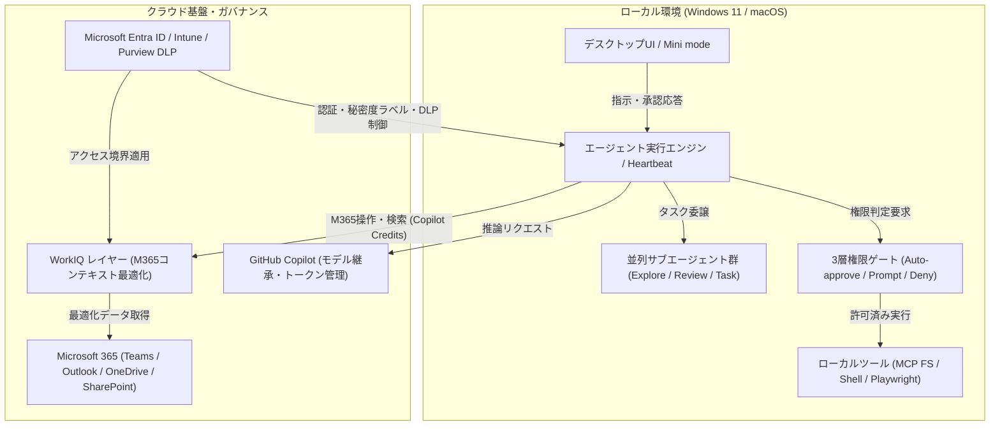

# **Microsoft Scout 調査レポート**

## **1. 基本情報**

* **ツール名**: Microsoft Scout（2026年9月に「Microsoft Autopilot」へのリブランドを発表）
* **ツールの読み方**: マイクロソフト スカウト / マイクロソフト オートパイロット
* **開発元**: Microsoft
* **公式サイト**: [https://learn.microsoft.com/en-us/microsoft-scout/get-started](https://learn.microsoft.com/en-us/microsoft-scout/get-started)
* **関連リンク**:
  * ドキュメント: [https://learn.microsoft.com/en-us/microsoft-scout/use-microsoft-scout](https://learn.microsoft.com/en-us/microsoft-scout/use-microsoft-scout)
  * 概要ガイド: [https://learn.microsoft.com/en-us/microsoft-scout/overview](https://learn.microsoft.com/en-us/microsoft-scout/overview)
* **カテゴリ**: デスクトップ/GUIエージェント
* **概要**: Microsoft Scout は、Windows 11 および macOS 向けの常時稼働型（Always-on）デスクトップAIエージェントアプリケーションです。2026年6月の Microsoft Build で Frontier プレビューとして初公開され、2026年9月には「Microsoft Autopilot」カテゴリーへの位置づけ統合・リブランドが発表されました。自然言語による指示やバックグラウンドの定期トリガーを通じて、ローカルファイル、シェルコマンド、ブラウザ操作、および Microsoft 365 データを横断し、ユーザーに代わって自律的にタスクを実行します。

## **2. 目的と主な利用シーン**

* **解決する課題**: 従来のチャット型AIアシスタントはプロンプト応答のたびに文脈が途切れ、ファイル操作・ターミナル作業・ブラウザ操作・Office業務の連携を手作業で行う必要がありました。Microsoft Scout はローカル環境とクラウド業務基盤を常時接続し、複数ツールを跨ぐ定常業務や開発ワークフローの断絶を解消します。
* **想定利用者**: 開発エンジニア、ITシステム管理者、Microsoft 365 を日常的に活用するエンタープライズ環境のナレッジワーカー。
* **利用シーン**:
  * ローカルリポジトリや GitHub Enterprise Cloud でのコードビルド、テスト実行、自動修正およびプルリクエスト作成。
  * Teams の会議トランスクリプト取得、会議室予約、Outlook の受信トレイルール自動化、SharePoint リストの更新などを含む業務フローの自動化。
  * Heartbeat モードや Automations 機能を用いた、15〜120分間隔での受信トレイトリアージ、プロジェクト進捗の監視、事前資料（Pre-read）の自動生成。

### **2.1 代表的な利用フロー**

```mermaid
swimlane-beta TB
  subgraph User["ユーザー"]
    A[自然言語で指示・定期タスクを設定]
    F[承認待ち操作を許可・結果を確認]
  end
  subgraph Scout["Microsoft Scout (デスクトップ)"]
    B[タスク分解と3層権限チェック]
    D[ローカル操作・サブエージェント並列実行]
    E[結果統合・レポート生成]
  end
  subgraph External["外部サービス (WorkIQ / GitHub Copilot)"]
    C[LLM推論とM365コンテキスト取得]
  end
  A --> B
  B -->|"モデル推論・WorkIQ照会"| C
  C -->|"実行計画・最適化コンテキスト"| D
  D -->|"処理結果・ステータス"| E
  E -->|"Prompt承認要求・完了通知"| F
```

* **代表的な流れ**: ユーザーが指示を入力（またはHeartbeatを設定）すると、Microsoft Scout が3層権限システムで安全性を判定しつつ GitHub Copilot のモデルおよび WorkIQ 経由で Microsoft 365 データを照会します。ローカルのファイル・シェル・ブラウザ操作やサブエージェントの並列処理を実行し、書き込みや外部送信など確認が必要な操作はユーザー承認を挟んで結果を提示します。

## **3. 主要機能**

* **ファイル操作とクラウドCo-Create連携**: MCP（Model Context Protocol）ファイルシステムツールを用い、ワークスペース内のドキュメント（Word、Excel、PowerPoint、ソースコード等）の読み書き・検索を実行します。2026年8月の更新により、Co-Create ワークスペースを OneDrive や SharePoint 上に直接保存可能になりました。
* **シェルコマンド実行**: `git`、`gh`、`curl`、PowerShell、Bash 等の開発ツールやスクリプトをローカルマシン上で実行します。`Auto-approve` / `Prompt` / `Deny` の3層権限システムで安全性を担保します。
* **ブラウザ自動化**: Playwright を標準バンドルし、Webサイトへのナビゲーション、フォーム入力、スナップショット撮影、ネットワークログやコンテンツの抽出を自律実行します。
* **Microsoft 365 統合（WorkIQ連携）**: メール、カレンダー、Teams、OneDrive、SharePoint を横断操作します。2026年8月以降は Teams 会議トランスクリプト取得、会議室検索・予約、SharePoint リストの閲覧・作成・更新、Outlook 受信トレイルールの管理、OneDrive/SharePoint の細粒度なファイル共有・アクセス監査にも対応しています。
* **自律実行モード（Heartbeat / Automations）**: 15〜120分等のスケジュール間隔でバックグラウンド起動して受信トレイやタスクを監視する「Heartbeat」と、条件トリガーベースで独立稼働する「Automations」を提供します。承認が必要なアクションはユーザー確認まで自動保留されます。
* **サブエージェント委譲（Delegation）**: コードベース調査（Explore）、タスク実行（Task）、コードレビュー、高速リサーチ等の専門サブエージェントをバックグラウンドで並列起動し、結果を集約します。
* **GitHub Enterprise Cloud 連携とモデル継承**: サインイン画面からエンタープライズホスト（例: `your-org.ghe.com`）を指定して認証でき、GitHub Copilot から複数世代・複数ベンダーの最新LLMを柔軟に継承利用します。
* **コンテキスト記憶（Memory）とカスタムスキル**: 過去のセッションでの決定事項や設定を記憶・再利用する Memory 機能と、`SKILL.md` 形式で独自ワークフローを定義できるカスタムスキル拡張を備えています。

## **4. 動作原理・システム構成**

Microsoft Scout は、ローカルマシン上で直接コードやOSリソースを操作する**ローカルファースト実行エンジン**と、Microsoft 365 / GitHub Copilot の**クラウド基盤**を組み合わせたハイブリッド・クライアント構成を採用しています。

* **アーキテクチャ**: Windows 11 / macOS 上のネイティブデスクトップアプリとして動作し、MCP クライアントとしてローカルツールや外部MCPサーバーと通信しながら、推論と組織データアクセスをクラウドへオフロードします。
* **主要コンポーネントとデータフロー**:
  * **ローカル実行環境**: ワークスペースディレクトリ内のファイル操作、ローカルシェル実行、Playwright によるブラウザ制御を担当。機密パスへのアクセスやワークスペース外へのアクセスは厳格に制限されます。
  * **3層権限ゲート**: すべてのコマンド・ツール実行前にポリシー判定を実施。読み取り専用コマンドは `Auto-approve`、書き込みや外部通信は `Prompt`（ユーザー承認待ち）、破壊的コマンドは `Deny` としてブロックされます。
  * **WorkIQ コンテキストレイヤー**: Microsoft 365 グラフデータへの仲介層。生データをそのままLLMへ渡すのではなく、冗長な識別子や文字列を事前に構造化・トリミングしてトークン消費を最適化し、Copilot Credits を消費してコンテキストを供給します。
  * **専用アイデンティティとガバナンス**: ユーザー個人のセッション権限を単に借用するのではなく、Microsoft Entra ID 上で管理された専用アイデンティティとして動作し、Intune ポリシーおよび Microsoft Purview の秘密度ラベル・DLP（データ損失防止）制御をリアルタイムに適用します。



* **特筆すべき要素技術**: Model Context Protocol (MCP) 準拠のツール接続、MSAL（Windows では WAM 連携）によるエンタープライズ認証、Playwright ブラウザエンジン、WorkIQ によるコンテキスト圧縮・最適化技術、Microsoft Information Protection (MIP) ラベル認識。

## **5. 開始手順・セットアップ**

* **前提条件**:
  * **OS**: Windows 11 または macOS 12 (Monterey) 以降。
  * **ライセンス**: Microsoft 365 職場/学校アカウント、**Microsoft 365 Copilot ライセンス**、および **GitHub Copilot Business または Enterprise ライセンス**（個人向け GitHub Copilot Pro は対象外）。
  * **IT管理者による事前設定**: Microsoft 365 管理センターでの Frontier プレビュー有効化、構成証明（Attestation）の提出、Microsoft Intune またはグループポリシーによる展開・テレメトリ設定の完了が必須。
* **インストール/導入**:
  IT管理者が承認・配布した公式インストーラー（Microsoft Learn 経由または Intune 配布パッケージ）を実行し、ローカル環境へインストールします。
* **初期設定**:
  1. Microsoft 365 の職場/学校アカウントでサインイン（WAM/MSAL 認証）。
  2. GitHub アカウントでサインイン（GitHub Enterprise Cloud 利用時は「Use a GitHub Enterprise host」を有効化し、`your-org.ghe.com` 等を指定）。
  3. Microsoft Scout がローカルファイルを読み書きする「ワークスペースディレクトリ」を指定。
* **クイックスタート**:
  チャット入力欄に「今週の未読メールと Teams 会議の文字起こしを要約し、ワークスペース内に Word レポートを作成して」のように入力し、権限プロンプトが表示された場合は内容を確認して承認します。

## **6. 特徴・強み (Pros)**

* **ローカル環境とクラウド業務の完全統合**: ローカルのシェル実行・コードビルド・ブラウザ操作と、Microsoft 365（Teams、Outlook、SharePoint、OneDrive）の業務データ処理を単一エージェントで完結できます。
* **常時稼働（Always-on）の自律性**: Heartbeat と Automations により、ユーザーが指示を出していない時間帯もバックグラウンドで監視・事前準備・トリアージを継続実行します。
* **エンタープライズ級の3層権限とガバナンス**: Auto-approve / Prompt / Deny の階層的制御に加え、Microsoft Entra ID、Intune、Purview DLP・MIP 秘密度ラベルと連携し、企業セキュリティ境界内で安全に運用できます。
* **柔軟なマルチモデル継承とMCP拡張性**: GitHub Copilot 経由で最新LLMを柔軟に利用できるほか、MCP サーバーや `SKILL.md` によるカスタム拡張に対応しています。

## **7. 弱み・注意点 (Cons)**

* **複合的なライセンス要件と高い導入コスト**: Microsoft 365 Copilot と GitHub Copilot Business/Enterprise の両方の有償シートが必須であり、さらに WorkIQ 呼び出しごとに Copilot Credits が消費されるため、個人や小規模チームでの試用ハードルが高いです。
* **厳格なIT管理者ゲート**: Frontier プレビューの有効化、構成証明（Attestation）、Intune ポリシー配布が必須のため、開発者個人がダウンロードして即座に使い始めることはできません（オンボーディング時の権限ループ報告もあり）。
* **デスクトップ専用**: Windows 11 / macOS 専用であり、iOS / Android 等のモバイル環境には対応していません。
* **日本語対応の状況**: 自然言語プロンプトやM365データの日本語処理には対応していますが、公式ドキュメント（Microsoft Learn）は英語中心であり、日本語での公式情報・設定ガイドは限定的です。

## **8. 料金プラン**

Microsoft Scout 単体での個別販売はなく、既存のエンタープライズライセンスおよび従量課金プールを組み合わせた複合課金体系となっています。

| プラン / 構成要素 | 料金目安 | 主な特徴・役割 |
|---------|---------|---------|
| **Microsoft Scout アプリ本体** | 追加ライセンス不要（Frontier Preview） | 対象ライセンス保持組織向けに Frontier プレビューとして提供。 |
| **Microsoft 365 Copilot** | 要契約（エンタープライズ契約） | 利用の前提となる必須ベースライセンス。 |
| **GitHub Copilot Business / Enterprise** | $19/月〜（Business） / $39/月〜（Enterprise） | モデル推論・トークン予算および認証の前提（GitHub Copilot Pro は非対応）。 |
| **Copilot Credits（WorkIQ 従量課金）** | 組織のクレジットプールより消費 | WorkIQ API を通じた M365 データ検索・ツール実行・Heartbeat 稼働時に従量消費。 |

* **課金体系**: ユーザー単位の月額サブスクリプション（M365 Copilot + GitHub Copilot）＋ トークン/クエリ従量消費（Copilot Credits）の複合型。
* **無料トライアル**: なし（Frontier プレビュープログラムへの組織オプトインおよび対象有償ライセンスが必須）。

## **9. 導入実績・事例**

* **導入企業**: Frontier プレビュー段階（および2026年9月の Microsoft Autopilot 移行発表直後）のため、具体的な導入企業名は公式サイト上で公開されていません。
* **導入事例**: Microsoft 365 を全社導入しているエンタープライズ企業のIT運用部門やソフトウェア開発チームにおいて、テスト自動化、会議文字起こし要約、受信トレイトリアージの限定プレビュー検証が進められています。
* **対象業界**: ソフトウェア開発、ITサービス、金融・コンサルティングなど Microsoft 365 と GitHub Enterprise を併用する大企業。

## **10. サポート体制**

* **ドキュメント**: [Microsoft Learn 公式ドキュメント](https://learn.microsoft.com/en-us/microsoft-scout/overview) にて、導入ガイド、管理者向け Intune/Attestation 手順、FAQ、Responsible AI ガイドラインが提供されています。
* **コミュニティ**: Microsoft Tech Community や Reddit（`r/microsoft_365_copilot`、`r/sysadmin`）等で管理者・開発者間の情報交換が行われています。
* **公式サポート**: Microsoft のエンタープライズサポート窓口を通じて提供されますが、Frontier プレビュー機能であるため SLA やサポート範囲に一部制限があります。

## **11. エコシステムと連携**

### **11.1 API・外部サービス連携**

* **API / 拡張仕様**: Model Context Protocol (MCP) クライアントとして外部 MCP サーバーと接続できるほか、`SKILL.md` を用いたカスタムスキル定義による独自機能の追加が可能です。
* **外部サービス連携**: Microsoft 365（Outlook、Teams、OneDrive、SharePoint Lists、Word、Excel、PowerPoint、Loop）、GitHub / GitHub Enterprise Cloud、Playwright（ブラウザ自動化）、Microsoft Intune、Microsoft Purview、Microsoft Entra ID。

### **11.2 技術スタックとの相性**

| 技術スタック | 相性 | メリット・推奨理由 | 懸念点・注意点 |
|:---|:---:|:---|:---|
| **Microsoft 365 (Teams / Outlook / SharePoint)** | ◎ | WorkIQ によるトークン最適化とネイティブ操作（会議室予約や受信ルール制御まで対応） | WorkIQ 呼び出しごとに Copilot Credits を消費 |
| **GitHub / GitHub Enterprise Cloud** | ◎ | 認証・モデル継承・`your-org.ghe.com` 連携を標準サポート | Business または Enterprise ライセンスが必須 |
| **Playwright / Webアプリ** | ◎ | 標準バンドルされており、フォーム入力やネットワーク検査を自律実行 | 複雑なSPAや認証フローでは調整が必要な場合あり |
| **ローカルシェル (PowerShell / Bash)** | ◯ | 3層権限システムにより安全に開発・運用スクリプトを実行可能 | Deny リスト対象や管理者ポリシー制限下のコマンドは不可 |

## **12. セキュリティとコンプライアンス**

* **認証**: MSAL（Microsoft Authentication Library）および Windows 上の WAM（Web Account Manager）による安全なエンタープライズ認証。Microsoft Entra ID 上で専用の管理されたアイデンティティとして動作します。
* **データ管理**: 組織の Microsoft 365 セキュリティ境界内で動作し、外部Webコンテンツ等の信頼できないデータは明示的にタグ付けされます。ワークスペース外ファイルへのアクセスはデフォルトで遮断され、Intune ポリシーでテレメトリや共有範囲を制御可能です。
* **準拠規格**: Microsoft 365 および Microsoft Purview のエンタープライズ準拠基盤（SOC2、ISO27001、GDPR 等）と MIP（Microsoft Information Protection）秘密度ラベル・DLP ポリシーを継承・強制します（プレビュー機能固有の追加認証状況は公式ドキュメント上での公開が限定的であり、詳細確認は Microsoft への問い合わせが必要）。

## **13. 操作性 (UI/UX) と学習コスト**

* **UI/UX**: 会話型のデスクトップチャットUIに加え、デスクトップ端に常駐できる「Mini mode」を搭載。実行結果はマークダウン、表、インライン画像、Mermaid 図等でリッチに表示されます。
* **学習コスト**: 自然言語で指示を出せるためエンドユーザーの基本操作は直感的です。一方、3層権限のチューニング、Heartbeat / Automations の適切な設計、MCP や `SKILL.md` の活用、さらに IT 管理者側の Intune / Attestation 設定には相応の専門知識が求められます。

## **14. ベストプラクティス**

* **効果的な活用法 (Modern Practices)**:
  * プロジェクト単位でワークスペースディレクトリを明確に分離し、エージェントの操作影響範囲を最小限に留める。
  * 定型的な朝のメールトリアージや会議前資料作成には Heartbeat（15〜120分間隔）を設定し、承認が必要な外部送信アクションは `Prompt` に設定してヒューマン・イン・ザ・ループを維持する。
  * チーム共通の調査・定型手順は `SKILL.md` として定義し、Cloud-stored Co-Create ワークスペースと組み合わせて共有する。
* **陥りやすい罠 (Antipatterns)**:
  * 利便性を優先してシェルコマンドの `Auto-approve` 範囲を過度に広げ、意図しないファイル変更や情報流出リスクを高めること。
  * Heartbeat の間隔を短くしすぎたり、広範な WorkIQ 検索を頻繁に走らせたりして Copilot Credits を想定外に消費してしまうこと。

## **15. ユーザーの声（レビュー分析）**

* **調査対象**: Reddit（`r/sysadmin`、`r/microsoft_365_copilot`）、IT管理者向け技術ブログ（Frontier プレビュー段階のため、G2 や Capterra 等の主要レビューサイトには単独製品としての登録なし）。
* **総合評価**: 未掲載（プレビュー提供中のため定量スコアなし）
* **ポジティブな評価**:
  * 単なるチャットボットではなく、Heartbeat でバックグラウンド自律稼働し会議準備や受信トレイ整理を先回りして進める「真の Autopilot 体験」が高く評価されている。
  * ローカルの PowerShell / ファイル / ブラウザ操作と Microsoft 365（Teams/Outlook/SharePoint）を WorkIQ でシームレスに繋ぐ能力が画期的との声が多い。
  * サブエージェントの並列委譲や MCP サーバー連携による拡張性がパワーユーザーから好評。
* **ネガティブな評価 / 改善要望**:
  * M365 Copilot と GitHub Copilot Business/Enterprise の両方に加えて Copilot Credits が必要という「三重のコスト構造」とライセンス条件の厳しさが最大の導入障壁として批判されている。
  * Intune ポリシーや Frontier Attestation の設定が複雑で、初期導入時に権限エラーやエンタイトルメントのループに陥りやすいという報告がある。
  * バックグラウンドでローカルシェルやブラウザを操作するため、DLP や監査ログの追跡性に対するシステム管理者の懸念が根強い。
* **特徴的なユースケース**:
  * ローカルでのコードテスト失敗ログを自動解析して GitHub Enterprise Cloud に修正 PR を作成し、関連する Teams 会議トランスクリプトや SharePoint リストの進捗ステータスを自動更新する一連の運用フロー。

## **16. 直近半年のアップデート情報**

* **2026-09**: Microsoft が「Microsoft Scout」を常時稼働型エージェント群の新カテゴリー「**Microsoft Autopilot**」へとリブランド・統合する方針を発表（対話型 Copilot から自律型デジタルチームメイトへの進化を明確化）。
* **2026-08**: Frontier プレビュー向け大型アップデート（August 2026 Release）を公開。
  * **GitHub Enterprise Cloud サインイン**: サインイン画面でエンタープライズホスト（`your-org.ghe.com`）の直接認証に対応。
  * **Teams 会議トランスクリプト・会議室操作**: 過去の会議文字起こし取得、会議室の検索・予約機能を追加。
  * **SharePoint リスト・Outlook ルール自動化**: SharePoint リストの閲覧・作成・更新、および Outlook 受信トレイルールの作成・編集・有効/無効化・削除に対応。
  * **細粒度ファイル共有とクラウド Co-Create**: OneDrive/SharePoint の共有権限設定・監査機能、およびクラウド保存型 Co-Create ワークスペースを追加。
* **2026-06**: Microsoft Build 2026 にて Frontier プレビュープログラム向けに初公開。Playwright 統合、M365/WorkIQ 連携、3層シェル権限管理、Heartbeat/Automations、サブエージェント委譲を実装。

(出典: [Microsoft Learn 公式ドキュメント](https://learn.microsoft.com/en-us/microsoft-scout/overview))

## **17. 類似ツールとの比較**

### **17.1 機能比較表 (星取表)**

| 機能カテゴリ | 機能項目 | Microsoft Scout | Copilot Cowork | Claude Cowork | GitHub Copilot | agent-desktop |
|:---:|:---|:---:|:---:|:---:|:---:|:---:|
| **業務連携** | Microsoft 365 統合 | ◎<br><small>WorkIQで深く統合</small> | ◎<br><small>M365クラウド完結</small> | △<br><small>コネクタ経由で連携</small> | ×<br><small>非対応</small> | ×<br><small>非対応</small> |
| **環境操作** | ローカルファイル・シェル | ◎<br><small>3層権限で直接実行</small> | ×<br><small>クラウド中心</small> | ◯<br><small>ローカルファイル対応</small> | ◯<br><small>App/CLI/IDEで実行</small> | ◎<br><small>OSアクセシビリティ操作</small> |
| **自律性** | 常時稼働・定期実行 | ◎<br><small>Heartbeat/Automations</small> | ◯<br><small>バックグラウンド実行</small> | ◯<br><small>承認付き自律実行</small> | ◯<br><small>自律エージェント/App</small> | △<br><small>CLI/SDK組み込み前提</small> |
| **コーディング** | 開発・GitHub連携 | ◯<br><small>GHE Cloud/ビルド対応</small> | △<br><small>非コーディング中心</small> | ◯<br><small>Claude Code基盤</small> | ◎<br><small>Copilot Fusion対応</small> | ×<br><small>GUI操作特化</small> |
| **導入容易性** | 個人・小規模チーム利用 | ×<br><small>複合ライセンス+IT管理必須</small> | △<br><small>M365 Copilot前提</small> | ◎<br><small>Proプラン($20/月)で利用可</small> | ◎<br><small>無料プランあり</small> | ◎<br><small>OSS・無料</small> |

### **17.2 詳細比較**

| ツール名 | 特徴 | 強み | 弱み | 選択肢となるケース |
|---------|------|------|------|------------------|
| **Microsoft Scout** | ローカル実行とM365を統合する常時稼働型デスクトップAI（Autopilot） | M365・WorkIQとローカルシェル/ブラウザの横断実行、3層権限、Heartbeat | 複合ライセンス（M365 + GH Copilot）とIT管理者による厳しい導入要件 | M365とGitHubを全社導入済みで、開発とオフィス業務を跨ぐ自律自動化を行いたいエンタープライズ |
| **Copilot Cowork** | Microsoft 365 向けのクラウド自律型エージェント（2026年6月GA） | クライアント導入不要のM365統合、マルチモデル（Claude/GPT）対応、ブラウザ自動化 | ローカルシェルやローカル開発環境への直接介入は限定的 | ローカル環境操作は不要で、M365上の定常業務をクラウド完結で任せたい場合 |
| **Claude Cowork** | デスクトップ・Web・モバイルで動作するAnthropicの自律エージェント | Proプラン($20/月)から手軽に導入可能、モバイル対応、直感的な承認フロー | Microsoft 365 のネイティブ管理機能（Intune/Purview等）との統合は弱い | 個人や中小チームで、ローカルファイルやSaaSを跨ぐ非コーディング業務を手軽に自動化したい場合 |
| **GitHub Copilot** | Copilot FusionやスタンドアロンApp・Computer Useを備えた開発支援基盤 | 無料枠あり、IDE/CLI/Appでの卓越したコード生成・自律開発体験 | Microsoft 365（メール・Teams・SharePoint等）の業務連携は対象外 | ソフトウェア開発ライフサイクル（Issue〜PR〜テスト）の生産性向上を最優先する場合 |
| **agent-desktop** | OSアクセシビリティツリー経由でGUI操作するOSSのCLI/Cライブラリ | ピクセル推測不要の高信頼・高速なクロスOS（Win/Mac/Linux）操作、完全無料OSS | 単体のチャットUIやM365連携を持たず、エージェント開発者向け基盤 | 自社開発のAIエージェントに決定論的なデスクトップGUI操作を組み込みたい開発者 |

## **18. 総評**

* **総合的な評価**:
  Microsoft Scout（およびリブランド後の Microsoft Autopilot）は、開発者のローカル環境（ファイル・シェル・Playwright）とナレッジワーカーの Microsoft 365 業務基盤（WorkIQ 経由の Teams・Outlook・SharePoint）を単一の常時稼働型デスクトップエージェントへ統合した、エンタープライズ向け AI の最先端に位置するツールです。Heartbeat による先回り処理と、Entra ID / Intune / Purview / 3層権限による厳格なガバナンスを両立している点は高く評価できます。一方で、M365 Copilot と GitHub Copilot Business/Enterprise の双方に Copilot Credits の従量消費が重なるコスト構造と、IT管理者による厳格な導入ゲートが普及のボトルネックとなっています。
* **推奨されるチームやプロジェクト**:
  Microsoft 365 Copilot と GitHub Enterprise をすでに全社導入しており、セキュリティ統制（Intune/Purview）を維持しながら「開発・運用作業とオフィス業務の自動連携」を推進したい大企業のIT運用部門・開発チームに最適です。
* **選択時のポイント**:
  純粋な開発支援であれば「GitHub Copilot」、M365内のクラウド完結業務であれば「Copilot Cowork」、手軽な個人・小規模チーム利用であれば「Claude Cowork」が適しています。「ローカル環境でのスクリプト実行やビルドと、Teams/Outlook/SharePoint を跨ぐ業務処理を定期自律実行させたい」という要件において、Microsoft Scout は最も強力な選択肢となります。
