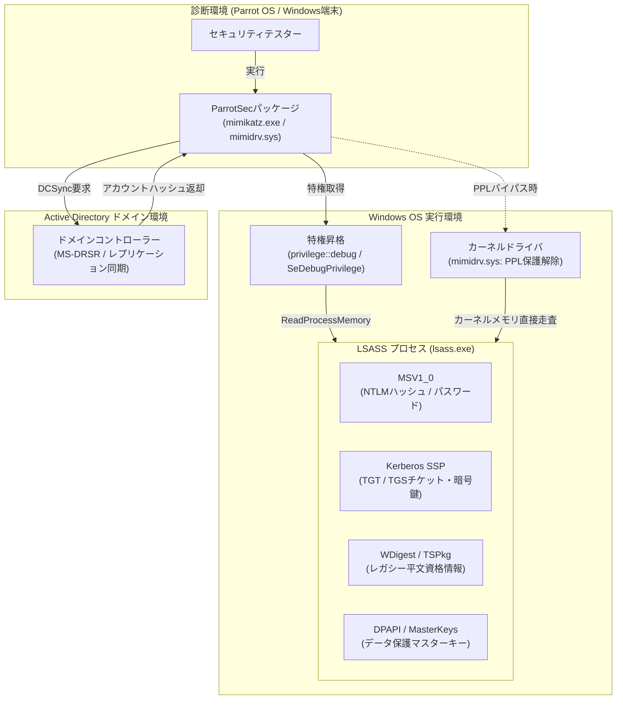

# **Mimikatz 調査レポート**

## **1. 基本情報**

* **ツール名**: Mimikatz
* **ツールの読み方**: ミミカッツ
* **開発元**: Benjamin Delpy (`gentilkiwi`) / Parrot Security（パッケージング・配布）
* **公式サイト**: [https://blog.gentilkiwi.com/mimikatz](https://blog.gentilkiwi.com/mimikatz)
* **関連リンク**:
  * GitHub: [https://github.com/ParrotSec/mimikatz](https://github.com/ParrotSec/mimikatz)
  * アップストリームGitHub: [https://github.com/gentilkiwi/mimikatz](https://github.com/gentilkiwi/mimikatz)
  * ドキュメント: [https://github.com/gentilkiwi/mimikatz/wiki](https://github.com/gentilkiwi/mimikatz/wiki)
* **カテゴリ**: セキュリティ/脆弱性診断
* **概要**: Mimikatzは、Windowsのメモリ空間（特にLSASSプロセス）から平文パスワード、ハッシュ値、PINコード、Kerberosチケットを抽出・操作するために開発されたオープンソースの資格情報診断ツールである。Benjamin Delpy氏によってWindowsの認証機構の研究ツールとして開発され、現在ではペネトレーションテストやレッドチーム演習における認証セキュリティ検証のデファクトスタンダードとして世界中で活用されている。ParrotSecリポジトリでは、Parrot Security OS向けに最適化されたDebianパッケージおよびWindows検証用バイナリが管理されている。

## **2. 目的と主な利用シーン**

* **解決する課題**: WindowsやActive Directory環境における認証情報の露出リスク、不適切な特権アクセス管理、Kerberosプロトコル実装の脆弱性を検証し、攻撃者による横展開（ラテラルムーブメント）やドメイン全体の権限昇格を防ぐこと。
* **想定利用者**: ペネトレーションテスター、レッドチームエンジニア、セキュリティ診断員、インシデントレスポンス（ブルーチーム）担当者
* **利用シーン**:
  * **内部ペネトレーションテスト**: 初期足がかり（端末）を確保した後のローカル認証情報抽出およびドメイン環境への特権昇格リスクの評価
  * **Active Directory診断**: DCSyncやGolden Ticket攻撃手法をシミュレートし、ドメイン管理者アカウントの侵害耐性を検証
  * **OS防御機能の有効性検証**: Windows Credential Guard、LSA Protection（RunAsPPL）、Restricted Adminモードなどの緩和策が正常に機能しているかの監査

### **2.1 代表的な利用フロー**

```mermaid
swimlane-beta TB
  subgraph 診断者["セキュリティ診断者"]
    A[管理者権限でセッション確立]
    G[認証チケットの保持と権限昇格検証]
  end
  subgraph Mimikatz["Mimikatz (ParrotSec)"]
    B[デバッグ権限を有効化]
    D[LSASSメモリをスキャン・抽出]
    F[Kerberosチケットのインジェクション]
  end
  subgraph WindowsOS["対象Windowsシステム"]
    C[SeDebugPrivilegeを付与]
    E[LSASSプロセス・暗号鍵を展開]
  end
  A --> B
  B --> C
  C --> D
  D --> E
  E --> F
  F --> G
```

* **代表的な流れ**: 診断者が対象端末で管理者権限を取得後、Mimikatzを起動して `privilege::debug` によりデバッグ特権（`SeDebugPrivilege`）を有効化する。Windows OSから特権が付与されると、MimikatzはLSASS（`lsass.exe`）のメモリ領域を走査し、セキュリティサポートプロバイダ（SSP）がキャッシュしているNTLMハッシュやKerberosチケット、平文資格情報を抽出する。取得したチケットはPass-the-Ticket等の手法で現在のログオンセッションにインジェクションされ、診断者がドメイン内での権限昇格やアクセス範囲を安全に検証する。

## **3. 主要機能**

* **sekurlsa::logonpasswords**: LSASSプロセスのメモリから現在ログオン中のユーザーの資格情報（NTLMハッシュ、平文パスワード、Kerberosキー等）を抽出する中核機能。
* **kerberos::golden / kerberos::silver**: Active Directory環境において、ドメイン管理者権限を持つ偽造TGT（Golden Ticket）や特定サービス宛の偽造TGS（Silver Ticket）を生成・発効する機能。
* **kerberos::ptt (Pass-the-Ticket)**: 保存されたKerberosチケット（`.kirbi` 形式）を現在のセッションに注入し、パスワードを入力することなく対象リソースへのアクセスを可能にする機能。
* **lsadump::dcsync**: ドメインコントローラーになりすまし、MS-DRSR（Directory Replication Service Remote Protocol）を用いて指定ユーザー（`krbtgt` 等）のパスワードハッシュをリモート同期・取得する機能。
* **lsadump::sam / lsadump::secrets**: ローカルのSAMデータベースやLSA Secretsからアカウントの資格情報やサービスアカウントのパスワードをダンプする機能。
* **privilege::debug**: 他のプロセスのメモリ空間にアクセスするために必須となる `SeDebugPrivilege` 権限を現在のMimikatzプロセスに付与する機能。
* **token::elevate / token::revert**: 利用可能なトークンをスキャンし、`NT AUTHORITY\SYSTEM` やドメイン管理者等の上位特権トークンを借用・復帰する権限昇格機能。
* **crypto::certificates / crypto::keys**: WindowsのCryptoAPIおよびCNG（Cryptography Next Generation）ストアから、エクスポート不可に設定されている秘密鍵やデジタル証明書を強制的にエクスポートする機能。
* **mimidrv (カーネルドライバ連携)**: 専用ドライバ `mimidrv.sys` をロードし、カーネル空間からLSASSの保護（RunAsPPL / Protected Process Light）を解除してメモリ解析を可能にする機能。
* **vault::cred / vault::list**: Windows Credential Vaultに保存されている保存済みパスワードやWeb資格情報をダンプする機能。

## **4. 動作原理・システム構成**

Mimikatzは、Windowsの内部認証機構やメモリレイアウトに対する深い理解に基づいて動作する、ネイティブC言語実装のローカルファーストCLIツールである。ParrotSecパッケージでは、ペネトレーションテスト用OSからターゲットへ配備可能な形式で管理されている。



* **アーキテクチャ**: ローカルファーストのクライアントスタンドアロン構成。外部サーバーやクラウドへの依存はなく、対象のWindowsマシン上で直接メモリ操作およびネットワークRPC呼び出しを実行する。
* **主要コンポーネントとデータフロー**:
  * **特権昇格部**: Windows APIの `AdjustTokenPrivileges` を使用し、プロセスに `SeDebugPrivilege` を有効化してLSASS（PID特定済み）へのハンドルを取得する。
  * **メモリ走査部（sekurlsa）**: `ReadProcessMemory` APIを用い、LSASSプロセス内のメモリシグネチャをスキャンして各SSP（WDigest、Kerberos、MSV1_0など）のデータ構造（`KIWI_MSV1_0_LIST` 等）を動的に特定・逆シリアライズする。
  * **ネットワーク同期部（lsadump）**: ドメイン参加環境下でRPCインターフェース（DRSUAPI）を直接呼び出し、正規のドメインコントローラー間レプリケーションを模倣してディレクトリ内のアカウント情報を引き出す。
* **特筆すべき要素技術**:
  * **パターンマッチングアルゴリズム**: Windowsの各バージョンやビルド（Windows 10、Windows 11、Windows Server各世代）ごとに異なるメモリ内構造体をオフセットやシグネチャ配列によって動的に特定する。
  * **Protected Process Light (PPL) バイパス**: Windows 8.1以降で導入されたLSASS保護に対し、ドライバ署名検証を前提とした専用カーネルドライバ `mimidrv.sys` を用いて、`EPROCESS` 構造体内の `Protection` ビットを直接書き換えて保護を解除する。
  * **DPAPIマスターキー復号**: Windows Data Protection API（DPAPI）のBlob復号に必要なマスターキーやドメインバックアップキー（`lsadump::backupkeys`）を取得・解析する。

## **5. 開始手順・セットアップ**

* **前提条件**:
  * 検証対象OS: Windows 7 / 8.1 / 10 / 11、Windows Server 2008〜2025（x86 / x64 / ARM64）
  * 実行権限: ローカル管理者権限（`Administrator` または `SYSTEM` 権限）
  * 検証環境におけるセキュリティ対策: 検証ラボ環境での実行時には、Windows Defenderなどのリアルタイム保護の除外設定またはオフ化が必要（AV/EDRが即座にブロックするため）
  * Parrot OS環境: Parrot Security OS（Debian系）上でのパッケージ管理
* **インストール/導入**:

  Parrot Security OS上でのパッケージ取得および展開:

  ```bash
  # Parrot OSでのパッケージ導入（提供されている場合）
  sudo apt update
  sudo apt install mimikatz

  # またはGitHubからParrotSecリポジトリをクローン
  git clone https://github.com/ParrotSec/mimikatz.git
  cd mimikatz
  ls -la x64/
  ```

  Windows検証環境へのバイナリ配置:
  `x64/mimikatz.exe`（64bit環境用）または `Win32/mimikatz.exe`（32bit環境用）を対象のWindowsテスト機に配置する。

* **初期設定**:
  * Windows側で管理者権限のコマンドプロンプトまたはPowerShellを起動する。
* **クイックスタート**:

  管理者権限プロンプトでMimikatzを起動し、ログオン資格情報を確認する基本手順:

  ```cmd
  :: Mimikatzの起動
  mimikatz.exe

  :: ログ出力を有効化
  mimikatz # log

  :: デバッグ特権の付与
  mimikatz # privilege::debug

  :: LSASSからログオン資格情報の抽出
  mimikatz # sekurlsa::logonpasswords

  :: 終了
  mimikatz # exit
  ```

  Pass-the-Hash（ハッシュを用いたセッション生成）の実行例:

  ```cmd
  :: NTLMハッシュを利用したプロセスの起動（プレースホルダー値）
  mimikatz # sekurlsa::pth /user:<TARGET_USER> /domain:<TARGET_DOMAIN> /ntlm:<NTLM_HASH_VALUE> /run:cmd.exe
  ```

## **6. 特徴・強み (Pros)**

* **認証セキュリティ検証における圧倒的な機能網羅性**: LSASSメモリ抽出からPass-the-Hash、Golden Ticket、DCSyncまで、Windows認証のあらゆる攻撃経路を1つのツールで網羅。
* **軽量かつ依存関係のないネイティブバイナリ**: C言語で書かれた単一実行ファイルとして完結しており、追加のランタイムやライブラリのインストールなしで即座に動作可能。
* **カーネルレベルの介入能力**: ユーザーランドでのメモリ抽出だけでなく、付属のドライバ（`mimidrv.sys`）を用いることでProtected Process Light（PPL）などの先進的なOS保護機構のバイパス検証が可能。
* **Windows最新バージョンへの継続的追従**: Windows 11 24H2や最新のWindows Serverビルドにおけるメモリレイアウト変更に対しても、コミュニティや開発者によって迅速に構造体定義がアップデートされる。
* **主要セキュリティフレームワークとの連携**: Metasploit（`kiwi`）、Cobalt Strike、PowerSploitなど業界の主要フレームワークにモジュールやDLL形式で幅広く組み込まれている。

## **7. 弱み・注意点 (Cons)**

* **AV/EDRによる100%近いシグネチャ検知**: 世界で最も警戒されているセキュリティツールの一つであるため、難読化やメモリインジェクション（反射型DLLロード等）を施さずに標準バイナリをディスクに配置すると、Windows DefenderをはじめとするEDRに即座に検知・隔離される。
* **ローカル管理者権限（特権）の前提**: `privilege::debug` によるLSASSアクセスには管理者権限が必須であり、初期侵入直後の一般ユーザー権限では主要機能の多くが実行できない。
* **ドキュメントの専門性と学習難易度**: コマンド体系がWindows内部アーキテクチャ（LSA、SSP/AP、Kerberos、Token等）に直結しており、Windowsの認証プロトコルに関する深い専門知識がないと正確な診断や結果の解釈が困難。
* **日本語情報の少なさ**: 公式ドキュメントや開発者ブログの多くが英語およびフランス語で提供されており、公式な日本語マニュアルは存在しない。
* **システムの安定性リスク**: LSASSプロセスの直接メモリ操作やカーネルドライバの読み込みを伴うため、誤った操作や未対応のWindowsビルドで実行した場合にブルースクリーン（BSOD）やシステムクラッシュを引き起こす可能性がある。

## **8. 料金プラン**

Mimikatzはオープンソースソフトウェア（OSS）として無償で提供されている。

| プラン名 | 料金 | 主な特徴 |
|---------|------|---------|
| **オープンソース (完全版)** | 無料 | すべてのモジュール（sekurlsa, kerberos, lsadump, crypto等）、バイナリ、ソースコードを利用可能（CC BY 4.0ライセンス） |

* **課金体系**: 課金なし（完全無料）
* **無料トライアル**: 該当なし（誰でも無償でダウンロード・利用可能）

## **9. 導入実績・事例**

* **導入企業**:
  * **グローバルセキュリティベンダー / レッドチーム**: Mandiant（Google Cloud）、CrowdStrike、Rapid7、Palo Alto Networks（Unit 42）などの世界的なペネトレーションテストチームにおいて、内部認証診断の検証基準ツールとして採用されている。
  * **大手監査法人 / コンサルティングファーム**: PwC、Deloitte、EY、KPMG等のサイバーセキュリティアドバイザリー部門におけるActive Directory監査での利用。
  * **国内セキュリティ診断専業企業**: ラック、三井物産セキュアディレクション、NRIセキュアテクノロジーズなどのペネトレーションテスターによる演習での活用。
* **導入事例**:
  * **金融機関のActive Directory侵害耐性監査**: 内部ネットワークに侵入されたシナリオを想定し、DCSync権限が過剰に付与されたアカウントの有無や、ドメイン管理者アカウントの即時奪取が可能かをMimikatzを用いて実証・是正。
  * **インフラ企業のEDR/Credential Guard防御検証**: 新規導入されたエンドポイント保護製品やWindowsのCredential Guardが、LSASSアクセスを確実に遮断・アラート発報できるかの受入テストに活用。
* **対象業界**: 金融、重要インフラ、防衛、IT・通信、政府機関など、Active Directoryを用いた大規模ドメインを運用する全エンタープライズ組織。

## **10. サポート体制**

* **ドキュメント**:
  * 開発者Benjamin Delpy氏の公式ブログ（[blog.gentilkiwi.com](https://blog.gentilkiwi.com)）および公式GitHub Wiki（[github.com/gentilkiwi/mimikatz/wiki](https://github.com/gentilkiwi/mimikatz/wiki)）に各モジュールの仕様やコマンド例がまとめられている。
* **コミュニティ**:
  * GitHub IssuesおよびDiscussionsにおいて世界中のセキュリティリサーチャーによる議論、不具合報告、最新Windowsビルドへのパッチ提案が行われている。
  * Twitter/X（`@gentilkiwi`）において最新のセキュリティリサーチやアップデート速報が共有されている。
* **公式サポート**:
  * オープンソースの個人開発プロジェクトのため、SLAを伴う商用サポートや電話・メール窓口は存在しない。企業利用時のトラブルシューティングは社内のセキュリティエンジニアまたは自社コミュニティ調査に依存する。

## **11. エコシステムと連携**

### **11.1 API・外部サービス連携**

* **API**: 外部から呼び出し可能なC/C++ライブラリ（`mimilib.dll`）が同梱されており、SSPやパスワードフィルタとしてWindowsに常駐させることが可能。
* **外部サービス・主要連携ツール**:
  * **Metasploit Framework**: `load kiwi` コマンドによりMeterpreterセッション内でMimikatzの機能をシームレスに直接実行可能。
  * **Cobalt Strike / Sliver / Mythic**: C2フレームワークにBeacon反射型DLLインジェクションとして統合され、ファイルレスでの実行を支援。
  * **BloodHound**: Mimikatzで奪取した資格情報やセッション情報を入力とし、Active Directoryの攻撃経路可視化グラフを補完。
  * **Impacket**: Linux上からMimikatzと同等のDCSyncやPass-the-Hash攻撃をネットワーク経由で実施するPythonツール群との相互補完。
  * **PowerSploit (Invoke-Mimikatz)**: PowerShellスクリプトを用いてメモリ上にMimikatzを直接ロード・実行するスクリプトとの連携。

### **11.2 技術スタックとの相性**

| 技術スタック | 相性 | メリット・推奨理由 | 懸念点・注意点 |
|:---|:---:|:---|:---|
| **Windows OS (7〜11 / Server)** | ◎ | ネイティブ対応。Windowsの全認証機構に対して直接アクセス可能 | EDRやDefenderの除外設定が演習時に必要 |
| **Parrot OS / Kali Linux** | ◎ | パッケージリポジトリで管理され、バイナリやYARAルールを即座に取得・展開可能 | Linux上での直接実行ではなくWindowsターゲットへの転送・配備が主 |
| **PowerShell** | ◎ | メモリ内インジェクション（`Invoke-Mimikatz`）によりディスク配置を回避可能 | AMSI（Antimalware Scan Interface）による検知対策が必要 |
| **C# / .NET** | ◯ | SharpKatzなどのラッパーやP/Invokeを利用した移植プロジェクトが多数存在 | .NETランタイムのバージョン依存や検知リスク |
| **Python** | ◯ | pypykatzなどのオフラインメモリダンプ解析ライブラリと連携可能 | ターゲット端末にPython環境を要求する場合は導入ハードルあり |

## **12. セキュリティとコンプライアンス**

* **認証**: Windowsの認証アーキテクチャそのものを診断・検証するツールであり、Kerberosチケット、NTLMハッシュ、平文パスワードの安全性を評価する。
* **データ管理**: すべての処理はローカルメモリ上で直接完結し、外部クラウドやサードパーティへのデータ送信は一切行われない。ログファイル（`log` コマンド）やチケット出力はローカルディスクにのみ保存される。
* **準拠規格**:
  * **MITRE ATT&CK**: 「T1003 OS Credential Dumping（OS資格情報ダンピング）」の中核テクニックとして定義されており、世界中のSOCや防衛チームの検知ルール策定基準となっている。
  * **ISO 27001 / SOC 2 / PCI DSS**: ペネトレーションテストや特権ID管理の厳格性を監査するプロセスにおいて、Mimikatzを用いた侵害シミュレーションが標準的に実施される。

## **13. 操作性 (UI/UX) と学習コスト**

* **UI/UX**: グラフィカルインターフェース（GUI）は持たず、洗練されたCUI（コマンドライン対話型シェル）を提供する。`モジュール::コマンド /引数:値` という直感的な構文体系を持ち、引数補完やコマンド履歴が利用可能である。
* **学習コスト**: 初心者にとっては極めて高い。単にコマンドを叩くだけであれば容易だが、結果として表示されるKerberosチケットフラグ、NTLMハッシュ、LSAプロバイダの挙動を正しく分析し、防御側の緩和策（Credential Guard、Protected Usersグループ等）と結びつけるには、高度なWindows内部構造の習得が不可欠である。

## **14. ベストプラクティス**

* **効果的な活用法 (Modern Practices)**:
  * **独立した隔離検証環境（サイバーレンジ）の利用**: 本番稼働中のサーバーではなく、Active Directoryを忠実に再現したステージング環境または隔離ラボで実行し、システムクラッシュのリスクを排除する。
  * **防御機能（Credential Guard）の事前・事後検証**: Windows Defender Credential GuardやLSA Protectionを有効化した環境でMimikatzを実行し、LSASSメモリからの抽出が確実に失敗することをテストする「ブルーチーム的活用」。
  * **DCSync権限の最小化チェック**: ドメインコントローラー以外の一般アカウントに `DS-Replication-Get-Changes-All` 拡張権限が誤って付与されていないかを、`lsadump::dcsync` を試行して棚卸しする。
* **陥りやすい罠 (Antipatterns)**:
  * **本番環境への生バイナリの無断配置**: AV/EDRのアラートが一斉に鳴り響き、SOCチームの緊急インシデント対応を引き起こすだけでなく、アンチウイルスによってバイナリがロックされ演習が中断する。
  * **SeDebugPrivilegeの付与忘れ**: 一般管理者プロンプトで起動しても `privilege::debug` を実行せずに `sekurlsa` コマンドを実行し、`ERROR kuhl_m_sekurlsa_acquireLSA ; Handle on memory (0x00000005)` 等のエラーで失敗する。
  * **未対応の最新Windowsプレビュービルドでの無計画な実行**: 内部構造体オフセットが変更された最新のWindows Canary/Devビルドで実行し、LSASSのアクセス違反（クラッシュ）を誘発してWindowsが再起動してしまう。

## **15. ユーザーの声（レビュー分析）**

* **調査対象**: Reddit（`r/netsec`, `r/redteamsec`）、GitHub Issues/Discussions、Infosec専門ブログ、ペネトレーションテスターのコミュニティレビュー
* **総合評価**: 4.8 / 5.0（Active Directory / Windows認証診断における評価）
* **ポジティブな評価**:
  * **唯一無二の深層アクセス能力**: 「Windowsの認証プロトコルやメモリ構造に対する作者の知識が異常なレベルで詰め込まれており、AD診断でMimikatzなしの作業は考えられない」
  * **DCSyncの圧倒的な利便性**: 「ドメインコントローラーに直接侵入しなくても、適切なレプリケーション権限さえあればリモートから瞬時にハッシュを取得できる機能は革命的」
  * **OS更新への素早い適応**: 「Windows 11 24H2などで内部構造が変わっても、世界中のコントリビューターによってすぐに構造体が更新され、使い続けられる点が素晴らしい」
* **ネガティブな評価 / 改善要望**:
  * **検知シグネチャの厳格さ**: 「有名すぎて平文バイナリは瞬時に隔離される。演習で使用するには独自コンパイルや難読化、シェルコード化が必須で準備に手間がかかる」
  * **コマンドの難解さ**: 「モジュールや引数の指定方法が独特で、Kerberosの暗号化方式（RC4、AES128、AES256）やSIDの知識がないとエラーの理由が分からない」
  * **不意のシステムクラッシュリスク**: 「本番サーバーでLSASSを操作する際、万が一クラッシュするとマシンが強制再起動するため、リスク管理に非常に神経を使う」
* **特徴的なユースケース**:
  * 端末侵害からドメイン全体が制圧されるまでの「攻撃パス（キルチェーン）」を経営層やシステム管理者に実演し、特権アクセス管理（PAM）や多要素認証（MFA）、Credential Guard導入の予算獲得を裏付けるためのデモンストレーションツールとして重宝されている。

## **16. 直近半年のアップデート情報**

Mimikatzは、Windowsの最新ビルドやパッチによる内部メモリ構造の変更に追従するため、継続的にリポジトリの更新が行われている。

* **2026-10-30**: `kuhl_m_sr98.c` の更新によるスマートカード・暗号モジュールの動作安定化
* **2026-10-26**: コミュニティPR（#489）のマージによる `sekurlsa::tickets` および `sekurlsa::ekeys` の機能拡張
* **2026-09-25**: Windows 11 24H2（build 26100）およびWindows Server 2022（build 20348）、Windows 10 1809（build 17763）に対応した最新Kerberosチケットキャッシュ内部構造体参照（`KerberosReferences`）の全面刷新
* **2026-04-17**: 特定のGMSA（グループ管理サービスアカウント）DPAPIアカウントのサポートを強化するマイナーアップデート
* **2026-04-09**: Windows 11 24H2および25H2の `sekurlsa::logonpasswords` に向けたパターン検索アプローチ2および `MSV1_0` 構造体定義の追加
* **2026-04-08**: Windows 11 24H2におけるLSASS構造変更に対応する機能追加（`feat(sekurlsa)`）

(出典: [Mimikatz コミット履歴](https://github.com/gentilkiwi/mimikatz/commits/master))

## **17. 類似ツールとの比較**

### **17.1 機能比較表 (星取表)**

| 機能カテゴリ | 機能項目 | Mimikatz | Impacket (secretsdump) | pypykatz | SharpKatz |
|:---:|:---|:---:|:---:|:---:|:---:|
| **基本機能** | LSASS直接メモリ解析 | ◎<br><small>ネイティブAPIで完全抽出</small> | ×<br><small>非対応（リモートAPI主）</small> | ◯<br><small>Minidump解析主</small> | ◯<br><small>C#経由で直接読み込み</small> |
| **AD攻撃検証** | DCSync (レプリケーション) | ◎<br><small>完全なRPCサポート</small> | ◎<br><small>Pythonで極めて安定</small> | ×<br><small>非対応</small> | △<br><small>一部限定対応</small> |
| **チケット操作** | Golden / Silver Ticket | ◎<br><small>完全なチケット生成・偽造</small> | ◎<br><small>ticketer.pyで生成可能</small> | △<br><small>チケット抽出が主</small> | △<br><small>生成機能は限定的</small> |
| **実行形態** | エージェントレスリモート実行 | ×<br><small>ターゲット上で実行必要</small> | ◎<br><small>Linux端末から完全遠隔実行</small> | ×<br><small>ダンプファイルの取得必要</small> | ×<br><small>ターゲット上で実行必要</small> |
| **検知耐性** | AV/EDR回避の容易性 | ×<br><small>シグネチャ対策が極めて強力</small> | ◯<br><small>ネットワークトラフィックのみ</small> | ◎<br><small>オフライン端末で解析可能</small> | △<br><small>.NET AMSI等の対策必要</small> |

### **17.2 詳細比較**

| ツール名 | 特徴 | 強み | 弱み | 選択肢となるケース |
|---------|------|------|------|------------------|
| **Mimikatz** | C言語によるネイティブWindows認証診断ツール | LSASS直接解析、Pass-the-Hash、Golden Ticket、カーネルドライバ連携まで全方位をカバー | AV/EDRによる検知率が極めて高く、管理者権限が必要 | Windowsターゲット上で直接、網羅的な認証脆弱性検証を実施する場合 |
| **Impacket** | Pythonによる各種Windowsプロトコルの実装群 | Linux端末（Parrot OS等）からターゲットに侵入せずネットワーク経由でDCSyncやSAMダンプを実行可能 | ターゲットのローカルメモリ（LSASS）から直接平文資格情報を引き抜くことはできない | ターゲットにバイナリを置かず、遠隔から安全にActive Directory診断を行いたい場合 |
| **pypykatz** | MimikatzのLSASS解析エンジンをPythonに完全移植 | 事前に取得したLSASSのMinidumpファイル（`.dmp`）をオフラインの安全なLinux端末上で解析可能 | ターゲット上でのリアルタイムなチケットインジェクションやPass-the-Ticketには向かない | EDRが厳格な環境で、メモリダンプのみを採取してオフラインで安全に資格情報を解析する場合 |
| **SharpKatz** | Mimikatzの主要機能をC#（.NET）に移植したツール | Cobalt Strike等のC2フレームワークから `execute-assembly` でインメモリ実行しやすい | .NETランタイムが必要であり、最新のWindows構造体変更への追従が本家より遅れやすい | Red Team演習においてC2フレームワークと連携してメモリ上でのみ手早く資格情報を確認したい場合 |

## **18. 総評**

* **総合的な評価**:
  * Mimikatzは、登場から10年以上にわたりWindowsおよびActive Directoryセキュリティの勢力図を根本から変えた、歴史的かつ今なお最前線の診断ツールである。MicrosoftがCredential GuardやRunAsPPL、Restricted Adminモードなどの強力な防御機能を次々と実装する動機となったのもMimikatzの存在であり、セキュリティの攻防両面において極めて重要なマイルストーンとなっている。
* **推奨されるチームやプロジェクト**:
  * **エンタープライズのレッドチーム / ペネトレーションテストチーム**: Active Directoryフォレストの侵害耐性や特権アクセス管理の堅牢性を徹底検証したいプロジェクト。
  * **インシデントレスポンス / ブルーチーム**: EDRの検知ルール策定や、Credential GuardなどのOS緩和策が正常に機能しているかをテスト・検証したいセキュリティ運用チーム。
* **選択時のポイント**:
  * Windowsターゲット端末に直接入って詳細なメモリ調査やチケットインジェクションを行いたい場合は本ツール（Mimikatz）が最適である。一方で、ターゲットにバイナリを配置せずネットワーク経由でAD検証を行いたい場合はImpacket、EDR回避のためにオフラインでメモリダンプを解析したい場合はpypykatzを選択するなど、演習のスコープと防御レベルに応じた使い分けが推奨される。
