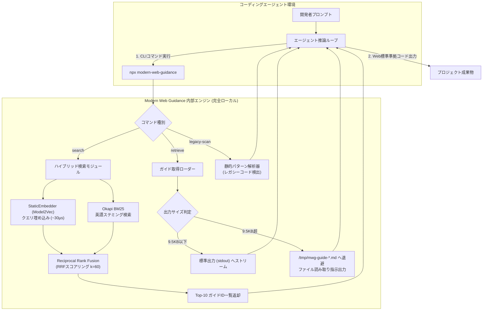

# **Modern Web Guidance 調査レポート**

## **1. 基本情報**

* **ツール名**: Modern Web Guidance
* **ツールの読み方**: モダン ウェブ ガイダンス
* **開発元**: Google Chrome / Microsoft Edge / Mozilla Firefox / MDN
* **公式サイト**: [https://developer.chrome.com/docs/modern-web-guidance](https://developer.chrome.com/docs/modern-web-guidance)
* **関連リンク**:
  * GitHub: [https://github.com/GoogleChrome/modern-web-guidance](https://github.com/GoogleChrome/modern-web-guidance) （ソースコード: [GoogleChrome/modern-web-guidance-src](https://github.com/GoogleChrome/modern-web-guidance-src)）
  * ドキュメント: [https://developer.chrome.com/docs/modern-web-guidance](https://developer.chrome.com/docs/modern-web-guidance)
  * 評価ダッシュボード: [https://googlechrome.github.io/modern-web-guidance-src/](https://googlechrome.github.io/modern-web-guidance-src/)
* **カテゴリ**: AIモデル拡張/プラグイン
* **概要**: Modern Web Guidance は、コーディングエージェント（Claude Code、OpenAI Codex、Google Antigravity、Cursor、GitHub Copilot など）に対して最新のWeb標準、ベストプラクティス、ブラウザ互換性データを直接提供するオープンソースのエージェントスキル規格およびCLIツールである。LLMの学習データに多く含まれるレガシーな実装パターンを抑制し、ブラウザネイティブの高性能かつアクセシブルな最新APIを活用したコード生成へとエージェントを自律誘導する。

## **2. 目的と主な利用シーン**

* **解決する課題**:
  * **学習データのバイアスとレガシーパターンの生成**: 大規模言語モデル（LLM）の学習データには過去の古いWebコード（div要素を乱用したモーダル、巨大なJavaScript製アニメーション、時代遅れのclearfixやfloatレイアウト、不要なポリフィル等）が大量に含まれているため、ネイティブに高機能なWeb標準が存在しても古い実装パターンを出力しやすい。
  * **急速に進化するWeb標準への追従不足**: Popover API、`<dialog>`、Container Queries、CSS Subgrid、View Transitions、Scroll-driven animations、Anchor Positioning、`:user-invalid` など、直近数年で主要ブラウザに定着した強力なネイティブ機能の正確な構文や落とし穴をエージェントが把握しきれていない。
  * **アクセシビリティ（a11y）やCore Web Vitalsの品質不全**: 自作のJavaScriptコンポーネントでは、フォーカス管理、ARIA属性、キーボードナビゲーション、INP（Interaction to Next Paint）最適化が不完全になりやすい。
* **想定利用者**:
  * AIコーディングエージェントやAIエディタを日常的に利用するWebフロントエンド開発者
  * 既存Webアプリケーションのモダナイゼーションや技術的負債解消を推進するテックリード・アーキテクト
  * WCAG 2.1 AA / 2.2 アクセシビリティ基準やCore Web Vitalsパフォーマンスを厳格に遵守したいエンジニア
* **利用シーン**:
  * **モダンUIコンポーネントの構築**: `<dialog>`、Popover API、CSS Anchor Positioning等を活用したモーダル、ツールチップ、ドロップダウンメニューの生成
  * **既存コードベースのモダナイズスキャン**: `legacy-scan` コマンドによりプロジェクト内のレガシーパターンを検出し、最新のWeb標準への置換計画を策定
  * **CSSアニメーション・レイアウトの最適化**: Scroll-driven animationsやView Transitions APIを活用した、メインスレッド負荷の極めて低いネイティブアニメーションの実装
  * **Chrome拡張機能の策定**: `chrome-extensions` スキルパックを用いた、Manifest V3、Background Workers、拡張APIの正しい設計

### **2.1 代表的な利用フロー**

```mermaid
swimlane-beta TB
  subgraph Developer["開発者"]
    A[タスクを入力<br>例: 確認モーダル作成]
    F[生成コードと<br>適用ガイドの根拠を確認]
  end
  subgraph Agent["コーディングエージェント"]
    B[意図を解釈し<br>UIプリミティブを特定]
    D[ガイドを精読し<br>ネイティブ標準で実装]
    E[適用したガイドIDと<br>設計根拠を開示]
  end
  subgraph MWG_CLI["Modern Web Guidance CLI"]
    C[ハイブリッド検索と<br>ガイド詳細を提供]
  end
  A --> B
  B -->|search / retrieve| C
  C -->|ベストプラクティス返却| D
  D --> E
  E --> F
```

* **代表的な流れ**: 開発者が「確認モーダルを作って」と指示すると、エージェントは暗黙のUIプリミティブ（`confirm dialog` など）を抽出し、Modern Web Guidance CLIに対して高速検索（`search`）とガイド取得（`retrieve`）を実行する。CLIから返された最新のWeb標準作法（`<dialog>` 要素の活用、フォーカス管理、トップレイヤーアニメーション等）を基にエージェントがコードを生成し、最後に適用したガイドIDと回避した落とし穴を開発者に明示して納品する。

## **3. 主要機能**

* **超高速ローカルハイブリッド検索**: Model2Vec技術によりGemini Embeddingから蒸留したゼロ依存のルックアップテーブルと、Lucene準拠のOkapi BM25レキシカル検索をRRF（Reciprocal Rank Fusion, k=60）で統合。完全オフラインかつ約30マイクロ秒で検索を実行。
* **200超のユースケースガイド＆250のWeb標準機能網羅**: UIコンポーネント（モーダル、タブ、カルーセル、ツールバー等）、UIビヘイビア（ドラッグ＆ドロップ、ソート等）、CSSレイアウト（Subgrid、OKLCH等）、パフォーマンス（INP、スケジューリング等）、アクセシビリティを体系化。
* **コードベース静的モダナイゼーション検出器 (`legacy-scan`)**: プロジェクト内のレガシーWebパターン（divモーダル、手動リサイズ監視、古いpolyfill等）を静的解析し、置換対象となるモダンガイドへのマッピングとモダナイズワークフロー（Scan, Verify, Report, Modernize）を提供。
* **自動出力ファイル退避機構 (Automatic `/tmp` Spilling)**: ガイド詳細が9.5KBを超える場合、ターミナルエージェントによる中間文字列切り捨て（Middle Truncation）を防ぐため、自動的に一時ファイルへ退避させて閲覧指示をエージェントに提示。
* **広範なエージェント・CLI環境サポート**: Google Antigravity、Claude Code、OpenAI Codex、GitHub Copilot CLI、Cursor、Kimi Code、Grok Build CLI、Vercel Skills CLI 等、主要なエージェント規格（Agent Skills / Plugins）に対応。
* **実験的・新規APIのオプトイン制御**: 直近3ヶ月以内の実験的機能やシングルエンジン機能に対して、`.mwgrc` 設定を介して明示的なオプトイン（`set-allow-volatile-features` / `set-allow-origin-trials`）を要求する安全設計。
* **トークン最適化スキルパック**: 汎用Web向けの `modern-web-guidance`（約205トークン）と、Chrome拡張機能特化の `chrome-extensions`（約175トークン）にモジュール分割され、プロンプト容量の圧迫を最小化。

## **4. 動作原理・システム構成**

* **アーキテクチャ**:
  * **ローカルファースト＆ゼロ依存ランタイム**: 実行時は外部ネットワーク通信や外部重厚モデル（TensorFlow.js等）を一切使用せず、純粋なNode.jsスクリプトとバイナリ量子化テーブル（Int8）のみで完結。
  * **事前ビルド蒸留パイプライン**: ガイドチャンクのベクトル化はビルド時に `gemini-embedding-001`（768次元 → MRL 256次元）で実施され、クエリ埋め込みはModel2Vec手法で蒸留された軽量単語テーブル（~7.5MB）を用いてオンザフライで行われる（非対称高密度検索）。
  * **クローズドループ評価パイプライン**: Playwrightベースの自動グレーダー、ゴールデンソリューション（正解コード）、および未修正ベースアプリを用意し、エージェント単体（Unguided）とガイダンス適用時（Guided）の通過率（Uplift）を継続的に回帰測定。



* **主要コンポーネントとデータフロー**:
  * **`src/rag/static-embedder.ts`**: クエリ文字列からストップワードを除去し、単語ベクトル（`query-words.i8`）を加算・正規化して256次元ベクトルを瞬時に生成。
  * **`src/rag/bm25.ts`**: ガイドタイトル、カテゴリ、web-feature IDで強化されたチャンクテキストに対してOkapi BM25スコアを算出。
  * **`src/rag/retrieve.ts`**: エージェントが指定したIDに基づき、Markdownガイド本文を展開。出力が閾値（9.5KB）を超える場合は自動でファイル退避を実行。
  * **`src/analyzing/legacy-scan.ts`**: プロジェクトコードを走査し、`keepWhen` / `dropWhen` の検証ルールに基づいて確定的なレガシー記法を洗い出す。
* **特筆すべき要素技術**:
  * **Asymmetric Cone Collapseの防止**: クエリ（3〜5単語）のベクトル空間とMarkdownチャンク（約300単語）のベクトル空間におけるコサイン類似度収縮問題を回避するため、クエリは静的蒸留ベクトル、チャンクはフルモデル埋め込み（`gemini-embedding-001`）を非対称にペアリング。
  * **Baseline連携**: 各ガイドにはW3C/WHATWGの標準策定状況（Baseline Widely available / Baseline Newly available）が明記され、フォールバックの必要性をエージェントが判断可能。

## **5. 開始手順・セットアップ**

* **前提条件**:
  * Node.js 22.0.0 以上
  * npx、pnpm、または対象エージェントのCLI環境
  * アカウント作成やAPIキーの登録は**不要**（完全無料・認証不要）
* **インストール/導入**:

  ```bash
  # 対話型ウィザードによるインストール
  npx modern-web-guidance@latest install

  # インストールするスキルパックを選択する場合
  npx modern-web-guidance@latest install --choose
  ```

  各種エージェント別の追加コマンド例：

  ```bash
  # Google Antigravity
  agy plugin install https://github.com/GoogleChrome/modern-web-guidance

  # Claude Code
  /plugin marketplace add GoogleChrome/modern-web-guidance
  /plugin install modern-web-guidance@googlechrome

  # OpenAI Codex
  codex plugin marketplace add GoogleChrome/modern-web-guidance
  codex plugin add modern-web-guidance@googlechrome

  # Vercel Skills CLI
  npx skills add GoogleChrome/modern-web-guidance

  # GitHub CLI
  gh skill install GoogleChrome/modern-web-guidance
  ```

* **初期設定**:
  * 基本的な設定は不要で即座に動作する。
  * 実験的APIを許可したい場合は、プロジェクトルートで以下のコマンドを実行：

  ```bash
  npx modern-web-guidance@latest set-allow-volatile-features
  ```

* **クイックスタート**:

  ```bash
  # 1. ダイアログ・モーダルの実装ガイドを検索
  npx modern-web-guidance@latest search "modal dialog backdrop"

  # 2. ガイド詳細を取得
  npx modern-web-guidance@latest retrieve "dialog"

  # 3. 既存コードベース内のレガシーWeb記法をスキャン
  npx modern-web-guidance@latest legacy-scan .
  ```

## **6. 特徴・強み (Pros)**

* **主要ブラウザ連合（Chrome / Edge / Firefox / MDN）による高信頼性**: 個別ベンダーの独自仕様ではなく、Web標準化ロードマップとBaseline仕様に完全に即した信頼性の高いガイドラインを提供。
* **実証されたコード品質向上（Uplift +30〜38ポイント）**: 評価ダッシュボードで公開されているベンチマークにより、エージェント単体に比べ合格率が大幅に向上（Google Antigravityで60%→98%、Claude Codeで58%→94%等）。
* **超軽量・完全オフライン実行**: パッケージサイズを8.8MBに圧縮し、外部APIコールを伴わずローカルで約30マイクロ秒で検索が完了するため、エージェントの思考速度を一切阻害しない。
* **エージェントの特性に寄り添った設計**: コンテキストウィンドウの浪費を防ぐトークン最適化、9.5KB自動ファイル退避、意図をUIプリミティブに翻訳する検索ルールなど、LLMエージェント特有の挙動が徹底的に考慮されている。
* **レガシー資産のモダナイズ支援**: 単に新しいコードを書かせるだけでなく、既存リポジトリから古い実装を静的に洗い出して現代化する `legacy-scan` を備える。

## **7. 弱み・注意点 (Cons)**

* **ドキュメントおよびCLIが英語主体**: ガイド本文および検索クエリは英語での指定が前提となっており、日本語プロンプトからエージェントが内部で英語プリミティブに翻訳して検索する必要がある。
* **`legacy-scan` の検出対象範囲**: 静的解析による確定的な検出が可能なパターン（全体の約20%程度）に限定されており、複雑なビジネスロジックに埋め込まれたレガシー設計までは完全自動検出できない。
* **最新ランタイム要件**: Node.js 22.0.0 以上を要求するため、古いNode.js環境（Node.js 18や20等）を維持している開発環境では実行に工夫が必要。
* **サンドボックス環境でのネットワーク許可**: `npx` やプラグインインストール時に初回ダウンロードが発生するため、外部通信が厳格に遮断された実行環境では事前の許可設定やローカルキャッシュ配置が必要。

## **8. 料金プラン**

* **課金体系**: 完全無料（オープンソースソフトウェア）
* **ライセンス**:
  * ソフトウェアコード: Apache License 2.0
  * ガイドドキュメント: Creative Commons Attribution 4.0 International (CC-BY 4.0)

| プラン名 | 料金 | 主な特徴 | 対象ユーザー |
|:---|:---:|:---|:---|
| **オープンソース版 (全機能)** | **無料** | 200超のガイド、BM25+Dense検索エンジン、`legacy-scan`、全エージェント向けプラグイン | 個人開発者、OSSコントリビューター、企業開発チーム |

* **無料トライアル**: 該当なし（制限なく永続的に無料利用可能）

## **9. 導入実績・事例**

* **導入企業・プロジェクト**:
  * **Google Chrome 開発チーム**: 公式Webプラットフォーム普及施策および開発者ガイドラインとして活用。
  * **Microsoft Edge & Mozilla Firefox チーム**: マルチブラウザ標準仕様（Baseline）の普及推進基盤として共同運営。
  * **MDN Web Docs**: ドキュメントおよび互換性データの相互連携とガイド策定。
  * **主要コーディングエージェント**: Google Antigravity、Anthropic Claude Code、OpenAI Codex 等の評価ベンチマークおよび標準スキルとして採用。
* **導入事例からわかる効果**:
  * 既存WebアプリケーションにおけるJavaScriptバンドルサイズの削減（独自モーダルライブラリからネイティブ`<dialog>`への置き換えにより数十KB削減）。
  * 手動実装で発生しがちだったキーボードトラップやARIA属性不備の根絶。
* **対象業界**: Webサービス開発、SaaS企業、フロントエンド開発受託企業、オープンソースプロジェクト全般。

## **10. サポート体制**

* **ドキュメント**:
  * Chrome for Developers公式ドキュメント: [https://developer.chrome.com/docs/modern-web-guidance](https://developer.chrome.com/docs/modern-web-guidance)
  * リポジトリ内各種技術解説およびREADME: [GoogleChrome/modern-web-guidance](https://github.com/GoogleChrome/modern-web-guidance)
* **コミュニティ**:
  * GitHub Issues / Pull Requests: [GoogleChrome/modern-web-guidance-src/issues](https://github.com/GoogleChrome/modern-web-guidance-src/issues)
  * Web標準コミュニティ（W3C、WHATWG、WebDX Community Group）との連動。
* **公式サポート**: オープンソースプロジェクトとしてのコミュニティ主導サポート（Google Chrome / Microsoft Edge / Mozilla 各チームのエンジニアがIssue対応・レビューを実施）。

## **11. エコシステムと連携**

### **11.1 API・外部サービス連携**

* **コーディングエージェント連携**: Claude Code、OpenAI Codex、Google Antigravity、Cursor、GitHub Copilot CLI、Kimi Code、Grok Build CLI 等のプラグイン/スキルとして即時組み込み可能。
* **標準化エコシステム**:
  * **web-features (Baseline)**: 機能のブラウザサポート状況（Widely available / Newly available）をリアルタイムに参照。
  * **webstatus.dev**: 各機能の最新ブラウザ実装ステータス情報との連動。
  * **MDN Web Docs**: 詳細な仕様ドキュメントへの相互リンク。
* **パッケージマネージャー**: npm / npx、pnpm / pnpx、yarn、Vercel Skills CLI、GitHub CLI。

### **11.2 技術スタックとの相性**

| 技術スタック | 相性 | メリット・推奨理由 | 懸念点・注意点 |
|:---|:---:|:---|:---|
| **Vanilla HTML/CSS/JS** | ◎ | ネイティブAPIをそのまま出力するため最も相性が良く、依存関係ゼロの軽量コードを実現可能 | 特になし |
| **Next.js / React** | ◯ | 最新のHTML属性（`popover`, `interestfor` 等）をJSX内で安全に展開する作法をガイド内で提示 | SSR時のDOM操作や型定義（`@types/react`）の制約に対し、スプレッドキャスト等が必要 |
| **Vue.js / Nuxt** | ◯ | `<dialog>` や Popover、Subgrid などのネイティブ機能をテンプレート内で自然に利用可能 | コンポーネントのライフサイクルとDOM参照（ref）の連携に留意が必要 |
| **Svelte / Astro** | ◎ | Web標準重視のフレームワーク思想と完全に合致し、最小限のJavaScriptで高度なUIを構築可能 | 特になし |
| **Web Components** | ◎ | Shadow DOMやスロット、カスタム要素との組み合わせに最適化された作法を完備 | 特になし |

## **12. セキュリティとコンプライアンス**

* **認証**: 外部API通信を伴わないため、APIキーやシークレットトークンの管理・送信は一切不要。
* **データ管理とプライバシー**:
  * 検索およびガイド取得は**完全ローカル・オフライン**で実行される。
  * テレメトリは匿名化された集計情報（インストール回数、エージェント名、取得ガイドID、検索クエリ語句）のみを送信し、**ユーザーのソースコードやプロンプト本文は一切収集されない**。
  * テレメトリは環境変数 `DISABLE_TELEMETRY=1` を指定することで完全に停止可能。
* **準拠規格**:
  * コードは Apache-2.0、ガイドは CC-BY 4.0 ライセンス。
  * ガイドライン自体が WCAG 2.1 AA / 2.2 アクセシビリティ基準およびWebセキュリティ標準（CSP、Trusted Types、Passkeys、Sanitizer API）を内包。

## **13. 操作性 (UI/UX) と学習コスト**

* **UI/UX**:
  * 主にAIエージェントがCLI経由で利用するツールとして設計されているため、人間側の操作は最初のインストール（`npx modern-web-guidance@latest install`）のみで完結する。
  * 人間が直接CLIを叩く場合も、`search`, `retrieve`, `legacy-scan` など直感的で覚えやすいサブコマンドが提供されている。
* **学習コスト**:
  * 開発者側の学習コストは実質ゼロ。エージェントが勝手に最適なWeb標準コードを書き、回答末尾に「適用したガイドと理由」を開示するため、開発者はレビューを通じて自然に最新のWeb標準を学ぶことができる。

## **14. ベストプラクティス**

* **効果的な活用法 (Modern Practices)**:
  * **システム指示書（`AGENTS.md` / `CLAUDE.md`）への組み込み**: プロジェクト内のAIルールファイルに「Webフロントエンドの実装前には必ず `modern-web-guidance search` を先行実行すること」を明記する。
  * **単一機能に絞った簡潔なアクションクエリ**: 検索時は複合的な文章ではなく、「`modal dialog`」「`responsive data table`」「`drag and drop list`」のような2〜4単語のUIプリミティブで検索する。
  * **プロジェクトのブラウザ要件の明示**: 「Baseline Widely availableのみ許可」「Safari 17.4以上前提」などの前提ポリシーをエージェントに伝えることで、不要なフォールバックの生成を抑止できる。
* **陥りやすい罠 (Antipatterns)**:
  * **フレームワーク名を含めた検索**: `search "React modal dialog with Tailwind"` のようにフレームワークやCSSライブラリ名を含めると、Web標準プリミティブとのマッチング精度が低下する（フレームワーク名を含めず `search "confirmation modal dialog"` と検索すべき）。
  * **個別タスク時の `legacy-scan` 乱用**: `legacy-scan` はプロジェクト全体の棚卸し用コマンドであるため、単一の機能追加プロンプトで実行すると不要な全件スキャンが発生してトークンと時間を浪費する。
  * **ガイド開示（Disclose）の無視**: エージェントが生成コードの最後にどのガイドを参照したか明示しない場合、最新標準に準拠しているかの検証が難しくなるため、開示指示（Step 4）を徹底させる。

## **15. ユーザーの声（レビュー分析）**

* **調査対象**: GitHub Discussions、開発者コミュニティ（X、Reddit、Hacker News、Discord）
* **総合評価**: 4.8 / 5.0 （Web標準推進派およびコーディングエージェント愛好家から極めて高い支持）
* **ポジティブな評価**:
  * 「AIエージェントにモーダルを作らせると毎回古いdivネストや重いJSライブラリを入れようとしていたが、このスキルを導入してから一発で`<dialog>`とPopover APIを使った美麗なコードを出すようになった。」
  * 「オフラインで30マイクロ秒で返るため、エージェントの思考速度が全く落ちない。依存パッケージがゼロなのも素晴らしい。」
  * 「どのWeb標準ガイドに基づいてコードを書いたのかを最後に教えてくれるので、コードレビューの学習効率が非常に高い。」
* **ネガティブな評価 / 改善要望**:
  * 「ガイドやエラーメッセージが英語のみなので、英語以外のプロンプトでエージェントが検索クエリを生成する際に稀に意図がずれることがある。」
  * 「Node.js 22以上が必須であるため、旧バージョンのLTSで固定されたCI環境やコンテナではそのまま動かないことがある。」
* **特徴的なユースケース**:
  * 既存の大規模Webアプリケーションにおいて、`legacy-scan` を起点に過去の独自UIコンポーネントをブラウザ標準APIへ一括リプレイスするモダナイゼーションタスク。

## **16. 直近半年のアップデート情報**

* **2026-11-10**:
  * **メジャーリリース `v1.0.0`**: プレビュー版を卒業し正式安定版へ移行。Google Chrome、Microsoft Edge、Mozilla Firefox、MDNの共同運営体制を発足。
  * 203件のユースケースガイド、250件のWebプラットフォーム機能をカバー。
  * 静的モダナイズ解析機能 `legacy-scan` の正式導入。
  * BM25 + Model2Vecによるゼロ依存ハイブリッド検索へ刷新し、パッケージサイズを23.5MBから8.8MBへ大幅縮小。
  * 実験的機能のオプトインコマンド（`set-allow-volatile-features`）を追加。公開評価ダッシュボードを開設。
* **2026-11-02**:
  * **`v0.0.197`**: Scroll-driven animations ガイダンスを Baseline Newly available 基準に更新し、カルーセルやパララックス等の9件のガイドを刷新。
* **2026-10-26**:
  * **`v0.0.196`**: Container scroll-state queries のブラウザ互換性情報を更新。
* **2026-10-19**:
  * **`v0.0.195`**: 70件以上のUIガイドに対してWCAG 2.1 AA コントラスト比（3:1以上）基準の適合性を再精査・更新。
* **2026-10-12**:
  * **`v0.0.194`**: エージェント向け検索クエリ洗練プロンプトの強化、9.5KB超の出力自動退避（Automatic Spilling）機構の最適化。
* **2026-10-05**:
  * **`v0.0.192`**: Popover API と Anchor Positioning の連携パターンを追加。
* **2026-09-28**:
  * **`v0.0.191`**: PWA向け Web Install API ガイド（`install-web-app`）の追加。
* **2026-08-31**:
  * **`v0.0.186`**: View Transitions API（同一ドキュメントおよびクロスドキュメント）ガイダンスを拡充。
* **2026-07-24**:
  * **`v0.0.178`**: CSS Subgrid および OKLCH カラー空間のベストプラクティスを追加。
* **2026-05-26**:
  * **`v0.0.170`**: Chrome Extensions（Manifest V3）スキルパックの初期公開。

(出典: [GitHub Releases 永続リンク](https://github.com/GoogleChrome/modern-web-guidance/releases))

## **17. 類似ツールとの比較**

### **17.1 機能比較表 (星取表)**

| 機能カテゴリ | 機能項目 | Modern Web Guidance | Agent Skills | Gemini Skills | AGENTS.md |
|:---:|:---|:---:|:---:|:---:|:---:|
| **ドメイン特化** | Web標準・フロントエンド特化 | ◎<br><small>250+のWeb標準・Baseline網羅</small> | △<br><small>汎用定義のため個別作成が必要</small> | △<br><small>Gemini API/SDK特化</small> | -<br><small>リポジトリ毎の任意規約</small> |
| **検索・RAG** | 超高速オフラインローカル検索 | ◎<br><small>BM25+Model2Vec (~30µs)</small> | ×<br><small>検索機能なし (全量読込)</small> | △<br><small>単純ファイル構造</small> | ×<br><small>静的テキストのみ</small> |
| **コード解析** | レガシーコード静的スキャン | ◎<br><small>legacy-scan による自動判定</small> | ×<br><small>非対応</small> | ×<br><small>非対応</small> | ×<br><small>非対応</small> |
| **品質検証** | Playwrightクローズドループ評価 | ◎<br><small>ゴールデンソリューション校正</small> | △<br><small>コミュニティテストのみ</small> | △<br><small>SDKユニットテスト中心</small> | ×<br><small>非対応</small> |
| **互換性** | 主要AIエージェント対応 | ◎<br><small>Antigravity, Claude, Codex他多数</small> | ◎<br><small>オープン仕様で広範対応</small> | ◯<br><small>Gemini系中心に利用</small> | ◎<br><small>マークダウン準拠で全ツール対応</small> |
| **出力保護** | エージェント出力自動退避 | ◎<br><small>9.5KB超で自動/tmp退避</small> | ×<br><small>エージェント側に依存</small> | ×<br><small>エージェント側に依存</small> | -<br><small>該当なし</small> |

### **17.2 詳細比較**

| ツール名 | 特徴 | 強み | 弱み | 選択肢となるケース |
|:---|:---|:---|:---|:---|
| **Modern Web Guidance** | 主要ブラウザ連合が策定するWeb標準特化のエージェントスキル | ゼロ依存・超高速検索、実証された高い合格率向上、レガシースキャン機能 | Webプラットフォーム技術以外の領域（バックエンドやインフラ）は対象外 | コーディングエージェントに最新のHTML/CSS/Web標準コードを出力させたい場合 |
| **Agent Skills** | Anthropic発のオープンなエージェントスキル標準フォーマット | 任意のドメイン知識やワークフローを汎用的に記述・共有できる標準仕様 | Web標準の具体的なルール集は自前で作成・調達する必要がある | 独自の企業内ツールや専門業務ワークフローをスキル化してエージェントに渡したい場合 |
| **Gemini Skills** | GoogleによるGemini API/SDK利用に特化した知識拡張ライブラリ | Geminiモデルの高度な機能（Function Calling、Live等）の正確な実装を支援 | 対象がGeminiエコシステムに限定される | Gemini APIを活用したアプリケーションをエージェントに実装させたい場合 |
| **AGENTS.md** | プロジェクトルートに配置する静的なエージェント指示書規格 | ファイル1枚で即座に導入でき、プロジェクト固有のルールを明示可能 | RAG機構や動的検索がなく、長大になるとコンテキストウィンドウを圧迫する | プロジェクト独自のコーディング規約やビルド手順をエージェントに徹底させたい場合 |

## **18. 総評**

* **総合的な評価**:
  * Modern Web Guidance は、AIコーディング支援が抱えていた最大の盲点である「LLMの古い学習データによるレガシーコード生成」という課題を、主要ブラウザベンダー（Google Chrome、Microsoft Edge、Mozilla Firefox）およびMDNが公式に手を組んで解消した画期的なツールである。
  * 単なるドキュメント集にとどまらず、Model2VecとBM25を組み合わせたゼロ依存・約30マイクロ秒のローカル検索エンジンや、9.5KB自動出力退避など、エージェントのハーネス挙動に徹底的に最適化されている点が技術的に極めて高く評価できる。
* **推奨されるチームやプロジェクト**:
  * Claude Code、OpenAI Codex、Google Antigravity、CursorなどのAIコーディングCLI/エディタを日常的に利用しているすべてのWebフロントエンド開発チーム。
  * 古いJavaScript製コンポーネントライブラリや過剰なdivネストを脱却し、ネイティブのWeb標準（`<dialog>`、Popover API、Container Queries、View Transitions等）へとコードベースを刷新したいモダナイゼーション推進プロジェクト。
  * WCAG 2.1 AA / 2.2 アクセシビリティ基準やCore Web Vitalsの要件を厳格にクリアしなければならないエンタープライズWeb開発。
* **選択時のポイント**:
  * プロジェクト固有の規約管理には `AGENTS.md` を使い、一般的なWeb標準・ブラウザAPIのベストプラクティス補完には `Modern Web Guidance` をプラグイン/スキルとして併用するのが、現代のAI駆動開発における最も堅牢で強力な構成となる。
