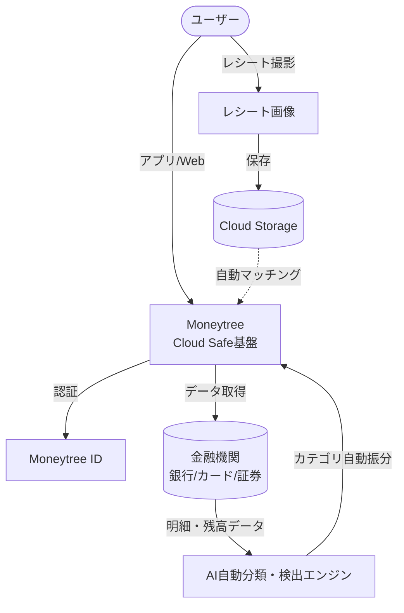

# **Moneytree 調査レポート**

## **1. 基本情報**

* **ツール名**: Moneytree
* **ツールの読み方**: マネーツリー
* **開発元**: マネーツリー株式会社
* **公式サイト**: [https://getmoneytree.com/jp/home](https://getmoneytree.com/jp/home)
* **関連リンク**:
  * アプリ(iOS): [https://apps.apple.com/jp/app/moneytree-%E5%AE%B6%E8%A8%88%E7%B0%BF%E3%82%88%E3%82%8A%E6%A5%BD%E3%83%81%E3%83%B3/id586847189](https://apps.apple.com/jp/app/moneytree-%E5%AE%B6%E8%A8%88%E7%B0%BF%E3%82%88%E3%82%8A%E6%A5%BD%E3%83%81%E3%83%B3/id586847189)
  * アプリ(Android): [https://play.google.com/store/apps/details?id=jp.moneytree.moneytree](https://play.google.com/store/apps/details?id=jp.moneytree.moneytree)
  * ドキュメント: [https://help.getmoneytree.com/ja/](https://help.getmoneytree.com/ja/)
* **カテゴリ**: 資産管理
* **概要**: 銀行、クレジットカード、電子マネー、ポイント・マイル、証券など、複数の金融サービスを一元管理できる資産管理ツール。個人の家計管理だけでなく、仕事の経費精算や法人口座の管理にも対応している。

## **2. 目的と主な利用シーン**

* **解決する課題**: 複数口座やカードの残高・明細確認の手間、家計簿の入力漏れ、経費精算の煩雑さ、ポイントの失効。
* **想定利用者**: 個人（家計管理）、フリーランス・ビジネスパーソン（経費精算）、法人・経営者（法人口座管理）。
* **利用シーン**:
  * 日々の家計簿の自動作成と収支の可視化。
  * 仕事で発生した経費の自動検出と精算書の作成。
  * 複数ある法人口座のキャッシュフローをモバイルで確認。

## **3. 主要機能**

* **一元管理**: 最大50社までの金融サービス（銀行、クレジットカード、電子マネー、ポイント、証券）を登録し、残高や利用明細を自動更新。
* **カテゴリ自動振り分け**: AIが明細を学習し、自動的に支出をカテゴリ別に振り分け。
* **通知機能**: 大口の入出金、口座残高の低下、カード支払日、ポイント有効期限などをプッシュ通知。
* **グラフ・レポート**: 収支や資産の推移をグラフで可視化。有料プランではカテゴリ別予算設定や月次レポートも可能。
* **経費精算 (Work/Corporate)**: AIによる経費の自動検出、レシート画像の安全保管と明細との自動照合、経費精算書の作成・データ出力。
* **法人口座管理 (Corporate)**: クラウド上での電子証明書発行により、モバイル上で法人口座の明細情報を閲覧可能。

## **4. 動作原理・システム構成**

* **アーキテクチャ**: クラウド型の資産管理・経費精算プラットフォーム (Cloud Safe™基盤)
* **主要コンポーネントとデータフロー**:
  * **データ収集**: API連携およびスクレイピングを通じて銀行、クレジットカード、証券会社などの金融機関から利用明細や残高情報を自動取得する。
  * **AI自動分類**: 自社開発のAIエンジンが取得した明細データを解析し、自動的にカテゴリ（食費、光熱費、交通費など）へ分類する。経費精算（Work）ではAIが経費該当項目を自動検出する。
  * **クラウドストレージ**: レシート画像などは「Cloud Safe™」と呼ばれるクラウド基盤に安全に保存され、明細と自動的にマッチングされる。
* **特筆すべき要素技術**:
  * **Moneytree ID**: 自社および他社の金融サービス（Moneytree Connect対応）へ横断的にログイン・連携できる統合認証基盤。
  * **セキュリティとプライバシー・バイ・デザイン**: プライバシー保護を重視した設計思想であり、明示的な同意なしに第三者へデータを提供しない仕組み。

## **5. 開始手順・セットアップ**

* **前提条件**:
  * iOS/Android端末、またはWebブラウザ。
  * アカウント作成（Moneytree ID）が必要。
* **インストール/導入**:
  * iOS: App Storeから「Moneytree」をインストール。
  * Android: Google Playから「Moneytree」をインストール。
  * Web: [https://app.getmoneytree.com/](https://app.getmoneytree.com/) から新規登録。
* **初期設定**:
  * Moneytree IDを作成しログイン。
  * 利用している銀行、クレジットカードなどの金融機関を選択し、ログイン情報（ID/パスワード等）を入力して連携。

## **6. 特徴・強み (Pros)**

* **無料プランが強力**: 無料の基本機能でも広告表示がなく（iOS/Web版）、50社まで金融サービスを登録可能。過去データの閲覧も制限なし（永年保存）。
* **プライバシー・セキュリティ重視**: 「あなたのデータはあなたのもの」というポリシーのもと、承諾なしの第三者へのデータ提供やアプリ内広告配信を行わない。
* **目的に応じたプラン展開**: 個人の家計管理（Grow）、経費精算（Work）、法人口座管理（Corporate）と、利用者のニーズに合わせた有料プランが用意されており、1つのアプリで切り替えて利用可能。

## **7. 弱み・注意点 (Cons)**

* **Android版の機能差**: 「月次レポート」や「データ出力 (XLSX/CSV)」など、一部の機能（Growプラン）がAndroid版には未搭載（今後のアップデートで対応予定の可能性あり）。
* **即時更新の制限**: 一部の銀行等のデータ更新は即時ではなく、金融機関側の仕様やプランによって更新頻度が異なる場合がある。
* **対応していない金融機関**: 暗号資産（仮想通貨）系の口座や、一部の地域金融機関など、未対応のサービスも存在する。

## **8. 料金プラン**

| プラン名 | 料金 (Web決済 / アプリ決済) | 主な特徴 |
|---------|------|---------|
| **パーソナル (無料)** | 無料 | 広告非表示(Android除く)、50社連携、自動振り分け、通知、永年保存。基本的な家計管理機能。 |
| **Moneytree Grow (家計管理)** | 月額: 390円 / 430円 年額: 3,900円 / 4,300円 | カテゴリ別予算設定、月次レポート、データ出力(CSV/Excel)、光熱費インサイトなど。 |
| **Moneytree Work (経費精算)** | 月額: 500円 / 500円 年額: 5,400円 / 5,400円 | 経費のAI自動検出、経費精算書の作成、レシート保管・自動照合、データ出力。 |
| **Moneytree Corporate (法人口座)** | 月額: 4,980円 / 4,980円 年額: 49,800円 / 49,800円 | 法人口座の連携（モバイル閲覧対応）、Workの全機能。 |

* **課金体系**: アカウント単位（月額または年額）。
* **無料トライアル**: 新規登録時に一定期間の無料トライアルが提供される場合がある（詳細はアプリ内等で確認）。

## **9. 導入実績・事例**

* **導入企業**: 個人向けアプリとして累計100万ダウンロード以上（Google Play）。
* **導入事例**: 無料の家計簿アプリとして広く利用されているほか、フリーランスや個人事業主の経費精算、中小企業の法人口座管理などで活用されている。
* **対象業界**: 個人（家計管理）、個人事業主、中小企業など全般。

## **10. サポート体制**

* **ドキュメント**: [ヘルプセンター (https://help.getmoneytree.com/ja/)](https://help.getmoneytree.com/ja/) にてFAQや使い方ガイドを提供。
* **コミュニティ**: 公式SNS（X, Facebook）での情報発信。
* **公式サポート**: メールサポート（`support@getmoneytree.com`）。

## **11. エコシステムと連携**

### **11.1 API・外部サービス連携**

* **API**: 企業向けには「Moneytree LINK」として金融インフラAPIを提供しているが、個人向けアプリとしての公開APIは提供されていない。
* **外部サービス連携**: レシートの連続スキャンにおいて、PFU社製スキャナー（ScanSnap iX100, iX1500, iX1600 等）と連携可能（iOS版 Moneytree Work/Corporate）。「Moneytree ID」を用いて、対応する他社の金融サービス（Moneytree Connect）と安全に連携可能。

### **11.2 技術スタックとの相性**

| 技術スタック | 相性 | メリット・推奨理由 | 懸念点・注意点 |
|:---|:---:|:---|:---|
| **各種会計ソフト** | ◯ | Work/Corporate/Grow(iOS)プランでCSV/Excel出力が可能 | 自動連携（API）機能は個人向けアプリからは直接提供されていないため、手動でインポートが必要 |

## **12. セキュリティとコンプライアンス**

* **認証**: Moneytree IDによる認証。
* **データ管理**: アプリ内で「セキュリティ、プライバシー、透明性を重視」と明記。承諾なしの第三者へのデータ提供なし。レシート画像はクラウド上 (Cloud Safe™️) で安全に保管。
* **準拠規格**: プライバシー保護を重視した設計。

## **13. 操作性 (UI/UX) と学習コスト**

* **UI/UX**: グリーンを基調としたシンプルで直感的なデザイン。個人用（パーソナル）、仕事用（ワーク）、法人用（コーポレート）の画面（タブ）が分かれており、目的のデータに素早くアクセスできる。
* **学習コスト**: 初回の口座連携さえ完了すれば、あとは自動でデータが更新・分類されるため、学習コストは非常に低い。経費精算やレシート読み取りも、直感的な操作で完結する。

## **14. ベストプラクティス**

* **効果的な活用法 (Modern Practices)**:
  * キャッシュレス決済（クレジットカード、電子マネー）を積極的に利用し、現金のやり取りを減らすことで、Moneytreeでの自動記録・分類の精度と利便性を最大化する。
  * Moneytree Growを利用して「カテゴリ別予算」を設定し、使いすぎの通知を受け取ることで、家計の改善サイクルを回す。
* **陥りやすい罠 (Antipatterns)**:
  * 金融機関のパスワードを変更した際、Moneytree側での認証情報更新を忘れるとデータが取得できなくなるため、パスワード変更時は速やかに再連携を行う。

## **15. ユーザーの声（レビュー分析）**

* **調査対象**: Google Play ストア, Apple App Store
* **総合評価**: 4.5/5.0 (Google Play)
* **ポジティブな評価**:
  * 「資産ビューアーとしてはシンプルで見やすく更新間隔も短いのでとても使いやすい」（Google Play）
  * 「現金預金、証券などの金融資産、DCなどをまとめて管理できて便利」（Google Play）
  * 「nanacoも登録出来、残高がすぐ確認出来て便利」（Google Play）
* **ネガティブな評価 / 改善要望**:
  * 「現金の扱いが他の類似アプリと比較して非常にクセがある」（Google Play）
  * 「特定のカード（例: PayPayカードなど）や暗号資産系のアカウントに未対応なのが不便」（Google Play）
  * 「通知機能（大口取引など）の反映タイミングに遅れや一部漏れがある場合がある」（Google Play）
* **特徴的なユースケース**:
  * サラリーマンは基本無料の「パーソナル」、個人事業主やフリーランスは経費自動検出がある「Work」、といったように属性に合わせてプランを使い分けているユーザーが多い。

## **16. 直近半年のアップデート情報**

* **2026-10-06**: Androidアプリにおける軽微なバグの修正および技術的な改善を実施。
* **2026-07-13**: 家計簿が続かない人向けに、AIを活用したお金の確認サポートに関する情報および案内を公開。
* **2026-06-11**: 複数口座やカードの残高をまとめて確認する機能に関する案内や管理手法を公開。
* **2026-02-20**: （推測）光熱費インサイト(ベータ版)機能の提供開始（レビュー等から近年追加された機能と推測）。
* **2024-10**: 「Moneytree Grow」において光熱費の全国平均と家庭を比較できる機能に関する素材追加。

(出典: [マネーツリー ブログ](https://getmoneytree.com/jp/app/blog), [Google Play](https://play.google.com/store/apps/details?id=jp.moneytree.moneytree))

## **17. 類似ツールとの比較**

### **17.1 機能比較表 (星取表)**

| 機能カテゴリ | 機能項目 | Moneytree | タックスナップ | TOKIUM |
|:---:|:---|:---:|:---:|:---:|
| **基本機能** | 連携可能数(無料) | ◎ <small>50社まで可能</small> | × <small>無料プランなし</small> | × <small>無料プランなし</small> |
| **基本機能** | 過去データ閲覧(無料) | ◎ <small>永年保存・閲覧可能</small> | - <small>無料プランなし</small> | - <small>無料プランなし</small> |
| **経費・ビジネス** | 経費精算/自動化 | ◯ <small>WorkプランでAI自動検出</small> | ◎ <small>スワイプ仕訳で超高速処理</small> | ◎ <small>オペレーター入力と高度な自動化</small> |
| **非機能要件** | レシート読み取り/管理 | ◯ <small>Workプランで対応(Cloud Safe保管)</small> | ◯ <small>スマホアプリ対応</small> | ◎ <small>原本保管代行まで対応</small> |
| **拡張性** | 法人口座/システム連携 | ◯ <small>Corporateプランで法人口座対応</small> | × <small>個人のみ</small> | ◎ <small>会計システム連携等、法人に特化</small> |

### **17.2 詳細比較**

| ツール名 | 特徴 | 強み | 弱み | 選択肢となるケース |
|---------|------|------|------|------------------|
| **Moneytree** | 無料版の制限が少なく、個人・経費・法人の一元管理が可能な資産管理ツール | 無料で50件連携・過去データ無期限閲覧可能。1つのアプリで個人と法人(経費)の切り替えが容易。 | 無料版ではレシート読み取り機能がない。Android版の有料機能に一部制限がある。 | 無料で複数の銀行・カードを管理したい個人、またはスマホで手軽に経費や法人口座を確認したいフリーランス・経営者。 |
| **タックスナップ** | 個人事業主・フリーランスに特化した、スワイプ操作で仕訳ができる自動計算・確定申告アプリ | スマホひとつで自動計算・e-Tax提出まで完結でき、他ソフトの約4倍の速さで経費処理が可能。 | 法人には非対応。完全に個人事業主・フリーランス向けの設計となっている。 | 確定申告をとにかく速く終わらせたいフリーランスや、スマホアプリだけで手軽に経費仕訳・申告を済ませたい個人事業主。 |
| **TOKIUM** | 中小〜大企業向けの、紙の領収書・請求書の完全ペーパーレス化を実現する支出管理プラットフォーム | レシート等の原本回収・保管代行までカバーし、オペレーターによる高精度な入力代行や電子帳簿保存法(JIIMA認証)に対応。 | 個人・フリーランス向けではなく、初期費用や月額費用が発生する法人向け（月額10,000円〜）。 | 企業全体のペーパーレス化、経費精算業務の大幅な削減、原本管理のアウトソーシングを行いたい法人企業。 |

## **18. 総評**

* **総合的な評価**:
  Moneytreeは、無料プランの充実度において他の追随を許さない非常に優秀な資産管理ツールである。特に「50社までの連携」「過去データの永年閲覧」「広告非表示（iOS/Web）」が無料で利用できる点は、ユーザーにとって大きなメリットである。一方で、現金管理やレシート読み取り（無料版）には対応していないため、完全なキャッシュレス派や、クレジットカード・銀行引き落とし中心の生活をしている人に最も適している。
* **推奨されるチームやプロジェクト**:
  * 複数の銀行口座、クレジットカード、証券口座を保有している個人。
  * 確定申告に向けて経費を自動で集計・出力したいフリーランスや個人事業主（Moneytree Work推奨）。
  * 外出先から会社のキャッシュフローを確認したい中小企業の経営者（Moneytree Corporate推奨）。
* **選択時のポイント**:
  * 「現金の支出（レシート入力）を細かく管理したいか」それとも「キャッシュレス決済を中心に自動で資産・収支を把握したいか」。後者であればMoneytreeは最適な選択肢となる。
  * 無料でどこまで連携・過去データの閲覧をしたいか（連携数が多いならMoneytreeが圧倒的有利）。
