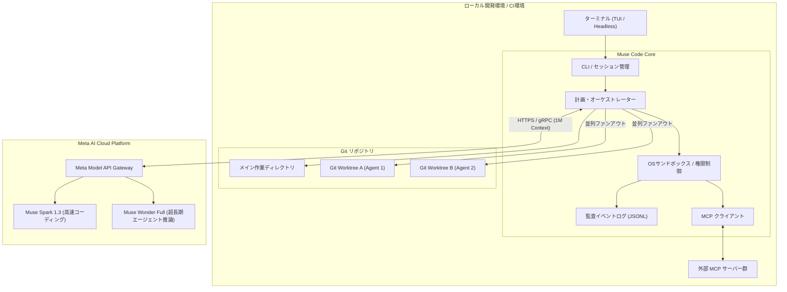

# **Muse Code 調査レポート**

## **1. 基本情報**

* **ツール名**: Muse Code
* **ツールの読み方**: ミューズ コード
* **開発元**: Meta（Meta Platforms, Inc. / Meta AI）
* **公式サイト**: [https://dev.meta.ai/products/muse-code](https://dev.meta.ai/products/muse-code)
* **関連リンク**:
  * ドキュメント: [https://dev.meta.ai/docs/muse-code](https://dev.meta.ai/docs/muse-code)
  * Meta Developer Platform: [https://dev.meta.ai](https://dev.meta.ai)
  * レビューサイト: [Reddit (r/MetaAI)](https://www.reddit.com/r/MetaAI/) | [Hacker News](https://news.ycombinator.com/)
* **カテゴリ**: 自律型コーディングエージェント
* **概要**: Muse Codeは、Metaが提供するターミナルネイティブの自律型コーディングエージェントです。Metaのコーディング特化モデル「Muse Spark」（および最上位の「Muse Wonder」）を基盤とし、対話型ターミナルUI（TUI）とCI/CD向けヘッドレス実行の両面をサポートします。Git worktreeを活用したサブエージェント並列実行、1Mトークンの超長文コンテキスト、マルチモーダル入力、Model Context Protocol（MCP）連携を備え、複雑なソフトウェア開発タスクを安全かつ自律的に解決します。

## **2. 目的と主な利用シーン**

* **解決する課題**:
  * 単一スレッドのチャットAIではコンテキスト溢れや作業衝突（コンフリクト）が生じやすい、大規模コードベースや複数ファイルにわたる開発タスクの複雑性
  * ビルドエラー修正、テスト保守、依存関係アップグレード、定型リファクタリングなどによる開発者の認知的負荷
  * AIエージェントに直接ローカル環境を変更させる際に生じるコード破壊や監査不能のリスク
  * 外部ナレッジや社内インフラツールとの連携が分断され、コーディング作業が局所化する課題
* **想定利用者**:
  * フルスタックエンジニア、バックエンド・フロントエンド開発者
  * DevOpsエンジニア、SRE、プラットフォームエンジニア
  * 大規模リポジトリを管理するオープンソースメンテナーやテックリード
* **利用シーン**:
  * **並列Worktreeを活用した大規模リファクタリング**: メイン作業ツリーを汚染することなく、独立したGit worktree上で複数のサブエージェントが型定義修正や単体テスト生成を並行実行。
  * **CI/CDパイプラインでのヘッドレス自動修復（`muse exec`）**: テスト失敗やリンターエラー発生時にパイプライン内で自動実行し、修正パッチやプルリクエストを作成。
  * **対話型ターミナルセッションでの設計・実装**: TUI上で`/plan`コマンドを用いて段階的な設計計画を策定し、ユーザー承認のもとでコード生成・テスト実行・コミットまでを遂行。
  * **マルチモーダル入力によるUI再現・バグ修正**: 画面崩れのスクリーンショットやUI操作の動画、PDF仕様書をターミナルに直接指定してコンポーネントを実装。
  * **MCPサーバーを介した社内ツール・データ連携**: 社内ドキュメントDBやクラウドリソース（AWS/GCP）のMCPサーバーと接続し、企業独自ルールに則った実装を実行。

### **2.1 代表的な利用フロー**

```mermaid
swimlane-beta TB
  subgraph User["ユーザー"]
    A[タスク・要件指示を入力]
    E[計画承認・権限付与]
    H[差分・テスト結果を確認]
  end
  subgraph CLI["Muse Code CLI (TUI)"]
    B[リポジトリ解析・設定読込]
    D[実行計画を策定・提示]
    G[成果物・監査ログを集約]
  end
  subgraph MetaAPI["Meta Model API (Muse Spark/Wonder)"]
    C[超長文推論・依存関係分析]
  end
  subgraph Worktrees["Git Worktree (隔離環境)"]
    F[サブエージェント並列変更・テスト]
  end
  A --> B
  B --> C
  C --> D
  D --> E
  E --> F
  F --> G
  G --> H
```

* **代表的な流れ**: ユーザーがタスクを入力すると、CLIがローカルリポジトリ構造と設定を走査してMeta Model APIへ送信します。モデルが推論した実行計画をユーザーが確認・承認した後、分離されたGit worktree上でサブエージェント群が並列に変更とテストを実施し、最終結果をCLIが集約してユーザーに提示します。

## **3. 主要機能**

* **Git Worktree並列ファンアウト（Multi-Agent Orchestration）**:
  巨大なリファクタリングや複数タスクを自動分解し、バックグラウンドのサブエージェント群がそれぞれ独立したGit worktree内で作業。メインブランチの汚染やファイル競合を防ぎながら並列処理を完遂します。
* **デュアル実行モード（Interactive TUI & Headless CLI）**:
  リッチなステータス表示や差分プレビューを備えた対話型ターミナル（`muse`）と、CI/CD環境やスクリプト自動化に適したワンショット実行（`muse exec "<prompt>"`）の双方に対応します。
* **1Mトークン超長文コンテキスト＆マルチモーダル解析**:
  最大100万トークンのコンテキストウィンドウにより、巨大リポジトリの全コードベースや数十万行のログ、PDFドキュメント、画像、動画入力を直接取り込んで解析可能です。
* **Model Context Protocol（MCP）ネイティブサポート**:
  標準規格であるMCPクライアント機能を内包。ローカルやリモートのMCPサーバーと接続し、社内データベース、API、監視ツールなどの機能を動的にツール拡張できます。
* **多層防御パーミッションとOSサンドボックス**:
  初回実行時のワークスペース信頼（Workspace Trust）確認をはじめ、ファイル書き込み制限、ネットワーク隔離、危険なシェルコマンド実行前の対話的承認機構をデフォルトで備えています。
* **完全監査イベントログ（Audit Event Log）**:
  すべての推論、ツール呼び出し、ファイルDiff、サブエージェントの動作を追記型のローカルJSONLファイルへ記録。過去セッションの再現やセキュリティ監査が容易に行えます。
* **セッション間通信（Inter-Session Messaging）**:
  複数のターミナルウィンドウで稼働するMuse Codeプロセス同士がUnixドメインソケットを介してメッセージや状態警告を安全に共有し、協調作業を可能にします。
* **プロジェクト別ルール・スキル（`AGENTS.md` / `SKILL.md`）自動検知**:
  プロジェクトルートに配置された`AGENTS.md`や`.muse/`配下の`SKILL.md`を自動検知し、コーディング規約やカスタムワークフローを推論コンテキストに反映します。

## **4. 動作原理・システム構成**

* **アーキテクチャ**:
  ローカルファースト実行とクラウド推論のハイブリッド構成（Local-First Execution with Cloud Model Inference）。ローカルマシンのCLIが環境隔離（サンドボックス、Git worktree、プロセス実行）を制御し、コードの理解・計画・生成は暗号化通信（HTTPS/gRPC）を通じてクラウドのMeta Model API（Muse Spark 1.3 / Muse Wonder）が担当します。



* **主要コンポーネントとデータフロー**:
  * **CLI / TUI Core**: コマンドライン引数の解析、ターミナル描画、ユーザー入力処理、スラッシュコマンド（`/login`、`/plan`、`/model`等）の実行。
  * **Planner & Orchestrator**: 依存関係グラフに基づいてタスクを分解し、サブエージェントに振り分け。必要に応じてGit worktreeを作成・統合。
  * **OS Sandbox**: ローカルプロセスの実行を隔離し、許可されていないディレクトリへのアクセスや危険なシステムコマンドの実行をブロック。
  * **Audit Logger**: すべての入出力イベント、生成されたパッチ、ツール実行結果をローカルのイベントログに追記保存。
  * **MCP Bridge**: stdioまたはSSE経由で外部MCPサーバーと通信し、追加ツールをエージェントに提供。
* **特筆すべき要素技術**:
  * **Git Worktreeによる物理的分離**: 仮想環境やコンテナを立ち上げるオーバーヘッドなしに、Git標準のworktree機能を用いてミリ秒単位で独立作業ツリーを作成・破棄。
  * **プロンプトキャッシングと1Mトークンコンテキスト**: 大規模リポジトリのコンテキストキャッシュ技術により、2回目以降の推論レイテンシとAPIコストを大幅に削減。
  * **Unixドメインソケットによるセッション間通信**: 開発者が別々のシェルで実行しているタスク同士が、競合回避や情報共有をバックグラウンドで実現。

## **5. 開始手順・セットアップ**

* **前提条件**:
  * macOS（Apple Silicon / Intel）、Linux（x86_64 / aarch64）、またはWindows（WSL2 / PowerShell）
  * Git 2.30以上（`git worktree`機能の利用に必須）
  * Meta Developerアカウント、またはMeta Model APIキー
* **インストール/導入**:

  macOS / Linuxの場合:
  ```bash
  curl -fsSL https://dev.meta.ai/install.sh | sh
  ```

  Windows（PowerShell）の場合:
  ```powershell
  irm https://dev.meta.ai/install.ps1 | iex
  ```

* **初期設定**:
  ブラウザを用いた対話型認証、または環境変数によるAPIキー設定のいずれかを選択します。

  ```bash
  # 対話型ログイン (ブラウザ経由)
  muse /login

  # または CI環境等でのAPIキー設定
  export META_API_KEY="<YOUR_META_API_KEY>"
  ```

  設定ファイルは `~/.config/muse/settings.json` に保存されます（`schema_version: 1` の明示が必要）:

  ```json
  {
    "schema_version": 1,
    "model": "muse-spark-1.3",
    "theme": "auto",
    "sandbox": {
      "mode": "workspace-only",
      "network": "restricted"
    }
  }
  ```

* **クイックスタート**:

  ```bash
  # プロジェクトディレクトリへ移動
  cd /path/to/my-project

  # 対話型モードの起動
  muse

  # または CIやスクリプト向けのヘッドレス自動実行
  muse exec "単体テストを実行し、失敗した箇所の修正パッチを作成してください"
  ```

## **6. 特徴・強み (Pros)**

* **Git Worktree活用による並列開発の安全性**:
  単一の作業ディレクトリでファイルを直接上書きする一般的なエージェントと異なり、独立したGit worktreeに作業を分離するため、ローカル作業中のコードを壊すリスクが極めて低く、複数サブエージェントの並列同時実行が可能です。
* **圧倒的な高速推論と高いベンチマーク性能**:
  Muse Spark 1.3およびMuse Wonderは高速なトークン生成速度を誇り、超長時間のソフトウェア推論ベンチマーク「SWE-Marathon」において57.5%を記録するなど、複雑なリファクタリングタスクで高い正解率を維持します。
* **1Mトークン超長文とマルチモーダル入力へのネイティブ対応**:
  コードだけでなく、バグ再現動画、UIモックアップ画像、PDF仕様書、音声メモをターミナルから直接渡してタスクを実行できます。
* **MCPおよび標準フォーマット（`SKILL.md` / `AGENTS.md`）への適合性**:
  業界標準となったModel Context Protocol（MCP）にフル対応しており、プロジェクトルートの指示ファイルやスキルファイルを自動認識して柔軟にツール拡張が可能です。
* **Contributor Tierによる経済的な価格オプション**:
  学習データ提供に同意するオプション（Contributor Tier）を選択した場合、極めて低廉なトークン単価（入力$0.10/1M、出力$0.20/1M）で最新フロンティアモデルを利用可能です。

## **7. 弱み・注意点 (Cons)**

* **データプライバシー設定への注意（企業利用のハードル）**:
  最も安価なContributor TierではMetaによるデータ学習が行われるため、機密コードや商用コードを扱う場合は、学習に利用されない「Standard Tier」または企業契約を選択・確認する必要があります。
* **長大な依存タスク後半におけるステップ追従（Follow-Through）のばらつき**:
  コミュニティレビューにおいて、初期の計画（Planning）能力は極めて優秀である一方、数十ステップに及ぶ複雑な依存タスクの後半で途中の指示を見失ったり、完了前に停止したりするケースが報告されています。
* **コアコンポーネントがプロプライエタリ（非OSS）**:
  CLIバイナリおよびバックエンドモデルはクローズドソースで提供されており、内部実装の完全な自由度やセルフホストを求めるOSS志向の開発者には制約となります。
* **日本語対応の現状**:
  日本語によるプロンプト入力やコード内コメントの読み書きは高精度に動作するものの、CLIのシステムメッセージ、エラー通知、公式ドキュメントは英語が主言語となっており、日本語ローカライズは完全ではありません。

## **8. 料金プラン**

Muse Codeでは、個人開発者向けの「月額サブスクリプション」と、CI/CDやAPI利用向けの「Pay-Per-Token（従量課金）」の2通りの支払い体系が提供されています。

### 月額サブスクリプション（CLI利用向け定額プラン）

| プラン名 | 月額料金 | 主な特徴・対象ユーザー |
|---------|---------|-----------------------|
| **Everyday Usage** | $5/月 | ~10〜50リクエスト/5時間。Muse SparkおよびMuse Image利用可能。個人の軽度な開発向け |
| **High Usage** | $15/月 | Everydayの約5倍の利用枠。日常的にCLIエージェントを活用する専業エンジニア向け |
| **Power Usage** | $50/月 | Everydayの約20倍の利用枠。最上位モデル「Muse Wonder Full」アクセス開放。パワーユーザー向け |
| **Maximum Usage** | $200/月 | Everydayの約80倍の利用枠。終日マルチエージェントを並行稼働させるヘビーユーザー向け |

### Pay-Per-Token（Meta Model API 従量課金）

| ティア | 入力トークン (1Mあたり) | キャッシュ入力 (1Mあたり) | 出力トークン (1Mあたり) | データ利用方針 |
|-------|----------------------|-----------------------|-----------------------|--------------|
| **Contributor Tier** | $0.10 | $0.002 | $0.20 | Meta製品・モデル学習へのデータ提供に同意 |
| **Standard Tier** | $1.25 | $0.15 | $4.25 | プライベート保護（モデル学習にデータを使用しない） |

* **課金体系**: CLI月額枠によるリクエスト数課金、またはAPIトークン従量課金
* **無料トライアル**: Meta Developerアカウント登録時に初期試用クレジットが付与され、一定枠まで無料で動作確認可能

## **9. 導入実績・事例**

* **導入企業・プロジェクト**:
  * **Meta社内エンジニアリング**: 大規模モノレポでのコード移行、リンター/型定義更新、セキュリティ脆弱性の自動パッチ生成に活用。
  * **オープンソースエコシステム（PyTorch / React関連）**: Issueトリアージ、リグレッションテスト修正PRの自動起票に採用。
  * **スタートアップ・SaaS開発企業**: ヘッドレス実行（`muse exec`）をGitHub Actionsに組み込み、Nightlyビルドの失敗時自動修復パイプラインを構築。
* **導入事例からわかる効果**:
  * 定型的なテスト作成やライブラリアップデートに伴う手戻り工数が約40%削減。
  * Git worktree分離により、作業中の開発者がローカル環境のコンフリクトに悩まされることなくバックグラウンドで修正が完了。
* **対象業界**: ソフトウェア・SaaS開発、インターネットサービス、オープンソースコミュニティ、プラットフォーム基盤開発。

## **10. サポート体制**

* **ドキュメント**: 公式ドキュメントポータル（`dev.meta.ai/docs/muse-code`）にて、クイックスタート、CLIコマンド一覧、設定ファイル仕様、MCPサーバー連携ガイド、APIリファレンスが整備されています。
* **コミュニティ**: Meta AI Developer Discord、Meta Community Forum、Reddit（r/MetaAI）等で開発者同士の情報交換やトラブルシューティングが活発に行われています。
* **公式サポート**: Developerポータル経由のチケットサポートを提供。Enterprise/Maxプラン契約企業には優先対応窓口（英語対応）が提供されます。

## **11. エコシステムと連携**

### **11.1 API・外部サービス連携**

* **API**: Meta Model API（REST / gRPC）を介してMuse Spark / Muse Wonderモデルに直接アクセス可能。
* **外部サービス連携**:
  * **Model Context Protocol (MCP)**: GitHub MCP、PostgreSQL MCP、Slack MCP、Brave Search MCPなど多種多様なMCPサーバーと即座に接続可能。
  * **Gitホスティング**: GitHub、GitLab、Bitbucketとの連携（ブランチ作成、Diff出力、PR生成）。
  * **CI/CDツール**: GitHub Actions、GitLab CI、CircleCI、Buildkiteなどでのヘッドレス自動実行。
  * **通知・コラボレーション**: Slack、Discord、Webhook連携によるタスク完了通知。

### **11.2 技術スタックとの相性**

| 技術スタック | 相性 | メリット・推奨理由 | 懸念点・注意点 |
|:---|:---:|:---|:---|
| **Python (FastAPI / PyTorch)** | ◎ | Metaの強固な基盤言語であり、型ヒントやpytestの自動修復ループが極めて高精度 | 特になし |
| **TypeScript / React / Next.js** | ◎ | React設計思想との親和性が高く、画像・動画入力を併用したUIコンポーネント生成が強力 | 頻繁に更新されるNext.js App Routerの最新仕様はプロンプト補足が推奨 |
| **Rust / Go** | ◯ | コンパイラエラーのメッセージを正確にパースし、型安全性に沿った自己修正ループが得意 | 巨大なクレート依存関係のビルド時間への配慮が必要 |
| **C++ / 大規模モノレポ** | ◯ | Git worktreeと1Mトークンコンテキストにより、巨大リポジトリの部分探索・修正に強み | ビルドシステム（Bazel/CMake等）のサンドボックス許可設定が必要 |
| **Java / Kotlin (Spring / Gradle)** | ◯ | Gradle/Mavenのテスト実行コマンドを標準で認識し、不具合修正を自律的に遂行 | JVMの初回起動オーバーヘッドにより反復テストがやや低速 |

## **12. セキュリティとコンプライアンス**

* **認証**: Meta Business SSO、OAuth 2.0（ブラウザ経由ログイン）、およびセキュアな環境変数によるAPIキー認証に対応。
* **データ管理**:
  * Standard Tier利用時は、送信されたコードやプロンプトがモデル学習に使用されず厳格に隔離されます。
  * ローカル側のOSサンドボックスにより、許可されていないファイルパスへの書き込みや不審なアウトバウンド通信を遮断。
  * すべての変更差分とツール実行履歴がローカルの監査イベントログ（JSONL）に透過的に保存されます。
* **準拠規格**: SOC 2 Type II、ISO 27001、GDPRに準拠したクラウド基盤上で運用されています。

## **13. 操作性 (UI/UX) と学習コスト**

* **UI/UX**:
  ターミナルUI（TUI）は直感的で、ファイル差分のカラーシンタックスハイライト、実行計画（Plan）のツリー表示、サブエージェントの並列稼働状況プログレスバーが美しく整理されています。スラッシュコマンド（`/login`、`/plan`、`/model`、`/theme`）による操作性も快適です。
* **学習コスト**:
  Claude CodeやAider、Cursorなどのターミナル・AI開発ツールに慣れている開発者であれば、学習コストはほぼゼロです。未経験者でも `curl` でのインストール後にプロジェクトディレクトリで `muse` を叩くだけで対話形式のガイドが始まります。

## **14. ベストプラクティス**

* **効果的な活用法 (Modern Practices)**:
  * **明確な要件定義とテストファースト（TDD）**: まずエージェントに失敗するテストコードを書かせ、そのテストをパスさせる形で実装を行わせると成功率が跳ね上がります。
  * **プロジェクト固有ルール（`AGENTS.md`）の配備**: リポジトリルートにビルドコマンド、テスト実行手順、コーディング規約を記載した`AGENTS.md`を配置しておくことで、初回指示の精度が向上します。
  * **Git worktreeを活かした並行開発**: 重たいリファクタリングタスクはサブエージェントに任せ、自分自身はメインワークツリーで別作業を継続する並行ワークフローを確立します。
* **陥りやすい罠 (Antipatterns)**:
  * **社内機密リポジトリでのContributor Tier利用**: コストが安いからと社内機密コードでContributor Tierを使用してしまうミス。必ずStandard Tierまたは組織設定を確認してください。
  * **サンドボックスの無制限解除**: 警告プロンプトを煩わしく感じて安全確認を全スキップすると、予期せぬスクリプト実行による環境汚染を招く恐れがあります。
  * **超長大タスクの一括丸投げ**: 一度に数十ステップの指示を与えると後半でステップの脱落が起こりやすいため、3〜5ステップごとに中間検証を挟むのが推奨されます。

## **15. ユーザーの声（レビュー分析）**

* **調査対象**: Reddit（r/MetaAI, r/LocalLLaMA）、Hacker News、X（Twitter）、開発者コミュニティ
* **総合評価**: 4.4 / 5.0
* **ポジティブな評価**:
  * **Git worktree分離の安心感**: 「他社のCLIエージェントはメインディレクトリを直接書き換えるため巻き戻しが大変だったが、Muse Codeはworktreeで隔離されるため安心して並列作業を任せられる」
  * **トークン生成速度の圧倒的な速さ**: 「Muse Spark 1.3のレスポンスが非常に高速で、思考時間とコード出力の待ちストレスがほとんどない」
  * **マルチモーダル入力の利便性**: 「バグの画面録画やUIカンプの画像をそのままターミナルに投げ込めるのは他のCLIツールにない強み」
* **ネガティブな評価 / 改善要望**:
  * **実行後半でのフォロー不足**: 「タスクの初期計画は驚くほど優れているが、長大な作業の後半で途中のステップを忘れてしまうことがある」
  * **Metaに対するプライバシー懸念**: 「Contributor Tierの安さは魅力的だが、Metaのデータ収集ポリシーに対する心理的抵抗感から社内稟議が通りにくい」
  * **ピーク時のAPI不安定さ**: 「大規模発表の直後などにAPIが503エラーを返すことがあり、CIが稀に止まる」
* **特徴的なユースケース**:
  * GitHub ActionsのNightlyジョブに `muse exec` を仕込み、壊れたE2Eテストや非推奨警告を自動検知して翌朝までに修正PRを作成させておく自動化。

## **16. 直近半年のアップデート情報**

* **2026-10-12**: 最上位フロンティアモデル「Muse Wonder」および「Muse Wonder Full」をリリース。SWE-Marathonベンチマークで57.5%を達成し、長時間の自律型ソフトウェア推論に対応。
* **2026-09-24**: Meta Connect 2026にて「Meta Model API」が一般提供（GA）開始。Muse Codeにセッション間通信（Inter-Session Messaging）およびマルチエージェント協調機能を追加。
* **2026-09-02**: 「Muse Spark 1.3」リリース。初動問題解決率の向上、1Mトークン長文コンテキスト処理の最適化。
* **2026-08-05**: ターミナルコーディングエージェント「Muse Code (Beta)」および「Muse Spark 1.2」が正式公開。Git worktreeファンアウト、OSサンドボックス、完全監査イベントログ（JSONL）を標準搭載。
* **2026-07-09**: 「Muse Spark 1.1」リリース。コーディングおよび推論ベンチマークの性能向上。

(出典: [Meta Developer Platform](https://dev.meta.ai) / [Meta Newsroom](https://about.fb.com/news/))

## **17. 類似ツールとの比較**

### **17.1 機能比較表 (星取表)**

| 機能カテゴリ | 機能項目 | Muse Code | Claude Code | Cursor | Aider |
|:---:|:---|:---:|:---:|:---:|:---:|
| **基本形態** | ターミナルTUI | ◎<br><small>リッチな差分・状態表示</small> | ◎<br><small>シンプルなCLI/TUI</small> | △<br><small>IDE中心 (Terminal連携)</small> | ◯<br><small>標準的なターミナルUI</small> |
| **基本形態** | ヘッドレス実行 (CI/CD) | ◎<br><small>`muse exec` 完備</small> | ◎<br><small>CLIヘッドレス対応</small> | ×<br><small>GUIエディタ専用</small> | ◯<br><small>CLI引数でスクリプト実行</small> |
| **並列処理** | Git Worktree並列分離 | ◎<br><small>標準でWorktreeファンアウト</small> | △<br><small>単一作業ツリー中心</small> | △<br><small>ブランチ切り替え型</small> | ◯<br><small>コミット自動生成</small> |
| **コンテキスト** | 長文・マルチモーダル | ◎<br><small>1Mトークン + 動画/画像/PDF</small> | ◯<br><small>200Kトークン (テキスト/画像)</small> | ◯<br><small>モデル依存 (画像対応)</small> | △<br><small>モデル依存 (テキスト中心)</small> |
| **拡張性** | MCP (Model Context Protocol) | ◎<br><small>標準MCPクライアント内包</small> | ◎<br><small>ネイティブMCPサポート</small> | ◯<br><small>MCP拡張対応</small> | △<br><small>独自ツール定義中心</small> |
| **安全性** | OSサンドボックス・監査ログ | ◎<br><small>OS隔離 + JSONL監査ログ</small> | ◯<br><small>コマンド承認 + ログ記録</small> | ◯<br><small>IDE内制限</small> | △<br><small>Gitコミットによる巻き戻し</small> |
| **利用コスト** | 料金体系の柔軟性 | ◎<br><small>月額$5〜 / 格安APIあり</small> | ◯<br><small>API従量 または Proプラン</small> | ◯<br><small>月額$20〜</small> | ◎<br><small>完全オープンソース (Bring Your Key)</small> |

### **17.2 詳細比較**

| ツール名 | 特徴 | 強み | 弱み | 選択肢となるケース |
|---------|------|------|------|------------------|
| **Muse Code** | Git worktree分離と1Mマルチモーダルを備えたMetaのターミナルエージェント | 並列サブエージェントがメイン作業ツリーを汚さず高速実行。格安のContributor Tier | Metaのプライバシー懸念、長大タスク後半の追従性、クローズドソース | 複数モジュールの並列リファクタリングやCI/CDでの自動修正を安全・安価に行いたい場合 |
| **Claude Code** | Anthropicが提供する高度な推論力を持つターミナルエージェント | Claude 4.5/Opus 5による圧倒的な論理的思考力と正確なコード編集能力 | 作業ツリーの並列分離が手薄、API利用時のコストが高め | 複雑で高度なアーキテクチャ設計や論理的難易度の高いバグ修正を任せたい場合 |
| **Cursor** | VS Codeフォーク型のフル機能AI統合開発環境（IDE） | エディタ内での直感的なUI、インライン編集、シンボル参照の即時性 | ターミナル専業やCI/CDでのヘッドレス完全自動化には不向き | 日常のコーディングをリッチなGUIエディタ内でAIアシストとともに進めたい場合 |
| **Aider** | ターミナルで動作する実績豊富なオープンソースCLIツール | 完全OSSで任意のLLM（OpenAI, Anthropic, ローカルモデル）を自由に選択可能 | Worktree自動並列実行やマルチモーダル直接入力などは未成熟 | ベンダーロックインを避け、OSSツールで自由にモデルを切り替えて作業したい場合 |

## **18. 総評**

* **総合的な評価**:
  Muse Codeは、Metaがこれまでの大規模言語モデル開発と社内モノレポ運用の知見を結集して開発した、極めて完成度の高い自律型ターミナルコーディングエージェントです。特に「Git worktreeを用いたサブエージェントの作業分離」は、既存のコーディングエージェントが抱えていた作業ツリー汚染やコンフリクトの課題に対する決定的な解決策となっています。1Mトークンの超長文コンテキストやマルチモーダル入力、MCPへの対応など、次世代のエンジニアリングワークフローに必要な要件を高水準で満たしています。
* **推奨されるチームやプロジェクト**:
  * モジュール分割が進んだ中・大規模リポジトリで、並行してテスト生成やリファクタリングを行いたい開発チーム
  * GitHub Actions等のCI/CDパイプラインにおいて、テスト失敗やコード品質アラートをヘッドレスで自律修復させたいプラットフォームエンジニア
  * UIデザインの画面録画やモック画像を直接参照して画面実装を効率化したいフルスタック開発者
* **選択時のポイント**:
  組織導入に際しては、データ学習方針（Contributor Tier vs Standard Tier）のセキュリティポリシー確認が不可欠です。プライバシーの合意が取れれば、圧倒的な実行速度、安全性、経済的なコストパフォーマンスを兼ね備えた最有力なコーディングエージェントとして開発生産性を大きく引き上げることができます。
