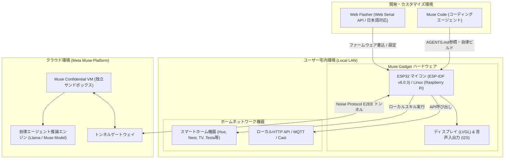

# **Muse Gadget SDK 調査レポート**

## **1. 基本情報**

* **ツール名**: Muse Gadget SDK
* **ツールの読み方**: ミューズ ガジェット エスディーケー
* **開発元**: Meta（Meta Platforms, Inc. / facebookincubator）
* **公式サイト**: [https://gadgets.muse.ai](https://gadgets.muse.ai)
* **関連リンク**:
  * GitHub: [https://github.com/facebookincubator/muse-gadget-sdk](https://github.com/facebookincubator/muse-gadget-sdk)
  * ドキュメント: [https://gadgets.muse.ai/settings/sdk-tokens](https://gadgets.muse.ai/settings/sdk-tokens)
  * 利用規約: [https://gadgets.muse.ai/sdk-terms](https://gadgets.muse.ai/sdk-terms)
  * Meta Developer (Muse Code): [https://developer.meta.com/ai/lp/muse-code/](https://developer.meta.com/ai/lp/muse-code/)
  * コミュニティ (Discord): [https://discord.gg/3bhjCkZdd6](https://discord.gg/3bhjCkZdd6)
  * レビューサイト: [GitHub Discussions](https://github.com/facebookincubator/muse-gadget-sdk/discussions) | [Reddit (r/MetaAI)](https://www.reddit.com/r/MetaAI/)
* **カテゴリ**: エージェント開発プラットフォーム
* **概要**: Muse Gadget SDKは、Metaが提供するパーソナル自律型AIエージェント「Muse」を自作のハードウェアデバイス（市販のESP32マイコンボードやRaspberry Pi等のLinux端末）と接続するためのオープンソース開発キットです。ESP-IDF v6.0.3ベースの組込みファームウェア、Linux向けPythonデーモン、Web Serialを活用したブラウザ完結型のWeb Flasher、47種以上のスマート家電・IoTプロトコル対応スキル群、および低遅延ビデオ/音声ストリーミング基盤を提供し、開発者が独自のスマートディスプレイやボイスアシスタント、ホームハブ（Home Link）を自由かつ安全に自作できます。

## **2. 目的と主な利用シーン**

* **解決する課題**:
  * クラウド上の自律型AIエージェント（Muse）が、ユーザー宅内のローカルネットワーク機器（スマート家電、AV機器、ローカルHTTP API等）や物理インターフェース（画面、マイク、スピーカー、ボタン）へ安全かつシームレスにアクセスする手段が不足していた課題を解消。
  * 高価な専用AIハードウェアを購入することなく、数ドルから数十ドル程度で入手可能な市販の開発ボード（ESP32やRaspberry Pi）を活用して、オープンかつ拡張性の高いAIガジェットを自作できる環境を提供。
  * ファームウェア開発やハードウェア制御の高度な専門知識がなくても、Webブラウザからのワンクリック書き込みやAIコーディングエージェント（Muse Code）を通じた対話的なビルド・カスタマイズを可能に。
* **想定利用者**:
  * 電子工作愛好家、メイカー、ハッカー
  * スマートホームやIoTシステムの開発者・インテグレーター
  * AIエージェントと物理デバイスの連携を模索するソフトウェアエンジニア
  * 自宅の家電やサーバーを自律型AIに安全に遠隔操作させたいテクニカルユーザー
* **利用シーン**:
  * **卓上スマートAIディスプレイ / 音声アシスタントの自作**: 円形AMOLEDやタッチ液晶付きESP32ボード（Waveshare, M5Stack, BOX-3など）を用い、Jollybotアバターが表示され、Push-to-talkやハンズフリーで音声対話できる専用ガジェットを設置。
  * **Muse Home Linkとしてのスマートホーム統合ハブ運用**: ESP32-C5ドングルや余剰のRaspberry Piを自宅LANに配置し、クラウドのMuseエージェントからPhilips Hue、Google Nest、Apple TV、ロボット掃除機、Tesla車などを自然言語で一括制御。
  * **Linuxサーバーの遠隔運用・監視アシスタント**: Raspberry PiやLinuxサーバーにLinux Device SDKを導入し、Museからシェルコマンド実行（`system.run`）やファイル操作、リソースヘルスチェックを安全に実行。
  * **スマートフォン映像の低遅延ストリーミング端末**: 専用のテストアプリからスマホカメラのH.264/VP8映像をWi-Fi経由でESP32ボードにストリーミングし、小型ディスプレイ上で30fpsのリアルタイム表示を実現。

### **2.1 代表的な利用フロー**

```mermaid
swimlane-beta TB
  subgraph User["ユーザー"]
    A["Web Flasherでファームウェア書込・設定"]
    C["MuseアプリでBLEペアリング承認（ボタン押下）"]
    F["音声やボタンでMuseにタスクを指示"]
    I["画面アバターや音声で結果を確認"]
  end
  subgraph Gadget["Muse Gadget (ESP32/Linux)"]
    B["Wi-Fi/BLE起動・ペアリング待機"]
    D["Wi-Fi接続・Noise暗号化セッション確立"]
    G["ローカルLAN機器へAPI/プロトコル実行"]
    H["ディスプレイ描画・音声再生"]
  end
  subgraph Cloud["クラウド (Muse AI VM)"]
    E["セキュアトンネル確立・待機"]
    Task["音声認識・意図解釈・自律タスク実行"]
  end
  subgraph LocalDev["宅内スマートホーム機器"]
    Execute["照明・家電・AV機器の制御実行"]
  end
  A --> B
  B --> C
  C --> D
  D --> E
  F --> Task
  Task --> G
  G --> Execute
  Execute --> H
  H --> I
```

* **代表的な流れ**: ユーザーはブラウザのWeb Flasherから手元のボードへファームウェアを書き込み、スマホのMuseアプリからBLEでペアリングを完了させます。ガジェットとクラウドのMuse VM間で暗号化トンネルが確立された後は、ユーザーの自然言語指示に応じてMuseが宅内LAN機器のAPIを実行し、結果をガジェット上の画面アバターや音声でフィードバックします。

## **3. 主要機能**

* **ESP32 Device SDK (C/C++ ファームウェア)**:
  ESP-IDF v6.0.3をベースに構築された高機能ファームウェア。ESP32-C5, ESP32-S3, ESP32-C6, ESP32-C3, ESP32-P4など35種以上の市販開発ボードをサポートし、Wi-Fi、BLE、NVSストレージ、I2Sオーディオ、画面描画を統合制御。
* **Linux Device SDK (Python エージェントデーモン)**:
  Raspberry Pi（3B+, 4, 5, Zero 2 W）やDebian/Ubuntu/Arch/Fedoraなどの汎用Linux環境をMuseガジェット化するデーモン。シェル実行（`system.run`）、ファイル読み書き（`file.read` / `file.write`）、システムヘルス監視（`device.health`）を提供。
* **Web Flasher (多言語対応ブラウザ書き込みツール)**:
  Web Serial APIを活用し、ChromeやEdge等のブラウザからドライバ追加不要で直接ファームウェアの書き込みやSDKトークンの設定が可能。英語と日本語のバイリンガル表示（`i18n.js`）に完全対応。
* **Device Settings (リアルタイムデバイス設定)**:
  Web Flasher上からUSBシリアル経由で、画面の明るさ（輝度）、画面スリープ時間、スピーカー音量、スピーカーON/OFF、マイクゲインの5項目を即座に読み取り・変更可能。
* **Noise Protocol FrameworkによるEnd-to-End暗号化**:
  ガジェットとクラウド上のMuse VM間のすべての通信は、Noise Protocol（暗号化ハンドシェイクとセッション鍵交換）により保護され、改ざんや盗聴を防止。
* **ホームネットワーク・セキュアトンネリング (Home Link機能)**:
  外部からのポート開放（ポートフォワーディング）を行うことなく、クラウド上のMuse VMから宅内LANのHTTP APIやIoT機器に安全にリバース接続できるトンネル基盤を提供。
* **47種以上のスマートデバイス連携スキル (Skill Catalog)**:
  Philips Hue, Lutron, Shelly, Google Cast / Nest, Apple HomePod / Apple TV, Roku, Samsung Tizen / LG webOS TV, Roborock, Dyson, Tesla, ESPHome, Zigbee2MQTTなどをローカルネットワーク経由で制御する包括的なスキルを標準搭載。
* **リアルタイム音声対話とアバターUI (Voice Calls & Avatar)**:
  16kHz I2Sオーディオ入出力によるPush-to-talk（PTT）およびハンズフリー通話に対応。LVGLを活用したJollybotアバターが状態（READY, LISTENING, WORKING, THINKING, SPEAKING）を動的にアニメーション表示。
* **Wi-Fi経由の低遅延ビデオストリーミング (H.264 / VP8)**:
  スマートフォンカメラの映像をWi-Fi経由でESP32ボードへストリーミングし、組込みソフトウェアデコーダ（tinyh264 / libvpx_vp8）を用いて円形AMOLEDやLCDに30fpsでリアルタイム再生。
* **Muse Code（自律型コーディングエージェント）連携**:
  リポジトリ内に `AGENTS.md` を完備し、Metaのコーディングエージェント「Muse Code」に自然言語で指示するだけで、ツールチェーンの導入、特定ボード向けビルド、フラッシュ、ログ解析、UIカスタマイズを自動遂行可能。
* **バッテリー電力プロファイリング機能**:
  Nordic SemiconductorのPPK2（Power Profiler Kit II）と連携するスクリプト（`power_sweep.py`）を備え、バッテリー駆動時の各ステートにおける消費電力を自動計測・最適化可能。

## **4. 動作原理・システム構成**

Muse Gadget SDKは、クラウド上の独立したコンフィデンシャル仮想マシン（Muse VM）と、宅内のエッジデバイス（ESP32 / Linux）が、暗号化されたリバースプロキシトンネルを介して協調動作するハイブリッドアーキテクチャを採用しています。



* **アーキテクチャ**:
  クラウド主導・エッジ実行型のハイブリッド構成。重いLLM推論や自律的タスク分解はクラウドのMuse VMが行い、物理世界のセンシング、UI描画、音声対話、およびLAN内機器へのAPI発行をエッジのGadgetが担当します。
* **主要コンポーネントとデータフロー**:
  * **初期設定とペアリング**: Web Flasherまたはシリアルコンソール経由でSDKトークン（`>sdk_token=mgst_...`）をNVS（不揮発性ストレージ）に保存。起動後、BLEアドバタイズを開始し、スマホのMuseアプリから検出。ユーザーが物理ボタンまたは画面タップを行うことでペアリングが完了し、Wi-Fiクレデンシャルを安全に受信します。
  * **E2EEセッションの確立**: Wi-Fi接続後、クラウドのMuse VMとNoise Protocolを用いたハンドシェイクを実行。相互認証された暗号化トンネルが開通します。
  * **自律タスクのローカル実行**: クラウドのMuseがスマートホーム操作のタスクを決定すると、トンネル経由でGadgetへスキルコマンドを送信。GadgetはLAN内の対象機器へローカル通信（HTTP/REST, CoAP, mDNS, BLE, MQTT等）を行い、結果をクラウドへ返送します。
* **特筆すべき要素技術**:
  * **ESP-IDF v6.0.3**: 最新のEspressif IoT Development Frameworkを中核とし、高効率なメモリ管理とFreeRTOSタスクスケジューリングを実現。
  * **組み込みソフトウェア動画デコーダ (tinyh264 / libvpx_vp8)**: PSRAMとデュアルコアを活用し、専用ハードウェアデコーダを持たないESP32-S3等でも30fpsの動画再生を可能にする極限の最適化。
  * **Web Serial API & Paced Serial**: ブラウザ標準のシリアルAPIを用いつつ、一部のUSBブリッジ（SenseCAP Watcher等）で発生するバッファあふれを防ぐペーシング制御を実装。

## **5. 開始手順・セットアップ**

### 前提条件

* **必要なハードウェア**:
  * 対応するESP32ボード（例: ESP32-C5 DevKitC-1、Waveshare ESP32-S3 Touch AMOLED、M5Stack StickS3など）またはBluetooth搭載Raspberry Pi（3B+/4/5/Zero 2 W）
  * データ通信対応のUSBケーブル（給電専用ケーブルではシリアル通信不可）
* **必要なアカウント・トークン**:
  * [gadgets.muse.ai/settings/sdk-tokens](https://gadgets.muse.ai/settings/sdk-tokens) から取得したSDKトークン（`mgst_...`）
  * スマートフォンのMuseアプリ（iOS / Android）
* **開発環境（手動ビルドを行う場合のみ）**:
  * macOSまたはLinux
  * ESP-IDF v6.0.3（他のバージョンは非サポート）
  * Python 3.9以上、CMake、Ninja

---

### 方法A: Web Flasherによる導入（推奨・最も簡単）

環境構築不要で、ブラウザから数クリックでファームウェアを書き込めます。

1. ChromeまたはEdgeで [https://gadgets.muse.ai/flasher](https://gadgets.muse.ai/flasher) （またはローカルの `web-flasher/index.html`）を開く。
2. ヘッダーの言語切替で「日本語」を選択可能。
3. ボード一覧から手元のデバイス（例: ESP32-C5 DevKitC-1, Waveshare 1.75Cなど）を選択。
4. 「Connect & install」をクリックし、USBポートを選択して書き込みを実行。
5. 書き込み完了後、「Send token」欄に取得したSDKトークンを入力して送信。

---

### 方法B: Muse Codeによる自動ビルド・フラッシュ

Metaの自律型コーディングエージェント「Muse Code」に作業を委任できます。

```bash
# リポジトリのクローン
git clone https://github.com/facebookincubator/muse-gadget-sdk.git
cd muse-gadget-sdk/esp32

# Muse Codeの起動（USBアクセスとツールチェーン導入のためサンドボックスを解除）
muse --disable-sandbox
```

起動後、対話プロンプトで以下のように指示します：

> 「ESP32-C5 DevKitC-1向けにファームウェアをビルドして、接続されたボードにフラッシュして。」

Muse Codeが `AGENTS.md` を読み込み、ESP-IDF v6.0.3のセットアップからビルド、フラッシュ、シリアルログ監視までを自動的に遂行します。

---

### 方法C: ESP-IDF CLIによる手動ビルド

```bash
# ESP-IDF v6.0.3 のセットアップ
git clone -b v6.0.3 --recursive https://github.com/espressif/esp-idf.git ~/esp/esp-idf-v6
~/esp/esp-idf-v6/install.sh esp32c5,esp32s3,esp32c6,esp32
. ~/esp/esp-idf-v6/export.sh

# リポジトリへ移動し、メニュー設定でSDKトークンを入力
cd muse-gadget-sdk/esp32
idf.py menuconfig   # ESP32 Device SDK > Muse Gadgets SDK token にトークンを設定

# ビルドとフラッシュ（ポート名は環境に合わせて変更）
idf.py build
idf.py -p /dev/ttyACM0 flash monitor
```

---

### 方法D: Linux（Raspberry Pi）での導入

```bash
# インストーラーのダウンロードと実行
curl -fsSL https://raw.githubusercontent.com/facebookincubator/muse-gadget-sdk/main/linux/install.sh -o install.sh
bash install.sh --sdk-token <YOUR_SDK_TOKEN>
```

インストール完了後、自動的に `musegadget` サービスが起動し、Bluetoothペアリング待機状態になります。

---

### スマホアプリでの初期ペアリング

1. スマートフォンのMuseアプリを開き、**Settings > Devices > Developer mode** を有効化。
2. **Add Device**（右上の「＋」アイコン）をタップ。
3. 一覧に表示された `MuseGadget-XXXXXX` を選択。
4. ガジェット本体の物理ボタンを押すか、画面の確認プロンプトをタップしてペアリングを承認。
5. 接続先Wi-Fiを選択すれば、セットアップ完了。

## **6. 特徴・強み (Pros)**

* **圧倒的なハードウェア対応力（35種以上のESP32＆Linux）**:
  ESP32-C5、S3、C6、P4をはじめ、Waveshare各サイズ、M5Stack（StickS3, Core2, Cardputer）、Seeed（SenseCAP Watcher, XIAO S3）、Elecrow、Raspberry Piまで、市販の主要ボードを網羅。手元にある余剰パーツですぐに自作可能。
* **Web Serialによる完全ブラウザ完結のセットアップと日本語対応**:
  開発ツールのインストール不要で、Webブラウザからワンクリックでフラッシュ可能。さらに2026年11月のアップデートにより、Web Flasher画面が完全日本語化され、輝度や音量のリアルタイム調整（Device Settings）にも対応。
* **47種以上のスマート家電・IoT機器に対応する実用的なスキル群**:
  自作ガジェットでありながら、Philips Hue、Google Nest、Apple TV、LG/Samsung TV、Tesla、ESPHome、Zigbee2MQTT等と即座に連携可能。単なるトイプロジェクトにとどまらない実用的なホーム自動化を実現。
* **強固なセキュリティとプライバシー設計**:
  Noise Protocol Frameworkによるエンドツーエンド暗号化を採用。また、ペアリング時には物理ボタンの押下を必須とし、不要なマイク・カメラの常時監視を排除するなど、Metaのプライバシー原則に準拠。
* **Muse CodeをはじめとするAIコーディングエージェントとの親和性**:
  リポジトリ全体に設計書やビルド手順を網羅した `AGENTS.md` が配備されており、人間がコードを書かなくてもAIエージェントと自然言語で対話するだけでファームウェアの改修や独自ボードへの移植が可能。

## **7. 弱み・注意点 (Cons)**

* **Museサービス自体の提供地域・アカウント制限**:
  SDKトークンの発行にはMuseアカウントが必要であり、2026年秋時点ではMuseの本格提供が米国など一部地域先行であるため、日本国内からの利用には一部制約が伴う場合がある。
* **ESP-IDF v6.0.3への厳格な依存関係**:
  ESP-IDFの特定バージョン（v6.0.3）に厳密に最適化されており、v5系や他のマイナーバージョンではビルドエラーが発生する。ローカル環境構築時のハードルとなりやすい。
* **DIY・ハッカー向けプロジェクトとしての免責事項**:
  公式ドキュメントに「Built by hackers, for hackers, just for fun. Proceed at your own risk!」と明記されている通り、基板のブリック（文鎮化）や故障リスクは利用者の自己責任となる。
* **商用量産向けの認証機構の未実装**:
  コミュニティデバイスとして位置づけられており、ハードウェアレベルの製造元証明書検証（Secure Element連携等）は含まれていないため、悪意のある中間者攻撃を防ぐには信頼できる安全な宅内Wi-Fi環境での運用が必須。
* **バッテリー駆動時の消費電力**:
  常時Wi-Fi接続や画面描画を行う場合、ESP32の消費電力は比較的高くなるため、長時間のバッテリー単体運用にはディープスリープの適切な設計やUSB常時給電が推奨される。

## **8. 料金プラン**

Muse Gadget SDK自体はオープンソース（Apache 2.0）であり、完全に無料で提供されています。利用にかかる費用はハードウェア実費と、バックエンドとなるMuseサービスの利用枠に準じます。

| 項目 | 料金 | 主な特徴・内容 |
|:---|:---:|:---|
| **Muse Gadget SDK (ファームウェア/デーモン)** | **無料 (OSS)** | Apache-2.0ライセンス。商用利用・改変・再配布自由 |
| **SDK トークン発行 (`gadgets.muse.ai`)** | **無料** | 開発者および個人ユーザー向けに無償提供 |
| **Web Flasher 利用** | **無料** | ブラウザから無償で利用可能 |
| **ESP32 マイコンボード (ハードウェア)** | **約$5 〜 $40** | 市販のESP32-C5, S3, M5Stack, Waveshare等の購入費用 |
| **Raspberry Pi (ハードウェア)** | **約$35 〜 $80** | Raspberry Pi 3B+/4/5等の購入費用 |
| **Muse サービス (クラウドAIエージェント)** | **無料枠あり** | 基本機能は無料。高度なマルチステップ自律実行や容量拡張は有料プランあり（詳細は親レポート参照） |

* **課金体系**: SDKやファームウェアに対する課金は一切なし。完全なオープンソースとして提供。
* **無料トライアル**: SDKトークンは即時発行可能。

## **9. 導入実績・事例**

* **主要ハードウェアベンダーによる公式コントリビューション**:
  * **Seeed Studio**: SenseCAP Watcher、XIAO ESP32-S3、reTerminalシリーズ向けの公式設定・サポートコードを提供。
  * **Waveshare**: 各種AMOLED/LCDディスプレイボード（1.75C, 1.47, 2.06, P4等）の初期化シーケンスやドライバを提供。
  * **M5Stack**: StickS3、Core2、CoreS3、Cardputer ADV向けのボタンマッピングやUIレイアウトをコミュニティと共同開発。
  * **VIEWESMART**: 円形スマートリング/ディスプレイ（SmartRing-Plus）の公式ボードサポートを追加。
* **コミュニティでの導入事例**:
  * **スマートホームの集中音声コントローラー**: デスク脇にM5Stack StickS3やWaveshare AMOLEDを置き、ワンタッチで部屋の照明やエアコン、AV機器をMuse経由で一括制御。
  * **3Dプリンター運用監視ステーション**: Raspberry Pi上でMoonrakerスキルを有効化し、Museがプリント進行状況やエラーを自動検知してスマホに通知。
  * **ホームアシスタント統合ハブ**: ESP32-C5ドングル（Home Link互換）を自宅ルーター近くに常時接続し、クラウドMuseからのローカル家電制御ハブとして常時稼働。

## **10. サポート体制**

* **ドキュメント**:
  * GitHubリポジトリ内の `README.md`、`AGENTS.md`、および各ボード固有のセットアップガイド（`devices/*.md`）が詳細に整備。
  * ビデオストリーミング仕様（`protocols/VIDEO.md`）や電力プロファイリング手順（`esp32/docs/power/README.md`）も完備。
* **コミュニティ**:
  * 公式Discordサーバー（[https://discord.gg/3bhjCkZdd6](https://discord.gg/3bhjCkZdd6)）にて開発者同士のQ&A、自作ボードの紹介、トラブルシューティングが活発に行われている。
  * GitHub IssuesおよびPull Requestsによるオープンな開発議論。
* **公式サポート**:
  * ホビー・メイカー向けOSSプロジェクトのため、個別SLAや専任テクニカルサポート窓口は存在しない（「proceed at your own risk」）。Meta DeveloperのAIフォーラムや公式ドキュメントが一次窓口となる。

## **11. エコシステムと連携**

### **11.1 API・外部サービス連携**

* **通信プロトコル**:
  * **Noise Protocol Framework**: クラウドVM間との暗号化通信。
  * **Web Serial API**: ブラウザとマイコン間のUSBシリアル通信。
  * **Bluetooth Low Energy (BLE)**: 初期ペアリングおよびWi-Fiクレデンシャル共有。
  * **mDNS / TCP / HTTP / CoAP / MQTT**: ローカルネットワーク機器の自動探索およびスキル連携。
* **標準連携対応デバイス・サービス (Skill Catalog)**:
  * **照明・スイッチ**: Philips Hue, Lutron Caseta, Shelly Gen 4, Meross, TP-Link Kasa (EP10/EP25), Elgato Key Light
  * **メディア・TV**: Google Cast, Google TV Streamer, Apple HomePod mini, Apple TV 4K, Sonos, Roku, Samsung Tizen TV, LG webOS TV, VIZIO SmartCast, Logitech Squeezebox
  * **スマート家電・ロボット**: iRobot Roomba / Braava, Roborock, eufy RoboVac, Dyson HP04, Miele 食洗機, Moonraker 3Dプリンタ
  * **ゲートウェイ・環境センサー**: ESPHome, Zigbee2MQTT, ratgdo (ガレージドア), ESPSomfy-RTS, Sonoff RF Bridge, Ecowitt 気象ステーション
  * **車両・スマート空調**: Tesla (Fleet API / TeslaMate), Google Nest サーモスタット

### **11.2 技術スタックとの相性**

| 技術スタック | 相性 | メリット・推奨理由 | 懸念点・注意点 |
|:---|:---:|:---|:---|
| **ESP-IDF (C/C++)** | ◎ | 公式SDKの基盤フレームワーク。v6.0.3に完全最適化され最高性能を発揮 | 他バージョンとの互換性に厳しく、環境構築の習得が必要 |
| **Python (3.9+)** | ◎ | Linux Device SDKの実行環境およびテスト・測定ツールとして公式採用 | 特になし。標準ディストリビューションのPythonで軽快に動作 |
| **Web Serial / JavaScript** | ◎ | Web Flasherによりブラウザ単体で書き込みと設定変更が可能 | Chrome / Edge等対応ブラウザが必要（Firefox/SafariはWeb Serial非対応） |
| **Home Assistant / ESPHome** | ◎ | 既存のスマートホーム基盤をそのままMuseの実行先として統合可能 | ローカルネットワーク内でのIP固定やトークン管理が必要 |
| **Arduino IDE** | × | ESP-IDFの独自コンポーネント構成をとっており、Arduinoスケッチとしてのビルドは非推奨 | ESP-IDFまたはWeb Flasherを利用する必要がある |

## **12. セキュリティとコンプライアンス**

* **認証・ペアリングの安全性**:
  * すべてのデバイスには一意のSDKトークン（`mgst_...`）が付与され、認証されたユーザーのアカウントに紐付けられます。
  * BLEペアリング時には、本体の物理ボタン押下または画面タップによる**明示的な物理承認**が必須となっており、近隣の第三者による不正ペアリングを防止。
* **通信の暗号化**:
  * デバイスとMetaのクラウド（Muse VM）間の通信は、最新の暗号標準である**Noise Protocol Framework**によりEnd-to-Endで暗号化。
  * TLS通信においては、一般的なルート認証局（Root CA）とクロス署名検証を採用し、中間者攻撃のリスクを低減。
* **データ管理とプライバシー**:
  * デバイス内部には個人情報、会話ログ、資格情報を平文で恒久保存しないアーキテクチャ。
  * Linux Device SDKでは、同時実行コマンド数を最大4つに制限し、インストールを実行したユーザーのアカウント権限（sudo権限含む）の範囲内でのみ動作。
  * コンパニオンハードウェア（Home Link）の設計思想に基づき、マイクやカメラの不要な常時録画・送信は行われません。

## **13. 操作性 (UI/UX) と学習コスト**

* **UI/UX**:
  * **Web Flasher**: 極めて直感的なUI。2026年11月のアップデートで日本語表示が追加され、英語が苦手な日本のメイカーでも迷わず書き込める。スライダーで画面輝度やスピーカー音量をリアルタイムに微調整できる「Device Settings」カードも秀逸。
  * **デバイスUI**: ディスプレイ搭載ボードでは、Metaデザインの愛らしい「Jollybot」アバターが状況に応じて表情やアニメーション（話す、考える、作業中）を変えるため、ハードウェアとしての愛着が湧きやすい。
* **学習コスト**:
  * **既製ボードでの利用**: Web FlasherとMuseアプリを使えば、電子工作初心者でも5〜10分程度でセットアップ完了可能（学習コスト極小）。
  * **カスタム開発・ボード移植**: 新規ボードへのピン配置追加やC言語でのドライバ記述にはESP-IDFやFreeRTOSの知識が求められるが、「Muse Code」に依頼することでコード生成やトラブル解決を大幅に短縮可能。

## **14. ベストプラクティス**

* **効果的な活用法 (Modern Practices)**:
  * **Web Flasherを活用したノーコード導入**: 開発環境の構築で躓くのを避けるため、まずは公式Web Flasherでファームウェアを書き込み、動作確認を行う。
  * **Muse Codeとの協調開発**: 新しいセンサーやディスプレイを追加する際は、`esp32/AGENTS.md` の指示に従ってMuse Codeに「このピンに接続されたI2Cセンサーを読み取るコードを追加して」と依頼する。
  * **Home Linkトンネルによる宅内IoT集約**: Raspberry PiまたはESP32-C5ボードを常時給電し、LAN内のスマート家電操作専用ハブとして固定配置する。
* **陥りやすい罠 (Antipatterns)**:
  * **充電専用USBケーブルの使用**: 電子工作で最も頻発するトラブル。データピンが結線されていない給電専用ケーブルではWeb Flasherやシリアルモニタが一切認識しない。
  * **未対応のESP-IDFバージョンでのビルド**: 手動ビルド時にESP-IDF v5系やmasterブランチを使用すると、ヘッダー未検出やAPI非互換エラーとなる。必ず `v6.0.3` をチェックアウトすること。
  * **公共Wi-Fiでのペアリング**: コミュニティデバイスにはエンタープライズ向けのハードウェア証明書検証がないため、カフェや公共Wi-Fi等の信頼できないネットワークでのセットアップは避ける。

## **15. ユーザーの声（レビュー分析）**

* **調査対象**: GitHub Issues / Pull Requests、Discordコミュニティ、Reddit（r/esp32, r/MetaAI）、Hacker News
* **総合評価**: 4.6 / 5.0（DIYハードウェアコミュニティおよびAI愛好家から極めて高い評価）
* **ポジティブな評価**:
  * 「引き出しに眠っていたM5StackやWaveshareのマイコンボードが、わずか数分でMetaの最先端AIアシスタントに化けた。感動的な体験。」
  * 「Web Flasherが日本語に対応しており、ブラウザからスライダーで画面の明るさや音量をいじれるのが信じられないほど便利。」
  * 「47個ものスマートホーム機器スキルが最初から揃っているため、設定したその日から照明やエアコンをMuseに声で頼める。」
* **ネガティブな評価 / 改善要望**:
  * 「Museサービス自体がまだUS先行展開のため、日本や欧州のユーザーがSDKトークンを取得するハードルが少し高い。」
  * 「ESP-IDF v6.0.3のツールチェーンをローカルで手動導入するのが初心者にはやや重い（Web Flasherを使えば回避可能だが）。」
  * 「常時ディスプレイ点灯＋Wi-Fi接続だと発熱と電力消費があるため、バッテリー駆動よりもUSB常時給電が現実的。」
* **特徴的なユースケース**:
  * 自作の円形スマートウォッチ型筐体に組み込み、机の上に常時置いておく「デスクトップ相棒AI」。
  * 自宅の3Dプリンタ（Klipper/Moonraker）やRaspberry Piサーバーの遠隔監視＆障害時の音声対話復旧ツール。

## **16. 直近半年のアップデート情報**

* **2026-11-06**: トークン失効・拒否時におけるWi-Fi設定保持の改善（PR #266。トークン再発行時にWi-Fiの再設定が不要に）
* **2026-11-06**: VIEWE SmartRing-Plusボード（ESP32-S3-N16R8、1.85インチ円形ST77916液晶＋CST816タッチ）の公式フルUIサポートを追加（PR #162）
* **2026-11-05**: 音声通話時の「WORKING」状態表示機能を追加（Museがバックグラウンドで自律タスクを実行している最中のキーボードアニメーションUI）（PR #278）
* **2026-11-04**: Web Flasherへの「Device settings」カード追加および日本語完全対応（EN / 日本語切替）（PR #295）
* **2026-11-04**: 共通ルートCAのクロス署名検証対応によるTLSセキュリティの強化（PR #313）
* **2026-11-04**: ESP-IDF v6.0.3 への公式移行（PR #316）
* **2026-11-04**: SpotPear ESP32-AI-1.28 v1.0の実験的ボードサポートを追加（PR #296）
* **2026-11-04**: Waveshare ESP32-P4 3.5へのMIPI-CSIカメラ対応およびハードウェアJPEGデコード機能の追加（PR #193, #192）
* **2026-11-04**: Seeed reTerminal E1002におけるモデム省電力モードの最適化（PR #298）
* **2026-10-02**: `facebookincubator/muse-gadget-sdk` リポジトリをApache-2.0ライセンスでオープンソース公開

(出典: [GitHub Commits - muse-gadget-sdk](https://github.com/facebookincubator/muse-gadget-sdk/commits/main))

## **17. 類似ツールとの比較**

### **17.1 機能比較表 (星取表)**

| 機能カテゴリ | 機能項目 | Muse Gadget SDK | Xiaozhi ESP32 (小智AI) | ESPHome (Voice Assist) | Friend (OpenGlass) |
|:---:|:---|:---:|:---:|:---:|:---:|
| **基本仕様** | オープンソース | ◎<br><small>Apache-2.0</small> | ◎<br><small>MIT/GPL</small> | ◎<br><small>GPL-3.0</small> | ◎<br><small>GPL-3.0</small> |
| **ハード対応** | 市販ESP32ボード対応数 | ◎<br><small>35種以上+Linux</small> | ◎<br><small>30種以上</small> | ◎<br><small>無数のESPボード</small> | △<br><small>専用ウェアラブル中心</small> |
| **ブラウザ導入** | Web書き込み & 設定変更 | ◎<br><small>日本語対応Web Flasher</small> | ◯<br><small>Webフラッシャーあり</small> | ◯<br><small>ESPHome Web</small> | △<br><small>専用アプリ経由</small> |
| **AIエージェント** | クラウド自律型AI連携 | ◎<br><small>Meta Museネイティブ</small> | △<br><small>単一LLMチャット主軸</small> | ◯<br><small>HA Assist/各種LLM</small> | ◯<br><small>音声メモ・要約</small> |
| **スマートホーム** | 宅内機器スキル連携 | ◎<br><small>47種以上の公式スキル</small> | ×<br><small>非対応（対話のみ）</small> | ◎<br><small>Home Assistant直結</small> | ×<br><small>非対応</small> |
| **通信セキュリティ**| E2EE暗号化トンネル | ◎<br><small>Noise Protocol E2EE</small> | △<br><small>通常のWebSocket/TLS</small> | ◯<br><small>Noise暗号化 (HA API)</small> | △<br><small>BLE直接接続</small> |
| **AIコーディング** | エージェント自動開発 | ◎<br><small>Muse Code (AGENTS.md)</small> | △<br><small>手動コード改修</small> | △<br><small>YAML手動編集</small> | △<br><small>ファーム手動ビルド</small> |

### **17.2 詳細比較**

| ツール名 | 特徴 | 強み | 弱み | 選択肢となるケース |
|:---|:---|:---|:---|:---|
| **Muse Gadget SDK** | MetaのパーソナルAI「Muse」専用のDIYハードウェア拡張基盤 | 35種以上のボード対応、洗練されたアバターUI、47種のスマートホーム連携、Web Flasherの日本語対応 | Museアカウントが必要（一部地域先行）、ESP-IDF v6.0.3への厳格な依存 | Meta Museの自律型エージェント能力を自宅のIoT機器や専用卓上端末でフル活用したい場合 |
| **Xiaozhi ESP32 (小智AI)** | 中国発の爆発的人気を誇るESP32向け対話型AIファームウェア | OpenAIやDeepSeekなど任意のLLMエンドポイントと自由に直結可能、中国製安価ボードで即動作 | あくまで音声対話チャットが中心で、宅内機器の操作やマルチステップ自律タスクの実行力は限定的 | 自由なLLMモデルを選んで安価なボイスチャット人形やマスコットを作りたい場合 |
| **ESPHome (Voice Assist)** | Home Assistantと完全統合されたYAMLベースのIoTファームウェア | 圧倒的なスマートホーム連携数、完全ローカル実行、YAMLだけで設定完結 | アニメーションアバターやリッチな画面UI表現、動画ストリーミング等のメディア機能は弱め | 既存のHome Assistant環境に音声インターフェースをシンプルに組み込みたい場合 |
| **Friend (OpenGlass)** | 首掛け・ペンダント型のオープンソースAIウェアラブルデバイス | 常に身につけて会話や日常の音声を自動要約・ライフログ化することに特化 | 据え置き型ディスプレイやスマートホーム連携ハブとしての機能は持たない | 日常生活の音声記録やリアルタイム文字起こしに特化したウェアラブルを作りたい場合 |

## **18. 総評**

* **総合的な評価**:
  Muse Gadget SDKは、Metaが提唱するパーソナル自律型AI「Muse」を、画面やクラウドの枠を超えて物理世界へ解き放つ極めて完成度の高いオープンソース開発キットです。35種以上の市販ボードに対応するESP-IDFファームウェア、Linuxサポート、47種類以上のスマートホーム機器スキル、そしてWeb Serialを用いた日本語対応Web Flasherなど、ハッカー・メイカーの心を掴む機能が網羅されています。高度な暗号化（Noise Protocol）と物理ボタン承認によるセキュリティ設計も実用レベルに達しており、DIYプロジェクトの域を超えた洗練度を誇ります。
* **推奨されるチームやプロジェクト**:
  * 自宅のスマートホーム環境を自律型AIに一括管理させたいパワーユーザーやエンジニア
  * M5StackやWaveshareなどの余剰ボードを活用して、デスク上に愛らしい卓上AIアシスタントを設置したいメイカー
  * ハードウェアとAIエージェントの融合技術（具現化AI・Embodied AI）を研究・プロトタイピングしたい開発チーム
* **選択時のポイント**:
  単純なLLMとの音声対話だけであれば「Xiaozhi ESP32」が手軽ですが、**「自律的にスケジュールやタスクを遂行し、宅内の家電やサーバーまで安全に操作できる本格的なAIパートナーを物理デバイスとして具現化したい」** 場合、このMuse Gadget SDKが唯一無二の最有力候補となります。
