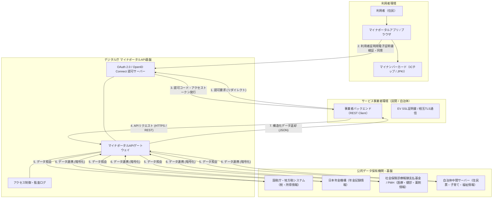

# **マイナポータルAPI 調査レポート**

## **1. 基本情報**

* **ツール名**: マイナポータルAPI (MynaPortal API)
* **ツールの読み方**: マイナポータルエーピーアイ
* **開発元**: デジタル庁 (Digital Agency, Government of Japan)
* **公式サイト**: [https://services.digital.go.jp/mynaportal-api/](https://services.digital.go.jp/mynaportal-api/)
* **関連リンク**:
  * ドキュメント: [マイナポータルAPI 仕様公開サイト](https://developers.digital.go.jp/documents/mynaportal-api/specification/)
  * 利用規約: [マイナポータルAPI利用規約 (PDF)](https://files.microcms-assets.io/assets/7c793323a46a46b7bb9a2ac7d0023301/535e70eb7c5b4918b5ae4b6b202c74c4/mynaportal-api-terms.pdf)
  * FAQサイト: [マイナポータルAPI FAQサイト](https://faq.api-apply.myna.go.jp/wiki/spaces/FAQ/overview)
  * 利用申請ポータル: [マイナポータルAPI 利用申請フォーム](https://portal.api-apply.myna.go.jp/servicedesk/customer/portal/1/group/-1)
  * 稼働状況・メンテナンス: [メンテナンス・稼働状況](https://developers.digital.go.jp/documents/mynaportal-api/maintenance/)
* **カテゴリ**: 認証/ID管理
* **概要**: マイナポータルAPIは、民間事業者や行政機関が提供するWebサービス・アプリに対して、マイナポータルが持つ本人情報確認機能や行政手続申請機能を組み込むことができるAPI基盤である。利用者の同意のもと、行政機関が保有する所得・税・年金・医療保険・健診などの公的一次データを安全に取得・連携し、ペーパーレスかつ高精度なオンライン手続きを実現する。

## **2. 目的と主な利用シーン**

* **解決する課題**:
  * 紙の住民票、所得証明書、納税証明書、健康保険証、控除証明書等の発行・郵送・目視確認にかかる膨大な時間とコストの削減
  * ユーザーによる手入力・転記ミスや、書類偽造・所得詐称などの不正リスクの排除
  * 金融ローンの審査、雇用手続き、医療・介護連携などにおけるリードタイムの大幅な短縮
  * 官民サービス間でのシームレスな電子申請連携とシングルサインオン環境の確立
* **想定利用者**:
  * 金融機関・フィンテック事業者（ローン審査、口座開設、クレジットカード発行、本人確認業務）
  * ヘルスケア・医療・製薬企業（PHRアプリ、電子お薬手帳、治験参加管理、健康相談サービス）
  * 地方公共団体・行政機関（子育て給付金、引越し、福祉手当などの電子申請受付・基幹連携）
  * 人事・労務・会計ソフトウェアベンダー（年末調整の各種控除証明書連携、社会保険・雇用保険手続き）
  * オンラインマッチング・身元確認事業者（公的データに基づく年収証明・独身証明）
* **利用シーン**:
  * **金融ローン・口座開設審査**: カードローンや住宅ローンの申込時に、マイナポータルから本人の所得情報・課税情報を即時取得し、即日審査・融資判定を実現。
  * **PHR（パーソナルヘルスレコード）管理**: 電子お薬手帳アプリや健康管理アプリにおいて、利用者の同意を得て特定健診結果や投薬履歴、診療情報を自動連携。
  * **自治体手続きのワンストップ申請**: 児童手当や保育施設利用申込、転出届などの行政手続きを、民間ポータルや自治体アプリから直接オンライン申請。
  * **年末調整・確定申告の自動化**: 生命保険料控除証明書や地震保険料控除証明書などを民間送達サービス経由で取得し、会計・労務システムに一括反映。
  * **会員制サービスの公的信頼性証明**: 審査制マッチングアプリ等で、公的データを用いた高精度な年収証明や独身証明を提供。

### **2.1 代表的な利用フロー**

```mermaid
swimlane-beta TB
  subgraph Resident["住民（エンドユーザー）"]
    A[連携申請の開始操作]
    C[マイナンバーカード認証・同意]
    I[審査結果・健康情報の確認]
  end
  subgraph Provider["民間・自治体サービス"]
    B[認可リクエスト送信]
    E[アクセストークン取得]
    F[マイナポータルAPI呼び出し]
    H[行政データをサービスへ反映]
  end
  subgraph MynaPortal["マイナポータルAPI基盤"]
    D[認証検証と認可コード発行]
    G[公的データ要求の仲介・返却]
  end
  subgraph GovBackend["行政・医療データ保有機関"]
    DataHub[税・年金・医療情報の照会]
  end
  A --> B
  B --> C
  C --> D
  D --> E
  E --> F
  F --> G
  G --> DataHub
  DataHub --> G
  G --> H
  H --> I
```

* **代表的な流れ**: 住民が民間・自治体サービス上でマイナポータル連携を開始すると、サービスから認可リクエストが発行され、マイナポータル（または認証アプリ）へ遷移する。住民がマイナンバーカードを用いた公的個人認証とデータ提供への同意を行うと、認可コードとトークンが発行される。サービス事業者は取得したトークンを用いてマイナポータルAPIを呼び出し、バックエンドの各府省・自治体・医療機関から安全に取得された行政データをサービスへ自動反映する。

## **3. 主要機能**

* **自己情報取得API**: 国税庁や地方自治体、日本年金機構などが保有する税・所得、公金受取口座、年金記録、世帯情報、児童手当・ひとり親家庭・就学支援などの子ども子育て情報、障害福祉情報を、住民の同意のもと安全に取得する。
* **医療保険情報取得API**: 社会保険診療報酬支払基金や国民健康保険中央会と連携し、診療情報（診療年月、受診医療機関名等）、薬剤情報（調剤日、薬品名、用法等）、特定健診情報（検査数値、メタボ判定等）、医療費通知情報を取得する。
* **PMH（Public Medical Hub）情報連携API**: PMH基盤を介して、地方自治体が管理する医療費助成（子ども医療費、ひとり親家庭医療費等）、予防接種歴、母子保健（乳幼児健診、妊婦健診等）の情報を取得・登録する。
* **お知らせ情報取得・民間送達サービス保有情報取得API**: 行政機関から住民宛てに届いたお知らせ通知や、民間送達サービス（マイナポータル連動の電子ポスト）に届いた生命保険料控除証明書・地震保険料控除証明書などの電子データを取得する。
* **利用者登録等API**: 外部サービスのアカウント作成時や初期設定時に、利用者のマイナポータル利用者登録をスムーズに支援・連携する。
* **電子申請等API（ぴったりサービス申請API）**: 子育て関連手続（児童手当、保育利用）や引越しワンストップサービスなど、地方公共団体に対する各種行政手続のオンライン申請・届出データを取りまとめて送信する。
* **法人設立・社会保険税手続申請API**: 法人設立ワンストップサービスおよび社会保険・税手続ワンストップサービスと連携し、会社設立登記後の諸届出や従業員の入退社に伴う社会保険手続きを民間システムから直接実行する。
* **在留手続申請API**: 外国人本人や外国人労働者を雇用する事業者・監理団体等向けに、在留資格変更許可や在留期間更新許可などの行政手続きを外部システムから連携申請する。
* **健康保険証利用登録API**: 医療機関・薬局の受付システムや健康保険関連サービスにおいて、住民のマイナンバーカードを健康保険証として利用するための登録申請を受け付ける。
* **電子申請等情報受取等API**: 自治体などの行政機関システムが、住民からマイナポータル経由で提出されたオンライン申請データや添付書類を自動ダウンロード・受信する。
* **属性連携設定API / 民間送達接続API**: 民間サービスのユーザーIDとマイナポータルアカウントを紐付け、シームレスなシングルサインオン（SSO）環境を提供するとともに、民間送達サービスとマイナポータルのメッセージ連携を実現する。

## **4. 動作原理・システム構成**

* **アーキテクチャ**: クラウドネイティブな政府共通APIゲートウェイ構成（ガバメントクラウド・政府共通プラットフォーム連携型）。外部の事業者システムと各行政機関・医療機関のバックエンドシステムを直接接続させず、デジタル庁が管理するセキュアなAPIゲートウェイが認証・認可・監査・データ仲介を統括する。
* **主要コンポーネントとデータフロー**:
  * **APIゲートウェイ・認可サーバー**: OAuth 2.0 / OpenID Connectに準拠した認可基盤。事業者からのAPI呼び出し認証、IP制限、レート制限、アクセストークンの発行・検証を担う。
  * **認証・同意インターフェース**: 利用者がマイナンバーカード（ICチップ）と暗証番号を用いて公的個人認証（JPKI）を行い、要求されたデータ項目の提供に同意する画面基盤（マイナポータルWebおよびマイナポータルアプリ）。
  * **中間連携ハブ（情報提供ネットワークシステム等）**: 行政機関（国税庁、自治体、年金機構等）や医療機関（支払基金、国保中央会、PMH）の基幹系システムと接続し、要求された公的データを安全に収集・集約するデータパイプライン。
  * **プライバシー保護設計**: マイナンバー（個人番号そのもの）は民間事業者のシステムには一切渡されず、API連携専用の暗号化されたリソース識別子（符号・トークン）のみが受け渡される設計となっている。
* **特筆すべき要素技術**:
  * **公的個人認証サービス (JPKI)**: マイナンバーカード内の利用者証明用電子証明書および署名用電子証明書を活用し、なりすましや改ざんを技術的に防止する最高レベルの認証強度（IAL3 / AAL3相当）。
  * **相互TLS通信 (mTLS) & EV SSL証明書**: APIクライアントとなる事業者の実在性を厳格に担保するため、EV SSLサーバー証明書による相互認証と通信経路全体の完全暗号化を採用。
  * **OAuth 2.0 認可コードグラント + PKCE**: スマートフォンアプリやWebフロントエンド経由の認可リクエストにおける認可コード横取り攻撃を防止。



## **5. 開始手順・セットアップ**

* **前提条件**:
  * 日本国内に法人登記されている企業、または地方公共団体・公的機関であること
  * EV SSLサーバー証明書（企業実在性が厳格に審査された電子証明書）の取得
  * 個人情報保護マネジメント体制（ISMS / Pマーク等）およびセキュアなシステム運用体制の具備
  * デジタル庁との機密保持誓約書（NDA）および利用規約への合意
* **インストール/導入**:
  * マイナポータルAPIはWeb API（RESTful API）であるため、専用ライブラリのインストールは必須ではなく、標準的なHTTPクライアントやOAuth 2.0クライアントライブラリを利用して実装可能。

  ```bash
  # Node.js での HTTP クライアント導入例
  npm install axios openid-client
  ```

* **初期設定**:
  1. **仕様書の取得申請**: デジタル庁開発者サイトの専用フォームから仕様書取得を申請し、技術仕様書一式および利用ガイドラインをダウンロードする。
  2. **利用申請・事前打合せ**: 利用目的・取り扱うデータ項目・想定ユーザー数・セキュリティ対策をまとめた利用申請書をデジタル庁に提出する（一部のAPIは事前打合せを実施）。
  3. **審査と接続情報受領**: デジタル庁の審査完了後、接続試験用のクライアントID、クライアントシークレット、接続先エンドポイント情報を受領する。
  4. **環境変数の設定**:
     ```bash
     # 環境変数の設定例（シークレットはプレースホルダー表記）
     export MYNAPORTAL_CLIENT_ID="<YOUR_CLIENT_ID>"
     export MYNAPORTAL_CLIENT_SECRET="<YOUR_CLIENT_SECRET>"
     export MYNAPORTAL_REDIRECT_URI="https://service.example.com/callback"
     export MYNAPORTAL_API_ENDPOINT="https://api.myna.go.jp/v1"
     ```

* **クイックスタート（API呼出例）**:

  ```typescript
  // Node.js による自己情報取得APIのリクエスト例
  import axios from 'axios';

  async function fetchSelfInfo(accessToken: string): Promise<any> {
    const endpoint = process.env.MYNAPORTAL_API_ENDPOINT;
    
    try {
      const response = await axios.get(`${endpoint}/selfinfo/tax`, {
        headers: {
          'Authorization': `Bearer ${accessToken}`,
          'Accept': 'application/json',
          'Content-Type': 'application/json',
          'X-Client-Id': process.env.MYNAPORTAL_CLIENT_ID,
        },
        timeout: 10000,
      });
      
      console.log('取得成功:', response.data);
      return response.data;
    } catch (error: any) {
      console.error('API呼出エラー:', error.response?.status, error.response?.data);
      throw error;
    }
  }
  ```

## **6. 特徴・強み (Pros)**

* **公的機関が保有する一次データの高信頼性**: 税、年金、健診、世帯情報など、官公庁・自治体が管理する原本データと直結しているため、記載ミスや改ざんが一切存在しない確実な情報を得られる。
* **公的個人認証（JPKI）による最高強度の本人確認**: マイナンバーカード内の耐タンパーICチップと暗証番号による認証を行うため、なりすましや偽造身分証による不正アクセスを技術的に完全に排除できる。
* **ペーパーレス化と業務コストの劇的削減**: 住民票や課税証明書、控除証明書の発行費用・郵送代・保管コスト、およびオペレーターによる目視確認や手入力の手間を全廃できる。
* **プライバシーバイデザインの設計**: マイナンバー（12桁の個人番号）そのものは事業者に提供されず、API連携用トークンと必要最小限の属性データのみが渡されるため、個人番号漏洩リスクを抱えずに済む。
* **デジタル庁が提供するAPI利用料は無料**: 国策インフラとして整備されているため、APIゲートウェイ自体の利用手数料やライセンス費用は0円で提供されている。

## **7. 弱み・注意点 (Cons)**

* **導入リードタイムが長期（約半年〜1年）**: 利用検討から仕様書入手、利用申請、デジタル庁の審査、開発、テスト環境での接続試験、本番動作確認、サービス提供前確認を経てリリースするまでに最低半年〜1年程度の期間を要する。
* **事前のPoCやアジャイルな検証のハードルが高い**: 審査を通過しなければ本番同等の接続テスト環境を利用できず、テスト環境の利用期間や検証データ数にも制限があるため、気軽なプロトタイプ検証が難しい。
* **エンドユーザーのUX負荷とカード読み取り離脱リスク**: 住民側でマイナンバーカードの実物読み取り（NFC対応スマートフォンまたはICカードリーダー）と暗証番号入力が必須となるため、暗証番号忘れや読み取り失敗による途中離脱対策が不可欠。
* **政府側の定期メンテナンス・仕様変更追従コスト**: 国や自治体の基幹システム改修、定期メンテナンス、法改正（番号法や保険証仕様変更等）に伴うAPI仕様改訂への追従保守が発生する。
* **日本語対応のみ**: 日本国内の住民および公的機関を対象とする制度であるため、API仕様書、ガイドライン、エラーメッセージ、管理画面等はすべて日本語のみの提供となる。

## **8. 料金プラン**

| プラン名 | 料金 | 主な特徴 |
|---------|------|---------|
| **マイナポータルAPI（デジタル庁）** | 無料 | APIゲートウェイ利用料、ライセンス料、コール課金は完全無償（デジタル庁への支払いなし） |
| **事業者側 開発・運用（自社負担）** | 実費負担 | 自社システムの開発費、インフラサーバー費用、年間保守運用費 |
| **EV SSLサーバー証明書** | 数万円〜十数万円/年 | 接続要件を満たす認証局発行のEV SSL証明書の取得・更新費用 |
| **中継プラットフォーム利用（任意）** | 提供事業者による個別見積 | PocketSign等の民間認定プラットフォームを介して接続する場合の月額・従量課金 |

* **課金体系**: デジタル庁が提供するAPI本体の利用料は無料。事業者側は自社システムの開発費およびEV証明書取得費用、通信環境整備費用を自己負担する。
* **無料トライアル**: デジタル庁の審査完了後、接続試験環境（テスト環境）が無償で提供される。

## **9. 導入実績・事例**

* **導入企業**:
  * 東海旅客鉄道株式会社（JR東海）: 「エクスプレス予約／スマートEX」におけるマイナンバーカード連携・本人確認
  * リンク株式会社: 完全審査制恋活・婚活マッチングアプリ「ゴージャス」における公的「年収証明」「独身証明」機能
  * 株式会社Dental Prediction: 「歯科まもる健康手帳」における歯周疾患検診情報・医療費通知・薬剤情報等の管理
  * 3Hメディソリューション株式会社: 「生活向上WEB」のマイカルテにおける健診情報・薬剤情報の自動取り込みと治験支援
  * 株式会社ヘルスケアリレイションズ: 総合医療介護連携システム「CoEsse」における自己情報取得連携
  * 母子モ株式会社: 「かわさき子育てアプリ すくすく」等における自治体子育て申請連携
  * 千葉県: 「千葉県奨学のための給付金電子申請サービス」における所得情報連携・申請受付
* **導入事例**:
  * 金融機関・カードローン会社では、申込時の収入証明書提出をマイナポータル連携に置き換えることで、書類提出にかかる時間を従来の数日〜数時間から「即時」に短縮し、離脱率の低減と審査自動化を実現。
  * PHRサービスでは、利用者が受診した過去の特定健診データや処方薬情報をワンタップで正確に取り込めるようになり、健康指導の精度向上に寄与。
* **対象業界**: 金融（銀行、信販、FinTech）、ヘルスケア・医療、地方公共団体、労務・会計SaaS、身元確認が重要なWebプラットフォーム。

## **10. サポート体制**

* **ドキュメント**: デジタル庁開発者サイト（[https://developers.digital.go.jp/documents/mynaportal-api/specification/](https://developers.digital.go.jp/documents/mynaportal-api/specification/)）にて、API一覧、利用ガイドライン、更新履歴、メンテナンススケジュール、障害・稼働状況情報が体系的に公開されている。
* **コミュニティ**: 一般公開のオープンソースコミュニティやパブリックSlack/Discord等は存在しない。行政システムとしてのセキュリティと機密性保持のため、公式サポート窓口を通じたクローズドな対応が基本となる。
* **公式サポート**: Jira Service Deskを基盤とした「マイナポータルAPI お問合せ窓口」（[https://portal.api-apply.myna.go.jp/](https://portal.api-apply.myna.go.jp/)）を提供。アカウント登録制のチケットシステムで問い合わせを受け付けており、平日営業時間帯に対応が行われる。

## **11. エコシステムと連携**

### **11.1 API・外部サービス連携**

* **API**: RESTful API / HTTPS形式。認可にOAuth 2.0 / OpenID Connectを採用。データ形式はJSON（一部PDFやXMLを含む）。
* **外部サービス連携**:
  * **行政システム連携**: 国税庁（e-Tax・年末調整控除情報）、日本年金機構（公的年金記録）、各地方自治体の住民基本台帳・税務・福祉システム。
  * **医療・公衆衛生基盤**: 社会保険診療報酬支払基金、国民健康保険中央会、PMH（Public Medical Hub）。
  * **ワンストップサービス基盤**: 法人設立ワンストップサービス、社会保険・税手続ワンストップサービス、引越しワンストップサービス、ぴったりサービス。
  * **民間認定プラットフォーム / eKYC連携**: ポケットサイン（PocketSign）、TRUSTDOCK、xIDなど、マイナポータルAPIやJPKI署名検証を中継・パッケージ化して提供するミドルウェアサービス群との連携が可能。

### **11.2 技術スタックとの相性**

| 技術スタック | 相性 | メリット・推奨理由 | 懸念点・注意点 |
|:---|:---:|:---|:---|
| **Node.js (TypeScript)** | ◎ | `openid-client` や `axios` などのエコシステムが成熟しており、OAuth認可フローとREST API連携を簡潔に実装可能 | EV SSL相互TLS通信の証明書管理やセッションセキュリティの厳格な設計が必要 |
| **Java (Spring Boot)** | ◎ | 金融機関やエンタープライズの堅牢な基盤と親和性が高く、mTLSや暗号化処理、PKCS#11/HSM連携実績が豊富 | 設定項目が多く、プロトタイプ構築にやや工数を要する |
| **Go** | ◎ | 高速・低レイテンシでセキュアなマイクロサービス基盤を構築でき、標準パッケージの暗号化・TLS機能が極めて堅牢 | 大規模な行政データJSONスキーマの型定義・パース実装が必要 |
| **Python (FastAPI / Django)** | ◯ | Requests/httpxによるAPI呼出やデータ集計・AI連携が容易で、医療・健診データの分析処理にも適する | OAuthリダイレクトと署名検証におけるスレッドセーフな鍵管理に注意 |
| **C# (.NET)** | ◯ | 自治体・官公庁向けSIerの基幹系システムやWindows Server環境での連携実績が豊富 | クラウドネイティブ環境への移行時のアーキテクチャ調整が必要 |

## **12. セキュリティとコンプライアンス**

* **認証**:
  * **エンドユーザー認証**: マイナンバーカードのICチップに格納された公的個人認証サービス（JPKI）の「利用者証明用電子証明書」および「署名用電子証明書」による強固な2要素認証（所持認証＋知識認証）。
  * **事業者クライアント認証**: EV SSLサーバー証明書による実在性認証、およびOAuth 2.0 Client Authentication（クライアントシークレットまたは秘密鍵JWT）によるアクセス制御。
* **データ管理**:
  * **通信の暗号化**: TLS 1.3 / TLS 1.2による通信経路全体の暗号化および相互認証（mTLS）。
  * **個人番号の非保持化**: マイナンバー（12桁の個人番号）そのものは事業者システムには送信されず、事業者ごとに異なる仮名化識別子（符号）が用いられるため、番号法上の特定個人情報管理義務を回避できる。
  * **厳格なログ管理**: 全APIアクセスのタイムスタンプ、リクエスト元IP、認可スコープがデジタル庁基盤に監査ログとして長期記録される。
* **準拠規格**:
  * 政府情報システムのためのセキュリティ評価制度（ISMAP）に適合したクラウド基盤上で運用。
  * 行政手続における特定の個人を識別するための番号の利用等に関する法律（マイナンバー法 / 番号法）および個人情報保護法に完全準拠。

## **13. 操作性 (UI/UX) と学習コスト**

* **UI/UX**:
  * **住民側**: マイナポータルアプリまたはWebブラウザを介して、画面の指示に従って暗証番号を入力し、スマートフォンをマイナンバーカードにかざすだけで認証が完了する。統一されたUIで提供されているため安心感がある一方、カードの読み取り位置が合わない場合や暗証番号を忘れた場合には手続きが中断するため、事業者側での丁寧な案内UIが重要。
  * **開発者側**: API自体の構造は標準的なREST/JSON仕様であり平易であるが、利用開始までの申請書類の作成、行政データスキーマの解釈、ガイドラインに基づく画面遷移要件の遵守が求められる。
* **学習コスト**: **中〜高**。OAuth 2.0やOpenID Connectの基礎知識に加えて、公的個人認証制度（JPKI）、マイナンバー法に基づく利用目的の制限、行政用語・医療用語のデータ構造定義を正確に理解する必要がある。

## **14. ベストプラクティス**

* **効果的な活用法 (Modern Practices)**:
  * **認定プラットフォーム事業者の活用**: 導入リードタイムを短縮したい場合、デジタル庁の仕様を直接実装するのではなく、PocketSign等の実績豊富な接続プラットフォームやミドルウェアを採用することで、開発工数と審査期間を大幅に圧縮する。
  * **カード読み取りガイダンスの充実**: スマートフォンアプリにカードの読み取り位置（機種別のかざし方アニメーション）や、暗証番号のロック注意（3回連続ミスで役所初期化が必要）を事前に明示し、ユーザー離脱を防ぐ。
  * **非同期バッチ処理とキャッシュの適切な併用**: 健診データや年金記録などのデータ量の大きいリソース取得時は、即時応答を前提とせず非同期処理で取得・反映し、システムの耐障害性を高める。
* **陥りやすい罠 (Antipatterns)**:
  * **本番審査期間の軽視**: 一般のSaaS APIと同じ感覚でアジャイル開発のスケジュールを組み、デジタル庁の審査・事前打合せ（数ヶ月）がボトルネックとなりリリースが延期する。
  * **利用規約・ガイドラインで禁止されている目的外利用**: 取得した所得情報や健診情報を、事前に住民に同意を得た利用目的以外（広告配信や別サービスへの無断流用など）に利用すること（即時利用停止および法的措置の対象となる）。
  * **トークン有効期限とエラーハンドリングの考慮不足**: アクセストークンの失効や、ユーザーがマイナポータル側で同意を後から撤回した場合のエラーケースを想定せずにシステムを組むこと。

## **15. ユーザーの声（レビュー分析）**

* **調査対象**: 導入企業の技術ブログ、導入事例発表、GovTechカンファレンス、開発者コミュニティ記事、プレスリリース
* **総合評価**: **4.2 / 5.0**（一次データの信頼性とペーパーレス化の価値は極めて高いが、申請・導入手続きの重さが改善要望点）
* **ポジティブな評価**:
  * 「ローン審査で紙の課税証明書の郵送を待つ必要がなくなり、申込から融資までのリードタイムが劇的に短縮された」（金融事業者）
  * 「ユーザーの自己申告ではなく、行政が保有する原本データと直結しているため、書類偽造の心配が完全に排除され審査の質が向上した」（FinTechエンジニア）
  * 「健診データや投薬情報が正確なフォーマットで取得できるため、手入力に依存していたお薬手帳アプリのUXが劇的に進化した」（ヘルスケアサービス担当者）
* **ネガティブな評価 / 改善要望**:
  * 「申請から本番開通まで半年以上かかり、事前のテスト環境利用にも制約が多いため、スタートアップの迅速な仮説検証には向いていない」（Webサービス開発者）
  * 「マイナンバーカードの読み取り時に暗証番号を忘れてしまったり、NFCの反応が悪かったりして離脱するユーザーが一定数発生する」（アプリ企画担当）
  * 「APIの仕様書が一般公開されておらず、申請フォーム経由で取得しなければならない点がオープンAPI文化と乖離している」（テックリード）
* **特徴的なユースケース**:
  * 恋活・婚活マッチングアプリにおける「公的年収証明」や「独身証明」として活用され、虚偽記載を防止する信頼性の高い差別化機能として定着。
  * 歯科専門アプリでの特定健診・歯周病検診情報の取得による、歯科医師とのオンライン遠隔相談。

## **16. 直近半年のアップデート情報**

* **2026-10-28**: 自己情報取得APIの活用事例を更新（リンク株式会社「ゴージャス」等の新規事例を反映）。
* **2026-10-01**: 自己情報取得API、医療保険情報取得API、利用者登録等API、電子申請等APIの活用事例を更新。医療保険情報取得APIにおける社会保険診療報酬支払基金の名称改訂および利用ガイドラインの更新。取得情報一覧（医療保険情報取得API）におけるデータ詳細項目を追加。健康保険証利用登録APIの利用メリットに関する案内を更新。
* **2026-08-25**: 複数APIの最新動向を反映した各種ガイドライン等資料の一斉更新（自己情報取得API利用ガイドライン、医療保険情報取得API利用ガイドライン、PMH情報連携API利用ガイドライン、お知らせ／民送情報取得API利用ガイドライン、複数API利用時の本人認証に関するガイドライン、利用者登録等API利用ガイドライン、健康保険証利用登録API利用フロー、民間送達接続API利用ガイドライン、属性連携設定API利用ガイドライン）。
* **2026-07-29**: 各種APIの活用事例を更新（自己情報取得API、医療保険情報取得API、PMH情報連携API、利用者登録等API、社会保険・税手続申請API、電子申請等API）。
* **2026-06-16**: デジタル庁開発者サイトにおいて「マイナポータルAPI 仕様公開サイト」および更新履歴一覧ページを正式公開。

(出典: [デジタル庁 開発者サイト マイナポータルAPI 更新履歴](https://developers.digital.go.jp/documents/mynaportal-api/updates/))

## **17. 類似ツールとの比較**

### **17.1 機能比較表 (星取表)**

| 機能カテゴリ | 機能項目 | マイナポータルAPI | PocketSign (ポケットサイン) | TRUSTDOCK (公的個人認証) | X-Road (エストニア電子政府基盤) |
|:---:|:---|:---:|:---:|:---:|:---:|
| **データ取得** | 行政一次データ（所得・年金） | ◎<br><small>国・自治体データと直結</small> | ◯<br><small>マイナポータルAPI連携対応</small> | ×<br><small>非対応（本人確認特化）</small> | ◎<br><small>分散データベース連携</small> |
| **医療・健康** | 健診・処方薬・医療費データ | ◎<br><small>支払基金・PMHと直接連携</small> | ◯<br><small>APIラッパーとして連携可</small> | ×<br><small>非対応</small> | ◎<br><small>e-Health基盤と直結</small> |
| **本人確認** | 公的個人認証 (JPKI) | ◎<br><small>マイナンバーカード標準</small> | ◎<br><small>大臣認定プラットフォーム</small> | ◎<br><small>大臣認定eKYCプラットフォーム</small> | ◎<br><small>eIDカード / Smart-ID</small> |
| **申請連携** | 行政手続きオンライン届出 | ◎<br><small>ぴったりサービス・ワンストップ</small> | △<br><small>一部自治体ソリューション</small> | ×<br><small>非対応</small> | ◎<br><small>包括的電子申請</small> |
| **導入速度** | 開発開始・リリースまでの迅速さ | △<br><small>審査等で半年〜1年必要</small> | ◎<br><small>SDK提供で数週間〜1ヶ月</small> | ◎<br><small>API/SDKで迅速導入</small> | △<br><small>国家・自治体規模の構築</small> |
| **API費用** | プラットフォーム利用料 | ◎<br><small>デジタル庁への費用は無料</small> | △<br><small>月額＋従量課金</small> | △<br><small>認証ごとの従量課金</small> | ◎<br><small>オープンソース（OSS）</small> |

### **17.2 詳細比較**

| ツール名 | 特徴 | 強み | 弱み | 選択肢となるケース |
|---------|------|------|------|------------------|
| **マイナポータルAPI** | デジタル庁が直轄運営する公式の公的データ連携・行政申請API基盤。 | 所得・年金・医療・健診等の行政保有原本データを直接取得可能。API利用料無料。 | 申請・審査期間が長く、EV証明書や厳格な監査要件など導入ハードルが高い。 | 税・所得・健診などの公的一次データを自社サービスに直接組み込みたい場合。 |
| **PocketSign** | マイナンバーカードを活用した認証・データ連携を支援する民間認定プラットフォーム。 | 開発者向けSDK・APIが整備されており、審査や接続検証の工数を大幅に短縮可能。 | プラットフォーム利用料（月額・従量）が別途発生する。 | マイナポータルAPI連携やJPKI本人確認を迅速に立ち上げたい民間企業。 |
| **TRUSTDOCK** | 日本のeKYC市場を牽引する本人確認・公的個人認証専業APIサービス。 | eKYC・身元確認に特化し、犯収法準拠の本人確認業務を一括アウトソース可能。 | 行政データの取得（所得証明や健診情報など）には非対応。 | 厳格な本人確認（eKYC）のみをアプリに組み込みたいフィンテック・ECサービス。 |
| **X-Road** | エストニアや北欧等で採用されている分散型データ交換プラットフォーム（OSS）。 | 分散型アーキテクチャによる最高峰の耐障害性とオープン性。国際標準。 | 日本国内のマイナンバー制度や行政システムとは直接接続できない。 | 自治体間や特定コンソーシアム内で独自のセキュアデータ連携網を構築する場合。 |

## **18. 総評**

* **総合的な評価**: マイナポータルAPIは、日本のデジタル社会・行政DXの中核を担う最も権威と信頼性の高いAPIプラットフォームである。行政機関や医療保険者が保有する所得・税・年金・医療・健診といった公的一次データに、住民本人の同意と公的個人認証（JPKI）を介して直接アクセスできる唯一無二の存在である。書類取得や手入力、目視審査にかかるコストを抜本的に削減し、高度なデジタル顧客体験を実現する基盤として絶大な価値を持つ。一方で、導入審査やセキュリティ要件の厳格さ、約半年から1年を要するリードタイムが最大の課題であり、導入にあたっては綿密なスケジュール管理と、必要に応じた民間認定プラットフォーム（PocketSign等）の併用検討が推奨される。
* **推奨されるチームやプロジェクト**:
  * 厳格な所得証明や本人確認が不可欠なカードローン、住宅ローン、フィンテックサービスの開発チーム
  * 利用者の特定健診結果や投薬履歴、医療費情報を活用して高度な個別化ヘルスケアを提供するPHR・医療アプリチーム
  * 子育て給付金や引越し手続き、各種許認可のオンライン申請を自動化したい地方公共団体およびGovTechベンダー
  * 高い信頼性が競争優位となる審査制サービス（マッチングアプリ、高級会員制サービス等）のプロダクトチーム
* **選択時のポイント**:
  * **行政一次データの取得・行政手続き連携が主目的の場合**: マイナポータルAPIの導入が必須となる。デジタル庁の仕様に直接接続するか、PocketSign等の仲介SaaSを経由して接続工数を削減するかを社内リソースに応じて判断する。
  * **本人確認（eKYC）や電子署名のみが目的の場合**: 行政データ取得が不要であれば、審査期間が短くSDKが充実したTRUSTDOCKやPocketSignなどの民間認定eKYCサービスを選択する方が、開発スピードとコスト面で有利である。
