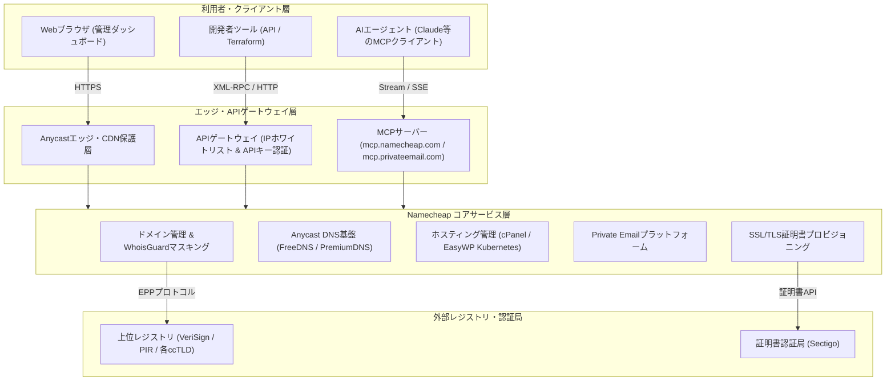

# **Namecheap 調査レポート**

## **1. 基本情報**

* **ツール名**: Namecheap (ネームチープ)
* **ツールの読み方**: ネームチープ
* **開発元**: Namecheap, Inc. (CEO: Hillan Klein / 創業者: Richard Kirkendall / 米国アリゾナ州フェニックス)
* **公式サイト**: [https://www.namecheap.com/](https://www.namecheap.com/)
* **関連リンク**:
  * ドキュメント: [Namecheap Knowledgebase & Guides](https://www.namecheap.com/support/)
  * レビューサイト: [Trustpilot](https://www.trustpilot.com/review/www.namecheap.com) | [G2](https://www.g2.com/products/namecheap/reviews)
* **カテゴリ**: インフラ/サーバー管理
* **概要**: Namecheapは、2000年に設立されたICANN公認のグローバル大手ドメインレジストラ兼Webホスティング事業者である。世界中で2,400万件以上のドメインを管理しており、業界標準となった生涯無料のWHOISプライバシー保護（WhoisGuard）、Anycast DNS、クラウドWordPressホスティング（EasyWP）、Sectigo提携のSSL証明書、ビジネスメール（Private Email）などを安価かつ包括的に提供している。2026年にはAIエージェントと直結する公式MCP（Model Context Protocol）の提供を開始するなど、開発者・AIフレンドリーな進化を続けている。

## **2. 目的と主な利用シーン**

* **解決する課題**:
  * 独自ドメインの取得・維持に伴う高額な初期費用および追加オプション（Whoisプライバシー有料化）によるコスト増加
  * 個人情報（氏名、住所、電話番号、メールアドレス）がWHOIS公開データベースに露出し、スパムや詐欺被害に遭うリスク
  * ドメインレジストラ、DNS管理、ホスティングサーバー、SSL証明書、独自ドメインメールがバラバラな事業者で分断され管理が煩雑化する問題
  * 現代の自動化ワークフローやAIエージェントからドメイン検索・DNS設定・メール送受信を自律制御できない課題
* **想定利用者**:
  * 個人開発者・エンジニア（サイドプロジェクト、ポートフォリオ、API用ドメインの調達）
  * Webサイト運営者・個人ブロガー・クリエイター（WordPressサイトの迅速な立ち上げ）
  * スタートアップ・中小企業（初期コストを抑えた独自ドメインおよびコーポレートメール環境の構築）
  * ドメイン投資家・リセラー（多数のドメインポートフォリオの一括管理と転売）
* **利用シーン**:
  * **初期コストを抑えた独自ドメイン調達**: 開発中の新サービスやブランド名に適したドメインを安価に検索・登録し、無料のWhoisGuardで連絡先情報を保護しながら即日運用を開始する。
  * **EasyWP / 共有ホスティングによる高速なWebサイト開設**: ネームサーバーやcPanelを介した複雑な初期設定を意識せず、数クリックでSSL証明書付きWordPressサイトをデプロイする。
  * **Anycast DNS（FreeDNS / PremiumDNS）による耐障害性の確保**: 他社レジストラで保有するドメインに対しても、NamecheapのFreeDNSをネームサーバーとして指定し、グローバル冗長化されたDNSルーティングを実現する。
  * **AIエージェント（MCP）による運用自動化**: Claude等のMCPクライアントから自然言語でドメイン空き状況の確認、DNSレコードの更新、Private Emailの仕分けや返信ドラフト作成を自律実行させる。

### **2.1 代表的な利用フロー**

```mermaid
swimlane-beta TB
  subgraph User["ユーザー"]
    A[ドメイン検索・希望プランをカートへ投入]
    E[DNSレコード設定・Webサイト公開]
  end
  subgraph Platform["Namecheapプラットフォーム"]
    B[注文決済・WhoisGuard無料適用・アカウント発行]
    D[Anycastネームサーバー割当・ホスティング環境初期化]
  end
  subgraph Registries["上位レジストリ・認証局"]
    C[レジストリへEPP登録・SSL自動プロビジョニング]
  end
  A --> B
  B --> C
  C --> D
  D --> E
```

* **代表的な流れ**: 利用者が管理画面やMCP経由でドメインを検索して注文すると、Namecheapが決済完了と同時にプライバシー保護（WhoisGuard）を適用して上位レジストリ（VeriSign等）へEPP通信経由で登録を行う。その後、Anycastネームサーバーの権威サーバー情報とホスティング/SSL基盤が自動セットアップされ、利用者は即座にDNSレコードのカスタマイズやWeb公開を行える。

## **3. 主要機能**

* **ドメイン登録・移管・WhoisGuard**: 数百種類におよぶgTLD（.com, .net, .org等）およびccTLD/新gTLD（.ai, .io, .tech, .app等）を幅広く取り扱い、購入ドメインすべてに生涯無料のWHOISプライバシー保護（WhoisGuard）が標準付帯する。他社からの移管（Transfer）も認証コード（EPPコード）入力のみでスムーズに行える。
* **Anycast DNS基盤（FreeDNS & PremiumDNS）**: 世界中に分散配置されたAnycastエッジDNSを提供。Namecheap以外で購入したドメインでも無料で利用できる「FreeDNS」に加え、SLA 100%の可用性と高速ルーティング、DDoS防御を誇る有償オプション「PremiumDNS」を提供する。DNSSEC（DNS Security Extensions）にも標準対応。
* **Webホスティング環境**: 初心者向けのcPanel付き「Shared Hosting（Stellarシリーズ）」、WordPressに特化しクラウドコンテナ上で最適化されたマネージドホスティング「EasyWP」、root権限と専有リソースを持つ「VPS Hosting」および物理「Dedicated Server」を揃える。
* **Private Email（独自ドメインビジネスメール）**: 独自ドメインでのメール送受信が可能な専用プラットフォーム。Webmailクライアント、iOS/Android向けネイティブアプリ、Jellyfish強力スパムフィルター、カレンダー・ストレージ連携、AIを活用したメール文面作成支援を備える。
* **SSL/TLS証明書マネージャー**: 大手認証局Sectigo（旧Comodo）と提携し、PositiveSSL、ワイルドカード証明書、マルチドメイン（SAN）証明書、企業実在証明（EV）証明書を格安で発行。cPanel環境でのAutoSSL自動更新にも対応する。
* **Model Context Protocol (MCP) 連携**: 2026年に提供開始された先進的機能。`mcp.namecheap.com` および `mcp.privateemail.com` エンドポイントを介して、ClaudeなどのAIクライアントから自然言語でドメイン空き状況検索、DNSレコードの読み書き、メールの検索・送信を行える。
* **開発者向けXML API & IaCプロバイダー**: ドメインの登録・検索・DNSホストレコード編集（A, AAAA, CNAME, TXT, MX等）をHTTPリクエスト経由でプログラマティックに制御可能なAPIを提供。公式・コミュニティ版Terraform Provider（`terraform-provider-namecheap`）を利用したインフラ構成管理（IaC）にも対応。
* **セキュリティ & ビジネス成長ツール**: TOTPおよびハードウェアセキュリティキー（FIDO2/WebAuthn）による2要素認証（2FA）、アカウントアクティビティ通知、さらにロゴ作成ツール（Logo Maker）、Relate AI（SEO/SNSマーケティング支援）などの付帯ツール群を提供する。

## **4. 動作原理・システム構成**

Namecheapは、ドメインレジストラ機能、グローバルAnycast DNS基盤、マルチテナント型ホスティングおよびコンテナインフラを統合したクラウド完結型のWebサービスプラットフォームである。



* **アーキテクチャ**:
  * **クラウド完結型SaaS / 分散ホスティング基盤**: Webダッシュボードは中央管理システムでオーケストレーションされ、実際のDNSやホスティングは世界各地のデータセンター（米国、英国、欧州）およびAnycastエッジに分散配備されている。
* **主要コンポーネントとデータフロー**:
  * **ドメインプロビジョニング**: ユーザーがドメインを登録すると、NamecheapバックエンドはICANNおよび各レジストリ（VeriSign, Public Interest Registry等）とEPP（Extensible Provisioning Protocol）を介して通信し、ドメインの所有権を即時確保する。同時にWhoisGuardプロキシデータベースへ実際の連絡先情報を格納し、公開WHOISには代理情報（Privacy Hero Inc. 等）を表示させる。
  * **DNSルーティング**: ネームサーバー（`dns1.namecheaphosting.com` や PremiumDNSサーバー）はBGP Anycastルーティングによって世界数十箇所のPoP（Point of Presence）からアナウンスされ、エンドユーザーから最も地理的・レイテンシ的に近いノードがDNSクエリを高速に応答する。
  * **EasyWPクラウド**: 従来の共有サーバーとは異なり、Kubernetesコンテナ基盤上でWordPressポッドが独立して動作する。独自のクラウドキャッシングレイヤー（Namecheap Cloud Storage）により、負荷集中時にも高速なTTFB（Time to First Byte）を維持する。
  * **Model Context Protocol (MCP)**: HTTP/SSE（Server-Sent Events）トランスポートを介してAIクライアントと双方向接続し、AIエージェントのプロンプト指示を安全にNamecheap内部APIメソッドへと変換・実行する。
* **特筆すべき要素技術**:
  * **EPP (Extensible Provisioning Protocol)**: レジストラとトップレベルドメイン（TLD）レジストリ間の安全かつ堅牢なXMLベース標準通信プロトコル。
  * **Anycast BGP Routing**: 同一IPアドレスを世界中の複数拠点から同時に広告し、最短経路への自動誘導とDDoS攻撃耐性を実現。
  * **FIDO2 / WebAuthn**: パスワード漏洩やフィッシング攻撃からドメインハイジャックを防ぐハードウェアトークン（YubiKey等）による強力な認証規格。

## **5. 開始手順・セットアップ**

* **前提条件**:
  * 有効なメールアドレス
  * 決済手段（クレジットカード、PayPal、またはBitcoinなどの暗号資産）
  * ※API利用を行う場合は、アカウント残高$50以上、過去2年間の利用実績$50以上、または20ドメイン以上の保有が必要。

* **導入/アカウント登録**:
  1. [Namecheap公式サイト](https://www.namecheap.com/) にアクセスし、画面右上の「Sign Up」をクリック。
  2. ユーザー名、パスワード、氏名、メールアドレスを入力してアカウントを作成。
  3. 登録確認メール内のリンクをクリックして認証を完了。

* **初期設定（セキュリティ強化）**:
  1. ダッシュボードの「Profile」→「Security」を開く。
  2. 「Two-Factor Authentication (2FA)」を有効にし、TOTP（Google Authenticator等）またはハードウェアセキュリティキー（U2F/WebAuthn）を設定。
  3. バックアップコードを安全な場所に保存する。

* **クイックスタート**:

  **1. ドメインの購入とDNSレコード設定**:
  1. トップページの検索バーに希望のドメイン（例: `my-awesome-app.com`）を入力して「Search」をクリック。
  2. カートに追加（WhoisGuardが無料自動付帯することを確認）し、「Checkout」をクリックして決済。
  3. ダッシュボードの「Domain List」から購入したドメインの「Manage」をクリック。
  4. 「Advanced DNS」タブを選択し、「Add New Record」をクリックしてAレコードやCNAMEレコードを登録する。

  ```text
  Type: A Record
  Host: @
  Value: 192.0.2.1
  TTL: Automatic

  Type: CNAME Record
  Host: www
  Value: my-awesome-app.com.
  TTL: Automatic
  ```

  **2. Model Context Protocol (MCP) 連携の設定（Claude Desktop例）**:
  AIエージェントからドメインやPrivate Emailを操作する場合、MCP設定ファイル（`claude_desktop_config.json`）に以下を追記する。

  ```json
  {
    "mcpServers": {
      "namecheap-domains": {
        "command": "npx",
        "args": ["-y", "@modelcontextprotocol/server-fetch", "https://mcp.namecheap.com/mcp"]
      },
      "namecheap-email": {
        "command": "npx",
        "args": ["-y", "@modelcontextprotocol/server-fetch", "https://mcp.privateemail.com/mcp"]
      }
    }
  }
  ```
  ※接続時にブラウザ経由でNamecheapアカウントのOAuth/アクセストークン承認画面が起動し、権限を付与することで利用可能となる。

  **3. TerraformによるDNSレコード管理（IaC例）**:

  ```hcl
  terraform {
    required_providers {
      namecheap = {
        source  = "namecheap/namecheap"
        version = "~> 2.0"
      }
    }
  }

  provider "namecheap" {
    user_name = "<YOUR_NAMECHEAP_USERNAME>"
    api_user  = "<YOUR_NAMECHEAP_API_USER>"
    api_key   = "<YOUR_API_KEY>"
    client_ip = "<YOUR_WHITELISTED_IP>"
    use_sandbox = false
  }

  resource "namecheap_domain_records" "my_domain" {
    domain = "example.com"
    mode   = "MERGE"

    record {
      hostname = "@"
      type     = "A"
      address  = "192.0.2.1"
      ttl      = 300
    }
  }
  ```

## **6. 特徴・強み (Pros)**

* **生涯無料のWHOISプライバシー保護（WhoisGuard）**: 他社（GoDaddy等）が年額十数ドルの追加有料オプションとしていることが多いWHOIS個人情報非公開化機能を、対象となるすべてのTLDに対して永年完全無料で提供。スパムや個人情報露出の心配がない。
* **初期ドメイン価格の優れたコストパフォーマンス**: 主力TLD（.com, .net, .org）や新興TLD（.xyz, .ai等）の初回取得プロモーションが業界最安値水準に設定されており、新規プロジェクトを極めて低リスク・低コストで開始できる。
* **24時間365日の迅速なライブチャットサポート**: 電話窓口はないものの、管理画面から数分で専任オペレーターにつながるライブチャットを提供。DNS設定のトラブルシューティングや移管手続きの疑問に迅速に対応してくれる。
* **時代を先取りする先進機能（MCP・暗号資産決済）**: 2026年にClaude等のAIアシスタントから直接操作可能な公式MCPサーバーをリリースしたほか、古くからBitcoin決済への対応やDNSSECの無料提供など、開発者やテクノロジー愛好者のニーズに素早く追従している。
* **ドメインからホスティング・メールまでの統合エコシステム**: 1つのダッシュボードからドメイン取得、DNS管理、cPanel共有ホスティング、EasyWP、Private Email、Sectigo SSL証明書までを完結して調達・管理可能。

## **7. 弱み・注意点 (Cons)**

* **完全英語対応（日本語UI・日本語サポートなし）**: 管理ダッシュボード、公式ドキュメント（Knowledgebase）、ライブチャットサポートのいずれも英語のみの提供となっている。専門用語やトラブル対応において英語でのやり取りが必須となるため、英語に不慣れな国内ユーザーには心理的ハードルがある。
* **更新料金（Renewal Price）と初回割引価格の乖離**: 1年目の登録プロモーション価格が非常に安価である反面、2年目以降の更新時には通常価格（例: 共有ホスティングStellarは初回月額$1.98前後だが更新時は年額約$55.88〜）が適用される。長期利用時の総コストをあらかじめ把握しておく必要がある。
* **共有ホスティングのエントリー制限**: 最安プラン「Stellar」はストレージ容量が20GB SSDに制限されており、高解像度メディアを多数抱えるサイトや、急激なアクセススパイクが発生する商用Webアプリケーションでは処理性能が頭打ちになる場合がある。
* **API利用開始に一定の利用資格要件が存在**: Namecheap APIを利用するためには、残高$50以上、過去2年間の利用額$50以上、または20ドメイン以上保有という要件を満たす必要がある（サンドボックス環境は即時利用可能だが本番環境には制限あり）。
* **購入手続き時のアップセル提案**: チェックアウト時にSSL証明書、VPN、有料メール、サイバーセキュリティツールの追加購入が推奨画面として多数表示されるため、不要なオプションを追加しないよう注意深く確認する必要がある。

## **8. 料金プラン**

Namecheapは、サービスごとに明確かつ透明性の高い価格体系を採用している（以下は代表的なサービスの料金概要）。

| サービスカテゴリ | プラン / TLD | 初回参考価格 | 更新参考価格 | 主な特徴・対象ユーザー |
|:---|:---|:---|:---|:---|
| **ドメイン登録** | **.com** | 約 $5.98〜$9.58/年 | 約 $14.58〜$15.98/年 | 無料WhoisGuard付帯、DNSSEC対応、業界標準TLD |
| **ドメイン登録** | **.net / .org** | 約 $11.98〜$12.98/年 | 約 $14.98〜$16.98/年 | 無料WhoisGuard付帯、インフラ・非営利向け |
| **ドメイン登録** | **.ai** | 約 $69.98/年 | 約 $79.98/年 | AIスタートアップ・テック企業向け（2年単位契約） |
| **共有ホスティング** | **Stellar** | $1.98/月 (年払) | 約 $55.88/年 | 3サイト、20GB SSD、無制限帯域、無料Webサイトビルダー |
| **共有ホスティング** | **Stellar Plus** | $2.98/月 (年払) | 約 $85.44/年 | 無制限サイト、SSD容量無制限、自動バックアップ機能 |
| **共有ホスティング** | **Stellar Business** | $4.98/月 (年払) | 約 $128.88/年 | 50GB CloudSSD、低ユーザー密度、eコマース向け |
| **マネージドWP** | **EasyWP Starter** | $2.91/月 (年払) | 約 $48.88/年 | 10GB SSD、月間5万PV想定、30日間無料トライアル |
| **マネージドWP** | **EasyWP Turbo** | $4.91/月 (年払) | 約 $88.88/年 | 50GB SSD、月間20万PV想定、高速CDN・無料SSL内蔵 |
| **独自ドメインメール** | **Private Email Starter** | $1.24/月 (年払) | 約 $17.88/年 | 1メールボックス、5GBメール容量、2GBストレージ |
| **DNSサービス** | **FreeDNS** | 無料 | 無料 | 他社ドメインでも利用可能なAnycast DNS、メール転送 |
| **DNSサービス** | **PremiumDNS** | $4.88/年 | $4.88/年 | SLA 100%保証、高負荷DDoS保護、ミリ秒単位の超高速応答 |

* **課金体系**: ドメイン登録は1年〜10年の年単位契約。ホスティングやPrivate Emailは月額払いまたは年額払い（年払いで大幅割引あり）。クレジットカード、PayPal、Bitcoin（BTCPay）による自動更新に対応。
* **無料トライアル / 保証**:
  * FreeDNS: 永年無料
  * 共有ホスティング: 30日間の返金保証（Money-back Guarantee）
  * EasyWP: 30日間の無料トライアルを提供

## **9. 導入実績・事例**

* **導入規模**: 全世界で2,400万件以上のドメインを管理し、数百万人のアクティブユーザーを抱える。ICANN公認レジストラとしてGoDaddyに次ぐ世界トップクラスのシェアを誇る。
* **導入事例**:
  * **グローバルWebスタートアップ**: 初期創業期においてドメイン取得費用とWhois保護費用を最小化し、コーポレートサイトおよびステージング環境用ドメインを一括管理。
  * **オープンソースプロジェクト・個人エンジニア**: 複数所持する趣味開発・検証用ドメインのネームサーバーをNamecheap FreeDNSに集約し、VercelやGitHub Pages、Cloudflare Pagesへのルーティングを効率化。
  * **小規模ビジネス・士業・クリエイター**: EasyWPとPrivate Emailを組み合わせて、専任エンジニア不在でも月数百円の低ランニングコストでセキュアな企業ホームページとメール環境を即日稼働。
* **対象業界**: 個人開発者、IT/Webサービス、マーケティング代理店、eコマース、中小企業、ドメインリセラーなど幅広い業界で採用されている。

## **10. サポート体制**

* **ドキュメント**:
  * [Namecheap Knowledgebase & Guides](https://www.namecheap.com/support/): ドメイン、DNS、SSL、cPanel、EasyWPなど製品カテゴリごとに数千件のFAQや設定チュートリアルを網羅。
  * [Guru Guides / Blog](https://www.namecheap.com/blog/): Webサイト構築手順、DNSSEC設定、WordPress高速化、MCP連携設定などの技術解説記事を定期公開。
  * [API Documentation](https://www.namecheap.com/support/api/intro/): XML APIの全メソッド一覧、エラーコード、サンドボックス利用手順を詳述。
* **コミュニティ**:
  * 公式ブログのコメント欄やX (旧Twitter: [@Namecheap](https://twitter.com/namecheap)) での情報発信。
  * Redditコミュニティ（`r/namecheap`）にてスタッフや熟練ユーザーによる質疑応答が活発に行われている。
* **公式サポート**:
  * **24/7 ライブチャット（英語）**: 公式サイト上から24時間365日いつでも即時チャット開始が可能（平均応答時間数分）。
  * **チケット制サポート（Support Ticket Desk）**: ログ添付や詳細な調査を要する複雑なサーバー障害・移管手続きに対応。
  * **システムステータスページ**: メンテナンス情報や各サーバー群の稼働状況をリアルタイム公開。
  * ※電話窓口は提供していない（ライブチャットとチケットに集約することで低価格を実現）。

## **11. エコシステムと連携**

### **11.1 API・外部サービス連携**

* **API**:
  * **Namecheap XML API**: ドメインの空き状況確認（`namecheap.domains.check`）、登録（`namecheap.domains.create`）、DNSホスト情報取得・更新（`namecheap.domains.dns.setHosts`）、SSL証明書管理に対応。IPホワイトリストによる厳格なセキュリティを要求。
  * **Model Context Protocol (MCP)**: AIエージェント標準プロトコル（MCP）を介して自然言語プロンプトからNamecheapサービスを自律操作。
* **外部サービス連携**:
  * **ホスティング・CDN**: Cloudflare、Vercel、Netlify、AWS（Route 53 / S3 / CloudFront）、Google Cloud、GitHub Pagesなどへのカスタムドメイン接続実績が極めて豊富。
  * **コントロールパネル**: cPanelを標準採用し、Softaculousによる1クリックWordPress / 各種CMSインストールに対応。
  * **IaCツール**: Terraformプロバイダー（`hashicorp/terraform-provider-namecheap`）によりDNSレコードをコード管理可能。

### **11.2 技術スタックとの相性**

| 技術スタック | 相性 | メリット・推奨理由 | 懸念点・注意点 |
|:---|:---:|:---|:---|
| **Vercel / Next.js** | ◎ | NamecheapのAdvanced DNSからCNAME / Aレコードを容易に紐付け可能。MCPによる自動化も相性良好 | ネームサーバーごと委譲するかレコード単体管理かの判断が必要 |
| **Cloudflare** | ◎ | ネームサーバーをCloudflareに委譲し、ドメイン保有・Whois保護のみをNamecheapで安価に行う構成が王道 | 二重管理（ドメインはNamecheap、DNS/WAFはCloudflare）の手間 |
| **WordPress** | ◎ | 専用のEasyWPマネージド環境、またはcPanel経由の1クリックデプロイが完備 | 大規模ECや過度なアクセス集中時はVPSへの昇格を検討 |
| **Terraform (IaC)** | ◯ | コミュニティ/公式プロバイダーによりDNSレコード設定をコード化可能 | API有効化に事前利用実績（$50以上）とIPホワイトリスト登録が必要 |
| **Claude / AIエージェント** | ◎ | 公式MCPサーバー（`mcp.namecheap.com`）が提供されており、チャット経由のドメイン・メール操作が直感的 | AIにドメイン購入権限を与える場合の意図しない課金リスク |

## **12. セキュリティとコンプライアンス**

* **認証**:
  * **2要素認証 (2FA)**: TOTPアプリ（Google Authenticator, 1Password等）およびFIDO2/WebAuthn（YubiKey等のハードウェアセキュリティキー）をサポート。
  * **IPホワイトリスト**: APIアクセス時および管理画面ログイン時の接続元IP制限が可能。
* **データ管理**:
  * **WhoisGuard（Domain Privacy）**: ドメイン登録者の氏名、住所、電話番号を自動的に匿名化し、Whoisデータベース上のスパム収集・個人情報特定を防止。
  * **データセンターセキュリティ**: 米国（アトランタ、フェニックス）および英国のTier 3/Tier 4クラスのデータセンターで運用。RAIDストレージ保護とオフサイトバックアップ。
* **準拠規格**:
  * **ICANN認定**: ICANN公認レジストラとしての厳しい監査・運用基準に完全準拠。
  * **PCI-DSS準拠**: クレジットカード決済処理における国際セキュリティ基準をクリア。
  * **GDPR対応**: 欧州居住者の個人データ保護規則に準拠したプライバシーポリシーとデータ処理契約を提供。

## **13. 操作性 (UI/UX) と学習コスト**

* **UI/UX**:
  * 直感的で整理された「Account Dashboard」を採用。所有ドメイン一覧、更新期日、ネームサーバー設定、DNSレコードがタブ形式で分かりやすく整理されている。
  * ドメインリストにはカスタムタグを付与でき、多数のドメインを所有している場合でもフィルタリングや一括更新が容易。
  * 一方で、チェックアウト時のオプション提案画面（アップセル）が多く、必要な項目のみを選択して進めるステップにやや慣れを要する。
* **学習コスト**:
  * ドメインの購入やDNSのA/CNAMEレコード設定など、Webサイト公開に必要な基本操作の学習難易度は非常に低い。
  * ただし、管理画面・サポートがすべて英語であるため、DNSやネームサーバーの前提知識がない英語初級者は、用語（Nameservers, Host Records, MX, TTL等）の理解に若干の学習コストがかかる。

## **14. ベストプラクティス**

* **効果的な活用法 (Modern Practices)**:
  * **ドメイン保有とホスティングの分離**: ドメイン登録とWhoisGuardはNamecheapの低価格を活かして利用し、DNSルーティングやCDNはCloudflare、フロントエンド配信はVercel/AWSといった専門特化型プラットフォームと組み合わせる「ベストオブブリード」構成が推奨される。
  * **FIDO2ハードウェアキーによるドメイン保護**: ドメイン乗っ取り（ドメインハイジャック）はWebサービスにとって壊滅的リスクとなるため、SMS認証ではなく必ずYubiKey等のWebAuthn/FIDO2ハードウェアキーを用いた2FAを有効化する。
  * **MCPを活用した自律運用の試験導入**: AIエージェントを活用する開発チームは、`mcp.namecheap.com` を介して社内Claudeからプロジェクト用ドメインの空き確認やステータスチェックを自然言語で迅速に行うワークフローを構築する。
* **陥りやすい罠 (Antipatterns)**:
  * **初回割引価格のみを前提とした長期予算編成**: 初年度$5〜$8程度で取得できたドメインも、次年度の更新時には標準料金（$14〜$16前後）となるため、複数年保有時の総コストをあらかじめ試算しておく必要がある。
  * **固定IP変更時のAPIエラー放置**: Namecheap APIは接続元IPが厳密にホワイトリスト照合されるため、クラウドCI/CD（GitHub Actions等）から動的IPで直接APIを叩くと認証エラーとなる。固定IPプロキシを中継するか、管理画面の手動操作に留める設計が必要。
  * **高トラフィックアプリをエントリー共有ホスティングで運用**: 月間数十万PVを超えるWebサービスを月額数ドルの共有ホスティング「Stellar」で運用しようとすると、CPU制限やメモリ上限に抵触してサイトが停止する原因となる。トラフィック増大時はEasyWP上位プランやVPSへ速やかに移行すること。

## **15. ユーザーの声（レビュー分析）**

* **調査対象**: Trustpilot (20,000件以上のグローバルレビュー)、G2 (Namecheap Domains / Hosting)、Reddit (r/webhosting, r/namecheap)
* **総合評価**:
  * **Trustpilot**: 4.1 / 5.0（20,000件以上のレビュー、業界トップクラスの好評価）
  * **G2**: 4.3 / 5.0（Verified Business Users）
* **ポジティブな評価**:
  * **「WhoisGuardがずっと無料で追加料金がかからないのが最高」**: GoDaddy等から乗り換えたユーザーから、ドメイン維持費の安さとプライバシー保護の透明性に絶大な支持が集まっている。
  * **「24時間ライブチャットの対応が速く親切」**: DNSの反映トラブルやSSL証明書の発行停止時など、チャットを開けば数分で専門スタッフが調査し解決策を提示してくれる点が高評価。
  * **「ダッシュボードがシンプルで直感的に操作しやすい」**: 競合他社にありがちな不要な広告や入り組んだメニュー構造に比べ、ドメインとDNSの管理画面がすっきりしていると好評。
* **ネガティブな評価 / 改善要望**:
  * **「更新価格が初年度より高くなる」**: 初回プロモーション価格と2年目以降の更新価格のギャップに対する不満が一部で見られる。
  * **「共有ホスティングの速度が遅い時間帯がある」**: 低価格な共有サーバー環境において、同一物理サーバー上の別ユーザーの影響を受け、ページの表示速度が低下することがあるとの指摘。
  * **「日本語でのサポートが受けられない」**: 日本国内のユーザーからは、問い合わせや管理画面がすべて英語である点に対する改善要望が根強く存在する。
* **特徴的なユースケース**:
  * 開発者が新しいプロダクトのアイデアを思いついた際、Namecheapでサクッと安価にドメインを抑え、FreeDNSとVercelを連携させて1時間以内にランディングページを公開するプロトタイピング基盤としてヘビーユースされている。

## **16. 直近半年のアップデート情報**

* **2026-11-01**: レジストリ（VeriSign等）の卸値改定に伴う.comなどの主要TLD価格改定のリマインダー実施および新価格の適用。
* **2026-09-15**: ホスティングサービス提供開始19周年記念キャンペーンを実施し、クラウドストレージインフラの増強およびEasyWPのキャッシュ最適化アップデートを展開。
* **2026-08-25**: 各種レジストリ規定改定に伴い、.xyz, .monster, .quest, .hosting等の特定新gTLDにおける価格改定を実施。
* **2026-06-01**: **Namecheap MCP および Private Email MCP の公式提供開始**。Model Context Protocol（MCP）に対応したAIアシスタント（Claude等）から、自然言語でドメイン空き確認、DNSレコード管理、メール検索・送受信を行える公式コネクタをリリース。
* **2026-05-19**: 共有ホスティング（Stellar, Stellar Plus, Stellar Business）のインフラ増強と信頼性向上に伴う更新価格（Renewal Price）の改定を実施。

(出典: [Namecheap Official Blog & Updates](https://www.namecheap.com/blog/))

## **17. 類似ツールとの比較**

### **17.1 機能比較表 (星取表)**

| 機能カテゴリ | 機能項目 | Namecheap | GoDaddy | Porkbun | Cloudflare Registrar |
|:---:|:---|:---:|:---:|:---:|:---:|
| **ドメイン機能** | 初回登録価格 | ◎<br><small>極めて安価なプロモ多数</small> | ◯<br><small>初回は安価だが制約多め</small> | ◎<br><small>業界最安水準</small> | ◯<br><small>原価提供（プロモなし）</small> |
| **ドメイン機能** | 無料Whois保護 | ◎<br><small>生涯完全無料</small> | △<br><small>基本保護のみ/上位は有料</small> | ◎<br><small>生涯完全無料</small> | ◎<br><small>完全無料標準付帯</small> |
| **ドメイン機能** | 更新価格の納得感 | ◯<br><small>標準的な市場価格</small> | ×<br><small>更新時に大幅高騰傾向</small> | ◎<br><small>更新時も業界最安級</small> | ◎<br><small>利益ゼロの卸値原価</small> |
| **DNS基盤** | Anycast & DNSSEC | ◎<br><small>FreeDNS/PremiumDNS対応</small> | △<br><small>DNSSECは有料アドオン等</small> | ◯<br><small>Cloudflare連携/DNSSEC対応</small> | ◎<br><small>世界最速クラスAnycast</small> |
| **インフラ統合** | ホスティング/WP | ◎<br><small>cPanel・EasyWP完備</small> | ◎<br><small>多彩なホスティング提供</small> | △<br><small>簡易ホスティングのみ</small> | ×<br><small>エッジ/静的Pagesのみ</small> |
| **先端機能** | AI・MCP連携 | ◎<br><small>公式MCPサーバー提供</small> | △<br><small>社内AIチャットボット中心</small> | ×<br><small>MCP未提供</small> | ◯<br><small>Workers AI/API連携</small> |
| **サポート** | 日本語サポート | ×<br><small>英語のみ（24/7チャット）</small> | ◎<br><small>日本語電話/チャット完備</small> | ×<br><small>英語のみ</small> | △<br><small>日本語UIあり/有料サポート</small> |

### **17.2 詳細比較**

| ツール名 | 特徴 | 強み | 弱み | 選択肢となるケース |
|---------|------|------|------|------------------|
| **Namecheap** | 無料Whois保護と豊富なインフラを併せ持つ大手バランス型レジストラ | ・WhoisGuard永年無料<br>・公式MCPによるAI親和性<br>・迅速な24時間チャット | ・日本語サポート非対応<br>・2年目以降の更新価格上昇 | 英語に抵抗がなく、ドメイン取得からメール・ホスティングまでを安価に一元管理したい個人〜中小企業 |
| **GoDaddy** | 世界最大の知名度を誇る老舗ドメイン・Webホスティング事業者 | ・日本語の電話・チャット窓口<br>・日本国内での知名度と安心感 | ・更新価格が高額<br>・有料オプションへの誘導が多い | 英語でのトラブル対応に不安があり、手厚い日本語電話サポートを最優先したい企業 |
| **Porkbun** | シンプルUIと徹底した低価格・透明性を追求する新興レジストラ | ・更新価格を含めた圧倒的安さ<br>・広告やアップセルの少なさ | ・ホスティング機能が限定的<br>・日本語サポートなし | 既存のクラウド（AWS/Vercel等）を活用しており、ドメイン維持費を極限まで抑えたい開発者 |
| **Cloudflare Registrar** | 手数料・マークアップなしの卸値原価でドメインを提供するエッジ大手 | ・利益を上乗せしない原価提供<br>・世界最速水準のAnycast DNS | ・新規取得は一部制約あり（移管中心）<br>・ネームサーバー変更不可 | すでにCloudflareのWAFやエッジネットワークを全面活用しており、最安でドメインを運用したい企業 |

## **18. 総評**

* **総合的な評価**:
  * Namecheapは、「ドメインの自由とプライバシー」を理念に掲げ、20年以上にわたりユーザーファーストな価格と機能を提供し続けている信頼性の高いWebインフラプラットフォームである。長年業界の課題であった「WHOIS個人情報公開によるスパム被害」に対してWhoisGuard無料化で先鞭をつけ、現在でも安価な初期取得価格と直感的なダッシュボードで高い支持を得ている。
  * さらに2026年には、AIエージェント時代に先駆けて公式MCP（Model Context Protocol）を導入するなど、単なるレジストラにとどまらず、最新のAIワークフローを取り込む積極的なイノベーション姿勢が際立っている。
* **推奨されるチームやプロジェクト**:
  * **個人開発者・スタートアップ**: 新規プロダクトのプロトタイピングやブランドドメインの調達において、初期費用を最小限に抑えつつ安全に運用したいチーム。
  * **個人ブロガー・小規模サイト運営者**: EasyWPや共有ホスティングと独自ドメインメール（Private Email）を組み合わせ、専門的なインフラ知識なしに低コストでWeb基盤を整えたいユーザー。
  * **AIエージェント自動化を推進するエンジニア**: ClaudeなどのMCPクライアントを活用して、ドメイン管理や独自メールの自動仕分け・送受信を自律的に構築したい先進的な開発者。
* **選択時のポイント**:
  * 管理画面およびサポートが完全英語であるため、日本語サポートを必須とする場合はGoDaddyや国内レジストラ（お名前.com等）が候補となる。
  * 一方で、英語での運用に抵抗がなく、「無料のプライバシー保護」「安価な初期費用」「AIエージェント（MCP）連携やAnycast DNSによるモダンな開発体験」を重視するならば、Namecheapは現在でも世界有数の最も有力な選択肢の一つである。
