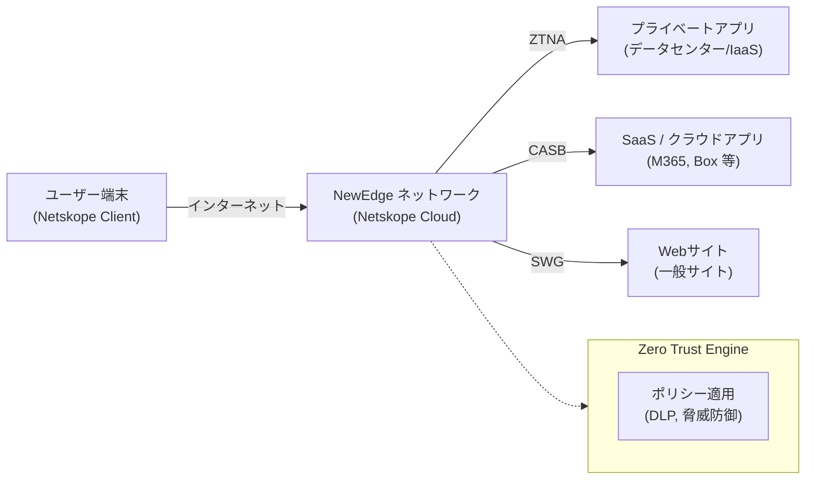

# **Netskope 調査レポート**

## **1. 基本情報**

* **ツール名**: Netskope
* **ツールの読み方**: ネットスコープ
* **開発元**: Netskope, Inc.
* **公式サイト**: [https://www.netskope.com/](https://www.netskope.com/)
* **関連リンク**:
  * ドキュメント: [https://docs.netskope.com/](https://docs.netskope.com/)
* **カテゴリ**: セキュリティ
* **概要**: Netskopeは、企業が利用するクラウドアプリケーション、Webサイト、プライベートアプリケーションへのアクセスを保護する、クラウドネイティブな統合セキュリティプラットフォーム（SASE/SSE）です。データの保護や脅威の防御を、高いネットワークパフォーマンスを維持したまま実現します。

## **2. 目的と主な利用シーン**

* **解決する課題**: クラウド利用の拡大やリモートワークの普及に伴う、シャドーIT、データ漏洩リスク、レガシーVPNのボトルネック、サイバー脅威への対応。
* **想定利用者**: 企業のCISO、セキュリティエンジニア、ネットワーク管理者、ITシステム部門。
* **利用シーン**:
  * 従業員のリモートアクセスをレガシーVPNからセキュアなゼロトラストネットワークアクセス（ZTNA）に移行する。
  * 従業員が利用する未許可のSaaS（シャドーIT）を可視化し、リスクを評価・制御する。
  * クラウド上の機密データ（個人情報や知的財産）の不正な持ち出しや漏洩を防ぐ（DLP）。
  * ChatGPTなどの生成AIアプリケーションの安全な利用を監視・制御する。

## **3. 主要機能**

* **CASB (Cloud Access Security Broker)**: 認可済み・未認可を問わず、数万のクラウドアプリの利用状況を可視化し、詳細なポリシー制御（アップロード/ダウンロード制限など）によるデータ保護や脅威防御を行います。
* **ZTNA (Zero Trust Network Access) / Private Access**: VPNに代わる機能。ユーザーをネットワーク全体ではなく、必要なプライベートアプリケーションにのみセキュアに接続させ、ラテラルムーブメント（脅威の横展開）を防ぎます。
* **Next Gen SWG (Secure Web Gateway)**: Webトラフィックを検査し、悪意のあるサイトへのアクセスブロック、クラウド上の脅威防御、Web経由のデータ持ち出し制御を行います。
* **DLP (Data Loss Prevention)**: AIや機械学習を活用して機密データ（PII、PCI、ソースコード等）を高精度で特定し、クラウド、Web、エンドポイントでのデータ漏洩を防止します。
* **AI Security**: 企業内での生成AI（GenAI）アプリやエージェントの利用状況を可視化し、AIへの機密データの送信を防ぐガードレール機能を提供します。
* **Advanced Analytics**: クラウド、Web、プライベートアプリにおけるユーザーのアクティビティを分析し、インシデントの傾向やリスクを視覚的なダッシュボードで提供します。
* **DEM (Digital Experience Management)**: ユーザーからアプリケーションまでの通信経路全体のパフォーマンスを監視し、ネットワークの問題切り分けを支援します。

## **4. 動作原理・システム構成**

* **アーキテクチャ**: クラウド完結型（SaaS）のセキュリティプラットフォームであり、エンドポイントには軽量な単一のエージェント（Netskope Client）を導入します。
* **主要コンポーネントとデータフロー**:

  * **Netskope Client**: ユーザーの端末にインストールされ、トラフィックをNetskopeのクラウドインフラへ誘導します。
  * **NewEdge Network**: Netskopeが独自に構築・運用する世界最大規模のプライベートセキュリティクラウド（ネットワークインフラ）。パブリッククラウドのルーティングに依存せず、最寄りのデータセンターでトラフィックの高速なインスペクション（SSL復号化・ポリシー適用）を行います。
  * **Zero Trust Engine**: アプリケーション、ユーザー、デバイス、データに関するコンテキストをリアルタイムで解釈し、適応型のポリシー制御を一元的に実行します。
* **特筆すべき要素技術**:
  * **Single-Pass Architecture**: CASB、SWG、DLP、脅威防御などの複数のセキュリティインスペクションを、トラフィックを一度展開するだけで同時に実行し、遅延を最小限に抑える設計。
  * パブリックインターネットの遅延や輻輳を回避するため、多数のクラウドプロバイダーやSaaSベンダーと直接ピアリング（相互接続）を行っています。

## **5. 開始手順・セットアップ**

* **前提条件**:
  * サブスクリプションの契約とNetskopeテナントの払い出し。
  * アイデンティティプロバイダ（IdP: Microsoft Entra ID、Oktaなど）との連携設定。
* **インストール/導入**:
  * ユーザーの端末（Windows, macOS, iOS, Android等）に、MDM/UEM等を利用してNetskope Clientを配布・インストールします。
* **初期設定**:
  * Netskope管理コンソール（クラウド）にて、Web閲覧用のSWGポリシー、クラウドアプリ制御用のCASBポリシー、プライベートアプリへのZTNA設定などを定義します。
* **クイックスタート**:
  * 初期は「可視化（監視）モード」で運用し、シャドーITの利用状況やデータフローを把握した後、段階的に「ブロック（制御）モード」へと移行していくのが一般的なベストプラクティスです。

## **6. 特徴・強み (Pros)**

* **圧倒的なネットワークパフォーマンス**: 自社インフラである「NewEdge」ネットワークにより、セキュリティを挟むことによる通信の遅延（ボトルネック）を感じさせないユーザー体験を実現。
* **高度なクラウド・アプリ制御**: クラウドアプリ内のアクティビティ（例: 「Slackにログインは許可するが、ファイルアップロードは禁止する」）をAPIレベルの解像度で詳細に制御可能。
* **単一のエージェントとコンソール**: SASE/SSEに必要な全機能が1つのエージェント、1つの管理画面に統合されており、運用負荷を削減できる。
* **AI時代への迅速な対応**: 生成AI（ChatGPTなど）に対するきめ細かいアクセスコントロールやデータ保護機能（AI Security）にいち早く対応。

## **7. 弱み・注意点 (Cons)**

* **エンタープライズ向けの価格帯**: 高度な機能とインフラを提供する分、導入コストは比較的高く、主に中堅〜大企業向けとなります。
* **初期設定とチューニングの難易度**: 機能が非常に豊富かつ詳細なポリシー設定が可能なため、適切に運用設計を行うにはセキュリティに関する専門知識や、導入パートナーの支援が必要になります。
* **多機能ゆえの学習コスト**: 管理者が全機能を把握し、自社に最適なポリシーへチューニングしていくには一定の学習期間と運用フェーズが必要です。

## **8. 料金プラン**

| プラン名 | 料金 | 主な特徴 |
|---------|------|---------|
| **エンタープライズプラン** | 要問い合わせ | サブスクリプション形式。必要な機能（CASB, SWG, ZTNAなど）やユーザー数に応じた個別見積もり。 |

* **課金体系**: ユーザー単位（シートベース）の年間サブスクリプションが基本。
* **無料トライアル**: エンタープライズ向け製品のため、無料トライアルや無償枠はありません。通常は営業窓口やパートナー経由でのPoC（概念実証）を実施します。

## **9. 導入実績・事例**

* **導入企業**: BDO、Colgate-Palmolive、ManTech、Prologisをはじめ、金融、製造、ハイテク、公共機関など全世界の大手企業で採用されています。
* **導入事例**: BDOでは、クラウドファーストでAIを積極的に活用するインフラを保護するためにネットワークとセキュリティを統合し、安全な業務環境を実現しています。
* **対象業界**: 業界を問わず、ゼロトラスト移行やクラウド移行を推進する中堅〜大規模エンタープライズ企業。

## **10. サポート体制**

* **ドキュメント**: 製品マニュアル、アーキテクチャガイド、リリースノートが [Netskope Documentation](https://docs.netskope.com/) に網羅されています（英語主、一部日本語あり）。
* **コミュニティ**: ユーザー同士のナレッジ共有フォーラムである「Netskope Community」が提供されています。
* **公式サポート**: グローバルでの24時間365日サポートや、導入パートナーを通じた日本語での技術サポート体制が整っています。有償のプロフェッショナルサービスによる導入支援も提供されています。

## **11. エコシステムと連携**

### **11.1 API・外部サービス連携**

* **API**: Netskopeテナントの管理、ログの抽出、ポリシーの動的変更を行うためのREST APIが提供されています。
* **外部サービス連携**:
  * **IdP**: Microsoft Entra ID, Okta, Ping Identity などによる認証連携とユーザー/グループ同期。
  * **SIEM / SOAR**: Splunk, Microsoft Sentinel, CrowdStrike 等へログやアラートを転送し、インシデント対応を自動化。
  * **EDR**: CrowdStrike, SentinelOne 等と連携し、端末の感染状況（コンテキスト）に応じたアクセス制御。

### **11.2 技術スタックとの相性**

エンタープライズITインフラ・セキュリティスタックに該当するため、開発フレームワークの相性ではなく、IT基盤ツールとの親和性を記載します。

| 技術スタック | 相性 | メリット・推奨理由 | 懸念点・注意点 |
|:---|:---:|:---|:---|
| **Microsoft 365 / Entra ID** | ◎ | 緊密なAPI連携。M365アプリの高度な可視化と制御が可能。 | 特になし |
| **CrowdStrike (EDR)** | ◎ | 脅威インテリジェンスの共有、デバイスポスチャ連携による強力なゼロトラスト基盤 | 双方のライセンスが必要 |
| **Splunk / SIEM** | ◯ | 公式プラグイン（Netskope Cloud Exchange等）を利用した容易なログ統合 | ログ量が多いため、SIEM側の課金容量に注意 |

## **12. セキュリティとコンプライアンス**

* **認証**: SAML連携による各種SSO、多要素認証（MFA）に対応。
* **データ管理**: ログデータの保管場所（Data Plane）は顧客の要件に応じてリージョン（国内含む）を選択可能。
* **準拠規格**: SOC 2 Type II, ISO 27001, FedRAMP High（米国政府基準）、ISMAP（日本政府情報システムのためのセキュリティ評価制度）など、各国の主要なセキュリティ認証・コンプライアンス基準を取得しています。

## **13. 操作性 (UI/UX) と学習コスト**

* **UI/UX**: 単一のWebコンソール（Netskope Orchestrator）から、CASB、SWG、ZTNAなどすべての設定を統合管理できます。ポリシー設定画面は柔軟性が高い一方で、項目が多岐にわたります。
* **学習コスト**: プラットフォーム全体を理解し、高度なDLPルールや適応型アクセスポリシーを自社に合わせて設計・運用するには、管理者向けのトレーニング（Netskope Academy等）の受講が推奨されます。学習コストは高めです。

## **14. ベストプラクティス**

* **効果的な活用法 (Modern Practices)**:
  * レガシーVPNの廃止とNetskope Private Access (ZTNA) への移行による、ユーザー体験の向上とセキュリティの強化。
  * 生成AI（ChatGPTなど）の利用を完全にブロックするのではなく、NetskopeのAI Security機能を用いて「AIアプリの利用は許可するが、ソースコードや機密データのペーストはブロック（または警告）する」といった柔軟なガードレールを設ける。
* **陥りやすい罠 (Antipatterns)**:
  * 導入直後から厳しいブロックポリシーを一斉に適用し、従業員の業務を阻害してしまうこと。初期は監査（モニタリング）モードでトラフィックを分析し、例外設定を適切に行った上で段階的にブロックに移行すべきです。

## **15. ユーザーの声（レビュー分析）**

* **調査対象**: G2, Capterra などのエンタープライズIT製品レビュー（一般的な評判の要約）
* **総合評価**: 業界トップクラスのSASE/SSEソリューションとして高い評価を受けています。
* **ポジティブな評価**:
  * 「エージェントが軽量で、トラフィックをNetskope経由にしても通信速度の低下を感じない（NewEdgeのパフォーマンスが高い）」
  * 「CASBによるシャドーITの可視化と制御の解像度が非常に高く、細かいポリシーが組める」
  * 「VPNからZTNAへの移行により、リモートワーク時の接続トラブルが激減した」
* **ネガティブな評価 / 改善要望**:
  * 「管理コンソールの設定項目が多く、直感的に目的の設定画面にたどり着くのに慣れが必要」
  * 「DLPのチューニング（誤検知の削減）に時間と労力がかかる」
  * 「中小企業にとってはライセンスコストが割高に感じる」
* **特徴的なユースケース**:
  * 昨今の生成AIブームに伴い、従業員による不用意なプロンプト入力（機密情報の送信）を防ぐ「AIデータ保護ツール」としての利用が急増しています。

## **16. 直近半年のアップデート情報**

* **2025-08-XX**: Netskope社がNasdaq市場へ新規株式公開（IPO）を実施し、ARR（年間経常収益）が7億700万ドル（前年比33%増）に達していることを公表。
* **2024-XX-XX** (直近の主要な動向として記載): Gartnerの2024年Magic Quadrantにおいて、SASE（Secure Access Service Edge）プラットフォームおよびSSE（Security Service Edge）部門の双方で「リーダー」に選出される。
* **2024年〜2025年**: 「Netskope One」プラットフォームに、AIの安全な利用を促進する「AI Security（Skylight）」機能を統合・拡充。AI Command Center、GenAI App Security、AI Guardrailsなどを提供。

(出典: [Netskope 公式サイト / ニュースルーム](https://www.netskope.com/company/newsroom))

## **17. 類似ツールとの比較**

### **17.1 機能比較表 (星取表)**

| 機能カテゴリ | 機能項目 | Netskope | Zscaler | Palo Alto (Prisma) |
|:---:|:---|:---:|:---:|:---:|
| **基本機能** | CASB (可視化・制御) | ◎ <small>業界最高峰の粒度</small> | ◯ <small>標準的</small> | ◯ <small>標準的</small> |
| **基本機能** | SWG (Webゲートウェイ) | ◎ <small>統合Single-Pass</small> | ◎ <small>業界標準・強力</small> | ◯ <small>強力な脅威防御</small> |
| **基本機能** | ZTNA (プライベートアクセス) | ◎ <small>一貫したポリシー</small> | ◎ <small>実績豊富 (ZPA)</small> | ◎ <small>強力</small> |
| **エンタープライズ** | データ保護 (DLP) | ◎ <small>AI/MLによる高精度検知</small> | ◯ <small>標準対応</small> | ◯ <small>標準対応</small> |
| **非機能要件** | ネットワーク性能 | ◎ <small>自社保有インフラ (NewEdge)</small> | ◎ <small>大規模インフラ</small> | ◎ <small>Google基盤等活用</small> |

### **17.2 詳細比較**

| ツール名 | 特徴 | 強み | 弱み | 選択肢となるケース |
|---------|------|------|------|------------------|
| **Netskope** | データセキュリティ(CASB/DLP)を出発点としてSASE/SSEへ発展した統合プラットフォーム | クラウドアプリの細かな制御、AI/生成AIへの対応、NewEdgeによる高速な通信 | 設定の複雑さ、導入ハードル | クラウド利用が進んでおり、データ保護やシャドーIT対策、AIの安全利用を最重視する企業 |
| **Zscaler** | SWG（Webプロキシ）を出発点とする、SSE市場のもう一つの絶対的リーダー | 圧倒的な導入実績、堅牢なSWG/ZTNA機能、広範なパートナーエコシステム | アプリ内の詳細制御(CASB)はNetskopeにやや譲る | Webセキュリティを中心としたリモートアクセス環境の全面刷新を図る大企業 |
| **Palo Alto Networks (Prisma SASE)** | ネットワーク機器（ファイアウォール）のリーダーによる統合SASE | 強力な脅威防御、SD-WANとの強力な統合 | コンポーネントが複数に分かれている場合がある | 既存のオンプレミス環境やSD-WANとクラウドセキュリティを強固に統合したい企業 |

## **18. 総評**

* **総合的な評価**:
  Netskopeは、今日のエンタープライズ企業が直面する「クラウドシフト」「リモートワーク」「AIの普及」という3つの大きな波に対し、単一のプラットフォーム（Netskope One）と単一のエージェントで包括的なセキュリティを提供する、非常に強力なSASE/SSEソリューションです。自社でネットワークバックボーン（NewEdge）を構築している点が特筆すべきであり、セキュリティによる通信の遅延という長年のトレードオフを解消しています。
* **推奨されるチームやプロジェクト**:
  数千〜数万人規模の従業員を抱え、デジタルトランスフォーメーション（DX）を推進するエンタープライズ企業。特に、SaaSの利用割合が高く、機密データの保護や生成AIの安全な業務利用（AIガバナンス）を喫緊の課題としている組織に最適です。
* **選択時のポイント**:
  ZscalerやPalo Alto Networksといった他のリーダー製品と比較する際は、自社の重点課題がどこにあるか（Web脅威対策か、データ保護/CASBか、拠点間ネットワーク/SD-WAN統合か）を見極めることが重要です。Netskopeは特に、アプリケーション内部のアクティビティレベルでの詳細な制御（例：「閲覧はOKだがダウンロードはNG」）や、データ漏洩防止（DLP）において業界トップクラスの優位性を持っています。導入においては、信頼できるインテグレーションパートナーと連携し、段階的なロールアウト計画を立てることが成功の鍵となります。
