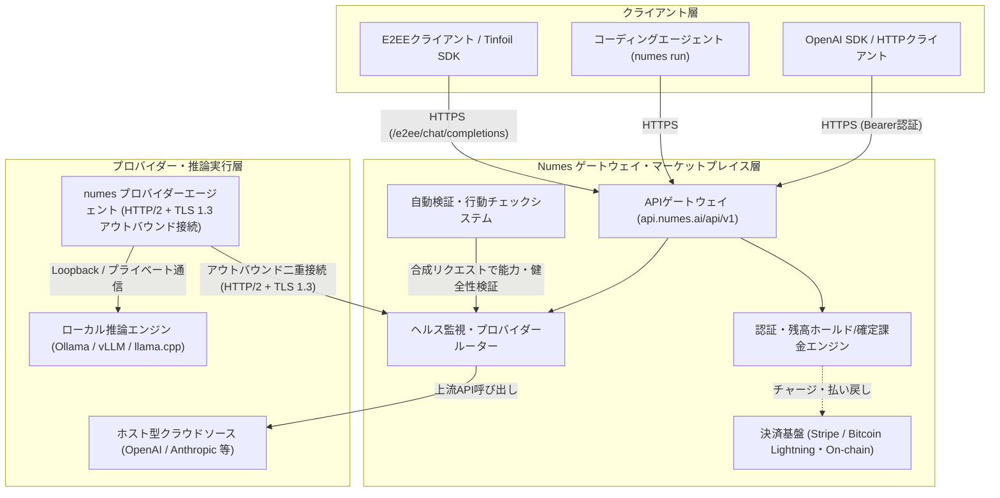

---
# === フロントマター ===
title: "Numes 調査レポート"
tool_name: "Numes"
tool_reading: "ニュームス / ヌームス"
category: "AIゲートウェイ"
developer: "Floating Point Systems, Inc."
official_site: "https://numes.ai/"
date: "2026-11-14"
last_updated: "2026-11-14"
tags:
  - "AI"
  - "大規模言語モデル"
  - "SaaS"
  - "開発者ツール"
  - "API"
description: "独立系プロバイダーが提供するフロンティアモデルやOSSモデルを単一のOpenAI互換APIで呼び出せるAI推論マーケットプレイス。USD（クレジットカード）とBitcoin（Lightning/オンチェーン）による従量課金、E2EE推論、プロバイダー自動検証を特徴とする。"

# 【クイックサマリー】
quick_summary:
  has_free_plan: false
  is_oss: false
  starting_price: "従量課金（プリペイド残高制・無料プランなし）"
  target_users:
    - "AIアプリ開発者"
    - "推論プロバイダー・GPU運用者"
    - "プライバシー重視のエンジニア"
  latest_highlight: "2026年10月にプライバシーポリシー・法的通知を更新し、Tinfoil等のE2EE推論やClaude Code連携を含むマーケットプレイス機能を提供"
  update_frequency: "不定期"

# 【ツール評価】100点満点、基準点70点からの加減算方式
evaluation:
  score: 70
  base_score: 70
  plus_points:
    - point: 5
      reason: "OpenAI/OpenRouter互換APIに加え、Tinfoil等のE2EE推論（:e2ee）や自動プロバイダー検証・不定期行動チェックなど独自機能を備える"
    - point: 4
      reason: "USD（クレジットカード）とBitcoin（Lightning/オンチェーン）の2通貨決済および独立プロバイダーとしての収益化に対応"
    - point: 3
      reason: "本番環境でのプロンプト・レスポンス非保存（ゼロリテンション）やOpenAPI 3.1仕様の公開などプライバシーと開発者体験に配慮"
  minus_points:
    - point: -5
      reason: "UI・ドキュメント・サポートともに日本語非対応（英語のみ）"
    - point: -4
      reason: "新興サービスでありG2/Capterra等の主要レビューサイトに実績がなく、Reddit等でプロモーションや信頼性に対する警戒の声がある"
    - point: -3
      reason: "無料プランがなく、クレジット購入時にプラットフォーム手数料（カード2.1%+決済手数料、BTC 5%）が加算される"
  summary: "E2EE推論やBitcoin決済、プロバイダー参入機能を備えた意欲的なAI推論マーケットプレイスだが、新興ゆえの実績不足とコミュニティ上の警戒意見を踏まえた慎重な検証が必要"

# 【任意項目】
links:
  documentation: "https://numes.ai/docs"
relationships:
  related_tools:
    - "LiteLLM"
    - "Portkey"
    - "9router"
    - "Fireworks AI"
---

# **Numes 調査レポート**

## **1. 基本情報**

* **ツール名**: Numes
* **ツールの読み方**: ニュームス / ヌームス（※公式サイト上に公式の日本語カタカナ表記の記載はないため、英語発音に基づく一般的な読み方を併記）
* **開発元**: Floating Point Systems, Inc.（米国デラウェア州ニューアーク）
* **公式サイト**: [https://numes.ai/](https://numes.ai/)
* **関連リンク**:
  * ドキュメント: [https://numes.ai/docs](https://numes.ai/docs)
  * モデルカタログ: [https://numes.ai/models](https://numes.ai/models)
  * OpenAPI 3.1 仕様: [https://numes.ai/docs/openapi.json](https://numes.ai/docs/openapi.json)
* **カテゴリ**: AIゲートウェイ
* **概要**: Numesは、独立系プロバイダーが提供するフロンティアAIモデル、オープンソースモデル、特化型モデルを単一のOpenAI互換API（`https://api.numes.ai/api/v1`）経由で利用できるオープンなAI推論マーケットプレイスである。利用者はクレジットカード（USD）またはBitcoin（Lightning/オンチェーン）でプリペイド残高をチャージしてリクエスト単位の従量課金で利用でき、反対に自身のGPU環境（Ollama、vLLM等）やクラウドAPIアカウントを接続して推論プロバイダーとして収益を得ることもできる。

## **2. 目的と主な利用シーン**

* **解決する課題**: 複数のLLMプロバイダーやホスティング事業者を個別に契約・管理する手間を省き、単一APIでコスト・レイテンシ・信頼性を最適化しながら推論を実行できるようにする。また、推論内容のプライバシー保護（ゼロリテンションやE2EE）と、GPUリソース保有者が仲介なしで推論供給者として市場参加できる仕組みを提供する。
* **想定利用者**:
  * 複数のLLMを低コスト・高可用性で切り替えたいAIアプリケーション開発者
  * コーディングエージェント（OpenCode、Pi、OMP等）を柔軟なモデルバックエンドで動かしたいエンジニア
  * クレジットカード以外の決済（Bitcoin / Lightning）やエンドツーエンド暗号化（E2EE）推論を求める利用者
  * 遊休GPUサーバーや既存API枠を活用して推論収益を得たいプロバイダー
* **利用シーン**:
  * **マルチモデルAPIゲートウェイ**: OpenAI SDKのベースURLとAPIキーを差し替えるだけで、複数の独立プロバイダーが提供するモデルを横断利用する。
  * **プライバシー重視の推論（E2EE）**: ハードウェアエンクレーブ（Tinfoil）等を用いた `:e2ee` モデルにより、Numesやプロバイダー運営者にプロンプト内容を平文で渡さず推論を実行する。
  * **推論リソースの収益化**: `numes` CLIやデスクトップアプリを用いて自宅・クラウドのOllama/vLLM環境を接続し、市場価格で推論を提供してUSDまたはBTCで報酬を受け取る。

### **2.1 代表的な利用フロー**

```mermaid
swimlane-beta TB
  subgraph User["ユーザー（開発者・アプリ）"]
    A["APIキー発行・クレジットチャージ（USD/BTC）"]
    B["OpenAI互換APIへリクエスト送信"]
    F["推論結果と確定コストを受領"]
  end
  subgraph Numes["Numes（マーケットプレイス・ルーター）"]
    C["残高上限ホールド・健全エンドポイント選定"]
    E["応答中継・確定課金（出力前失敗時は自動フォールバック）"]
  end
  subgraph Provider["独立プロバイダー（推論基盤）"]
    D["モデル推論を実行（通常またはE2EE）"]
  end
  A --> B
  B --> C
  C --> D
  D --> E
  E --> F
```

* **代表的な流れ**: ユーザーはUSDまたはBTC建てのAPIキーとプリペイド残高を用意し、OpenAI互換エンドポイントへリクエストを送信する。Numesは推定コスト上限をホールドしたうえで検証済みのプロバイダーエンドポイントへルーティングし、独立プロバイダーが推論を実行して返却された出力分のみを確定課金する（出力開始前に失敗した場合は別エンドポイントへ自動フォールバックする）。

## **3. 主要機能**

* **OpenAI / OpenRouter互換API**: `https://api.numes.ai/api/v1` をベースURLとし、`POST /chat/completions`、`/embeddings`、`/images`、`/audio/speech`、`/audio/transcriptions` 等を提供する。OpenRouterのAPI規約（エラー形式や `usage.cost` 等）に準拠しつつ、未定義フィールドを厳格に拒否（`400 invalid_request`）する閉じたリクエスト設計を採用している。
* **デュアル通貨プリペイド課金（USD / BTC）**: APIキーごとに通貨（USDまたはBTC）を固定し、USDはクレジットカード（Stripe経由）、BTCはBitcoin（Lightning Networkおよびオンチェーン）で事前チャージできる。両通貨は混在・自動変換されない厳格な分離設計となっている。
* **スマートルーティングと自動フォールバック**: 価格、スループット、レイテンシ、計測品質によるソートや、特定プロバイダーのピン留め・除外（`provider.order` 等）が可能。出力開始前のエンドポイント障害時には同一モデルの別エンドポイントへ自動フォールバックする。
* **プロバイダー自動検証と不定期チェック**: 新規オファー（モデル×エンドポイント×価格）は、運営チームによるオペレーター・モデル名・価格レビューに加え、ストリーミングやTool Calling等の機能検証（60秒タイムアウトの合成リクエスト）を通過した場合のみルーティング対象となる。稼働中もヘルスチェックや不定期の行動分析が実施される。
* **エンドツーエンド暗号化推論（`:e2ee`）**: Tinfoil（ハードウェアエンクレーブ＋クライアント側アテステーション検証）およびVenice（公開鍵暗号化）に対応した `:e2ee` モデルを提供し、Dashboard Chat、ローカルブリッジ、またはTinfoil SDK経由で暗号化推論を実行できる。
* **プロバイダーエージェント（CLI / TUI / デスクトップアプリ）**: 単一バイナリ `numes`（およびmacOS/Linux向けデスクトップアプリ）により、Ollama、vLLM、llama.cpp等のローカル推論エンジンや、OpenAI・Anthropic・Google Gemini・OpenRouter・Claude Codeログイン等のクラウドソースを接続し、インバウンドポート開放不要で推論を販売できる。
* **コーディングエージェント統合ランチャー**: `numes run opencode`、`numes run pi`、`numes run omp` コマンドにより、対応コーディングエージェントをNumes APIキー設定済み状態で即座に起動できる。
* **ゼロリテンション（プロンプト・レスポンス非保存）**: 本番環境ではメタデータのみを記録し、プロンプト、メッセージ、ファイル、ツール引数、レスポンス本文、クライアントIPアドレスをリクエスト履歴に保存しない設計としている。

## **4. 動作原理・システム構成**

Numesは、クラウド完結型のマーケットプレイス／APIゲートウェイと、プロバイダー側で動作するアウトバウンド接続型エージェントから構成される分散型仲介アーキテクチャを採用している。内部のプラットフォームコードは非公開（プロプライエタリ）だが、公式ドキュメントおよびOpenAPI 3.1仕様から以下の構成と処理フローが確認できる。



* **アーキテクチャ**: クライアントに対してはクラウド完結型の単一APIゲートウェイ（`https://api.numes.ai/api/v1`）として振る舞い、プロバイダーに対してはアウトバウンド接続型のエージェント通信モデルを採用している。
* **主要コンポーネントとデータフロー**:
  * **リクエスト処理とコストホールド**: クライアントからのリクエスト到着時、サーバーは対象キーの通貨残高（USDまたはBTC）から推定上限コストを一時ホールド（Reserved）し、ヘルシーかつ検証済みのエンドポイントへ転送する。出力が配信されたトークン分のみを確定課金し、プロバイダーの保留収益（Pending）へ計上する。
  * **プロバイダーエージェント通信**: プロバイダー端末上の `numes` デーモンは、プラットフォームのゲートウェイに対して **HTTP/2 over TLS 1.3** で2本のアウトバウンド接続を張り続ける。これによりプロバイダー側はパブリックIPやインバウンドファイアウォール開放が不要となっている。
  * **E2EE境界**: `:e2ee` モデル利用時は、クライアント側でペイロードを暗号化して `/e2ee/chat/completions` へ送信し、Numesは暗号文をそのままTinfoilエンクレーブ等へリレーする（モデルIDやトークン課金メタデータのみゲートウェイ側で可視）。
* **特筆すべき要素技術**:
  * **OpenAPI 3.1 契約駆動**: `/docs/openapi.json` で厳密なスキーマを公開し、未知フィールドを許容しない閉じたバリデーションを実施。
  * **SHA-256 自己検証インストーラー**: プロバイダーエージェントは単一実行ファイル（Node.js/Python等のランタイム同梱）で配布され、`SHA256SUMS` マニフェスト検証と自動更新・ロールバック機構を内蔵する。
  * **プロンプトキャッシュ／セッションルーティング**: `prompt_cache_key`、`session_id`、`X-Session-Id` を受け取り、プロバイダー側へはアカウント識別子を含まない不透明な（opaque）ヒントのみを渡して同一エンドポイントへのスティッキールーティングを行う。

## **5. 開始手順・セットアップ**

* **前提条件**:
  * **API利用者**: Numesアカウント登録（メール＋パスワード、パスキー、またはGoogle/GitHub/Apple連携）、APIキー発行、およびUSDまたはBTCでの事前クレジットチャージ（無料枠なし）。なお、ブラウザからの直接API呼び出しはCORSで禁止（`403 cors_forbidden`）されているため、バックエンドまたはCLI/SDKから呼び出す必要がある。
  * **プロバイダー参入者**: Linux x64/ARM64（glibc環境、Alpine等のmusl非対応）またはApple Silicon搭載macOS（Intel MacおよびWindowsは非対応）。
* **インストール/導入**:
  API利用のみの場合は既存のOpenAI SDK等で利用可能。コーディングエージェント連携（`numes run`）やプロバイダーエージェントを利用する場合は以下のコマンドで `numes` CLIをインストールする。

  ```bash
  # プロバイダーエージェント / CLI インストーラー
  curl -fsSL https://numes.ai/install | sh
  ```

  既存のPython/Node.jsプロジェクトからAPIを呼び出す場合は公式OpenAI SDKを利用する。

  ```bash
  # Python OpenAI SDK の例
  pip install openai
  ```

* **初期設定**:
  ダッシュボードの「Keys」から通貨（USDまたはBTC）を選択してAPIキーを発行し、環境変数に設定する（キーのシークレットは作成時に1度だけ表示される）。

  ```bash
  export NUMES_API_KEY="<YOUR_NUMES_API_KEY>"
  ```

* **クイックスタート**:
  `https://api.numes.ai/api/v1/chat/completions` に対してChat Completionsリクエストを送信する。

  ```bash
  curl -X POST "https://api.numes.ai/api/v1/chat/completions" \
    -H "Authorization: Bearer $NUMES_API_KEY" \
    -H "Content-Type: application/json" \
    -d '{
      "model": "openai/gpt-6-luna",
      "messages": [
        {"role": "user", "content": "Hello, Numes!"}
      ]
    }'
  ```

## **6. 特徴・強み (Pros)**

* **USDとBitcoin（Lightning/オンチェーン）の両決済対応**: クレジットカードだけでなくBitcoinによるチャージおよびプロバイダーへのBTC払い出しに対応しており、クレジットカードを持たない利用者や匿名性・グローバル決済を重視する開発者に適している。
* **E2EE（エンドツーエンド暗号化）推論の統合**: Tinfoilのハードウェアエンクレーブ検証やVeniceの暗号化推論を `:e2ee` モデルとして同一プラットフォーム上で提供しており、通常推論へのフォールバックを行わない厳格なプライバシー境界を持つ。
* **ゼロリテンションと徹底したメタデータ最小化**: 本番環境でプロンプト・レスポンス本文を保存せず、クライアントIPアドレスもリクエスト履歴に紐付けない。Dashboard Chatの履歴もサーバーではなくブラウザ側に保存される。
* **プロバイダー参入の容易さと検証品質**: 単一バイナリかつアウトバウンド接続のみでローカルLLMや既存API枠を収益化でき、利用者側も運営の自動能力検証・不定期行動チェックを通過したエンドポイントのみにルーティングされるため、モデル偽装リスクを低減している。

## **7. 弱み・注意点 (Cons)**

* **日本語対応の欠如**: 公式サイト、ドキュメント、ダッシュボードUI、サポート窓口のいずれも英語のみであり、日本語の公式情報は提供されていない。
* **無料プラン・無料クレジットがない**: 利用開始にはUSDまたはBTCでの事前チャージが必須であり、クレジット購入時にはプラットフォーム手数料と決済手数料が上乗せされる。
* **プラットフォームの実績不足とコミュニティ上の警戒意見**: 2026年時点で比較的新しいプラットフォームであり、G2やCapterra等の第三者レビューサイトに掲載がない。また、Reddit上では「主要AIモデルの無料APIキー」を謳うプロモーション動画等と絡めて警戒・注意喚起する投稿が見られるため、本番導入や高額チャージ前には十分な検証が推奨される。
* **複数モデル間の自動フォールバック非対応**: リクエストごとに1つのモデルのみを指定する仕様であり、同一モデル内の別エンドポイントへのフォールバックには対応するものの、OpenRouterのような「モデルAが失敗したらモデルBへフォールバック」する機能はクライアント側で実装する必要がある。

## **8. 料金プラン**

Numesには月額固定のサブスクリプションプランや無料プランは存在せず、**プリペイド残高からのリクエスト単位従量課金制**を採用している。各モデルの利用単価はプロバイダーが設定する市場価格（トークン単価等）に依存する。

| 項目 | 手数料 / 料金体系 | 主な特徴・条件 |
|---|---|---|
| **月額基本料 / 無料プラン** | なし（無料プランなし） | 事前チャージした残高から出力配信分のみを従量課金 |
| **USDチャージ（クレジットカード）** | プラットフォーム手数料 **2.1%**（最低 **$0.33**） ＋ カード決済手数料（米国発行カード **2.9% + $0.30** / 米国以外 **4.4% + $0.30**） | 例：$100チャージ時、米国カードは合計 $105.46、米国以外のカードは合計 $107.11。Stripe経由で決済 |
| **BTCチャージ（Bitcoin）** | プラットフォーム手数料 **5%**（最低額なし） | Lightning Networkまたはオンチェーン送金に対応。USD残高とは完全に分離 |
| **プロバイダー収益・出金** | プラットフォーム手数料の控除なし（顧客側のチャージ時に徴収） | USDはStripe経由で銀行出金、BTCはLightningまたはオンチェーンで出金可能（保留・リザーブ期間あり） |

* **課金体系**: モデル・エンドポイントごとのトークン単価等に基づくリクエスト単位の従量課金（推定上限コストをリクエスト開始前に一時ホールドし、配信された出力分のみを確定精算）。
* **無料トライアル**: 公式ドキュメント上、無料トライアルや無償枠の記載はない。

## **9. 導入実績・事例**

* **導入企業**: 公式サイトおよび公開資料において、具体的な導入企業名やケーススタディは公開されていない。
* **導入事例**: 公開事例なし。ただし、OpenAI SDKを用いたバックエンドアプリケーションや、OpenCode / Pi / OMPといったコーディングエージェントの推論バックエンド、およびGPU保有者による推論提供プラットフォームとしての利用を想定したドキュメントが整備されている。
* **対象業界**: AIアプリケーション開発スタートアップ、個人開発者、プライバシー要件の高いソフトウェア開発領域、および分散コンピューティング／Web3・Bitcoinエコシステム周辺。

## **10. サポート体制**

* **ドキュメント**: [https://numes.ai/docs](https://numes.ai/docs) にAPIリファレンス（OpenAPI 3.1仕様含む）、クイックスタート、プロバイダーガイド、プライバシー・ルーティング解説が英語で詳細に整理されている。
* **コミュニティ**: 公式サイト上に公開のDiscord、Slack、フォーラム等のコミュニティリンクは確認できない。
* **公式サポート**: ダッシュボード内のサポートチケット機能（`/dashboard/support`）およびメール（`support@numes.ai`）による英語対応。サポート会話は暗号化保存され、最終メッセージから90日後に自動削除される。

## **11. エコシステムと連携**

### **11.1 API・外部サービス連携**

* **API**: OpenAI Chat Completions互換およびOpenRouter規約準拠のREST API（`https://api.numes.ai/api/v1`）を提供。`GET /models`、`POST /chat/completions`、`POST /e2ee/chat/completions`、`POST /embeddings`、`POST /images`、`POST /audio/speech`、`POST /audio/transcriptions`、`GET /credits`、`GET /keys` 等を備え、OpenAPI 3.1ドキュメントから型付きクライアントを生成できる。
* **外部サービス連携**:
  * **コーディングエージェント**: OpenCode、Pi（`@earendil-works/pi-coding-agent`）、OMP（`@oh-my-pi/pi-coding-agent`）を `numes run` で直接起動・連携可能。
  * **プロバイダー接続先（ローカル）**: Ollama、vLLM、llama.cpp、LM Studio等のOpenAI互換サーバー。
  * **プロバイダー接続先（クラウド）**: OpenAI、Anthropic（およびClaude Codeログイン）、Google Gemini、OpenRouter、DeepInfra、Novita AI、PPQ.ai、Venice、Tinfoil、Kimi Code、OpenCode Zen。
  * **決済**: Stripe（USDカード決済・プロバイダー銀行出金）、Bitcoin（Lightning Network / オンチェーン）。

### **11.2 技術スタックとの相性**

Numesは専用の言語別SDKを提供していないが、OpenAI公式SDKのベースURL差し替えおよびOpenAPI 3.1仕様によるクライアント生成で幅広い環境から利用できる。

| 技術スタック | 相性 | メリット・推奨理由 | 懸念点・注意点 |
|:---|:---:|:---|:---|
| **Python (FastAPI / Django / CLI)** | ◯ | 公式 `openai` Python SDKの `base_url` を変更するだけで即座に利用可能 | Numes独自の `provider` ルーティング指定やE2EE利用時は追加パラメータ／Tinfoil SDKの併用が必要 |
| **TypeScript / Node.js (Next.js等)** | ◯ | 公式 `openai` JS/TS SDKやOpenAPI 3.1からの型生成と相性が良い | ブラウザからの直接呼び出しはCORS（`403`）でブロックされるため必ずサーバーサイド（API Route等）経由とする必要がある |
| **Go / Rust / その他サーバー言語** | ◯ | 標準HTTPクライアントまたはOpenAPI 3.1コード生成で全エンドポイントを利用可能 | 公式のNumes専用ラッパーライブラリは存在しない |
| **ブラウザSPA（フロントエンド単体）** | × | バックエンドを伴う構成が前提 | サードパーティオリジンからの直接リクエストは `403 cors_forbidden` で拒否される |

## **12. セキュリティとコンプライアンス**

* **認証**: メールアドレス＋パスワード、パスキー（WebAuthn）、ソーシャルログイン（Google / GitHub / Apple）に対応し、2要素認証（認証アプリおよびリカバリーコード）をサポート。登録・ログイン時にはCloudflare Turnstileによるボット対策を実施。APIキー・マネジメントキーはハッシュ化（keyed digest）して保管され、発行後の再表示は不可。プロバイダーデーモンはHTTP/2 + TLS 1.3のアウトバウンド接続とローカルの所有者限定シークレットストアを使用する。
* **データ管理**: 本番環境はゼロリテンション（メタデータのみ記録）で運用され、プロンプト・レスポンス本文・ツール引数・クライアントIPアドレスはリクエスト履歴に保存されない。ダッシュボードのチャット履歴はブラウザ内に保存される。ただし、組織アカウントでRequest Policyによる検査・書き換えを有効にした場合や、選択した独立プロバイダー側のデータ保持ポリシー（モデルページで宣言内容を確認可能）に依存する点には留意が必要。暗号化通信やStripeによるカード情報非保持が徹底されている一方、サーバーの物理的なデータ保管リージョン詳細は公式サイト上で明示されていない（リクエスト時にリージョン指定・実行リージョンのメタデータ記録機能はある）。
* **準拠規格**: プライバシーポリシーにおいてGDPR適用地域における法的根拠や権利行使について言及しているものの、SOC 2、ISO 27001、HIPAA、ISMAP等の第三者セキュリティ認証の取得状況は公式サイトで公開されていない。問い合わせが必要。

## **13. 操作性 (UI/UX) と学習コスト**

* **UI/UX**: Next.jsベースのモダンでミニマルなWebダッシュボード（モデルカタログ、チャット、APIキー管理、利用ログ、請求管理、プロバイダー管理）を提供する。プロバイダー向けにはWeb画面に加えて、CLI、ターミナルUI（TUI）、およびmacOS/Linux向けのネイティブデスクトップアプリ（SSH経由のリモートLinux管理対応）が用意されており、運用スタイルに応じた柔軟な操作が可能。
* **学習コスト**: API利用のみであればOpenAI互換のため学習コストは非常に低い。一方、プロバイダーとして参入する場合は、能力検証ルール、価格レビュー、リザーブ期間（USDはアカウント90日経過＆出金3回未満の場合120日リザーブ等）といったマーケットプレイス特有の規約・ライフサイクルの理解が必要となる。

## **14. ベストプラクティス**

* **効果的な活用法 (Modern Practices)**:
  * **通貨・用途別のAPIキー分離と利用上限設定**: マネジメントキーと推論キーを分離し、推論キーごとにSpending Limit（利用上限）を設定することで予期せぬ残高消費を防ぐ。
  * **要件に応じたルーティング指定とE2EEの使い分け**: 通常のワークロードでは `prompt_cache_key` や `session_id` を活用してキャッシュ効率を高め、機密データを扱う場合は通常の `/chat/completions` ではなくTinfoil等の `:e2ee` モデル（アテステーション検証付き）を明示的に利用する。
  * **プロバイダー運用時のリモート管理**: デスクトップアプリまたはTUIでバックグラウンドサービスとして登録し、自動アップデートとSHA-256整合性チェックを有効化する。
* **陥りやすい罠 (Antipatterns)**:
  * **フロントエンド（ブラウザ）からの直接API呼び出し**: Numes APIはサードパーティオリジンからのブラウザリクエストを `403 cors_forbidden` で拒否するため、必ずバックエンド経由で呼び出すこと。
  * **未定義フィールドの送信**: OpenRouterと異なり、Numes APIは未知のパラメータを無視せず `400 invalid_request` エラーを返すため、OpenAI互換クライアントから独自拡張フィールドを送る際は `/docs/api-reference/parameters` で対応状況を確認すること。
  * **通常モデルIDへの `:e2ee` 機械的付与**: 通常のモデル名に `:e2ee` を付けるのではなく、カタログ上でE2EE対応として公開されている正規IDを確認して指定する必要がある。

## **15. ユーザーの声（レビュー分析）**

* **調査対象**: G2、Capterra、ITreview、Reddit（`r/ArtificialInteligence` 等）
* **総合評価**: G2、Capterra、ITreview等の主要B2Bレビューサイトには公式製品ページおよび評価スコアが存在しない（2026年11月時点）。
* **ポジティブな評価**:
  * （公式仕様・技術的観点からの評価として）OpenAI互換APIとOpenRouter規約に沿った導入のしやすさ、およびUSDとBitcoin Lightningの両決済に対応している点は技術的特徴として注目されている。
  * 本番環境でのプロンプト非保存（ゼロリテンション）とTinfoil等を用いたE2EE推論のサポートは、プライバシー重視のワークロードにおける利点と位置づけられている。
  * 単一バイナリの `numes` CLIによるローカルLLMの収益化と、自動検証・不定期行動チェックの仕組みは、オープンな推論マーケットプレイスの設計として合理性がある。
* **ネガティブな評価 / 改善要望**:
  * **コミュニティ上の警戒・否定的な声**: Reddit（`r/ArtificialInteligence` 等）において、「主要AIモデルの無料（$0）APIキーが使える」といった趣旨の誇大なプロモーション動画等をきっかけに、`numes.ai` に対して「詐欺やフィッシングの疑いがあるため注意すべき」「Googleアカウント連携や個人情報の入力は避けるべき」と警告するユーザー投稿が複数確認されている（Redditより引用・要約）。
  * **実績・透明性の不足**: 運営法人（Floating Point Systems, Inc.）の登記住所や法的文書は公開されているものの、G2/Capterra等の第三者レビューや導入企業事例が存在せず、信頼性を客観的に判断する外部材料が乏しい。
  * **決済手数料と通貨分離の制約**: クレジットカード購入時の2.1%＋決済手数料やBTCの5%手数料が実質的なコスト増となる点、およびUSD残高とBTC残高を相互変換・併用できない点が運用上の制約となる。
* **特徴的なユースケース**:
  * コーディングエージェント（OpenCode / Pi / OMP）のバックエンドとして `numes run` で迅速に切り替える開発ワークフローや、余剰GPUリソースを `numes` デーモン経由で貸し出す個人プロバイダー用途が想定されている。

## **16. 直近半年のアップデート情報**

NumesはGitHub上の公開リポジトリや独立したブログ形式のChangelogを公開していないが、公式ドキュメントおよび法的文書から以下の直近の更新・提供状況が確認できる。

* **2026-10-07**: プライバシーポリシー（Privacy Policy）および法的通知（Legal notice）を最終更新。本番環境でのゼロリテンション運用、Stripe決済／Bitcoin決済、組織向けRequest Policy等の取り扱いを明文化。
* **2026-09**: OpenRouter互換性ドキュメント（Compatibility）を2026年9月時点のOpenRouter仕様に照合してレビュー・更新し、対応エンドポイント（`/e2ee/*`、`/audio/*`、`/images` 等）と厳格なリクエスト検証仕様を整理。
* **2026年（詳細日付非公開）**: プロバイダー向けソースとして `Claude Code 2.1.280` の既存ログイン（`claude auth login`）を利用した推論提供機能、およびmacOS（Apple Silicon）/ Linux向けデスクトップアプリの提供・ドキュメント整備を実施。

(出典: [Numes Documentation](https://numes.ai/docs) / [Numes Legal Notice](https://numes.ai/legal/legal-notice) / [OpenRouter Compatibility](https://numes.ai/docs/api-reference/compatibility))

## **17. 類似ツールとの比較**

AIゲートウェイ・LLMルーター・推論プラットフォームとして既存の調査対象である **LiteLLM**、**Portkey**、**9router**、**Fireworks AI** と比較する。

### **17.1 機能比較表 (星取表)**

| 機能カテゴリ | 機能項目 | Numes | LiteLLM | Portkey | 9router | Fireworks AI |
|:---:|:---|:---:|:---:|:---:|:---:|:---:|
| **基本機能** | マルチモデル統合API (OpenAI互換) | ◎<br><small>OpenAI/OpenRouter互換</small> | ◎<br><small>100+プロバイダー統合</small> | ◎<br><small>250+ LLM統合</small> | ◎<br><small>マルチモデルルーティング</small> | ◯<br><small>OSSモデル中心</small> |
| **基本機能** | 独自推論ホスティング / マーケットプレイス | ◎<br><small>独立プロバイダー市場</small> | ×<br><small>ゲートウェイ専業</small> | ×<br><small>ゲートウェイ専業</small> | ×<br><small>プロキシ専業</small> | ◎<br><small>自社高速GPU基盤</small> |
| **セキュリティ** | E2EE推論 / ゼロリテンション | ◎<br><small>:e2ee対応・非保存</small> | ◯<br><small>セルフホスト可</small> | ◯<br><small>ZDR・ガードレール</small> | ◯<br><small>ローカル完結可</small> | ◯<br><small>ゼロデータ保持オプション</small> |
| **決済・導入** | OSS / セルフホスト | ×<br><small>プロプライエタリSaaS</small> | ◎<br><small>MITライセンスOSS</small> | ◎<br><small>OSSゲートウェイあり</small> | ◎<br><small>OSSプロキシ</small> | ×<br><small>クラウドSaaS</small> |
| **決済・導入** | Bitcoin / 暗号資産決済 | ◎<br><small>BTC/Lightning対応</small> | ×<br><small>決済機能なし</small> | ×<br><small>カード/請求書</small> | ×<br><small>決済機能なし</small> | ×<br><small>カード/請求書</small> |
| **エンタープライズ** | 実績・第三者認証 (SOC2等) | △<br><small>認証公開なし・新興</small> | ◎<br><small>エンタープライズ実績豊富</small> | ◎<br><small>SOC2/HIPAA/GDPR対応</small> | △<br><small>個人・開発者向け</small> | ◎<br><small>SOC2/HIPAA対応</small> |
| **非機能要件** | 日本語対応 | ×<br><small>英語のみ</small> | △<br><small>英語中心（日本語記事多）</small> | ×<br><small>英語のみ</small> | △<br><small>英語中心</small> | ×<br><small>英語のみ</small> |

### **17.2 詳細比較**

| ツール名 | 特徴 | 強み | 弱み | 選択肢となるケース |
|---|---|---|---|---|
| **Numes** | 独立プロバイダーと利用者を繋ぐAI推論マーケットプレイス | USD＋Bitcoin（Lightning）決済、`:e2ee` 推論、プロバイダーとしてGPU収益化が可能 | 無料プランなし、第三者認証・導入実績が乏しくコミュニティ上の警戒意見もある | - |
| **LiteLLM** | OSSのLLMプロキシサーバー＆Python SDK | 完全OSSでセルフホストでき、予算管理・フォールバック・100以上のモデル統合に実績が豊富 | 推論の課金・決済自体は各上流APIプロバイダーと個別契約が必要 | 自社インフラ内で完全制御可能なAIゲートウェイを構築したい場合 |
| **Portkey** | オブザーバビリティとガードレールを備えたAIゲートウェイ | SOC2/HIPAA等のエンタープライズ準拠、プロンプト管理、キャッシュ、詳細な可観測性 | 高度なガバナンス機能は有料クラウドプランが中心 | 企業の本番環境でガバナンス・監査・信頼性を最優先する場合 |
| **9router** | ローカル・開発者向けの軽量AIルーター／プロキシ | 手軽にローカルでマルチプロバイダーのルーティング・フォールバックを構成可能 | エンタープライズ向けのサポートや決済統合機能はない | 個人や小規模チームでAPIキーをまとめて簡易ルーティングしたい場合 |
| **Fireworks AI** | 高速推論に特化したクラウドLLMプラットフォーム | 自社最適化されたGPU基盤による超低レイテンシ推論、ファインチューニング、SOC2/HIPAA対応 | 対応モデルはOSSや特定モデル中心で、他社クローズドモデル（GPT/Claude等）は対象外 | OSSモデルの高速・低コストな本番推論基盤を求める場合 |

## **18. 総評**

* **総合的な評価**:
  * Numesは、単一のOpenAI互換APIの裏側に「独立プロバイダーによるオープンな推論マーケットプレイス」を構築し、クレジットカード（USD）とBitcoin（Lightning/オンチェーン）の2通貨決済、Tinfoil等を用いたE2EE推論（`:e2ee`）、さらには運営による自動能力検証・不定期行動チェックを組み合わせた意欲的なプラットフォームである。ドキュメントやOpenAPI 3.1仕様の整備度、ゼロリテンション設計など技術的な完成度は高い一方、サービスとしての実績・第三者セキュリティ認証が未公開であること、またReddit等で「無料APIキー」を謳うプロモーションと関連付けた警戒・注意喚起が見られる点はリスク要因として明確に認識する必要がある。
* **推奨されるチームやプロジェクト**:
  * Bitcoin（Lightning）でのAI推論決済を必要とする開発者や、Tinfoil等のE2EE推論を手軽に試したいエンジニア。
  * 遊休GPUや既存の推論環境を、インバウンドポート開放なしの小規模な構成で収益化したい個人・小規模プロバイダー。
* **選択時のポイント**:
  * **企業のミッションクリティカルな本番利用**や**コンプライアンス要件（SOC 2 / HIPAA等）**が重視される場合は、実績と認証が豊富な **Portkey** や **Fireworks AI**、あるいは自社環境で完結できるOSSの **LiteLLM** を優先すべきである。Numesを採用する場合は、少額のプリペイド残高と利用上限（Spending Limit）を設定したうえで、APIの挙動やプロバイダー品質を十分に検証してから段階的に利用を拡大することが推奨される。
