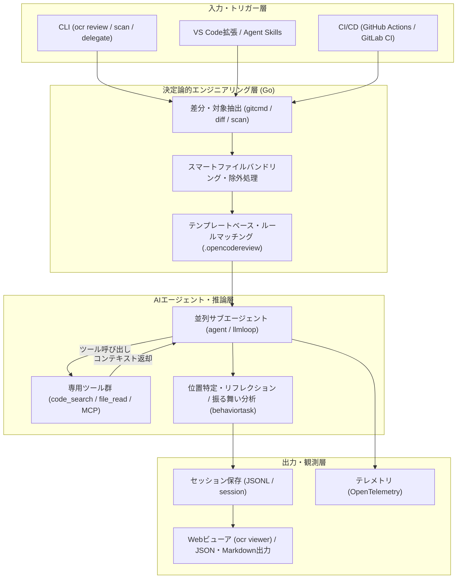

# **Open Code Review 調査レポート**

## **1. 基本情報**

* **ツール名**: Open Code Review
* **ツールの読み方**: オープンコードレビュー
* **開発元**: Alibaba Group
* **公式サイト**: [https://open-codereview.ai/](https://open-codereview.ai/)
* **関連リンク**:
  * GitHub: [https://github.com/alibaba/open-code-review](https://github.com/alibaba/open-code-review)
  * DeepWiki: [https://deepwiki.com/alibaba/open-code-review](https://deepwiki.com/alibaba/open-code-review)
* **カテゴリ**: AIコードレビュー
* **概要**: Open Code Review（CLIコマンド名: `ocr`）は、Alibaba Group社内で数万人の開発者に2年間運用された実績をもとにオープンソース化されたAIコードレビューツールである。決定論的なエンジニアリングパイプラインとツール利用可能なLLMエージェントを組み合わせることで、汎用エージェントにありがちなファイルの見落としや行位置のズレを抑え、低トークン消費で高精度な行レベルレビューを実現する。

## **2. 目的と主な利用シーン**

* **解決する課題**: 汎用AIエージェントによるコードレビューで発生しやすい「大規模変更でのファイル見落とし」「指摘行番号のズレ（ポジションドリフト）」「プロンプト依存による品質のばらつき」「過剰な誤検知（ノイズ）と高いトークン消費」。
* **想定利用者**: ソフトウェア開発者、コードレビュアー、DevOpsエンジニア、セキュリティ・品質管理担当者。
* **利用シーン**:
  * コミット前やブランチ開発中のローカル環境におけるセルフコードレビュー（`ocr review`）
  * GitHub Actions、GitLab CI、GerritなどのCI/CDパイプラインでの自動PR/MRレビュー
  * `ocr scan` による既存コードベースや特定ディレクトリの全ファイル監査
  * Claude Code、Codex、Cursor、Kimi Code、OpenCodeなどのAIコーディングエージェントとの連携（Native Mode / Delegation Mode）

### **2.1 代表的な利用フロー**

```mermaid
swimlane-beta TB
  subgraph Dev["開発者"]
    A["レビュー対象を指定して実行 (ocr review / scan)"]
    F["Session ViewerやPR上で指摘を確認・対応"]
  end
  subgraph OCR["Open Code Review (ocr CLI)"]
    B["決定論的パイプラインで差分抽出・バンドル・ルール適用"]
    C["サブエージェントに文脈とルールを割り当て"]
    E["位置特定・リフレクション後にJSON/Markdown出力"]
  end
  subgraph LLM["LLMプロバイダー / 外部MCP"]
    D["ツール呼び出しを伴うコード解析と欠陥検出"]
  end
  A --> B
  B --> C
  C --> D
  D --> E
  E --> F
```

* **代表的な流れ**: 開発者が `ocr` コマンド（またはエージェントスキル／CI）を起動すると、OCRの決定論的エンジンがGit差分や対象ファイル・適用ルールを確定し、分割されたサブエージェントがLLMおよび外部MCPツールと対話して欠陥を抽出する。最後に独立した位置特定・リフレクションモジュールで検証された結果がCLI・JSON・ローカルWebビューアに出力される。

## **3. 主要機能**

* **スマートファイルバンドリングと並列レビュー**: 関連性の高いファイル（例: 多言語リソースファイルや意味的に関連するファイル群）を単一のレビューユニットにまとめ、分離されたコンテキストを持つサブエージェントで並列処理する。
* **決定論的ルールマッチングと多言語ルールセット**: テンプレートエンジンによりファイル特性に応じたレビュールール（NPE、スレッドセーフティ、XSS、SQLインジェクションなど）を自動適用し、Java、Go、TypeScript/JavaScript、Python、Rust、Ruby、SQL、HCL/Terraform、CUDA/HIP、HarmonyOS（`.ets`）など幅広い言語に対応する。
* **全ファイルスキャン（`ocr scan`）**: Gitの差分だけでなく、リポジトリ全体や特定ディレクトリ・ファイル全体を対象とした監査を実行できる。中断時の `--resume` 再開にも対応する。
* **2つの実行モード（Native Mode / Delegation Mode）**: OCR自身が設定済みLLMを呼び出す「Native Mode」に加え、Claude CodeやCursor等のホストエージェント側のモデル・サブスクリプション枠を使ってレビューを実行する「Delegation Mode」（`ocr delegate`）を備える。
* **正確な位置特定・リフレクションと振る舞い・影響分析**: 独立したコメント位置特定モジュールとリフレクションモジュールにより誤記や行ズレを防止する。v1.14.0以降では変更の振る舞いや影響範囲を分析するオプション機能や重要度順ソートも搭載されている。
* **MCPおよびACP（Agent Client Protocol）連携**: 標準のMCPサーバー（stdio / Streamable HTTP）を外部ツールとしてエージェントに統合できるほか、OCR自体をACPアダプタ経由の専用レビューエージェントとして外部クライアントから呼び出せる。
* **ブラウザベースSession ViewerとCI/CD向け出力**: `ocr viewer` コマンドでローカルWebUIを起動し、過去のセッション履歴やトークン消費量、指摘事項の修正・無視ステータスを管理できる。また `--format json --output` によりCI/CDパイプラインへ容易に組み込める。

## **4. 動作原理・システム構成**

Open Code ReviewはGo言語で実装された**ローカルファーストのハイブリッドCLIアプリケーション**であり、決定論的な制御層（Hard Constraints）と動的なLLM推論層（Agent）を明確に分離したアーキテクチャを採用している。



* **アーキテクチャ特性**: プロジェクトのローカル環境またはCIランナー上で単一バイナリ（Go製）として動作し、ソースコードの解析とファイル選定をローカルで完結させた上で、必要なコンテキストのみを設定されたLLMエンドポイントへ送信する。
* **主要コンポーネントとデータフロー**:
  * **制御・抽出層（`gitcmd`, `diff`, `pathutil`, `scan`）**: Git 2.41以上を利用して差分や対象ファイルを漏れなく抽出し、テスト・自動生成物やCargoベンチマーク等をルールに基づき除外する。
  * **エージェントループ層（`agent`, `llmloop`, `tool`, `mcp`, `behaviortask`）**: 分割されたファイルバンドルごとにサブエージェントを起動し、本番トレースから最適化された専用ツール群（`code_search`, `file_read`, `file_find`, 比較両側の差分参照など）やリモートMCPツールを通じて動的に文脈を取得する。
  * **検証・永続化層（`suggestdiff`, `session`, `viewer`, `telemetry`）**: 生成されたコメントは独立した位置特定・リフレクション処理で検証され、JSONL形式のセッションログとして保存される。実行メトリクスやトレースはOpenTelemetry（v1.47.0対応）経由で外部出力できる。
* **ベンチマーク性能（AACR-Bench）**: Alibabaが公開した50のOSSリポジトリ・200件のPR・10言語からなるベンチマークデータセット「AACR-Bench」において、同一基盤モデルを用いた汎用エージェント（Claude Code）と比較して高いPrecisionとF1スコアを記録しつつ、トークン消費量を約1/9に削減し高速に完了することが報告されている（Recallはノイズ抑制のため意図的に抑える設計）。

## **5. 開始手順・セットアップ**

* **前提条件**:
  * **OS**: Windows、macOS、Linux
  * **Git**: バージョン 2.41 以上
  * **LLM認証情報**: Native Modeを利用する場合はOpenAI互換API・Anthropic API・Gemini・Bedrock・Azure等のエンドポイントとAPIキー（またはChatGPT OAuth）。Delegation Modeのみを利用する場合はOCR側のAPIキー設定は不要。
* **インストール/導入**:

  ```bash
  # npmによるグローバルインストール（推奨）
  npm install -g @alibaba-group/open-code-review

  # コーディングエージェント向けSkillのインストール
  npx skills add alibaba/open-code-review
  ```

  ※ その他、公式インストールスクリプト（`install.sh` / `install.ps1`）、Windows WinGet（`Alibaba.OpenCodeReview`）、GitHub Releasesのバイナリ直接取得、ソースからのビルドに対応。

* **初期設定**:
  * 対話型UIコマンドでプロバイダーとモデルを選択し、接続テストまで自動実行できる。

  ```bash
  ocr config provider   # 組み込みプロバイダーの選択またはカスタム追加
  ocr config model      # 使用するモデルの選択
  ```

  * CLIや環境変数で直接設定する場合は、APIキーを環境変数（例: `OCR_LLM_TOKEN`）またはプレースホルダーで管理する。

  ```bash
  export OCR_LLM_TOKEN="<YOUR_API_KEY>"
  ocr config set llm.url https://api.anthropic.com/v1/messages
  ocr config set llm.model claude-opus-4-6
  ocr config set llm.use_anthropic true
  ```

* **クイックスタート**:

  ```bash
  # ワークスペースの未コミット変更をレビュー
  ocr review

  # 現在のブランチの変更をmainとの差分でレビュー（--to はHEADがデフォルト）
  ocr review --from main

  # 特定ディレクトリを全ファイルスキャン
  ocr scan --path internal/agent

  # Delegation Modeのプレビュー
  ocr delegate preview
  ```

## **6. 特徴・強み (Pros)**

* **決定論×AIのハイブリッドによる高い安定性とコスト効率**: ファイル抽出・バンドル・ルール適用をプログラムで固定し、LLMには推論のみを委ねることで、汎用エージェント比で約1/9のトークン消費と高いPrecisionを実現している。
* **柔軟な実行モードとベンダーロックインの回避**: 自社のオンプレミスLLM・Ollama・各種商用API（OpenAI/Anthropic/Gemini/Mistral/MiniMax等）を自由に選択できるほか、Delegation Modeにより既存エージェントの契約枠をそのまま活用できる。
* **大規模本番実績とオープンな透明性**: Alibaba社内での2年間の運用実績に加え、ベンチマークデータセット（AACR-Bench）やOpenSSF Best Practices Goldバッジ取得など、品質と透明性が高い。

## **7. 弱み・注意点 (Cons)**

* **網羅性（Recall）とのトレードオフ**: 誤検知やノイズを極力減らす（Precision重視）設計のため、ファイル横断的なアーキテクチャ課題など、制約のない汎用エージェントが偶発的に見つけるような広範な指摘の網羅率は意図的に抑えられている。
* **完全マネージドSaaSではない点**: PR作成時の自動コメントやダッシュボード運用を完全に自動化するには、GitHub ActionsやGitLab CIなどのCIワークフロー構築、およびLLM APIキー（またはホストエージェント）の自己調達が必要。
* **日本語対応の状況**: README（`docs/i18n/README.ja-JP.md`）やドキュメントの日本語対応は充実しているものの、CLIのデフォルト出力言語設定によっては `ocr config set language Japanese` 等の明示的な言語指定が求められる場合がある。

## **8. 料金プラン**

| プラン名 | 料金 | 主な特徴 |
|---------|------|---------|
| **オープンソース (Apache-2.0)** | 無料 | ツール本体の利用・商用利用・セルフホストは完全無料。 |
| **Native Mode利用時** | LLM API従量課金 | 接続するOpenAI・Anthropic等のAPI利用料が別途発生（自己負担）。 |
| **Delegation Mode利用時** | 既存契約に準拠 | Claude CodeやCursor等、ホスト側エージェントの既存サブスクリプション枠内で実行可能。 |

* **課金体系**: オープンソースソフトウェアのためツール利用料は不要。コストは連携するLLMプロバイダーのトークン課金、またはホストエージェントの利用プランに依存する。
* **無料トライアル**: 制限なし（ローカルLLMであるOllama等と組み合わせればAPI費用も無料）。

## **9. 導入実績・事例**

* **導入企業**: Alibaba Group
* **導入事例**: アリババ社内で公式AIコードレビューアシスタントとして2年間運用され、数万人の開発者が日常的に利用し数百万件のコード欠陥を特定。公開後もGitHub上で56,000以上のスターを獲得し、多様なOSSプロジェクトや開発チームで採用されている。
* **対象業界**: ソフトウェア開発全般、エンタープライズIT、クラウド・インフラ開発。

## **10. サポート体制**

* **ドキュメント**: [公式サイト（open-codereview.ai）](https://open-codereview.ai/) およびGitHubリポジトリにて、英語・中国語・日本語（`docs/i18n/README.ja-JP.md`）・韓国語・ロシア語・トルコ語・フランス語・ベトナム語の多言語ドキュメントを提供。
* **コミュニティ**: GitHub IssuesおよびGitHub Discussionsを通じてバグ報告、機能要望、ルールセットの改善議論が活発に行われている。
* **公式サポート**: OSSコミュニティによるサポートが中心であり、個別のエンタープライズ向け有償SLAサポートは提供されていない。

## **11. エコシステムと連携**

### **11.1 API・外部サービス連携**

* **LLMプロバイダー / API**: OpenAI互換API、Anthropic API、Google Gemini、Amazon Bedrock、Azure OpenAI、Mistral AI、MiniMax、ChatGPT OAuth（Responses API経由）、ローカルLLM（Ollama等）。
* **AIエージェント・IDE連携**:
  * Claude Code、Codex、Cursor、Kimi Code、OpenCode、GitHub Copilot CLI、QCA Forward（プラグイン／Agent Skills）
  * VS Code公式拡張機能（`extensions/`）
  * MCP（Model Context Protocol：stdio / Streamable HTTP）および ACP（Agent Client Protocol）
* **CI/CD・Gitプラットフォーム連携**: GitHub Actions（`action.yml`）、GitLab CI、GitFlic CI、Gerrit。

### **11.2 技術スタックとの相性**

| 技術スタック | 相性 | メリット・推奨理由 | 懸念点・注意点 |
|:---|:---:|:---|:---|
| **Java / Go** | ◎ | NPE、スレッドセーフティ、モダンな標準ライブラリ活用など詳細な組み込みルールが充実。 | 特になし |
| **TypeScript / JavaScript** | ◎ | `.ts`/`.tsx`/`.mts`/`.cts`等の拡張子を網羅し、XSSや型安全性のルールに対応。 | 特になし |
| **Rust / C / C++ / CUDA・HIP** | ◎ | v1.14.0でCUDA/HIPサポートやCargoテスト・ベンチマーク自動除外が強化。 | 特になし |
| **SQL / Ruby / Python** | ◯ | SQL・Ruby専用ルールを含む多言語ルールセットを標準搭載。 | 独自フレームワーク規約は `.opencodereview/rule.json` で補完推奨 |
| **Terraform (HCL) / Bicep / HarmonyOS (.ets)** | ◯ | IaCファイルや`.ets`ファイルの拡張子・ルールマッチングに対応。 | 特殊なDSLはカスタムルール設定が必要 |

## **12. セキュリティとコンプライアンス**

* **認証**: LLMエンドポイントへの接続にはAPIキー（環境変数 `OCR_LLM_TOKEN` や設定ファイル）またはOAuth（ChatGPTプラン連携時）を使用。
* **データ管理**: ソースコードおよび差分はローカルで処理され、設定したLLMエンドポイント（または外部MCPサーバー）にのみ送信される。Ollama等のローカルLLMや閉域網内のプライベートLLMを指定すれば、コードが社外に一切流出しない構成が可能。
* **準拠規格**: OpenSSF Best Practices Goldバッジを取得している。オープンソースソフトウェアのため、SaaS型のSOC2やISO27001等の第三者認証は該当しない。

## **13. 操作性 (UI/UX) と学習コスト**

* **UI/UX**: `ocr config provider` による対話型セットアップや、CLI上でのMarkdownサマリー表示・カラー進捗表示により直感的に操作できる。また `ocr viewer` のWebUIやVS Code拡張機能により、大量の指摘事項を視覚的にトリアージできる。
* **学習コスト**: 基本的なレビュー実行までは数分で導入可能。ただし、プロジェクト固有の `.opencodereview/rule.json` のパスフィルタリングやカスタムプロンプト、CI/CDへの自動コメント投稿スクリプトを最適化するには公式ドキュメントの理解が必要となる。

## **14. ベストプラクティス**

* **効果的な活用法 (Modern Practices)**:
  * **ハイブリッド運用（ローカル＋CI）**: 開発中はClaude CodeやCursorのDelegation Modeで手軽にセルフレビューを行い、PR作成時にはGitHub Actions上でNative Mode＋`--format json` を回して品質ゲートとする。
  * **仕様準拠レビューとカスタムルール**: `.opencodereview/rule.json` にチーム固有の設計原則やセキュリティ要件を記述し、`include` / `exclude` を適切に設定してノイズを抑える。
* **陥りやすい罠 (Antipatterns)**:
  * テストファイルや自動生成コード、ロックファイルを除外せずに `ocr scan` を実行し、不要なトークンを消費してしまうこと。
  * 機密性の高いリポジトリでパブリックLLM APIをそのまま指定し、社内のセキュリティポリシーに違反してしまうこと（ローカルLLMまたは承認済みエンタープライズAPIを利用すべき）。

## **15. ユーザーの声（レビュー分析）**

* **調査対象**: GitHubリポジトリ（スター数・Issues・Discussions）、技術メディア（InfoQ等）および開発者コミュニティの解説記事。
* **総合評価**: GitHubスター数は56,200以上（2026年11月時点）に達しており、OSSのAIコードレビューツールとして極めて高い注目と評価を集めている。
* **ポジティブな評価**:
  * 汎用エージェントと比べてトークン消費が圧倒的に少なく（約1/9）、CI/CDでのランニングコストを劇的に抑えられる。
  * 決定論的なパイプラインのおかげで、大規模な変更セットでもファイルの見落としや指摘行番号のズレが起きにくい。
  * Claude CodeやCursorなどの既存エージェントにスキルとして即座に組み込め、Delegation Modeなら追加のAPIキーなしでも試せる点が好評。
* **ネガティブな評価 / 改善要望**:
  * Precision重視の設計上、探索的なクロスファイル分析による網羅性（Recall）は汎用エージェントに劣るケースがある（今後の「Ultra Mode」での改善が予定されている）。
  * 大規模リポジトリや独自DSLにおいて、より高度なカスタマイズを行う場合の設定・チューニングに一定の習熟が必要。
  * JetBrains IDE向けプラグインの正式リリースを望む声が多く、ロードマップで対応が進められている。
* **特徴的なユースケース**:
  * GitHub Actionsでの自動PRレビューに加え、新しく引き継いだレガシーコードベース全体を `ocr scan` で一括監査し、潜伏しているNPEやセキュリティ脆弱性を洗い出す用途で活用されている。

## **16. 直近半年のアップデート情報**

* **2026-11-24**: v1.14.3 リリース。`code_search` の無効な正規表現に対するモデル向けエラー返却の修正、OpenTelemetry v1.47.0への更新、フランス語README追加、GitHub Actionsでの `pull_request_target` 利用ガイド追記。
* **2026-11-21**: v1.14.0 リリース。オプションの「振る舞い・影響分析（behavior and impact analysis）」機能追加、指摘事項の重要度順ソート、SQL/Ruby/DhallルールおよびCUDA/HIPサポート追加。
* **2026-11-15**: v1.13.10 リリース。`--from` 指定時の `--to HEAD` デフォルト化、ワークスペースモードでの `--resume` 再開対応、CLIのMarkdownサマリー表示強化。
* **2026-11-12**: v1.13.8 リリース。GitHub Copilot CLI統合（プラグインマニフェスト・ガイド）を追加。
* **2026-10-13**: v1.13.0 リリース。ChatGPTプラン（OAuth Responses API）によるレビュー対応、ACP（Agent Client Protocol）サービスアダプタ対応。
* **2026-08-10**: v1.9.0 リリース。QCA Delegation統合、Mistral AIプロバイダープリセット追加、GitLab CI投稿処理の強化。
* **2026-07-01**: v1.7.0 リリース。標準MCP（Model Context Protocol）ツールサポートを追加（続くv1.8.0でStreamable HTTPによるリモートMCPおよびTerraform/HCLに対応）。
* **2026-06-24**: v1.6.0 リリース。差分ではなくファイル全体を監査する `ocr scan` コマンドを追加。
* **2026-06-07**: v1.2.4 リリース。日本語ドキュメント（`README.ja-JP.md`, `CONTRIBUTING.ja-JP.md`）が追加。
* **2026-06-06**: v1.2.0 リリース。GitHub Actionsワークフローを利用した自動PRレビューの機能が追加された。
* **2026-06-05**: v1.1.21 リリース。CC-Switchプロキシ設定の記述が追加された。
* **2026-06-05**: v1.1.19 リリース。CIパイプラインの更新に加え、HarmonyOSの `.ets` ファイルのレビューがサポートされた。

**今後のロードマップ（`ROADMAP.md` より）**: JetBrains IDEプラグインの提供、Recallを重視した「Ultra Mode」の追加、過去のレビュー知見を蓄積する「ドメイン特化型長期メモリ（H1 2027予定）」などが計画されている。

(出典: [GitHub Releases](https://github.com/alibaba/open-code-review/releases) / [ROADMAP.md](https://github.com/alibaba/open-code-review/blob/main/ROADMAP.md))

## **17. 類似ツールとの比較**

### **17.1 機能比較表 (星取表)**

| 機能カテゴリ | 機能項目 | 本ツール (Open Code Review) | CodeRabbit | Qodo | Bito |
|:---:|:---|:---:|:---:|:---:|:---:|
| **レビュー** | 自動PRレビュー | ◎<br><small>CLI・CI統合で高精度かつ低コスト</small> | ◎<br><small>SaaSとしてGitHub等へ密接に統合</small> | ◎<br><small>Qodo MergeでPR解析・対話対応</small> | ◎<br><small>Git連携とAI Architectによる文脈理解</small> |
| **品質管理** | 静的解析・テスト連携 | ◯<br><small>決定論的ルール群を内蔵（外部SAST連携は限定的）</small> | ◎<br><small>40以上の外部SASTツールと標準連携</small> | ◎<br><small>自動テスト生成とカバレッジ向上に強み</small> | ◯<br><small>規約ファイル(.mdc等)準拠とSlack/Jira連携</small> |
| **カスタマイズ** | セルフホスト・LLM選択 | ◎<br><small>OSS・任意LLM/ローカルLLM・Delegation対応</small> | ×<br><small>SaaS前提（エンタープライズ構成のみ個別）</small> | ◯<br><small>エンタープライズ向けVPC/オンプレミス対応</small> | △<br><small>クラウドSaaS中心</small> |
| **プラットフォーム** | IDE・エージェント連携 | ◎<br><small>VS Code拡張・MCP/ACP・主要エージェント統合</small> | ◯<br><small>VS Code等IDE拡張とCLIを提供</small> | ◎<br><small>VS Code/JetBrains向けQodo Genを提供</small> | ◎<br><small>VS Code/JetBrains・CLI・Slack連携</small> |
| **非機能要件** | 日本語対応 | ◯<br><small>多言語ドキュメント完備・LLM出力で対応</small> | △<br><small>AI出力の日本語設定は可能</small> | △<br><small>UI・ドキュメントは英語中心</small> | △<br><small>ドキュメントは英語中心</small> |

### **17.2 詳細比較**

| ツール名 | 特徴 | 強み | 弱み | 選択肢となるケース |
|---------|------|------|------|------------------|
| **Open Code Review** | 決定論的エンジニアリングとAIエージェントのハイブリッドOSS。 | 完全無料でセルフホスト可能。高いPrecisionと約1/9のトークン効率、MCP/ACPやDelegation Modeによる柔軟性が突出。 | 完全マネージド型SaaSではないためCI構築が必要。Recall重視の探索的レビューは抑えめ。 | コストやデータガバナンスを重視し、自社LLMや既存AIエージェント基盤と統合したい開発チーム。 |
| **CodeRabbit** | AIコードレビュー自動化に特化したSaaS。 | GitHub/GitLabへの導入が数分で完了し、40以上の静的解析ツール連携やChange Stack等によりPRレビュー体験が非常に洗練されている。 | 有料プラン（$24/月〜）が基本で、OSSのセルフホストや任意のローカルLLM利用には不向き。 | 運用・構築コストを最小限に抑え、即座にPR上の自動レビューを始めたいチーム。 |
| **Qodo** | 自動テスト生成とPRレビューを統合した品質第一プラットフォーム。 | Qodo Gen/Merge/Coverにより、単なるレビューだけでなく自動テスト生成とカバレッジ向上を一気通貫で支援。 | 恒久的な無料プランがなく（$30/月〜）、機能が多岐にわたるため初期設定と学習コストが高い。 | コードレビューと同時にユニットテストの自動生成・品質保証体制を強化したい組織。 |
| **Bito** | ナレッジグラフ「AI Architect」を中核とした文脈理解型ツール。 | リポジトリ全体の依存関係理解に加え、Jira/Confluence/LinearやSlackと連携した業務フロー統合に優れる。 | 高度な機能は有料プラン（$15/月〜）が中心であり、完全OSSのような内部透明性や自由度はない。 | チケット管理やSlackと連動したチーム横断の文脈理解型レビューを求める開発チーム。 |

## **18. 総評**

* **総合的な評価**:
  Open Code Reviewは、汎用AIエージェントによるコードレビューの弱点である「不安定さ」「位置ズレ」「高いトークンコスト」を、決定論的エンジニアリングのハード制約で補完する優れたOSSである。2026年後半にかけて `ocr scan`、MCP/ACP対応、Delegation Mode、振る舞い・影響分析など急速に機能を拡充しており、実用性と拡張性の両面でトップクラスの完成度に達している。
* **推奨されるチームやプロジェクト**:
  * セキュリティポリシー上、社内LLMやローカルLLM（Ollama等）、承認済みクラウドAPIのみを使用する必要がある企業。
  * Claude Code、Cursor、CodexなどのAIコーディングエージェントを日常的に利用しており、既存の契約枠を活かして高精度なレビューを組み込みたいチーム。
  * GitHub ActionsやGitLab CI上で、トークンコストを抑えつつノイズの少ない自動レビューゲートを構築したいプロジェクト。
* **選択時のポイント**:
  * 設定不要のフルマネージドSaaSや40種以上の外部SAST連携を即座に使いたい場合はCodeRabbit、自動テスト生成を主軸にする場合はQodoが適している。一方、高い制御性・透明性・コスト効率、そしてAIエージェントエコシステムとの柔軟な統合を求める場合は、Open Code Reviewが最有力候補となる。
