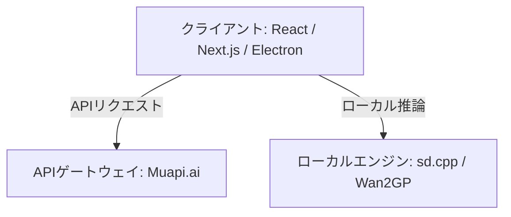

# **Open Generative AI 調査レポート**

## **1. 基本情報**

* **ツール名**: Open Generative AI
* **ツールの読み方**: オープン ジェネレーティブ エーアイ
* **開発元**: Anil-matcha
* **公式サイト**: [https://dev.muapi.ai/open-generative-ai](https://dev.muapi.ai/open-generative-ai)
* **関連リンク**:
  * GitHub: [https://github.com/Anil-matcha/Open-Generative-AI](https://github.com/Anil-matcha/Open-Generative-AI)
* **カテゴリ**: クリエイティブツール
* **概要**: オープンソースで提供される、AI画像・動画生成プラットフォーム。コンテンツフィルターやプロンプト拒否などの制限がなく、200以上の最新AIモデルを利用できる。

## **2. 目的と主な利用シーン**

* **解決する課題**: 既存のAI動画プラットフォームに存在するコンテンツフィルターやサブスクリプション料金、クローズドなエコシステムといった制約からの解放。
* **想定利用者**: クリエイター、開発者、AI愛好家
* **利用シーン**:
  * AIを用いた自由な画像および動画コンテンツの生成。
  * ローカル環境や自社サーバーでの生成プラットフォームのホスティング。
  * ワークフロースタジオを利用したマルチステップのAIパイプライン構築。

## **3. 主要機能**

* **Image Studio**: 50以上のText-to-Imageモデルと55以上のImage-to-Imageモデルを利用して画像を生成。
* **Video Studio**: 40以上のText-to-Videoモデルと60以上のImage-to-Videoモデルを利用して動画を生成。
* **Audio Studio**: 専用の音声生成タブ。
* **Lip Sync Studio**: 音声ファイルを用いて、人物画像や既存の動画からリップシンク（口パク）動画を生成する9つの専用モデルを搭載。
* **Cinema Studio**: レンズ、焦点距離、絞りなどのプロ仕様のカメラコントロールを使用して写実的なシネマティックショットを生成。
* **Workflow Studio**: ノードベースのエディタで画像、動画、音声モデルを繋げたパイプラインを視覚的に構築・実行。
* **マルチイメージ入力**: Nano Banana 2 Editなどの対応モデルで最大14枚の参照画像を入力可能。
* **Vibe Motion**: 新しいモーションエフェクト機能。
* **Clipping**: 動画切り抜きワークフロー。
* **Design Agent**: AIデザインアシスタント統合。
* **ローカル推論**: デスクトップアプリ限定で、sd.cppやWan2GPを使用したローカルでのモデル実行に対応。

## **4. 動作原理・システム構成**

<!--
【ガイドライン】
- ツールの動作原理、システム構成（アーキテクチャ）、データの流れ、通信フローなどを記述
- クライアント・サーバー型、ローカルファースト、クラウド完結など、ツールのアーキテクチャ特性を明記
- 可能であればMermaidによる構成図やフロー図を含めること（Mermaid内のノードや説明テキストは原則日本語表記で作成する）
- 要素技術や内部で使われている仕組み（例：Docker、Git worktree、WebSockets、E2EEなど）を解説
- SaaS等の場合はわかる範囲で記述し、公開されていない場合は「非公開」とし、分かる範囲の処理フロー等を記載
-->

* **アーキテクチャ**: デスクトップアプリ(Electron)またはWebアプリ(React/Next.js)から、クラウドのAPIゲートウェイ（Muapi.ai）またはローカル推論エンジンへ接続するハイブリッド構成。
* **主要コンポーネントとデータフロー**:
  * ブラウザのlocalStorageにAPIキーを保存し、クライアントから直接Muapi.aiのAPIへリクエストを送信。
  * デスクトップアプリでローカルモデルを実行する場合、内蔵の `sd.cpp` や別途立てた `Wan2GP` サーバーへリクエストをルーティング。
* **特筆すべき要素技術**:
  * ローカル推論エンジン (`sd.cpp`, `Wan2GP`) の使い分け
  * Node.js/Electron を用いたクロスプラットフォームデスクトップアプリ



## **5. 開始手順・セットアップ**

* **前提条件**:
  * Web版を利用する場合はアカウント登録のみ（インストール不要）。
  * デスクトップアプリを使用する場合は各OSのインストーラーを利用（Node.js不要）。
  * 開発する場合はNode.js (v18+) とMuapi.aiのAPIキーが必要。
* **インストール/導入**:

  ```bash
  # 開発用セットアップ（リポジトリのクローンとサブモジュールの取得）
  git clone --recurse-submodules https://github.com/Anil-matcha/Open-Generative-AI.git
  cd Open-Generative-AI

  # 依存関係のインストールとビルド
  npm run setup
  ```

* **初期設定**:
  * デスクトップアプリ初回起動時、または開発サーバー起動時にMuapi.aiのAPIキーを入力（ローカルモデルのみを使用する場合はスキップ可能）。
* **クイックスタート**:
  * 開発用デスクトップアプリの起動: `npm run electron:dev`
  * 開発用Web版の起動: `npm run dev` (<http://localhost:3000> にアクセス)

## **6. 特徴・強み (Pros)**

* コンテンツフィルターやプロンプト拒否がなく、完全な創造的自由が保証されている点。
* オープンソースであり、サブスクリプション費用やベンダーロックインが発生しない点。
* Flux、Midjourney、Kling、Sora、Veoなど、200以上の最新のオープンおよび商用モデルを利用可能な点。

## **7. 弱み・注意点 (Cons)**

* ローカル推論（特に動画モデルや大規模モデル）を実行するには、CUDAまたはROCm対応のGPUを搭載した高性能なPCが必要。
* デスクトップ版のインストーラーがコード署名されていないため、macOSやWindowsで初回起動時にセキュリティ警告が表示される。
* 日本語UIの提供については明記されておらず、プロンプトの入力なども基本的には英語が中心となる可能性がある。

## **8. 料金プラン**

| プラン名 | 料金 | 主な特徴 |
|---------|------|---------|
| **オープンソース版** | 無料 | すべての機能を利用可能。デスクトップアプリでのローカル推論やセルフホストが可能。 |
| **Webホスト版** | 無料 | Muapi.ai上にホストされたバージョン。ブラウザから直接すべてのスタジオ機能を利用可能。 |

* **課金体系**: クラウド上のAPI（Muapi.aiなど）を利用する場合は、そちらのサービスの利用料に従う。ローカルで推論する場合は完全無料。
* **無料トライアル**: -

## **9. 導入実績・事例**

* **導入企業**: 個人開発およびオープンソースプロジェクトのため、公開されているエンタープライズ導入事例はない。
* **導入事例**: AI動画生成を自由に行いたい個人のクリエイターや、独自のパイプラインを構築したい開発者に利用されている。
* **対象業界**: エンターテインメント、クリエイティブ制作、ソフトウェア開発。

## **10. サポート体制**

* **ドキュメント**: GitHubのREADMEにて、詳細なインストール手順やアーキテクチャが解説されている。
* **コミュニティ**: DiscordサーバーおよびRedditコミュニティ(r/muapi)が存在し、ディスカッションやサポートが行われている。
* **公式サポート**: オープンソースプロジェクトのため、専任の公式サポート窓口はなく、GitHubのIssueを通じて対応される。

## **11. エコシステムと連携**

### **11.1 API・外部サービス連携**

* **API**: 内部的にMuapi.aiのAPIゲートウェイと連携しており、モデルの実行を管理している。
* **外部サービス連携**: Muapi.ai、Hugging Faceモデルなどと連携可能。

### **11.2 技術スタックとの相性**

| 技術スタック | 相性 | メリット・推奨理由 | 懸念点・注意点 |
|:---|:---:|:---|:---|
| **Next.js (App Router)** | ◎ | 公式の実装がNext.jsで構築されており、コンポーネントライブラリをそのまま利用可能 | 特になし |
| **Electron** | ◎ | 公式のデスクトップアプリがElectronで提供されており、ローカル実行の実績がある | 特になし |
| **React** | ◎ | `packages/studio` が共有のReactコンポーネントとして提供されている | 特になし |

## **12. セキュリティとコンプライアンス**

* **認証**: ブラウザの `localStorage` にAPIキーを保存する方式を採用しており、Muapi.ai以外のサーバーには送信されない。
* **データ管理**: セルフホストやデスクトップアプリを使用した場合、アップロードした画像や生成データはローカルに保存される。
* **準拠規格**: オープンソースソフトウェアであり、ISO27001やSOC2などの特定のコンプライアンス認証は取得していない。

## **13. 操作性 (UI/UX) と学習コスト**

* **UI/UX**: ダークテーマのグラスモーフィズムUIを採用しており、レスポンシブデザインでデスクトップとモバイルの両方で動作する。直感的なインターフェースを提供。
* **学習コスト**: 基本的な画像生成・動画生成は直感的に行えるため学習コストは低いが、ワークフロースタジオで複雑なパイプラインを構築する場合やローカル推論環境を自前で構築する場合は、ある程度の技術的知識が必要となる。

## **14. ベストプラクティス**

* **効果的な活用法 (Modern Practices)**:
  * GPU搭載のLinuxやWindowsマシンでWan2GPサーバーを立ち上げ、Macのデスクトップアプリからリモートサーバーとして接続して高負荷なモデルを実行する構成。
  * `Vibe Workflow` などの関連プロジェクトと組み合わせて、自動メディア生成パイプラインを構築する。
* **陥りやすい罠 (Antipatterns)**:
  * メモリが8GBしかないMacでZ-Imageなどの大規模モデルをローカルで動かそうとすると、システムがフリーズする可能性があるため、SD 1.5などの軽量モデルを選択すること。

## **15. ユーザーの声（レビュー分析）**

* **調査対象**: G2、Capterra、ITreviewにレビューの登録なし（GitHubスター数は14.2k以上）。
* **総合評価**: 不明
* **ポジティブな評価**:
  * オープンソースで無料でありながら、多種多様なモデルにアクセスできる点が評価されている。（GitHubコミュニティなどでの反響より）
  * コンテンツ制限がないため、自由にプロンプトを試すことができる。
* **ネガティブな評価 / 改善要望**:
  * ローカル推論のセットアップ（特にWan2GPなどの別途サーバーを立てる構成）が初心者にはやや複雑。
  * デスクトップアプリ起動時のセキュリティ警告の回避手順が面倒。
* **特徴的なユースケース**:
  * クラウド上のGPUインスタンス（RunPodなど）でWan2GPを動かし、手元のPCから快適に生成を行う。

## **16. 直近半年のアップデート情報**

* **2026-05-23**: Audio Studio, Vibe Motion, Clipping, Design Agent & more (v2.0.0)
* **2026-05-11**: Wan2GP end-frame upload skips API-key prompt (v1.0.11)
* **2026-05-01**: Lipsync Infinite Talk null-prompt fix (v1.0.10)
* **2026-04-27**: Local Wan2GP video generation (v1.0.9)
* **2026-04-27**: Windows build restored (Tailwind v3 revert) (v1.0.8)
* **2026-04-25**: Wan2GP local engine + Dreamshaper URL fix (v1.0.7)

(出典: [GitHub Releases](https://github.com/Anil-matcha/Open-Generative-AI/releases))

## **17. 類似ツールとの比較**

### **17.1 機能比較表 (星取表)**

| 機能カテゴリ | 機能項目 | 本ツール | Stable Diffusion | Luma AI | Seavid AI |
|:---:|:---|:---:|:---:|:---:|:---:|
| **基本機能** | 画像生成 | ◎<br><small>50以上のモデル</small> | ◎<br><small>高品質な生成</small> | ×<br><small>非対応</small> | ◎<br><small>画像生成対応</small> |
| **カテゴリ特定** | 動画生成 | ◎<br><small>40以上のモデル</small> | ×<br><small>非対応</small> | ◎<br><small>Dream Machine</small> | ◎<br><small>複数モデル対応</small> |
| **カテゴリ特定** | 複数モデルの利用 | ◎<br><small>200以上のモデルを選択可</small> | ×<br><small>自社モデルのみ</small> | ×<br><small>自社モデル中心</small> | ◎<br><small>複数ベンダー統合</small> |
| **非機能要件** | オープンソース | ◎<br><small>MITライセンス</small> | ◎<br><small>オープンウェイト</small> | ×<br><small>プロプライエタリ</small> | ×<br><small>プロプライエタリ</small> |
| **非機能要件** | コンテンツフィルター | ◎<br><small>制限なし</small> | △<br><small>制限あり</small> | △<br><small>制限あり</small> | △<br><small>制限あり</small> |

### **17.2 詳細比較**

| ツール名 | 特徴 | 強み | 弱み | 選択肢となるケース |
|---------|------|------|------|------------------|
| **本ツール** | 200種以上のモデルを束ねるオープンソースのプラットフォーム | コンテンツ制限がなく、多様なモデルを1つのUIで利用可能 | ローカル実行時の環境構築ハードルが高い | 様々なモデルを制限なく試したい場合や、独自の生成パイプラインを構築したい場合 |
| **Stable Diffusion** | テキストプロンプトから高品質な画像を生成できる、オープンウェイトの画像生成AIモデル | 圧倒的な芸術性とプロンプトへの追従性 | 動画生成機能がない | 最高品質の静止画像だけを生成したい場合 |
| **Luma AI** | テキストや画像から高品質な動画や3Dモデルを生成するAIプラットフォーム | 独自の強力な動画生成モデル(Dream Machine) | 画像生成機能がない、自社モデルのみ | 映像制作業務で高品質な動画を効率的に生成・編集したい場合 |
| **Seavid AI** | 複数の最新AIモデルを統合し、画像・動画生成ツールを提供するオールインワンプラットフォーム | リアルで自然な動きの動画生成に強み、複数モデル対応 | プロンプトや生成可能なコンテンツに制限がある | 様々なベンダーのモデルを利用して画像や動画を生成したい場合 |

## **18. 総評**

* **総合的な評価**:
  * Open Generative AIは、既存の商用AIプラットフォームの制約（コンテンツフィルターや高額な利用料、単一モデルへの依存）を排除し、クリエイターに完全な自由を提供する非常に強力なオープンソースツールである。単一のUIで画像、動画、リップシンクなど200以上の最新モデルにアクセスできる点は他に類を見ない。
* **推奨されるチームやプロジェクト**:
  * AIを用いた実験的なコンテンツ制作を行う個人のクリエイター。
  * 自社サービスにAI画像・動画生成機能を組み込みたい開発チーム。
  * ローカル環境でのデータプライバシーを重視するプロジェクト。
* **選択時のポイント**:
  * 既存の特定の商用モデル（例：Runwayの特定機能）だけを使いたい場合は商用サービスの方が手軽だが、様々なモデルを比較・組み合わせて自由なコンテンツ生成を行いたい場合、あるいはAPI呼び出しを自動化してワークフローを構築したい場合には、本ツールが最適な選択肢となる。
