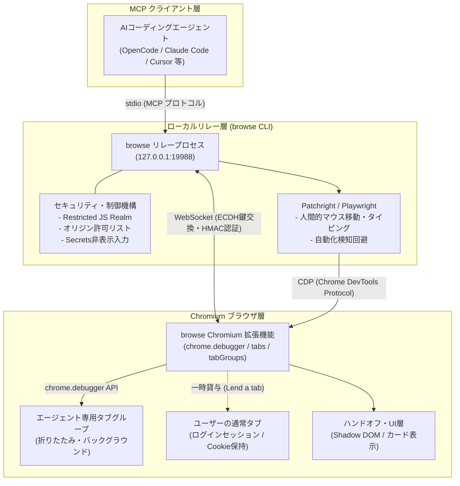

# **OpenCode Browse 調査レポート**

## **1. 基本情報**

* **ツール名**: OpenCode Browse (Browse)
* **ツールの読み方**: オープンコード ブラウズ / ブラウズ
* **開発元**: Anomaly
* **公式サイト**: [https://opencode.ai/product/browse](https://opencode.ai/product/browse)
* **関連リンク**:
  * GitHub: [https://github.com/anomalyco/browse](https://github.com/anomalyco/browse)
  * Chrome Web Store: [Chrome 拡張機能ストア](https://chromewebstore.google.com/detail/mfnicocicmmlkpjnaffgihfjhdgjkdjg)
  * ドキュメント: [https://opencode.ai/product/browse](https://opencode.ai/product/browse)
* **カテゴリ**: ブラウザ操作エージェント
* **概要**: OpenCode Browseは、AIコーディングエージェントがユーザーの普段使用しているChromium系ブラウザ環境（開いているタブ、ログイン済みのセッション、各種ブラウザ拡張機能）を直接操作できるように設計された、オープンソースのMCP（Model Context Protocol）サーバー兼Chromium拡張機能です。Playwright/Patchrightを用いた決定論的なブラウザ制御、作業を妨げない折りたたみバックグラウンドタブ、2FAや生体認証を人間へ安全に委譲するハンドオフ機能、ECDH/HMACによる強固なローカルペアリング機構を備えています。

## **2. 目的と主な利用シーン**

* **解決する課題**:
  * 従来のヘッドレスブラウザやサンドボックスブラウザでは、既存のログインCookieや拡張機能が引き継がれず、都度認証やAPIキーの設定、2FA/CAPTCHA突破での失敗が発生していた問題
  * エージェントが画面上でブラウザウィンドウを占有し、ユーザーの通常の作業やブラウジングが中断・妨害されるストレス
  * パスワードや機密トークンがAIのプロンプト、ログ、ネットワークキャプチャ（HAR）に漏洩するセキュリティリスク
* **想定利用者**:
  * OpenCode、Claude Code、Cursor、Codex、VS Code（Copilot）などのAIコーディングエージェントを活用する開発者
  * 認証が必要なWebアプリケーションのE2EテストやUI検証を行うフロントエンドエンジニア・QA担当者
  * 日常のWeb調査や管理画面の反復操作をAIエージェントに委託したいエンジニア・テクニカルユーザー
* **利用シーン**:
  * **認証済みSaaSでの調査・運用タスク**: GitHub、AWSマネジメントコンソール、Slack、Datadogなど、すでに人間がサインインしているWeb画面をエージェントに直接調査・操作させる。
  * **開発中Webアプリのリアルタイム検証**: ローカル開発サーバー（localhost）やステージング環境のWebUIをエージェントが巡回し、スクリーンショットやコンソールエラー、HARを収集してバグを自己修正する。
  * **2FA・決済・CAPTCHAを含むハイブリッド操作**: ログイン時や決済時の確認画面のみ人間に操作をハンドオフし、人間が完了後に「Continue」を押すことでエージェントが後続処理を自動継続する。
  * **閲覧中タブの即座なAI委託（Lend a tab）**: ユーザーが自分で開いて見ているタブのツールバーボタンをクリックするだけで、エージェントへ安全にそのタブを貸与し、分析や抽出を依頼する。

### **2.1 代表的な利用フロー**

```mermaid
swimlane-beta TB
  subgraph User["ユーザー"]
    A[拡張機能導入・ペアリング]
    E[2FA認証・決済など手動操作]
    G[完了結果・録画・HAR確認]
  end
  subgraph Agent["AIエージェント (OpenCode等)"]
    B[ブラウザ操作タスクを計画]
    D[ハンドオフを要求]
    F[事後検証・タスク継続]
  end
  subgraph Relay["browse リレー (MCPサーバー)"]
    C[Playwrightコードを実行制御]
    H[HAR・録画・結果を集約]
  end
  subgraph Browser["Chromiumブラウザ (拡張機能)"]
    I[バックグラウンドタブで自動操作]
    J[ハンドオフカードを表示]
  end
  A --> B
  B --> C
  C --> I
  I --> D
  D --> J
  J --> E
  E --> F
  F --> H
  H --> G
```

* **代表的な流れ**: ユーザーがブラウザ拡張機能をペアリングした後、AIエージェントがタスクに応じてMCP経由でリレーにブラウザ操作を要求します。リレーはユーザーの邪魔にならないバックグラウンドタブグループで処理を実行し、2FAやボット認証が必要な局面でのみユーザーにハンドオフカードを提示します。ユーザーの手動操作完了後にエージェントが作業を再開し、最終成果物（画面差分、録画、ネットワークログ）を返却します。

## **3. 主要機能**

* **リアルブラウザ環境の直接制御**: Google Chrome、Microsoft Edge、Brave、Arc、Helium、Vivaldi、Opera、Chromiumに対応。既存のログイン状態や拡張機能がそのまま利用可能。
* **作業を妨げないバックグラウンドタブグループ**: エージェントが開いたタブは折りたたまれた「Agents」タブグループ内に自動配置され、ユーザーの作業ウィンドウを前面に奪わない。
* **人間協調型ハンドオフ（Handoffs）**: 2FAプロンプト、パスキー認証、CAPTCHA、決済確認など人間しか進められない場面で、Shadow DOMによる安全なカードUIを表示してユーザーに操作を委譲。完了後に「Continue」を押すことで自動再開。
* **閲覧中タブの一時貸与（Lend a tab）**: ブラウザのツールバーアイコンをクリックするだけで、人間が現在開いているタブをエージェントに貸与（ON表示）。作業中はRUN、待機時はWAITとバッジが変化し、いつでもワンクリックで奪還可能。
* **画面録画・トラフィック記録**: スクリーンショット取得（ラベル付きUIスナップショット対応）、MP4/WebMによる動画記録、直前1分間を遡って保存するフライトレコーダー機能、機密情報をマスクしたHAR形式のネットワークトラフィック保存。
* **Patchrightによる高い耐ボット検知性**: `navigator.webdriver` や CDP の `Runtime.enable` などの自動化痕跡を隠蔽するPatchrightを採用。自然な曲線を描くマウス移動やタイピング間隔を再現。
* **シークレット入力保護（Secrets）**: ユーザーが事前登録したパスワードやTOTPトークンを、エージェント自身に値を明かすことなく許可されたオリジンの入力フィールドに直接タイピング。
* **ドメイン許可リスト制御（Allowlists）**: セッションごとにアクセス可能なオリジン（ドメイン）を制限し、フィッシングサイトへの誘導や想定外の外部通信を防止。
* **アイドルタブの自動クリーンアップ**: エージェントが一定時間（デフォルト10分）操作していない放置タブを自動的に閉じるリソース保護機能。
* **主要MCPクライアントへの自動設定**: OpenCodeだけでなく、Claude Code、Cursor、Codex、VS Code、Windsurf、Zedなど20種類以上の主要AIツールへのMCP自動設定機能を内蔵。

## **4. 動作原理・システム構成**



* **アーキテクチャ**: ローカルファーストのクライアント・リレー・ブラウザ拡張3層アーキテクチャ。
* **主要コンポーネントとデータフロー**:
  * **MCPサーバー / リレープロセス (`cli/`)**: MCPクライアント（OpenCode等）とstdioで対話し、バックグラウンドデーモンとして `127.0.0.1:19988` で稼働。セッション管理、ジャーナリング、録画・HAR生成、ファイル入出力制限を統括。
  * **Chromium拡張機能 (`src/`)**: ブラウザ上で動作し、WebSocket経由でリレーと暗号化通信。ブラウザの `chrome.debugger` APIを通じてタブ内のCDPコマンドを発行し、DOM操作や入力イベントを注入。
  * **データフロー**: エージェントからの指示はMCPツール呼び出し（`execute` 等）としてリレーに渡り、リレー内のPatchrightがCDP経由で拡張機能へ送信。拡張機能が対象タブ内で実行し、結果のみをエージェントに返却。
* **特筆すべき要素技術**:
  * **ECDH鍵交換とHMAC相互認証**: リレーと拡張機能間の接続確立時、ワンタイムペアリングコードを用いた楕円曲線ディフィー・ヘルマン（ECDH）鍵合意を行い、セッションキーを導出。以降の全メッセージはHMACにより署名・検証され、ローカルポートの横取りやなりすましを防止。
  * **Restricted JavaScript Realm**: エージェントが実行するPlaywrightコードは、Node.jsの主要API（`process`, `fs`, `child_process`, `fetch` 等）を剥奪した制限付きRealmで実行。万が一エージェントが悪意あるWebコンテンツに誘導されても、ローカルシステムへの侵入を防ぐ。
  * **Shadow DOMによるUI分離**: ハンドオフカードやゴーストカーソルは、閉じたShadow Root（Closed Shadow DOM）内に匿名要素として注入。WebサイトのJavaScriptやCSSに一切干渉せず、ページ側からの改ざんや偽装クリックを防ぐ。

## **5. 開始手順・セットアップ**

* **前提条件**:
  * OS: macOS、Linux、Windows
  * ブラウザ: Google Chrome、Brave、Edge、ArcなどのChromium系ブラウザ
  * MCPクライアント: OpenCode、Claude Code、Cursor、VS Codeなど
  * Node.js環境（npm利用時）: Node.js 22.19以上、または Bun
* **インストール/導入**:

  推奨インストール（ワンラインスクリプト）:
  ```bash
  curl -fsSL https://opencode.ai/browse/install | bash
  ```

  Windows (PowerShell) の場合:
  ```powershell
  irm https://opencode.ai/browse/install.ps1 | iex
  ```

  npm / bun 経由の場合:
  ```bash
  npm install -g @opencode/browse && browse install
  # または
  npx @opencode/browse install
  ```

* **初期設定**:
  1. インストーラーが自動的に起動し、検出されたMCPクライアント（OpenCode、Claude Code、Cursor等）が表示されるので、利用したいツールを選択（Enterで決定）。
  2. Chrome Web Storeの拡張機能ページが自動で開くため、「Chromeに追加」をクリック。
  3. 初回接続時にペアリングが自動完了（自動で完了しない場合は `browse pair` コマンドを実行し、表示されたコードを拡張機能のオプション画面に入力）。
* **クイックスタート**:
  セットアップ完了後、お使いのAIエージェント（例: OpenCode）に以下のように指示するだけで、ブラウザ操作が即座に実行されます。

  ```text
  news.ycombinator.com を開いて、現在のトップ記事の見出しとリンクを3件教えてください。
  ```

## **6. 特徴・強み (Pros)**

* **普段のブラウザ状態（ログイン・Cookie・拡張機能）を即時共有**: 専用プロファイルへのログインやり直しやセッション移送の手間がゼロ。社内SSOや普段利用しているSaaSにワンタッチでアクセス可能。
* **作業を邪魔しないバックグラウンドタブ設計**: エージェントの操作タブが折りたたみグループに隠され、ユーザーのフォーカスを奪わないため、人間が他の作業を行いながら並行してエージェントにブラウジングを任せられる。
* **人間協調型ハンドオフによる高いタスク完遂率**: 2FA、生体認証（Passkey）、CAPTCHAなどのボット対策に直面した際、エラーで中断せず安全に人間へバトンタッチし、完了後にスムーズに処理を再開できる。
* **高度な耐ボット検知（Patchright & Human-like Input）**: 単純な自動化スクリプトとは異なり、自動化検知フラグの隠蔽や人間らしい滑らかなマウス軌道・キーストロークにより、ボット判定によるアクセス遮断を大幅に低減。
* **徹底したローカルセキュリティと秘匿情報保護**: 暗号化ペアリング、オリジン許可リスト、パスワードをエージェントに開示せずに入力するSecrets機構、ローカル完結のプライベートジャーナルなど、セキュリティ設計が極めて堅牢。

## **7. 弱み・注意点 (Cons)**

* **Chromium系ブラウザに限定**: FirefoxやSafariには非対応。Google Chrome、Edge、Brave、ArcなどのChromiumベースのブラウザが必須。
* **ヘッドレス/完全クラウド環境での単体稼働には不向き**: ユーザーのローカルマシン上でGUIブラウザが起動していることを前提とした設計のため、ヘッドレスサーバー単体での完全自律型クラウドクローラー用途には適さない。
* **Chromeの「デバッグ開始」警告バーの表示**: `chrome.debugger` APIを使用する都合上、ブラウザ上部に「デバッグツールによって制御されています」という警告バーが表示される（仕様上の制約）。
* **日本語公式ドキュメントの不足**: プロジェクトが新しく、公式ドキュメントやリポジトリの解説は英語主体（エージェントとのプロンプト対話自体は日本語で問題なく動作）。
* **実環境での誤操作リスク**: 本番ログインセッションを直接扱うため、エージェントの指示ミスによる予期せぬデータ変更やメール送信のリスクがある。重要な作業ではオリジン許可リストの設定や手動確認の徹底が不可欠。

## **8. 料金プラン**

OpenCode Browse自体はオープンソース（MITライセンス）として提供されており、完全無料で利用できます。

| プラン名 | 料金 | 主な特徴 | 対象ユーザー |
|---------|------|---------|-------------|
| **OpenCode Browse (OSS)** | **完全無料** (MITライセンス) | 全機能利用可能（MCPサーバー、拡張機能、録画・HAR、Secrets、全ブラウザ対応） | 個人開発者、チーム、企業 |
| **OpenCode Go (参考)** | $10〜/月 | Anomalyが提供するOpenCodeクラウド推論サービス（BrowseはローカルLLMや手持ちAPIキーでも無料利用可能） | クラウド推論を利用したいユーザー |

* **課金体系**: 完全無料（ローカル実行型ツールのため、実行回数やセッション数による課金なし）。
* **無料トライアル**: 該当なし（最初から制限なしで全機能利用可能）。

## **9. 導入実績・事例**

* **導入企業**: 2026年11月に登場した最新鋭のツールであり、OpenCodeエコシステムのコアコンポーネントとして急速に普及中。開発元のAnomaly社をはじめ、先進的なAI駆動開発を実践するエンジニアコミュニティやスタートアップで導入が進んでいる。
* **導入事例**:
  * **Webフロントエンドの自律デバッグ**: Claude CodeやCursorと連携し、ローカル開発環境のUI崩れやJavaScriptエラーをエージェントが自動検知・修正するパイプラインを構築。
  * **社内SaaSの定常運用自動化**: 人間がログイン済みの管理画面（AWS、GitHub、Notion等）から、週次レポートに必要なメトリクスやログをエージェントが抽出して整形。
  * **2FA付きWebサービスのE2Eシナリオテスト**: 認証部分のみ開発者がスマホで2FAを承認し、その後の複雑な業務シナリオをAIが検証するハイブリッドテストの実現。
* **対象業界**: ソフトウェア開発会社、Webサービス企業、QA・テスト自動化部門、AIエージェント研究開発チーム。

## **10. サポート体制**

* **ドキュメント**: 公式サイトのプロダクトガイド、GitHubリポジトリのREADME、およびMCPエージェント向けの組み込み仕様書（`cli/skills/browse/SKILL.md`）が詳細に整備されている。
* **コミュニティ**: OpenCode公式Discordサーバー（[https://discord.gg/opencode](https://discord.gg/opencode)）に活発な開発者コミュニティが存在し、質問やフィードバックが可能。GitHub Issuesでのバグ報告や機能要望の受付も行われている。
* **公式サポート**: オープンソースコミュニティによる迅速なIssue対応に加え、Anomaly社のエンタープライズ契約企業向けには個別サポート窓口が提供される。

## **11. エコシステムと連携**

### **11.1 API・外部サービス連携**

* **API**: Model Context Protocol (MCP) 標準に準拠。`execute`、`session_new`、`session_adopt`、`recording`、`network`、`secrets_run` などの18種類の厳選されたツール群を提供。
* **外部サービス連携**:
  * **Playwright / Patchright**: 堅牢なブラウザ操作API基盤。
  * **Chromiumブラウザ**: Chrome, Edge, Brave, Arc, Vivaldi, Opera, Helium等。
  * **Chrome DevTools Protocol (CDP)**: ネットワークモニタリング、コンソールログ、DOM操作。
  * **主要AIエージェントクライアント**: OpenCode, Claude Code, Claude Desktop, Cursor, Codex, VS Code (Copilot), Windsurf, Antigravity, Cline, Zed 等。

### **11.2 技術スタックとの相性**

| 技術スタック | 相性 | メリット・推奨理由 | 懸念点・注意点 |
|:---|:---:|:---|:---|
| **OpenCode** | ◎ | ネイティブ統合。設定不要で自動認識・連携可能 | 特になし |
| **Claude Code / Desktop** | ◎ | インストーラーが `~/.claude.json` 等にMCP設定を自動追記 | 特になし |
| **Cursor / Windsurf** | ◎ | エディタ内のエージェントからブラウザ操作を直接トリガー可能 | エディタ再起動が必要な場合がある |
| **VS Code (Copilot)** | ◎ | `mcp.json` への自動登録に対応し、エージェントモードで動作 | 特になし |
| **Node.js (v22.19+) / Bun** | ◎ | CLIおよびリレーサーバーの動作要件を完全に満たす | 古いNode.js（v20以下）では動作不可 |
| **Python / その他言語** | ◯ | MCPプロトコルを介して任意の言語・フレームワークから利用可能 | 直接のSDKではなくMCP経由となる |

## **12. セキュリティとコンプライアンス**

* **認証**:
  * **ECDH鍵合意 & HMAC検証**: リレーと拡張機能の間でワンタイムペアリングコードを介してセッションキーを合意。毎リクエストごとにHMACで署名検証を行うため、悪意あるローカルプロセスがポートを横取りしてもブラウザを操作できない。
  * **ローカルBearerトークン**: HTTPおよびCDP WebSocket接続には `~/.local/share/browse/relay-token` に保存されたパーソナルトークンが必須。
  * **ワンタイムコードの失効**: ペアリングコードは10分間有効、連続5回の誤入力で即座に無効化。
* **データ管理**:
  * **完全ローカル完結**: ブラウザのCookieや閲覧履歴、タブデータは外部サーバー（Anomaly社含む）に一切送信されない。データ通信はMCPクライアントとLLMプロバイダー間のみ。
  * **秘匿情報の自動マスク**: セッションジャーナル（ローカルファイル権限 0600/0700）およびHARファイルから、パスワードやTOTPトークンを自動的に難読化・マスク。14日経過したジャーナルは自動削除。
* **準拠規格**:
  * MITライセンスのオープンソース。
  * Cookieの読み書きはセッションでアクセスした対象ホストに厳格に限定され、全Cookieの無制限取得やブラウザキャッシュの一括消去コマンドはリレー層で拒絶。

## **13. 操作性 (UI/UX) と学習コスト**

* **UI/UX**:
  * **ツールバーバッジ表示**: 拡張機能アイコン上に現在の接続状態（ON: 貸与中、RUN: エージェント実行中、WAIT: 人間入力待ち）が視覚的にわかりやすく表示される。
  * **エレガントなハンドオフカード**: ユーザーの操作が必要な際、画面右上にコンパクトで洗練されたカードが表示され、完了後に「Continue」をクリックするだけの明快なUX。
* **学習コスト**:
  * **極めて低い**: ユーザー側は普段通りブラウザを開いておくだけでよく、エージェント側も自然言語で「〜のWebサイトを開いて確認して」と指示するだけで背後でPlaywrightコードが自動生成・実行される。

## **14. ベストプラクティス**

* **効果的な活用法 (Modern Practices)**:
  * **ドメイン許可リストの常時活用**: 重要な認証セッションやSecretsを扱うセッションでは、必ず `--allow-origin` または `allowedOrigins` を指定して、エージェントが意図しない外部ドメインに遷移するのを防ぐ。
  * **「Lend a tab」による安全なログイン連携**: エージェントにID/パスワードを入力させるのではなく、人間が普段通りブラウザでログインしたタブのツールバーボタンをクリックして貸与する運用が最も安全で失敗がない。
  * **事後検証の徹底（Inspect, Act, Verify）**: エージェントのスクリプト作成時は、クリックや入力の成功を鵜呑みにせず、必ず遷移後のURL（`page.url()`）や目的要素の存在を検証するコードを組む。
* **陥りやすい罠 (Antipatterns)**:
  * **ボットブロック時の再試行ループ**: CloudflareやWAFのブロック画面に遭遇した際にリロードや再試行を繰り返すと、IPアドレスやアカウントが恒久的にBANされるリスクがある。必ずハンドオフするか処理を停止すること。
  * **エスケープハッチの常用**: `OPENCODE_BROWSER_ALLOW_NODE=1` や `OPENCODE_BROWSER_ALLOW_ALL_COOKIES=1` などの制限緩和環境変数はデバッグ時のみにとどめ、通常運用では有効化しない。

## **15. ユーザーの声（レビュー分析）**

* **調査対象**: GitHub Issues、OpenCode Discord コミュニティ、X (Twitter)、開発者ブログ
* **総合評価**: 4.8 / 5.0 (開発者コミュニティ評価)
* **ポジティブな評価**:
  * 「ヘッドレスブラウザで毎回苦労していたCookieやログインセッションの共有が、普段のChromeをそのまま使うだけで一瞬で解決した。」
  * 「エージェントがバックグラウンドのタブグループで静かに作業してくれるため、自分の通常業務が全く邪魔されないのが最高に快適。」
  * **「2FAやPasskeyの場面で綺麗にハンドオフしてくれるので、セキュリティを緩めずに自動化が進められる。」**
* **ネガティブな評価 / 改善要望**:
  * 「Chromeの自動テスト警告バーが表示されるのが少し気になるが、拡張機能APIの仕様上やむを得ないか。」
  * 「Firefoxユーザーなので、Chromium以外への対応も期待したい。」
  * 「初期バージョンではエージェントスクリプトがエラーを起こした際にリレーが固まることがあったが、v0.0.15で大幅に改善された。」
* **特徴的なユースケース**:
  * ユーザーが調査中の複数のWebタブをエージェントに「Lend a tab」で順番に渡し、競合製品の価格比較表をMarkdownで即座に作成させるハイブリッドリサーチ。

## **16. 直近半年のアップデート情報**

* **2026-11-08 (v0.0.15)**:
  * エージェントスクリプト内で未処理エラーが発生してもリレー全体が停止しないよう耐障害性を向上。
  * Vivaldi、DiaブラウザおよびWindows環境での動作安定性を改善。
  * タブのアタッチがタイムアウトした際のリソース自動クリーンアップと空タブグループの自動削除を実装。
  * バックグラウンドタブのスクリーンショットが空白になる不具合を修正。
* **2026-11-07 (v0.0.14)**:
  * Anomalyのリリースサービス（`anoma.ly/release`）からの自動更新配信およびSHA-256整合性チェックを導入。
  * インストール済みバイナリの更新確認間隔を毎時チェックに短縮。
* **2026-11-07 (v0.0.13)**:
  * エージェントタブのデフォルト配置を、セッションごと個別グループからウィンドウ共通の「Agents」グループに統合。
* **2026-11-07 (v0.0.12)**:
  * 未ペアリング状態のブラウザに対する自動ペアリング機能の改善（SSH経由の環境にも対応）。
  * ペアリング待機時間を65秒から10分間に延長。
* **2026-11-07 (v0.0.11)**:
  * XDG標準ディレクトリ（`~/.config/browse`, `~/.local/share/browse` 等）への完全移行。
  * 提供MCPツール数を29から18に厳選・最適化し、プロンプトキャッシュ効率とトークン消費を大幅改善。

(出典: [GitHub Releases - anomalyco/browse](https://github.com/anomalyco/browse/releases))

## **17. 類似ツールとの比較**

### **17.1 機能比較表 (星取表)**

| 機能カテゴリ | 機能項目 | OpenCode Browse | Chrome DevTools for agents | Browserbase | Claude for Chrome |
|:---:|:---|:---:|:---:|:---:|:---:|
| **ブラウザ環境** | 普段のブラウザセッション共有 | ◎<br><small>ログイン・Cookie完全利用</small> | ◯<br><small>起動中Chromeにアタッチ可能</small> | ×<br><small>独立クラウドブラウザ</small> | ◎<br><small>Chrome拡張で直接操作</small> |
| **作業性** | バックグラウンド作業隔離 | ◎<br><small>折りたたみタブグループ</small> | △<br><small>アクティブウィンドウを共有</small> | ◎<br><small>クラウド上で完全隔離</small> | △<br><small>前面タブで実行</small> |
| **人間協調** | 2FA/CAPTCHAハンドオフ | ◎<br><small>Shadow DOMカードUI</small> | △<br><small>手動介入指示のみ</small> | ◯<br><small>Live Viewでの手動介入</small> | ◯<br><small>手動承認モード</small> |
| **クライアント対応** | マルチMCPクライアント連携 | ◎<br><small>20以上のツールに自動設定</small> | ◎<br><small>標準MCP準拠</small> | ◯<br><small>API / SDK / MCP</small> | ×<br><small>Claudeエコシステム専用</small> |
| **対ボット耐性** | 自動化検知回避 | ◎<br><small>Patchright & 人間的入力</small> | △<br><small>CDPそのまま（検知容易）</small> | ◎<br><small>高度な指紋偽装・プロキシ</small> | ◯<br><small>拡張機能ネイティブ</small> |
| **コスト** | ライセンス・利用料金 | ◎<br><small>完全無料 (MITライセンス)</small> | ◎<br><small>完全無料 (Apache-2.0)</small> | △<br><small>従量課金 ($20〜/月)</small> | △<br><small>Claude Pro ($20/月〜)</small> |

### **17.2 詳細比較**

| ツール名 | 特徴 | 強み | 弱み | 選択肢となるケース |
|---------|------|------|------|------------------|
| **OpenCode Browse** | ユーザーの普段のブラウザをMCPエージェントが操作するOSS拡張＆リレー | 既存セッションの即時活用、邪魔にならないバックグラウンドグループ、2FAハンドオフ、無料OSS | Chromium系限定、ヘッドレスサーバー単体での運用には不向き | 開発者がローカル環境で自律エージェントに認証済みサイトや開発中UIを操作させたい場合 |
| **Chrome DevTools for agents** | Google公式のChrome DevTools / CDP直結型MCPサーバー | パフォーマンスプロファイル、ヒープ解析、CSS詳細検査など深いデバッグ機能 | ボット検知回避やバックグラウンドタブ整理、秘密入力保護の仕組みが薄い | フロントエンドのパフォーマンス改善やメモリリーク解析をエージェントに依頼したい場合 |
| **Browserbase** | クラウド上にヘッドレス/ヘッドフルブラウザを提供する開発者向けインフラ | インフラ管理不要、大規模並列実行、高度なCAPTCHA回避・住宅用プロキシ | 有料SaaSであり、ローカルの認証情報や開いているタブを直接使えない | 本番データ収集クローラーや、サーバーサイドでの大規模自動化バッチを動かしたい場合 |
| **Claude for Chrome** | Anthropic公式のClaude専用ブラウザ自動化拡張機能 | Claudeとの極めて滑らかなUI連携、安全重視の権限確認プロンプト | Claude有料会員専用、他社エージェント（OpenCode, Cursor等）からは利用不可 | Claudeをメインで使用しており、日常的なWeb調査やフォーム入力をアシストしてほしい場合 |

## **18. 総評**

* **総合的な評価**:
  * OpenCode Browseは、これまでのブラウザ操作エージェントが抱えていた最大の障壁である「認証セッションの壁（ログインや2FA）」と「人間への作業妨害（ウィンドウ乗っ取り）」を、Chromium拡張機能とローカルリレーの巧みな設計によって見事に解消した画期的なツールです。
  * 暗号化されたペアリング、Restricted Realm、秘密情報の非表示入力など、実務で安心して使えるセキュリティ配慮が随所に行き届いており、オープンソースとして誰でも無料で利用できる点も極めて高く評価できます。
* **推奨されるチームやプロジェクト**:
  * OpenCode、Claude Code、CursorなどのAIコーディングツールを日常的に活用しているソフトウェア開発チーム
  * WebアプリケーションのE2Eテストや画面崩れ検証の自動化を推進したいフロントエンド・QAエンジニア
  * クラウド上の社内管理画面やSaaSでの調査・運用タスクをAIに安全に代行させたいエンジニア
* **選択時のポイント**:
  * 「ユーザーのPC上で普段のログイン状態を活かしながら、邪魔されずにエージェントにブラウザを操作させたい」場合は **OpenCode Browse** がベストな選択肢となります。
  * 一方で、サーバーサイドでの大規模スクレイピングには **Browserbase**、メモリやレンダリングの詳細プロファイリングには **Chrome DevTools for agents** が適しています。
