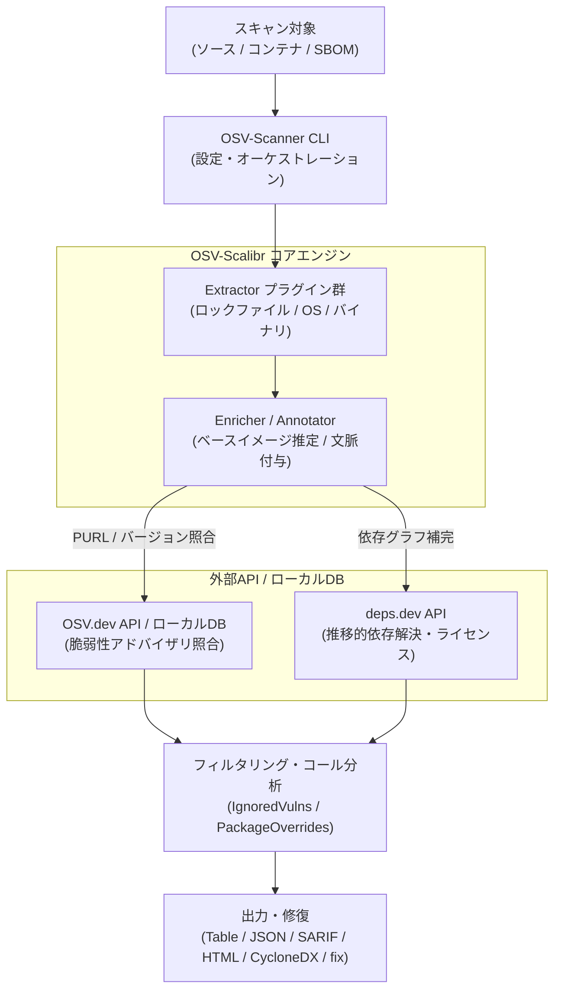

# **OSV-Scanner 調査レポート**

## **1. 基本情報**

* **ツール名**: OSV-Scanner
* **ツールの読み方**: オーエスブイスキャナー
* **開発元**: Google / OpenSSF
* **公式サイト**: [https://google.github.io/osv-scanner/](https://google.github.io/osv-scanner/)
* **関連リンク**:
  * GitHub: [https://github.com/google/osv-scanner](https://github.com/google/osv-scanner)
  * DeepWiki: [https://deepwiki.com/google/osv-scanner](https://deepwiki.com/google/osv-scanner)
  * CodeWiki: [https://codewiki.google/github.com/google/osv-scanner](https://codewiki.google/github.com/google/osv-scanner)
  * ドキュメント: [https://google.github.io/osv-scanner/](https://google.github.io/osv-scanner/)
* **カテゴリ**: SCA/OSS依存関係管理
* **概要**: OSV-Scannerは、プロジェクトの依存関係に含まれる既知の脆弱性を検出するオープンソースのセキュリティツールです。統合された解析エンジン「OSV-Scalibr」と高品質なOSV.devデータベースを活用し、誤検知を減らして実用的な警告と修復ガイダンスを提供します。

## **2. 目的と主な利用シーン**

* **解決する課題**: アプリケーションやコンテナ、SBOMの依存パッケージに含まれる既知の脆弱性の迅速かつ正確な特定と、修復作業の負担軽減。
* **想定利用者**: 開発者、セキュリティエンジニア、DevSecOpsチーム
* **利用シーン**:
  * CI/CDパイプライン（GitHub Actions等）でのソースコードやコンテナイメージの自動脆弱性スキャン。
  * ローカル環境での依存パッケージのセキュリティ監査、SBOM（CycloneDX / SPDX）生成・スキャン、ライセンス確認。
  * 脆弱性の修正計画の立案と自動修復（Guided Remediation）の適用。

### **2.1 代表的な利用フロー**

```mermaid
swimlane-beta TB
  subgraph User["ユーザー / CI"]
    A["スキャンコマンドを実行"]
    F["レポート確認・修復適用"]
  end
  subgraph Scanner["OSV-Scanner (CLI)"]
    B["設定ファイル読込・解析指示"]
    E["フィルタリング・出力整形"]
  end
  subgraph Scalibr["OSV-Scalibr (抽出エンジン)"]
    C["依存関係・コンテナ層を抽出"]
  end
  subgraph External["OSV.dev / deps.dev API"]
    D["脆弱性照合・依存解決"]
  end
  A --> B
  B --> C
  C --> D
  D --> E
  E --> F
```

* **代表的な流れ**: ユーザーまたはCIが `osv-scanner` コマンドを実行すると、OSV-Scannerが設定ファイル（`osv-scanner.toml`）を読み込み、内蔵の `osv-scalibr` エンジンにターゲット（ソースコードやコンテナイメージ）のパッケージ抽出を委譲します。抽出されたインベントリは `osv.dev` および `deps.dev` APIと照合され、コール分析や除外設定によるフィルタリングを経てTable・SARIF・CycloneDX・HTML形式で結果が返されます。

## **3. 主要機能**

* **ディレクトリの再帰的スキャン**: `package-lock.json`、`go.mod`、`pom.xml`、`Cargo.lock`、`bun.lock`、`.csproj`、`Package.resolved`（Swift）、`package_config.json`（Dart）など多様なマニフェストやロックファイルを検出し、依存関係の脆弱性を調査します。
* **コンテナイメージのレイヤー認識スキャン**: コンテナのベースイメージや含まれるOSパッケージ（Alpine、Debian、Ubuntu、Chisel、SUSE、Azure Linux等）をレイヤー単位で解析し、脆弱性を検出します。
* **コール分析（Call Analysis）**: GoやRust等のプロジェクトにおいて、脆弱性のある関数が実際にコード内で呼び出されているかを解析し、到達不可能な脆弱性による誤検知を削減します。
* **SBOMスキャンと生成・ライセンス確認**: CycloneDX 1.7およびSPDX形式のSBOMスキャン・出力（PURLや脆弱性重大度を含む）に対応し、SPDX形式に基づくライセンスコンプライアンス違反のチェックも可能です。
* **オフラインスキャン**: `--offline` / `--offline-vulnerabilities` フラグにより、ローカルにキャッシュしたOSVデータベースを用いてネットワーク遮断環境でもスキャンを実行できます。
* **自動修復機能（Guided Remediation）**: `osv-scanner fix` により、依存関係の深さ、最小深刻度、修正戦略に基づき、パッケージバージョンの最小アップグレードパスを提案・適用します。
* **実験的プラグイン拡張（`--x-plugins`）**: `osv-scalibr` が提供する多数の拡張プラグインを有効化し、FreeBSDパッケージ、Goワークスペース（`go.work`）、Zig（`build.zig.zon`）、VS Code拡張機能（`.vsix`）、ブラウザ拡張機能などのスキャンにも対応可能です。

## **4. 動作原理・システム構成**



* **アーキテクチャ**: ローカルファーストのCLIツールおよびGoライブラリ構成です。ファイル解析やパッケージ抽出処理はすべてローカル環境内で完結し、脆弱性情報の照合時にのみパッケージ名・バージョン等のメタデータを外部APIへ送信します（オフラインDB利用時は完全ローカル完結）。
* **主要コンポーネントとデータフロー**:
  1. **オーケストレーション層（OSV-Scanner）**: コマンドライン引数や `osv-scanner.toml`（`[[IgnoredVulns]]`、`[[PackageOverrides]]` 等）を解釈し、スキャンパイプラインを制御します。
  2. **抽出・解析層（OSV-Scalibr）**: v2.5.0以降、スキャン・フィルタリング・マッチングのパイプライン全体がGoogle製のモジュール式SCAライブラリ `osv-scalibr` に統合されました。`Extractor`、`Detector`、`Enricher`、`Annotator` の各プラグインが連携して統一的なソフトウェアインベントリを生成します。
  3. **照合・エンリッチ層**: 抽出されたパッケージ情報（PURLやエコシステム固有のバージョン、Gitコミットハッシュ）を用いて `osv.dev` API（またはローカルにダウンロードしたZIP形式のOSVデータベース）に一括クエリを実行します。`deps.dev` APIは推移的依存関係の解決やコンテナベースイメージの特定に利用されます。
  4. **後処理・出力層**: コール分析の結果や設定ファイルによる除外ルールを適用し、Table、JSON、SARIF、CycloneDX 1.7、SPDX、インタラクティブHTMLレポートとして出力します。
* **特筆すべき要素技術**:
  * **OSVスキーマ**: パッケージのバージョン範囲やGitコミットハッシュを厳密に表現できるオープン標準スキーマを採用し、曖昧なCPEマッチングによる誤検知を排除しています。
  * **Go単一バイナリとプラグイン設計**: ランタイム依存のない単一バイナリとして配布されつつ、内部は `osv-scalibr` による疎結合なプラグインアーキテクチャを採用し、新しいパッケージ形式への追従性を高めています。

## **5. 開始手順・セットアップ**

* **前提条件**:
  * OSに対応したプレビルドバイナリのダウンロード、Homebrew等のパッケージマネージャー、またはGo環境（`go install`）が必要です。
  * アカウント作成やクレジットカードの登録は不要です。
* **インストール/導入**:

  ```bash
  # Goを使用したインストール例
  go install github.com/google/osv-scanner/v2/cmd/osv-scanner@latest
  ```

* **初期設定**:
  * インストール後、特別な初期設定なしですぐにコマンドを利用可能です。脆弱性の無視期限（`EffectiveUntil`）やパッケージオーバーライドを設定する場合は、プロジェクトルートに `osv-scanner.toml` を配置します。
* **クイックスタート**:
  * カレントディレクトリを再帰的にスキャンする場合:

    ```bash
    osv-scanner scan source -r .
    ```

  * コンテナイメージをスキャンする場合:

    ```bash
    osv-scanner scan image my-image:latest
    ```

## **6. 特徴・強み (Pros)**

* **OSV.devデータベースの活用**: OSVデータベースはオープンソースエコシステム（GitHub Security Advisories、RustSec、PyPI、Go等）を広くカバーしており、各アドバイザリが権威あるソースから提供されているため高品質です。
* **誤検知の少なさ**: コール分析機能やGitコミットベース（`pkg:git` PURL）の正確な照合を備えており、ノイズが少なく実用的なアラートを提供します。
* **OSV-Scalibrによる高い拡張性と網羅性**: ロックファイル、コンテナレイヤー、OSパッケージ（ChiselやAzure Linux等を含む）、SBOM、さらには `--x-plugins` を通じた多様なアーティファクトまで単一ツールでカバーします。

## **7. 弱み・注意点 (Cons)**

* **SaaS型一元管理機能の不在**: OSSツールであるため、組織全体でのスキャン結果のダッシュボードや一元管理機能は標準では提供されていません。
* **自動修復機能のリスク**: Guided Remediation（`osv-scanner fix`）は、未信頼のプロジェクトに対して実行するとパッケージマネージャーのスクリプトがトリガーされるリスクがあるため、信頼できるコードにのみ使用する必要があります。
* **日本語対応**: CLI出力および公式ドキュメントは英語ベースであり、日本語による公式サポートは提供されていません。

## **8. 料金プラン**

| プラン名 | 料金 | 主な特徴 |
|---------|------|---------|
| **OSS版** | 無料 | Apache-2.0ライセンスの完全無料オープンソースソフトウェア。機能制限なし。 |

* **課金体系**: 無料
* **無料トライアル**: 完全無料で利用可能。

## **9. 導入実績・事例**

* **導入企業**: GoogleおよびOpenSSFによって開発・支援されており、多くのオープンソースプロジェクトやクラウドネイティブ開発現場で採用されています。
* **導入事例**: GitHub Actions等のCI/CDパイプラインに組み込まれ、プルリクエスト時の脆弱性チェックや定期的なSBOM監査として広く利用されています。
* **対象業界**: ソフトウェア開発、クラウドネイティブ技術を利用するあらゆる業界。

## **10. サポート体制**

* **ドキュメント**: 公式サイトにて、詳細なインストール手順、CLIフラグ、設定ファイル仕様、機能解説が提供されています。
* **コミュニティ**: GitHubリポジトリ上のIssuesやPull Requestsを通じて、活発なディスカッションと機能改善が行われています。
* **公式サポート**: オープンソースプロジェクトであるため、専任の有償カスタマーサポート（SLAあり）は提供されません。

## **11. エコシステムと連携**

### **11.1 API・外部サービス連携**

* **API**: 脆弱性情報の取得に OSV.dev API、推移的依存関係解決やベースイメージ特定に deps.dev API を利用しています。また、OSV-Scanner自体をGoライブラリとしてアプリケーションに組み込むことも可能です。
* **外部サービス連携**: GitHub Actions 用の公式アクション（`google/osv-scanner-action`、マルチアーキテクチャ `linux/arm64` 対応）や Docker ベースの pre-commit フックが提供されており、ファイル行番号付きのアノテーション出力にも対応しています。

### **11.2 技術スタックとの相性**

| 技術スタック | 相性 | メリット・推奨理由 | 懸念点・注意点 |
|:---|:---:|:---|:---|
| **GitHub Actions** | ◎ | 公式アクションが提供されており、行番号付きアノテーションやPR差分スキャンが容易 | 特になし |
| **Go** | ◎ | Go製ツールであり、Goモジュールおよびコール分析・`go.work` に強力に対応 | 特になし |
| **npm / Yarn / pnpm / Bun** | ◎ | JSエコシステムのロックファイル解析、Git依存のPURL判定、自動修復機能に対応 | `fix` 実行時は信頼できるリポジトリに限定すること |
| **Docker / OCIコンテナ** | ◎ | レイヤー認識およびChisel・Alpine等のディストリビューション別スキャンに対応 | 特になし |

## **12. セキュリティとコンプライアンス**

* **認証**: ツール自体の実行にアカウント認証やAPIキーは不要です。
* **データ管理**: スキャン時、パッケージ名、バージョン、エコシステム、ファイルハッシュが OSV.dev API および deps.dev API に送信されますが、ソースコード自体は外部に送信されません。オフラインモード（`--offline` / `--offline-vulnerabilities`）を使用することで、ネットワーク通信を遮断してスキャンすることも可能です。
* **準拠規格**: GoogleおよびOpenSSFのセキュリティプラクティス（SLSA Level 3 等）に準拠してビルド・リリースが行われています。

## **13. 操作性 (UI/UX) と学習コスト**

* **UI/UX**: CLIツールとして直感的なコマンド体系（`osv-scanner scan source`, `osv-scanner scan image`, `osv-scanner fix` など）を採用しています。v2.7.0以降は実験的機能の短縮フラグ（`--x-`）も導入され、さらにHTMLレポートでは「Fix available」フィルタやライセンス違反フィルタによるインタラクティブな絞り込みが可能です。
* **学習コスト**: 基本的なスキャンコマンドは非常にシンプルであり、公式ドキュメントも整備されているため、学習コストは低いです。

## **14. ベストプラクティス**

* **効果的な活用法 (Modern Practices)**:
  * CI/CDパイプラインに `osv-scanner-action` を組み込み、プルリクエストごとの差分スキャンとSARIF出力によるコードスキャンアラート連携を行う。
  * `osv-scanner.toml` の `[[IgnoredVulns]]` では `EffectiveUntil` を指定し、一時的な除外ルールが恒久化しないよう期限管理する（v2.7.1では期限切れ `[[PackageOverrides]]` への警告機能も追加）。
  * オフラインモードやコール分析を活用して、環境に合わせたセキュアかつノイズの少ないスキャンを実現する。
* **陥りやすい罠 (Antipatterns)**:
  * 信頼できないサードパーティのプロジェクトに対して、内容を確認せずに `osv-scanner fix`（自動修復）を実行してしまうこと（任意のスクリプトが実行されるリスクがあります）。

## **15. ユーザーの声（レビュー分析）**

* **調査対象**: GitHub（スター数、Issue等の動向）
* **総合評価**: 非常に高い注目を集めている（GitHubにて約11.6kスター）
* **ポジティブな評価**:
  * 「高品質なOSV.devデータベースを直接活用できるため、結果の信頼性が高い」
  * 「オフラインスキャンやライセンススキャン、CycloneDX出力など、実務で求められる機能が充実している」
  * 「誤検知が少なく、コール解析による通知が実用的」
* **ネガティブな評価 / 改善要望**:
  * 「特定のニッチなパッケージマネージャーや新規フォーマットへの標準対応を望む声がある（現在は `--x-plugins` での実験的対応が拡大中）」
  * 「商用SaaSのような組織横断のGUIダッシュボードが欲しい」
  * 「より詳細な修復ガイダンスや自動化オプションへの改善要望」
* **特徴的なユースケース**:
  * インターネット接続が制限されたセキュアな開発環境で、ローカルキャッシュDBを用いたオフライン脆弱性スキャンを実施する。

## **16. 直近半年のアップデート情報**

* **2026-11-09**: v2.7.1 リリース（テーブル出力でのエコシステム優先度表示、HTMLレポートへの「Fix available」フィルタ追加、`[[IgnoredVulns]]` の `EffectiveUntil` サポートと期限切れ `[[PackageOverrides]]` 警告、GitHub Actions アノテーションの行番号対応、`osv-scalibr` 経由の FreeBSD / Go workspace / R / Python `setup.cfg` 等プラグイン追加）
* **2026-10-12**: v2.7.0 リリース（JSON出力への `purl` 付与、`--x-` 短縮実験フラグの導入と `--experimental-` 非推奨化、CycloneDX出力への脆弱性重大度・レーティング追加、Dart `package_config.json` のデフォルト有効化、Bitnami SPDX SBOM / Zig `build.zig.zon` 対応）
* **2026-09-14**: v2.6.0 リリース（`osv-scanner-action` の `linux/arm64` マルチアーキテクチャイメージ公開、JS/CargoロックファイルのGitコミット固定依存関係への `pkg:git` PURL割り当てによる誤検知削減、HTMLレポートへのライセンス違反フィルタ追加）
* **2026-08-17**: v2.5.1 リリース（`osv.dev` API問い合わせ時のパッケージ名前空間保持、`OSV_SCANNER_LOCAL_DB_CACHE_DIRECTORY` 環境変数の再サポート、オンライン環境下での `--offline-vulnerabilities` 動作修正）
* **2026-08-07**: v2.5.0 リリース（スキャン・フィルタリング・マッチングパイプラインを全面的に `osv-scalibr` へ移行、VS Code拡張機能 `.vsix` スキャン対応、SUSE / Azure Linux / Alpaquita / openSUSE Leap 等へのエコシステム拡張）
* **2026-06-18**: v2.4.0 リリース（CycloneDX 1.7 仕様サポート、`.csproj` / `nugetcpm` / `swift/packageresolved` / Canonical Chisel（`os/chisel`）プラグインの標準有効化、Alpine PURL `distro` 解析対応）
* **2026-05-08**: v2.3.8 リリース（依存関係の競合修正などのバグ修正）
* **2026-05-01**: v2.3.6 リリース（パッケージ名オーバーライドの正規表現マッチ対応やHomebrewインベントリスキャンのサポートなど）
* **2026-03-25**: v2.3.5 リリース（バグ修正および各種スキャン精度の向上）

(出典: [GitHub Releases](https://github.com/google/osv-scanner/releases) )

## **17. 類似ツールとの比較**

### **17.1 機能比較表 (星取表)**

| 機能カテゴリ | 機能項目 | OSV-Scanner | Trivy | Dependency-Check | Snyk Open Source |
|:---:|:---|:---:|:---:|:---:|:---:|
| **基本機能** | 脆弱性スキャン | ◎<br><small>OSV.dev DB利用</small> | ◎<br><small>コンテナ、IaC等に幅広く対応</small> | ◯<br><small>NVD中心に照合</small> | ◎<br><small>独自DBによる高精度検出</small> |
| **精度・解析** | 誤検知削減・到達性解析 | ◎<br><small>コール分析・OSV精密照合</small> | ◯<br><small>VEX・各種フィルタ対応</small> | △<br><small>CPE一致による誤検知あり</small> | ◎<br><small>到達性解析・詳細トリアージ</small> |
| **カテゴリ特定** | コンテナスキャン | ◯<br><small>レイヤー認識・Chisel等対応</small> | ◎<br><small>高機能・高速・IaCも対応</small> | ×<br><small>非対応</small> | ◯<br><small>コンテナSCA連携</small> |
| **エンタープライズ** | 一元管理・自動PR修正 | △<br><small>ローカルfix機能のみ</small> | △<br><small>OSS版は制限あり（商用版あり）</small> | ×<br><small>CLI/レポート出力のみ</small> | ◎<br><small>SaaSダッシュボード・自動PR</small> |
| **非機能要件** | オフライン・OSS | ◎<br><small>完全OSS・ローカルDB対応</small> | ◎<br><small>OSS版あり・DBキャッシュ可</small> | ◎<br><small>完全OSS・ローカルDB</small> | ×<br><small>商用SaaS中心（無料枠あり）</small> |

### **17.2 詳細比較**

| ツール名 | 特徴 | 強み | 弱み | 選択肢となるケース |
|---------|------|------|------|------------------|
| **OSV-Scanner** | OSV.devとOSV-Scalibrを基盤とするGoogle製スキャナー | OSVスキーマによる高精度なバージョン照合、コール分析による誤検知削減、自動修復（`fix`） | 商用SaaSのような組織横断ダッシュボードやIaCスキャン機能がない | 依存関係の脆弱性において、誤検知を減らしつつ高品質なOSSデータで正確に検出・修復したい場合。 |
| **Trivy** | 幅広い対象をスキャンできる多機能スキャナー（Aqua Security製） | セットアップが容易でコンテナ、Git、IaC、シークレットなど単一ツールで網羅的に高速スキャン可能 | OSS版は同時実行やエンタープライズ管理機能（RBAC/SSO）に制限がある | CI/CDでコンテナやIaCを含む包括的なセキュリティスキャンを簡単に自動化したい場合。 |
| **Dependency-Check** | OWASPが開発する老舗のOSS脆弱性スキャナー | Java/Mavenや.NETなどでの豊富な実績とOWASPの信頼性 | NVDデータの初回同期に時間がかかり、CPEマッチング由来の誤検知が出やすい | OWASP基準に準拠した既存のCIパイプラインやJava中心のレガシー環境で利用する場合。 |
| **Snyk Open Source** | 開発者体験を重視した商用SCAプラットフォーム | IDE統合、自動修正PR、到達性解析、組織全体の一元管理ダッシュボード | 大規模運用やフル機能の利用には有償プランが必要 | 組織全体で開発者向けの修正ワークフローやガバナンスを一元管理したい場合。 |

## **18. 総評**

* **総合的な評価**:
  * OSV-Scannerは、GoogleとOpenSSFが主導するOSV.devデータベースと、v2.5以降で全面統合された抽出エンジン `osv-scalibr` の強みを最大限に活かした脆弱性スキャナーです。コール分析や自動修復（Guided Remediation）、CycloneDX 1.7出力、オフラインスキャンなど、開発現場のニーズに応える高度な機能を備えており、オープンソースのSCAツールとして極めて高く評価できます。
* **推奨されるチームやプロジェクト**:
  * オープンソースライブラリを多用する開発チーム、セキュリティエンジニア、コンテナベースの開発やSBOM活用を行っているプロジェクト。
* **選択時のポイント**:
  * オープンソースの依存パッケージの脆弱性を正確かつノイズ少なく特定し、CLIベースで迅速に修復したい場合にはOSV-Scannerが最適です。一方、IaCの設定不備チェックまで単一ツールで賄いたい場合はTrivy、組織横断のガバナンスや自動PR運用を求める場合はSnyk Open Sourceなどの商用プラットフォームとの比較・併用を検討すると良いでしょう。
