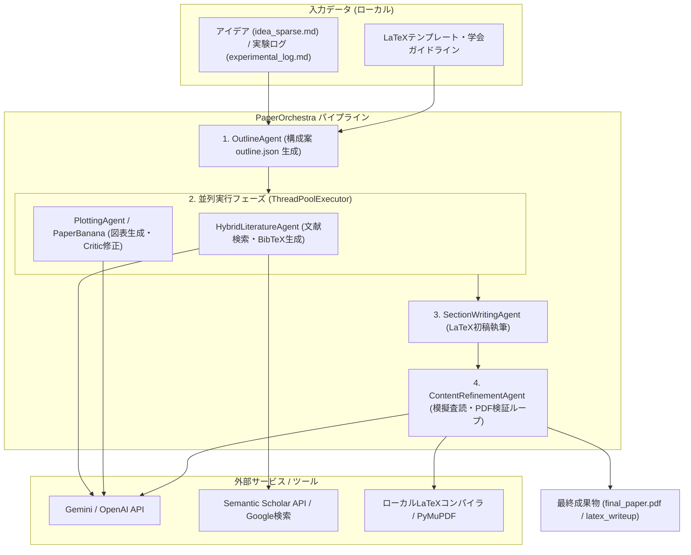

# **PaperOrchestra 調査レポート**

## **1. 基本情報**

* **ツール名**: PaperOrchestra
* **ツールの読み方**: ペーパーオーケストラ
* **開発元**: Google Cloud AI Research（Google Research）
* **公式サイト**: [https://github.com/google-research/paper-orchestra](https://github.com/google-research/paper-orchestra)
* **関連リンク**:
  * GitHub: [https://github.com/google-research/paper-orchestra](https://github.com/google-research/paper-orchestra)
  * プロジェクトページ: [https://yiwen-song.github.io/paper_orchestra/](https://yiwen-song.github.io/paper_orchestra/)
  * 論文 (arXiv): [https://arxiv.org/abs/2604.05018](https://arxiv.org/abs/2604.05018)
* **カテゴリ**: マルチエージェントフレームワーク
* **概要**: PaperOrchestraは、Google Cloud AI Researchが開発したAI研究論文の自動執筆マルチエージェントフレームワークです。研究者のメモやアイデア概要、実験ログといった非構造化データ（pre-writing materials）を入力として受け取り、専門化された複数のAIエージェントが協調することで、文献調査、図表（プロットや概念図）の生成、セクション執筆、模擬査読による推敲を経て、学会提出レベルのLaTeX原稿およびPDFを自動生成します。

## **2. 目的と主な利用シーン**

* **解決する課題**: 従来のエンドツーエンド型「自律型AIサイエンティスト」系ツールでは、実験コードの実行環境と論文執筆プロセスが密結合しており、実験の失敗が論文品質の低下を招いたり、先行研究の引用（Literature Review）が浅くハルシネーションを含んだりする課題がありました。PaperOrchestraは実験実行から論文執筆フェーズを切り離し、任意の研究素材から高品質かつ正確な引用・図表を備えた論文原稿を効率的に構築する課題を解決します。
* **想定利用者**: 機械学習・AI分野の研究者、大学院生、企業のR&Dエンジニア、および学術論文執筆の自動化パイプラインを研究・開発する開発者。
* **利用シーン**:
  * **実験ログからの論文ドラフト作成**: 生の実験結果ログや箇条書きのアイデアメモから、CVPRやICLRなど特定学会フォーマットに準拠したLaTeX初稿を自動生成する。
  * **網羅的な文献調査とBibTeX構築**: 研究テーマに関連する先行研究を検索・選別し、実在確認済みの引用キーと`references.bib`を自動生成する。
  * **論文用プロット・概念図の自動生成と改善**: 実験データや手法説明から統計グラフやアーキテクチャ図を生成し、自己批評ループを通じて視認性と正確性を高める。

### **2.1 代表的な利用フロー**

```mermaid
swimlane-beta TB
  subgraph User["ユーザー"]
    A["アイデア・実験ログ・学会テンプレートを用意"]
    F["生成されたLaTeX・PDFを確認・調整"]
  end
  subgraph Orchestrator["PaperOrchestra (パイプライン)"]
    B["アウトライン設計 (OutlineAgent)"]
    D["並列処理: 文献調査・図表生成"]
    E["セクション執筆・模擬査読による反復修正"]
  end
  subgraph ExternalAPI["外部API (LLM / 学術検索)"]
    C["Gemini / OpenAI API・Semantic Scholar API実行"]
  end
  A --> B
  B --> D
  D --> C
  C --> E
  E --> F
```

* **代表的な流れ**: ユーザーが研究アイデア・実験ログ・対象学会のLaTeXテンプレートを入力すると、PaperOrchestraがまずアウトラインを設計し、続いて外部のLLM APIやSemantic Scholar APIを呼び出しながら文献調査と図表生成を並列実行します。最後に全セクションの執筆と模擬査読ループによる推敲・LaTeXコンパイルを完了し、ユーザーへ最終PDFとLaTeXプロジェクト一式を返却します。

## **3. 主要機能**

* **マルチエージェント・オーケストレーション**: アウトライン作成、文献調査、プロット・図表生成、セクション執筆、コンテンツ推敲の5つの専門エージェントを連携させ、一貫性のある論文作成プロセスを実行します。
* **ハイブリッド文献調査（Hybrid Literature Synthesis）**: GeminiのGoogle Searchグラウンディング機能とSemantic Scholar APIを組み合わせ、関連論文の発見・実在検証・要約・`references.bib`生成を自動化します。カットオフ日（`--research_cutoff`）の指定にも対応し、ベンチマーク評価時の情報リークを防止できます。
* **自動プロット・概念図生成（PaperBanana統合）**: `PlottingAgent`がFew-shot例の検索、構成計画、デザイン調整（Stylist）、コード/画像生成モデルによる描画、およびCriticによる自己修正ループ（デフォルト最大3回）を通じて、学会基準のグラフや概念図を生成します。
* **学会テンプレート準拠のLaTeX執筆**: CVPR 2025やICLR 2025などのスタイルファイル（`.sty`）やガイドライン（`guidelines.md`）をコンテキストとして読み込み、フォーマット制約に沿ったLaTeXコード（`raw_draft_paper.tex`）を生成します。カスタムテンプレートの追加も可能です。
* **模擬査読による反復推敲（Content Refinement Loop）**: `AgentReview`のルーブリック（1〜10点評価）に基づく自動査読と、PDFレンダリング結果の視覚的チェックを組み合わせ、最大3ラウンド（`max_reflections=3`）の自律的な内容・レイアウト修正を行います。
* **複数LLMバックエンド対応**: `utils/llm_backend_utils.py`により、デフォルトのGoogle Geminiモデル（`gemini-3.1-pro-preview`等）に加え、Vertex AI経由の実行やOpenAIモデル（`gpt`、`o1`、`o3`系）の選択に対応しています。
* **CLIおよびStreamlit WebデモUI**: バッチ処理向けのPython CLI（`paper_writing_cli.py`）に加え、進捗タイムライン・生成図表ギャラリー・ZIPダウンロード・完了通知メール機能を備えたStreamlitベースのWeb UI（`frontend/app.py`）を提供します。
* **自動評価モジュール（Autoraters）**: 引用の正確性を測る`citation_f1.py`や文献レビュー品質評価（`lit_review_quality.py`）、Side-by-Side比較評価（`sxs_paper_quality.py`）など、論文品質を定量評価するためのスクリプト群を同梱しています。

## **4. 動作原理・システム構成**

* **アーキテクチャ**: ローカル環境で動作するPython製マルチエージェント・パイプライン（CLIまたはStreamlitローカルサーバー）であり、推論・検索・画像生成処理は外部API（Gemini API / Vertex AI、OpenAI API、Semantic Scholar API）へリクエストするクライアント・API連携型アーキテクチャです。



* **主要コンポーネントとデータフロー**:
  1. `paper_writing_cli.py`（または`frontend/app.py`）が入力ディレクトリから`raw_materials`を出力作業ディレクトリへコピーし、`write_single_paper()`を呼び出します。
  2. `OutlineAgent`が研究アイデア・実験ログ・`template.tex`・`guidelines.md`を統合し、論文の章立てと図表計画を含む`outline.json`を生成します。
  3. `ThreadPoolExecutor`により`HybridLiteratureAgent`と`PlottingAgent`（`--use_plotting true`時）が並列実行されます。前者はスレッドセーフなレジストリ管理下で`references.bib`と`citation_map.json`を出力し、後者は`figures/info.json`と画像ファイルを出力します。
  4. `SectionWritingAgent`が全中間成果物を集約して`raw_draft_paper.tex`を生成します。
  5. `ContentRefinementAgent`がローカルのLaTeXコンパイラでPDFを生成し、`PyMuPDF`等でテキスト抽出とページグリッド画像化を実施します。`autoraters/agent_review.py`による模擬査読スコアと指摘事項をもとに本文およびフォーマットの修正を最大3回反復し、`final_paper.pdf`を確定します。
* **特筆すべき要素技術**:
  * **PaperBananaパイプライン統合**（`utils/paper_banana_utils.py`）: Retriever → Planner → Stylist → Visualizer → Critic の5段階エージェント協調により、単なるスクリプト描画にとどまらない高品質な学術図表・概念図を生成します。
  * **自己リトライ・修復機構**: `paper_writer_with_plotting.py`ではパイプライン全体の最大3回のリトライループが組まれており、`json_repair`によるLLM出力のJSONパース修復や、PyMuPDF失敗時の`pypdf`フォールバックなど堅牢性を高める実装が施されています。

## **5. 開始手順・セットアップ**

* **前提条件**:
  * Python 3.11（公式手順ではConda環境を推奨）
  * ローカル環境にLaTeXディストリビューション（`pdflatex` / `bibtex`等が実行可能なTeX Live等）がインストールされていること
  * 使用するLLMプロバイダーのAPIキー（Google Gemini API Key または Google Cloud Vertex AI プロジェクト、あるいは OpenAI API Key）
  * 任意でSemantic Scholar API Key（レート制限緩和用）
* **インストール/導入**:

  ```bash
  # リポジトリのクローン
  git clone https://github.com/google-research/paper-orchestra.git
  cd paper-orchestra

  # Conda環境の作成と依存関係のインストール
  conda create -n paper_orchestra python=3.11
  conda activate paper_orchestra
  pip install -r requirements.txt
  ```

* **初期設定**:
  プロジェクトルートに `.env` ファイルを作成し、利用するAPIキー等の環境変数を設定します（2026年11月の更新により、実際に使用するプロバイダーのキーのみ設定すれば動作するようになりました）。

  ```env
  # Geminiモデルを使用する場合（Vertex AI または Gemini API Key のいずれか）
  GEMINI_API_KEY=<YOUR_GEMINI_API_KEY>
  # VERTEX_AI_PROJECT=<YOUR_GCP_PROJECT_ID>
  # VERTEX_AI_LOCATION=<YOUR_GCP_LOCATION>

  # OpenAIモデルを使用する場合
  OPENAI_API_KEY=<YOUR_OPENAI_API_KEY>

  # 文献検索のレート制限緩和用（任意）
  SEMANTIC_SCHOLAR_API_KEY=<YOUR_SEMANTIC_SCHOLAR_API_KEY>

  # Streamlitデモ完了時のメール通知用（任意）
  SMTP_EMAIL=<YOUR_EMAIL>
  SMTP_PASSWORD=<YOUR_APP_PASSWORD>
  ```

* **クイックスタート**:
  1. 研究アイデア（`idea_sparse.md`）と実験ログ（`experimental_log.md`）を配置したディレクトリを用意し、CLIで実行します。

     ```bash
     python paper_writing_cli.py \
       --raw_materials_dir /path/to/your/raw_materials/ \
       --latex_template_dir templates/cvpr2025 \
       --output_dir ./paper_output \
       --use_plotting true
     ```

  2. Web UI（インタラクティブデモ）を使う場合はStreamlitを起動し、ブラウザで `http://localhost:8501` にアクセスします。

     ```bash
     streamlit run frontend/app.py
     ```

## **6. 特徴・強み (Pros)**

* **研究実験と論文執筆の疎結合設計**: 実験の実行環境やコードベースに依存せず、アイデアメモや実験ログなどのテキスト資料さえあれば動作するため、既存の研究ワークフローへ柔軟に組み込めます。
* **高精度な文献レビューと引用の信頼性**: Semantic Scholar APIとWeb検索を組み合わせ、論文タイトルの曖昧一致（`thefuzz`）や公開日カットオフで検証するため、LLM単独執筆で頻発する架空引用（ハルシネーション）を大幅に抑制します。論文（arXiv:2604.05018）の人間評価では、文献レビュー品質でベースラインに対し50%〜68%の絶対勝率マージンを記録しています。
* **図表生成とレイアウトの視覚的自己修正**: PaperBanana統合による図表生成に加え、コンパイル後のPDFをグリッド画像化してマルチモーダルLLMでレイアウト崩れを検証するため、LaTeXの体裁品質が高い水準に保たれます。
* **高い拡張性と評価基盤の同梱**: 新しい学会のLaTeXテンプレートを`templates/`配下に追加するだけで他分野・他会議に対応でき、`autoraters/`により生成論文の自動採点や比較実験も実施可能です。

## **7. 弱み・注意点 (Cons)**

* **日本語対応の状況**: UI（Streamlitデモ）、プロンプト、および同梱テンプレート（`cvpr2025`、`iclr2025`）はすべて英語前提であり、日本語の公式ドキュメントや日本語論文向けテンプレートは提供されていません。
* **公式サポート対象外（研究用コード）**: `README.md`に「This is not an officially supported Google product.」と明記されており、商用SaaSのようなSLAや継続的な製品サポートは期待できません。
* **ベンチマークデータセットの未同梱**: 論文で評価に使用された200件のベンチマークデータセット（PaperWritingBench / PaperWriting-Eval200）は本リポジトリには含まれておらず、別途公開予定となっています。
* **実行コストとローカル環境要件**: 複数のエージェントが長文コンテキストや画像生成・視覚評価を並列・反復実行するため、1本の論文生成あたりのLLM APIトークン消費量が大きくなりやすく、またローカルにLaTeXコンパイル環境の構築が必要です。

## **8. 料金プラン**

PaperOrchestra自体はオープンソースソフトウェア（Apache-2.0ライセンス）として無償公開されており、ソフトウェアライセンス費用は一切かかりません。ただし、実行には外部APIの利用料が発生します。

| プラン / 構成 | 料金 | 主な特徴 |
|---------|------|---------|
| **OSSフレームワーク本体** | 無料 | GitHubからクローンして無制限に利用可能（Apache-2.0ライセンス）。CLI・Streamlit UI・評価スクリプトを含む。 |
| **Gemini API / Vertex AI 利用時** | 従量課金 | `gemini-3.1-pro-preview` や `gemini-3-pro-image-preview` 等のトークン・画像生成単価に応じたGoogle Cloud / Gemini API課金（無料枠利用可）。 |
| **OpenAI API 利用時** | 従量課金 | `gpt` / `o1` / `o3` 系モデルを指定した場合のOpenAI API従量課金。 |

* **課金体系**: OSS本体は無料。バックエンドとして接続するLLM APIおよび画像生成APIの従量課金（Pay-as-you-go）。
* **無料トライアル**: OSSのため試用期限なし。Gemini APIの無料枠などを利用すれば初期コストを抑えて検証可能です。

## **9. 導入実績・事例**

* **導入企業**: 公開企業導入事例なし（Google Cloud AI Researchによる研究成果およびOSS公開ツールとして提供）。
* **導入事例**: 論文（arXiv:2604.05018）にて、CVPR・ICLR等のトップカンファレンス論文200本から逆構築したベンチマーク「PaperWritingBench」上での検証事例が報告されており、全体品質で既存自律執筆ベースラインを14%〜38%の絶対勝率マージンで上回る結果を示しています。また、GitHub上では公開後約半年で5,900以上のスターを獲得し、AI研究者コミュニティで広く検証・活用されています。
* **対象業界**: 学術研究機関（大学・大学院）、企業のAI基礎研究所・R&D部門、自律型AIエージェント開発コミュニティ。

## **10. サポート体制**

* **ドキュメント**: GitHubの`README.md`、フロントエンド用`frontend/README.md`、各テンプレート内の`guidelines.md`、および学術論文（arXiv:2604.05018）・プロジェクトページにて仕様やセットアップ手順が公開されています（すべて英語）。
* **コミュニティ**: GitHub IssuesおよびPull Requestsを通じたOSSコミュニティベースのやり取りが中心です。外部コントリビューターからのPRマージも行われています。
* **公式サポート**: なし（「This is not an officially supported Google product.」の免責事項あり）。

## **11. エコシステムと連携**

### **11.1 API・外部サービス連携**

* **API**: PaperOrchestra自体はCLIおよびStreamlitアプリケーションとして提供されており、REST APIサーバー機能は内蔵していませんが、`methods/paper_writer.py`および`methods/paper_writer_with_plotting.py`の`write_single_paper()`関数をPythonモジュールとしてインポート・呼び出し可能です。
* **外部サービス連携**:
  * **Google Gemini API / Vertex AI** (`google-genai` SDK): テキスト生成、Google Searchグラウンディング、画像生成。
  * **OpenAI API** (`openai` SDK): GPT / o1 / o3 系モデルによるテキスト・画像入力処理。
  * **Semantic Scholar API**: 学術論文のメタデータ・アブストラクト・被引用数検索。
  * **SMTPメールサーバー**: Streamlitデモ完了時の成果物メール送信機能。
  * **LaTeX / BibTeX環境**: ローカルのTeXコンパイラによるPDFビルド。

### **11.2 技術スタックとの相性**

| 技術スタック | 相性 | メリット・推奨理由 | 懸念点・注意点 |
|:---|:---:|:---|:---|
| **Python 3.11 + Conda** | ◎ | 公式推奨環境であり、`requirements.txt`一式でそのまま動作 | 特定バージョンの依存パッケージ（PyMuPDF等）に注意 |
| **Google Cloud (Vertex AI / Gemini)** | ◎ | デフォルト設定がGeminiモデルとGoogle Searchグラウンディングに最適化 | Vertex AI利用時はGCPプロジェクトとロケーション設定が必要 |
| **LaTeX (CVPR / ICLR テンプレート)** | ◎ | `templates/`配下に公式対応テンプレートとガイドラインを同梱 | ローカル環境へのTeX Live等の事前導入が必須 |
| **OpenAI API (GPT / o1 / o3)** | ◯ | `llm_backend_utils.py`経由でモデル名指定による切り替えが可能 | Google Searchグラウンディング等一部機能はGemini前提の実装箇所あり |
| **日本語組版 (pLaTeX / LuaLaTeX)** | △ | テンプレート追加の仕組み自体は利用可能 | 公式プロンプト・スタイルが英語論文前提のためプロンプト調整が必要 |

## **12. セキュリティとコンプライアンス**

* **認証**: フレームワーク自体にユーザー認証機構は実装されていません（ローカル実行ツールのため）。外部APIとの認証には`.env`ファイルまたは環境変数で渡すAPIキー（Gemini API Key、OpenAI API Key、Vertex AI ADC/プロジェクト設定、Semantic Scholar API Key、SMTP認証情報）を使用します。
* **データ管理**: 入力資料（アイデア・実験ログ）および生成物（中間JSON・LaTeX・PDF）はすべて実行環境のローカルディスク（`base_dir`配下）に保存されます。ただし、推論や検索のためにプロンプトおよびコンテキストデータが外部のLLM API（Google / OpenAI）やSemantic Scholar APIへ送信されます。
* **準拠規格**: OSSリポジトリおよび公式ドキュメント上でSOC2やISO27001などの第三者認証取得は公開されていない（ローカル実行型OSSのため、利用するVertex AIやOpenAI Enterprise等のクラウド側コンプライアンスに依存します）。

## **13. 操作性 (UI/UX) と学習コスト**

* **UI/UX**: CLIは引数が整理されておりスクリプト実行が容易です。さらに`frontend/app.py`のStreamlit UIでは、フォームへの素材入力、パイプラインの進行状況を示すステップ別タイムライン、生成された図表のギャラリー表示、PDFプレビューおよびZIP一括ダウンロードまで直感的に操作できます。
* **学習コスト**: PythonとCondaの基本操作、およびLaTeXの基礎知識があれば導入は容易です（中程度）。ただし、出力品質をカスタマイズしたい場合やエラー発生時にデバッグする場合は、各エージェントのプロンプト構造やLaTeXコンパイルエラーの読解知識が求められます。

## **14. ベストプラクティス**

* **効果的な活用法 (Modern Practices)**:
  * **実験ログの構造化**: `experimental_log.md`には数値テーブルや実験条件・比較ベースラインを明確に記述しておくと、`PlottingAgent`と`SectionWritingAgent`の精度が大幅に向上します。
  * **カットオフ日の明示**: 特定の時点までの先行研究のみを対象にしたい場合は、`--research_cutoff YYYY-MM`（例: `2025-10`）を指定して文献検索の再現性を確保します。
  * **図表生成オプションの使い分け**: 既存の確定図表（`.pdf`/`.png`）が`raw_materials/figures/`に揃っている場合は`--use_plotting false`で高速化し、生データから図表を起こしたい場合のみ`--use_plotting true`を有効にします。
* **陥りやすい罠 (Antipatterns)**:
  * **TeX環境未導入での実行**: ローカル環境に`pdflatex`や`bibtex`がインストールされていない状態で実行すると、`ContentRefinementAgent`のPDFコンパイル段階で失敗します。
  * **不要なAPIキーの混在と課金管理**: `max_reflections`や`plotting_max_critic_rounds`を大きく設定しすぎると、LLM・画像生成APIの呼び出し回数が急増しコストと実行時間が膨らみます。
  * **生データの確認不足**: AIが自動生成した文章やグラフの数値を無検証で投稿せず、必ず最終生成された`final_paper.pdf`と`experimental_log.md`の整合性を人間が確認してください。

## **15. ユーザーの声（レビュー分析）**

* **調査対象**: Reddit（`r/WebAfterAI`、`r/ScrapingAgents`等）、技術系メディア（MarkTechPost等）、GitHubリポジトリ動向
* **総合評価**: 一般SaaS向けレビューサイト（G2、Capterra、ITreview）への掲載はなし。GitHubでは5,950+ Stars / 767 Forksと高い注目を集めています。
* **ポジティブな評価**:
  * 「実験コードの実行まで抱え込む従来のAI Scientist系と異なり、実験ログから論文執筆に特化しているため実用性が高い」
  * 「文献レビューの根拠付け（Semantic Scholar連携）とハルシネーション抑制の設計が優れている」
  * 「Streamlitデモと学会テンプレートが最初から用意されており、パイプライン全体の流れを追いやすい」
* **ネガティブな評価 / 改善要望**:
  * 「評価用データセット（PaperWritingBench）がリポジトリにまだ含まれていないため、論文記載のベンチマークを即座に追試できない」
  * 「初期版では使用しないLLMプロバイダーのAPIキーまで要求される制約や依存パッケージの不足があった（2026年11月のPRで改善済み）」
  * 「APIコストと1本あたりの生成時間（並列処理と反復査読を含むため）が無視できない」
* **特徴的なユースケース**:
  * 自律コーディングエージェントが出力した大量の実験ログやベンチマーク結果の整理・論文ドラフト化。
  * 既存の研究ノートから素早く学会向けフォーマットの初稿（叩き台）を作成する用途。

## **16. 直近半年のアップデート情報**

* **2026-11-15**: 外部コントリビューターからの3件のPR（#2, #3, #4）をマージ。実際に使用するLLMプロバイダーのAPIキーのみを必須とする改善（Geminiのみ、またはOpenAIのみでの実行に対応）、`requirements.txt`への不足依存パッケージ追加、およびLaTeXプロンプト文字列内の無効なエスケープシーケンス修正を実施。
* **2026-05-17**: `README.md`のBibTeX引用フォーマットを公式arXivプレプリント（`arXiv:2604.05018`）に合わせて更新。
* **2026-05-07**: GitHubリポジトリ（`google-research/paper-orchestra`）をApache-2.0ライセンスで初期公開。

（出典: [GitHub Commit History](https://github.com/google-research/paper-orchestra/commits/main)）

## **17. 類似ツールとの比較**

### **17.1 機能比較表 (星取表)**

| 機能カテゴリ | 機能項目 | PaperOrchestra | The AI Scientist (Sakana AI) | Agent Laboratory | CrewAI |
|:---:|:---|:---:|:---:|:---:|:---:|
| **基本機能** | 論文執筆・LaTeX生成 | ◎<br><small>5エージェント協調＋模擬査読</small> | ◎<br><small>自動実験からLaTeX生成まで一貫</small> | ◯<br><small>対話的なレポート・論文作成</small> | △<br><small>汎用基盤のため自前実装が必要</small> |
| **基本機能** | 実験コードの自律実行 | ×<br><small>実験ログ入力を前提（執筆特化）</small> | ◎<br><small>仮説立案〜実験実行〜検証を自律実行</small> | ◯<br><small>Human-in-the-loopで実行</small> | △<br><small>ツール連携で実装可能</small> |
| **専門機能** | 文献調査・引用精度 | ◎<br><small>Search+Semantic Scholar検証</small> | △<br><small>浅い引用や重複概念の再発明課題</small> | ◯<br><small>段階的な文献レビュー支援</small> | △<br><small>検索ツールの組み込みが必要</small> |
| **専門機能** | 図表・概念図生成 | ◎<br><small>PaperBanana統合＋視覚Critic</small> | ◯<br><small>実験スクリプトからプロット生成</small> | △<br><small>基本的な可視化中心</small> | ×<br><small>標準機能としては非搭載</small> |
| **操作性** | Web UI / デモ提供 | ◎<br><small>Streamlitデモ標準同梱</small> | △<br><small>CLI中心</small> | ◯<br><small>対話型ワークフロー</small> | ◎<br><small>CrewAI Studio / AMP提供</small> |
| **非機能要件** | 日本語対応 | ×<br><small>英語UI・英語学会テンプレートのみ</small> | ×<br><small>英語前提</small> | ×<br><small>英語前提</small> | △<br><small>コミュニティ情報あり・英語中心</small> |

### **17.2 詳細比較**

| ツール名 | 特徴 | 強み | 弱み | 選択肢となるケース |
|---------|------|------|------|------------------|
| **PaperOrchestra** | 研究素材から投稿可能なLaTeX論文を生成する特化型マルチエージェント | 文献統合の正確さ、PaperBananaによる高品質な図表生成、視覚的模擬査読ループ | 実験の自動実行機能がなく、日本語学会テンプレートに未対応 | すでにアイデアや実験ログがあり、論文執筆・図表作成・推敲を高速化したい場合 |
| **The AI Scientist** | 仮説生成・実験実行・論文執筆・査読までを完全自動化する先駆的フレームワーク | 実験から執筆まで完全エンドツーエンドで自動化できる | 実験の失敗率や文献レビューの浅さ、不正確なデータ生成リスクが課題 | 人手を介さず自律的な科学研究ループ全体をプロトタイピングしたい場合 |
| **Agent Laboratory** | 人間の研究者と協調（Human-in-the-loop）して研究を進めるラボ型フレームワーク | 重要な意思決定に人間が介在するため、暴走や誤った方向への最適化を防ぎやすい | 完全自動ワンクリックツールに比べると人間の操作・介入が多くなる | 研究者とAIが対話しながら仮説検証とレポート作成を段階的に進めたい場合 |
| **CrewAI** | 汎用的な役割ベース（Crews）と状態管理フロー（Flows）を備えたマルチエージェント基盤 | タスクの汎用性が高く、企業向け管理機能や拡張エコシステムが充実 | 論文執筆やLaTeXコンパイル等の専門機能はゼロから構築が必要 | 学術論文執筆に限らず、汎用的なマルチエージェント業務自動化を構築したい場合 |

## **18. 総評**

* **総合的な評価**:
  * PaperOrchestraは、「実験の自動実行」と「論文の自動執筆」をあえて切り離すことで、従来の自律型研究エージェントが抱えていた文献レビューの浅さや構成破綻を克服した完成度の高いフレームワークです。特にSemantic ScholarとWeb検索を組み合わせた引用検証、PaperBananaによる図表生成、PDFグリッド画像を用いた視覚的フォーマット修正まで一気通貫で実装されている点は非常に実用的です。
* **推奨されるチームやプロジェクト**:
  * CVPRやICLRなどの国際会議向けに英語論文を執筆するAI研究者・R&Dチーム。
  * 実験ログやベンチマーク結果の蓄積は既にあるものの、論文ドラフト作成や参考文献整理・作図の工数を大幅に削減したいプロジェクト。
* **選択時のポイント**:
  * 「実験から自動で回したい」場合はThe AI ScientistやAgent Laboratory、「既存の実験結果やメモから最高品質のLaTeX論文・図表を仕上げたい」場合はPaperOrchestraを選択するのが最適です。なお、Googleの公式サポート対象外のOSSであるため、APIコスト管理と生成内容のファクトチェックを運用に組み込むことが重要です。
