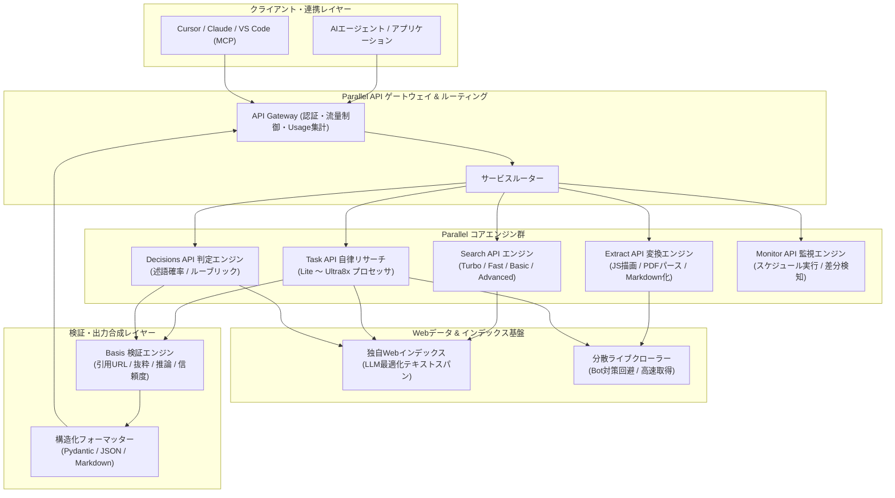

# **Parallel 調査レポート**

## **1. 基本情報**

* **ツール名**: Parallel（パラレル / Parallel Web Systems / Parallel AI）
* **ツールの読み方**: パラレル
* **開発元**: Parallel Web Systems Inc.
* **公式サイト**: [https://parallel.ai/](https://parallel.ai/)
* **関連リンク**:
  * ドキュメント: [https://docs.parallel.ai/](https://docs.parallel.ai/)
  * プラットフォーム管理画面: [https://platform.parallel.ai/](https://platform.parallel.ai/)
  * GitHub（公式SDK・ツール群）: [https://github.com/parallel-web](https://github.com/parallel-web)
  * レビューサイト: 開発者コミュニティ（Reddit, Hacker News等）
* **カテゴリ**: エージェントエコシステム/基盤
* **概要**: Parallel（Parallel Web Systems）は、元Twitter CEOのParag Agrawal氏とTravers Nisbet氏によって2023年に設立された、AIエージェントおよび大規模言語モデル（LLM）アプリケーション専用のWebインフラストラクチャプラットフォームである。人間のブラウジングやクリックを前提とした従来の検索エンジンやWebスクレイパーと異なり、LLMのコンテキストウィンドウに最適化された事前圧縮テキストスパンの返却、多段階の自律的Webリサーチ、閉じた質問に対するWeb証拠付きの判定などを単一API群で提供する。

## **2. 目的と主な利用シーン**

* **解決する課題**:
  * **人間向け検索APIの非効率性**: 従来の検索エンジンAPI（Google/Bing SERP API等）はリンクのリストや長文HTMLを返すため、エージェント側でスクレイピング、不要要素除去、再ランキング、要約といった多段パイプラインを構築する必要があり、トークン消費とレイテンシが肥大化していた。
  * **Webスクレイピングの脆弱性と保守コスト**: 動的JavaScript描画、Bot対策、IPブロック、頻繁なDOM構造変更により、自前スクレイパーの運用保守が極めて高コストであった。
  * **ハルシネーションと根拠の不透明性**: 従来の検索結果をLLMに渡すだけでは、参照元URLの食い違いや古い情報に基づくハルシネーションが発生し、ファクトチェックやコンプライアンス要件を満たせなかった。
  * **複雑な多段リサーチの手間**: 複数ドメインにまたがる情報のクロスリファレンスや、条件を満たす企業・エンティティの網羅的リストアップを手動または単純なプロンプトで行うには限界があった。
* **想定利用者**:
  * 自律型AIエージェント、リサーチアシスタント、コーディングエージェントを開発するエンジニア
  * 金融・投資・M&A・コンサルティング分野で企業調査やデューデリジェンスの自動化を行うデータチーム
  * 法務・知財・レギュラトリー分野で法令や判例、最新規制の追跡を行うコンプライアンス担当者
  * Cursor、Claude Code、VS Code等で最新のWeb検索・ドキュメント取得をシームレスに行いたい開発者
* **利用シーン**:
  * **エージェントのリアルタイムWebグラウンディング**: チャットやタスク実行時に最新の事実情報や技術仕様を高速（p50約200ms〜1s）に取得し、モデルに注入する。
  * **企業・人物・製品の構造化ディープリサーチ**: Task APIとBasis機能を用いて、複数ソースの照合、推論過程、抜粋、信頼度スコアを含むPydantic/JSONスキーマに適合したレポートを自動生成する。
  * **高速なファクトチェックと条件判定**: Decisions APIを用い、「この企業はSOC 2認証を取得しているか？」「最新四半期の売上高は増加したか？」などの閉じた質問に対して、Web上の証拠に基づき確率や判定結果をミリ秒単位で得る。
  * **ターゲットエンティティの網羅的探索**: FindAll APIを用いて「2025年以降にSeries Aを調達した欧州のAIスタートアップ」など自然言語条件に合致する全候補をWeb全体から発見・検証する。
  * **競合・市場・規制の常時モニタリング**: Monitor APIを用いて、関心のあるテーマや特定企業の更新をスケジュール監視し、差分をWebhookで検知する。

### **2.1 代表的な利用フロー**

```mermaid
swimlane-beta TB
  subgraph User["ユーザー / クライアント"]
    A[リサーチ目標・検証クエリの入力]
    G[構造化データと引用根拠の確認]
  end
  subgraph Agent["AIエージェント / アプリケーション"]
    B[目標の分解とAPIリクエスト構築]
    F[推論・要約・最終アウトプット生成]
  end
  subgraph Parallel["Parallel Web Systems API"]
    C[自律検索・URL発見・コンテンツ抽出]
    E[Basis検証・信頼度スコア・抜粋生成]
  end
  subgraph Web["公開Web / ターゲットサイト"]
    D[ライブWebページ・ドキュメントの提供]
  end
  A --> B
  B --> C
  C --> D
  D --> E
  E --> F
  F --> G
```

* **代表的な流れ**: クライアントから目標や質問を受け取ったAIエージェントが、自然言語の目標（`objective`）とキーワードクエリ（`search_queries`）を生成してParallel APIに送信する。Parallel側で独自インデックスの検索やライブWebページの抽出を行い、Basis（引用URL・テキスト抜粋・推論過程・信頼度）を付与したLLM最適化データを生成してエージェントへ返却し、高精度な最終回答を出力する。

## **3. 主要機能**

* **Parallel Search API (`/v1/search`)**: 自然言語の研究目標（`objective`）と短いキーワード（`search_queries`）を受け取り、LLMのコンテキストにそのまま渡せる事前圧縮された引用付きテキスト抜粋（Excerpts）を返却する。低遅延の `turbo`（p50約200ms）、`fast`（1〜2秒）、標準の `basic`、高精度な `advanced` の4つの検索モードを備える。
* **Parallel Extract API (`/v1/extract`)**: 任意の公開WebページURLから、JavaScriptレンダリングやPDF解析を経て、不要なヘッダー・フッター・ナビゲーションを排除したクリーンなMarkdownテキストへ高精度に変換する。
* **Parallel Decisions API (`/v1/decisions`)**: 「はい/いいえ」の判定、複数選択肢からの選択、順序付けされたルーブリックスコア（評価段階）などの閉じた質問に対し、リアルタイムなWeb証拠を収集・照合して判定結果とエビデンスを高速（200ms〜1s）に返却する。1回のリクエストで最大100問を一括処理可能。
* **Parallel Task API (Deep Research & Data Enrichment)**: 単一の検索では回答できない複雑なリサーチ課題に対し、バックグラウンドで複数回の検索・抽出・検証を自律的に繰り返すディープリサーチエンジン。要求スキーマ（Pydanticモデル等）に沿った構造化データを自動生成する。
* **Basis with Calibrated Confidences**: Task APIおよびDecisions APIで生成される各出力フィールドに対し、(1)情報源URL（Citations）、(2)推論過程の解説（Reasoning）、(3)引用抜粋テキスト（Excerpts）、(4)校正された3段階の信頼度（Confidence: `low` / `medium` / `high`）を付与する検証システム。
* **Parallel Responses API**: OpenAI Responses API互換のエンドポイント。単一のAPIコールで自律的なWeb検索と引用付きの回答生成を完結させ、既存のOpenAIクライアントコードから容易に移行可能。
* **FindAll API & Entity Search**: 「特定の条件を満たす企業や人物」を自然言語で指定し、Web全体を探索して検証済みのリストを作成する。即時同期応答の `Entity Search` と、非同期で網羅的に検証する `FindAll` を使い分け可能。
* **Monitor API**: 自然言語で指定した監視条件に基づき、対象Webページやトピックの変更を定周期で自動実行し、重大な差分が発生した際にWebhookで通知する。
* **Parallel MCP 2.0 (`https://mcp.parallel.ai/mcp`)**: Model Context Protocolに準拠した統合サーバー。Cursor、Claude Desktop、VS Code、ChatGPT等に登録することで、`web_search`、`web_fetch`、`web_decisions`（無料・キー不要）、`web_research`（要認証）の各ツールを即座に利用可能。
* **Usage Data API (`GET /service/v1/usage`)**: 組織内の日次API消費量、プロダクト別・APIキー別・プロセッサ別の課金明細をプログラムから取得・監査できる管理機能。

## **4. 動作原理・システム構成**

* **アーキテクチャ**: クラウド完結型SaaS（マルチテナント・分散マイクロサービス構成）。米国データセンターおよび欧州データセンター（`eu.parallel.ai`）でホスティングされている。
* **主要コンポーネントとデータフロー**:
  * **API Gateway & Routing**: クライアントからのリクエスト認証、レートリミット、モード別（Turbo/Fast/Advanced）ルーティング、使用量集計を実施。
  * **Proprietary Web Index**: 人間向け広告やデザイン要素を排除し、AIが理解しやすいセマンティクスとファクト情報に特化した独自のWebインデックスを保持。
  * **Live Fetch & Extraction Engine**: キャッシュにない情報や最新性が求められるクエリに対し、分散ヘッドレスブラウザ環境でJavaScriptを実行し、PDFや動的コンテンツをMarkdown化。
  * **Autonomous Research Engine (Task)**: 複合的な目標を複数サブタスクに分解し、検索・抽出・照合・矛盾検証を反復するエージェントループを実行。
  * **Basis Synthesis Engine**: 収集した証拠テキストと生成された回答を照合し、引用元URL・抜粋・推論ログ・校正された信頼度（Calibrated Confidence）をメタデータとして統合。



* **特筆すべき要素技術**:
  * **Goal-Directed Context Extraction**: 単なるキーワードマッチではなく、与えられた `objective`（研究目的）に直接関係する段落やデータテーブルのみをピンポイントで切り出す抽出技術。
  * **Calibrated Confidences**: 多数の情報源間での整合性やソースの権威性をアルゴリズム的に評価し、信頼度（低/中/高）を校正して提示。
  * **Agentic Payments (MPP & x402)**: StripeおよびTempoステーブルコインを用いたMachine Payments Protocolに対応し、AIエージェント自身がAPI費用を自律決済するプロトコルをサポート。
  * **欧州データレジデンシー（EU Data Residency）**: 欧州連合（EU）内のインフラで検索・抽出を完結させ、GDPRや国境を越えたデータ移転規制に対応。

## **5. 開始手順・セットアップ**

* **前提条件**:
  * Python 3.10以上 または Node.js 18以上
  * Parallel Platform（[https://platform.parallel.ai](https://platform.parallel.ai)）のアカウントおよびAPIキー（MCPの基本ツール利用時はキー不要）

* **インストール/導入**:

  Python環境の場合:
  ```bash
  pip install "parallel-web>=1.0.1"
  ```

  TypeScript / Node.js環境の場合:
  ```bash
  npm install "parallel-web@^1.0.1"
  ```

* **初期設定**:
  環境変数にAPIキーを設定する。

  ```bash
  export PARALLEL_API_KEY="<YOUR_API_KEY>"
  ```

* **クイックスタート**:

  PythonによるSearch APIの実行例:
  ```python
  import os
  from parallel import Parallel

  # 環境変数 PARALLEL_API_KEY から自動読み込み
  client = Parallel()

  # objective（自然言語の調査目的）と search_queries（2-3個の短いキーワード）を指定
  response = client.search(
      objective="Compare vector database pricing and latency benchmarks",
      search_queries=[
          "vector database benchmarks 2026",
          "pinecone vs qdrant vs milvus cost latency"
      ],
      mode="fast"  # turbo, fast, basic, advanced
  )

  for result in response.results:
      print(f"Title: {result.title}")
      print(f"URL: {result.url}")
      for excerpt in result.excerpts:
          print(f"  - {excerpt}")
  ```

  Decisions APIを用いた閉質問判定の例:
  ```python
  from parallel import Parallel

  client = Parallel()

  # Web上の最新証拠に基づく判定
  decision = client.beta.decisions.create(
      objective="Verify enterprise compliance certification",
      questions=[
          {
              "id": "q1",
              "type": "boolean",
              "question": "Does Notion currently possess SOC 2 Type II certification?"
          }
      ]
  )

  for ans in decision.answers:
      print(f"Question {ans.id}: {ans.answer} (Confidence: {ans.confidence})")
      print(f"Reasoning: {ans.reasoning}")
  ```

  CursorやClaude DesktopでのMCP 2.0設定例（`claude_desktop_config.json` 等）:
  ```json
  {
    "mcpServers": {
      "parallel": {
        "command": "npx",
        "args": ["-y", "@parallel-web/mcp"]
      }
    }
  }
  ```
  ※またはSSE/HTTPエンドポイントとして `https://mcp.parallel.ai/mcp` を直接登録可能（キー不要で基本3ツール利用可能）。

## **6. 特徴・強み (Pros)**

* **LLMコンテキストウィンドウの最適化とトークン節約**: 人間向けの装飾HTMLや冗長な文章を排除し、事前圧縮された高密度なテキスト抜粋を返すため、エージェントが消費するプロンプトトークン数を最大70〜80%削減可能。
* **Basisによる高い透明性とハルシネーション抑止**: URL、推論理由、抽出抜粋、校正された信頼度スコア（Calibrated Confidence）がセットで提供されるため、人間や上位エージェントがエビデンスを即座に監査できる。
* **同期・非同期を横断する包括的APIポートフォリオ**: 数百ミリ秒の低遅延検索（Turbo）から、数分〜数時間かけて数百のWebページを自律調査するディープリサーチ（Task）、閉質問判定（Decisions）、エンティティ探索（FindAll）まで、エージェントのWebデータ要件を単一プラットフォームで完結できる。
* **MCP 2.0によるゼロフリクションなエージェント統合**: 統合MCPサーバー（`mcp.parallel.ai/mcp`）により、CursorやClaude Codeなどの開発環境からAPIキー登録なしですぐに無料の検索・抽出機能を利用できる。
* **卓越したベンチマーク実績と業界最高水準の資金調達**: Artificial Analysis Search Indexで1位を獲得し、SealQAやDeepSearchQAでもSOTAを記録。元Twitter CEOのParag Agrawal氏が率い、Sequoia Capital主導などで累計2.3億ドル以上を調達した強固なインフラ継続性を持つ。

## **7. 弱み・注意点 (Cons)**

* **全ドメインクローラー・汎用スクレイパーではない**: 特定Webサイトの全階層を網羅的にクローリングしてサイトマップを構築するようなバッチスクレイピングには設計上不向きであり、そうした用途ではFirecrawlやScraplingなどとの併用が必要。
* **日本語対応およびドキュメントの制約**: 管理画面（Platform）および公式ドキュメントはすべて英語で提供されている。また、日本のニッチな地方自治体や特定業界団体の非公開・独自構造サイトに対するインデックス密度は、グローバル英語圏のWebデータと比較してやや薄い場合がある。
* **ディープリサーチ（Task API）のコスト管理**: Task APIの `pro` や `ultra`（最大$2,400/1,000回）などの長時間プロセッサを不用意にループ実行させると予期せぬ請求が発生するリスクがあるため、Spend Limitの設定やプロセッサの段階的使い分けが不可欠。
* **マルチモーダル入力の限定性**: テキスト情報およびWebページ上のロゴ検出等の特定画像解析には対応しているが、画像や音声ファイルを直接インプットとして与えてWeb調査を行うようなマルチモーダル入力には現状非対応。

## **8. 料金プラン**

Parallelは利用量に応じた完全従量課金制（Usage-based pricing）を採用しており、毎月$5分の無料クレジットが自動付与される。またMCP 2.0の基本ツールは無料・認証不要で利用可能である。

| API / 機能 | 料金 (USD) | 応答時間 / 実行形式 | 主な特徴・備考 |
|:---|:---|:---:|:---|
| **Search API (Turbo / Fast)** | $1.00 / 1,000リクエスト | 200ms〜2s (同期) | 1リクエストあたり10件の抜粋結果を含む。追加1,000件ごとに$1.00 |
| **Search API (Basic / Advanced)** | $5.00 / 1,000リクエスト | 1〜3s (同期) | 高度な再ランキングとより深いWebインデックス検索 |
| **Extract API** | $1.00 / 1,000 URL | 1〜20s (同期) | JSレンダリング、PDFパース、クリーンMarkdown変換 |
| **Decisions API** | $1.00 / 1,000リクエスト | 200ms〜1s (同期) | 1リクエスト内に最大100問の閉質問を含むことが可能 |
| **Responses API** | $10〜$250 / 1,000リクエスト | 5〜60s (同期) | OpenAI互換。Reasoning effort（Low: $10, Mid: $50, High: $250） |
| **Task API (Lite / Base)** | $5〜$10 / 1,000実行 | 10〜100s (非同期) | 基本メタデータ付与、低遅延エンリッチメント |
| **Task API (Core / Core2x)** | $25〜$50 / 1,000実行 | 1〜10分 (非同期) | 複数ソースのクロスリファレンス、中程度の複雑な出力 |
| **Task API (Pro)** | $100 / 1,000実行 | 2〜10分 (非同期) | 探索的な多段Webディープリサーチ |
| **Task API (Ultra 〜 Ultra8x)** | $300〜$2,400 / 1,000実行 | 5分〜2時間 (非同期) | 最も難度の高いマルチソース深層調査・検証 |
| **FindAll API** | $0.25〜$10固定 + $0.03〜$1.00/match | 10s〜2時間 (非同期) | 条件合致エンティティの網羅的探索。Previewは固定$0.10 |
| **Entity Search** | $5.00 / 1,000リクエスト | 1〜3s (同期) | 人物・企業の高速検索。1リクエストあたり100件を含む |
| **Monitor API** | $3〜$10 / 1,000実行 | スケジュール実行 | Lite（$3: 単一ドメイン・個別監視）、Base（$10: 広い領域監視） |

* **課金体系**: リクエスト数、URL数、または成功したTask Run数に応じた完全従量制（Task APIは成功完了した実行のみ課金され、失敗した実行は請求対象外）。
* **無料トライアル**: 新規登録時に全ユーザーへ毎月$5相当の無料クレジットが付与される。さらにParallel MCP 2.0の `web_search`、`web_fetch`、`web_decisions` はAPIキーなしで恒久的に無料で利用可能。

## **9. 導入実績・事例**

* **導入企業**:
  * 欧米の主要AIスタートアップおよびユニコーン企業（自律型エージェント開発企業、AIブラウザ開発チーム）
  * 大手リーガルテック企業（最新の法令改正・判例・知財情報の自動照合・エビデンス収集）
  * 金融機関・ベンチャーキャピタル・プライベートエクイティ（未公開企業のトラクション分析、デューデリジェンスの自動化）
  * グローバルコンサルティングファーム（特定産業における競合環境マップの迅速な自動生成）
* **導入事例**:
  * **AIエージェントのWeb探索エンジン**: 自律型コーディングエージェントにおいて、ライブラリの最新APIドキュメントや移行手順のリアルタイム検索エンジンとして採用。従来のSERP APIと比較してトークン消費を大幅に削減し、回答の正確性を向上させた。
  * **投資先・競合モニタリング**: 数万社規模のスタートアップ企業の資金調達ニュースや経営陣の変更、製品リリースをMonitor APIで常時監視し、アラートをSlackへ即時連携。
  * **ベンダーコンプライアンス自動審査**: Decisions APIを活用し、サプライチェーン企業のセキュリティ認証（SOC 2、ISO 27001等）の保持状況をWebエビデンス付きで自動スクリーニング。
* **対象業界**: ソフトウェア・AI開発、金融・フィンテック、リーガルテック、コンサルティング、サイバーセキュリティ。

## **10. サポート体制**

* **ドキュメント**: 公式ドキュメントサイト（[https://docs.parallel.ai/](https://docs.parallel.ai/)）が極めて充実している。AIエージェント向けインデックス（`llms.txt`, `llms-full.txt`）が常時メンテナンスされているほか、任意のドキュメントURLに `.md` を付与することでMarkdown生データを取得可能。Python/TypeScriptのクックブック（`parallel-cookbook`）も公開されている。
* **コミュニティ**: DiscordサーバーおよびGitHubリポジトリ（SDK、CLI、クックブック等）におけるDiscussions/Issuesを通じたコミュニティサポートが活発に行われている。
* **公式サポート**: メールサポート（`support@parallel.ai`、エンタープライズ・提携相談は `partnerships@parallel.ai`）を提供。エンタープライズ契約顧客には専任のカスタマーサクセス担当および共有Slack/Teamsチャンネルによる技術支援が提供される。対応言語は原則英語。

## **11. エコシステムと連携**

### **11.1 API・外部サービス連携**

* **API**: RESTful JSON API、Server-Sent Events（SSE）によるタスク進捗ストリーミング、Webhookによる非同期完了通知。OpenAPI仕様書（`public-openapi.json`）が公開されている。
* **外部サービス連携**:
  * **MCP（Model Context Protocol）**: Claude Desktop、Cursor、Windsurf、VS Code、OpenCode等との即時連携
  * **クラウドマーケットプレイス**: Google Cloud Marketplace、AWS Marketplace（AWSアカウントでの一括請求対応）、Amazon Bedrock AgentCore
  * **フレームワーク**: LangChain、Vercel AI SDK、OpenAI Tool Calling、Anthropic Tool Calling、Ollama（ローカルLLMとの連携）
  * **データコネクタ**: Google Drive、Notion、Confluence等の社内ナレッジソースとWeb情報の統合
  * **エージェント決済**: Machine Payments Protocol (MPP) & x402（Stripe / Tempo）

### **11.2 技術スタックとの相性**

| 技術スタック | 相性 | メリット・推奨理由 | 懸念点・注意点 |
|:---|:---:|:---|:---|
| **Python (FastAPI / LangChain)** | ◎ | 公式SDK（`parallel-web`）が提供され、Pydanticモデルによる型安全なスキーマ定義が可能 | 非同期（async/await）利用時はクライアントの初期化方法に留意 |
| **TypeScript / Node.js** | ◎ | 公式SDK（`parallel-web`）完備、Vercel AI SDKとの親和性が非常に高い | 大量データ処理時のメモリ管理 |
| **Go / Rust / 他バックエンド** | ◯ | OpenAPIスキーマに基づきクライアントコードを自動生成可能、REST APIが簡潔 | 公式個別SDKは未提供のためHTTPクライアントで実装が必要 |
| **エージェントIDE (Cursor / Windsurf)** | ◎ | 統合MCPサーバー（`mcp.parallel.ai/mcp`）により設定ファイル数行で即座に統合可能 | ネットワーク通信環境が必要 |
| **ローカルLLM環境 (Ollama / vLLM)** | ◯ | ツールコーリング機能を通じてローカルモデルからParallel Web検索を実行可能 | モデルの関数呼び出し精度に依存 |

## **12. セキュリティとコンプライアンス**

* **認証**: APIキーによるベアラトークン認証。管理画面での細粒度ロール制御（Owner, Admin, Member）。Account APIによるデバイスベースOAuth 2.0認証をサポート。
* **データ管理**:
  * 全ての通信はTLS 1.2以上で暗号化。保存データはAES-256で暗号化。
  * データセンターは米国および欧州（EU）のTier 4データセンターを利用。
  * **データ学習ポリシー**: 標準規約では非個人化された入力・出力データがモデル改善に使用される場合があるが、エンタープライズ向けZero Data Retention（ZDR）契約、またはEUエンドポイント（`eu.parallel.ai`）宛ての通信はモデルトレーニングから完全に除外される。
* **準拠規格**:
  * **SOC 2 Type I & Type II**: 2025年4月に認証取得済み（Trust Center経由で監査レポートを請求可能）。
  * **GDPR**: EUデータレジデンシー（欧州域内での検索・抽出処理）およびデータプライバシー規制に準拠。
  * **VPC / プライベートクラウド対応**: 適格エンタープライズ顧客向けにPrivate Cloud / VPC内での専用環境提供オプションを用意。

## **13. 操作性 (UI/UX) と学習コスト**

* **UI/UX**: Web管理画面（Platform）は洗練されており、インタラクティブにAPIリクエストを試行できるPlaygroundが提供されている。リアルタイムな利用量グラフ、製品別・キー別のコスト内訳、月額利用上限（Spend Limit）のアラート設定などが直感的に行える。
* **学習コスト**: 非常に低い。基本的なSearch APIの呼び出しは5行程度のコードで実装可能であり、MCPを利用する場合はコード記述すら不要で設定ファイルへの追加のみで動作する。一方、Task APIのプロセッサ選定（LiteからUltra8x）やDecisions APIのルーブリック定義には、求める品質とレイテンシ・コストのバランスを考慮した設計理解が求められる。

## **14. ベストプラクティス**

* **効果的な活用法 (Modern Practices)**:
  * **`objective` と `search_queries` の役割分担**: Search APIを呼び出す際、`objective` にはエージェントが達成したいゴールや文脈（自然言語の文章）を記述し、`search_queries` には検索エンジンが的確なページをヒットさせるための3〜6単語の多様なキーワード（文ではなく単語の組み合わせ）を2〜3個指定する。
  * **SearchとExtractのハイブリッドパイプライン**: まずSearch APIを実行して事前圧縮された引用抜粋を取得し、LLMが「さらに深い情報が必要」と判断した特定のURLに対してのみExtract APIを発行することで、トークン消費とコストを最小化する。
  * **閉質問にはDecisions APIを優先**: 「この企業はB2Bか？」「対象製品にAPIはあるか？」といった二値判定や選択式タスクには、LLMに自由記述させるのではなくDecisions APIを活用することで、低コストかつミリ秒単位の高速判定と定量的な確率値を得る。
* **陥りやすい罠 (Antipatterns)**:
  * **自然言語の質問文をそのまま `search_queries` に渡すこと**: 「2026年時点における主要なベクトルデータベースの料金と性能の比較について教えてください」といった長文を `search_queries` に渡すとキーワード検索のヒット率が著しく低下するため、キーワードへの分解が必須。
  * **定型タスクに対する過剰なプロセッサ割り当て**: 単純な企業概要の取得に高価な `ultra` や `ultra2x` プロセッサを割り当てるのはコストの浪費となるため、まずは `lite` や `base` から検証を開始する。
  * **レートリミットを考慮しない大量非同期ループ**: デフォルトレートリミット（Search: 600 req/min、Task: 2,000 req/min）を超過しないよう、クライアント側での指数バックオフやバッチ制御を設けること。

## **15. ユーザーの声（レビュー分析）**

* **調査対象**: Reddit（`r/ProxyEngineering`, `r/LocalLLaMA`等）、Hacker News、技術系テックブログ、Product Hunt、開発者コミュニティ
* **総合評価**: 開発者コミュニティにおいて 4.6 / 5.0 相当の高評価を獲得。特に「AIエージェントに特化したWebデータインフラ」という明確なポジショニングが絶賛されている。
* **ポジティブな評価**:
  * **トークン削減とコンテキスト効率**: 「生のWebページやSERP APIのJSONを自前でパースする地獄から解放された。最初からLLMにそのまま注入できる形（事前圧縮された高密度抜粋）で届くため、プロンプトトークンとAPIコストが激減した。」
  * **Basisによるファクトチェックの確実性**: 「出力されたすべてのデータに引用URLと抜粋、推論理由、信頼度が付与されているため、ハルシネーションの検出や人間によるダブルチェックが極めてスムーズになった。」
  * **MCP 2.0の即時性と利便性**: 「CursorやClaude CodeにURLを追加するだけで、APIキーなしですぐに高品質なWeb検索が動く。開発体験として最も摩擦が少ない。」
* **ネガティブな評価 / 改善要望**:
  * **サイト全体の丸ごとクローリングには不向き**: 「特定ドメインの全サブページを再帰的に巡回してサイトマップを構築するような用途には適しておらず、そうした作業にはFirecrawl等を使わざるを得ない。」
  * **日本語ローカル情報に対するインデックス差**: 「英語圏の技術情報やビジネス情報では圧倒的な精度を誇るが、日本のマイナーな地方自治体や中小企業のローカル情報では検索結果がやや薄いことがある。」
  * **高度なTask API利用時のコスト意識**: 「Task APIの深いプロセッサは驚異的な調査能力を持つが、バッチ処理で大量に回すと請求額が跳ね上がるため、Spend Limitの設定が必須。」
* **特徴的なユースケース**:
  * **リードジェネレーションと企業プロファイリング**: FindAll APIでニッチな条件に合致するスタートアップ企業を1,000社抽出し、Task APIでCEO、直近調達額、利用クラウド、競合製品を自動で埋めてCRMに登録。
  * **リアルタイム判例・法改正チェッカー**: リーガルエージェントが、クライアントの契約書レビュー中に最新の規制ガイドラインや判例動向をDecisions APIで瞬時に照合。

## **16. 直近半年のアップデート情報**

* **2026-11-05**: **Parallel MCP 2.0のリリース** — 従来のSearch MCPとTask MCPを `https://mcp.parallel.ai/mcp` に統合。`web_search`、`web_fetch`、`web_decisions` の3ツールがAPIキー不要・完全無料で利用可能に。
* **2026-11-04**: **Usage Data APIの提供開始** — `GET /service/v1/usage` エンドポイントにより、日次の利用量・コスト明細をプロダクト・プロセッサ・キー別にプログラムから取得可能に。
* **2026-10-26**: **Decisions APIの正式リリース** — リアルタイムなWeb証拠に基づき、述語確率、選択肢、ルーブリックスコアを最大100問一括で判定する専用エンドポイントを提供開始。
* **2026-10-19**: **欧州データレジデンシー（EU Data Residency）の提供開始** — `https://eu.parallel.ai` にてSearch BasicモードおよびExtract APIの欧州域内処理をサポート。
* **2026-09-23**: **Data Connectorsの発表** — Google Drive、Notion、Confluence等の組織内プライベートデータとWeb検索を横断的に統合するデータコネクタ機能を導入。
* **2026-08-25**: **Google Cloud MarketplaceでのAPI全スイート提供開始** — Google Cloud顧客向けにインフラ統合と一括請求をサポート。
* **2026-08-24**: **Task APIにおけるPer-Element Basisの一般提供（GA）** — リサーチ結果の各要素ごとに個別引用・推論・抜粋・信頼度を紐付ける高精度Basis機能が正式提供。
* **2026-08-21**: **Parallel Search API Fastモードの導入** — レイテンシと精度のバランスを最適化したFastモードを提供開始。
* **2026-08-19**: **Artificial Analysis Search Indexにおいて第1位を獲得** — AI検索APIベンチマークにおいて精度とコスト効率で首位にランクイン。
* **2026-07-21**: **Responses APIのリリース** — OpenAI互換のWebリサーチ付き回答生成エンドポイントを公開。
* **2026-07-15**: **月額$5分の無料クレジット自動付与制度を開始** — 全登録ユーザーを対象に毎月の無料枠を提供。
* **2026-07-13**: **Parallel Search API Turboモードの発表** — p50約200msの超低遅延Web検索モードを提供開始。
* **2026-05-06**: **Monitor APIの一般提供（GA）開始** — 自然言語クエリによるWeb上の変更検知とWebhook連携を正式提供。

(出典: [Parallel API Changelog](https://docs.parallel.ai/changelog))

## **17. 類似ツールとの比較**

### **17.1 機能比較表 (星取表)**

| 機能カテゴリ | 機能項目 | Parallel | Tavily | Exa | Firecrawl | Perplexity API |
|:---:|:---|:---:|:---:|:---:|:---:|:---:|
| **検索・抽出** | LLM最適化抜粋 | ◎<br><small>事前圧縮スパン</small> | ◯<br><small>要約スニペット</small> | ◎<br><small>ハイライト抽出</small> | △<br><small>Markdown全文</small> | ◯<br><small>検索連携生成</small> |
| **検索・抽出** | 超低遅延検索 | ◎<br><small>Turboモード(~200ms)</small> | ◯<br><small>約1〜2秒</small> | ◯<br><small>約1秒</small> | ×<br><small>スクレイピング主眼</small> | △<br><small>LLM生成待ち発生</small> |
| **自律リサーチ** | 多段ディープリサーチ | ◎<br><small>Task API(9段階プロセッサ)</small> | △<br><small>簡易Q&A</small> | △<br><small>単一検索中心</small> | ×<br><small>非対応</small> | ◯<br><small>Deep Research機能</small> |
| **検証性** | 根拠・信頼度提示 (Basis) | ◎<br><small>URL/抜粋/推論/信頼度</small> | ◯<br><small>参照URLのみ</small> | ◯<br><small>類似度スコア</small> | ×<br><small>非対応</small> | ◯<br><small>引用番号付き回答</small> |
| **判定・発見** | 閉質問判定 (Decisions) | ◎<br><small>最大100問一括判定</small> | ×<br><small>非対応</small> | ×<br><small>非対応</small> | ×<br><small>非対応</small> | ×<br><small>非対応</small> |
| **探索機能** | エンティティ網羅探索 | ◎<br><small>FindAll / Entity Search</small> | ×<br><small>非対応</small> | ◯<br><small>類似ドメイン探索</small> | ×<br><small>非対応</small> | ×<br><small>非対応</small> |
| **サイト巡回** | ドメイン全体クローリング | ×<br><small>目的主導抽出に特化</small> | ×<br><small>非対応</small> | △<br><small>ドメインフィルタ</small> | ◎<br><small>再帰的サイトマップ巡回</small> | ×<br><small>非対応</small> |
| **エコシステム** | MCPネイティブ対応 | ◎<br><small>MCP 2.0(キー不要無料)</small> | ◯<br><small>コミュニティ/公式MCP</small> | ◯<br><small>MCPサーバー提供</small> | ◯<br><small>MCPサーバー提供</small> | △<br><small>コミュニティ対応</small> |
| **非機能要件** | 日本語対応 | △<br><small>英語主体(日本語検索可)</small> | ◯<br><small>日本語検索対応</small> | ◯<br><small>多言語埋め込み</small> | ◯<br><small>多言語Markdown</small> | ◎<br><small>自然な日本語生成</small> |
| **セキュリティ** | SOC 2 / EUデータ保持 | ◎<br><small>SOC 2 Type II / EU拠点</small> | ◯<br><small>SOC 2対応</small> | ◯<br><small>SOC 2対応</small> | ◯<br><small>SOC 2対応</small> | ◯<br><small>エンタープライズ対応</small> |

### **17.2 詳細比較**

| ツール名 | 特徴 | 強み | 弱み | 選択肢となるケース |
|:---|:---|:---|:---|:---|
| **Parallel** | AIエージェント専用のWebインフラ。高速検索から深層調査・判定までを網羅 | 事前圧縮抜粋によるトークン節約、Basisによる完全な根拠提示、MCP 2.0のキー不要無料提供 | 全ドメインの網羅的クローリングに非対応、ドキュメント・コンソールが英語のみ | 自律型AIエージェントのWeb探索、デューデリジェンス自動化、閉質問の高速判定を行う場合 |
| **Tavily** | AI検索に特化したシンプルな検索エンジンAPI | セットアップが極めて容易、一般的なLLMフレームワークとの連携実績多数 | 多段階リサーチや閉質問判定、エンティティ発見などの高度な推論機能は未提供 | シンプルなWeb検索・要約スニペットのみを素早くアプリに組み込みたい場合 |
| **Exa (formerly Metaphor)** | セマンティック・ニューラル検索に強みを持つ検索API | リンク埋め込みベクトルによる意味的類似検索、類似企業・ドメイン探索 | ディープリサーチパイプラインや閉じた判定機能はなく、自前での後処理が必要 | キーワードが曖昧な概念検索や、特定のWebページに類似したページを発見したい場合 |
| **Firecrawl** | WebサイトをまるごとLLM対応のMarkdownに変換するスクレイピング基盤 | サイトマップに基づく再帰的クローリング、動的ページの完全Markdown化 | Web全体の検索や自律的ディープリサーチ機能は持たない | 既知の特定Webサイト全体をクローリングしてナレッジベース（RAG）を構築したい場合 |
| **Perplexity API** | 検索とLLMテキスト生成が統合された一体型API | 単一コールで検索から自然な文章生成・引用付与まで完了する手軽さ | 検索スニペットのみの抽出や独自モデルループへの組み込み、細粒度の判定制御が困難 | 自前でエージェントループを持たず、検索付きのQ&A機能を即座に画面へ表示したい場合 |

## **18. 総評**

* **総合的な評価**:
  Parallelは、「AIエージェントのためのプログラマブルなWeb」というコンセプトを高い完成度で体現した最先端のWebインフラストラクチャプラットフォームである。従来の人間向けSERP APIやアドホックなWebスクレイパーが抱えていた「過剰なトークン消費」「HTMLパースの脆弱性」「ハルシネーションと根拠の不透明性」という3大課題を、LLM特化の事前圧縮インデックス、多段リサーチエンジン（Task API）、そして完全な根拠・推論過程を提示するBasis機能によって根本から解決している。特に、超低遅延なTurbo検索から数時間の深層調査までを段階的プロセッサで選べる柔軟性と、ClaudeやCursorですぐに使える無料のMCP 2.0サーバーの提供は、エージェント開発者にとって強力な武器となる。
* **推奨されるチームやプロジェクト**:
  * 自律型AIエージェント、リサーチアシスタント、コーディング支援ツールを開発するAIエンジニアリングチーム
  * 未公開企業調査、コンプライアンス審査、M&Aデューデリジェンスの自動化を推進する金融・法務・コンサルティング組織
  * エージェントのプロンプトトークン費用と検索レイテンシを徹底的に最適化したいプロダクション開発者
* **選択時のポイント**:
  * 単一のWebサイト全体の全ページを巡回・クロールしてRAGに格納したい場合はFirecrawlなどのクローラーが適しているが、**「自然言語の目的や質問を出発点として、Web全体からエビデンス付きのファクトを収集・検証・判定したい」**場合はParallelが第一選択となる。
  * まずは登録不要・無料のParallel MCP 2.0（`https://mcp.parallel.ai/mcp`）をCursorやClaudeで試用し、自律エージェントの回答精度と速度の向上を確認した上で、SDKを用いたプロダクション組み込みへとステップアップするのが推奨される。
