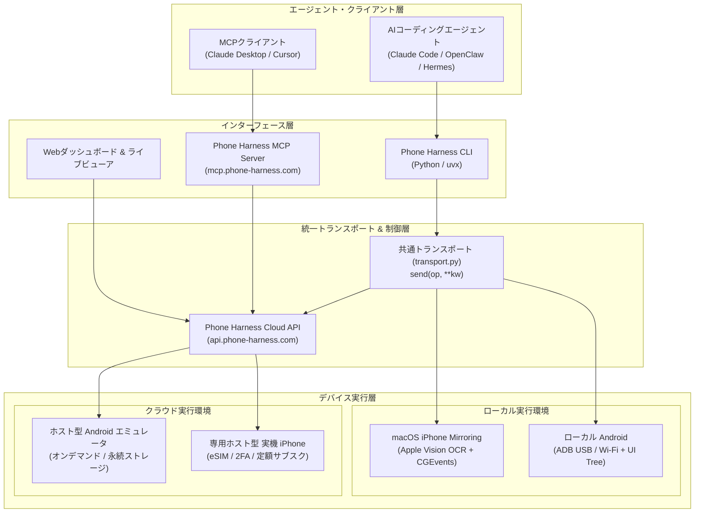

# **Phone Harness 調査レポート**

## **1. 基本情報**

* **ツール名**: Phone Harness
* **ツールの読み方**: フォン ハーネス
* **開発元**: Phone Harness（Shawn Pana / Shawn Pan）
* **公式サイト**: [https://phone-harness.com/](https://phone-harness.com/)
* **関連リンク**:
  * GitHub: [https://github.com/phone-harness/phone-harness](https://github.com/phone-harness/phone-harness)
  * ドキュメント: [https://phone-harness.com/docs](https://phone-harness.com/docs)
  * 公式X (Twitter): [@phone_harness](https://x.com/phone_harness)
  * 公式Discord: [Phone Harness Discord](https://discord.gg/7FwGsjvjS)
* **カテゴリ**: エージェント実行環境/ランタイム
* **概要**: Phone Harnessは、Claude Code、Codex、OpenClawなどの自律型AIエージェントが、本物のスマートフォン（iPhoneおよびAndroid）をタップ・文字入力・スクロール・画面読み取り操作するためのオープンソース実行ハーネスおよびクラウドインフラである。iPhoneの脱獄（Jailbreak）やXcodeプロビジョニング、端末側への特殊アプリ導入を一切必要とせず、ローカル実機からクラウド上の専用実機・エミュレータまでを統一インターフェースで制御できる。

## **2. 目的と主な利用シーン**

* **解決する課題**:
  * 従来のAIエージェントはWebブラウザやデスクトップ環境に限定され、ネイティブモバイルアプリ（配車、デリバリー、金融、各種SNSなど）の自律的な操作やテストが極めて困難だった課題を解消。
  * iOS実機の自動化に不可欠とされていた脱獄や企業署名、複雑なXcode・WebDriverAgent環境構築の摩擦を排除。
  * クラウド上でのモバイル端末調達において、エージェント向けAPI、リアルタイム画面監視、使い捨てセッション、2FA/SMS認証用実電話番号をワンストップで提供。
* **想定利用者**:
  * AIコーディングエージェントを活用してモバイル自動化を構築するエンジニア
  * 実機モバイルアプリのE2Eテストやリグレッション検証を自動化したいQAチーム
  * スマートフォンネイティブの業務（配車、注文、通知確認等）をエージェントに代行させたい開発者
* **利用シーン**:
  * **実機モバイルWeb / ネイティブアプリの自動検証**: ローカルで立ち上げたWebアプリや開発中ネイティブアプリを、エージェントが実機Safari/Chromeやアプリ上で実際にタップ・入力して回帰テストを実行。
  * **日常タスクの完全自律代行**: 「現在地からカフェまでWaymoを配車して」「マップアプリでルートを検索してスクショを送って」といった指示に対し、エージェントが実アプリ画面を認識しながらUIを操作。
  * **クラウドエージェントフリートの並列テスト**: クラウド上のAndroidエミュレータや実機iPhoneをAPI経由でオンデマンドに起動し、複数のAIエージェントに並列で動作検証を実行させる。

### **2.1 代表的な利用フロー**

```mermaid
swimlane-beta TB
  subgraph User["ユーザー"]
    A["自然言語でタスク指示を入力"]
    G["実行結果・画面キャプチャを確認"]
  end
  subgraph Agent["AIエージェント (Claude Code等)"]
    B["スキル起動・画面認識 (screen / ocr)"]
    D["画面解析に基づき操作コードを生成"]
  end
  subgraph Harness["Phone Harness (CLI / Cloud API)"]
    C["端末画面をキャプチャ・座標マッピング"]
    E["OS入力イベント (CGEvents / ADB) を送信"]
  end
  subgraph Device["モバイル端末 (iOS / Android)"]
    F["ネイティブアプリ操作・UI更新"]
  end
  A --> B
  B --> C
  C --> D
  D --> E
  E --> F
  F --> G
```

* **代表的な流れ**: ユーザーが「Waymoを配車して」などのゴールを入力すると、AIエージェントがPhone Harnessのヘルパーを呼び出して端末画面をキャプチャ・OCR解析し、特定されたUI要素の座標に対してタップや文字入力を発行。端末側でアプリが操作された後、更新された画面を再確認してユーザーへ結果を報告する。

## **3. 主要機能**

* **脱獄不要のiOS実機コントロール**: macOS 15（Sequoia以降）の「iPhone Mirroring（iPhone連携）」機能とAppleのVision OCRフレームワーク、Core Graphics HIDイベント（CGEvents）を組み合わせ、端末側に何もインストールせず物理iPhone（iOS 18以降）の完全な画面読み取り・操作を実現。
* **ADB経由の高精度Android操作**: USB接続およびWi-Fiワイヤレスペアリング（mDNS自動検出）に対応し、ADB経由の画面キャプチャと入力イベント送信に加え、OSのアクセシビリティツリー（UI階層情報）を直接パースして高精度な要素特定（`tap_ui`）が可能。
* **Phone Harness Cloud（クラウド端末インフラ）**: 手元に端末がない場合や並列実行が必要な開発者向けに、オンデマンドのAndroidエミュレータ（従量課金）およびクラウド上で常時待機する専用実機iPhone（定額制）をAPI経由で即座に調達可能。
* **実電話番号・eSIM・2FA対応**: Cloud iPhoneでは本物のeSIM回線を提供可能であり、SMS認証コードの受信や2要素認証（2FA）を伴うモバイルアプリの登録・ログイン自動化に対応。
* **状態永続化プロファイル（Saved phone）**: セッション終了時にアプリアイコンの配置、ログイン状態、キャッシュデータを保存し、次回のセッション開始時に同じ状態の端末を復元可能。
* **リアルタイムWebライブビューア**: エージェントが端末を操作している様子をブラウザから低遅延でリアルタイム視認できるライブビューアを提供。必要に応じてユーザー自身が画面をクリックして直接手動操作（介入）することも可能。
* **Phone Harness MCP Server**: Model Context Protocol（MCP）に対応したエンドポイント（`https://mcp.phone-harness.com/mcp`）を提供し、Claude DesktopやCursor、その他MCP対応クライアントから追加設定なしでクラウド端末を呼び出し可能。
* **主要AIエージェント用公式プラグイン**: Claude CodeおよびCodex向けのスキル定義（`SKILL.md`）、OpenClaw向け公式プラグイン（`clawhub:phone-harness`）、Hermes Agent（Nous Research）向けプラグインを提供し、主要なエージェント基盤に1コマンドで組み込み可能。

## **4. 動作原理・システム構成**

* **アーキテクチャ**: ローカルファーストのCLI制御と、クラウドオーケストレーション型SaaS（Phone Harness Cloud）のハイブリッド構成。
* **主要コンポーネントとデータフロー**:
  * **エージェントインターフェース**: AIエージェントはCLIの標準入力やPythonヘルパー関数（`open_app`、`tap_text`、`type_text`、`screen`など）、またはMCP経由でコマンドを発行。
  * **統一トランスポート層 (`transport.py`)**: すべての端末操作を抽象化された `send(op, **kw)` ボキャブラリへ変換し、接続先がローカルiOS、ローカルAndroid、クラウド端末であっても同一のスクリプトで駆動。
  * **ローカルiOSバックエンド**: バックグラウンド動作するiPhone Mirroringウィンドウを常時監視。画面ピクセルをVision OCRで座標付きテキストリストへ変換し、CGEventsでOSレベルのマウスクリック・ドラッグ・キーストロークを生成。
  * **ローカルAndroidバックエンド**: ADBプロトコルを用い、`screencap` による画面取得、`input` コマンドによる操作、および `uiautomator` によるアクセシビリティツリー取得を実行。
  * **Cloud API & トンネリング**: Cloud Androidは安全な一時ポートとワンタイムアンロックコードによるADBトンネル経由で通信。Cloud iPhoneはHTTPSエンドポイント経由で直接操作コマンドを受信。



* **特筆すべき要素技術**:
  * **非侵襲的なiPhone制御**: 従来のiOS自動化で必須だった開発者署名付きWebDriverAgentの注入を排し、OSネイティブのMirroringウィンドウに対するHIDイベント注入とApple Visionフレームワークによる高速ローカルOCRを採用。
  * **アクセシビリティツリーとVisionのフォールバック融合**: AndroidではDOMに相当するUI階層ツリーを優先利用し、アニメーション等でツリーがアイドル状態にならない画面では自動的にピクセルキャプチャ+OCRへとフォールバックする耐障害設計。
  * **ゼロトラスト・サンドボックス分離**: オーケストレータ側がマスターAPIキーを保持してセッションを作成し、実行環境のエージェントには一時的なADB接続先（ホスト・ポート・失効付きアンロックコード）のみを渡すことで、エージェントによる課金乱用やアカウント侵害を物理的に防止。

## **5. 開始手順・セットアップ**

* **前提条件**:
  * **iOS実機をローカルで動かす場合**: macOS 15（Sequoia以降）を搭載したMac、iOS 18以降を搭載したiPhone、Mac側のアクセシビリティおよび画面収録の権限許可。
  * **Android実機をローカルで動かす場合**: macOS、Linux、またはWindows環境、`adb`（Android Platform Tools）のインストール、端末側のUSBデバッグ有効化。
  * **クラウド端末（Phone Harness Cloud）**: [phone-harness.com](https://phone-harness.com/)のアカウント（新規登録で$5の無料クレジット付属）。Python 3.12+および `uv` または `pip`。
* **インストール/導入**:

  ```bash
  # uvを使用した推奨インストール
  uv tool install phone-harness

  # または pip でインストール
  pip install phone-harness
  ```

* **初期設定と環境診断**:

  ```bash
  # 環境設定の健全性を確認（iOSまたはAndroid）
  phone-harness --doctor ios
  phone-harness --doctor android

  # Claude Code 用スキルの自動登録
  mkdir -p ~/.claude/skills/phone-harness
  phone-harness skill > ~/.claude/skills/phone-harness/SKILL.md

  # Phone Harness Cloud へのログイン（ブラウザが起動して承認）
  phone-harness cloud login
  ```

* **クイックスタート**:

  ```bash
  # クラウド端末の起動（ライブビューアが自動で開く）
  phone-harness cloud start

  # Pythonスクリプトによる操作実行
  phone-harness <<'PY'
  open_app("Settings")
  tap_text("Wi-Fi")
  print([item["text"] for item in screen()][:10])
  PY

  # セッションの終了（状態が保存され課金停止）
  phone-harness cloud stop
  ```

## **6. 特徴・強み (Pros)**

* **完全非侵襲・脱獄不要のiOS実機操作**: 従来のiOS自動化に付きまとっていた「Xcode証明書切れ」「iOSアップデートに伴うWebDriverAgentの破損」「脱獄によるセキュリティ崩壊」という課題を根本から解決。
* **統一インターフェース（OS非依存のPythonヘルパー）**: iOS、Android、クラウド端末の差異が `phone_harness.helpers` に隠蔽されており、エージェントはプラットフォームを意識せずに同一のコードで操作可能。
* **実電話番号・eSIMによるSMS/2FAの自動化**: クラウド上の物理実機iPhoneにeSIMを割り当てることで、多くのモバイルアプリでボトルネックとなる「電話番号宛のSMS認証コード」を自動受信・処理可能。
* **エージェントへのクレデンシャル非露出設計**: エージェントが実行するサンドボックス環境にPhone HarnessのマスターAPIキーを渡す必要がなく、セッション単位の一時ポートとアンロックコードのみで動作するため安全性が極めて高い。
* **充実したエコシステム連携**: Claude Code、OpenClaw、Hermes Agent、MCP（Model Context Protocol）に最初から最適化されており、プロンプトを貼るだけで即座にエージェントがスマホ操作能力を獲得する。

## **7. 弱み・注意点 (Cons)**

* **端末ロック画面・生体認証による中断**: iPhoneの画面がロック（パスコード）された場合、ミラーリングが一時停止するため人間のロック解除が必要。AndroidでもPINロック画面はエージェント単独での突破が制限される。
* **テキストを持たないアイコン・グラフィックの制限**: 基本操作はOCRによるテキスト認識を起点とするため、テキストラベルのないアイコンボタンや独自Canvas描画ゲーム等の操作には、Vision機能を持つLLMによる座標推測が別途必要。
* **高度なジェスチャーやDRMコンテンツの非対応**: ピンチイン/ピンチアウトなどのマルチタッチ操作、カメラやFace IDを要求するフローは自動化対象外。また、DRM保護された著作権保護動画はミラーリング上で黒塗り表示となる。
* **日本語UIや特殊フォントに対する認識精度**: Apple Vision OCRおよびAndroid標準の文字認識は英語に最適化されており、日本語の複雑なレイアウトや特殊フォントにおいて座標特定がずれるケースがある。
* **クラウド実機iPhoneの固定コスト**: クラウド上の実機iPhoneは月額$80〜$100（年契約で月額$64〜$80）の定額サブスクリプションであり、個人のホビーユースにはやや敷居が高い。

## **8. 料金プラン**

| プラン名 | 料金 | 主な特徴 |
|---------|------|---------|
| **オープンソース CLI** | 完全無料 | ローカルの物理iPhone（Mac経由）およびAndroid（ADB経由）を無制限に操作可能。MITライセンス。 |
| **Cloud Android emulators** | 無料（従量制）<br>5¢ / 分 | 新規登録時に$5（100分相当）の無料クレジット付属。起動・プロビジョニング時間は無料。アプリ・ログイン状態の永続化、ライブビューア、Agent API、MCP対応。 |
| **Cloud iPhone (月払い)** | $80 / 月<br>（eSIM付き: $100 / 月） | 専有物理実機iPhone。分単位課金なしの定額制。eSIM実電話番号対応（SMS/2FA）、データ永続保持、ライブビューア、Agent API、MCP対応。 |
| **Cloud iPhone (年一括払い)** | $64 / 月相当（$768 / 年）<br>（eSIM付き: $80 / 月相当） | 月払いから20%割引の年間一括契約。専有物理実機iPhoneのフル機能を提供。 |
| **Dedicated phones** | カスタム（要問合せ） | 専有Android/iPhoneの大規模フリート予約、ボリュームディスカウント、請求書払い、直接サポート窓口の提供。 |

* **課金体系**: クラウドAndroidエミュレータは使用した端末の稼働分単位（1分5¢）の従量課金制。クラウド実機iPhoneは1台ごとの月額/年額定額サブスクリプション制。
* **無料トライアル**: 新規アカウント登録時に$5分の無料クレジット（クラウドAndroid 100分稼働相当）が自動付与される。カード登録不要で試用可能。

## **9. 導入実績・事例**

* **導入企業・プロジェクト**:
  * **AIエージェント開発コミュニティ**: Claude CodeやOpenClaw、Hermes Agentを活用する自律型AIエンジニアコミュニティで急速に普及。
  * **モバイルアプリ開発スタートアップ**: モバイルWebおよびReact Native/Flutterアプリのリリース前実機検証環境として採用。
  * **自律型エージェント研究開発**: 自動配車（Waymo）やフードデリバリー、ECアプリの自動購入ワークフローのPoC実証に活用。
* **導入事例**:
  * **実機モバイルWebの自動リグレッションテスト**: ローカルの開発環境を立ち上げた状態でClaude Codeに「実機Safariでローカルサーバーを開いて各画面を回遊し、崩れやコンソールエラーがないか検証せよ」と指示し、テスト時間を80%削減。
  * **Waymo自動配車デモ**: エージェントが実機iPhone上のWaymoアプリを開き、目的地を検索して乗車地点を設定する一連の配車フローを完全自律実行。
* **対象業界**: モバイルアプリ開発、AI・自律型エージェント開発、E2Eテスト自動化/QA事業、業務プロセス自動化（RPA）。

## **10. サポート体制**

* **ドキュメント**: Mintlifyを基盤とした包括的な公式ドキュメント（[https://phone-harness.com/docs](https://phone-harness.com/docs)）、OpenAPI仕様（`openapi.json`）、AIエージェント向けインデックス（`/docs/llms.txt`）が整備されている。
* **コミュニティ**: 公式Discordサーバー（[https://discord.gg/7FwGsjvjS](https://discord.gg/7FwGsjvjS)）、GitHub Discussions、GitHub Issuesが活発に運用されており、開発者のShawn Pana氏が直接質問に対応。
* **公式サポート**: サポート窓口（`support@phone-harness.com`）、導入相談・商談用のオンラインデモ予約（[https://cal.com/shawnpana/phone-harness-demo](https://cal.com/shawnpana/phone-harness-demo)）を提供。

## **11. エコシステムと連携**

### **11.1 API・外部サービス連携**

* **API**: RESTful API（`https://api.phone-harness.com`）が公開されており、セッションのプロビジョニング、ライフサイクル管理、ADB接続情報取得、端末リセット等の全操作が可能。
* **Phone Harness MCP**: Model Context Protocolサーバー（`https://mcp.phone-harness.com/mcp`）を提供。Claude DesktopやCursor等のMCPクライアントからシームレスに呼び出し可能。
* **エージェントフレームワーク連携**:
  * **Claude Code / Codex**: `phone-harness skill` コマンドでエージェントスキルをワンタッチ導入。
  * **OpenClaw**: 公式プラグイン `clawhub:phone-harness` により `phone_exec` ツールを提供。
  * **Hermes Agent**: Nous ResearchのHermes向け公式プラグイン `integrations/hermes` を同梱。
* **決済・インフラ連携**: クレジット課金およびサブスクリプション決済にStripe Checkoutを採用。

### **11.2 技術スタックとの相性**

| 技術スタック | 相性 | メリット・推奨理由 | 懸念点・注意点 |
|:---|:---:|:---|:---|
| **Python 3.12+ / uv** | ◎ | 公式SDK・CLIの主要言語であり、ヘルパーライブラリが完全に最適化されている | なし |
| **Claude Code / Codex** | ◎ | 公式のプロンプトとSKILL.mdが整備され、自動セットアップと操作実行が容易 | 長時間セッション時のトークン消費管理が必要 |
| **OpenClaw / Hermes Agent** | ◎ | 公式プラグインが提供されており、承認フローを含む安全な制御が可能 | プラグインのバージョン追従が必要 |
| **macOS 15+ & iOS 18+** | ◎ | iPhone Mirroringを用いた脱獄不要の非侵襲操作がネイティブ動作 | macOS 14以前やWindows/Linuxホスト単体ではローカルiPhone操作不可 |
| **Android / ADB** | ◎ | OSを選ばず（Mac/Win/Linux）、アクセシビリティツリーを用いた高速・精密な操作が可能 | USBデバッグの事前有効化が必要 |
| **Node.js / TypeScript** | ◯ | MCPサーバーやREST API経由で直接操作可能 | 公式のTypeScript専用SDKは現時点で未提供（API直接呼び出し） |

## **12. セキュリティとコンプライアンス**

* **認証**: Phone Harness CloudではBearer API Keyによる認証を採用。エージェントが操作する実行環境にはセッション単位で使い捨ての一時トークンおよびADBアンロックコードのみが渡される安全な権限制御。
* **データ管理**:
  * 一時Androidエミュレータセッションは、終了時に端末データおよびアプリ情報が完全に初期化・破棄される。
  * 永続保存プロファイル（Saved phone）および専用実機iPhoneのデータはアカウントに紐づけて安全に保持され、ユーザーがAPI/ダッシュボードから明示的にリセットを発行した場合のみ完全消去される。
  * **注意点**: ADB over TCP通信は平文で行われるため、パブリックネットワークを介した機密情報の送受信には暗号化トンネル等の併用が推奨される。
* **準拠規格**: 決済基盤はStripeに準拠（PCI-DSS）。エンタープライズ向けの専用ホスティングや個別SLAについては要問合せ（`support@phone-harness.com`）。

## **13. 操作性 (UI/UX) と学習コスト**

* **UI/UX**:
  * **CLI体験**: `phone-harness cloud start` や `phone-harness doctor` などシンプルで直感的なコマンド体系。
  * **エージェント向けヘルパー**: `open_app("アプリ名")`、`tap_text("ボタン名")`、`type_text("テキスト")` など、直感的なPython関数群が自動インポートされており、LLMが直感的にコードを記述できる。
  * **Webダッシュボード**: 接続中の端末画面がリアルタイムにストリーミング表示され、クリックによる人間側の手動介入もシームレスに行える。
* **学習コスト**: 極めて低い。Claude Code等のエージェントに対して「README記載のセットアッププロンプト」を送信するだけで、エージェント自身がスキルの登録から端末認識までを自動実行するため、利用者は複雑なマニュアルを読む必要がない。

## **14. ベストプラクティス**

* **効果的な活用法 (Modern Practices)**:
  * **オーケストレータとサンドボックスの分離**: マスターAPIキーを管理する親プロセス（オーケストレータ）と、実際にADB/HTTPSで端末を操作するエージェントサンドボックスを明確に分離し、エージェントの暴走による意図しない課金やAPIキー漏洩を防止する。
  * **操作前後の検証ループ（Sense-Act-Verify）**: スクリプト実行前に `screen()` で画面状態を確認し、操作実行後に再度キャプチャを取得して期待する画面遷移が生じたかをエージェントに自己検証させる。
  * **タイムアウトの厳格な設定**: クラウドAndroidセッションを作成する際は、必要最小限の `timeout_seconds`（デフォルト5分など）を明示的に指定し、セッション放置による不要な課金を防止する。
* **陥りやすい罠 (Antipatterns)**:
  * **エージェントにマスターAPIキーを環境変数で渡す**: エージェントが誤ってキーを外部送信したり、無制限にセッションを乱造するリスクがあるため厳禁。
  * **ロック画面の放置**: iPhoneの画面ロックがかかった状態でエージェントを放置すると、セッションが進行せずタイムアウトを迎えるため、事前のロック解除や画面常時点灯（`phone-harness android awake`）を忘れないこと。
  * **DRM保護コンテンツや生体認証画面の自動化**: Netflix等の動画再生画面やFace ID認証画面は技術的にブラックアウトまたは停止するため、自動化フローから除外すること。

## **15. ユーザーの声（レビュー分析）**

* **調査対象**: GitHub Issues / Discussions、Hacker News、X (Twitter)、Reddit、開発者コミュニティ。
* **総合評価**: GitHubで4,000以上のスターを獲得しており、Browser Useの元共同創業者によるプロジェクトとしてAIエージェント開発コミュニティから極めて高い注目を集めている。
* **ポジティブな評価**:
  * 「MacのiPhone Mirroringを活用して脱獄なしで実機iPhoneを動かすアプローチはまさにコロンブスの卵。開発環境の準備が圧倒的に楽になった。」
  * 「Claude Codeにプロンプトを貼るだけで、数分後にはスマホの実アプリをポチポチ操作し始めた光景は衝撃的。」
  * 「クラウド上で物理実機iPhoneとeSIMが使えるため、これまで自動化が不可能だったSMS 2FA認証を伴うモバイルアプリのE2Eテストが実現できた。」
* **ネガティブな評価 / 改善要望**:
  * 「iPhoneのパスコードロックがかかると手動で解除しなければならず、完全なヘッドレス放置運用には一定の制約がある。」
  * 「クラウドiPhoneの月額$80は企業ユースなら格安だが、個人の趣味開発者には少し敷居が高い。時間単位でのレンタルが欲しい。」
  * 「文字のないアイコンやグラフィックUIではOCRが効かないため、高価なVisionモデルを呼び出す必要があり推論コストが嵩む。」
* **特徴的なユースケース**:
  * **モバイルWebアプリのリアルタイムクロスブラウザ検証**: ローカル開発サーバーを起動し、エージェントが実機SafariとChromeの両方で画面をタップしてレイアウト崩れを自動報告。
  * **Waymoやフードデリバリーアプリの自律操作**: 音声やチャットの指示から実機のアプリを立ち上げ、現在地から目的地までの配車手続きを自動で完了させるパーソナルアシスタントの構築。

## **16. 直近半年のアップデート情報**

* **2026-11-02**: **v0.3.3** - Phone Harness MCP（`mcp.phone-harness.com`）の提供開始、OpenClaw公式プラグイン連携（`clawhub:phone-harness`）、公式Discordサーバーの開設、`push_file` および `open_url` ヘルパーの追加、Android画面回転時のバウンディングボックス補正修正。
* **2026-10-12**: **v0.3.2** - セットアップフローをGitクローンから `uv tool install` 方式へ移行、Hermes Agentプラグインのテレメトリオプトイン化および実行前確認・環境変数サニタイズの強化。
* **2026-10-12**: **v0.3.1** - Phone Harness Cloudにおいて「Cloud iPhone（専有物理実機）」の提供を開始、Nous ResearchのHermes Agent向け公式プラグイン公開、iPhone Mirroring一時停止時の自動再接続機能、CLI自動更新チェック機能。
* **2026-09-20**: **v0.3.0** - Phone Harness Cloud（Androidエミュレータ）の提供開始、新規登録者への100分間（$5）無料クレジット付与、`cloud start` によるWebライブビューアの自動起動、常時アニメーション画面に対するピクセル読み取りフォールバック機能。
* **2026-08-18**: **v0.2.0** - Android端末のフルサポート追加（ADB経由、USBおよびWi-Fiワイヤレスペアリング対応、アクセシビリティツリーによる精密UI解析 `tap_ui`）、iOSとAndroidを抽象化する統一トランスポート層（`send(op, **kw)`）の導入、PyPIへの初パッケージ公開。
* **2026-08-17**: **v0.1.0** - 初回一般公開。macOSのiPhone Mirroringウィンドウをバックグラウンドで操作するコア機能（Apple Vision OCRとCore Graphicsイベント注入）、フォーカスを奪わずに操作するバックグラウンドバックエンドの実装。

(出典: [Phone Harness GitHub Releases](https://github.com/phone-harness/phone-harness/releases))

## **17. 類似ツールとの比較**

### **17.1 機能比較表 (星取表)**

| 機能カテゴリ | 機能項目 | Phone Harness | Appium | Android Use | agent-desktop |
|:---:|:---|:---:|:---:|:---:|:---:|
| **対象環境** | 物理実機iPhone（脱獄不要） | ◎<br><small>macOS Mirroring経由で設定不要</small> | △<br><small>Xcode/WDAの複雑な署名必須</small> | ×<br><small>非対応（Android特化）</small> | ×<br><small>非対応（PCデスクトップ特化）</small> |
| **対象環境** | Android端末 / エミュレータ | ◎<br><small>ADB + UI Tree + クラウド</small> | ◎<br><small>UiAutomator2完全対応</small> | ◎<br><small>ADB + AccessibilityTree</small> | ×<br><small>非対応（PCデスクトップ特化）</small> |
| **対象環境** | デスクトップOS (Mac/Win/Linux) | ×<br><small>非対応（モバイル特化）</small> | ◯<br><small>Mac2/WinAppDriver等</small> | ×<br><small>非対応</small> | ◎<br><small>OSアクセシビリティ完全対応</small> |
| **AIエージェント親和性** | MCP / コーディングエージェント連携 | ◎<br><small>MCP, Claude Code, OpenClaw対応</small> | △<br><small>独自ラッパーやMCP開発が必要</small> | ◯<br><small>モジュラーLLM対応</small> | ◎<br><small>Rust/Cライブラリ & CLI</small> |
| **クラウドインフラ** | ホスト型実機・エミュレータ提供 | ◎<br><small>専用実機iPhone & 従量制Android</small> | △<br><small>Sauce Labs等の外部SaaS依存</small> | ×<br><small>ローカル実行環境のみ</small> | ×<br><small>ローカル実行環境のみ</small> |
| **通信・操作認証** | 2FA / eSIM実電話番号サポート | ◎<br><small>Cloud iPhoneでeSIM利用可能</small> | △<br><small>外部SMS受信API連携が必要</small> | ×<br><small>非提供</small> | ×<br><small>非該当</small> |
| **セットアップ難易度** | 環境構築の容易さ | ◎<br><small>uv tool install & プロンプト1行</small> | ×<br><small>Node/Java/SDK/証明書等で高難度</small> | ◯<br><small>Pythonライブラリ</small> | ◎<br><small>単一バイナリ同梱</small> |

### **17.2 詳細比較**

| ツール名 | 特徴 | 強み | 弱み | 選択肢となるケース |
|---------|------|------|------|------------------|
| **Phone Harness** | AIエージェントに特化したモバイル操作ハーネスおよびクラウドインフラ | 脱獄・署名不要の実機iOS/Android操作、MCP/Claude Code標準対応、実機iPhoneクラウド提供 | 端末ロック解除など一部で手動操作が必要、クラウド実機iPhoneの月額コスト | AIエージェントからスマートフォン実機を即座に操作させたい場合、2FA付きモバイルアプリの自動化 |
| **Appium** | モバイルテスト自動化の世界的デファクトスタンダード（W3C WebDriver準拠） | 巨大なエコシステム、圧倒的なテスト自動化実績、多言語SDK対応 | セットアップが極めて複雑、AIエージェントが自律的に扱うにはプロトコルが重い | 厳密なCI/CDパイプラインでの回帰テスト、従来のQA自動化フレームワークとの統合 |
| **Android Use** | Androidネイティブアプリ向けの軽量オープンソースAIエージェントライブラリ | アクセシビリティツリー優先で高速かつ低コスト、Visionモデル非依存 | Android専用（iOS非対応）、クラウド端末インフラやMCP未提供 | Androidアプリに限定した低コスト・高速なローカルAIエージェント実行 |
| **agent-desktop** | PCデスクトップ（macOS/Windows/Linux）向けOSネイティブ操作基盤 | OSアクセシビリティツリー直接参照による超高速操作、ピクセル推測不要 | モバイル端末には非対応（PCデスクトップ専用） | PC上のデスクトップアプリや開発環境をエージェントに自律操作させたい場合 |

## **18. 総評**

* **総合的な評価**:
  * Phone Harnessは、「AIエージェントによる物理スマートフォンの自律操作」という極めて高い参入障壁を、macOSのiPhone Mirroring技術やADB、そしてクラウド実機インフラを巧みに組み合わせることで劇的に引き下げた画期的なツールである。
  * 従来のAppiumのような複雑な環境構築やXcode署名の苦痛を完全に解消し、Claude CodeやOpenClaw等の最新コーディングエージェントにプロンプトを1行渡すだけで、即座に実機アプリを操作できる開発者体験は秀逸である。
* **推奨されるチームやプロジェクト**:
  * モバイルアプリのリリース検証や実機動作確認をAIエージェントで自動化したい開発チーム
  * 配車、フードデリバリー、金融、SNSなどモバイルネイティブなサービスを横断する自律型AIアシスタントを開発するエンジニア
  * クラウド上で複数のAndroid/iOS端末をAPI経由で並列稼働させたいエージェントサービス事業者
* **選択時のポイント**:
  * **PCデスクトップ操作かモバイル操作か**: PCアプリの操作であれば `agent-desktop`、モバイルアプリ（iOS/Android）の操作であれば `Phone Harness` が第一選択となる。
  * **テスト仕様書の厳格実行かエージェントの自律探索か**: 事前に決められた網羅的テストスクリプトをCIで回すなら `Appium`、自然言語の指示に基づきエージェントが柔軟にアプリを探索・操作するなら `Phone Harness` が最適である。
