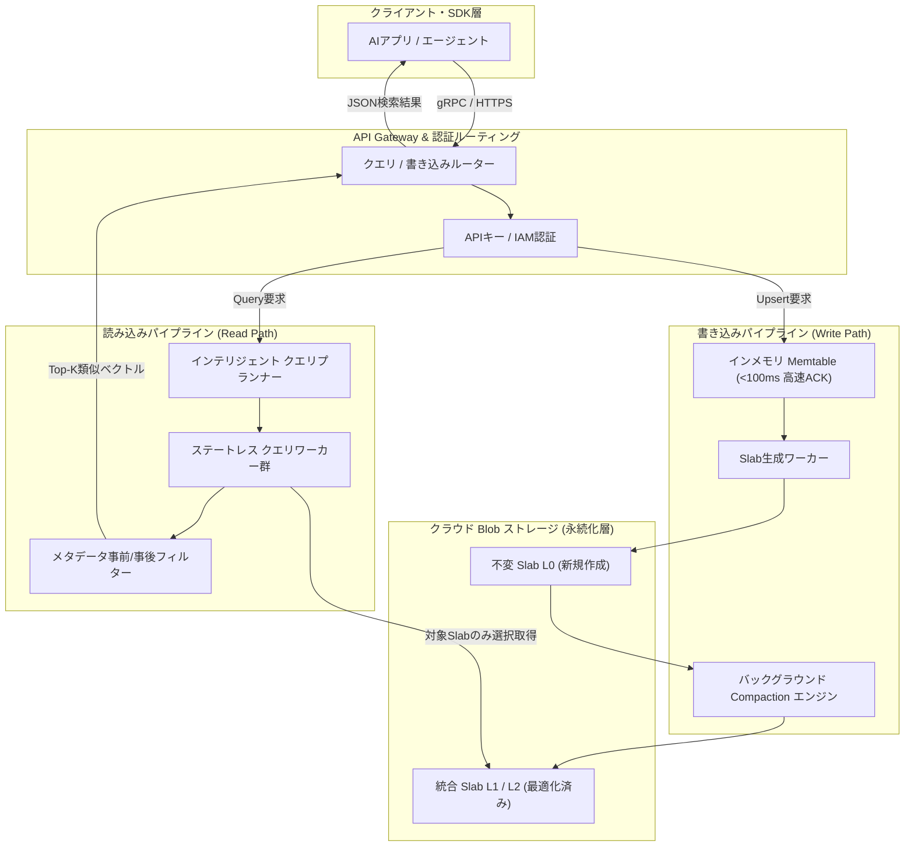

# **Pinecone 調査レポート**

## **1. 基本情報**

* **ツール名**: Pinecone
* **ツールの読み方**: パインコーン
* **開発元**: Pinecone Systems, Inc.
* **公式サイト**: [https://www.pinecone.io/](https://www.pinecone.io/)
* **関連リンク**:
  * ドキュメント: [https://docs.pinecone.io/](https://docs.pinecone.io/)
  * レビューサイト: [G2](https://www.g2.com/products/pinecone/reviews)
* **カテゴリ**: データベース/データストレージ
* **概要**: Pineconeは、大規模なAIアプリケーション、RAG（Retrieval-Augmented Generation: 検索拡張生成）、セマンティック検索向けに最適化されたフルマネージドのServerlessベクトルデータベースである。ストレージとコンピュートを分離したクラウドネイティブ設計を採用しており、インデックスやインフラのサイジング・チューニングを人手で行うことなく、数十億規模のベクトルデータに対してミリ秒単位の超低レイテンシな類似度検索を提供する。

## **2. 目的と主な利用シーン**

* **解決する課題**:
  * 大規模な非構造化データ（テキスト、画像、音声など）の高次元ベクトル化に伴う、ストレージ容量の爆発とインフラ運用コストの高騰
  * 自前でベクトルインデックス（HNSW等）をホスト・維持する際のメモリ管理、クラスタスケーリング、可用性担保の運用負荷
  * RAGシステムにおけるドキュメント検索の精度低下、レイテンシの遅延、およびメタデータ絞り込みとベクトル近傍探索の両立の難しさ
  * 検索用クエリの埋め込み生成（Embedding）とベクトル検索エンジンの多重管理によるシステム構成の複雑化
* **想定利用者**:
  * LLMを活用したRAGシステムやチャットボットを構築するAIエンジニア・ソフトウェアエンジニア
  * 大規模レコメンデーションエンジンや画像・音声の類似検索基盤を運用する機械学習チーム
  * ゼロ運用で安全かつ高可用なセマンティック検索基盤を導入したいエンタープライズ開発組織
* **利用シーン**:
  * **RAG（検索拡張生成）による社内ナレッジ検索**: 社内ドキュメントやマニュアルをチャンク化してベクトル格納し、ユーザーの質問に関連するコンテキストを瞬時に抽出してLLMに提供
  * **Eコマース・コンテンツの類似レコメンデーション**: ユーザーの閲覧履歴や商品特徴の埋め込みベクトルを基に、意味的に近いアイテムをリアルタイムで推薦
  * **マルチテナント型SaaSのセマンティック検索**: Namespaces機能を活用し、数千社・数万ユーザーのデータを論理的に完全分離した状態で同一インデックス内に安全に格納・検索
  * **AIエージェントの長期記憶（Long-term Memory）**: 会話履歴やタスク実行ログを永続化し、過去の経験を類似度検索によってエージェントの推論に動的ロード

### **2.1 代表的な利用フロー**

```mermaid
swimlane-beta TB
  subgraph User["エンドユーザー"]
    A[質問・クエリを入力]
    G[LLM生成回答を閲覧]
  end
  subgraph ClientApp["AIアプリケーション"]
    B[クエリを受領し前処理]
    D[抽出コンテキストとプロンプトを合成]
    F[ストリーミング回答を生成]
  end
  subgraph PineconeServerless["Pinecone (Serverless)"]
    C[ANN近傍探索とメタデータ絞り込み]
  end
  subgraph ModelInference["埋め込み / LLMモデル"]
    E1[テキストのベクトル化]
    E2[プロンプト推論・回答生成]
  end
  A --> B
  B --> E1
  E1 -->|埋め込みベクトル返却| B
  B --> C
  C -->|関連コンテキスト返却| D
  D --> E2
  E2 -->|推論トークン返却| F
  F --> G
```

* **代表的な流れ**: エンドユーザーが自然文で質問を入力すると、AIアプリケーションが外部またはPinecone内蔵の埋め込みモデル（Embedding API）を呼び出して高次元ベクトルに変換する。変換されたベクトルを基にPineconeが超低レイテンシで類似ベクトル検索およびメタデータ絞り込みを行い、関連する高スコアのコンテキストを抽出する。AIアプリケーションはこのコンテキストをプロンプトに組み込んでLLMに送信し、高精度な回答を生成してユーザーにストリーミング返却する。

## **3. 主要機能**

* **Serverless Vector Database**: インフラの事前プロビジョニングやクラスタサイズの設計が不要。クエリトラフィックやストレージ量に応じて自動的にゼロから無限へスケールし、アイドル時はコンピュート費用が発生しない。
* **ストレージ・コンピュート分離アーキテクチャ**: クラウドのBlobストレージを永続化層とし、ステートレスなコンピュートワーカーがクエリ処理を担当。従来の高価なメモリ常駐型クラスタに比べ、保管コストを最大50分の1に削減。
* **ハイブリッド検索（Hybrid Search / Full-Text Search GA）**: 高次元のDense Vector（意味的検索）とSparse Vector / BM25（単語完全一致のキーワード検索）を単一クエリで統合し、Reciprocal Rank Fusion（RRF）等による高度なリランキングと検索精度を実現。
* **リアルタイム・メタデータフィルタリング**: ベクトルデータと同時に構造化メタデータ（作成日時、カテゴリ、ユーザーID、アクセス権限等）を保存可能。近傍探索の前後でブール論理演算による高速なフィルタリングを実行。
* **マルチテナント分離（Namespaces）**: 単一のインデックス内に論理的なパーティション（Namespace）を数千〜数万作成可能。テナントごとに異なるインデックスを立ち上げるコストや管理工数を削減。
* **Pinecone Inference & Documents API**: 外部のEmbedding APIを個別に呼び出すことなく、Pinecone側でテキストの自動ベクトル化（OpenAI、Google、Cohere等のホスト型モデル）とリランキング（Rerank API）を単一APIでシームレスに実行。
* **Pinecone Assistant**: ファイル（PDF, Word, Markdown等）をアップロードするだけで、チャンク分割、埋め込み、ベクトル保存、引用元追跡（Citations）付きのRAG会話インターフェースを即座に構築できるマネージドサービス。
* **pg_pinecone 拡張機能（2026年最新）**: PostgreSQLデータベース内に直接Pineconeの検索エンジンを組み込み、通常のSQLクエリやpgvector互換構文からPineconeの高速ベクトル検索を透過的に実行可能にする拡張モジュール。
* **エンタープライズ・セキュリティ（BYOC / PrivateLink）**: AWS PrivateLinkやAzure Private Linkによる閉域網接続、Bring Your Own Cloud（BYOC）による自社VPC内デプロイ、暗号化キーのユーザー管理（CMEK/BYOK）に対応。

## **4. 動作原理・システム構成**

* **アーキテクチャ**: クラウドネイティブなマルチテナント・Serverlessアーキテクチャ（ストレージとコンピュートの完全分離型SaaS）。AWS、GCP、Azureの主要クラウドリージョンに対応。
* **主要コンポーネントとデータフロー**:
  * **API Gateway & Routing層**: gRPCまたはREST API経由のリクエストを受信し、TLS暗号化、APIキー認証、ルーティングを高速に処理。
  * **書き込みパス (Write Path)**: クライアントからのUpsertリクエストは、まず高可用なインメモリのMemtableに書き込まれ、100ミリ秒未満で即時ACKが返却される。その後、不変（Immutable）なファイル単位である「Slab」としてクラウドBlobストレージ（S3 / GCS / Azure Blob）にフラッシュされる。
  * **バックグラウンド・コンパクション (Compaction Engine)**: 生成された複数の小さなSlab（L0）は、LSMツリー（Log-Structured Merge-tree）の手法に類似したバックグラウンド処理によりマージされ、最適化された階層型Slab（L1, L2）へ定期的に再構築される。
  * **読み込みパス (Read Path)**: 検索クエリを受信すると、インテリジェント・クエリプランナーが必要なSlabセグメントのみを特定。ステートレスなクエリワーカー群がBlobストレージからオンデマンドで取得・キャッシュし、メタデータフィルターを適用した上でANN（近似最近傍探索）を実行して結果を返却する。
* **特筆すべき要素技術**:
  * **分散LSM-Vector Index**: 追記型ストレージモデルにより、高負荷な書き込みと高速な読み込みが互いに干渉（ロック競合）しない分離設計を実現。
  * **量子化（Quantization）とベクトル圧縮**: メモリフットプリントを極限まで削減し、Blobストレージからの高速転送とキャッシュ効率を最大化するベクトル量子化技術。
  * **完全ステートレス・ワーカー**: ノード障害時も状態を持たないため、瞬時に代替インスタンスへフェイルオーバー可能。



## **5. 開始手順・セットアップ**

* **前提条件**:
  * Python 3.8以上 または Node.js 18以上
  * Pinecone アカウント（[https://app.pinecone.io/](https://app.pinecone.io/) にて作成、クレジットカード不要で開始可能）
  * Pinecone 管理コンソールから取得した APIキー（`<PINECONE_API_KEY>`）
* **インストール/導入**:

  ```bash
  # Python SDKのインストール
  pip install pinecone

  # Node.js / TypeScript SDKの場合
  # npm install @pinecone-database/pinecone
  ```

* **初期設定**:
  * Pineconeコンソールの「API Keys」画面でキーを発行し、環境変数に設定する。

  ```bash
  export PINECONE_API_KEY="<PINECONE_API_KEY>"
  ```

* **クイックスタート (PythonによるServerlessインデックス作成・検索)**:

  ```python
  import os
  import time
  from pinecone import Pinecone, ServerlessSpec

  # 1. Pineconeクライアントの初期化
  pc = Pinecone(api_key=os.environ.get("PINECONE_API_KEY", "<PINECONE_API_KEY>"))

  index_name = "sample-serverless-index"

  # 2. Serverlessインデックスの作成（存在しない場合）
  if index_name not in [idx["name"] for idx in pc.list_indexes()]:
      pc.create_index(
          name=index_name,
          dimension=1536,          # 例: OpenAI text-embedding-3-small の次元数
          metric="cosine",         # cosine, dotproduct, euclidean から選択
          spec=ServerlessSpec(
              cloud="aws",         # aws, gcp, azure
              region="us-east-1"   # リージョン指定
          )
      )
      # インデックスの準備完了まで待機
      while not pc.describe_index(index_name).status["ready"]:
          time.sleep(1)

  # 3. インデックスへの接続
  index = pc.Index(index_name)

  # 4. ベクトルのアップサート（Upsert）
  sample_vectors = [
      {
          "id": "doc-001",
          "values": [0.05] * 1536,
          "metadata": {"title": "Pinecone入門", "category": "tech", "year": 2026}
      },
      {
          "id": "doc-002",
          "values": [0.08] * 1536,
          "metadata": {"title": "RAG実践ガイド", "category": "ai", "year": 2026}
      }
  ]
  index.upsert(vectors=sample_vectors, namespace="tutorial-space")

  # 5. メタデータフィルタリングを伴う類似度検索（Query）
  query_vector = [0.05] * 1536
  query_response = index.query(
      vector=query_vector,
      top_k=2,
      include_metadata=True,
      namespace="tutorial-space",
      filter={"category": {"$eq": "tech"}}
  )

  print("検索結果:", query_response)
  ```

## **6. 特徴・強み (Pros)**

* **完全マネージドな運用負荷ゼロのServerless設計**: クラスタのプロビジョニング、レプリカ数やシャーディングの構成、OSやライブラリのパッチ適用などが一切不要。開発者はインデックスを作成するだけで即座に本番稼働できる。
* **驚異的なコストパフォーマンス**: ストレージとコンピュートを分離したことで、従来のメモリ常駐型アーキテクチャと比較してストレージ単価が劇的に安価（$0.33/GB-月）。アクセス頻度が低いコールドデータも無駄なコンピュート費用をかけずに大量保管できる。
* **超低レイテンシと高いスループット**: 高度に最適化されたC++コアエンジンと分散LSM構造により、数億ベクトルの規模でも数十ミリ秒以内のP95レイテンシを安定して維持。
* **豊富なエコシステム統合とDocument/Inference機能**: LangChain、LlamaIndex、Semantic Kernel、OpenAI等の主要AIフレームワークと標準統合。さらに組み込みのEmbedding生成やRerank API、Assistant機能により、周辺コンポーネントを内包してシンプルに構築可能。
* **柔軟なマルチテナンシーとメタデータ制御**: Namespaceによるテナント別論理分離と、豊富な演算子（`$eq`, `$in`, `$gt` 等）を備えたリアルタイム・メタデータフィルタリングにより、複雑なアクセス制御要件に容易に対応。

## **7. 弱み・注意点 (Cons)**

* **完全クローズドソースSaaSによるベンダーロックイン**: PineconeコアのサーバーエンジンはプロプライエタリなクラウドSaaSであり、オープンソース版のセルフホストや完全オフライン・閉域オンプレミス環境での稼働は不可（BYOCによる自社クラウド環境展開はEnterpriseプランで提供）。
* **ローカル開発環境での完全エミュレートの難しさ**: Dockerなどでローカルコンテナとして完全に同一のPineconeインスタンスを立ち上げることはできないため、テスト・開発時にもクラウド上のStarter環境やモックライブラリを使用する必要がある。
* **日本語トークナイズ・BM25ハイブリッド検索の事前準備**: Dense Vectorのセマンティック検索は多言語対応モデルを用いれば高精度に機能するが、Sparse Vector（BM25）によるハイブリッド検索を行う場合、日本語特有の分かち書き（形態素解析）やSparse表現の生成をクライアント側で適切に前処理する必要がある。
* **突発的な大量読み書き時の従量コスト監視**: Serverlessプランは使った分だけの課金である一方、クエリ数（Read Units: RU）や書き込み数（Write Units: WU）が突発的にスパイクした場合、想定外のコストが発生するリスクがあるため、クォータ制限やアラート通知の設定が推奨される。

## **8. 料金プラン**

| プラン名 | 料金 | 主な特徴 |
|---------|------|---------|
| **Starter** | 無料 | ・1プロジェクト、1インデックス（Serverless）<br>・最大2GBストレージ（約200万ベクトル相当）<br>・一定の月間RU/WU枠、コミュニティサポート<br>・プロトタイプ開発や個人学習向け |
| **Builder** | $20/月 | ・最大1,000 Namespaces対応<br>・月額固定費用でStarterの制限を緩和<br>・ソロ開発者や小規模プロダクション向け |
| **Standard** | 月額$50〜<br><small>（最低利用料$50、超過分は従量課金）</small> | ・無制限のインデックスとNamespaces<br>・Serverless従量課金（ストレージ + RU + WU）<br>・99.9%稼働率SLA、メールサポート<br>・本番稼働のAIアプリケーション向け |
| **Enterprise** | 月額$500〜<br><small>（最低利用料$500、超過分は従量課金）</small> | ・99.99%稼働率SLA、24/7/365専任サポート<br>・AWS/Azure PrivateLink、BYOK/CMEK暗号化<br>・HIPAA BAA対応、BYOC（自社VPCデプロイ）オプション<br>・Dedicated Read Nodes（専用読込ノード）の利用 |

* **課金体系**:
  * **ストレージ費用**: $0.33 / GB-月（インデックスに保持されているデータ量に基づき日割り計算）
  * **Read Units (RU)**: クエリ処理量に応じた課金（約$16〜$24 / 100万RU。1クエリで読み出すデータサイズやTop-KによりRU数が決定）
  * **Write Units (WU)**: ベクトルの挿入・更新・削除量に応じた課金（約$2.00〜$6.00 / 100万WU）
* **無料トライアル**: Starterプランは恒久無料。新規登録時にStandardプランで利用可能な$300相当のクレジット（21日間有効）が付与されるセルフサーブアップグレードパスが用意されている。

## **9. 導入実績・事例**

* **導入企業**:
  * **Shopify**: 数百万点に及ぶグローバル商品のセマンティック検索とパーソナライズ推薦エンジンに導入
  * **Notion**: Notion AIのナレッジ検索およびRAGパイプラインのベクトル基盤として活用
  * **Gong**: 営業ミーティングの音声テキストログから関連インサイトを瞬時に抽出する分析基盤に採用
  * **ClickUp**: プロジェクトタスク・ドキュメント全体の横断セマンティック検索とAIアシスタントに利用
  * **HubSpot**: カスタマーサポートおよびCRM内の自動応答・ナレッジレコメンデーションに採用
* **導入事例**:
  * Shopifyでは、従来のキーワード検索では捉えきれなかった曖昧なユーザー意図をベクトル類似度検索で補完し、検索経由のコンバージョン率を大幅に向上。
  * Notionでは、マルチテナント環境下で各ユーザー・組織の権限に応じたメタデータフィルタリングと高速検索を組み合わせ、セキュアなAI検索を実現。
* **対象業界**:
  * IT・SaaS、Eコマース、フィンテック、メディア、ヘルスケアなど、非構造化データを活用したAIプロダクトを開発するあらゆる業界。特にスタートアップから大規模メガテックまで幅広く採用されている。

## **10. サポート体制**

* **ドキュメント**:
  * 公式ドキュメント（[https://docs.pinecone.io/](https://docs.pinecone.io/)）: チュートリアル、言語別SDKガイド、APIリファレンス、サンプルコード集が極めて充実。
  * Pinecone Learn: ベクトル検索のアルゴリズム解説、RAG設計論、ハイブリッド検索の理論などを学べる教育リソースを無償公開。
* **コミュニティ**:
  * Pinecone Community Forum（[https://community.pinecone.io/](https://community.pinecone.io/)）: 開発者同士のQ&Aやベストプラクティスが盛んに共有されている。
  * 公式DiscordサーバーおよびGitHubディスカッションによるアクティブな技術交流。
* **公式サポート**:
  * **Starter / Builder**: コミュニティフォーラムによるセルフサポート。
  * **Standard**: 公式チケット・メールサポート（営業時間内の対応、SLA 99.9%）。
  * **Enterprise**: 24/7/365の緊急対応、専任テクニカルアカウントマネージャー（TAM）、カスタムSLA（99.99%）。

## **11. エコシステムと連携**

### **11.1 API・外部サービス連携**

* **API**: gRPCおよびRESTful HTTP APIを完全提供。OpenAPI仕様準拠の仕様書が公開されており、高スループットが求められるバックエンド通信には低オーバーヘッドなgRPCプロトコルが自動適用される。
* **公式SDK**: Python、TypeScript/JavaScript、Go、Java、C#/.NET を公式サポート。
* **AIオーケストレーション連携**:
  * **LangChain / LlamaIndex**: ベクトルストア（VectorStore）コネクタとして最重要パートナーの1つであり、数行のコードで統合可能。
  * **Semantic Kernel / Haystack**: MicrosoftやDeepsetのエコシステムでも公式プロバイダーとして標準対応。
* **クラウド・データパイプライン連携**:
  * **Airbyte / Fivetran**: データベースやSaaSからのデータ同期パイプラインに標準対応。
  * **AWS / GCP / Azure**: 各社クラウドマーケットプレイスを通じた調達、VPC接続、IAM連携に対応。
  * **PostgreSQL (pg_pinecone)**: Postgresから直接Pineconeインデックスを呼び出すSQLネイティブ連携。

### **11.2 技術スタックとの相性**

| 技術スタック | 相性 | メリット・推奨理由 | 懸念点・注意点 |
|:---|:---:|:---|:---|
| **Python (FastAPI / LangChain)** | ◎ | 公式SDKの機能更新が最速で反映。NumPyやPyTorchとの親和性が抜群。 | 特になし。事実上の標準開発環境。 |
| **Node.js / TypeScript (Next.js)** | ◎ | 公式型定義完備のSDK提供。エッジランタイムやサーバーレス関数とも好相性。 | 大量ベクトルの一括バッチ生成はバックエンドへの委譲を推奨。 |
| **PostgreSQL (RDB)** | ◎ | 2026年提供の `pg_pinecone` 拡張により、リレーショナルデータと透過的に結合可能。 | 拡張機能のインストール要件や権限設定に留意が必要。 |
| **Go** | ◯ | 公式Go SDK提供。高スループットなマイクロサービスとの統合が容易。 | Python向けの高水準AIラッパーに比べると実装コード量はやや多め。 |
| **Java / Kotlin (Spring Boot)** | ◯ | 公式Java SDK提供。エンタープライズバックエンドでの安定稼働に対応。 | AIパイプライン全体のPython依存とのブリッジ設計が必要。 |
| **ローカル完結型 (完全オフライン)** | × | クラウド専用SaaSのため、インターネット非接続環境では動作不可。 | ChromaやQdrant（ローカルモード）の検討が必要。 |

## **12. セキュリティとコンプライアンス**

* **認証**:
  * 組織・プロジェクトごとのAPIキー認証、細粒度の権限管理（RBAC）。
  * SAML 2.0 / Okta / Azure AD等を利用したシングルサインオン（SSO）および多要素認証（MFA）に対応（Enterprise）。
* **データ管理**:
  * **保管時暗号化 (Encryption at Rest)**: AES-256によるデータ暗号化。Enterpriseプランではユーザー独自の暗号化キーを適用できるBYOK/CMEKに対応。
  * **転送時暗号化 (Encryption in Transit)**: TLS 1.3 / HTTPS / 安全なgRPC通信。
  * **ネットワーク分離**: パブリックエンドポイントに加え、AWS PrivateLinkやAzure Private Linkによる閉域接続、自社VPC内にデプロイするBYOC（Bring Your Own Cloud）に対応。
* **準拠規格**:
  * **SOC 2 Type II** 認定取得済み
  * **ISO 27001** 認証取得済み
  * **HIPAA** 準拠（BAA締結オプションあり、Enterprise）
  * **GDPR / CCPA** 準拠

## **13. 操作性 (UI/UX) と学習コスト**

* **UI/UX**:
  * **Web管理コンソール**: 極めて洗練されており、インデックスの作成、ステータス確認、使用量メトリクス（RU/WU、ストレージ消費推移）がグラフィカルに一目で把握可能。
  * **データエクスプローラー**: コンソール上から直接インデックス内のベクトルID、メタデータ、名前空間のレコードを検索・プレビュー・削除できるGUIが完備されている。
* **学習コスト**:
  * **導入の敷居は極めて低い**: クラスタのサイジングやシャード数の指定が不要（`dimension` と `metric` のみを指定して作成）なため、初学者でも数分で「Hello World」を実行可能。
  * **実運用時の注意点**: コスト最適化のためのRU消費の仕組み（Top-K数と返却メタデータサイズがRUに与える影響）や、効果的なメタデータインデックスの設計、ハイブリッド検索におけるSparse-Denseの重み調整などには一定の学習が必要。

## **14. ベストプラクティス**

* **効果的な活用法 (Modern Practices)**:
  * **Namespaceを活用したマルチテナンシー**: 顧客ごとやデータソースごとにインデックスを分けるのではなく、単一のServerlessインデックス内でNamespaceを分割する運用にすることで、インデックス管理工数を削減し課金を統合。
  * **メタデータサイズの最小化**: 検索結果として返却したい必要最小限の属性（ID、タイトル、ソースURL、カテゴリ等）のみをメタデータに格納し、ドキュメントの長大な本文データそのものは外部のオブジェクトストレージ（S3等）やドキュメントストアに持たせて参照IDで結合することで、RU消費とストレージコストを抑制。
  * **Pinecone Inferenceの積極活用**: アプリケーション側で自前でEmbeddingモデルをホスト・スケールさせる代わりに、Pinecone内蔵のInference API（Documents API）を利用して、データ投入・検索クエリ作成のアーキテクチャを簡素化。
  * **ハイブリッド検索での精度向上**: 固有名詞やコード型番などの完全一致検索にはBM25（Sparse Vector）、概念的な意味の類似度にはDense Vectorを組み合わせ、ハイブリッド検索を適用してハルシネーションを防止。
* **陥りやすい罠 (Antipatterns)**:
  * **過大なメタデータの格納**: ベクトルのメタデータに数万文字に及ぶ生テキストや不要なバイナリを含めると、メタデータ上限（通常40KB）に達するだけでなく、クエリごとのデータ読み出しサイズが増加してRead Units（RU）が過剰消費される。
  * **高次元ベクトルの不適切な距離尺度選択**: モデルが正規化された埋め込みを出力している場合は `dotproduct` や `cosine` を選択すべきであり、モデルの推奨メトリックと異なる距離計算を指定すると検索精度が著しく劣化する。
  * **ループ処理による単一ベクトルUpsert**: 大量データを投入する際に1件ずつUpsertを実行するとネットワーク往復レイテンシが増大し大幅に遅延する。100〜500件程度のバッチ単位でUpsertを実行することが強く推奨される。

## **15. ユーザーの声（レビュー分析）**

* **調査対象**: G2、コミュニティフォーラム（Reddit、Discord）、各種技術ブログ・評価レポート
* **総合評価**: **4.4 / 5.0** (G2 レビュー 約80件以上)
* **ポジティブな評価**:
  * **インフラ運用の完全な解放**: 「クラスタのサイジングやメンテナンスに頭を悩ませることなく、APIを叩くだけで超高速なベクトル検索が手に入る。Serverlessモデルへの移行により、月額数ドルのプロトタイプから大規模商用までシームレスに拡張できる」（AIスタートアップ創業者）
  * **SDKの使いやすさとエコシステム連携**: 「LangChainやOpenAIとの連携が極めて直感的で、最初のPoC構築がわずか半日で完了した。Python SDKの完成度が高い」（ソフトウェアエンジニア）
  * **ミリ秒単位の安定したレイテンシ**: 「数千万件規模のインデックスに対しても、P95レイテンシがブレずに一貫して高速に応答してくれる」（プロダクト開発リード）
* **ネガティブな評価 / 改善要望**:
  * **オフライン・ローカルテスト環境の欠如**: 「完全なマネージドクラウド専用であるため、ローカルDockerでモックやテスト用DBを完全に自前再現することが難しく、CI/CDでPinecone実環境にアクセスするかモックライブラリを作り込む必要がある」（リードバックエンドエンジニア）
  * **スケール時のコスト予測**: 「データ量やリクエスト数が急増した際、RU/WUの従量課金がどのように膨らむかの見積もりに慣れが必要。急激なクエリ増に対する課金上限ガードレールをもっと強化してほしい」（インフラエンジニア）
* **特徴的なユースケース**:
  * **金融・法律ドキュメントの高度なコンプライアンスRAG**: Namespaceごとの権限分離とメタデータの作成年・法域フィルタリングを組み合わせ、厳格な監査証跡を維持しながら瞬時に条文検索を行うシステムでの活用。

## **16. 直近半年のアップデート情報**

* **2026-10-22**: **PostgreSQL拡張 `pg_pinecone` のオープンソースリリース** - PostgreSQLデータベース内から直接Pineconeのベクトル検索を実行できる公式拡張モジュールを公開。既存のSQLテーブルと透過的に結合可能。
* **2026-10-08**: **Documents APIにおける統合埋め込み（Integrated Embedding）の機能強化** - 生テキストを送信するだけでPinecone側で自動ベクトル化とインデックス登録を完結。Google `gemini-embedding-2` および OpenAI `text-embedding-3-small` / `large` のビルトインモデル対応を拡充。
* **2026-10-01**: **Pinecone BYOC（Bring Your Own Cloud）On-Demand Modeの提供** - 顧客自社のクラウドVPC内にPineconeのデータプレーンを自動プロビジョニングし、オンデマンドで利用できるモードを追加。
* **2026-09-15**: **Full-Text Search（全文検索機能）の一般提供（GA）** - ベクトルによるセマンティック検索に加え、インデックス内部でのBM25全文キーワード検索をGA。シームレスなハイブリッド検索を単一APIで実現。
* **2026-08-20**: **Pinecone Nexus の GA** - 自律型AIエージェント向けに最適化された、エンタープライズ規模のナレッジレイヤー管理・オーケストレーション基盤を正式提供。
* **2026-07-01**: **四半期APIバージョン `2026-07` のリリース** - 12ヶ月の長期サポート（LTS）を提供する安定版API仕様の更新とSDKのメジャーアップデート。
* **2025-10-15**: **Dedicated Read Nodes（専用読込ノード）の導入** - 大規模なQPS（秒間クエリ数）を要求されるエンタープライズ向けに、確定的な計算資源を割り当てる専用リードノード機能を提供。
* **2025-03-25**: **AIエージェント向けServerless最適化とバックアップ/リストアAPI** - バースト性の高い大量の小さなNamespacesを効率的に処理するLSM適応型インデックスの強化、およびポイントインタイムリカバリ（PITR）APIをリリース。

(出典: [Pinecone Product Updates & Release Notes](https://www.pinecone.io/blog/category/product-updates/))

## **17. 類似ツールとの比較**

### **17.1 機能比較表 (星取表)**

| 機能カテゴリ | 機能項目 | Pinecone | Qdrant | Weaviate | pgvector (Supabase) |
|:---:|:---|:---:|:---:|:---:|:---:|
| **基本機能** | ベクトル類似度検索 | ◎<br><small>完全Serverlessで超低レイテンシ</small> | ◎<br><small>Rust製で超高速</small> | ◎<br><small>Go製で高機能</small> | ◯<br><small>RDB拡張で標準対応</small> |
| **デプロイ形態** | クラウドマネージド (SaaS) | ◎<br><small>完全自動スケール・運用不要</small> | ◯<br><small>Qdrant Cloud提供</small> | ◯<br><small>Weaviate Cloud提供</small> | ◎<br><small>Supabase Cloud等で利用可能</small> |
| **デプロイ形態** | セルフホスト / OSS | ×<br><small>非公開SaaS専有（BYOCはあり）</small> | ◎<br><small>オープンソース（Apache 2.0）</small> | ◎<br><small>オープンソース（BSD 3-Clause）</small> | ◎<br><small>オープンソース（PostgreSQL拡張）</small> |
| **検索機能** | ハイブリッド検索 (Dense+Sparse) | ◎<br><small>Full-Text GAと統合API</small> | ◎<br><small>Sparse Vector標準対応</small> | ◎<br><small>BM25+Denseの統合ハイブリッド</small> | ◯<br><small>pg_trgm / Full-Textと手動結合</small> |
| **データ管理** | メタデータフィルタリング | ◎<br><small>高速な演算子と自動最適化</small> | ◎<br><small>ペイロードインデックス機能</small> | ◯<br><small>GraphQL/REST対応</small> | ◎<br><small>SQLのWHERE句による自由な結合</small> |
| **運用性** | ゼロ運用 / Serverless | ◎<br><small>ストレージ・コンピュート完全分離</small> | ◯<br><small>Serverlessプラン提供</small> | ◯<br><small>Serverlessプラン提供</small> | △<br><small>DBリソース・VACUUM管理が必要</small> |
| **エコシステム** | RAG / 内蔵Inference | ◎<br><small>Documents API・Assistant内蔵</small> | ◯<br><small>FastEmbed等のライブラリ</small> | ◎<br><small>豊富なVectorizerモジュール</small> | △<br><small>外部Embedding呼び出しが基本</small> |

### **17.2 詳細比較**

| ツール名 | 特徴 | 強み | 弱み | 選択肢となるケース |
|---------|------|------|------|------------------|
| **Pinecone** | ストレージ・コンピュートを分離したServerless特化のマネージドベクトルDB | 運用管理工数が完全にゼロ。大規模でも超低レイテンシ。InferenceやAssistant等RAGスタックが統合。 | オープンソース版が存在せずクラウド専有。突発的な大量利用時のRU/WUコスト管理が必要。 | インフラ運用に工数を割かず、即座にスケーラブルな本番用RAGやAI検索を構築したい場合。 |
| **Qdrant** | Rust言語で開発された超高速・軽量なオープンソースベクトル検索エンジン | メモリ効率と検索スループットが極めて高く、ローカルDocker、オンプレミス、クラウドのどこでも自由に動く。 | クラスタの自己運用にはKubernetesや分散システムの知識が必要。 | オンプレミスや自社インフラでセルフホストしたい場合や、Rustの極限性能を求める場合。 |
| **Weaviate** | GraphQLインターフェースや豊富なAIモジュールを備えた多機能オープンソースベクトルDB | テキスト・画像・音声のベクトル化モジュールが内蔵され、マルチモーダルやハイブリッド検索に強い。 | 内部構造が多機能なぶん設定項目が多く、運用とトラブルシューティングの学習コストが高め。 | マルチモーダル検索やGraphQLを活用した複雑なオブジェクトリレーションを扱う場合。 |
| **pgvector (Supabase)** | PostgreSQLのリレーショナルデータベース上でベクトル検索を実現する拡張モジュール | 既存のPostgresデータベース内でSQLを使って顧客情報や注文履歴とベクトルを直接結合（JOIN）可能。 | 数千万〜数億規模の超大規模ベクトルになるとメモリ消費とインデックス再構築の負荷が急増する。 | 既にPostgreSQL/Supabaseを運用しており、ベクトル数が数十万〜数百万件程度でRDBと密結合させたい場合。 |

## **18. 総評**

* **総合的な評価**:
  * Pineconeは、生成AI・RAG時代における「ベクトルインフラ運用の難しさ」を徹底的に排除した先駆的かつデファクトスタンダードのマネージドサービスである。かつてのPodベースからServerlessアーキテクチャへと全面的に刷新したことで、ストレージコストを極小化しつつ、ゼロから数十億規模までの自動スケーリングを実現している。さらに、2026年に入りPostgreSQL連携（`pg_pinecone`）やDocuments APIによる統合埋め込み、Full-Text SearchのGAなど、単なる「ベクトルの入れ物」を超えた総合的なAIナレッジ基盤へと進化を遂げている。
* **推奨されるチームやプロジェクト**:
  * **AIプロダクトを最速で立ち上げたいスタートアップ**: インフラ保守要員を割くことなく、Starterプラン（無料）から始めてプロダクションスケールまでコードの書き換えなしでスケール可能。
  * **エンタープライズの社内ナレッジ検索・RAG開発チーム**: SOC 2 Type IIやHIPAA、AWS PrivateLink、BYOCなどのセキュリティ要件を満たしつつ、安定した低レイテンシ検索基盤を導入したい企業。
  * **マルチテナント型AI SaaSを開発するチーム**: Namespaces機能とメタデータフィルタリングを組み合わせることで、テナントごとのデータ分離を最小のコストと運用負荷で実現したい組織。
* **選択時のポイント**:
  * 自社のポリシーとしてオンプレミスや閉域ネットワーク内での「完全なオープンソースのセルフホスト」が必須である場合は、QdrantやWeaviateが有力な候補となる。
  * また、既存のPostgreSQLデータベースと密に結合した小〜中規模の検索であればpgvector（Supabase等）で十分なケースもある。
  * 一方で、「データベースのシャーディングやインデックス再構築、メモリ管理の運用から完全に解放され、ミリ秒単位の安定した高速検索とスケーラビリティを享受したい」という要件であれば、Pineconeが現在最も完成度の高い第一選択肢となる。
