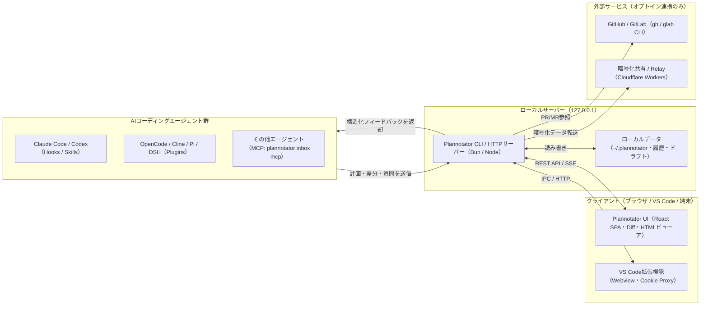

# **Plannotator 調査レポート**

## **1. 基本情報**

* **ツール名**: Plannotator
* **ツールの読み方**: プラノテーター
* **開発元**: backnotprop（オープンソースプロジェクト）
* **公式サイト**: [https://plannotator.ai](https://plannotator.ai)
* **関連リンク**:
  * GitHub: [https://github.com/backnotprop/plannotator](https://github.com/backnotprop/plannotator)
  * ドキュメント: [https://docs.plannotator.ai](https://docs.plannotator.ai)
* **カテゴリ**: AI開発ワークフロー
* **概要**: Plannotatorは、Claude Code、Codex、OpenCode、Gemini CLIなどのAIコーディングエージェントと開発者の間に位置する、ローカルファーストかつブラウザベースのレビュー・アノテーションワークスペースである。エージェントが提示する実装計画（Plan）、Markdown仕様書、HTML成果物、コード差分（Diff）を自動フックまたはコマンド経由で視覚的なUIに表示し、行単位のコメントや削除指定などの赤入れ結果を構造化フィードバックとしてエージェントへ直接返送する。

## **2. 目的と主な利用シーン**

* **解決する課題**: AIコーディングエージェントが高速に実装計画や数百行のコード差分を生成する中、ターミナル上で長文テキストを読み解いて曖昧な指示文や単純な `(y/n)` 承認を行う作業が開発者の大きなボトルネックとなっていた。Plannotatorは「Human-in-the-Loop（人間参加型）」の視覚的レビュー層を提供することで、設計段階での誤りを早期に修正し、手戻りを最小化する。
* **想定利用者**: AIコーディングエージェントを日常的に活用するソフトウェアエンジニア、複数の自律型エージェントを並列運用するテックリード・アーキテクト、ローカル環境で安全に仕様レビューやPRレビューを行いたい開発チーム。
* **利用シーン**:
  * **エージェント実装計画の事前レビュー**: Claude Codeなどが `ExitPlanMode` に入ったタイミングでブラウザを開き、実装方針の特定ステップへの修正指示や削除指定を行ってから実装に進ませる。
  * **ローカル変更・リモートPRのコードレビュー**: 未コミットのGit差分、GitButlerワークスペース、Jujutsu (`jj`)、Perforce (`p4`)、あるいはGitHub PR / GitLab MRを統一UIでレビューし、指摘事項をエージェントへ返して自動修正させる。
  * **マルチエージェントの非同期統合管理（Plannotator Inbox）**: 並列稼働する複数のコーディングエージェントやパーソナルアシスタントからの質問、成果物、判断待ちタスクを1つのローカルInboxに集約し、エージェントのセッションをブロックせずに回答・指示を返す。

### **2.1 代表的な利用フロー**

```mermaid
swimlane-beta TB
  subgraph User["ユーザー（開発者）"]
    A[タスクを指示]
    D[ブラウザ上で計画や差分に注釈・承認]
  end
  subgraph Agent["AIエージェント（Claude Code等）"]
    B[実装計画やコード差分を生成]
    F[構造化フィードバックに基づき修正・実装]
  end
  subgraph Plannotator["Plannotator（ローカルサーバー・UI）"]
    C[フックで検知しレビューUIを起動]
    E[注釈を行単位の構造化データへ変換]
  end
  subgraph External["外部連携（Git / ノート / 共有）"]
    G[Git PR連携・Obsidian保存・暗号化共有]
  end
  A --> B
  B --> C
  C --> D
  D --> E
  E --> F
  E --> G
```

* **代表的な流れ**: 開発者がAIエージェントにタスクを指示すると、エージェントが生成した計画や差分をPlannotatorのフック/プラグインが検知し、ローカルHTTPサーバーを起動してブラウザ（またはVS Codeタブ）にレビュー画面を表示する。開発者が視覚的に赤入れ・コメントを行って送信すると、Plannotatorが正確な行位置に紐づいた構造化フィードバックとしてエージェントの次ターンへ返し、必要に応じてObsidian保存やGitHub/GitLab連携も実行する。

## **3. 主要機能**

* **Plan Modeインターセプトと計画書レビュー**: Claude Codeの `ExitPlanMode` やCodexの `Stop` フック、OpenCodeプラグインなどを通じてエージェントの計画提案を自動検知し、Markdown形式の実装計画をブラウザ上で視覚的にレビュー・承認・差し戻しできる。
* **インラインアノテーション（赤入れ・置換・削除）**: テキストやコードの特定行・範囲を選択し、コメント付与、削除マーキング（Redline）、代替コード・テキストの提案を直感的に記述できる。プロファイル設定でVimキーバインド（`j`/`k`/`l`/`h`、Visual選択）やターゲットHUDも利用可能。
* **コードレビューとマルチVCS/PR対応**: 未コミットの変更、ステージ済み差分、未追跡ファイルを統合したSide-by-Side / Unified Diffビューアを備える。Gitに加え、GitButler、Jujutsu（`jj`）、Perforce（`p4`）、静的パッチファイル、GitHub PR・GitLab MRのURL指定レビューに対応する。
* **Guided Review（ガイド付きレビュー）**: 大規模な差分に対して `Guide`（`Cmd/Ctrl+Shift+G`）を実行すると、AIエージェントが変更内容を重要度順の「チャプター（章）」に整理し、左側に概要解説、右側に注釈可能な実差分を並べて効率的にレビューできる。
* **Plannotator Inbox（マルチエージェント受信トレイ）**: 複数のコーディングエージェント（Claude Code、Pi、OpenCode、Cline、Hermes、OpenClaw等）が非同期に送信した質問、画像付き選択肢、ファイル、レビュー依頼を単一画面に集約する。セッションを待機状態のまま拘束せず、後から一括または個別に返信できる。
* **HTMLアーティファクト・ライブサイト注釈**: ローカルのHTMLファイルや `http://localhost:5173` などの開発中ライブサイトをローカルプロキシ経由で開き、ホットリロードを維持したまま実画面上に直接コメントを付けられる（`plannotator annotate`）。
* **内蔵AIアシスタント（Ask AI / Review Agents）**: レビュー画面内から対象箇所についてAIへ質問したり、セキュリティチェックリスト等のカスタムレビュー用スキルを実行して差分上に自動コメントを投稿させたりできる。
* **外部ノート連携と暗号化URL共有**: 承認した計画書をObsidian、Bear、Octarine、Notionへ自動保存できるほか、計画データをリンク自体に埋め込むか（小規模時）、暗号化して一時アップロード（7日間有効）してチームメンバーと共有し、相手のコメントを取り込める。
* **VS Code拡張機能とターミナルTUI（Herdr Annotate / Plannotator TUI）**: 外部ブラウザの代わりにVS Code内のタブ・Diffビューで完結させる公式拡張機能に加え、ターミナル内で完結するTUI版もエコシステムとして提供されている。

## **4. 動作原理・システム構成**

* **アーキテクチャ**: ローカルファーストのクライアント・サーバー構成（シングルバイナリ＋エージェント別プラグイン/フック）。クラウドへの常時接続を前提とせず、ユーザーのローカルマシン（`127.0.0.1`）上で一時的または常駐のHTTPサーバーを起動し、ビルド済みのシングルファイルSPA（ReactベースUI）を配信する。
* **主要コンポーネントとデータフロー**:
  1. **エージェント連携層（Hooks / Plugins / Skills / MCP）**: `apps/hook`（Claude Codeプラグイン）、`apps/opencode-plugin`、`apps/cline-plugin`、`apps/dsh-plugin`（DeepSeek Harness）、`apps/pi-extension`、`apps/hermes-plugin`、`apps/openclaw-plugin` などが各エージェントのライフサイクルを捕捉し、CLIバイナリを呼び出す。汎用エージェント向けには `plannotator inbox mcp` によるMCPサーバー接続も提供する。
  2. **ローカルサーバー層（Bun / Node.jsデュアルランタイム）**: `packages/server`（Bunベース、単一バイナリへコンパイル可能）と `apps/pi-extension/server`（Pi環境向けNode互換）が `/api/plan`、`/api/approve`、`/api/deny`、`/api/draft` などのREST APIおよびSSE（`/api/ai/query`）を提供する。
  3. **ローカルデータストア**: 計画履歴、承認/却下アーカイブ、ドラフト、設定ファイル（`config.json`）はデフォルトで `~/.plannotator`（または `$XDG_DATA_HOME/plannotator`、`PLANNOTATOR_DATA_DIR`）に保存される。UI設定はポートが毎回ランダムに割り当てられる仕様上、localStorageではなくCookieに保存される。
  4. **共有・リレー層（オプトイン）**: URL共有時は暗号化後に `apps/paste-service` へ一時保存（7日期限）される。モバイル等からのInbox遠隔操作にはCloudflare Worker + Durable Objectで構成された `apps/relay` が暗号文のみを中継する。



* **特筆すべき要素技術**:
  * **Bun単一バイナリコンパイルとシングルファイルHTML配信**: `apps/hook/server/index.ts` を `bun build --compile` で単一実行バイナリ化し、ViteでバンドルしたUI（`index.html`、`review.html`、`inbox.html`）をバイナリ内メモリから直接配信する設計により、外部依存なしの高速起動を実現している。
  * **厳格なパス・オリジン・CSPガード**: `/api/doc` や `/api/image` ではシンボリックリンク解決後の実ファイル種別検証、`isThisMachineReader` によるリバースプロキシ/Tailscale判別、外部HTML表示時の `connect-src 'none'` 注入など多層防御を実装している。
  * **VS Code IPC / Cookie Proxy**: 各フック起動でポートが変わる問題に対し、VS Code拡張機能側でCookieプロキシとIPCサーバーを立ててセッション間の一貫性を維持する。

## **5. 開始手順・セットアップ**

* **前提条件**:
  * OS: macOS、Linux、WSL、Windows（PowerShell対応）
  * 対象エージェント: Claude Code、Codex、OpenCode、Copilot CLI、Gemini CLI、Pi、Droid、Kiro等のいずれか（単体での `plannotator annotate` / `review` 利用も可能）
  * アカウント登録・クレジットカード登録: 不要
* **インストール/導入**:

  ```bash
  # macOS / Linux / WSL（バイナリ導入＋エージェント自動検出・フック/スキル設定）
  curl -fsSL https://plannotator.ai/install.sh | bash

  # バイナリのみ最小構成で ~/.local/bin に導入する場合
  curl -fsSL https://plannotator.ai/install.sh | bash -s -- --minimal
  ```

  ```powershell
  # Windows PowerShell
  irm https://plannotator.ai/install.ps1 | iex
  ```

* **初期設定**:
  * **Claude Code の場合**: Claude Code内で以下を実行し、再起動する。

    ```text
    /plugin marketplace add backnotprop/plannotator
    /plugin install plannotator@plannotator
    ```

  * **環境変数（任意）**: リモートサーバー上で使う場合は `PLANNOTATOR_REMOTE=1`、ポート固定は `PLANNOTATOR_PORT=19432`、共有無効化は `PLANNOTATOR_SHARE=disabled`、AI機能無効化は `PLANNOTATOR_AI=disabled` を設定する。設定は `~/.plannotator/config.json` でも管理可能。
* **クイックスタート**:
  * Plan Mode対応エージェント（Claude Code等）で計画を作成させると、自動的にブラウザでレビュー画面が開く。
  * 手動でドキュメントやコード差分を確認したい場合は、ターミナルまたはエージェント内で以下を実行する。

  ```bash
  # ローカルのMarkdownファイルを注釈
  plannotator annotate README.md

  # 未コミットのGit差分をレビュー
  plannotator review

  # マルチエージェントInboxを起動
  plannotator inbox
  ```

## **6. 特徴・強み (Pros)**

* **「見る・赤入れする・返す」の圧倒的な低摩擦UX**: ターミナルの `(y/n)` 承認や長文プロンプト入力を置き換え、マウス選択やVim操作で直感的に計画やコードへ赤入れし、ワンクリックで正確なコンテキスト付きフィードバックをエージェントへ返せる。
* **ローカルファースト＆プライバシー重視の設計**: ソースコードや設計計画、レビュー履歴はすべてローカルマシン上で完結し、製品利用状況のトラッキングやクラウド強制保存を行わない。機密性の高いリポジトリでも安心して導入できる。
* **マルチエージェント・マルチVCSへの包括的対応**: 特定のAIベンダーやエディタにロックインされず、Claude Code、Codex、OpenCode、Copilot CLI、Gemini CLI、Pi、Cline、Droid、Kiro、さらにGitButlerやJujutsu（`jj`）、Perforce（`p4`）まで幅広くカバーしている。
* **極めて活発なOSS開発とデュアルライセンス**: Apache-2.0 または MIT の選択可能なデュアルライセンスで完全無料提供されており、GitHubスター12,500超、ほぼ毎日のように機能追加やバグ修正のリリースが行われている。

## **7. 弱み・注意点 (Cons)**

* **日本語UI・公式日本語サポートの不足**: UI、ドキュメント（`docs.plannotator.ai`）、スキル定義はすべて英語で提供されており、日本語への公式ローカライズや日本語サポート窓口は用意されていない（ただし、レビュー対象の計画書やコメント自体は日本語のMarkdownでも問題なく表示・注釈できる）。
* **チーム向けクラウド版（Workspaces）が未成熟**: 個人開発やローカル完結のワークフローは完成度が高い一方、複数人でのリアルタイム共同編集や組織管理を担うホスト版「Plannotator Workspaces」はプライベートベータ（ウェイトリスト登録制）段階であり、エンタープライズ向けのSLAや料金体系はまだ公開されていない。
* **エージェント側のアップデート追従リスク**: Claude Codeのプラグイン仕様やCodexの実験的 `Stop` フックなど、各AIエージェント側のフック/プラグイン機構に依存する部分があるため、エージェント本体の仕様変更時にPlannotator側のアップデートが必要になる場合がある（`v0.28.61` などで自動更新の連携改善が進められている）。

## **8. 料金プラン**

| プラン名 | 料金 | 主な特徴 |
|---------|------|---------|
| **Plannotator (Open Source)** | 無料 | Apache-2.0 / MITデュアルライセンス。Plan Review、Code Review、Annotate、Inbox、Guided Review、VS Code拡張、CLIの全機能が利用制限なしで使用可能 |
| **Plannotator Workspaces** | 未定（Private Beta） | チーム向けのホスト型共有ワークスペース。複数メンバーでのリアルタイム共同レビューやGit連携の共有空間を提供予定（現在はウェイトリスト受付中） |

* **課金体系**: オープンソース版は完全無料（BYOK／手元のAIエージェント契約に依存）。Workspacesの課金体系は未公開。
* **無料トライアル**: オープンソース版は恒久的に無料。Workspacesはベータ招待待ち。

## **9. 導入実績・事例**

* **導入企業**: オープンソースプロジェクトのため公式の法人導入事例リストは公開されていない。ただし、GitHub上で12,500以上のスターと1,200以上のフォークを獲得しており、Claude CodeやOpenCode、Codexを業務で活用する世界中のソフトウェアエンジニアやスタートアップ開発現場で広く利用されている。
* **導入事例**: 公開事例はないが、Hacker Newsや個人テックブログ等では「大規模リファクタリング時の計画レビューをターミナルからブラウザへ移行し、誤った設計のまま実装が進むのを防ぐ用途」や「複数エージェントを並列起動した際の判断待ちタスクをPlannotator Inboxで捌く用途」での活用が報告されている。
* **対象業界**: Webサービス開発、SaaS開発、AI駆動開発（AI-Native Engineering）を推進するソフトウェア開発現場全般。

## **10. サポート体制**

* **ドキュメント**: [docs.plannotator.ai](https://docs.plannotator.ai)（Mintlifyベース）にて、クイックスタート、エージェント別の導入ガイド、環境変数リファレンス、ローカルサーバーAPI仕様、トラブルシューティングまで体系的に整備されている。リポジトリ内の `docs/agent-guides/` にも詳細な内部設計ドキュメントが公開されている。
* **コミュニティ**: GitHub Issues / Discussions でのバグ報告・機能要望が活発に行われているほか、公式Xアカウント（[@plannotator](https://x.com/plannotator)）で最新リリースの告知やデモ動画が発信されている。
* **公式サポート**: オープンソース版のため専任の商用サポート窓口（電話・SLA付きサポート等）は提供されていない。セキュリティ脆弱性の報告はGitHubのPrivate Vulnerability Reportingフォームを通じて受け付けている。

## **11. エコシステムと連携**

### **11.1 API・外部サービス連携**

* **API**: ローカルHTTPサーバーが提供するREST API（`/api/plan`、`/api/approve`、`/api/deny`、`/api/draft`、`/api/doc`、`/api/ref` 等）およびAI対話用のSSEエンドポイント（`/api/ai/query`）を備える。汎用エージェント連携向けにはMCP（Model Context Protocol）サーバー機能（`plannotator inbox mcp`）を提供する。また、商用/外部ホスト向けにUIコンポーネントを切り出せる `@plannotator/ui`（`configurePlannotatorUI()`）も整備されている。
* **外部サービス連携**:
  * **AIコーディングエージェント**: Claude Code、OpenCode、Codex、GitHub Copilot CLI、Gemini CLI、Kiro、Droid、Amp、DeepSeek Harness（DSH）、Pi、Cline、T3 Code、Hermes Agent、OpenClaw
  * **バージョン管理・コードホスティング**: Git、GitHub（`gh` CLI経由のPR取得・コメント投稿）、GitLab（`glab` CLI経由のMR取得）、GitButler、Jujutsu（`jj`）、Perforce（`p4`）
  * **ノート・ナレッジアプリ**: Obsidian、Bear、Octarine、Notion
  * **エディタ・ターミナル**: Visual Studio Code（公式拡張機能）、Herdr（`herdr-annotate`）
  * **その他**: Jina Reader（URL取得時のMarkdown変換）、Tailscale（セキュアなリモート閲覧）、Cloudflare Workers（共有・Inboxリレー）

### **11.2 技術スタックとの相性**

| 技術スタック | 相性 | メリット・推奨理由 | 懸念点・注意点 |
|:---|:---:|:---|:---|
| **Claude Code / OpenCode / Codex** | ◎ | 公式プラグイン・フック・スキルが完備されており、Plan Modeがシームレスに自動連携する | エージェント側のバージョンアップ時にプラグイン更新が必要な場合がある |
| **Visual Studio Code** | ◎ | 公式拡張機能により外部ブラウザを開かずエディタ内のタブ・Diffビューで完結できる | 一部の最新Inbox機能やCLI機能はブラウザUI先行で提供されることがある |
| **Git / GitHub / GitLab** | ◎ | ローカル変更とPR/MRの双方を単一UIでレビュー可能。`gh`/`glab` 連携でホバーカードやコメント投稿にも対応 | リモートPRレビューには `gh` または `glab` CLIの事前認証が必要 |
| **Jujutsu (`jj`) / Perforce (`p4`) / GitButler** | ◯ | 標準で差分取得・レビューに対応しており、モダンVCSや大規模モノレポでも利用できる | Gitと比較すると一部ワークフローでコマンドオプション指定が必要 |
| **Windows (PowerShell / WSL)** | ◯ | PowerShellインストーラ提供やInboxからのエージェント起動のWindows対応が進んでいる | Codexフックなど一部エージェント側の機能がWindowsネイティブでは実験的扱いとなる場合がある |

## **12. セキュリティとコンプライアンス**

* **認証**: オープンソース版はローカルホスト（`127.0.0.1`）上で動作するため、原則としてアカウント認証やパスワード設定は不要。ただし、リバースプロキシ経由やTailscale経由（`--tailscale`）でアクセスする場合は、ホストヘッダ検証、Same-Originチェック（CSRF対策）、Tailscaleアカウント所有者の識別を行い、他人のアクセスやローカルドキュメントの不正読み取りを防止している。
* **データ管理**: 計画書、コード差分、注釈ドラフト、アーカイブはユーザーのローカルディスク（`~/.plannotator`）にのみ保存され、外部サーバーへの自動アップロードや利用状況アナリティクス送信は行われない（自動アップデート確認の最小限の匿名pingのみ実施、無効化可能）。URL共有機能を使う場合のみ暗号化データが `paste-service` へ送信され、7日後に自動失効する。`PLANNOTATOR_SHARE=disabled` で共有機能自体を完全に遮断できる。
* **準拠規格**: ローカル実行型オープンソースソフトウェアであり、組織としてのSOC 2、ISO 27001、ISMAP等の第三者認証は取得していない（クラウドホスティングを行わないため対象外）。リポジトリ内では `.gitleaks.toml` や `.semgrep.yml` による静的セキュリティチェックおよび [SECURITY.md](https://github.com/backnotprop/plannotator/blob/main/SECURITY.md) に基づく脆弱性報告ポリシーを運用している。

## **13. 操作性 (UI/UX) と学習コスト**

* **UI/UX**: ブラウザ上のクリーンな2ペイン/3ペイン構成を採用しており、左側または中央でMarkdown計画書やSide-by-Side差分を閲覧し、右側のサイドバーやインラインポップオーバーで注釈を管理できる。テキストを選択してコメントや削除（Redline）を付ける操作はGoogle DocsやGitHub PRレビューに近く、非常に直感的である。さらに、テーマ切り替え（Light / Modern Dark等）やオプトインのVimナビゲーション・HUDも備える。
* **学習コスト**: インストーラを実行すれば既存エージェントのフック設定まで自動で行われるため、基本的なPlan ReviewやCode Reviewは学習コストほぼゼロで使い始められる。一方、Guided Review、HTMLライブサイト注釈、複数マシン間のInbox連携、カスタムReview Skillsの活用まで使いこなす場合は、公式ドキュメントやCLIヘルプ（`--help`）を一読する必要がある。

## **14. ベストプラクティス**

* **効果的な活用法 (Modern Practices)**:
  * **設計段階での徹底的な赤入れ**: コードを書かせる前のPlan Modeの段階で、不要な変更箇所をRedlineで削除し、エッジケースの考慮をインラインコメントで指示することで、エージェントのトークン消費と手戻りを大幅に削減する。
  * **Guided Reviewの活用**: 変更ファイル数が多い大規模リファクタリングでは、`Cmd/Ctrl+Shift+G` でGuided Reviewを起動し、AIが整理した重要度順チャプターに沿ってレビューすることで見落としを防ぐ。
  * **カスタムReview Skillsの組み込み**: チーム固有のセキュリティチェックリストや命名規則をスキルとして定義し、Plannotator上でローカルチェックを実行させて自動コメントを生成させる。
  * **Plannotator Inboxによる並列作業**: 複数のエージェントをバックグラウンドで走らせ、判断が必要なタイミングだけInboxに通知させて非同期に回答を返すワークフローを組む。
* **陥りやすい罠 (Antipatterns)**:
  * **リモート環境で `PLANNOTATOR_REMOTE=1` を設定し忘れる**: SSHポートフォワードやトンネル越しに共有する際、ローカルモードのまま起動するとホスト外のドキュメントへアクセス可能になるリスクがあるため、リモート公開時は必ず `PLANNOTATOR_REMOTE=1` を指定する。
  * **機密プロジェクトで共有リンクを安易に発行する**: URL共有は暗号化されるものの「リンクを知っている全員が閲覧可能」となるため、機密リポジトリでは環境変数 `PLANNOTATOR_SHARE=disabled` を設定しておくことが推奨される。

## **15. ユーザーの声（レビュー分析）**

* **調査対象**: Hacker News（Show HN / コミュニティ議論）、Reddit、GitHub / YouTubeのエンジニアレビュー（※G2、Capterra、ITreviewには現時点で製品の登録なし）。
* **総合評価**: 正式な5段階スコアはレビューサイト未登録のため集計されていないが、GitHubスター12,500超およびHacker Newsでの高評価スレッドなど、AIコーディングツール利用者層から極めて高い支持を獲得している。
* **ポジティブな評価**:
  * 「AIエージェントの生成速度が人間の読解速度を上回る中、ターミナルの `(y/n)` 確認をやめてブラウザで視覚的に設計を軌道修正できる点が画期的」（Hacker News / 技術ブログ要約）
  * 「ローカルファーストでテレメトリがなく、すべての計画と注釈データが自分のマシンに留まる安心感がある」（YouTube / コミュニティ議論要約）
  * 「Gitだけでなく `jj` やGitHub PRにも対応し、コメントをそのままClaude CodeやOpenCodeの次ターンへ返せるのが実用的」（Reddit / GitHub議論要約）
* **ネガティブな評価 / 改善要望**:
  * 「UIやドキュメントが英語のみであり、日本語など他言語へのローカライズがまだない」（コミュニティ利用時の課題）
  * 「チーム全体で計画書や注釈をリアルタイム共有するためのクラウド機能（Workspaces）がまだウェイトリスト段階で、組織導入のハードルがある」（コミュニティ要望）
  * 「対応エージェントが増える一方で、各エージェント側のフック仕様変更やWindows環境での動作安定性に追従アップデートが必要になる場面がある」（GitHubリリース履歴より）
* **特徴的なユースケース**:
  * コーディングエージェントの計画レビューだけでなく、ローカルで生成したHTMLプロトタイプや開発中Webアプリ（`localhost`）に対して直接UIデザインの修正指示を書き込む「ビジュアルフィードバックツール」としての利用。

## **16. 直近半年のアップデート情報**

* **2026-11-16 (v0.28.66 / v0.28.65)**: Tailscale経由で接続した際に自身のアカウント限定でアクセスを開く制御を追加。また、Inbox上でエージェントがまだ受け取っていない返信の取り消し（Undo）、リンクされた複数マシン間での統一タグ付け、T3 Codeスレッドの自動Inbox連携を実装。
* **2026-11-13 (v0.28.64 / v0.28.63)**: インストーラ・アップデータのダウンロードサイズ削減（圧縮配布対応）、Artifactsページの動画フィルタ追加、GitLabのファイル全体コメントのスレッド化、Grok Bot等のクラウドエージェント連携、Hermes Agent / OpenClaw / Muse CodeのInbox対応、Priorityピン留め機能を追加。
* **2026-11-12 (v0.28.62)**: Inboxからのエージェント起動がWindowsに対応。エージェント起動時のモデル・Effort指定、自然言語によるエージェントルール設定、スレッドの決定事項をGitHub PRへ直接投稿する機能を追加。
* **2026-11-10 (v0.28.61 / v0.28.60)**: 本体アップデート時のClaude Codeプラグイン自動更新に対応。また、単語クリックによるハイライト、Themesダイアログ、スター付きスレッドのピル表示、モバイル向けサイドバー・返信ボックスの刷新を実施。
* **2026-11 (v0.28系全般)**: マルチエージェント受信トレイ「Plannotator Inbox」、Guided Review（AIによるチャプター分割レビュー）、ローカルライブサイトへの直接アノテーション機能を継続的に拡充。

(出典: [GitHub Releases](https://github.com/backnotprop/plannotator/releases))

## **17. 類似ツールとの比較**

### **17.1 機能比較表 (星取表)**

| 機能カテゴリ | 機能項目 | Plannotator | CodeRabbit | cc-sdd | TAKT |
|:---:|:---|:---:|:---:|:---:|:---:|
| **基本機能** | 計画書・仕様書の視覚的赤入れ | ◎<br><small>ブラウザ上でPlanを直接注釈</small> | ×<br><small>PR/コード差分レビュー特化</small> | △<br><small>Markdown仕様書生成中心</small> | △<br><small>ワークフロー定義中心</small> |
| **基本機能** | コード差分レビュー・コメント | ◎<br><small>Git/jj/p4/PR対応・ローカルUI</small> | ◎<br><small>AIによる自動PRレビュー</small> | ×<br><small>レビューUIは非搭載</small> | ◯<br><small>エージェント間の自動レビュー</small> |
| **AI連携** | AIエージェントへのフィードバック還流 | ◎<br><small>ワンクリックで構造化返送</small> | ◯<br><small>IDE/CLI/PRコメント経由</small> | ◯<br><small>プロンプト・仕様ファイル経由</small> | ◎<br><small>マルチエージェント協調実行</small> |
| **開発形態** | ローカルファースト・OSS無料利用 | ◎<br><small>完全OSS・ローカル完結</small> | △<br><small>OSSは無料、企業はSaaS課金</small> | ◎<br><small>完全OSS・ローカル完結</small> | ◎<br><small>完全OSS・ローカル完結</small> |
| **運用・管理** | マルチエージェント統合受信トレイ | ◎<br><small>Plannotator Inbox搭載</small> | ×<br><small>非対応</small> | ×<br><small>非対応</small> | ◯<br><small>並列タスク実行管理</small> |
| **非機能要件** | 日本語対応 | △<br><small>UI英語のみ（内容の日本語は可）</small> | ◎<br><small>日本語レビュー・解説に対応</small> | ◯<br><small>日本語ドキュメント・仕様対応</small> | ◯<br><small>日本語プロンプト対応</small> |

### **17.2 詳細比較**

| ツール名 | 特徴 | 強み | 弱み | 選択肢となるケース |
|---------|------|------|------|------------------|
| **Plannotator** | 人間がAIエージェントの計画書・HTML・差分を視覚的に赤入れし返送するレビュー基盤 | ブラウザ/VS Code上の直感的な赤入れUX、ローカル完結、多様なエージェントとVCSへの対応 | UI・ドキュメントが英語中心、チーム共有クラウド版はベータ段階 | Claude CodeやCodex等の計画・差分を人間が高速かつ正確にレビュー・修正したい場合 |
| **CodeRabbit** | GitHub/GitLab等のPRに対してAIが自動でコードレビューとサマリーを生成するSaaS/CLI | 導入即座に自動PRレビューが回り、日本語解説や組織向けガバナンス・SOC 2対応が充実 | 人間がPlan Modeの計画書を赤入れしてエージェントへ返す用途には向かない | チーム全体のPRレビュー工数をAI自動レビューで削減したい場合 |
| **cc-sdd** | AIコーディングエージェントに仕様書駆動開発（SDD）のテンプレートとコマンドを導入するCLI | 要件定義から設計・タスク分解までの標準化されたワークフローを軽量に導入できる | ブラウザベースの視覚的アノテーションUIやDiffビューアを持たない | Kiro風の仕様書駆動プロセスをClaude Code等にすぐ組み込みたい場合 |
| **TAKT** | 複数のAIエージェントをYAMLワークフローで協調・並列実行させるオーケストレーションツール | コーダー・レビュアー等の役割分担を定義し、自律的にタスクを完遂させる力が高い | 人間が細部をインタラクティブに赤入れ・対話レビューするUIは主目的ではない | 人間の介入を最小化し、エージェント同士の自動協調パイプラインを組みたい場合 |

## **18. 総評**

* **総合的な評価**:
  * Plannotatorは、AIコーディングエージェントが実用段階に入った2025〜2026年において顕在化した「生成スピードに人間のレビューが追いつかない」という課題に対し、ローカルファーストかつブラウザベースの視覚的アノテーションという明快な解を提示している。単なるPlan Modeのビューアにとどまらず、マルチVCS対応のコードレビュー、Guided Review、HTMLライブ注釈、そしてマルチエージェントを束ねるPlannotator Inboxへと急速に進化しており、開発ワークフローの中核を担う完成度を備えている。
* **推奨されるチームやプロジェクト**:
  * Claude Code、Codex、OpenCode、Cline、Copilot CLIなどのCLI/IDEエージェントを日常的に利用している個人開発者・スタートアップ・開発チーム。
  * ソースコードや設計書を外部クラウドへ送信せずに、ローカル環境内でセキュアにHuman-in-the-Loopのレビュー体制を構築したいプロジェクト。
* **選択時のポイント**:
  * PRの「AIによる自動一次レビュー」を求める場合はCodeRabbitが適しているが、「AIが立てた計画や書いたコードを人間が的確に赤入れしてエージェントに直させる」という双方向ループを高速化したい場合はPlannotatorが第一選択となる。また、仕様書駆動開発（cc-sdd）やエージェントオーケストレーション（TAKT）とも競合ではなく補完関係として併用しやすい点も大きな魅力である。
