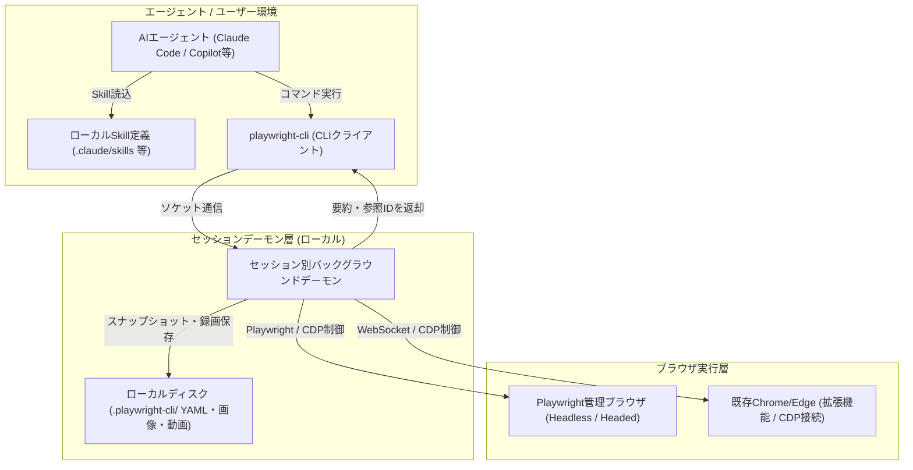

# **Playwright CLI 調査レポート**

## **1. 基本情報**

* **ツール名**: Playwright CLI (`@playwright/cli`)
* **ツールの読み方**: プレイライト シーエルアイ
* **開発元**: Microsoft
* **公式サイト**: [https://github.com/microsoft/playwright-cli](https://github.com/microsoft/playwright-cli)
* **関連リンク**:
  * GitHub: [https://github.com/microsoft/playwright-cli](https://github.com/microsoft/playwright-cli)
  * DeepWiki: [https://deepwiki.com/microsoft/playwright-cli](https://deepwiki.com/microsoft/playwright-cli)
  * ドキュメント: [https://github.com/microsoft/playwright-cli#readme](https://github.com/microsoft/playwright-cli#readme)
  * Playwright MCP (関連パッケージ): [https://github.com/microsoft/playwright-mcp](https://github.com/microsoft/playwright-mcp)
* **カテゴリ**: AIテスト自動化
* **概要**: Playwright CLIは、Claude CodeやGitHub CopilotなどのAIコーディングエージェントがWebブラウザを効率的に操作するための公式コマンドラインツールです。従来のMCP（Model Context Protocol）サーバーのように巨大なツールスキーマやアクセシビリティツリー全体を毎回LLMのコンテキストへ送るのではなく、ローカルディスクへのYAMLスナップショット保存と「Skills」アプローチを採用することで、トークン消費量を大幅に抑えた高速・低コストなブラウザ自動化を実現します。

## **2. 目的と主な利用シーン**

* **解決する課題**: AIエージェントがWebアプリケーションの動作確認や情報収集を行う際に発生する、LLMコンテキストウィンドウの圧迫（トークン消費増大）とブラウザ起動オーバーヘッドの最適化。
* **想定利用者**: AIコーディングエージェントを活用するソフトウェア開発者、QAエンジニア、テスト自動化スペシャリスト。
* **利用シーン**:
  * **AIエージェントによるE2Eテスト・UIデバッグ**: 開発中のローカルWebアプリに対して、エージェントが自律的に画面操作・コンソールログ確認・ネットワーク検証を行いバグを発見・修正する。
  * **ログイン済みブラウザでの自律タスク**: Chrome拡張機能モードやCDP接続を用い、バックグラウンドで既存のログイン済みセッションを活用した調査や確認を実行する。
  * **手動操作のコード化・証跡動画作成**: `recording-start` / `recording-stop` による手動操作のPlaywrightコード変換や、60fps・カーソル表示付きデモ動画の生成を行う。

### **2.1 代表的な利用フロー**

```mermaid
swimlane-beta TB
  subgraph User["開発者"]
    A["エージェントへWeb確認を指示"]
    F["ダッシュボードや出力結果を確認"]
  end
  subgraph Agent["AIコーディングエージェント"]
    B["Skillを参照しCLIコマンドを生成"]
    D["スナップショット参照IDで操作指示"]
  end
  subgraph CLI["Playwright CLI (デーモン)"]
    C["ページを開きYAMLスナップショット保存"]
    E["操作を実行し簡潔な結果を返却"]
  end
  subgraph Browser["ブラウザ / 拡張機能"]
    G["Webページを描画・DOM操作を実行"]
  end
  A --> B
  B --> C
  C --> G
  G --> C
  C --> D
  D --> E
  E --> G
  E --> F
```

* **代表的な流れ**: 開発者がAIエージェントにタスクを指示すると、エージェントはインストール済みのSkill情報を基に `playwright-cli` を呼び出します。CLIデーモンがブラウザを制御してスナップショットをローカルに保存し、要素の参照ID（ref）や要約のみをエージェントに返すため、最小限のトークン消費で操作ループを完結できます。

## **3. 主要機能**

* **トークン効率の良いスナップショットと検索**: ページ全体のDOMやアクセシビリティツリーをLLMへ返さず、要素参照（ref）を含むYAMLスナップショットをディスクに保存します。さらに `find` コマンドにより巨大スナップショットから必要なノードのみをgrep的に抽出可能です。
* **セッション管理とマルチユーザー隔離**: `-s=name` でワークスペースやタスク単位にブラウザセッションを分離でき、`--persistent` でプロファイルをディスクへ永続化できます。また `--isolated-context=<name>` により、1つのセッション内で複数ユーザーのログイン状態をタブ単位で隔離できます。
* **バックグラウンド拡張機能連携とCDPアタッチ**: `attach --extension=chrome` により既存のChrome/Edgeブラウザのログイン状態を活用でき、`PLAYWRIGHT_MCP_BACKGROUND=1` によるバックグラウンド実行や `--session` / `--session-color` によるタブグループ識別・再開にも対応しています。
* **モニタリングダッシュボードとUIレビュー**: `playwright-cli show` で実行中の全セッションをグリッド・詳細ビューでリアルタイム監視・手動介入できます。`annotate` やマルチスクリーンショットによるUIレビュー機能も備えます。
* **高度な動画録画と手動操作のコード変換**: `video-start --fps=60 --cursor` によるVP9形式の滑らかな動画録画と `video-show-actions` での操作ハイライト表示に加え、`recording-start` / `recording-stop` で人間の手動操作をPlaywrightコードへ変換できます。
* **WebMCP連携とサンドボックス実行**: Webページが公開するWebMCPツールを検出・実行する `webmcp-list` / `webmcp-call` や、JavaScript/Python/Java/C# へのコード生成、`run-code`（`fetch` や `crypto` 等対応、`require`/`process` は制限）によるスクリプト実行が可能です。
* **多彩なブラウザ操作とストレージ制御**: `open`, `click`, `fill`, `drag`, `drop`, `screenshot --hires`, `pdf`, Cookie/LocalStorage/SessionStorageの細かい操作（ドメイン・パス指定削除など）をCLIコマンドで網羅しています。

## **4. 動作原理・システム構成**

Playwright CLIは、**ローカルファーストのCLIクライアント・常駐デーモン構成**を採用しています。



* **アーキテクチャ**: コマンド実行ごとにブラウザを起動し直すのではなく、セッション単位でバックグラウンドのデーモンプロセスを常駐させ、CLIクライアントからローカルソケット経由で指示を送る設計です。ヘッドレスセッションはコマンド無操作が1時間続くと自動終了します（`--idle-timeout` で変更可能）。
* **主要コンポーネントとデータフロー**:
  * **CLIクライアントとSkills**: AIエージェントが `playwright-cli --help` や `.claude/skills` 等の簡潔なSkill定義を参照し、シェルコマンドを実行します。
  * **セッションデーモンとディスクキャッシュ**: デーモンがPlaywright経由でページ状態を取得し、アクセシビリティスナップショット（YAML）やスクリーンショット、VP9動画をローカルディスクに書き出します。標準出力には現在のURL・タイトル・保存パス等の軽量情報のみを返し、コンテキスト肥大化を防ぎます。
* **特筆すべき要素技術**:
  * **Browser Context / Isolated Context**: タブ単位での `--isolated-context` 隔離により、1つのブラウザプロセス内で複数アカウントのCookie/Storageを安全に分離します。
  * **Chrome拡張機能 / CDPブリッジ**: ユーザーの通常ブラウザにインストールされた拡張機能や `--cdp` エンドポイントを介して、既存の認証セッションを引き継いだ操作（バックグラウンドモード対応）を実現します。

## **5. 開始手順・セットアップ**

* **前提条件**:
  * Node.js 20以上
  * PlaywrightがサポートするOS環境（Windows, macOS, Linux x64/ARM64）
  * アカウント登録・クレジットカード登録は不要
* **インストール/導入**:

  ```bash
  npm install -g @playwright/cli@latest
  playwright-cli --help
  ```

* **初期設定**:
  * Claude Code等のAIエージェントへスキルとして登録する場合（ワークスペース内またはグローバル `-g`）:

    ```bash
    # Claude Code向け (.claude/skills)
    playwright-cli install --skills
    # その他のエージェント向け (.agents/skills)
    playwright-cli install --skills=agents
    # ホームディレクトリへグローバルインストール
    playwright-cli install --skills --global
    ```

* **クイックスタート**:

  ```bash
  # URLを開く（--headed で画面表示）
  playwright-cli open https://playwright.dev
  # ページスナップショットを取得
  playwright-cli snapshot
  # スクリーンショットを撮る（--hires で高解像度）
  playwright-cli screenshot --hires
  # ダッシュボードで監視する
  playwright-cli show
  ```

## **6. 特徴・強み (Pros)**

* **圧倒的なトークン効率**: スナップショットをディスクへ逃がし、必要な部分だけを `find` や `--depth` 指定で参照できるため、MCPサーバー経由のブラウザ操作と比較してLLMのコンテキスト消費を劇的に抑えられます。
* **多様な接続形態と隔離性**: 使い捨てのヘッドレスブラウザだけでなく、永続プロファイル（`--persistent`）、複数ユーザー隔離タブ（`--isolated-context`）、既存Chromeのバックグラウンド接続（`attach --extension=chrome`）まで柔軟に使い分けられます。
* **観察と介入のしやすさ**: `playwright-cli show` のWebダッシュボードにより、エージェントが裏で動かしているブラウザをいつでもリアルタイムで確認し、必要に応じて人間がマウス・キーボード操作を引き継げます。
* **Microsoft公式の継続的進化**: Playwright本体と密接に連携してほぼ毎月アップデートされており、WebMCP対応やARM64 Linuxサポート、多言語コード生成など最新要件への追従が極めて速いです。

## **7. 弱み・注意点 (Cons)**

* **複雑な制御ロジックの記述**: 基本的には1ステップずつのCLIコマンド実行であるため、条件分岐やループを伴う複雑なテストスイートには従来の `@playwright/test`（Playwright本体）を併用・生成するのが適しています。
* **日本語ドキュメントの不在**: 公式READMEおよびヘルプ出力は英語のみです。ただしCLIコマンド体系が直感的であり、AIエージェント経由で利用する上では大きな障壁になりにくいです。
* **MCPサーバーとの使い分け**: 常時接続によるリッチなイントロスペクションや長時間の自律探索ループに特化した用途では、兄弟パッケージの `playwright-mcp` の方が適しているケースがあります。

## **8. 料金プラン**

| プラン名 | 料金 | 主な特徴 |
|---------|------|---------|
| **オープンソース** | 無料 | 全機能利用可能 (Apache-2.0 License) |

* **課金体系**: なし（完全に無料）
* **無料トライアル**: なし（制限なく常に無料）

## **9. 導入実績・事例**

* **導入企業**: Microsoft（GitHub Copilot）、Anthropic（Claude Code）などのAIコーディングエージェント提供元で標準的なブラウザ連携手段として推奨・活用されています。
* **導入事例**: Claude CodeやGitHub Copilot CLIの開発ワークフローにおいて、ローカルサーバーのUI確認、PR添付用のスクリーンショット/VP9動画生成、Webドキュメントの動的取得などに広く利用されています。
* **対象業界**: ソフトウェア開発、Webアプリケーション開発、QA・テスト自動化、AIエージェント研究開発。

## **10. サポート体制**

* **ドキュメント**: [GitHub README](https://github.com/microsoft/playwright-cli#readme) が公式リファレンスとして最新コマンド・設定項目を網羅しています。
* **コミュニティ**: Playwright公式のDiscordコミュニティおよび [GitHub Issues](https://github.com/microsoft/playwright-cli/issues) で質問・不具合報告・機能要望が可能です。
* **公式サポート**: オープンソースプロジェクトのため個別の商用SLAサポートはありませんが、MicrosoftのPlaywright開発チームおよびコミュニティによる活発なメンテナンスが行われています。

## **11. エコシステムと連携**

### **11.1 API・外部サービス連携**

* **CLI / JSONインターフェース**: 標準入出力および `--json` フラグによる構造化レスポンスを介して、あらゆるプログラムやAIエージェントから呼び出し可能です。
* **主要な連携サービス・ツール**:
  * **Claude Code**: `install --skills` のデフォルト対象（`.claude/skills`）としてシームレスに統合。
  * **GitHub Copilot CLI / GitHub Copilot**: ターミナルでのエージェントタスクやPR作成時の画面証跡取得（`gh` 連携）に活用。
  * **Cline / Roo Code / Cursor / Windsurf**: `install --skills=agents` やCLI直接呼び出しで連携可能。
  * **Chrome / Edge 拡張機能**: 既存のブラウザプロファイルへ直接アタッチ。
  * **WebMCP対応Webアプリ**: `webmcp-list` / `webmcp-call` によりページ側のAIツールを直接実行。

### **11.2 技術スタックとの相性**

| 技術スタック | 相性 | メリット・推奨理由 | 懸念点・注意点 |
|:---|:---:|:---|:---|
| **Node.js / TypeScript** | ◎ | npmパッケージ（`@playwright/cli`）として提供され、導入とCI連携が容易。 | Node.js 20以上が必要。 |
| **Python / Java / C#** | ◯ | 外部プロセスとして呼び出し可能で、v0.1.18以降は各言語向けのコード生成にも対応。 | ライブラリ直接埋め込みではなくCLI経由の実行となる。 |
| **Docker / Linux ARM64** | ◎ | ヘッドレス実行に最適化されており、v0.1.25でARM64 LinuxへのChrome導入にも対応。 | ヘッドフル表示にはX11/VNC等の設定が必要。 |

## **12. セキュリティとコンプライアンス**

* **認証**: ローカル環境で完結して動作するため独自のユーザー認証はありません。既存ブラウザへの接続時はローカルソケット通信やChrome拡張機能の承認機構を介して制御されます。
* **データ管理**: スナップショット、Cookie、録画データはローカルディスク（またはメモリ内セッション）に保持され、外部サーバーへ自動送信されません。また、コンソールログ出力時のシークレット自動フィルタリングやURLパラメータのマスク（`redactUrlParams`）、`run-code` 実行時の `require` / `process` アクセス制限など、AIエージェント向けの安全機構を備えています。
* **準拠規格**: Apache-2.0ライセンスのオープンソースソフトウェアであり、SaaSのようなSOC2/ISO27001等の第三者認証は該当しません。

## **13. 操作性 (UI/UX) と学習コスト**

* **UI/UX**: 基本はターミナルベースのCUIですが、`playwright-cli show` によってWebベースのライブ監視ダッシュボードが開き、複数セッションのサムネイル一覧表示やクリックによる手動操作引き継ぎが可能です。また、`--json` オプションにより機械可読な構造化出力も得られます。
* **学習コスト**: AIエージェントに自然言語で指示するだけで自動的に適切なコマンドが選択・実行されるため、開発者が全コマンドを暗記する必要がなく学習コストは非常に低いです。

## **14. ベストプラクティス**

* **効果的な活用法 (Modern Practices)**:
  * **MCPとCLIの適切な使い分け**: コーディング作業と並行した素早いUI確認やトークン節約が重要な場面では `playwright-cli` を優先し、探索的テストで常時リッチなコンテキストが必要な場面のみ `playwright-mcp` を使う。
  * **セッションとコンテキストの分離**: `PLAYWRIGHT_CLI_SESSION` 環境変数や `-s=session_name` でプロジェクトごとにブラウザを分け、複数ユーザー検証には `--isolated-context` を活用する。
  * **`find` コマンドの活用**: 巨大なDOMを持つページでは `snapshot` 全体を読ませず、`find <text>` や `--depth=N` で必要な要素だけを取得する。
* **陥りやすい罠 (Antipatterns)**:
  * **不要なスクリーンショットの連発**: 画像はトークン消費が大きいため、要素の特定や状態確認にはテキストベースの `snapshot` / `find` を優先し、視覚レビュー時のみ `screenshot` を使う。
  * **旧パッケージの利用**: 非スコープの古い `playwright-cli` パッケージではなく、必ず公式の `@playwright/cli` をインストールする。

## **15. ユーザーの声（レビュー分析）**

* **調査対象**: GitHub Issues / Releases、X (Twitter)、技術ブログ（Zenn / Dev.to等）
* **総合評価**: 4.6/5.0 (コミュニティでの評価に基づく推定)
* **ポジティブな評価**:
  * 「MCPサーバーを使っていた時と比べてコンテキストの消費が激減し、Claude Codeでの長時間のデバッグ作業が途切れなくなった。」
  * 「`playwright-cli show` のダッシュボードが優秀。エージェントが裏で何を操作しているか一目で分かり、ログイン画面だけ人間が介入できるのが便利。」
  * 「`attach --extension=chrome` のバックグラウンドモードのおかげで、エージェント作業中も自分のPC作業を邪魔されなくなった。」
* **ネガティブな評価 / 改善要望**:
  * 「既存の `npx playwright`（テストランナー）との違いが最初は分かりにくく、コマンド体系の把握に少し戸惑うことがある。」
  * 「公式ドキュメントがGitHub README中心で、複雑な設定オプションや高度な使い方の解説ページが別途あると嬉しい。」
  * 「非常に複雑なSPAやCanvasベースのUIでは、CLIコマンドの連続よりもPlaywrightスクリプトを直接書いた方が安定する場面がある。」
* **特徴的なユースケース**:
  * PRレビュー前にエージェントへUI操作と60fps動画録画を実行させ、`gh` コマンドでそのままPRへ動作検証動画を添付する自動化ワークフロー。

## **16. 直近半年のアップデート情報**

* **2026-11-18 (v0.1.25)**: Chrome拡張機能セッション（`attach --extension=chrome`）で `--session` / `--session-color` によるタブグループ識別と再接続時の選択・再開に対応。`detach --close-tabs` で切断時にエージェントのタブを自動終了可能に。Linux ARM64環境でのChromeインストールにも対応。
* **2026-11-10 (v0.1.24)**: `PLAYWRIGHT_MCP_BACKGROUND=1` または設定 `"background": true` により、ログイン済みブラウザをバックグラウンドのまま操作できる機能を追加。新ヘッドレスモードでの動画全画面録画修正や `snapshot` での識別名保持を改善。
* **2026-10-31 (v0.1.23)**: `--isolated-context` による1セッション内での複数ログインユーザー隔離タブに対応。動画録画をVP9エンコード化しファイルサイズとCPU負荷を削減。`console --all` / `requests --all` でページ遷移を跨いだログ保持に対応。
* **2026-09-28 (v0.1.22)**: `run-code` スクリプト内でタイマー、`fetch`、`crypto`、`AbortController` 等のWeb標準APIを利用可能に改善（`require`/`process` は引き続き制限）。`find --filename` で大量ヒット結果をファイル保存可能に。
* **2026-09-18 (v0.1.21)**: `video-start --fps=60` および `--cursor`（操作点へ移動するアニメーションカーソル）に対応。WebMCPツール一覧を `snapshot` 上部に自動表示するよう改善。ライト/ダークカラースキーム切り替えにも対応。
* **2026-09-14 (v0.1.20)**: WebMCP APIでページが公開するツールを一覧・実行する `webmcp-list` / `webmcp-call` コマンドを追加。無操作時のヘッドレスセッション自動終了（1時間、`--idle-timeout` で変更可）を導入。
* **2026-09-01 (v0.1.19)**: ユーザーの手動ブラウザ操作をPlaywrightコードとして記録する `recording-start` / `recording-stop` コマンドを追加。
* **2026-08-06 (v0.1.18)**: `install --skills -g` によるグローバルインストールに対応。JavaScriptに加え、Python・Java・C#のコード生成をサポート。
* **2026-07-09 (v0.1.16)**: 巨大スナップショット全体を読み込まずにテキストや正規表現で検索・抽出できる `find` コマンドを追加。
* **2026-06-30 (v0.1.15)**: 高解像度スクリーンショット（`screenshot --hires`）およびコンソールログからのシークレット自動フィルタリングを追加。
* **2026-06-10 (v0.1.14)**: 録画動画内に操作コールアウトを描画する `video-show-actions` / `video-hide-actions` を追加。

(出典: [GitHub Releases](https://github.com/microsoft/playwright-cli/releases))

## **17. 類似ツールとの比較**

### **17.1 機能比較表 (星取表)**

| 機能カテゴリ | 機能項目 | Playwright CLI | Chrome DevTools for agents | Playwright | Selenium | Browserbase |
|:---:|:---|:---:|:---:|:---:|:---:|:---:|
| **AI連携** | トークン効率 | ◎<br><small>CLI+ディスクSnapshot</small> | ◯<br><small>MCPツール実行</small> | △<br><small>Test Agents経由</small> | ×<br><small>標準非対応</small> | ◯<br><small>Stagehand連携</small> |
| **デバッグ** | パフォーマンス/メモリ解析 | △<br><small>コンソール/Net中心</small> | ◎<br><small>DevTools完全連携</small> | ◎<br><small>Trace Viewer</small> | △<br><small>限定的なログ</small> | ◯<br><small>Session Replay</small> |
| **環境** | マルチブラウザ対応 | ◎<br><small>Chromium/Firefox/WebKit</small> | ×<br><small>Chrome系のみ</small> | ◎<br><small>主要全ブラウザ</small> | ◎<br><small>全主要ブラウザ</small> | △<br><small>クラウドChromium中心</small> |
| **導入** | ローカル導入容易性 | ◎<br><small>npm一発・完全無料</small> | ◎<br><small>npx/MCP設定</small> | ◯<br><small>プロジェクト導入</small> | △<br><small>Driver/環境構築</small> | ◎<br><small>クラウドSaaS</small> |
| **用途** | 既存ログイン引き継ぎ | ◎<br><small>拡張機能/CDPバックグラウンド</small> | ◯<br><small>リモートデバッグ</small> | △<br><small>Storage State手動</small> | △<br><small>プロファイル指定</small> | ◯<br><small>Contexts機能</small> |

### **17.2 詳細比較**

| ツール名 | 特徴 | 強み | 弱み | 選択肢となるケース |
|---------|------|------|------|------------------|
| **Playwright CLI** | AIコーディングエージェント向けに最適化された軽量CLI。 | トークン消費が極めて少なく、ダッシュボード監視やChrome拡張のバックグラウンド接続が可能。 | 複雑な条件分岐を含む網羅的テストスイート記述には不向き。 | Claude CodeやGitHub Copilot CLIに軽量・高速なブラウザ操作をさせたい場合。 |
| **Chrome DevTools for agents** | Google公式のChrome DevTools連携MCPサーバー。 | メモリヒープ解析、パフォーマンス計測、並列ツール実行など深いデバッグが可能。 | Chrome系ブラウザ専用で、MCP特有のコンテキスト消費が発生しやすい。 | フロントエンドのパフォーマンス解析やメモリリーク調査をAIに任せたい場合。 |
| **Playwright** | Microsoft製の総合E2Eテスト自動化フレームワーク。 | 自動待機、Trace Viewer、CI並列実行、Test Agentsなどテスト基盤として最高水準。 | スクリプト実装が前提となり、単発の対話的操作にはやや大掛かり。 | 継続的なCI/CDパイプライン用のE2Eテストスイートを構築・運用する場合。 |
| **Selenium** | 長い歴史を持つWebブラウザ自動化の標準フレームワーク。 | Java/Python/C#等あらゆる言語とレガシー環境に対応し情報資産が豊富。 | AIエージェント連携機能がなく、WebDriver管理や待機処理が煩雑。 | レガシーシステムや特定言語での既存テスト資産を維持・拡張する場合。 |
| **Browserbase** | AIエージェント向けのクラウド型ヘッドレスブラウザ基盤。 | クラウド上でスケーラブルに動作し、CAPTCHA回避やセッション管理が容易。 | 有料SaaS（$20/月〜）であり、ローカル開発サーバーへの直接アクセスには工夫が必要。 | 本番環境で多数の自律型Webエージェントをクラウド並列稼働させる場合。 |

## **18. 総評**

* **総合的な評価**:
  Playwright CLIは、AIコーディングエージェント時代のブラウザ操作における事実上の標準ツールへと急速に進化しています。ローカルのYAMLスナップショットと「CLI + Skills」による省トークン設計を軸に、2026年後半のアップデートでバックグラウンドChrome拡張接続、マルチユーザー隔離、60fpsカーソル付き録画、WebMCP対応まで網羅し、実用性が極めて高い水準に達しています。
* **推奨されるチームやプロジェクト**:
  Claude CodeやGitHub Copilot CLIを日常的に活用しているソフトウェア開発チーム、PR作成時のUI動作確認や動画証跡作成を自動化したいQAチームに強く推奨します。
* **選択時のポイント**:
  AIコーディングエージェントにブラウザ操作を行わせる場合は、まずPlaywright CLIを導入するのが最も効率的です。一方で、深いメモリ・パフォーマンス解析が必要なら「Chrome DevTools for agents」、CIで回す堅牢な回帰テストスイートを構築するなら「Playwright」本体、クラウド上での大規模並列スクレイピングなら「Browserbase」というように目的に応じて併用・選択すると良いでしょう。
