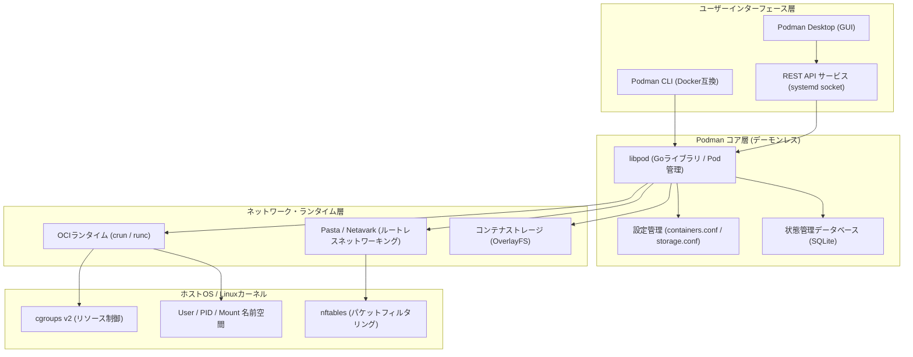

# **Podman 調査レポート**

## **1. 基本情報**

* **ツール名**: Podman
* **ツールの読み方**: ポッドマン
* **開発元**: Red Hat
* **公式サイト**: [https://podman.io/](https://podman.io/)
* **関連リンク**:
  * GitHub: [https://github.com/containers/podman](https://github.com/containers/podman)
  * DeepWiki: [https://deepwiki.com/containers/podman](https://deepwiki.com/containers/podman)
  * ドキュメント: [https://docs.podman.io/en/latest/](https://docs.podman.io/en/latest/)
* **カテゴリ**: ビルドツール/ランタイム
* **概要**: Podman (Pod Manager) は、OCI (Open Container Initiative) 準拠のオープンソース・コンテナエンジンです。常駐デーモンを持たないデーモンレス設計と一般ユーザー権限で動作するルートレスアーキテクチャを最大の特徴とし、Dockerコマンドとの高い互換性とKubernetes連携能力を備えています。

## **2. 目的と主な利用シーン**

* **解決する課題**:
  * Dockerデーモン（常駐特権プロセス）に起因する単一障害点や特権昇格などのセキュリティリスクの排除。
  * ローカル開発環境とKubernetes本番環境との抽象度乖離の解消。
  * 商用利用時におけるライセンス費用やベンダーロックインの低減（Docker Desktopの有償化対策）。
  * CI/CD環境における特権不要なセキュアコンテナビルド（Docker-in-Dockerの課題解消）。
* **想定利用者**: アプリケーション開発者、インフラエンジニア、SRE、DevOpsエンジニア、セキュリティ担当者。
* **利用シーン**:
  * **コンテナ化アプリケーションの開発・テスト・実行**: Dockerコマンドと同等のCLI体験によるシームレスな移行と日常開発。
  * **セキュリティ要件の厳しいエンタープライズ・公共システム**: ルート権限を与えないルートレスコンテナ運用。
  * **Kubernetesネイティブな開発フロー**: ローカルで作成したPod群から直接Kubernetesマニフェスト（YAML）を生成・検証。
  * **Systemdを用いた常駐サービス管理**: Quadletによるコンテナ・Podの宣言的Systemdサービス化。

### **2.1 代表的な利用フロー**

```mermaid
swimlane-beta TB
  subgraph User["開発者"]
    A["コンテナ起動・操作指示"]
    E["Kubernetes用マニフェスト出力指示"]
    H["Pod構成を検証・運用"]
  end
  subgraph CLI["Podman CLI"]
    B["コマンド解釈とローカルDB照合"]
    D["コンテナプロセスの監視・管理"]
    F["podman generate kube 実行"]
  end
  subgraph Engine["コンテナ基盤 (Pasta / crun / SQLite)"]
    C["ルートレス名前空間分離・ランタイム起動"]
    G["実行中Pod状態からYAML生成"]
  end
  subgraph Cluster["Kubernetes / 外部レジストリ"]
    I["コンテナイメージの取得"]
    J["生成マニフェストの適用・本番展開"]
  end
  A --> B
  B --> I
  I --> C
  C --> D
  D --> E
  E --> F
  F --> G
  G --> H
  H --> J
```

* **代表的な流れ**: 開発者がCLIからコンテナ起動を指示すると、Podmanはリモートレジストリからイメージを取得し、ルートレス名前空間とPastaネットワーク、OCIランタイム（crun）を連携させて直接プロセスをフォークします。開発検証後に `podman generate kube` を実行することで、稼働中のPod状態からKubernetesマニフェストを自動生成し、本番クラスタへのスムーズなデプロイを実現します。

## **3. 主要機能**

* **デーモンレスアーキテクチャ**: 常駐デーモン（dockerd等）が存在せず、各CLIコマンドが直接OCIランタイムを実行するfork/execモデルを採用。単一障害点を排除し、アイドル時のリソース消費を最小化します。
* **ルートレスコンテナ (Rootless Containers)**: ユーザー名前空間を活用し、ホストのroot権限を一切使用せずにコンテナを実行可能。v6.0以降はPastaがルートレスネットワークの標準となり、高速かつセキュアな通信を実現します。
* **SQLiteデータベースバックエンド**: 従来のBoltDBを廃止し、v6.0よりSQLiteに一本化。並行アクセス時の信頼性とデータベース破損耐性が大幅に向上し、アップグレード時の自動マイグレーションに対応しています。
* **AMD GPU ネイティブサポート**: `--gpus` オプションによりAMD GPUのパススルーとハードウェアアクセラレーションをネイティブサポート。AI/MLワークロードやグラフィックス処理をセキュアに実行可能です。
* **強化されたネットワーク管理**: ネットワーク分離（Network Isolation）がデフォルトで有効化され、複数静的IPアドレスの割り当てに対応。NetavarkとAardvark-dnsによる高度なDNS・コンテナ間通信を提供します。
* **Podのネイティブサポート**: 複数のコンテナがネットワークやリソースを共有する「Pod」をローカル環境で直接作成・管理可能。Kubernetesと同一の抽象単位で開発が行えます。
* **Docker CLI 互換性**: Dockerコマンド体系との互換性を徹底しており、`alias docker=podman` を設定するだけで既存のスクリプトやツールチェインをほぼそのまま利用可能です。
* **Kubernetes双方向連携**: `podman generate kube` による実行中PodからのKubernetesマニフェスト出力、および `podman play kube`（v6.xでの `--validate` による事前構文検証対応）によるYAMLからのPod再生をサポートします。
* **QuadletによるSystemd統合**: Systemdのユニットファイル記述（`.container`, `.pod`, `.network`, `.volume`）から自動的にSystemdサービスを生成。v6.xではサブディレクトリ構造による整理やAppArmor統合に対応しています。
* **Podman Desktop**: GUI環境でコンテナ、Pod、イメージ、リソースを直感的に管理できるデスクトップツール。Kubernetesクラスタ拡張や各種プラグインエコシステムを提供します。

## **4. 動作原理・システム構成**

* **アーキテクチャ**: ローカルファーストのデーモンレス・クライアント実行モデル。中央デーモンを介さず、ユーザープロセスが直接コンテナプロセスを管理します。
* **主要コンポーネントとデータフロー**:
  * **Podman CLI / Desktop**: コマンドライン引数やUI入力を受け取り、Goライブラリ（libpod）を呼び出すフロントエンド。
  * **libpod**: コンテナ、Pod、イメージ、ボリュームのライフサイクルを制御するコアライブラリ。
  * **SQLite Database**: コンテナの状態、メタデータ、ネットワーク設定などを永続化するトランザクションDB。
  * **Netavark / Pasta / Aardvark-dns**: ネットワークスタック。ルートレス時はPastaがホストとコンテナ間のパケット転送を担い、Netavarkがブリッジ管理、Aardvark-dnsがコンテナ名解決を実施。nftablesルールを用いてフィルタリングを行います。
  * **crun / runc (OCI Runtime)**: Linuxカーネルのcgroups v2や名前空間（User, PID, Mount, Network等）を構成して実際の隔離コンテナプロセスを生成。
* **特筆すべき要素技術**:
  * **fork/exec モデル**: コマンド実行ごとに新しいプロセスが起動するため、デーモンのクラッシュによるコンテナ全滅（単一障害点）が原理的に発生しません。
  * **User Namespaces**: コンテナ内のUID 0（root）をホストOS上の一般ユーザーUIDにマッピングすることで、万一コンテナエスケープが発生してもホスト権限の奪取を防止します。
  * **cgroups v2 & nftables 前提**: v6.0以降、レガシーなcgroups v1やiptablesを完全に排除し、カーネルの最新リソース制御とパケット処理機構に最適化されています。



## **5. 開始手順・セットアップ**

* **前提条件**:
  * Linux (RHEL 9+, Fedora, Ubuntu 24.04+ 等、cgroups v2必須)。
  * macOS (Apple Silicon推奨、macOS 13+)。
  * Windows (Windows 11 + WSL2推奨。※v6.0以降Windows 10は非サポート)。
* **インストール/導入**:

  ```bash
  # RHEL / CentOS Stream / Fedora
  sudo dnf install -y podman

  # Ubuntu / Debian
  sudo apt-get update && sudo apt-get install -y podman

  # macOS (Homebrew)
  brew install podman
  ```

* **初期設定**:
  * **Linux (ネイティブ)**: 追加設定なしでルートレス実行が可能。`podman info` で状態を確認。
  * **macOS / Windows**: 専用のLinux VM（Podman Machine）を初期化・起動。
    ```bash
    # VMの初期化と起動
    podman machine init
    podman machine start

    # VMの再起動（v6.1以降対応）
    podman machine restart
    ```
* **クイックスタート**:

  ```bash
  # 基本的なコンテナ実行（ルートレス）
  podman run --rm hello-world

  # Nginxコンテナのバックグラウンド実行（ポートフォワーディング）
  podman run -d --name web -p 8080:80 nginx

  # 実行中コンテナからKubernetesマニフェストを生成
  podman generate kube web > web-pod.yaml

  # Podmanボリュームの管理（v6.1以降のリネーム機能）
  podman volume create mydata
  podman volume rename mydata mydata-backup
  ```

## **6. 特徴・強み (Pros)**

* **本質的なゼロトラスト・セキュリティ**: 常駐デーモンが存在せず、ルートレス実行が標準。さらにv6.0からはネットワーク分離がデフォルト有効化されたため、Docker以上の隔離強度を誇ります。
* **モダン技術への最適化**: v6.0においてレガシー技術（BoltDB, slirp4netns, CNI, iptables, cgroups v1）を完全撤廃し、SQLite、Pasta、Netavark、nftables、cgroups v2に一本化されたことで、システムの安定性と実行パフォーマンスが飛躍的に向上しています。
* **Kubernetes開発とのシームレスな統合**: 単一コンテナにとどまらず、ローカルで複数コンテナからなる「Pod」を作成・テストし、そのまま本番用Kubernetesマニフェストを出力できます。
* **AI/MLワークロードへの対応**: `--gpus` フラグによるAMD GPU（ROCm）ネイティブサポートにより、機械学習やAI推論コンテナのローカル実行が容易です。
* **オープンソースとゼロライセンスコスト**: Apache 2.0ライセンス準拠の完全なOSSであり、企業利用における有償シート課金（Docker Desktopのような制限）が発生しません。

## **7. 弱み・注意点 (Cons)**

* **レガシー環境の切り捨て（v6.0の破壊的変更）**: Windows 10、Intel Mac、cgroups v1環境のサポートが終了しているため、古い社内端末やレガシーサーバーではPodman 5系（LTS）にとどまる必要があります。
* **Docker独自機能との差異**: Docker SwarmやDocker Desktop専用の商用拡張機能（Docker Extensionsの一部）は利用できません。Docker Composeも多くは動くものの、特異なエッジケースで非互換が生じることがあります。
* **非Linux環境でのVMオーバーヘッド**: macOSやWindowsでは仮想マシン（Podman Machine）を介して実行されるため、ネイティブLinuxと比較してファイルI/Oやメモリ消費のオーバーヘッドが存在します。
* **日本語ドキュメント・情報の偏り**: 公式ドキュメントおよび最新のv6.x系機能解説は英語が主体であり、Dockerに比べると日本語コミュニティのQ&Aやトラブルシューティング情報の蓄積が少ない傾向にあります。

## **8. 料金プラン**

| プラン名 | 料金 | 主な特徴 |
|---------|------|---------|
| **Podman OSS版** | 無料 | GitHubから入手可能なオープンソース版。全機能が無制限で利用可能。コミュニティサポート。 |
| **Podman Desktop** | 無料 | 完全無料のオープンソースGUIツール。プラグイン拡張やKubernetesクラスタ連携をサポート。 |
| **Red Hat Enterprise Linux (RHEL) サブスクリプション** | 有償 (RHEL契約に内包) | Red Hatによる公式商用サポート、エンタープライズSLA、長期セキュリティパッチ提供。 |

* **課金体系**: PodmanエンジンおよびPodman Desktopは完全に無料・オープンソースであり、ユーザー数や企業規模によるライセンス費用は発生しません。商用サポートが必要なエンタープライズ環境では、RHELのOSサブスクリプションを通じてサポートが提供されます。
* **無料トライアル**: RHEL環境向けには「Red Hat Developer Subscription」により、個人開発者向けに最大16システムまで無償で利用可能なライセンスが提供されています。

## **9. 導入実績・事例**

* **導入企業**: Red Hatエコシステムを採用する多くのグローバル金融機関、通信事業者、官公庁、防衛関連組織、テクノロジー企業。
* **導入事例**:
  * **金融・公共機関**: root権限を持つデーモンプロセスの常駐を禁止する厳格なセキュリティポリシーに適合するため、DockerからPodmanへ全面移行。
  * **大規模CI/CD環境**: 特権コンテナ（Docker-in-Docker）によるホスト侵害リスクを避けるため、一般ユーザー権限でコンテナビルドを実行可能なPodmanを採用。
* **対象業界**: 金融、官公庁、防衛、医療、通信など、高度なコンプライアンスとゼロトラスト運用が要求される業界。

## **10. サポート体制**

* **ドキュメント**: [公式サイト](https://docs.podman.io/)にてCLIリファレンス、チュートリアル、アーキテクチャ解説、Dockerからの移行ガイドを提供。
* **コミュニティ**: GitHub（Discussions、Issues）、Matrixチャットチャンネル（#podman:fedoraproject.org）、メーリングリストを通じた活発なオープンソースコミュニティ。
* **公式サポート**: Red Hat Enterprise Linuxのサブスクリプションを保有する顧客に対し、Red Hatのグローバルサポートチームによる24時間365日のエンタープライズSLAサポートが提供されます。

## **11. エコシステムと連携**

### **11.1 API・外部サービス連携**

* **Docker互換REST API**: `/run/podman/podman.sock` を通じてDocker Engine互換のREST APIを提供。VS Code、IntelliJ IDEA、Testcontainersなど、Docker APIに依存する多数の開発ツールがそのまま接続可能。
* **CNCFエコシステムとの統合**: v6.0以降、Go importパスが `go.podman.io/podman/v6` へ変更され、CNCF標準のコンテナツールチェーンとの緊密な連携が強化されています。
* **コンテナツール群連携**: Buildah（イメージビルド）、Skopeo（レジストリ間イメージ転送）、CRI-O（Kubernetes用ランタイム）とライブラリを共有。

### **11.2 技術スタックとの相性**

| 技術スタック | 相性 | メリット・推奨理由 | 懸念点・注意点 |
|:---|:---:|:---|:---|
| **Kubernetes** | ◎ | Podのネイティブ作成、マニフェストの双方向変換（`generate`/`play`）に対応 | 特になし |
| **Systemd** | ◎ | QuadletによりSystemdサービスとしてコンテナ・Podを宣言的に自動管理 | 従来のシェルスクリプト運用からの学習が必要 |
| **Ansible** | ◎ | `containers.podman` コレクションにより強固な自動プロビジョニングが可能 | モジュールのバージョン依存に留意 |
| **Docker Compose** | ◯ | `podman-compose` またはDocker Compose公式バイナリ経由で実行可能 | ネットワークや高度なCompose構文で一部差異あり |
| **AMD ROCm / GPU** | ◎ | `--gpus` によるAMD GPUネイティブサポートでAI/ML推論を高速化 | ドライバーの事前セットアップが必要 |

## **12. セキュリティとコンプライアンス**

* **認証**: レジストリ認証トークンの安全な保存（`containers-auth.json`）、シークレット管理（`podman secret`）、TLS/mTLS暗号化接続のサポート。
* **データ管理**: ルートレスモードによりユーザーごとのストレージ（`~/.local/share/containers/storage`）とシステム領域が完全分離され、ユーザー間のデータ漏洩を防止。
* **デフォルトのネットワーク分離**: v6.0よりコンテナ間およびホスト間のネットワーク分離が初期状態で有効化され、意図しないポート開放や通信傍受を防止。
* **脆弱性対応実績**: Hyper-Vバックエンドの脆弱性（CVE-2026-33414）や環境変数漏洩脆弱性（CVE-2026-57231）などに対し、迅速なパッチリリース（v5.8.2, v6.0.x）を提供。
* **準拠規格**: OCI（Open Container Initiative）仕様に完全準拠。RHEL環境でのFIPS 140暗号化標準およびSELinuxのMLS/MCSポリシードメインに対応。

## **13. 操作性 (UI/UX) と学習コスト**

* **UI/UX**:
  * **CLI**: Dockerコマンドと同一の構文体系を持ち、`podman run`, `podman ps`, `podman build` など直感的に利用可能。
  * **GUI (Podman Desktop)**: コンテナやPodの一覧表示、ログ閲覧、シェル接続、リソース使用量確認がGUI上で完結。
* **学習コスト**: Dockerの利用経験があれば、学習コストはほぼゼロ。ただし、ルートレス特有のファイルパーミッション管理（UIDマッピング）やSystemd Quadletの記述方法については一定の理解が必要です。

## **14. ベストプラクティス**

* **効果的な活用法 (Modern Practices)**:
  * **徹底したルートレス運用**: ホストの安全性を確保するため、特別な理由がない限り一般ユーザー権限でコンテナを実行する。
  * **SQLiteへの正常移行確認**: v6.0へアップグレードした際は、`podman system migrate` 等でBoltDBからSQLiteへの移行が正常に完了したことを確認する。
  * **Quadletを用いたサービス管理**: 本番環境や常駐サーバーでは、シェルスクリプトではなくQuadlet（`.container` / `.pod` ファイル）を用いてSystemdに管理を委ねる。
  * **Pod単位のローカル設計**: マイクロサービス開発では複数コンテナをPodとしてまとめ、Kubernetesへの移行を見据えて `podman generate kube` でマニフェスト化する。
* **陥りやすい罠 (Antipatterns)**:
  * **習慣的なsudoの使用**: ルートレスで動作するPodmanに対してsudoを付与すると、root所有の別ストレージが参照され、セキュリティ上の利点も失われる。
  * **レガシーネットワーク（CNI/slirp4netns）設定の残存**: v6.0ではこれらが削除されているため、過去の古い設定ファイルを引き継ぐとエラーになる。PastaおよびNetavark構成へ更新する。
  * **Windows 10 / Intel Macでのv6.x強制導入**: v6.0以降サポート対象外のため、該当環境では無理に更新せずv5.8系（LTS）を維持する。

## **15. ユーザーの声（レビュー分析）**

* **調査対象**: GitHub Discussions, Reddit, X (旧Twitter), 各種技術コミュニティ (2026年時点の情報を参照)
* **総合評価**: 4.6 / 5.0 - セキュリティとKubernetes連携において最高水準の評価を獲得。
* **ポジティブな評価**:
  * 「常駐デーモンがない安心感は圧倒的。CI環境でのコンテナビルドがroot権限なしで安全に回せるようになった」
  * 「v6.0でSQLiteに移行したことで、複数プロセスの並行アクセス時にDBロックや破損が起きなくなり、劇的に安定した」
  * 「Docker Desktopのライセンス課金を回避できるだけでなく、QuadletによるSystemd統合が本番サーバー管理で手放せない」
  * 「AMD GPUをネイティブにパススルーできるようになったため、ローカルAI開発環境の構築が非常にスムーズになった」
* **ネガティブな評価 / 改善要望**:
  * 「v6.0でWindows 10やIntel Mac、cgroups v1が切り捨てられたため、一部の開発端末でアップグレードを保留せざるを得ない」
  * 「Docker Composeの一部エッジケースでネットワークの挙動が異なり、微調整が必要だった」
* **特徴的なユースケース**:
  * 金融・公共分野における厳格なゼロトラスト・コンテナ実行環境としての標準採用。
  * Kubernetesクラスタ導入前のローカル開発・マニフェスト事前検証環境。

## **16. 直近半年のアップデート情報**

* **2026-10 (v6.2-rc / プレビュー)**:
  * `podman kube play --validate`: マニフェストの適用前に構文・設定エラーを検出するバリデーションオプションを追加。
  * マルチプラットフォーム対応: `podman manifest push` 実行時の `--platform` オプションの拡張。
  * 自動更新管理: コンテナごとの更新状態レポート機能の強化。
* **2026-08 (v6.1.0 / v6.1.x)**:
  * **CLI機能拡張**: 使用中でないボリューム名を変更できる `podman volume rename` コマンドを追加。
  * **マシン管理**: macOS / Windows向けに `podman machine restart` コマンドを導入し、開発環境の復旧手順を簡略化。
  * **安定性・ネットワーク**: `podman network rm --ignore` フラグの追加、WSL環境でのポート転送安定化のための `force_port_listen` 設定サポート。
* **2026-06-24 (v6.0.0 メジャーリリース)**:
  * **アーキテクチャ刷新**: データベースバックエンドをBoltDBから **SQLite** へ完全移行（初回起動時の自動マイグレーションをサポート）。
  * **レガシー技術の完全排除**: `slirp4netns`、`CNI`、`iptables`、`cgroups v1` のサポートを完全撤廃。ルートレスネットワークを **Pasta**、パケット制御を **nftables** に一本化。
  * **新機能**: `--gpus` による **AMD GPU ネイティブサポート**、ネットワーク分離（Network Isolation）のデフォルト有効化、複数静的IPアドレスの割り当て対応。
  * **プラットフォーム変更**: Windows 10およびIntel Macのサポート終了。Go importパスを `go.podman.io/podman/v6` へ刷新。
* **2026-04-14 (v5.8.2)**: Windows Hyper-Vバックエンド利用時の重大なセキュリティ脆弱性（CVE-2026-33414）を修正。
* **2026-03-11 (v5.8.1)**: Quadlet利用時のBoltDBからSQLiteへの自動マイグレーション関連の不具合を修正。
* **2026-02-12 (v5.8.0)**: `podman quadlet install` での複数Quadlet定義ファイル対応、AppArmorプロファイル連携、パフォーマンス最適化（`podman exec --no-session` 等）。

(出典: [GitHub Releases](https://github.com/containers/podman/releases))

## **17. 類似ツールとの比較**

### **17.1 機能比較表 (星取表)**

| 機能カテゴリ | 機能項目 | Podman | Docker (CE/Desktop) | containerd | Rancher Desktop |
|:---:|:---|:---:|:---:|:---:|:---:|
| **基本機能** | コンテナ実行 | ◎<br><small>OCI完全準拠</small> | ◎<br><small>業界標準</small> | ◯<br><small>低レイヤー</small> | ◯<br><small>K8s内包</small> |
| **アーキテクチャ** | デーモンレス | ◎<br><small>常駐プロセスなし</small> | ×<br><small>dockerd常駐必須</small> | ×<br><small>containerd常駐</small> | ×<br><small>デーモン依存</small> |
| **セキュリティ** | ルートレス実行 | ◎<br><small>標準・Pasta統合</small> | ◯<br><small>設定が複雑</small> | △<br><small>設定難度高</small> | ◯<br><small>K8s構成依存</small> |
| **セキュリティ** | ネットワーク分離 | ◎<br><small>v6.0より標準有効</small> | ◎<br><small>デフォルト有効</small> | △<br><small>プラグイン次第</small> | ◯<br><small>K8s準拠</small> |
| **ハードウェア** | AMD GPU対応 | ◎<br><small>--gpusネイティブ</small> | ◯<br><small>プラグイン設定要</small> | △<br><small>手動構成</small> | △<br><small>設定困難</small> |
| **オーケストレーション** | K8s連携 (Pod) | ◎<br><small>Podネイティブ・マニフェスト出力</small> | △<br><small>Compose経由変換</small> | ◯<br><small>CRI準拠</small> | ◎<br><small>K8s統合</small> |
| **デスクトップUX** | GUIツール | ◯<br><small>Podman Desktop (無料)</small> | ◎<br><small>Docker Desktop (有償枠有)</small> | ×<br><small>GUIなし</small> | ◯<br><small>Rancher UI (無料)</small> |
| **コスト** | ライセンス体系 | ◎<br><small>完全オープンソース・無料</small> | △<br><small>大企業商用利用は有料</small> | ◎<br><small>完全OSS</small> | ◎<br><small>完全OSS</small> |

### **17.2 詳細比較**

| ツール名 | 特徴 | 強み | 弱み | 選択肢となるケース |
|---------|------|------|------|------------------|
| **Podman** | デーモンレス・ルートレス、OCI/K8s親和性 | 本質的なセキュリティ、K8s連携、SQLite/Pastaによる最新スタック、ゼロライセンス費用 | Docker独自拡張機能の一部非対応、レガシーOS非対応（v6.0） | セキュリティ要件の厳しい環境、K8sを前提とした開発、Docker Desktopの代替 |
| **Docker** | コンテナ界のデファクトスタンダード | 圧倒的な情報量、広範なエコシステム、成熟したGUI | 常駐デーモン起因のリスク、大企業における商用ライセンス費用 | 初学者の学習、一般的なWeb開発、Docker Desktop専用機能が不可欠な場合 |
| **containerd** | OCI準拠の軽量コンテナランタイム | 極めて軽量で高信頼、Kubernetes標準ランタイム | 人間向けの対話型CLIやローカル開発環境としては不向き | Kubernetesノードのバックエンド、カスタムコンテナ基盤の構築 |
| **Rancher Desktop** | Kubernetes/コンテナ管理デスクトップ | K8sバージョンの切り替えが容易、完全OSS | リソース消費が比較的多め、AI/GPU周りの統合が発展途上 | Kubernetesクラスタ管理を中心としたローカル開発環境が必要な場合 |

## **18. 総評**

* **総合的な評価**:
  * Podmanは、セキュリティ、Kubernetes親和性、そして真のオープンソース性を兼ね備えた現代最高水準のコンテナエンジンです。
  * 2026年にリリースされた **バージョン6.0** によって、長年の技術的負債であったBoltDB、slirp4netns、CNI、cgroups v1などを一掃し、SQLiteデータベース、Pastaルートレスネットワーク、nftables、AMD GPUネイティブサポートといったモダン技術スタックへ完全に刷新されました。これにより、Docker代替にとどまらない独自の優位性と信頼性を確立しています。
* **推奨されるチームやプロジェクト**:
  * **エンタープライズ・金融・公共機関**: root権限の排除やゼロトラストセキュリティを厳格に要求される組織。
  * **Kubernetes本番展開を行うクラウドネイティブ開発チーム**: ローカル環境でPod単位の設計・検証を行い、直接マニフェストを出力したいプロジェクト。
  * **Docker Desktopのコスト削減を目指す開発組織**: 有償ライセンスの制約を受けることなく、GUIとCLIの双方で快適なコンテナ環境を全社展開したい企業。
* **選択時のポイント**:
  * **「セキュリティ」「Kubernetes連携」「ライセンスコストの排除」を最優先するならPodmanが最適な選択肢。**
  * **「レガシーOS環境（Windows 10等）の維持」や「圧倒的な情報量・サードパーティ連携」を重視するならDockerまたはPodman 5系（LTS）を検討。**
