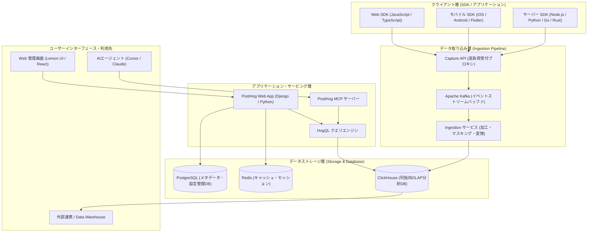

# **PostHog 調査レポート**

## **1. 基本情報**

* **ツール名**: PostHog
* **ツールの読み方**: ポストホグ
* **開発元**: PostHog, Inc. (米国サンフランシスコ、2020年創業、Y Combinator W20出身)
* **公式サイト**: [https://posthog.com/](https://posthog.com/)
* **関連リンク**:
  * GitHub: [https://github.com/PostHog/posthog](https://github.com/PostHog/posthog)
  * DeepWiki: [https://deepwiki.com/PostHog/posthog](https://deepwiki.com/PostHog/posthog)
  * ドキュメント: [https://posthog.com/docs](https://posthog.com/docs)
  * レビューサイト: [G2](https://www.g2.com/products/posthog/reviews)
* **カテゴリ**: データ分析
* **概要**: PostHogは、プロダクトアナリティクス、セッションリプレイ、フィーチャーフラグ、A/Bテスト、エラートラッキング、LLMオブザーバビリティ、データウェアハウスを1つのプラットフォームに統合した開発者向けオープンソース「Product OS」です。散在しがちな複数のSaaS（Mixpanel、Hotjar、LaunchDarkly、Sentryなど）を1つに集約し、イベントデータと画面録画・例外ログを相互にリンクさせることで、ユーザーの課題発見から仮説検証、バグ修正までのサイクルを劇的に高速化します。

## **2. 目的と主な利用シーン**

* **解決する課題**:
  * **ツールのサイロ化と高額な複数サブスクリプション**: アナリティクス、セッション録画、フラグ管理、エラー追跡を別々のサービスで契約することで生じる高額なコストとツール間のコンテキストスイッチを解消する。
  * **定量データと定性データの分断**: 「どのステップで離脱したか（数値）」と「なぜ離脱したのか（ユーザーの操作やエラー）」が別システムに分かれており、原因究明に時間がかかる問題を解決する。
  * **シート課金によるチーム展開の障壁**: メンバー追加ごとのアカウント費用を排除し、開発者・デザイナー・PM・創業者の全員が同一のデータ基盤にアクセスできる環境を実現する。
* **想定利用者**:
  * ソフトウェアエンジニア（フロントエンド、バックエンド、フルスタック）
  * プロダクトマネージャー（PM）、プロダクトデザイナー
  * グロースハッカー、データアナリスト
  * スタートアップ創業者およびプロダクト開発チーム
* **利用シーン**:
  * **新機能の段階的ロールアウトとA/Bテスト**: フィーチャーフラグを用いて新機能をベータユーザーや全体の10%に段階展開し、統計的有意差を確認しながら本番リリースを判断する。
  * **エラー例外とセッションリプレイの連動デバッグ**: アプリケーションで発生した例外スタックトレースからワンクリックで該当ユーザーの操作動画（DOMリプレイ）とコンソールログを再生し、再現困難なエッジケースを特定する。
  * **AIエージェント・LLMアプリの挙動監視**: アプリ内のLLM呼び出し（プロンプト、レイテンシ、トークン費用、エラー率）を追跡し、モデル更新やプロンプト調整の効果を測定する。
  * **登録・購入ファネルの脱落原因調査**: オンボーディングや決済フローの離脱ポイントをファネルチャートで特定し、脱落ユーザーのセッション録画を直接確認してUI/UXのボトルネックを改善する。

### **2.1 代表的な利用フロー**

```mermaid
swimlane-beta TB
  subgraph User["エンドユーザー (Web/アプリ)"]
    A[Web/アプリで新機能や画面を操作]
    D[A/Bテスト適用UIを閲覧・操作]
    G[問題発生時に画面上で例外が発生]
  end
  subgraph AppClient["クライアント (Web/モバイルSDK)"]
    B[イベント・DOM変更・コンソールを自動収集]
    E[フラグ判定を受け取りUIを描画]
    H[例外スタックトレースを捕捉]
  end
  subgraph PostHog["PostHog (製品・分析基盤)"]
    C[イベントストリーム集計とフラグ評価]
    F[A/Bテスト結果とファネル指標を更新]
    I[セッション録画と例外を紐付けて保存]
  end
  subgraph DevTeam["開発者 / プロダクトマネージャー"]
    J[ダッシュボードでファネルと録画を確認]
    K[IDEやWeb画面から改善・フラグ全展開]
  end
  A --> B
  B --> C
  C --> E
  E --> D
  D --> G
  G --> H
  H --> I
  C --> F
  F --> J
  I --> J
  J --> K
```

* **代表的な流れ**: エンドユーザーのクリックや画面遷移、DOM変更、エラー例外はPostHog SDKによって自動収集され、PostHog基盤上でリアルタイムに集計・紐付けが行われます。開発者やPMは統合ダッシュボードやIDE（MCP連携）からファネル指標やセッション録画、エラー原因を総合的に分析し、即座に機能改善やフラグの全展開を実施できます。

## **3. 主要機能**

* **プロダクト & Webアナリティクス (Product & Web Analytics)**: ユーザー行動の自動キャプチャ（Autocapture）やカスタムイベント送信に対応。ファネル分析、リテンション分析、ユーザージャーニー（パス分析）、コホート分析、およびB2B向けのグループアナリティクス（会社・組織単位の集計）を高速に実行可能です。
* **セッションリプレイ (Session Replay)**: ユーザーの画面操作をDOMレベルで精密に記録・再生。コンソールログやネットワーク通信ログも同期再生され、パスワードや機密情報はクライアント側で厳格に自動マスキング（Privacy Masking）されます。
* **フィーチャーフラグ & A/Bテスト (Feature Flags & Experiments)**: ユーザーID、属性、コホート、または割合に基づいた段階的ロールアウトを制御。多変量テストに対応し、主要指標への統計的有意差（Bayesian/Frequentist）を自動算出します。
* **エラートラッキング (Error Tracking)**: Web・モバイル・サーバーサイドの例外と未処理エラーを自動キャプチャ。SourceMap解決によるスタックトレース表示に加え、エラー発生瞬間のセッションリプレイやユーザー属性へ直接ジャンプしてデバッグできます。
* **アプリ内サーベイ (Surveys)**: NPS調査、CSAT評価、PMF（Product-Market Fit）調査、解約時アンケートなどをコード不要で画面内に配信。特定のユーザーセグメントや行動トリガーに応じて柔軟に表示制御できます。
* **データウェアハウス & CDP (Data Warehouse & Customer Data Infrastructure)**: Stripe、HubSpot、Zendesk、PostgreSQL、BigQueryなどの外部SaaS/DBデータを統合。ClickHouse上でHogQL（SQL）を用いたクロスデータ結合やリバースETL（Webhook、S3、外部サービスへのデータ同期）を提供します。
* **AI / LLMオブザーバビリティ (AI Engineering & LLM Analytics)**: OpenAI、Anthropic、LangChain、LlamaIndexなどのLLM呼び出しを追跡。プロンプト内容、生成結果、トークン数、コスト、レイテンシの可視化と品質評価（Evaluations）を実行可能です。
* **Model Context Protocol (MCP) 連携**: 公式MCPサーバーを提供し、Cursor、Claude Desktop、VS CodeなどのAIコーディングアシスタントから自然言語やツール呼び出しを通じてPostHogの分析データ取得、エラー調査、フラグ管理を直接実行できます。

## **4. 動作原理・システム構成**

PostHogは、クラウド完結型SaaS（米国・欧州リージョン）およびオープンソースセルフホスト（Docker Compose、Kubernetes Helm）の双方に対応した分散データアーキテクチャを採用しています。大量のリアルタイムイベントストリームを高耐久に処理し、数十億件規模のデータをサブ秒でクエリできるよう設計されています。

* **アーキテクチャ**: イベント駆動型ストリーミング・インジェスチョンパイプラインと高速列指向OLAPデータベース（ClickHouse）を中心とするマイクロサービス構成。
* **主要コンポーネントとデータフロー**:
  * **クライアントSDK / Capture API**: ブラウザ、モバイルアプリ、バックエンドから送信されるイベントをGo/Rustベースの超軽量HTTPキャプチャサービスで高速に受付。
  * **Apache Kafka**: 受信したイベントストリームを耐久性高くバッファリングし、トラフィック急増時のスパイクを吸収。
  * **Ingestion Worker (Plugin Server)**: Kafkaからイベントを消費し、GeoIP付与、ユーザーIDのエイリアス解決、PIIマスキング、カスタムデータ変換（Hog functions）を適用。
  * **ClickHouse**: 分析データの中核となる列指向OLAPデータベース。イベント、セッションログ、例外データを高圧縮・分散保存し、超高速集計を実現。
  * **PostgreSQL & Redis**: PostgreSQLでユーザー認証、組織設定、フィーチャーフラグ定義などのメタデータを管理し、Redisをセッション管理やキャッシュ、非同期タスクキューに利用。
  * **HogQL & Query Engine**: ClickHouse SQLにセマンティックレイヤーと安全なマルチテナント制御を統合した独自のクエリエンジン。
* **特筆すべき要素技術**:
  * **ClickHouse**: 従来の行指向RDBMSとは一線を画す圧倒的な列指向集計性能。
  * **HogQL**: PostHog内部のデータモデル（events, persons, session_replay_eventsなど）を直感的にJOIN・フィルタできる拡張SQL。
  * **Lemon UI**: アクセシビリティと開発者体験を重視したPostHog独自のオープンソースReactデザインシステム。



## **5. 開始手順・セットアップ**

* **前提条件**:
  * Web/アプリ環境（Node.js、React、Next.js、Vue、Python、iOS、Android等）
  * PostHog Cloudのアカウント登録（クレジットカード不要、メールアドレスまたはGitHub/Googleアカウントで即時開設可能）
  * ※セルフホストの場合はDocker ComposeまたはKubernetesクラスタ
* **インストール/導入**:

  Next.jsやReactプロジェクトでのWeb SDK導入例：

  ```bash
  # パッケージのインストール
  npm install posthog-js
  # または pnpm を利用する場合
  pnpm add posthog-js
  ```

* **初期設定**:
  環境変数にプロジェクトAPIキーとホストURLを設定します（US CloudまたはEU Cloudを選択）。
  認証情報には必ずプレースホルダーを使用し、公開リポジトリに実キーをコミットしないよう管理します。

  ```bash
  # .env.local
  NEXT_PUBLIC_POSTHOG_KEY="<YOUR_PROJECT_API_KEY>"
  NEXT_PUBLIC_POSTHOG_HOST="https://us.i.posthog.com" # EUリージョンの場合は https://eu.i.posthog.com
  ```

* **クイックスタート**:

  クライアント側でPostHogを初期化し、イベントを送信します。

  ```typescript
  // posthog.ts
  import posthog from 'posthog-js'

  if (typeof window !== 'undefined') {
    posthog.init(process.env.NEXT_PUBLIC_POSTHOG_KEY || '<YOUR_PROJECT_API_KEY>', {
      api_host: process.env.NEXT_PUBLIC_POSTHOG_HOST || 'https://us.i.posthog.com',
      person_profiles: 'identified_only', // 匿名ユーザーのプロファイル作成ポリシー
      capture_pageview: true,             // ページビューの自動収集
      capture_pageleave: true,            // 滞在時間測定用
    })
  }

  // ユーザーの明示的識別とカスタムイベント送信
  export const identifyUser = (userId: string, email: string) => {
    posthog.identify(userId, { email })
  }

  export const trackFeatureUsed = (featureName: string) => {
    posthog.capture('feature_used', {
      feature_name: featureName,
      source: 'navigation_bar',
    })
  }
  ```

## **6. 特徴・強み (Pros)**

* **圧倒的な機能統合によるオールインワン体験**: 分析ツール（Mixpanel）、画面録画（Hotjar）、フラグ管理（LaunchDarkly）、エラー監視（Sentry）を別々に契約する必要がなく、1つのプラットフォームと単一SDKで全て完結します。
* **極めて寛大な永続無料枠と透明性の高い従量課金**: 月間100万イベント、月間5,000セッション録画、月間100万フラグ評価が毎月無料で提供されます。シート課金（1ユーザーあたりの固定月額）がなく、チーム全員を無料で招待可能です。
* **オープンソースとセルフホストの選択肢**: コア部分がオープンソース（MIT/PostHogライセンス）で公開されており、ソースコードの監査や自社インフラ内でのセルフホストが可能です。
* **HogQLによる自由自在なデータアクセス**: GUIのグラフ作成機能にとどまらず、SQLライクな独自言語「HogQL」を用いて保存されたイベントやセッションデータに対して自在にJOINや集計クエリを実行できます。
* **先端のAI & MCPエコシステム対応**: AIアプリ向けのLLM Observabilityに加え、公式MCPサーバーの提供によりCursorやClaudeから直接PostHogのデータを検索・操作できる最新の開発環境親和性を備えています。

## **7. 弱み・注意点 (Cons)**

* **日本語UI・ドキュメントの非対応**: 管理画面UI、ヘルプドキュメント、公式サポートはすべて英語のみであり、英語に不慣れなマーケターやビジネスサイドのメンバーにとっては導入ハードルとなります。
* **非技術職（ビジネス職）にとっての学習コスト**: 開発者向けに設計されているため、機能が豊富である反面、イベントプロパティの概念やHogQLクエリ、高度なファネル設定の理解に一定の技術的リテラシーが求められます。
* **無料枠超過後の従量課金管理**: トラフィックが急増したWebサイトや不要な高頻度イベントを送信し続けた場合、月間無料枠を超過して予期せぬ課金が発生するリスクがあります（管理画面でハードリミット/請求上限の設定が必須）。
* **セルフホスト版の運用難易度**: セルフホスト構成にはClickHouse、Apache Kafka、PostgreSQL、Redisなどの運用管理が必要となり、本格的な本番運用には専門的なSRE/インフラの保守運用コストがかかります。

## **8. 料金プラン**

PostHogは全製品に共通して「毎月リセットされる手厚い無料枠」と、無料枠を超過した分だけ支払う「従量課金（ボリュームディスカウント付き）」の体系を採用しています。ユーザーごとのシート課金は一切ありません。

| プラン名 | 月額基本料 | 主な特徴・含まれる枠 | 対象ユーザー |
|---------|----------|-------------------|------------|
| **Free Tier (無料プラン)** | 無料 | ・プロダクト分析: 100万イベント/月<br>・セッションリプレイ: 5,000本/月<br>・フィーチャーフラグ: 100万リクエスト/月<br>・エラートラッキング: 10万例外/月<br>・サーベイ: 1,500回答/月<br>・チームメンバー無制限招待<br>・データ保持期間: 1年間 | スタートアップ、個人開発者、小規模チーム |
| **Pay-as-you-go (従量課金)** | 無料 (従量分のみ) | ・無料枠を超過した分のみの従量支払い<br>・利用量が増えるほど単価が下がるステップダウン割引<br>・ハードリミット（請求上限額）設定可能<br>・データ保持期間: 最大7年間 | 成長期のスタートアップ、中規模SaaS企業 |
| **Teams / Enterprise** | お問い合わせ (カスタム) | ・SAML/SSO認証、高度な権限管理<br>・HIPAA対応 (BAA締結可能)<br>・専任アカウントマネージャー、優先サポートSlack<br>・カスタムデータ保持期間と請求書払い | 大規模エンタープライズ、医療/金融など規制業種 |

* **課金体系**: 各製品ごとの月間利用量（イベント数、録画本数、リクエスト数）に基づく完全従量課金制。
* **無料トライアル**: クレジットカード登録不要で直ちにFree Tierを利用開始可能。また、創業2年以内でシリーズB未満のスタートアップ向けに最大50,000ドル相当のクレジットを付与するスタートアップ支援プログラムを提供しています。

## **9. 導入実績・事例**

* **導入企業**:
  * **Y Combinator**: 世界的アクセラレーターであり、卒業生スタートアップへの標準的なアナリティクス基盤として推奨・採用。
  * **Airbus**: 欧州航空機大手。セルフホストや厳格なデータ主権要件を満たす分析基盤として採用。
  * **Linear**: 開発者向け人気プロジェクト管理ツール。製品改善や機能利用状況の分析に活用。
  * **AssemblyAI**: 音声AIプラットフォーム。プロダクト分析とフィーチャーフラグの統合運用でリリースサイクルを高速化。
  * **Supabase**: オープンソースFirebase代替基盤。ユーザー行動分析とWebトラフィック分析にPostHogを活用。
  * **ElevenLabs**: 音声生成AIユニコーン。急成長するAIサービスのユーザーリテンションと利用パターンを計測。
* **導入事例から見る効果**:
  * 複数ツール（Mixpanel + Hotjar + LaunchDarkly）の統合により、年間数万ドル規模のSaaSコスト削減を達成。
  * エラー発生時のセッションリプレイ連動により、バグ再現・調査にかかるエンジニアの工数を平均50%以上削減。
* **対象業界**: SaaS、AIアプリケーション開発企業、Web3/FinTech、開発者向けツール（DevTools）、急成長スタートアップ全般。

## **10. サポート体制**

* **ドキュメント**: [公式ドキュメント](https://posthog.com/docs)、ユースケース別[チュートリアル](https://posthog.com/tutorials)、APIリファレンス、および各言語・フレームワーク別クイックスタートが非常に充実（英語）。
* **コミュニティ**: [公式コミュニティフォーラム](https://posthog.com/questions)、[GitHub Issues](https://github.com/PostHog/posthog/issues)が非常に活発。開発元エンジニアやCEOが直接質問に回答するカルチャーが定着。
* **公式サポート**:
  * 無料プラン: コミュニティフォーラムでの対応。
  * 有料プラン: アプリ内サポートチケット、メール対応。
  * Enterpriseプラン: 専任カスタマーサクセス、専用共有Slackチャンネルでのリアルタイム優先サポート（原則英語対応、平日営業時間帯）。

## **11. エコシステムと連携**

### **11.1 API・外部サービス連携**

* **API**:
  * **REST API**: イベント投入、フラグ判定、コホート管理、ダッシュボード操作などの完全なAPIを提供。
  * **HogQL Query API**: 外部プログラムから安全にSQLクエリを実行して分析結果を取得可能。
  * **PostHog MCP Server**: Model Context Protocolに準拠し、CursorやClaudeなどのAIツールからダイレクトに連携可能。
* **外部サービス連携**:
  * **コミュニケーション**: Slack、Discord、Microsoft Teams（アラート通知、サーベイ回答転送）
  * **データウェアハウス/BI**: Snowflake、Google BigQuery、Amazon Redshift、ClickHouse、Metabase
  * **外部SaaSデータ連携**: Stripe（決済データ連携）、HubSpot、Salesforce、Zendesk、GitHub、Sentry
  * **CDP/パイプライン**: Segment、RudderStack、Reverse ETLパイプライン

### **11.2 技術スタックとの相性**

| 技術スタック | 相性 | メリット・推奨理由 | 懸念点・注意点 |
|:---|:---:|:---|:---|
| **Next.js / React** | ◎ | 公式SDK（`posthog-js`）および専用Reactプロバイダー、SSR/App Router向けガイダンスが完備 | SSR環境下でのフラグ評価時のフラッシュ防止設定に配慮が必要 |
| **Node.js / TypeScript** | ◎ | 公式`posthog-node`が提供され、サーバーサイドでのイベント送信やフィーチャーフラグ評価が極めて高速 | ローカルキャッシュを用いたフラグ判定設定を推奨 |
| **Python (Django / FastAPI)** | ◎ | バックエンド用公式SDK完備。DjangoミドルウェアやFastAPI依存性注入に対応 | セレリや非同期処理でのコンテキスト引き継ぎに注意 |
| **モバイル (iOS / Android / Flutter / React Native)** | ◯ | 各種モバイルSDKが公式提供され、画面遷移やクラッシュ、セッションリプレイに対応 | モバイルセッションリプレイはネットワーク帯域とバッテリー消費に留意 |
| **Go / Rust** | ◯ | 公式SDKが提供され、マイクロサービスや高スループットAPIサーバーからの追跡に最適 | クライアント側のようなDOM記録機能はなくイベント送信・フラグが中心 |

## **12. セキュリティとコンプライアンス**

* **認証**:
  * 多要素認証 (2FA / MFA) を標準サポート。
  * Google OAuth、GitHub OAuthログイン対応。
  * EnterpriseプランにてSAML 2.0 / Okta / Azure AD等によるSSO（シングルサインオン）およびSCIMプロビジョニングをサポート。
* **データ管理**:
  * **リージョン選択**: プロジェクト作成時に「米国リージョン（US Cloud - バージニア州）」または「欧州リージョン（EU Cloud - ドイツ・フランクフルト）」を自由に選択可能（GDPRおよびデータ主権要件に適合）。
  * **通信・保管時暗号化**: 通信はすべてTLS 1.3/1.2で保護され、データ保管時はAES-256で暗号化。
  * **プライバシーマスキング**: セッションリプレイ記録時、パスワード入力欄やクレジットカード番号はデフォルトで不可視化され、HTML属性（`data-ph-mask`）で機密要素を厳格に除外可能。
* **準拠規格**:
  * **SOC 2 Type II**: 年次監査を実施し認証を取得済み。
  * **GDPR & CCPA**: 欧州一般データ保護規則およびカリフォルニア州消費者プライバシー法に完全準拠。DPA（データ処理契約）をオンライン締結可能。
  * **HIPAA**: Enterprise契約においてBAA（事業提携契約）の締結が可能であり、医療ヘルスケア分野での導入実績あり。

## **13. 操作性 (UI/UX) と学習コスト**

* **UI/UX**:
  * 開発者やテクニカルPMが心地よく操作できるよう設計された「Lemon UI」を採用。
  * ダークモード対応、豊富なキーボードショートカット、直感的なインサイトエディタ（グラフ種類、集計軸、フィルタの即時プレビュー）を搭載。
  * セッションリプレイ再生画面では、コンソールログ、ネットワークエラー、クリックイベントがタイムライン上に連動表示され、極めて高い操作性を実現。
* **学習コスト**:
  * **導入初期**: WebサイトにSDKコードを貼り付けるだけで自動キャプチャが開始されるため、最初のダッシュボード作成までは数分〜1時間程度で習得可能。
  * **高度な活用**: 複雑なファネルの除外条件、コホート計算、SQLライクなHogQLクエリを使いこなすには、一般的なBIツールやデータウェアハウスと同程度の学習投資が必要。

## **14. ベストプラクティス**

* **効果的な活用法 (Modern Practices)**:
  * **AutocaptureとExplicit Trackingの使い分け**: 基本的なクリックやページビューはAutocaptureに任せつつ、購入完了や契約締結など重要なビジネス指標は明示的な`posthog.capture()`で命名規則（例: `[名詞] [動詞]`）を統一して送信する。
  * **予算上限（Billing Limits / Hard Caps）の事前設定**: アカウント開設時に月間請求上限（例: $0や$100）を設定しておくことで、DDoS攻撃やトラフィック急増に伴う予期せぬ過大請求を完全に防止する。
  * **フィーチャーフラグとセッションリプレイの併用**: 新機能をフラグで公開した際、そのフラグに接触したユーザーセグメントでセッションリプレイをフィルタリングし、初期の利用動向や混乱している挙動をリリース当日に観察する。
  * **MCPサーバーを通じたAI協調開発**: Cursor等のエディタからPostHog MCPサーバーを呼び出し、「直近24時間で急増したフロントエンドエラーと発生画面を教えて」と依頼して修正作業に直結させる。
* **陥りやすい罠 (Antipatterns)**:
  * **PII（個人特定情報）のマスキング漏れ**: カスタムイベントのプロパティに誤って平文のメールアドレスや電話番号、個人認証トークンを含めて送信してしまうこと（プロパティ設計時のサニタイズが必須）。
  * **過度に高頻度なイベント送信**: マウス移動イベントやスクロールごとの過剰なカスタムイベントを送信し、あっという間に月間100万枠を消費してしまうこと。
  * **保守体制のない安易なセルフホスト運用**: クラウド利用料を浮かせようと小規模チームでClickHouseクラスタをセルフホストし、ノード障害やディスク溢れ、バージョンアップのトラブルで本業の開発が圧迫されること（特別な要件がない限りCloud版の利用が推奨される）。

## **15. ユーザーの声（レビュー分析）**

* **調査対象**: G2、TrustRadius、GitHub Discussions、開発者コミュニティ（X、Zenn、Qiita）
* **総合評価**:
  * G2: 4.6 / 5.0 (300件以上のレビュー)
  * TrustRadius: 8.9 / 10.0
* **ポジティブな評価**:
  * **ツール統合とコスト削減**: 「これまでMixpanel、Hotjar、LaunchDarklyの3つを契約して月数十万円を支払っていたが、PostHogに一本化したことで管理コストも請求額も劇的に圧縮された。」
  * **エンジニアフレンドリーな設計**: 「SDKが極めて洗練されており、ドキュメントも開発者向けにユーモアを交えて書かれていて分かりやすい。HogQLで自由にSQLを叩ける点もデータ分析の自由度を高めている。」
  * **寛大すぎる無料枠**: 「初期スタートアップにとって月100万イベントと5,000セッション録画が永続無料で使えるのは神がかっており、創業期に選ばない理由がない。」
* **ネガティブな評価 / 改善要望**:
  * **完全英語の壁**: 「UIもドキュメントもすべて英語のため、非エンジニアのマーケターや日本のビジネスメンバーにツールを展開する際にオンボーディングの負荷が大きかった。」
  * **大量データ時の急激な課金カーブ**: 「B2Cの急成長アプリでイベント数が数千万件に達した際、クオータ制御やフィルタリングを適切に行っていないと従量課金が跳ね上がるため注意が必要。」
  * **セルフホストの運用負荷**: 「オープンソースなのでオンプレミス運用を試みたが、ClickHouseやKafkaのクラスタ運用が極めて重く、最終的にマネージドなCloud版へ移行した。」
* **特徴的なユースケース**:
  * 「新機能リリース当日にフィーチャーフラグで5%のユーザーにのみ開放し、その5%のユーザーのセッションリプレイを倍速で確認。数件のエラーログと離脱挙動を即座に特定してホットフィックスを当て、翌日には安心して100%全展開できた。」

## **16. 直近半年のアップデート情報**

* **2026-11-04**: **サーバーSDKにおけるトレースコンテキスト伝播の拡充**
  * Java、.NET、Elixir、Go、Ruby/Rails、PHP、Rust、Node.jsの各サーバーSDKにおいて、リクエストコンテキストやトレースIDをエラーイベントおよび分散スパンへ自動伝播する機能をサポート。障害発生時の原因リクエストの追跡性が大幅に向上。
* **2026-10-28**: **Web SDKの単一外部スクリプトタグ（One-Tag）初期化と`defaults: 'latest'`設定**
  * Web SDKを単一の外部`<script>`タグで初期化可能とし、クライアントダウンロード中のイベント呼び出しを安全にキューイングする軽量ローダーを提供。また、日付固定を要さず自動で最新仕様に追従する`defaults: 'latest'`構成オプションを追加。
* **2026-10-15**: **Data WarehouseにおけるHelp Scout連携およびマーケティング指標の拡充**
  * Data Warehouseのインポート先としてHelp Scout（保留・クローズド含む全ステータス）をサポート。さらにMeta Ads、LinkedIn Ads、Ahrefs等の外部マーケティングソースにおいて動画エンゲージメントやコンバージョン詳細指標の取り込みを強化。
* **2026-09-18**: **BigQueryインポートにおけるGCP共有サービスアカウント認証対応**
  * Data WarehouseのBigQuery連携において、従来の個別JSONサービスアカウントキーのアップロード方式に加え、GCPの共有サービスアカウントによるセキュアな認証方式をサポート。
* **2026-08-20**: **Batch ExportsにおけるAWS AssumeRole短寿命認証のサポート**
  * Amazon RedshiftおよびS3へのバッチエクスポートにおいて、固定の長期認証情報の代わりにAWS IAM AssumeRoleを利用した一時的クレデンシャルによる安全なデータエクスポートに対応。
* **2026-07-16**: **Data WarehouseにおけるClickHouse / ClickHouse Cloudのライブクエリ対応**
  * 事前のデータインポートを行わずに、外部のClickHouseおよびClickHouse Cloudデータソースに対して読み取り専用のリアルタイムHogQLクエリを直接実行可能にアップデート。
* **2026-06-25**: **PostHog MCP サーバー機能拡張とMCP Analytics（AIツール追跡）の強化**
  * CursorやClaudeから呼び出せる公式MCPサーバーにAI Observabilityエンドポイントやプロジェクトコスト集計ツールを追加。また、AIエージェントのツール呼び出しを追跡する`$mcp_tool_call`テレメトリ機能を提供。

(出典: [PostHog Changelog](https://posthog.com/changelog), [GitHub Releases](https://github.com/PostHog/posthog/releases))

## **17. 類似ツールとの比較**

### **17.1 機能比較表 (星取表)**

| 機能カテゴリ | 機能項目 | PostHog | Mixpanel | Amplitude | Sentry |
|:---:|:---|:---:|:---:|:---:|:---:|
| **基本分析** | プロダクト & ファネル分析 | ◎<br><small>HogQL対応・自動収集完備</small> | ◎<br><small>分析・レポート機能特化</small> | ◎<br><small>エンタープライズ分析強力</small> | △<br><small>パフォーマンストレース中心</small> |
| **定性分析** | セッションリプレイ | ◎<br><small>DOM/コンソール完全統合</small> | △<br><small>外部連携が中心</small> | ◯<br><small>Session Replay機能あり</small> | ◯<br><small>エラー連動リプレイあり</small> |
| **リリース管理** | フィーチャーフラグ / A/Bテスト | ◎<br><small>標準機能として統合</small> | △<br><small>簡易実験機能のみ</small> | ◯<br><small>Experimentation提供</small> | ×<br><small>非対応</small> |
| **品質・障害監視** | エラートラッキング | ◯<br><small>セッション・フラグ連動</small> | ×<br><small>非対応</small> | ×<br><small>非対応</small> | ◎<br><small>業界デファクト・自動修正AI</small> |
| **最新技術** | AI / LLM監視 & MCP連携 | ◎<br><small>公式MCPサーバー・LLMトレース</small> | ×<br><small>非対応</small> | △<br><small>一部AIアシスタント機能</small> | ◯<br><small>AIデバッグ・Seer機能</small> |
| **オープン性** | OSS / セルフホスト対応 | ◎<br><small>完全オープンソース提供</small> | ×<br><small>完全独自SaaS</small> | ×<br><small>完全独自SaaS</small> | ◯<br><small>セルフホスト版あり (FSL)</small> |
| **料金モデル** | 永続無料枠の充実度 | ◎<br><small>月100万イベント・5千録画</small> | ◯<br><small>月2万MTUまで無料</small> | ◯<br><small>月5万MTUまで無料</small> | ◯<br><small>小規模チーム向け無料枠</small> |
| **料金モデル** | シート課金 (ユーザー招待) | ◎<br><small>全プランでシート課金なし</small> | △<br><small>プランによりシート制限あり</small> | △<br><small>プランによりシート課金制</small> | △<br><small>シート追加課金あり</small> |
| **非機能要件** | 日本語UI対応 | △<br><small>英語のみ（日本語非対応）</small> | ◯<br><small>日本語UI・国内代理店あり</small> | ◯<br><small>日本語UI・日本法人あり</small> | △<br><small>英語UIが基本</small> |

### **17.2 詳細比較**

| ツール名 | 特徴 | 強み | 弱み | 選択肢となるケース |
|---------|------|------|------|------------------|
| **PostHog** | プロダクト分析、セッション録画、フラグ、エラー、LLM監視を1つに統合したオープンソースProduct OS | ・全機能が1つのSDK・DBに集約<br>・シート課金なし＆100万イベント無料<br>・MCP/AI親和性とHogQLの柔軟性 | ・UIとドキュメントが英語のみ<br>・非エンジニアには操作がやや難解<br>・セルフホスト運用の難易度が高い | エンジニア主導のスタートアップやSaaS企業で、複数ツールの契約を統合し、分析からエラーデバッグまで一体化したい場合 |
| **Mixpanel** | プロダクト分析・行動分析のパイオニアで、直感的なレポート作成に特化 | ・洗練されたUIで非技術職でも扱いやすい<br>・ファネルやリテンション分析のレスポンスが高速<br>・日本語サポートが充実 | ・セッション録画やフラグ機能がなく単体で完結しない<br>・大規模利用時の課金が高額になりやすい | マーケターやビジネス職が主体となり、行動分析・コンバージョン分析を専門的に行いたい場合 |
| **Amplitude** | 大規模エンタープライズ向けの統合デジタルアナリティクス基盤 | ・膨大なデータ量に対する高度な予測分析<br>・エンタープライズ向けガバナンス機能が強力<br>・日本法人のサポート体制が厚い | ・導入・運用コストが非常に高額<br>・導入設計やイベント定義の学習コストが高い | 大企業や大規模サービスで、専門のデータ分析チームが高度なコホート分析や予測分析を行う場合 |
| **Sentry** | コードレベルのエラー監視とパフォーマンス追跡のデファクトスタンダード | ・圧倒的なエラー集約力とSourceMap解析<br>・AIによる根本原因自動特定と修正PR生成<br>・100以上の豊富な言語SDK | ・プロダクト分析やファネル分析、A/Bテストには対応していない<br>・シート課金とイベント課金の併用 | アプリケーションの障害検知、クラッシュ追跡、コード品質改善に特化して最高水準のツールを導入したい場合 |
| **Datadog** | インフラ、APM、ログ、セキュリティまで網羅する全方位オブザーバビリティ | ・クラウドインフラ全体の統合監視が可能<br>・SRE/DevOps向けの包括的なモニタリング機能 | ・プロダクトグロース向け機能（ファネル、サーベイ等）は薄い<br>・全体的な導入コストが極めて高額 | インフラ全体の死活監視、ネットワーク監視、APMをSREチームが一元管理したい場合 |

## **18. 総評**

* **総合的な評価**:
  PostHogは、現代のソフトウェア開発において不可欠となった「プロダクト分析」「セッションリプレイ」「フィーチャーフラグ」「エラートラッキング」「LLMオブザーバビリティ」を極めて高い完成度で1つに集約した革新的な「Product OS」です。各ツールのデータをClickHouse上に統合したことで、「ファネルで離脱した瞬間の録画を即座に再生する」「エラーが発生したユーザーの直前操作を追跡する」といった、従来はツール間の壁に阻まれていた高度な調査がシームレスに行えます。シート課金を排した寛大な価格設定とオープンソースならではの高い拡張性も備えており、開発者主導のプロダクトグロースにおいて最も魅力的な選択肢の1つです。
* **推奨されるチームやプロジェクト**:
  * **初期〜成長期のスタートアップ**: 無料枠（月100万イベント・5,000録画）が極めて充実しており、少人数チームが低コストで本格的な分析・実験・エラー監視基盤を即座に立ち上げたい場合。
  * **エンジニアリング主導のSaaS / AI製品開発チーム**: SDK導入やフラグ管理、MCP連携、HogQLクエリをエンジニア自らが柔軟に操り、高速なリリースサイクルを回したいプロジェクト。
  * **ツールのサイロ化とSaaSコスト増に悩む中堅企業**: Mixpanel、Hotjar、LaunchDarkly、Sentryなどの個別サブスクリプションを統合し、費用とコンテキストスイッチを同時に削減したい組織。
* **選択時のポイント**:
  * **英語UIの受容性**: 管理画面やドキュメントが英語のみであるため、英語に抵抗のないチームや、エンジニアが中心となって活用する体制が整っているかどうかが重要な選定基準となります。
  * **非エンジニアの活用頻度**: マーケティング部門や営業部門が独自に直感的なレポートを作成したい比重が高い場合はMixpanelなども併せて検討候補になりますが、開発チームと密接に連携してデータドリブンな改善を進める場合はPostHogが最適な投資対効果を発揮します。
