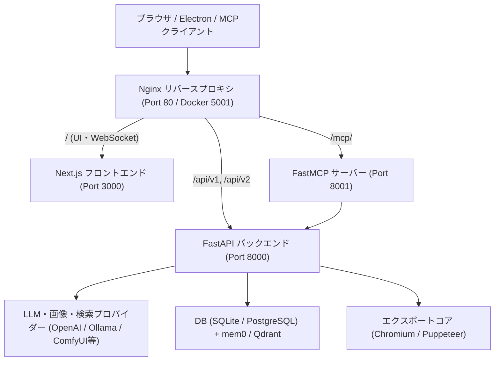

# **Presenton 調査レポート**

## **1. 基本情報**

* **ツール名**: Presenton
* **ツールの読み方**: プレゼントン
* **開発元**: Presenton Inc.
* **公式サイト**: [https://presenton.ai/](https://presenton.ai/)
* **関連リンク**:
  * GitHub: [https://github.com/presenton/presenton](https://github.com/presenton/presenton)
  * DeepWiki: [https://deepwiki.com/presenton/presenton](https://deepwiki.com/presenton/presenton)
  * ドキュメント: [https://docs.presenton.ai/](https://docs.presenton.ai/)
* **カテゴリ**: スライド/プレゼンテーション
* **概要**: Presentonは、プロンプトや既存のドキュメントから編集可能なPowerPoint（`.pptx`）およびPDFスライドを自動生成するオープンソース（Apache 2.0）のAIプレゼンテーションプラットフォームです。Dockerによるセルフホスト、Windows/macOS/Linux向けのネイティブデスクトップアプリ、マネージドクラウド（Presenton Cloud）、およびエンタープライズ版を提供しており、Ollama等を用いた完全オフライン実行やREST API・組み込みMCPサーバー経由でのシステム統合にも対応しています。

## **2. 目的と主な利用シーン**

* **解決する課題**: プレゼンテーション作成にかかる手作業の時間を削減し、企業のブランドガイドラインに沿ったスライドを自動生成する。同時に、機密データを外部クラウドへ送信できない企業のセキュリティ・コンプライアンス課題や、SaaSベンダーロックインの課題を解決する。
* **想定利用者**: 開発者、データアナリスト、スタートアップ、エンタープライズチーム、教育関係者
* **利用シーン**:
  * 金融機関や企業における機密データを扱った定例・コンプライアンスレポートの自動生成（オンプレミス／エアギャップ環境・API活用）
  * 自社SaaS製品や業務アプリへのプレゼンテーション生成機能の組み込み（REST API / 組み込みMCPサーバー）
  * AIエージェント（Claude、Cursor等）から自然言語でスライドを生成・エクスポートする自動化ワークフロー
  * 既存の企業PPTXテンプレートを取り込んだ、ブランド統一済み営業資料・提案書の作成

### **2.1 代表的な利用フロー**

```mermaid
swimlane-beta TB
  subgraph User["ユーザー / AIエージェント"]
    A[プロンプト・資料を入力]
    E[エディタで微調整・PPTX確認]
  end
  subgraph Frontend["Presenton UI / MCPクライアント"]
    B[生成モード・テンプレート選択]
    D[スライドプレビュー表示]
  end
  subgraph Backend["FastAPI / MCPサーバー"]
    C1[アウトライン・コンテンツ生成]
    C3[Template V2 / Smart Mode 描画・出力]
  end
  subgraph Providers["LLM・画像・検索プロバイダー"]
    C2[テキスト・画像生成 / Web検索]
  end
  A --> B
  B --> C1
  C1 --> C2
  C2 --> C3
  C3 --> D
  D --> E
```

* **代表的な流れ**: ユーザーまたはAIエージェント（MCP経由）がプロンプトやドキュメントを入力し、Standard Mode（Template V2）またはSmart Modeを選択すると、FastAPIバックエンドが設定されたLLM・画像生成・Web検索プロバイダーを呼び出して構成と内容を非同期生成します。生成されたスライドはブラウザUIまたはデスクトップアプリ上で即座にプレビュー・ドラッグ編集でき、最終的に編集可能なPPTX/PDFとしてエクスポートされます。

## **3. 主要機能**

* **2つのAIスライド生成モード（Standard Mode / Smart Mode）**:
  * **Standard Mode**: 組み込みテンプレートや独自カスタムテンプレート（Template V2）のレイアウト制約に従って、ブランド統一されたスライドを生成。
  * **Smart Mode**: スライドの内容に応じてAIが動的に最適なHTML/Tailwindベースのレイアウトを設計・生成する適応型ワークフロー。
* **Template V2（カスタムテンプレート＆既存PPTX変換）**: 既存のPowerPoint（`.pptx`）やPDFをVision対応LLMで解析し、HTML/Tailwind CSSベースの再利用可能なテンプレートに変換。フォントの自動解決やテーマ抽出にも対応。
* **編集可能なPPTX / PDF / PNGエクスポート**: LibreOffice依存を排除した独自のアーキテクチャ非依存エクスポートコア（`@presenton/export` / Chromium）により、PowerPoint上でネイティブに編集可能な `.pptx` や高精細PDF・PNGを出力。
* **組み込みMCPサーバー（Model Context Protocol）**: FastMCPベースのMCPエンドポイント（`/mcp/`）を標準搭載し、ClaudeやCursor等の外部AIエージェントから非同期でのスライド生成・進捗確認・エクスポートを実行可能。
* **BYOK＆マルチプロバイダー対応**:
  * **LLM**: OpenAI、Google Gemini、Anthropic Claude、DeepSeek、Azure OpenAI、Vertex AI、AWS Bedrock、OpenRouter、Fireworks、Together AI、Cerebras、LiteLLM、Ollama、LM Studio、さらにAPIキー不要の「Sign in with ChatGPT（Codex OAuth）」に対応。
  * **画像生成・素材**: GPT Image 2 / 2.5、Gemini Flash/Image、ComfyUI、Open WebUI、OpenAI互換画像API、Pexels、Pixabay。
  * **Web Grounding（検索連携）**: Tavily、Exa、Brave Search、SearXNG、Serper。
* **リッチエディタ＆数式・図解機能**: ドラッグ＆ドロップ、整列スナップガイド、KaTeX/LaTeX数式レンダリング、インフォグラフィック、ベクター図形・矢印、テーブル・チャート編集、AIアシスタントによる選択部分のチャット編集に対応。
* **マルチユーザーワークスペース＆管理機能**: ユーザーごとのプライベートワークスペース、管理者ロール権限（Admin Console）、認証制御、およびDocker・デスクトップアプリ（Windows/macOS/Linux）の双方を提供。

## **4. 動作原理・システム構成**

* **アーキテクチャ**: Nginxリバースプロキシをゲートウェイとし、Next.jsフロントエンド（Port 3000）、FastAPIバックエンド（Port 8000）、FastMCPサーバー（Port 8001）の3プロセスをNode.jsランチャー（`start.js`）で統合管理するローカルファースト／セルフホスト型クライアント・サーバー構成です。Electronデスクトップアプリ版も、これらと同一のNext.js＋FastAPIスタックをローカルマシン内にバンドルして実行します。



* **主要コンポーネントとデータフロー**:
  * **ルーティング層（Nginx）**: 外部からのHTTP/WebSocket通信を受け付け、UIリクエストをNext.jsへ、REST API（`/api/v1/`, `/api/v2/`）をFastAPIへ、MCP通信（`/mcp/`）をFastMCPサーバーへ振り分ける（最大100〜145MBのファイルアップロードに対応）。
  * **生成・オーケストレーション層（FastAPI + `llmai`）**: プロンプトやLiteParseで抽出したドキュメントを受け取り、非同期タスクおよびSSE（Server-Sent Events）ストリーミングでアウトライン・スライドJSON・Smart HTMLを生成する。
  * **記憶・検索・永続化層**: リレーショナルデータ（プレゼン・ユーザー・テンプレート情報）はSQLAlchemy＋Alembic経由でSQLite（デフォルト）またはPostgreSQL（`DATABASE_URL`）に保存。コンテキスト記憶には `mem0` とローカルQdrant、埋め込みモデル（FastEmbed `BAAI/bge-small-en-v1.5`）を利用する。
  * **レンダリング・エクスポート層**: HTML/Tailwind CSSで構築されたスライドをヘッドレスChromiumおよび `@presenton/export` コアでレンダリングし、ネイティブPPTX要素やPDF/PNGに変換して `/app_data/exports` へ出力する。
* **特筆すべき要素技術**:
  * **LibreOfficeレスのエクスポート基盤**: v0.8.8-beta以降でLibreOfficeへの依存を廃止し、Chromiumとアーキテクチャ非依存のエクスポートコアへ移行したことで、ARM/x64環境間でのレイアウト崩れを低減し高速化を実現。
  * **エアギャップ（完全オフライン）対応**: Dockerイメージ内にFastEmbed等の埋め込みモデルやローカルフォントを同梱（v0.9.12-beta）しており、インターネット接続のない環境でもOllama等と組み合わせて完結動作が可能。

## **5. 開始手順・セットアップ**

* **前提条件**:
  * Dockerを利用する場合はDocker Engine（またはDocker Desktop）がインストールされていること。
  * デスクトップアプリの場合は対象OS（Windows x64 `.exe`、macOS Apple Silicon/Intel `.dmg`、Linux x64 `.deb`）。
  * ソースから開発・ビルドする場合はNode.js (LTS)、Python 3.11、`uv` が必要。
* **インストール/導入**:

  ```bash
  # Dockerでのクイックスタート例（v0.8.9以降はホスト側ポート5001がデフォルト）
  docker run -it --name presenton -p 5001:80 -v "./app_data:/app_data" ghcr.io/presenton/presenton:latest
  ```

  または、`docker-compose.yml` を用いて各種環境変数（LLMプロバイダー、画像生成、PostgreSQL接続等）を一括指定して起動します。デスクトップアプリは公式サイト（[https://presenton.ai/download](https://presenton.ai/download)）からインストーラーをダウンロードできます。

* **初期設定**:
  * 初回起動時に管理者アカウントの設定（または環境変数 `AUTH_USERNAME` / `AUTH_PASSWORD` 指定）を行い、Web UIの設定画面または環境変数（`OPENAI_API_KEY=<YOUR_API_KEY>`、`GOOGLE_API_KEY=<YOUR_API_KEY>`、`OLLAMA_URL` 等）から利用するLLM・画像プロバイダーを設定します。
  * ChatGPTアカウントで直接利用する場合は、「Sign in with ChatGPT」からOAuth認証を行うことでAPIキー設定なしで利用可能です。
* **クイックスタート**:
  * Docker起動後、ブラウザで `http://localhost:5001` にアクセス（またはデスクトップアプリを起動）し、プロンプトやPDF/DOCXファイルをアップロードしてテンプレートまたはSmart Modeを選ぶだけで最初のスライドが生成されます。

## **6. 特徴・強み (Pros)**

* プライバシーとセキュリティを完全にコントロール可能なオープンソース（Apache 2.0ライセンス）。
* Ollama・LM Studio連携やDocker同梱モデルにより、外部APIに一切依存しない完全オフライン／エアギャップ環境での生成が可能。
* クラウドSaaSへのロックインを回避でき、自社インフラ・VPC・Kubernetes（Enterprise Helmチャート）上にセルフホストできる。
* Template V2により既存のPowerPoint資産をAIテンプレート化して再利用でき、生成結果も編集可能なPPTXとして書き出せる。
* REST APIおよび組み込みMCPサーバーを標準搭載しており、既存システムやAIエージェントへの組み込みが容易。

## **7. 弱み・注意点 (Cons)**

* CanvaやGammaなどのデザイン特化型SaaSと比較すると、UI上での直感的なビジュアル調整機能や素材ライブラリの豊富さでは一部簡素な面がある。
* セルフホストやローカルLLM（Ollama / ComfyUI等）を併用する場合、DockerやGPU環境、環境変数の設定に関する基礎知識が必要となる。
* ソフトウェアは現在ベータ版（`v0.9.x-beta`）であり、テンプレート仕様（v1→v2移行等）やAPI・UIのアップデートが頻繁に行われている。
* **日本語対応の状況**: 生成するスライドのコンテンツ自体は日本語プロンプトおよび各LLMを通じて日本語で出力可能だが、管理UI・公式ドキュメント・サポートは英語が中心。

## **8. 料金プラン**

| プラン名 | 料金 | 主な特徴 |
|---------|------|---------|
| **オープンソース版 / デスクトップアプリ** | 無料 | Apache 2.0ライセンス。セルフホスト、ローカル実行可能。BYOK（API従量課金は各LLM提供元へ支払い）またはChatGPTアカウント連携 |
| **Presenton Cloud** | 月額クレジット制（詳細は公式サイト参照） | サーバー管理不要のマネージドブラウザ版。生成スライド数に応じたクレジット消費方式 |
| **Presenton Enterprise** | 要問い合わせ | プライベートクラウド／オンプレミス／エアギャップ展開、Kubernetes用Helmチャート、SSO/OIDC/SCIM、監査ログ、専任サポート |

* **課金体系**: オープンソース版は無料。Presenton Cloudは生成スライド数に基づく月額クレジット制、Enterpriseは組織規模・要件に応じた個別見積もり。
* **無料トライアル**: オープンソース版およびデスクトップアプリは誰でも無償でダウンロード・利用可能。

## **9. 導入実績・事例**

* **導入企業**: 公式サイト上での特定企業名の公開事例はないが、GitHubで11,900以上のスターを獲得し、開発者コミュニティや企業のPoC・社内基盤として広く利用されている。
* **導入事例**: 金融サービスでの自動コンプライアンスレポート生成、SaaS企業による自社製品へのスライド出力機能組み込み、エアギャップ環境や機密データ処理を必要とする企業チームでのローカル生成が想定されている。
* **対象業界**: 金融、SaaS開発、コンサルティング、教育、データ分析など、自動化とデータプライバシーを重視する業界。

## **10. サポート体制**

* **ドキュメント**: 公式ドキュメントサイト（[https://docs.presenton.ai/](https://docs.presenton.ai/)）にて、Dockerクイックスタート、APIリファレンス、MCP連携、テンプレート作成ガイドが提供されている。
* **コミュニティ**: GitHubのIssues・Discussions、および公式Discordサーバーでのコミュニティサポートが活発に運用されている。
* **公式サポート**: Presenton CloudおよびEnterprise向けに、デモ予約やカスタムデプロイメントの技術サポート窓口が用意されている。

## **11. エコシステムと連携**

### **11.1 API・外部サービス連携**

* **REST API & MCP**: 非同期タスク型のREST API（`/api/v1/ppt/presentation/generate`、`/api/v2/`、`/api/v3/smart-design/` 等）およびOpenAPI仕様を提供。さらに `/mcp/` エンドポイントでFastMCPサーバーを公開し、AIエージェントからの直接操作に対応。
* **外部サービス連携**:
  * **LLM**: OpenAI、Google Gemini、Anthropic Claude、DeepSeek、Vertex AI、Azure OpenAI、Amazon Bedrock、OpenRouter、Fireworks、Together AI、Cerebras、LiteLLM、Ollama、LM Studio。
  * **画像・検索**: GPT Image 2、Gemini Flash、ComfyUI、Open WebUI、Pexels、Pixabay、Tavily、Exa、Brave Search、SearXNG、Serper。

### **11.2 技術スタックとの相性**

| 技術スタック | 相性 | メリット・推奨理由 | 懸念点・注意点 |
|:---|:---:|:---|:---|
| **Docker / Kubernetes** | ◎ | 公式イメージやdocker-composeが整備され、Enterprise向けにはHelmチャートも提供 | `/app_data` ボリュームの永続化と権限設計が必要 |
| **Python / Node.js (REST API)** | ◎ | 非同期ジョブ＋SSEストリーミングやOpenAPI仕様が整っておりバックエンド統合が容易 | 長時間生成時のタイムアウト設定（30分推奨等）に留意 |
| **MCPクライアント (Claude / Cursor等)** | ◎ | 組み込みMCPサーバーにより認証付きで自然言語からスライド生成・状態取得が可能 | Nginx経由の `/mcp/` ルーティングとBearer認証設定が必要 |
| **Ollama / LM Studio (ローカルAI)** | ◎ | 完全オフラインでの推論に対応し、動的モデル検出機能も備える | モデルの品質と生成速度はローカルマシンのGPU/メモリ性能に依存 |

## **12. セキュリティとコンプライアンス**

* **認証**: マルチユーザー認証および管理者ロール権限（Admin Role Permissions）に対応し、APIキー変更権限などの制御が可能。また、Enterprise版ではOAuth、OIDC、SCIMによるSSOおよび自動ユーザープロビジョニングをサポート。
* **データ管理**: セルフホストやローカル実行（デスクトップアプリ＋Ollama）、エアギャップ展開を選択することで、プロンプト・アップロード資料・生成スライドを外部送信せずローカルストレージ／自社DB内に完結できる。
* **準拠規格**: プライベートネットワークやエアギャップ環境で運用することで、GDPRや金融・医療等の厳格な社内セキュリティポリシーに適合させやすい構成となっている（第三者認証の取得状況については公式サイトで未公開のため、Enterprise導入時は問い合わせが必要）。

## **13. 操作性 (UI/UX) と学習コスト**

* **UI/UX**: Next.js＋Tailwind CSSによるクリーンなUIを採用。ドラッグ＆ドロップ編集、整列スナップガイド、KaTeX数式エディタ、ベクター矢印編集、選択箇所を指定してAIに修正を指示できるチャットアシスタントなど、直感的な操作性を備えている。
* **学習コスト**: デスクトップアプリでの利用開始は非常に容易。一方で、Dockerセルフホスト、PostgreSQL連携、ComfyUIワークフロー連携、Template V2のカスタム構築には一定の開発・インフラ知識が求められる。

## **14. ベストプラクティス**

* **効果的な活用法 (Modern Practices)**:
  * 社内の標準PPTXデザインをTemplate V2として取り込む際は、公式推奨の通りVision対応LLM（GPT-4o/5系やGemini等）を使用してレイアウトとフォント情報を高精度に抽出する。
  * 定例レポート生成はREST APIの非同期タスク（`get_job_status` ポーリング）や組み込みMCPサーバーと組み合わせ、データ抽出からPPTX生成までを自動パイプライン化する。
  * 機密情報を扱う場合は、`MEM0_ENABLED` 等のローカル構成とOllamaを組み合わせたオフライン構成を徹底する。
* **陥りやすい罠 (Antipatterns)**:
  * Vision非対応の軽量テキストモデルのみでPPTXテンプレート変換を実行し、レイアウト解析精度が低下する。
  * セルフホスト時に外部LLMプロバイダーをデフォルトのまま残し、機密データを意図せず外部APIへ送信してしまう。
  * スペック不足のCPU環境で大規模なローカルLLMを動かし、生成タイムアウトを引き起こす。

## **15. ユーザーの声（レビュー分析）**

* **調査対象**: G2やCapterraなどの商用B2Bレビューサイトには未掲載だが、GitHub（スター数11,900超）やProduct Hunt、Reddit等で活発な評価・フィードバックが確認できる。
* **総合評価**: Product Hunt等で高評価を獲得しており、オープンソースのスライド生成ツールとしてトップクラスの支持を集めている。
* **ポジティブな評価**:
  * 「ローカルLLM（Ollama）と組み合わせて、機密データを外部に出さずにスライドを作れる点が非常に心強い。」
  * 「出力されたPPTXがそのままPowerPointで綺麗に編集でき、既存PPTXをテンプレート化できるのが実用的。」
  * 「APIとMCPサーバーが標準で用意されているため、自社ワークフローやAIエージェントへの組み込みが簡単。」
* **ネガティブな評価 / 改善要望**:
  * 「ベータ版ゆえにアップデートが頻繁で、Docker環境変数やテンプレート仕様の追従・設定調整に少し手間がかかることがある。」
  * 「Gammaなどの商用SaaSと比べると、ブラウザ上での繊細なレイアウト・デザイン調整機能は発展途上。」
* **特徴的なユースケース**:
  * MCPサーバー経由でコーディングエージェントや社内チャットボットから資料を自動生成し、編集可能なPPTXとしてチームへ共有する運用。

## **16. 直近半年のアップデート情報**

* **2026-10-26**: `v0.9.12-beta` リリース。非推奨となったDALL-E 3に代わるGPT Image 2サポート、新テンプレート（Landmark Nova / Signal）追加、管理ロール権限によるアクセス制御（`CAN_CHANGE_KEYS`置換）、Dockerへの埋め込みモデル同梱、テンプレートレイアウト対応のAIスライド編集を実装。
* **2026-09-21**: `v0.9.11-beta` リリース。エアギャップ（完全オフライン）環境デプロイとコミュニティワークフロー対応、RTL（右から左）テキストのブラウザ双方向レンダリング対応、Open WebUI画像生成連携修正、起動時DBマイグレーションのデフォルト有効化。
* **2026-09-08**: `v0.9.10-beta` リリース。設定可能なプレゼン生成モード（Standard / Smart）追加、MCP生成ワークフローの拡張とセキュリティ強化、Mosaic・Verdantテンプレート追加、Ubuntu 22向けLinux Electron対応。
* **2026-08-26**: `v0.9.8-beta` リリース。アーキテクチャ非依存のエクスポートコア採用、エンタープライズ向けインフォグラフィック生成・編集、ベクター矢印・LaTeX混在テキストレンダリング改善、AIアシスタントの履歴・選択コンテキスト対応。
* **2026-08-17**: `v0.9.7-beta` リリース。Presenton Enterprise（Kubernetes Helmチャート、監査ログ、OAuth/OIDC/SCIMによるSSO）の拡充およびLogin with Presenton対応。
* **2026-08-10**: `v0.9.4-beta` リリース。内容に応じて動的レイアウトを生成するSmart Mode導入、KaTeX数式サポート、エディタのスナップガイド機能追加。
* **2026-07-27**: `v0.9.3-beta` リリース。マルチユーザー認証の追加、署名付きmacOS DMGパッケージング、白紙プレゼン作成UI・アイコンエディタ・Template V2ベクター図形強化。
* **2026-07-13**: `v0.9.0-beta` リリース。Template V2エディタ（チャート・テーブル・テキスト・フォント編集）の本格実装およびレガシーv1エンドポイントの整理。
* **2026-06-23**: `v0.8.9-beta` リリース。MCP認証とOpenAPI仕様更新、DeepSeekサポート追加、Dockerデフォルトホストポートを5001に変更。
* **2026-06-16**: `v0.8.8-beta` リリース。LibreOffice依存を排除したPPTX/HTML変換リファクタリング、Web検索プロバイダー統合、Ollamaモデルの動的検出対応。
* **2026-06-08**: `v0.8.7-beta` リリース。チャットLLMツール統合、ComfyUIランダムシード対応、スキャンPDF解析品質向上、nginxパストラバーサル修正。
* **2026-05-29**: `v0.8.6-beta` リリース。LiteLLMサポート強化、OpenAI互換画像プロバイダー追加、UIレイアウトとテンプレート機能改善。
* **2026-05-12**: `v0.8.5-beta` リリース。LiteLLMサポートの追加とモデル設定の強化。
* **2026-05-11**: `v0.8.4-beta` リリース。AzureおよびVertex LLM連携の強化、HuggingFaceダウンロードの安定性向上。
* **2026-05-09**: `v0.8.3-beta` リリース。スライドレイアウトジョブ処理とテンプレート作成プロセスの向上、PostgreSQL関連修正。
* **2026-04-20**: `v0.7.3-beta` リリース。デザインとUIの大幅刷新、テーマ管理エンドポイント追加。

(出典: [Presenton GitHub Releases](https://github.com/presenton/presenton/releases))

## **17. 類似ツールとの比較**

### **17.1 機能比較表 (星取表)**

| 機能カテゴリ | 機能項目 | Presenton | Gamma | Canva | Beautiful.ai |
|:---:|:---|:---:|:---:|:---:|:---:|
| **基本機能** | AIスライド自動生成 | ◎<br><small>Standard / Smart Mode</small> | ◎<br><small>Gamma 5対話型AI</small> | ◎<br><small>独自AI Craft / Brush</small> | ◯<br><small>スマートテンプレート生成</small> |
| **カスタマイズ** | 既存PPTXのテンプレート化 | ◎<br><small>Template V2でAI解析</small> | △<br><small>ブランド設定・インポート可</small> | ◯<br><small>ブランドキット・素材充実</small> | ◯<br><small>豊富な標準レイアウト</small> |
| **出力互換性** | 編集可能PPTXエクスポート | ◎<br><small>ネイティブ編集を重視</small> | ◯<br><small>複雑な図形は崩れる場合あり</small> | ◯<br><small>PPTX書き出し対応</small> | ◯<br><small>PPTX書き出し対応</small> |
| **セキュリティ** | ローカル実行・セルフホスト | ◎<br><small>OSS / Docker / エアギャップ</small> | ×<br><small>クラウド専用</small> | ×<br><small>クラウド専用</small> | ×<br><small>クラウド専用</small> |
| **拡張性** | API・MCPによる自動化 | ◎<br><small>REST API + 組み込みMCP</small> | ◎<br><small>REST API v1.0 + 公式MCP</small> | △<br><small>Connect API中心</small> | △<br><small>エンタープライズ中心</small> |
| **デザイン性** | UI上の自由編集・素材力 | ◯<br><small>ドラッグ編集・KaTeX対応</small> | ◎<br><small>自由配置ハイブリッド編集</small> | ◎<br><small>ProSuite・膨大な素材</small> | ◎<br><small>自動整列の完成度が高い</small> |

### **17.2 詳細比較**

| ツール名 | 特徴 | 強み | 弱み | 選択肢となるケース |
|---------|------|------|------|------------------|
| **Presenton** | オープンソースのAIプレゼン基盤 | ローカル／エアギャップ実行、セルフホスト、組み込みMCP＆API、無料利用 | 専用SaaSに比べUI上のデザイン微調整が簡易的 | プライバシーが厳格な環境、自社システムへの組み込み、編集可能PPTXの自動生成を重視する場合 |
| **Gamma** | 対話型AIと自由配置キャンバスを統合したAIデザインパートナー（Gamma 5） | 高いデザイン品質と初速、Public API・公式MCP対応、Webページ出力 | クラウド専用（オフライン不可）、無料枠は初回400クレジット使い切り | クラウド上で直感的かつ高速に美しい資料やWebページを作成したい場合 |
| **Canva** | 独自AIモデルとProSuiteを備えた総合ビジュアルプラットフォーム | 圧倒的な素材・テンプレート数、動画・SNS・印刷まで一気通貫 | 機能が膨大で管理・習得コストが高め、セルフホスト不可 | プレゼン以外のマーケティング素材も含めてチームで統一管理したい場合 |
| **Beautiful.ai** | デザインルールを自動適用するプレゼン専用SaaS | レイアウトが自動で美しく整い、チーム連携が強力 | ローカル実行不可、自由配置の柔軟性に制限 | デザインスキルに依存せず統一感のある企業資料をクラウドで作たい場合 |

## **18. 総評**

* **総合的な評価**:
  Presentonは、手軽なデスクトップ／Webスライド作成ツールであると同時に、強力なエンタープライズ向けプレゼン自動化エンジンでもあります。v0.9系への進化により、Template V2とSmart Modeの二刀流、組み込みMCPサーバー、LibreOffice不要の高品質PPTXエクスポート、さらにはエアギャップ環境やKubernetes（Helm）への対応まで獲得し、オープンソースAIプレゼン基盤として頭一つ抜けた完成度に達しています。
* **推奨されるチームやプロジェクト**:
  機密データを扱い外部クラウドに情報を出せない企業、定期レポートをAPI/MCP経由で完全自動化したいデータ・開発チーム、自社SaaSにプレゼン出力機能を組み込みたいプロダクトチーム。
* **選択時のポイント**:
  クラウド上で洗練されたビジュアル資料を即座に作りたい場合はGammaやCanvaが有力ですが、オンプレミス／ローカルLLMでの完全なデータ統制、既存PowerPoint資産のテンプレート再利用、あるいはBYOKによる柔軟なモデル選択とコスト最適化を求める場合には、Presentonが最適な選択肢となります。
