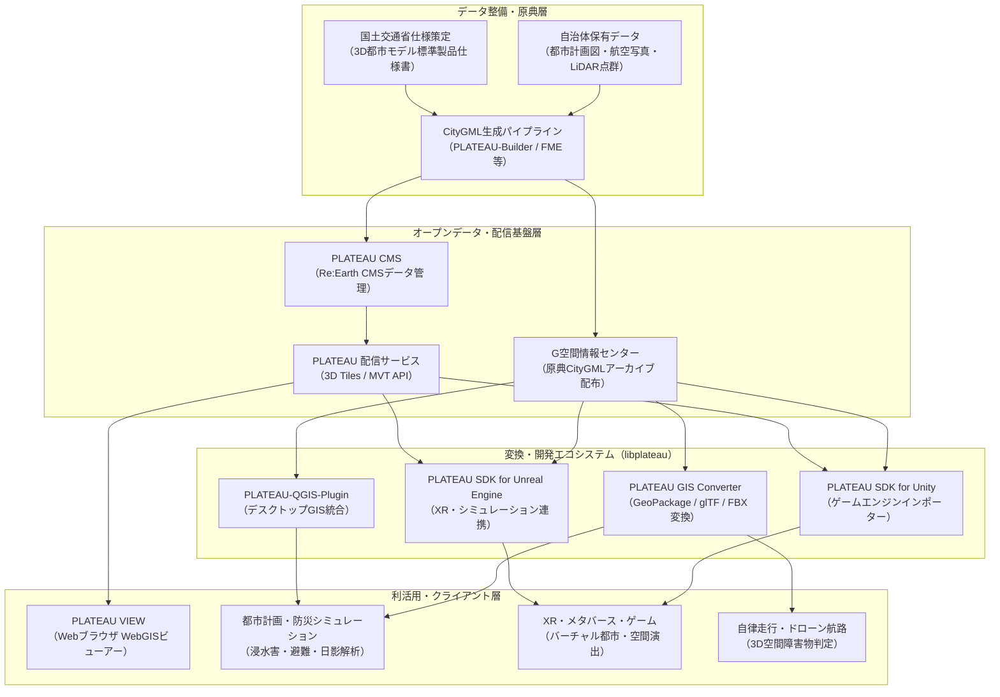

# **Project PLATEAU 調査レポート**

## **1. 基本情報**

* **ツール名**: Project PLATEAU（プロジェクト・プラトー）
* **ツールの読み方**: プロジェクト プラトー / プラトー
* **開発元**: 国土交通省（都市局）
* **公式サイト**: [https://www.mlit.go.jp/plateau/](https://www.mlit.go.jp/plateau/)
* **関連リンク**:
  * GitHub: [https://github.com/Project-PLATEAU](https://github.com/Project-PLATEAU)
  * ドキュメント: [https://www.mlit.go.jp/plateau/learning/](https://www.mlit.go.jp/plateau/learning/)
  * データ配布ポータル（G空間情報センター）: [https://www.geospatial.jp/ckan/dataset/plateau](https://www.geospatial.jp/ckan/dataset/plateau)
* **カテゴリ**: GIS/空間情報
* **概要**: Project PLATEAUは、国土交通省が主導する日本全国の3D都市モデルの整備・活用・オープンデータ化を推進するプロジェクトである。建築物や道路、都市計画情報などの詳細な属性情報（セマンティクス）を備えた3D都市空間データを無償公開し、WebGISビューアー（PLATEAU VIEW）、各種ゲームエンジン向けSDK、データ変換ツール群を提供することで、都市活動のデジタルツイン化と社会実装を牽引している。

## **2. 目的と主な利用シーン**

* **解決する課題**:
  * 従来の2次元地図データに依存した都市分析や合意形成における直感性・精度の不足
  * 自治体や民間企業が個別に3D都市データを測量・構築する際の膨大なコストと重複投資
  * 3Dメッシュ形状データと台帳属性情報（建築年、構造、用途、浸水想定等）の分断による高度なシミュレーションの困難さ
  * ゲームエンジンやWebブラウザで地理空間データ（GIS）を扱う際のデータ変換や座標変換に伴う技術的参入障壁
* **想定利用者**:
  * 自治体の都市計画・防災・土木・情報システム担当者
  * 空間情報（GIS）エンジニア、Web開発者、データサイエンティスト
  * ゲーム・メタバース・XRコンテンツ開発者（Unity / Unreal Engineクリエイター）
  * 建設・不動産・環境アセスメント・モビリティ分野の民間事業者・研究機関
* **利用シーン**:
  * **防災・減災シミュレーション**: 洪水・津波・内水氾濫のハザードマップと3D建築物モデルを重ね合わせ、各建物の浸水深や孤立リスク、最適な避難経路を立体的に検証
  * **都市計画・景観評価・合意形成**: 新規ビル・タワー開発に伴う日影の影響や眺望の変化をWebブラウザ上で住民や関係者に共有し、合意形成を迅速化
  * **モビリティ・スマートシティ実装**: 自動運転車両やドローンの航路設計、障害物判定、5Gミリ波等の通信電波伝搬シミュレーションへの空間基盤適用
  * **エンターテインメント・XRコンテンツ開発**: 渋谷、新宿、大阪などの実在する日本の都市空間をUnityやUnreal Engineに取り込み、オープンワールドゲームやバーチャルイベント会場を制作

### **2.1 代表的な利用フロー**

```mermaid
swimlane-beta TB
  subgraph User["ユーザー（開発者・自治体）"]
    A[対象エリアと利用目的の策定]
    F[3D都市空間の可視化・シミュレーション検証]
  end
  subgraph PlateauPlatform["PLATEAUプラットフォーム"]
    B[3D都市モデル・データセット検索]
    C[CityGMLまたは3D Tilesの配信]
  end
  subgraph DevelopmentTools["開発ツール・SDK"]
    D[PLATEAU SDK / GIS Converterでデータ読み込み]
    E[LOD・属性情報の抽出とメッシュ最適化]
  end
  A --> B
  B --> C
  C --> D
  D --> E
  E --> F
```

* **代表的な流れ**: ユーザーが対象エリアと用途（シミュレーションやXR開発）を策定してPLATEAUプラットフォーム（G空間情報センターまたは配信API）から該当データを取得し、PLATEAU SDKやGIS Converterを用いてゲームエンジンやGISツールに最適化されたメッシュ・属性情報を取り込み、目的のシミュレーションやアプリケーションを構築・検証する。

## **3. 主要機能**

* **全国規模の3D都市モデルオープンデータ**: 日本全国300以上の自治体を対象とした建築物、道路、地形、土地利用等の詳細な3DモデルをCC BY 4.0互換のオープンデータとして無償提供。
* **多段階詳細度（LOD0〜LOD4）とセマンティクス管理**: フットプリント（LOD0）、箱型（LOD1）、屋根形状再現（LOD2）、開口部立体化（LOD3）、屋内空間（LOD4）の5段階の幾何形状に加え、用途、構造、築年数、浸水深などの属性情報を統一規格で保持。
* **WebGISビューアー「PLATEAU VIEW」**: Webブラウザ上で日本全国の3D都市モデルを即座に表示し、災害リスクや日影などのレイヤー重畳、属性検索、断面表示をノーコードで行えるWebプラットフォーム。
* **ゲームエンジン統合「PLATEAU SDK for Unity / Unreal Engine」**: ゲームエンジン内にCityGMLや3D Tilesを直接インポートし、座標変換（平面直角座標系からローカル座標系）、メッシュ結合、コライダー生成、マテリアル適用をGUI上で実行可能。
* **データ変換ユーティリティ「PLATEAU GIS Converter」**: XML形式のCityGMLを、3D Tiles、glTF、GeoPackage、Shapefile、FBX、OBJ、MVT（Mapbox Vector Tiles）等の汎用フォーマットへ一括変換するGUIツール。
* **オープンソースGISプラグイン「PLATEAU-QGIS-Plugin」**: 世界標準のオープンソースGIS「QGIS」にPLATEAUのCityGMLや属性データをスムーズに取り込み、地図分析や属性結合を可能にする拡張機能。
* **ストリーミング配信API（3D Tiles / MVT API）**: 数十ギガバイトに及ぶ大容量ファイルを事前にダウンロードすることなく、Webアプリやゲームエンジンから必要な視界・ズームレベルのタイルのみを動的ストリーミング取得するAPI環境。
* **標準製品仕様書と実践チュートリアル**: 官民で共通利用できる都市モデル標準製品仕様書（国際標準CityGML準拠）および、ユースケース別の実装ガイド「PLATEAU Learning」を提供。

## **4. 動作原理・システム構成**

* **アーキテクチャ**: クラウドベースのオープンデータ配信基盤と、ローカル/オンプレミス環境で動作する変換ツール・SDK群をシームレスに組み合わせたハイブリッド型デジタルツインアーキテクチャを採用している。
* **主要コンポーネントとデータフロー**:
  * **データ整備・原典層**: 自治体が保有する都市計画基本図、航空測量写真、航空レーザ点群データから、標準製品仕様書に基づいてCityGML（XML）形式の原典データが生成される。
  * **データ配信・ホスティング層**: 原典CityGMLアーカイブは「G空間情報センター」を通じて配布され、Web配信向けに事前変換された3D Tilesやベクタータイル（MVT）は「PLATEAU CMS（Re:Earth CMSベース）」およびAWS（S3 / CloudFront）を介してグローバルに低遅延配信される。
  * **変換・エンジン層**: オープンソースのC++コアライブラリ「libplateau」が、CityGMLの高速パース、平面直角座標系からデカルト座標系への空間演算、テクスチャUV展開、メッシュ最適化を担う。
  * **アプリケーション層**: ブラウザ上ではCesiumJS / Re:EarthエンジンがWebGL/WebGPUを用いて3D Tilesを動的レンダリングし、デスクトップ/XR上ではUnityやUnreal Engineがネイティブメッシュとして描画する。



* **特筆すべき要素技術**:
  * **OGC CityGML 2.0**: 国際標準化団体OGCが策定した3D都市空間データ標準。幾何形状（Geometry）と事物・属性（Semantics）を分離せずに統合保持可能。
  * **OGC 3D Tiles**: Cesium社が提唱したWeb向け大規模3D空間データストリーミング規格。八分木（Octree）やKD木による空間階層構造を持ち、視点距離に応じた動的LOD切り替えを実現。
  * **libplateau**: C++で実装された高性能パーサー/ジオメトリ処理ライブラリ。CityGMLの複雑なXML構造を高速に解析し、メッシュ生成や座標系（EPSGコード）変換を高速に処理。
  * **Re:Earth Visualizer / CMS**: Eukarya社が主導するオープンソースWebGISプラットフォーム。PLATEAU VIEW 2.0以降の基盤としてノーコードでのUI構築やデータ管理を実現。

## **5. 開始手順・セットアップ**

* **前提条件**:
  * **ブラウザ閲覧（PLATEAU VIEW）**: Google Chrome、Microsoft Edge、Safari等のWebGL対応モダンブラウザ（インストール不要・アカウント不要）。
  * **Unity開発（PLATEAU SDK for Unity）**: Unity 2021.3 LTS / 2022.3 LTS / Unity 6以降。
  * **Unreal Engine開発（PLATEAU SDK for Unreal Engine）**: Unreal Engine 5.1 / 5.2 / 5.3以降。
  * **アカウント・クレジットカード登録**: すべて不要（完全無償オープンデータ）。
* **インストール/導入**:

  **1. Unity Package Manager経由での導入（PLATEAU SDK for Unity）**:
  Unityエディタの `Window` > `Package Manager` を開き、左上の `+` ボタンから `Add package from git URL...` を選択して以下を入力する。

  ```text
  https://github.com/Project-PLATEAU/PLATEAU-SDK-for-Unity.git?path=Packages/com.synesthesias.plateau-unity-sdk
  ```

  **2. PLATEAU GIS Converter（スタンドアロンGUIツール）の導入**:
  GitHubの公式リポジトリから実行可能バイナリをダウンロードして解凍する。

  ```bash
  # GitHub Releasesから最新版アーカイブを取得・展開（Windows / macOS対応）
  # https://github.com/Project-PLATEAU/PLATEAU-GIS-Converter/releases
  ```

* **初期設定**:
  * Unityプロジェクト起動後、メニューバーに `[PLATEAU]` メニューが追加される。
  * 座標系設定（日本の平面直角座標系 第I系〜第XIX系の中から対象地域に合致する系番号）を選択する。
* **クイックスタート（Unityでのインポート）**:
  1. Unity上部メニューから `[PLATEAU] > [PLATEAU SDK]` をクリックしてウィンドウを開く。
  2. データソースとして「ローカル」または「サーバー（ストリーミング）」を選択。
  3. 地図UI上で目的の地域（例: 東京都港区や渋谷区）を矩形選択。
  4. インポートしたい地物（建築物・道路・地形）とLOD（LOD1またはLOD2）にチェックを入れ、「モデルをインポート」を実行。
  5. シーン内に実寸大・テクスチャ付きの3D街並みが自動生成され、Inspectorから建物ごとの築年数や用途属性を確認できる。

## **6. 特徴・強み (Pros)**

* **圧倒的なオープンデータ規模と商用フリー**: 日本全国300以上の自治体（数千万棟以上の建築物）の高精度3Dモデルが、政府標準利用規約2.0（CC BY 4.0互換）に基づき完全無償・商用利用可能で公開されている。
* **セマンティクス（意味情報）の保持**: 単なる外観メッシュにとどまらず、建築物の用途区分（住宅・商業・公共等）、構造種別（RC・S・木造等）、階数、築年数、都市計画区域、浸水想定深などのメタデータを各オブジェクトに保持しているため、データ駆動型の高度なシミュレーションが可能。
* **ゲームエンジンとの強力なネイティブ親和性**: 公式SDK（Unity / Unreal Engine）が高度に整備されており、GISの専門知識がなくてもゲーム開発やVR/AR空間の舞台として数クリックで都市をインポートできる。
* **官民連携によるオープンエコシステムの確立**: PLATEAU AWARD（開発コンテスト）、PLATEAU RFI（技術提案公募）、PLATEAU Learning（実践教材）、全国規模のアイデアソン・ハッカソンが継続開催されており、開発者コミュニティや導入事例が豊富。
* **国際規格（OGC）準拠**: CityGMLおよび3D Tilesという国際標準フォーマットを採用しているため、Cesium、Mapbox、QGIS、Blenderなど世界中のサードパーティツールと高い相互運用性を持つ。

## **7. 弱み・注意点 (Cons)**

* **地域・地物ごとの整備詳細度（LOD）の格差**: 東京都心部や政令指定都市の中心街区では詳細な屋根形状やテクスチャを持つLOD2/LOD3が整備されているが、地方都市や郊外では直方体ブロック（LOD1）のみの提供となる場合が多い。
* **膨大なデータサイズとハードウェア負荷**: 全国や大都市圏のCityGML生データは数百GB〜数TBに達し、解凍・インポート時に多大なストレージと高スペックなPC（特に32GB以上のメインメモリとディスクリートGPU）が推奨される。
* **GIS特有の専門知識（座標系やスキーマ構造）の習得**: 平面直角座標系（JGD2011）の系番号選択やCityGMLの複雑なXML階層構造など、ゲーム開発者やWebエンジニアにとって一定のGIS学習コストが存在する。
* **リアルタイム更新ではないタイムラグ**: 都市モデルの原典データは自治体の定期測量や都市計画見直しサイクルに依存するため、直近数ヶ月以内に建設・解体された建物の反映には年単位のタイムラグが生じることがある。

## **8. 料金プラン**

| プラン名 | 料金 | 主な特徴 |
|---------|------|---------|
| **オープンデータ・基本ツール（全ユーザー）** | **完全無料** | ・全国のCityGML/3D Tilesデータのダウンロード・商用利用<br>・PLATEAU VIEWの無償利用<br>・PLATEAU SDK（Unity / Unreal Engine）の無償利用<br>・PLATEAU GIS Converter / QGISプラグインの無償利用<br>・利用登録・APIキー発行不要（無制限） |

* **課金体系**: なし（国土交通省の公共投資・オープンデータ施策として運営されており、民間・個人・学術利用を問わず一切の費用が発生しない）。
* **無料トライアル**: 該当なし（常時完全無料で利用可能）。

## **9. 導入実績・事例**

* **導入企業・団体**:
  * **東京都**: 「デジタルツイン実現プロジェクト」においてPLATEAUの3D都市モデルを都市基盤データとして活用し、防災・まちづくりシミュレーションを展開。
  * **静岡県**: 「バーチャル静岡」プロジェクトの一環として、県独自の航空点群データとPLATEAU仕様を融合した官民連携データ活用を推進。
  * **大手建設・不動産企業（竹中工務店、日建設計、森ビル等）**: 都市開発計画の合意形成、風況シミュレーション、熱環境シミュレーション、眺望分析に活用。
  * **大手IT・通信事業者（NTTデータ、ゼンリン、ソフトバンク等）**: 5G基地局電波伝搬シミュレーション、自動配送ロボットのルート計画、モビリティ管理プラットフォームに導入。
  * **ゲーム・エンタメ・XR企業（クラスター、バンダイナムコ研究所等）**: バーチャル都市空間のイベント会場構築、メタバースワールド制作、ARまち歩きアプリの開発。
* **導入事例**:
  * **流域治水・浸水シミュレーション**: 洪水浸水想定区域図と3D建築物データを重ね合わせ、建物ごとの浸水階数や地下街の浸水危険性を立体的に可視化し、タイムライン防災計画に反映。
  * **AI景観まちづくり**: 都市計画の高さ制限や斜線制限、建ぺい率を3D都市空間上にリアルタイム反映し、新築ビルの景観調和を事前検証。
* **対象業界**: 自治体・公共政策、都市開発・建設・不動産、土木・防災工学、モビリティ・物流、ゲーム・XR・エンターテインメント。

## **10. サポート体制**

* **ドキュメント**:
  * **PLATEAU Learning**: 初心者向けの入門からUnity/Unreal Engine/Python/QGISを活用した実践ガイドまで体系的なチュートリアルを日本語で提供。
  * **3D都市モデル標準製品仕様書**: UMLクラス図、属性定義、品質検査基準などを詳細に網羅した公式技術文書（無償公開）。
* **コミュニティ**:
  * **PLATEAU公式GitHub**: 各ツール（SDK、Converter、ビューアー等）のリポジトリにてIssuesおよびDiscussionsを通じたオープンなバグ報告・改善提案を受付。
  * **PLATEAUコンソーシアム・イベント**: 全国各地でのハンズオンワークショップ、開発コンテスト「PLATEAU AWARD」、官民連携ハッカソンが定期開催され、活発な開発者ネットワークが存在。
* **公式サポート**: 国土交通省 都市局 都市政策課 PLATEAU推進チームによる総合窓口（公式サイトの問い合わせフォーム経由）。

## **11. エコシステムと連携**

### **11.1 API・外部サービス連携**

* **API**:
  * **3D Tiles / MVT ストリーミングAPI**: Webブラウザやクライアントツールから直接呼び出し可能なタイル配信エンドポイント。
  * **G空間情報センター CKAN API**: 自治体ごとのCityGMLデータセットのメタデータ取得・ダウンロード自動化が可能なREST API。
* **外部サービス連携**:
  * **Cesium / Cesium ion**: 3D Tilesを直接読み込み、全世界の地形データや衛星画像とシームレスに合成表示。
  * **Mapbox / MapLibre GL JS**: ベクタータイル（MVT）形式の都市データをカスタムマップ上に重ね合わせ。
  * **QGIS**: PLATEAU-QGIS-Plugin経由で、国土地理院ベクトルタイルや基盤地図情報、オープン川マップと直接レイヤー統合。
  * **Blender / Maya / 3ds Max**: GIS Converter経由でFBX/OBJ/glTFに変換し、CG制作環境に都市アセットを取り込み。

### **11.2 技術スタックとの相性**

| 技術スタック | 相性 | メリット・推奨理由 | 懸念点・注意点 |
|:---|:---:|:---|:---|
| **Unity (C#)** | ◎ | 公式SDK（PLATEAU SDK for Unity）によりGUIでエリア選択・インポート完備。メッシュ最適化や属性参照が極めて容易。 | 大規模なLOD2データをインポートする際のメモリ消費とビルド時間。 |
| **Unreal Engine (C++ / Blueprints)** | ◎ | 公式SDKによりNaniteやLumenと組み合わせたフォトリアルな都市ビジュアライゼーションが可能。 | プラグインのエンジンバージョン追従と巨大メッシュのクック時間。 |
| **Webフロントエンド (CesiumJS / Three.js)** | ◎ | 3D TilesおよびglTF形式による高速ストリーミング描画に標準対応。軽量なWebアプリ構築に最適。 | モバイル端末ブラウザでのメモリ制約とテクスチャ帯域。 |
| **Python (GDAL / GeoPandas / PlateauUtils)** | ◯ | PlateauUtils等のOSSライブラリを用いてCityGMLのデータ抽出・集計・AI解析パイプラインを構築可能。 | 巨大XMLのパース速度と空間インデックス処理の実装工数。 |
| **QGIS (Desktop GIS)** | ◎ | 公式プラグインによりGIS環境へワンクリックでデータ展開可能。都市計画図や統計データとの結合が容易。 | 3Dマップ表示時のPCグラフィック性能に依存。 |

## **12. セキュリティとコンプライアンス**

* **認証**: オープンデータ配布基盤およびWebGISビューアー（PLATEAU VIEW）は完全パブリックであり、ユーザー登録や認証（APIキー）は一切不要。
* **データ管理**:
  * すべての3D都市モデルデータは、個人情報や国家安全保障上の機密情報を除外・抽象化した公知データ（都市計画基本図・航空写真等）から生成。
  * データ配信基盤は高可用性パブリッククラウド（AWS等）上でホスティングされ、堅牢なCDN（CloudFront等）によるDDoS対策と低遅延配信を実施。
* **準拠規格**:
  * **政府標準利用規約第2.0版（CC BY 4.0互換）**: 商用利用・改変・再配布を無償で許可（クレジット表記が必要）。
  * **OGC CityGML 2.0 / OGC 3D Tiles**: 国際空間情報コンソーシアムの標準規格に完全準拠。

## **13. 操作性 (UI/UX) と学習コスト**

* **UI/UX**:
  * **PLATEAU VIEW**: 直感的なマップUIを採用。マウス操作で自由な3D視点移動、レイヤーのオン/オフ、透過度調整、断面解析、日影・浸水シミュレーションをワンクリックで実行可能。
  * **PLATEAU SDK**: UnityおよびUnreal Engineのエディタウィンドウ内にネイティブなGUIが統合されており、日本地図から直感的にメッシュ区画を選択できる。
* **学習コスト**:
  * **一般ユーザー / ビジネス職**: PLATEAU VIEWの操作は数分で習得可能（学習コスト：極小）。
  * **開発者 / クリエイター**: ゲームエンジンへのインポート自体は容易だが、GIS座標系（平面直角座標系やEPSG）、CityGMLのLOD概念、3Dメッシュの軽量化ノウハウの習得に一定の学習期間が必要（学習コスト：中）。

## **14. ベストプラクティス**

* **効果的な活用法 (Modern Practices)**:
  * **ストリーミングとローカルの使い分け**: 初期検証や軽量アプリではPLATEAU配信サービス（3D Tiles）を利用し、リッチなXR開発や物理演算・シミュレーションが必要な場合のみCityGML生データをSDKでインポートする。
  * **適切なLODの選択とメッシュ結合（Combine）**: 広域背景用にはブロック形状のLOD1を選択し、プレイヤーや視点の近景のみLOD2/LOD3を配置する。また、SDKのメッシュ結合機能を活用してドローコール（Draw Calls）を抑制する。
  * **自治体オープンデータとの属性結合**: 建物ID（gml:id）をキーとして、各自治体が公開するオープンデータ（避難所情報、人口動態、路線価、固定資産税評価等）と連携させて独自の高付加価値デジタルツインを構築する。
* **陥りやすい罠 (Antipatterns)**:
  * **広域のLOD2データを無加工で一括インポート**: 巨大なポリゴン数とテクスチャがメモリを圧迫し、UnityやUnreal Engineがクラッシュ・フリーズする原因となる。対象エリアをメッシュコード単位で厳格に限定すべきである。
  * **座標系の不一致（CRSの誤選択）**: 日本の平面直角座標系（1〜19系）の選択を誤ると、標高がずれたり建物が宙に浮く現象が発生する。対象自治体の系番号を必ず確認してインポートする必要がある。
  * **CityGMLの自前パース試行**: XMLスキーマが非常に複雑で相互参照（XLink等）を含むため、独自パーサーを書くのは避け、libplateauやPLATEAU GIS Converterなどの既存ツールを活用すべきである。

## **15. ユーザーの声（レビュー分析）**

* **調査対象**: Zenn、Qiita、X（旧Twitter）、PLATEAUハッカソン参加者ブログ、技術カンファレンス登壇資料。
* **総合評価**: **4.8 / 5.0**（世界に類を見ない国家規模の3D都市モデルオープンデータ基盤として、開発者・研究者から極めて高い称賛を獲得）。
* **ポジティブな評価**:
  * 「日本の現実の街並みを商用フリーのオープンデータとしてここまで大規模に使えるのは世界的にも突出した先進事例」
  * 「PLATEAU SDK for Unityのおかげで、ゲーム開発者がGISの難解な数式を気にせず数クリックで街を作れるようになった」
  * 「Google Earth等の単なる3Dメッシュと違い、各建物に用途や築年数、災害リスクなどの『意味情報』が付随しているため、学術研究や都市シミュレーションの価値が段違い」
* **ネガティブな評価 / 改善要望**:
  * 「CityGMLのフォルダ構造とファイルサイズが巨大すぎて、ダウンロードと解凍だけでストレージが逼迫する」
  * 「大都市圏以外の地方部ではLOD1（直方体）のみの地域が多く、全地域でリアルな屋根やテクスチャが揃っているわけではない」
  * 「建物の解体や新築が即座に反映されるわけではないため、リアルタイムの現況との差異に注意が必要」
* **特徴的なユースケース**:
  * 渋谷駅前や新宿歌舞伎町の3D都市モデルを舞台にしたインディーズゲームやメタバースライブの制作
  * 地域住民向けの防災ワークショップにおいて、浸水ハザードマップを3D化してVRゴーグルで体感する避難シミュレーション

## **16. 直近半年のアップデート情報**

* **2026-10-20**: **「PLATEAU RFI#2」の技術提案公募・審査結果公表**。衛星データ・点群・生成AIを活用した3D都市モデル整備・更新の効率化および自動化に向けた実証実験プロジェクトを採択。
* **2026-09-15**: **PLATEAU-GIS-Converter v0.1.8 リリース**。3D Tiles出力時のテクスチャ圧縮（KTX2/Basis Universal）対応および大容量CityGML変換時のメモリ消費を大幅に削減。
* **2026-07-28**: **国土交通省が「PLATEAUビジョン2026」を策定・公表**。2027年度末までに整備都市数を全国500都市へ拡大する目標を掲げるとともに、データ更新自動化・官民連携サービス実装・都市デジタルツインの海外展開方針を策定。
* **2026-06-18**: **ソリューション開発コンテスト「PLATEAU AWARD 2026」開催発表・募集開始**。総額数百万円の賞金とともに、3D都市モデルを活用した革新的なアプリ・XR・シミュレーション作品のエントリー受付を開始。
* **2026-05-30**: **PLATEAU-SDK-for-Unity v2.4.0 リリース**。Unity 6への正式対応、3D Tilesストリーミング機能の通信負荷低減、および大規模メッシュインポート時のパフォーマンス向上を実施。

(出典: [国土交通省 PLATEAU プレスリリース・お知らせ](https://www.mlit.go.jp/plateau/) および [Project-PLATEAU GitHub Releases](https://github.com/Project-PLATEAU))

## **17. 類似ツールとの比較**

### **17.1 機能比較表 (星取表)**

| 機能カテゴリ | 機能項目 | Project PLATEAU | Cesium (Cesium ion) | ArcGIS (Esri) | Google 3D Tiles |
|:---:|:---|:---:|:---:|:---:|:---:|
| **基本仕様** | 日本国内データカバレッジ | ◎<br><small>全国300都市以上網羅</small> | ◯<br><small>グローバル対応だが粗い地域あり</small> | ◯<br><small>商用データ連携でカバー</small> | ◎<br><small>主要大都市圏を高精細カバー</small> |
| **データ品質** | セマンティクス属性（用途・構造） | ◎<br><small>CityGML標準で詳細保持</small> | △<br><small>属性はユーザー持ち込みが主</small> | ◎<br><small>包括的なGIS属性管理</small> | ×<br><small>純粋な外観3Dメッシュのみ</small> |
| **ライセンス** | オープンデータ・商用無償利用 | ◎<br><small>完全無償・CC BY 4.0互換</small> | △<br><small>一定量以上は有料SaaS</small> | ×<br><small>高額な商用ライセンス</small> | △<br><small>従量課金API（利用規約制限有）</small> |
| **開発エコシステム** | Unity / Unreal Engine 公式SDK | ◎<br><small>専用SDK提供・インポート完備</small> | ◎<br><small>Cesium for Unity/Unreal</small> | ◯<br><small>ArcGIS Maps SDK提供</small> | ◯<br><small>Cesium経由またはWeb統合</small> |
| **Web可視化** | ノーコードWebブラウザビューアー | ◎<br><small>PLATEAU VIEW（無料提供）</small> | ◯<br><small>Cesium Stories / Sandcastle</small> | ◎<br><small>ArcGIS Online / Scene Viewer</small> | △<br><small>Maps JS API等で実装が必要</small> |
| **非機能要件** | 日本語ドキュメント・サポート | ◎<br><small>国交省主導の日本語完備</small> | △<br><small>英語中心（一部コミュニティ訳）</small> | ◎<br><small>ESRIジャパンによる日本語支援</small> | ◯<br><small>Google Cloud日本語ドキュメント</small> |

### **17.2 詳細比較**

| ツール名 | 特徴 | 強み | 弱み | 選択肢となるケース |
|---------|------|------|------|------------------|
| **Project PLATEAU** | 国土交通省主導の全国3D都市モデルオープンデータ基盤。 | 日本全国を網羅し、完全無償で商用利用可能。用途・構造などの意味情報（セマンティクス）を保持。 | 地方都市のLOD精度（LOD1中心）やデータ更新サイクルに年単位のタイムラグがある。 | 日本国内の都市を対象とした防災、都市計画、XRゲーム開発、研究開発を行うすべてのケース。 |
| **Cesium (Cesium ion)** | 3D地理空間データのグローバル標準ホスティング＆ストリーミング基盤。 | 3D Tiles規格の発案元であり、全世界の地形・航空写真と組み合わせた大規模配信性能が極めて高い。 | 大規模な商用利用ではサブスクリプション課金が発生し、独自データのホスティング管理が必要。 | グローバル規模の3D地理空間配信インフラを構築したい場合や、PLATEAUデータを独自クラウドでホストしたい場合。 |
| **ArcGIS (Esri)** | 世界最大のGISベンダーが提供する包括的地理情報プラットフォーム。 | 高度な空間解析、都市計画（ArcGIS Urban）、BIM/CIM統合、エンタープライズ権限管理が万全。 | 導入費用が高価であり、ベンダーロックインが発生しやすい。 | 官公庁や大手建設・インフラ企業が本格的なGIS分析・業務ワークフローとして統合運用する場合。 |
| **Google Photorealistic 3D Tiles** | Google Earthの航空測量メッシュ技術を活用した高精細フォトリアル3Dタイル。 | 実写レベルの圧倒的なテクスチャ品質と全世界主要都市のリアルな外観再現性。 | メッシュ形状のみで属性情報（築年数や用途）が存在せず、データ二次配布やオフライン利用が禁止。 | 外観の美しさと現実感（フォトリアリズム）を最優先するWebビジュアライゼーションや観光アプリ。 |

## **18. 総評**

* **総合的な評価**:
  * Project PLATEAUは、国土交通省のリーダーシップのもとで構築された、世界でも類を見ない国家規模の3D都市空間データ基盤である。単なる外観の3Dビジュアルにとどまらず、建築物の築年数・構造・用途や防災リスクなどの「意味情報（セマンティクス）」が国際標準CityGML仕様で統合されている点が最大の特徴である。
  * さらに、UnityやUnreal Engine向け公式SDK、GISコンバーター、ブラウザビューアー（PLATEAU VIEW）など、開発者が現場ですぐに使えるオープンソースツールチェーンを網羅的に提供しており、公共事業にとどまらずスタートアップやエンタメ業界にまで広がる強力なデジタルツインエコシステムを築き上げている。
* **推奨されるチームやプロジェクト**:
  * **自治体・都市計画・防災関連プロジェクト**: 水害や地震時の立体的なリスク評価、住民合意形成を低コストかつ直感的に進めたいチーム。
  * **ゲーム・メタバース・XR開発チーム**: 日本の実在都市（東京、大阪、名古屋など）を舞台にしたオープンワールドやバーチャル空間を迅速に構築したいクリエイター。
  * **スマートシティ・モビリティ実証チーム**: ドローン航路計画や自動運転シミュレーション、電波伝搬解析に必要な実寸大3D都市空間を無償で活用したい研究開発部門。
* **選択時のポイント**:
  * 日本国内の都市空間を対象とする場合、ライセンス料ゼロ・商用利用フリーでセマンティクス属性を活用できるPLATEAUが第一候補となる。
  * 外観のフォトリアリズムのみを重視し属性情報を必要としない場合はGoogle Photorealistic 3D Tiles、全世界規模のデータ配信基盤が必要な場合はCesium ion、エンタープライズGIS業務に直結させる場合はArcGISとの連携や併用を検討すると良い。
