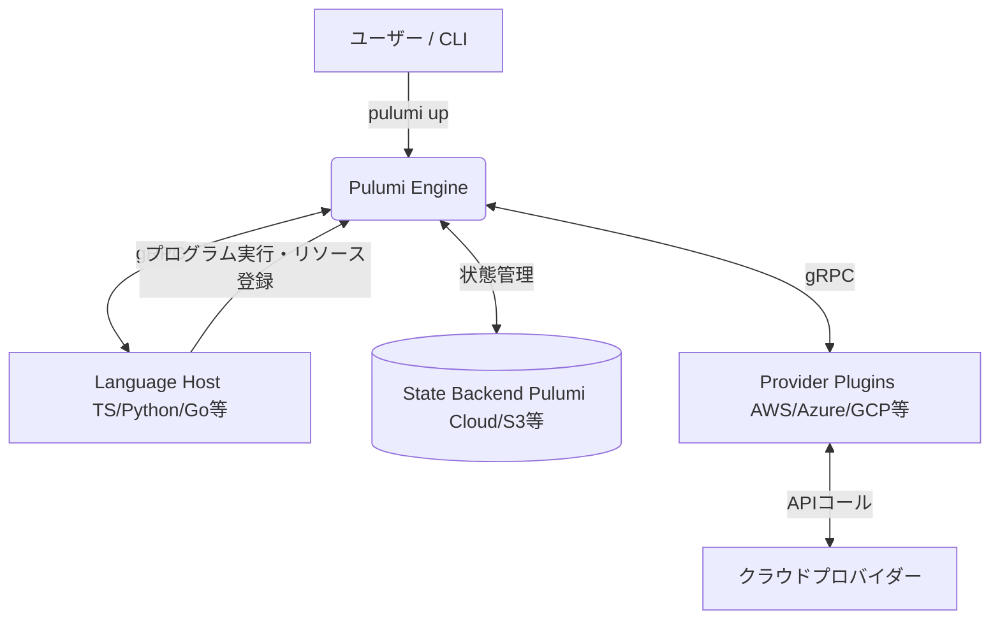

# **Pulumi 調査レポート**

## **1. 基本情報**

* **ツール名**: Pulumi
* **ツールの読み方**: プルミ
* **開発元**: Pulumi Corp.
* **公式サイト**: [https://www.pulumi.com/](https://www.pulumi.com/)
* **関連リンク**:
  * GitHub: [https://github.com/pulumi/pulumi](https://github.com/pulumi/pulumi)
  * CodeWiki: [https://codewiki.google/github.com/pulumi/pulumi](https://codewiki.google/github.com/pulumi/pulumi)
  * ドキュメント: [https://www.pulumi.com/docs/](https://www.pulumi.com/docs/)
* **カテゴリ**: 構成管理
* **概要**: Pulumiは、TypeScript, Python, Go, C#, Java, YAMLなどの使い慣れたプログラミング言語を使用して、クラウドインフラをコードとして定義、デプロイ、管理できるオープンソースのInfrastructure as Code (IaC) プラットフォームです。AIアシスタント「Pulumi Copilot」を搭載し、インフラ管理の生産性を向上させます。

## **2. 目的と主な利用シーン**

* **解決する課題**: 独自のDSL（ドメイン固有言語）を学ぶ必要なく、汎用プログラミング言語の能力を最大限に活用して、テスト可能で再利用性の高いインフラコードを構築したい。
* **想定利用者**: DevOpsエンジニア, クラウドエンジニア, アプリケーション開発者
* **利用シーン**:
  * AWS, Azure, Google Cloudなどマルチクラウド環境のインフラ構築と管理
  * Kubernetesクラスタのプロビジョニングとアプリケーションデプロイ
  * CI/CDパイプラインと統合したインフラの完全自動化
  * 既存のTerraform資産(HCL)を活用しつつ、段階的にプログラミング言語ベースの管理へ移行

## **3. 主要機能**

* **多言語対応**: TypeScript, Python, Go, C#, Java, YAMLに加え、TerraformのHCLもサポート。
* **マルチクラウド対応**: AWS, Azure, Google Cloud, Kubernetesなど170以上のクラウドプロバイダーに対応。
* **Pulumi Copilot (AI)**: 生成AIを活用したインフラ管理アシスタント。自然言語でのコード生成、デプロイのデバッグ、インフラに関する質問への回答などを行う。
* **状態管理**: デプロイされたインフラの状態を管理。デフォルトのPulumi Cloudのほか、S3やGCSなどでのセルフホスティングも可能。
* **シークレット管理 (Pulumi ESC)**: 複数のクラウドやVaultにまたがるシークレットと構成を一元管理する。
* **テストフレームワーク**: 各言語の標準的なテストツール（例: pytest, Jest）を使用してインフラコードの単体テストや統合テストを作成可能。

## **4. 動作原理・システム構成**

* **アーキテクチャ**: クライアント・サーバー構成（CLIツールとPulumi Cloud等による状態管理）
* **主要コンポーネントとデータフロー**:
  * ユーザーはCLI（`pulumi up`等）を実行し、コードを実行してインフラの目標状態を計算します。
  * Language Hostsが各プログラミング言語のプログラムを実行し、リソースの登録要求をPulumi Engineに送信します。
  * Pulumi Engineは現在の状態（State）と目標状態を比較し、必要な変更（Create/Update/Delete）の計画（Plan）を作成します。
  * Provider Pluginsが各クラウドのAPIを呼び出して実際のインフラストラクチャを構成し、その結果を状態管理バックエンド（Pulumi Cloud等）に保存します。
* **特筆すべき要素技術**:
  * **gRPC通信**: CLI、Language Hosts、およびProvider Plugins間はgRPCで通信するため、様々な言語やプロバイダーをプラグインとして拡張可能です。



## **5. 開始手順・セットアップ**

* **前提条件**:
  * OS: macOS, Linux, Windows
  * 言語ランタイム: Node.js, Python, Go, .NET Core, Java (使用言語による)
  * Pulumi Cloudアカウント (無料、ローカル状態管理の場合は不要)
* **インストール/導入**:

  ```bash
  # macOS (Homebrew)
  brew install pulumi/tap/pulumi

  # Linux / macOS (Curl)
  curl -fsSL https://get.pulumi.com | sh

  # Windows (Winget)
  winget install pulumi
  ```

* **初期設定**:
  * `pulumi login`: Pulumi Cloudへのログイン（または `pulumi login --local` でローカルモード）
  * クラウドプロバイダーの認証情報設定 (例: `export AWS_ACCESS_KEY_ID=...`)
* **クイックスタート**:

  ```bash
  # 新規プロジェクトの作成
  mkdir my-project && cd my-project
  pulumi new aws-typescript

  # 依存関係のインストールとプレビュー
  npm install
  pulumi preview

  # インフラのデプロイ
  pulumi up
  ```

## **6. 特徴・強み (Pros)**

* **汎用プログラミング言語の活用**: HCLのようなDSLを新たに学習する必要がなく、IDEの補完機能や型チェック、デバッガなどの恩恵を受けられる。
* **高い表現力と再利用性**: ループ、条件分岐、関数、クラスなどを利用して、DRY原則に則った効率的で再利用性の高いインフラコードを記述できる。
* **テストの容易さ**: 使い慣れたテストフレームワークを使ってインフラコードの品質を担保でき、ソフトウェア開発と同様のベストプラクティスを適用できる。
* **AIによる生産性向上**: Pulumi Copilotがコード生成やデバッグを支援し、インフラ管理の生産性を大幅に向上させる。

## **7. 弱み・注意点 (Cons)**

* **コミュニティ規模**: 最大の競合であるTerraformと比較して、ユーザーコミュニティやサードパーティ製のモジュールはまだ少ない。
* **学習コスト**: プログラミング言語は使えるものの、IaCの概念やPulumiのアーキテクチャを理解するための学習コストは別途必要。
* **日本語対応**: UIやドキュメントは基本的に英語であり、日本語の情報は限定的。

## **8. 料金プラン**

| プラン名 | 料金 | 主な特徴 |
|---|---|---|
| **Community** | 無料 | 個人向け。状態管理、無制限のデプロイ、基本的なAI機能。 |
| **Team** | $40/月〜 | 最大10ユーザー。CI/CD連携、高度なAI支援、OIDCサポート。 |
| **Enterprise** | $400/月〜 | ユーザー数無制限。SAML/SSO、RBAC、監査ログ、ドリフト検出。 |
| **Business Critical** | カスタム | 大企業向け。セルフホスティング、コンプライアンスポリシー、24時間365日のサポート。 |

* **課金体系**: リソース数に応じた従量課金。各プランに無料枠が含まれる。
* **無料トライアル**: Enterpriseプランの14日間無料トライアルあり。

## **9. 導入実績・事例**

* **導入企業**: Snowflake, Mercedes-Benz, Atlassian, BMW, Unity, Dockerなど、グローバルで3,700社以上で利用。
* **導入事例**: Atlassianでは、開発者がインフラを簡単に利用できるようにし、メンテナンスにかかる時間を50%削減。Snowflakeは、複数クラウドにまたがるKubernetesへの移行を3ヶ月で実現。
* **対象業界**: テクノロジー、自動車、金融、ゲームなど幅広い業界で採用。

## **10. サポート体制**

* **ドキュメント**: 公式サイトに詳細なドキュメント、チュートリアル、APIリファレンスが整備されている。
* **コミュニティ**: 1万人以上が参加する活発なSlackコミュニティが存在し、ユーザー同士での情報交換が可能。
* **公式サポート**: Enterprise以上のプランで、ビジネス時間内または24時間365日のサポートが利用可能。

## **11. エコシステムと連携**

### **11.1 API・外部サービス連携**

* **API**: REST APIが提供されており、Pulumi Cloudの各種操作（スタック管理、デプロイ情報取得など）を自動化できる。
* **外部サービス連携**: AWS Code Services, Azure DevOps, CircleCI, GitHub Actions, GitLab CIなど、主要なCI/CDツールとシームレスに連携可能。

### **11.2 技術スタックとの相性**

| 技術スタック | 相性 | メリット・推奨理由 | 懸念点・注意点 |
|:---|:---:|:---|:---|
| **TypeScript / Node.js** | ◎ | 最も広く使われており、ドキュメントや例が豊富。型安全性と非同期処理の扱いやすさが強み。 | 特になし。 |
| **Python** | ◯ | データサイエンスやML基盤の構築に親和性が高い。動的型付けによる記述の柔軟性。 | 型チェックの恩恵を受けるにはType hintsが必要。 |
| **Go** | ◯ | パフォーマンスが高く、バイナリ配布が容易。静的型付けによる堅牢性。 | 記述量がやや多くなる傾向がある。 |
| **C# / .NET** | ◯ | エンタープライズ環境での採用が多い。強力な型システムとIDEサポート。 | Windows環境以外でのセットアップ手順に注意。 |
| **Java** | △ | JVMエコシステムの資産を活用できるが、IaCとしての採用例は他の言語に比べて少なめ。 | 起動時間やメモリ消費が気になる場合がある。 |
| **YAML** | △ | シンプルな宣言的記述が可能だが、Pulumiの強みであるプログラミング言語の機能を使えない。 | 複雑なロジックには向かない。 |

## **12. セキュリティとコンプライアンス**

* **認証**: SAML/SSO、OIDCによるセキュアな認証に対応 (Enterprise以上)。
* **データ管理**: Pulumi CloudはSOC 2 Type II認証を取得済み。シークレットはデフォルトで暗号化して管理される。
* **準拠規格**: RBAC（ロールベースアクセス制御）や監査ログ機能を提供し、企業のコンプライアンス要件に対応。

## **13. 操作性 (UI/UX) と学習コスト**

* **UI/UX**: Pulumi CloudのWeb UIは、リソースの可視化やデプロイ履歴の確認がしやすい。CLIの出力もカラーで見やすく、進捗状況が把握しやすい。
* **学習コスト**: サポートされているプログラミング言語に習熟している開発者にとっては、DSLを学ぶよりも学習コストは低い。ただし、IaCの基本概念（State, Stack, Resource Graphなど）の理解は必要。

## **14. ベストプラクティス**

* **効果的な活用法 (Modern Practices)**:
  * **StackReferencesの活用**: ネットワーク層とアプリ層など、インフラを複数のプロジェクト/スタックに分割し、StackReferenceを使って疎結合に連携する。
  * **シークレットの暗号化**: 機密情報は必ず `pulumi config set --secret` を使用して暗号化し、平文で保存しない。
  * **CI/CDへの統合**: ローカルからの手動デプロイを避け、GitHub ActionsやGitLab CIなどのCI/CDパイプラインから `pulumi up` を実行する。
* **陥りやすい罠 (Antipatterns)**:
  * **Stateファイルのコミット**: ローカルバックエンドを使用する場合、`.pulumi` ディレクトリやStateファイルをGitリポジトリにコミットしない（シークレット漏洩のリスク）。
  * **巨大な単一スタック**: すべてのリソースを1つのスタックに詰め込むと、デプロイ時間が長くなり、依存関係が複雑化する。

## **15. ユーザーの声（レビュー分析）**

* **調査対象**: G2, Capterra, Reddit
* **総合評価**: 4.5/5.0 (G2), 4.7/5.0 (Capterra) ※2026年1月時点
* **ポジティブな評価**:
  * 「使い慣れたプログラミング言語でインフラを書ける開発者体験は素晴らしい。Terraformから乗り換えて本当に良かった。」
  * 「インフラコードに対して単体テストや統合テストを書けるため、コードの品質と信頼性が大幅に向上した。」
  * 「AI機能が強力で、コードの雛形作成やエラー解決の時間を短縮できる。」
* **ネガティブな評価 / 改善要望**:
  * 「Terraformに比べてニッチなリソースのサポートが遅れることがある。」
  * 「ドキュメントが不十分な箇所があり、解決策を見つけるのに時間がかかることがある。」
  * 「Pulumi Cloudの料金体系がリソースベースで、コスト予測がしにくい。」
* **特徴的なユースケース**:
  * アプリケーションコードと同じリポジトリでインフラコードを管理し、開発者がフルサイクルで開発を担当するケース。

## **16. 直近半年のアップデート情報**

* **2026-10-21**: v3.271.0リリース。`ReadResourceResponse`に`id`フィールドを追加し、Automation APIに`state`および`env`コマンドを追加。 (出典: [GitHub Releases](https://github.com/pulumi/pulumi/releases))
* **2026-10-16**: v3.270.0リリース。`env edit`などのコマンドで環境設定の競合を修正。 (出典: [GitHub Releases](https://github.com/pulumi/pulumi/releases))
* **2026-10-07**: v3.268.0リリース。Automation APIへの`version`、`whoami`、`install`コマンドの追加、および`Invoke`時のOutputValuesのネゴシエーションを実装。 (出典: [GitHub Releases](https://github.com/pulumi/pulumi/releases))
* **2026-05-08**: v3.237.0リリース。`pulumi cloud api`に対する`lang`および`os`クエリパラメータの自動入力機能や、テンプレートからPulumiパッケージをブートストラップする`pulumi package new`を追加。 (出典: [GitHub Releases](https://github.com/pulumi/pulumi/releases))
* **2026-05-06**: v3.236.0リリース。 (出典: [GitHub Releases](https://github.com/pulumi/pulumi/releases))
* **2026-05-05**: v3.235.0リリース。ログの復号化用`pulumi logs decrypt`の追加、`hcl`コンバータのバンドル、および任意のPulumi Cloud APIを呼び出せる`pulumi cloud api`コマンド群を追加。 (出典: [GitHub Releases](https://github.com/pulumi/pulumi/releases))

(出典: [Pulumi Blog](https://www.pulumi.com/blog/) / [GitHub Releases](https://github.com/pulumi/pulumi/releases))

## **17. 類似ツールとの比較**

### **17.1 機能比較表 (星取表)**

| 機能カテゴリ | 機能項目 | Pulumi | Terraform | AWS CloudFormation | OpenTofu |
|:---:|:---|:---:|:---:|:---:|:---:|
| **言語** | 記述方式 | ◎<br><small>汎用言語(TS, Python等)</small> | ◯<br><small>独自DSL(HCL)</small> | △<br><small>YAML/JSON</small> | ◯<br><small>独自DSL(HCL)</small> |
| **ライセンス** | OSS | ◎<br><small>Apache 2.0</small> | △<br><small>BUSL</small> | -<br><small>プロプライエタリ</small> | ◎<br><small>MPL 2.0</small> |
| **状態管理** | State | ◯<br><small>Pulumi Cloud推奨</small> | ◯<br><small>ローカル/S3/HCP</small> | -<br><small>AWS管理</small> | ◎<br><small>クライアント暗号化対応</small> |
| **対応範囲** | マルチクラウド | ◎<br><small>170+プロバイダー</small> | ◎<br><small>3000+プロバイダー</small> | ×<br><small>AWSのみ</small> | ◎<br><small>互換性あり/数千プロバイダー</small> |
| **テスト** | 単体テスト | ◎<br><small>標準テストツール利用可</small> | △<br><small>独自テスト機能</small> | ×<br><small>困難</small> | △<br><small>独自テスト機能</small> |

### **17.2 詳細比較**

| ツール名 | 特徴 | 強み | 弱み | 選択肢となるケース |
|---------|------|------|------|------------------|
| **Pulumi** | 汎用プログラミング言語で記述。AI搭載。 | 高い表現力、テスト容易性、AIによる生産性向上。 | Terraformよりコミュニティが小さい。 | 開発者中心のチームで、ソフトウェア開発手法をインフラ管理に適用したい場合。 |
| **Terraform** | HCLという独自DSLで記述。業界標準。 | 巨大なコミュニティ、豊富なモジュール、実績多数。 | DSLの学習コスト、複雑なロジックの記述が困難。 | DevOpsチームが確立されており、HCLでの管理に慣れている場合。業界標準を使いたい場合。 |
| **AWS CloudFormation** | AWSネイティブのIaC。YAML/JSONで記述。 | AWSの最新機能へ即時対応、追加コスト不要。 | AWSにロックインされる、記述が冗長になりがち。 | インフラがAWSに限定されており、ネイティブツールで完結させたい場合。 |
| **OpenTofu** | Terraformのオープンソースフォーク。 | 完全オープンソース、Terraformからの移行が容易。 | エコシステムや開発速度はTerraformに劣る可能性。 | Terraformのライセンス変更を懸念し、オープンソースの代替を求める場合。 |

## **18. 総評**

* **総合的な評価**:
  Pulumiは、ソフトウェアエンジニアリングの手法をインフラ管理に適用することを可能にする、非常に強力でモダンなIaCプラットフォームである。汎用プログラミング言語による記述、AIアシスタントの搭載、そして優れたテスト容易性は、Terraformに対する明確な優位性となっている。開発者体験を最優先し、アプリケーションとインフラの境界をなくしたいチームにとって、最適な選択肢の一つと言える。
* **推奨されるチームやプロジェクト**:
  * アプリケーション開発者がインフラ構築にも積極的に関わるチーム。
  * PythonやTypeScriptなどのプログラミング言語スキルを持つエンジニアが多いチーム。
  * インフラコードのテストを自動化し、品質と信頼性を重視するプロジェクト。
* **選択時のポイント**:
  * チームが持つスキルセット（プログラミング言語 vs HCL）。
  * AIによる開発支援機能をどの程度重視するか。
  * コミュニティの規模や既存モジュールの活用と、ツールの表現力やテスト容易性のどちらを優先するか。
