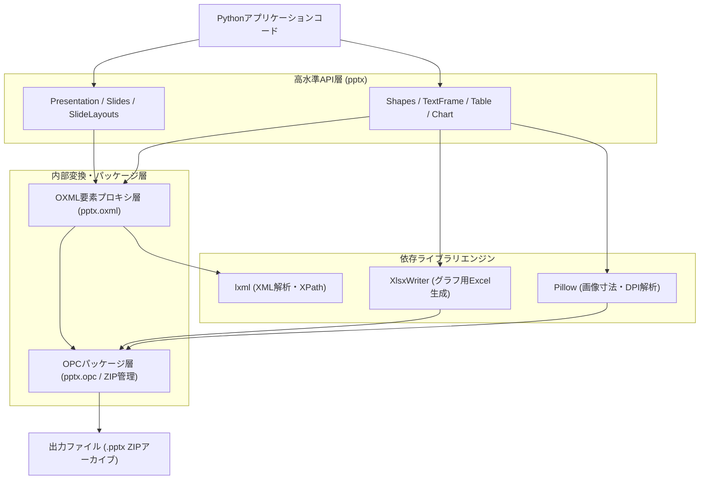

# **python-pptx 調査レポート**

## **1. 基本情報**

* **ツール名**: python-pptx
* **ツールの読み方**: パイソン ピーピーティーエックス
* **開発元**: Steve Canny (scanny) / オープンソースコミュニティ（MITライセンス）
* **公式サイト**: [https://python-pptx.readthedocs.io/en/latest/](https://python-pptx.readthedocs.io/en/latest/)
* **関連リンク**:
  * GitHub: [https://github.com/scanny/python-pptx](https://github.com/scanny/python-pptx)
  * PyPI: [https://pypi.org/project/python-pptx/](https://pypi.org/project/python-pptx/)
  * ドキュメント: [https://python-pptx.readthedocs.io/en/latest/](https://python-pptx.readthedocs.io/en/latest/)
* **カテゴリ**: スライド/プレゼンテーション
* **概要**: `python-pptx` は、PowerPoint（`.pptx` / Open XML）ファイルをプログラムから新規作成・読み取り・更新するためのPythonライブラリです。Microsoft OfficeやCOMオートメーション（Windows依存）を必要とせず、Linuxサーバーやコンテナ、サーバーレス環境上で完全にオフラインで動作するため、定型レポートの自動生成からAI/RAG向けドキュメント解析の前処理まで幅広く利用されています。

## **2. 目的と主な利用シーン**

* **解決する課題**: 週次・月次の定例報告資料や営業提案書の作成において、BIツールやデータベースから数値を手作業で転記し、グラフや表を貼り付ける反復作業の工数とヒューマンエラーを削減する。また、大量の既存プレゼンテーションファイルからテキストやメタデータを一括抽出する。
* **想定利用者**: バックエンド開発者、データエンジニア、データサイエンティスト、業務自動化担当者、AI/RAGパイプライン開発者
* **利用シーン**:
  * **データ駆動の定型レポート自動生成**: pandasの集計結果やSQLクエリ結果、Matplotlibのグラフ画像を企業テンプレート（`.pptx`）に差し込み、週次・月次レポートをバッチ生成する。
  * **Webアプリからの資料エクスポート**: SaaSや社内Webシステム上で、ユーザーが選択した条件に応じた提案書・分析資料を `.pptx` 形式でダウンロード提供する。
  * **AI・LLMパイプラインの前処理・後処理**: `MarkItDown` や `Unstructured` などのドキュメント解析ライブラリ経由で `.pptx` からテキスト・表を抽出したり、LLMが生成した構造化データをスライド化する。

### **2.1 代表的な利用フロー**

```mermaid
swimlane-beta TB
  subgraph User["ユーザー・業務システム"]
    A["バッチ実行またはエクスポート要求"]
    F["生成された.pptxファイルを確認・配布"]
  end
  subgraph App["Pythonスクリプト (python-pptx)"]
    B["テンプレート.pptxを読み込み"]
    C["スライド追加とプレースホルダー・表・グラフへデータ注入"]
    E["Open XMLパッケージを.pptxとして保存"]
  end
  subgraph Data["データソース・テンプレート"]
    D["DB・API・画像ファイルの取得"]
  end
  A --> B
  B --> C
  D --> C
  C --> E
  E --> F
```

* **代表的な流れ**: ユーザーまたは定期バッチがPythonスクリプトを起動すると、`python-pptx` が企業のブランドデザインが適用されたテンプレート `.pptx` を読み込み、外部データベースや画像ファイルから取得したデータをスライドのプレースホルダーや表・グラフへ差し込み、新しい `.pptx` ファイルとして書き出します。

## **3. 主要機能**

* **ラウンドトリップ読み書き（Round-Trip）**: 既存の `.pptx` ファイルを開いて一部のテキストやデータを更新し、未対応の要素や元のスタイル・テーマを壊さずにそのまま再保存できる。
* **スライド・レイアウト管理**: テンプレート内のスライドマスターおよびスライドレイアウトを選択してスライドを追加・参照・並び替え・削除（未使用レイアウトの削除含む）できる。
* **プレースホルダーとテキスト書式制御**: タイトルや箇条書きプレースホルダーへの入力に加え、テキストボックスの配置、段落（`Paragraph`）・ラン（`Run`）単位でのフォント名・サイズ・色・太字・斜体・配置制御が可能。
* **オートシェイプ・コネクタ・グループ図形**: 矩形、角丸四角形、吹き出し、フローチャート記号などのオートシェイプやコネクタの追加、位置・サイズ（EMU/インチ/cm/pt単位）指定、塗りつぶしや枠線スタイル設定に対応。
* **画像・OLEオブジェクト埋め込み**: PNG・JPEG・GIF・TIFF・BMPなどの画像をアスペクト比を保持したまま挿入でき、`shapes.add_ole_object()` によるExcel等のバイナリファイルの埋め込みにも対応。
* **テーブル（表）の作成とセル書式**: 行・列数を指定したテーブルの生成、セルの結合・分割、セル内テキストの書式設定、背景色や余白のカスタマイズが可能。
* **ネイティブグラフ（Chart）生成**: 棒グラフ（縦・横）、折れ線グラフ、円グラフ、散布図、バブルチャート、レーダーチャートなどのPowerPointネイティブグラフを `ChartData` 経由で生成し、後からExcelでデータ編集可能な状態で埋め込める。
* **スピーカーノート・ドキュメントプロパティ操作**: 各スライドのノートペインの読み書きや、タイトル・作成者・件名などのコアプロパティ（`core_properties`）の参照・更新が可能。

## **4. 動作原理・システム構成**

* **アーキテクチャ**: 完全ローカル完結型のPure Pythonライブラリ（一部C拡張ライブラリ `lxml` に依存）。外部サーバーやMicrosoft Officeプロセスと通信せず、アプリケーションプロセス内のメモリ上でOpen XML（OOXML）構造を直接構築・編集する。
* **主要コンポーネントとデータフロー**:
  * **オブジェクトグラフ層（`pptx.presentation`, `pptx.slide`, `pptx.shapes`, `pptx.chart`）**: 開発者が操作する高水準なPythonic API群。独立したコンストラクタではなく、親コンテナのメソッド（例: `prs.slides.add_slide()`、`slide.shapes.add_textbox()`）を通じてオブジェクトを生成するコンテナ駆動設計を採用している。
  * **OPCパッケージ層（`pptx.opc`）**: `.pptx` の実体であるZIPアーカイブ（Open Packaging Conventions）を解釈し、各XMLパーツ（`slide1.xml`、`presentation.xml` 等）とリレーションシップ（`_rels/*.rels`）、コンテンツタイプ（`[Content_Types].xml`）を管理する。
  * **OXML要素層（`pptx.oxml`）**: PresentationML（`<p:sld>`, `<p:sp>`）やDrawingML（`<a:r>`）のXML要素をラップするカスタムプロキシクラス群。高水準APIへの操作をXMLツリーの読み書きへ変換する。
* **特筆すべき要素技術**:
  * **`lxml`**: 高速なXMLパース・シリアライズおよびXPath探索を担う基盤エンジン。
  * **`XlsxWriter`**: PowerPointのグラフデータを格納する埋め込みExcelワークブック（`.xlsx`）を動的に生成するために使用。
  * **`Pillow` (PIL)**: 挿入される画像のフォーマット検証、ピクセル寸法・DPIの読み取りを行い、適切なEMU（English Metric Unit）サイズを計算するために使用。



## **5. 開始手順・セットアップ**

* **前提条件**:
  * Python 3.8 以上（Windows / macOS / Linux 対応）
  * Microsoft PowerPoint のインストール不要
  * アカウント登録・APIキー不要
* **インストール/導入**:

  ```bash
  # pip を使用する場合
  pip install python-pptx

  # uv を使用する場合
  uv add python-pptx
  ```

  主な依存パッケージ（`Pillow>=3.3.2`, `XlsxWriter>=0.5.7`, `lxml>=3.1.0`, `typing-extensions>=4.9.0`）は自動的にインストールされます。

* **初期設定**:
  * 設定ファイルや環境変数は不要。既存デザインを流用したい場合は、ベースとなるテンプレート `.pptx` ファイルを用意する。
* **クイックスタート**:

  ```python
  from pptx import Presentation

  prs = Presentation()
  title_slide_layout = prs.slide_layouts[0]
  slide = prs.slides.add_slide(title_slide_layout)

  slide.shapes.title.text = "Hello, World!"
  slide.placeholders[1].text = "python-pptx で作成したプレゼンテーション"

  prs.save("hello.pptx")
  ```

## **6. 特徴・強み (Pros)**

* **完全オフライン・クロスプラットフォーム動作**: OfficeライセンスやWindows環境（COMオートメーション）に依存しないため、Dockerコンテナ、AWS Lambda、Linuxバッチサーバーで安全かつ高速に動作する。
* **テンプレート継承による高いデザイン品質**: デザイナーが作成した企業の公式 `.pptx` テンプレートを読み込み、スライドマスターやプレースホルダーをそのまま活用してデータだけを流し込める。
* **編集可能なネイティブオブジェクト生成**: 画像貼り付けではなく、PowerPoint上で後からテキスト編集や数値修正が可能なネイティブの表・図形・グラフを生成できる。
* **枯れた安定性と型サポート**: 10年以上の実績があり、2024年のv1.0.xで `py.typed` を含む型アノテーションに対応したため、現代的なIDEでの補完や静的型チェック（mypy/pyright）とも相性が良い。

## **7. 弱み・注意点 (Cons)**

* **フォントレンダリングエンジン非搭載（テキスト溢れ問題）**: 文字列が指定枠に収まるかどうかの描画幅・高さを計算する機能がないため、長文を動的に挿入すると枠からはみ出したりレイアウトが崩れたりする。
* **PDF・画像への変換機能がない**: `python-pptx` 単体では `.pptx` をPDFやPNGにエクスポートできないため、プレビューやPDF配布が必要な場合は LibreOffice（`soffice --headless --convert-to pdf`）など外部ツールとの併用が必要になる。
* **高度なPowerPoint機能のAPI不足**: SmartArtの編集、アニメーション設定、複合グラフ（棒＋折れ線など）、複雑なグループ化図形の詳細編集などは高水準APIでカバーされておらず、`lxml` を用いた低レベルXML操作が必要になる。
* **日本語ドキュメントの不在と開発停滞**: 公式ドキュメントは英語のみであり、日本語特有の組版機能（縦書きなど）のサポートは限定的。また、2024年8月のv1.0.2以降は新規リリースが停止しており、最新のOpen XML機能への追従は期待しにくい。

## **8. 料金プラン**

| プラン名 | 料金 | 主な特徴 |
|---------|------|---------|
| **オープンソース版 (MIT License)** | 無料 | 商用利用・改変・再配布を含め、すべての機能を無制限かつ無料で利用可能 |

* **課金体系**: なし（MITライセンスのオープンソースソフトウェア）
* **無料トライアル**: 該当なし（恒久的に無料）

## **9. 導入実績・事例**

* **導入企業・プロジェクト**: 企業固有の公開導入事例一覧ページは存在しないが、Microsoftのオープンソースライブラリ `MarkItDown` や、AIデータ前処理フレームワーク `Unstructured`、LangChainエコシステム（`UnstructuredPowerPointLoader`）など、多くの著名OSS・エンタープライズ向けAI基盤の内部コンポーネントとして広く利用されている。
* **導入事例**:
  * **AI/RAGドキュメント解析基盤**: 社内に蓄積された数千〜数万件のPowerPoint資料からテキストや表構造を抽出し、ベクトルデータベースへ格納する前処理パイプラインでの活用。
  * **金融・コンサルティング領域の定型レポート自動化**: 週次・月次の市場分析データやKPI集計表をコーポレートテンプレートへ自動流し込みするバッチシステムの構築。
* **対象業界**: IT・SaaS、コンサルティング、金融、製造業、データ分析・AI開発企業

## **10. サポート体制**

* **ドキュメント**: 公式ドキュメント（Read the Docs: [https://python-pptx.readthedocs.io/en/latest/](https://python-pptx.readthedocs.io/en/latest/)）が英語で提供されており、Getting Started、User Guide、API Reference、XML仕様解説まで体系的に整備されている。
* **コミュニティ**: GitHub Issues（[https://github.com/scanny/python-pptx/issues](https://github.com/scanny/python-pptx/issues)）および Stack Overflow（`python-pptx` タグ）に膨大なQ&Aとワークアラウンドが蓄積されている。日本語でもQiitaやZenn等に多数の解説記事が存在する。
* **公式サポート**: 個人/OSSプロジェクトのため、商用のSLA付きサポート窓口（メール・電話・チャット）は提供されていない。

## **11. エコシステムと連携**

### **11.1 API・外部サービス連携**

* **API**: REST APIではなくPythonのインプロセスライブラリとしてAPIを提供。型ヒント（`py.typed`）に対応。
* **外部サービス連携**: 直接のSaaS連携機能は持たないが、Pythonエコシステムを通じて以下のツール・ライブラリと組み合わせて利用される。
  * `pandas` / `Polars`（データ集計結果をテーブル・グラフへ流し込み）
  * `Matplotlib` / `Seaborn` / `Plotly`（高度な可視化グラフを画像化してスライドへ挿入）
  * `MarkItDown` / `Unstructured` / `LangChain`（`.pptx` のテキスト抽出とLLM/RAG連携）
  * `LibreOffice`（ヘッドレスモードでの `.pptx` → PDF/画像変換）
  * `ReportLab` / `WeasyPrint`（PDF生成との併用）

### **11.2 技術スタックとの相性**

| 技術スタック | 相性 | メリット・推奨理由 | 懸念点・注意点 |
|:---|:---:|:---|:---|
| **Python (FastAPI / Django / Batch)** | ◎ | ネイティブライブラリとして直接importでき、Web APIレスポンスやバッチ処理で高速に動作 | 大量画像や巨大ファイル処理時はメモリ消費に注意 |
| **データ分析・AI基盤 (pandas / LangChain)** | ◎ | DataFrameからの表生成や、RAG用のテキスト抽出パイプラインで実績が豊富 | 複雑な数式やSmartArtの抽出には追加処理が必要 |
| **サーバーレス (AWS Lambda等)** | ◯ | Office不要で軽量なためLambda Layer等で動作可能 | `lxml`・`Pillow` のネイティブバイナリをターゲットOS向けにビルドする必要あり |
| **Node.js / TypeScript / Go** | △ | 直接利用不可。マイクロサービスやサブプロセス経由での呼び出しが必要 | Node.js中心なら `PptxGenJS` 等の利用が自然 |

## **12. セキュリティとコンプライアンス**

* **認証**: ローカル実行ライブラリのため、認証機構や外部クラウドへの通信機能を持たない。
* **データ管理**: すべてのファイル読み書きはローカルメモリおよびローカルストレージ（またはアプリケーションが指定したストリーム `io.BytesIO`）上で完結し、外部サーバーへデータが送信されることはない。機密情報を含む社内資料もエアギャップ環境で安全に処理できる。
* **準拠規格**: OSSライブラリ単体としてのSOC2・ISO27001等の認証取得はない。ただし、依存する `lxml` や `Pillow` に脆弱性が報告された際は、パッケージバージョンを最新に保つ運用が推奨される（v0.6.23で `Pillow` の古いバージョン制約による脆弱性対応を実施済み）。

## **13. 操作性 (UI/UX) と学習コスト**

* **UI/UX**: GUIを持たない開発者向けPythonライブラリ。API設計はPowerPointの論理構造（Presentation → Slide → Shape → TextFrame → Paragraph → Run）に忠実で直感的である。
* **学習コスト**: 基本的なスライド作成やテキスト・画像の配置は数十分程度で習得可能。ただし、テーブルの結合やグラフの詳細カスタマイズ、さらに未対応要素に対する `oxml`（生XML）操作に踏み込む場合は、Office Open XML（ECMA-376）の知識が求められ学習コストが急上昇する。

## **14. ベストプラクティス**

* **効果的な活用法 (Modern Practices)**:
  * **テンプレート駆動設計**: 座標やフォントをすべてPythonコードでハードコーディングするのではなく、PowerPoint上でデザイン・プレースホルダー・テーマを整えた `.pptx` テンプレートを用意し、コード側はコンテンツの流し込みに専念する。
  * **インメモリストリーム活用**: Webアプリケーションで動的生成する際は、一時ファイルを作成せず `io.BytesIO()` に保存してそのままHTTPレスポンスとして返却する。
  * **高度なグラフは画像化する**: `python-pptx` で表現が難しい複合グラフやヒートマップは、`Matplotlib` や `Plotly` で高解像度PNGとしてレンダリングし、`add_picture()` で配置する。
* **陥りやすい罠 (Antipatterns)**:
  * **プレースホルダーのインデックス固定参照によるエラー**: テンプレートを変更した際に `slide.placeholders[1]` などのインデックスがずれて `KeyError` や意図しない箇所への挿入が起きやすい。プレースホルダー名やレイアウト確認を徹底すべきである。
  * **長文テキストの無制限挿入**: 自動縮小・折り返し計算がサーバー側で行われないため、文字数制限やフォントサイズ縮小ロジックを事前に組み込まないとテキストがスライド外へはみ出す。
  * **テーブルセル内への直接画像挿入の試み**: テーブルセルは画像を直接格納するAPIを持たないため、座標計算によるオーバーレイ配置が必要となり、行高さの動的変化と組み合わせると位置ずれを起こしやすい。

## **15. ユーザーの声（レビュー分析）**

* **調査対象**: Stack Overflow、Reddit（r/Python 等）、GitHub Issues
* **総合評価**: BtoB SaaSではないためG2/Capterraのスコアはないが、Pythonコミュニティ内では「`.pptx` 自動化の標準ライブラリ」として非常に高い信頼を得ている（GitHubスター数 約3,590以上）。
* **ポジティブな評価**:
  * 「WindowsやMicrosoft Officeのインストールなしで、Linuxサーバーやクラウド関数上でそのままPowerPointを生成できる点が最高」（Stack Overflow）
  * 「既存の企業テンプレートを読み込んでプレースホルダーにデータを入れるだけで、ブランドガイドラインに沿った綺麗な資料を量産できる」（Reddit）
  * 「API設計がオブジェクト指向で分かりやすく、標準的な表・グラフ・画像の挿入はドキュメント通りにすぐ動く」（Stack Overflow）
* **ネガティブな評価 / 改善要望**:
  * 「フォントレンダリングエンジンがないため、動的に入れたテキストがボックスから溢れるかどうかを事前に計算できないのが最大の悩み」（Stack Overflow）
  * 「SmartArt内のテキスト編集や、棒グラフと折れ線グラフの複合チャートなど、少し凝ったことをしようとすると生XML（`lxml`）を直接いじるハックが必要になる」（Stack Overflow）
  * 「メンテナーの更新が長期間止まることがあり、モダンなPowerPoint機能の追加が追いついていない」（Reddit）
* **特徴的なユースケース**:
  * Pythonコードだけで完璧なレイアウトを組むのではなく、テンプレート `.pptx` ＋ `Matplotlib`（グラフ画像） ＋ `LibreOffice`（PDF変換）を組み合わせた「自動レポート生成パイプライン」の中核として運用するケースが多い。

## **16. 直近半年のアップデート情報**

直近6ヶ月間（2026年5月〜2026年11月）において、PyPIへの新規リリースおよび公式GitHubリポジトリ（`scanny/python-pptx`）の `master` ブランチへの新規コミットは確認されていません。ライブラリとしては成熟・安定フェーズにあり、現在の最新安定版は **v1.0.2**（2024-08-07リリース）です。

参考として、最新の `1.0.x` 系および直近の主要アップデート履歴を以下に記載します。

* **2024-08-07**: **v1.0.2 リリース** — read-only Enumメンバーの復元に関する不具合修正（`#1003`）。
* **2024-08-05**: **v1.0.1 リリース** — PEP 561準拠の `py.typed` マーカーファイルを追加（`#1000`）。
* **2024-08-03**: **v1.0.0 リリース** — プロジェクト全体の型アノテーション追加、`image/jpg` MIMEタイプのJPEG読み込み修正（`#929`）、ZIPタイムスタンプ制約の緩和（`#990`）、`next-slide-id` のエッジケース修正（`#972`）。
* **2023-11-02**: **v0.6.23 リリース** — セキュリティ脆弱性を含む古い `Pillow<=9.5` 制約の撤廃（`#912`）。

(出典: [scanny/python-pptx HISTORY.rst](https://github.com/scanny/python-pptx/blob/master/HISTORY.rst) / [GitHub Releases](https://github.com/scanny/python-pptx/releases))

## **17. 類似ツールとの比較**

### **17.1 機能比較表 (星取表)**

| 機能カテゴリ | 機能項目 | python-pptx | Google Slides API | Slidev | Presenton |
|:---:|:---|:---:|:---:|:---:|:---:|
| **基本機能** | .pptxネイティブ出力 | ◎<br><small>読み書き・テンプレート保持</small> | △<br><small>Google Slides経由で変換</small> | △<br><small>PDF/PNG中心（PPTXは限定的）</small> | ◎<br><small>PPTX/PDF出力対応</small> |
| **基本機能** | プログラムによる精密制御 | ◎<br><small>座標・XML単位で制御可能</small> | ◎<br><small>EMU・アフィン変換で制御</small> | ◯<br><small>Markdown/HTML/CSSで制御</small> | △<br><small>AIプロンプト主導</small> |
| **開発・運用** | 完全オフライン実行 | ◎<br><small>ローカル完結・Office不要</small> | ×<br><small>GoogleクラウドAPI必須</small> | ◎<br><small>ローカルNode.jsで動作</small> | ◎<br><small>Ollama等でローカル実行可</small> |
| **AI・自動化** | AIスライド自動生成 | △<br><small>外部LLMと組み合わせ必須</small> | △<br><small>MCP対応・生成は外部LLM</small> | △<br><small>MCP対応・記述はMarkdown</small> | ◎<br><small>プロンプトから自動生成</small> |
| **出力・変換** | PDF・画像直接レンダリング | ×<br><small>LibreOffice等の併用が必要</small> | ◎<br><small>Drive API経由で変換可</small> | ◎<br><small>Playwrightで高品質出力</small> | ◎<br><small>PDFエクスポート標準対応</small> |
| **コスト** | 無料利用 | ◎<br><small>MITライセンス完全無料</small> | ◎<br><small>標準クォータ内は無料</small> | ◎<br><small>MITライセンス完全無料</small> | ◯<br><small>OSS無料（外部LLM利用時課金）</small> |

### **17.2 詳細比較**

| ツール名 | 特徴 | 強み | 弱み | 選択肢となるケース |
|---------|------|------|------|------------------|
| **python-pptx** | Pythonで `.pptx` を直接操作するOSSライブラリ | オフライン動作、既存テンプレート保持、編集可能なグラフ・表の生成 | テキスト自動調整不可、PDF直接出力不可、メンテナンス停滞 | - |
| **Google Slides API** | Google Workspace公式のREST API | 共同編集基盤、Web上でのリアルタイムプレビュー・PDF変換 | Googleクラウド依存、OAuth設定やクォータ制限、JSON記述が複雑 | Google Workspace中心の業務で、クラウド上で共同編集可能なスライドを自動生成したい場合 |
| **Slidev** | MarkdownとVue.jsで作る開発者向けスライドツール | Git管理しやすい、コードハイライトやインタラクティブデモに強い | PowerPoint形式での社内配布・二次編集には不向き | 技術カンファレンスや社内勉強会など、エンジニア向けの登壇資料をコード管理したい場合 |
| **Presenton** | プロンプトや資料からスライドを自動生成するOSS AIツール | 文章や企画からデザイン込みでスライドを一気に自動生成できる | 厳密な企業フォーマットやピクセル単位の数値帳票には不向き | 構成案やドキュメントから、ゼロベースでAIにプレゼン資料のたたき台を作らせたい場合 |

## **18. 総評**

* **総合的な評価**:
  * `python-pptx` は、Python環境でMicrosoft PowerPoint（`.pptx`）ファイルをプログラムから生成・解析するための揺るぎないデファクトスタンダードである。OfficeライセンスやWindows環境に依存せず、既存の企業テンプレートを壊さずにデータやグラフを流し込める点は、実務の定型レポート自動化において代替が効きにくい強みを持つ。一方で、フォントレンダリング機能を持たないことによるテキスト溢れの制約や、2024年8月以降の新規リリース停止といったメンテナンス面の課題も明確に存在する。
* **推奨されるチームやプロジェクト**:
  * 企業フォーマットが厳格に決まっている週次・月次レポート、営業提案書、分析帳票の自動生成パイプラインを構築したいPython開発チームやデータエンジニア。
  * 社内に蓄積された大量の `.pptx` ファイルからテキストや表データを抽出し、LLM/RAGシステムへ取り込みたいAIエンジニア。
* **選択時のポイント**:
  * **定型帳票・企業テンプレート重視**であれば `python-pptx` が最有力となる（PDF化が必要なら `LibreOffice`、複雑なグラフなら `Matplotlib` と組み合わせる）。一方、**クラウドでの共同編集**を重視する場合は `Google Slides API`、**エンジニアの登壇資料**であれば `Slidev`、**AIによるゼロからの構成・デザイン生成**を求める場合は `Presenton` を選択するのが合理的である。
