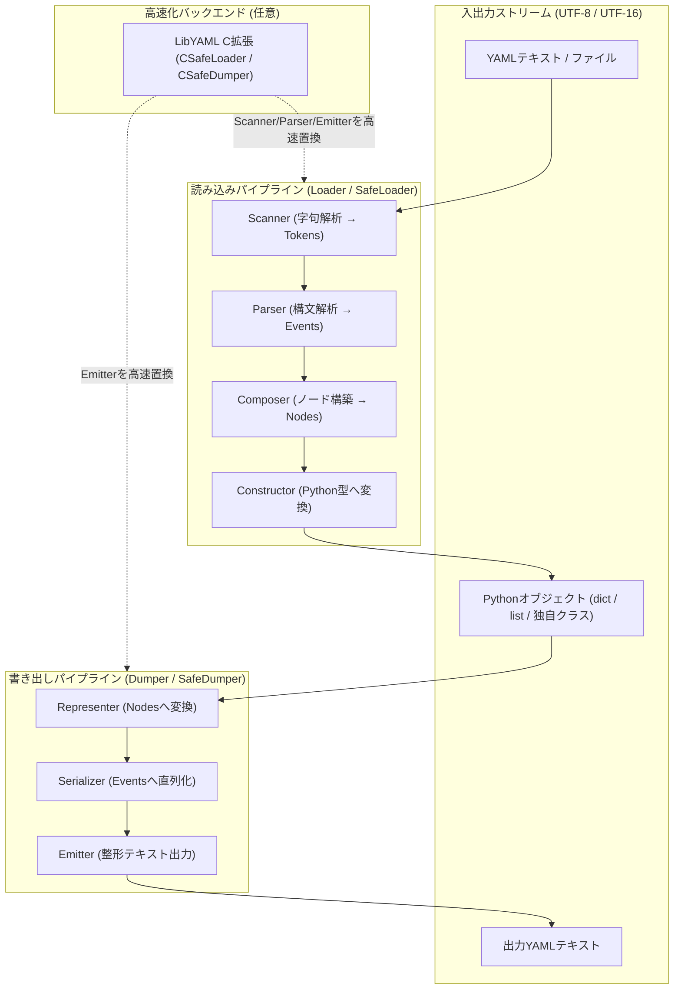

# **PyYAML 調査レポート**

## **1. 基本情報**

* **ツール名**: PyYAML
* **ツールの読み方**: パイヤムル / ピーワイヤムル
* **開発元**: Kirill Simonov（原著者） / YAML Organization（コミュニティメンテナンス）
* **公式サイト**: [https://pyyaml.org/](https://pyyaml.org/)
* **関連リンク**:
  * GitHub: [https://github.com/yaml/pyyaml](https://github.com/yaml/pyyaml)
  * ドキュメント: [https://pyyaml.org/wiki/PyYAMLDocumentation](https://pyyaml.org/wiki/PyYAMLDocumentation)
  * PyPI: [https://pypi.org/project/PyYAML/](https://pypi.org/project/PyYAML/)
* **カテゴリ**: データ抽出/変換
* **概要**: PyYAMLは、Pythonプログラミング言語向けのフル機能を備えたYAML（YAML Ain't Markup Language）パーサーおよびエミッター（シリアライザー）ライブラリである。YAML 1.1仕様に完全準拠しており、Pure Python実装に加えてC言語ライブラリ「LibYAML」のバインディングによる高速処理に対応し、AnsibleやKubernetes関連ツールなど数多くのPythonプロジェクトの基盤として採用されている。

## **2. 目的と主な利用シーン**

* **解決する課題**: Python標準ライブラリにはJSON（`json`）やTOML（Python 3.11以降の`tomllib`）のパーサーは含まれているが、YAMLの標準パーサーが存在しない。PyYAMLは人間が読み書きしやすいYAML形式の設定ファイルやデータ構造を、Pythonの辞書・リスト・スカラー型やカスタムオブジェクトへ相互変換する課題を解決する。
* **想定利用者**: Pythonアプリケーション開発者、インフラ/DevOpsエンジニア、MLOps/データサイエンティスト、CLIツール開発者。
* **利用シーン**:
  * WebアプリケーションやCLIツール、機械学習パイプラインの設定ファイル（`config.yaml`等）の読み込みとバリデーション前処理
  * Kubernetesマニフェスト、Docker Compose定義、GitHub Actionsワークフロー等のYAMLファイルをプログラムから解析・生成する自動化スクリプト
  * Pythonオブジェクトのシリアライズ（ダンプ）によるデータエクスポートやテストフィクスチャの生成

### **2.1 代表的な利用フロー**

```mermaid
swimlane-beta TB
  subgraph User["ユーザー / アプリケーション"]
    A[YAMLファイル・文字列を用意]
    E[変換後のPythonオブジェクトを利用]
  end
  subgraph PyYAML["PyYAML (yaml.safe_load / safe_dump)"]
    B[入力ストリームを読み込み]
    D[YAMLノードをPython型へ構築]
  end
  subgraph Backend["パーサーバックエンド (Pure Python / LibYAML)"]
    C[字句解析・構文解析を実行]
  end
  A --> B
  B --> C
  C --> D
  D --> E
```

* **代表的な流れ**: ユーザーまたはアプリケーションがYAML入力を`yaml.safe_load()`に渡すと、PyYAMLは内部のPure PythonまたはLibYAML（`CSafeLoader`）バックエンドを用いて字句解析・構文解析を実行し、最終的に安全なPython標準データ型（`dict`、`list`、`str`、`int`など）へと変換して呼び出し元へ返却する。

## **3. 主要機能**

* **YAML 1.1仕様の完全サポート**: アンカー（`&`）、エイリアス（`*`）、マージキー（`<<`）、ブロックスタイル・フロースタイル、複数ドキュメントストリーム（`---`）などYAML 1.1の全構文に対応する。
* **セキュアなローダー分離（`SafeLoader` / `FullLoader` / `UnsafeLoader`）**: 用途に応じて信頼できない入力向けの`yaml.safe_load()`、標準的なPythonオブジェクト向けの`full_load()`、任意オブジェクト生成を許可する`unsafe_load()`を使い分けられる。
* **LibYAML C拡張による高速化**: CythonでラップされたLibYAMLバインディング（`CLoader`、`CSafeLoader`、`CDumper`、`CSafeDumper`）を同梱（対応環境ではwheelに組み込み済み）しており、Pure Python実装比で数倍〜10倍以上の高速なパース・ダンプが可能。
* **カスタムコンストラクタ・リプレゼンタ拡張**: `yaml.add_constructor()`や`yaml.add_representer()`、`YAMLObject`継承により、独自のYAMLタグ（`!custom_tag`）とPythonクラス間のシリアライズ・デシリアライズ規則を柔軟に定義できる。
* **低レベルストリーミングAPI（SAXライク処理）**: `yaml.scan()`（トークン単位）、`yaml.parse()`（イベント単位）、`yaml.compose()`（ノードツリー単位）、`yaml.emit()`を通じて、メモリ効率を重視した大規模YAMLの逐次処理やAST操作が可能。
* **出力フォーマット制御**: `yaml.dump()` / `yaml.safe_dump()`において、`default_flow_style`、`indent`、`sort_keys`、`allow_unicode`、`width`などのオプションにより整形出力を細かく制御できる。
* **詳細な構文エラーレポート**: 構文エラー発生時に`YAMLError`例外をスローし、該当箇所のファイル名・行番号・列番号・コンテキストスニペットをわかりやすく表示する。

## **4. 動作原理・システム構成**

* **アーキテクチャ**: ローカルプロセス内で完結するインプロセス・ライブラリ構成（Pythonパッケージ＋オプションのCython/C拡張モジュール）。外部サーバーやクラウド通信は一切行わない。
* **主要コンポーネントとデータフロー**:
  * **読み込み（Load）パイプライン**: 入力ストリーム → **Reader**（UTF-8/UTF-16デコード）→ **Scanner**（トークン列生成）→ **Parser**（イベント列生成）→ **Composer**（アンカー・エイリアス解決とノードグラフ構築）→ **Constructor**（Pythonオブジェクト生成）。
  * **書き出し（Dump）パイプライン**: Pythonオブジェクト → **Representer**（ノードグラフ生成）→ **Serializer**（共有参照のエイリアス化とイベント列生成）→ **Emitter**（インデント・スタイル適用と文字列出力）。
* **特筆すべき要素技術**:
  * Pure Python実装（`yaml/scanner.py`、`yaml/parser.py`、`yaml/emitter.py`）と同一APIで差し替え可能なLibYAML C拡張（`yaml._yaml`）。Cython 3.xによるビルドに対応し、主要プラットフォーム向けにビルド済みバイナリwheelがPyPIから配布されている。



## **5. 開始手順・セットアップ**

* **前提条件**:
  * Python 3.8以降（最新版6.0.3ではPython 3.14および実験的free-threadingに対応、CIは3.15にも対応更新済み）
  * アカウント登録・クレジットカード登録は不要（PyPIから即時導入可能）
* **インストール/導入**:

  ```bash
  # pip を使用する場合
  pip install PyYAML

  # uv を使用する場合
  uv add pyyaml
  ```

  * 主要OS（Linux x86_64/aarch64、macOS、Windows x64/arm64、musllinux_aarch64等）ではLibYAML組み込み済みのwheelが自動選択される。ソースビルドでLibYAMLを有効化する場合はシステムに`libyaml-dev`等が必要。
* **初期設定**: 特別な設定ファイルや環境変数は不要。Pythonコード内で`import yaml`するだけで利用できる。
* **クイックスタート**:

  ```python
  import yaml

  # 安全な読み込み（推奨）
  yaml_text = """
  app:
    name: sample-service
    port: 8080
    features:
      - auth
      - logging
  """
  data = yaml.safe_load(yaml_text)
  print(data["app"]["port"])  # 8080

  # 日本語を保持したブロック形式でのダンプ
  output = yaml.safe_dump(data, allow_unicode=True, default_flow_style=False, sort_keys=False)
  print(output)
  ```

## **6. 特徴・強み (Pros)**

* **圧倒的なデファクトスタンダード**: Pythonエコシステム全体で月間数億〜四半期数十億回規模でダウンロードされており、事実上すべての主要なYAML利用フレームワークやツールと高い互換性を持つ。
* **LibYAMLによるCレベルの処理速度**: `yaml.CSafeLoader` / `yaml.CSafeDumper`を利用することで、Pure Python実装の`ruamel.yaml`や`StrictYAML`と比較して大規模YAMLファイルのパース・生成を非常に高速に処理できる。
* **シンプルで学習しやすいAPI**: `yaml.safe_load()`と`yaml.safe_dump()`の2関数を覚えるだけで日常的なYAML処理の9割以上をカバーでき、Pythonの標準`json`モジュールと同じ感覚で扱える。
* **柔軟な拡張性**: カスタムタグやPythonクラスのシリアライズ/デシリアライズをフックするAPIが洗練されており、フレームワーク内部でのDSL実装にも適している。

## **7. 弱み・注意点 (Cons)**

* **YAML 1.1仕様による「Norway問題」等の暗黙的型変換**: クォートなしの`no`、`yes`、`on`、`off`、`NO`などが自動的にブール値（`False`/`True`）に変換されるため、国コード（例: ノルウェーの`NO`）や設定フラグで意図しない型バグを招きやすい。YAML 1.2には非対応。
* **コメント・書式を保持できない（非ラウンドトリップ）**: `safe_load()`で読み込んで`safe_dump()`で書き戻すと、元のYAMLファイルに含まれていたコメント、空行、クォートの有無、インデントの微妙な差異がすべて失われる。
* **日本語対応と文字コードの注意点**: ライブラリ自体のドキュメント・エラーメッセージは英語のみ。また、`yaml.safe_dump()`はデフォルトで非ASCII文字（日本語など）を`\uXXXX`形式にエスケープするため、日本語をそのまま出力するには`allow_unicode=True`の明示指定が必須。
* **安全でないLoaderの誤用リスク**: 古いコード例やドキュメントに残る`yaml.load(data)`（ローダー未指定）や`FullLoader`を信頼できない外部入力に適用すると、任意コード実行（RCE）等の重大な脆弱性につながる恐れがある。

## **8. 料金プラン**

| プラン名 | 料金 | 主な特徴 |
|---------|------|---------|
| **オープンソース (MIT License)** | 無料 | 商用・非商用を問わず無制限に利用・改変・再配布可能。機能制限や利用期間制限なし。 |

* **課金体系**: 完全無料のオープンソースソフトウェア（MITライセンス）。課金体系なし。
* **無料トライアル**: 該当なし（恒久的に無料）。

## **9. 導入実績・事例**

* **導入企業・主要OSSプロジェクト**:
  * **Red Hat (Ansible)**: IT自動化ツールAnsibleのPlaybook・インベントリ・変数ファイルのコアパーサーとして採用。
  * **Kubernetesエコシステム (kubernetes公式Pythonクライアント等)**: クラスタマニフェスト（Deployment/Service等）の読み込み・構築に利用。
  * **Hugging Face (`transformers` / `accelerate`)・PyTorchエコシステム**: モデル設定、学習レシピ、ハイパーパラメータ定義の読み込みに採用。
  * **MkDocs**: 静的ドキュメントサイトジェネレーターの設定ファイル（`mkdocs.yml`）の解析エンジンとして採用。
  * **Home Assistant**: オープンソースのスマートホームプラットフォームにおける各種設定ファイルの解析に利用。
* **導入事例**: 企業・OSSを問わずPython製ツールやCI/CDスクリプトの基盤コンポーネント（推移的依存関係を含む）として世界中で広く利用されている。
* **対象業界**: IT・ソフトウェア開発、クラウドインフラ/DevOps、AI/機械学習、IoT・組み込み開発など全業界。

## **10. サポート体制**

* **ドキュメント**: 公式Wiki（[PyYAML Documentation](https://pyyaml.org/wiki/PyYAMLDocumentation)）およびGitHubリポジトリ内のドキュメントが提供されている（英語のみ）。長年の普及により日本語の技術ブログや書籍の解説も豊富。
* **コミュニティ**: GitHub Issues / Pull Requests（[yaml/pyyaml](https://github.com/yaml/pyyaml)）、StackOverflow、Reddit（r/Python）等で活発に情報交換が行われている。
* **公式サポート**: コミュニティベースのOSSであるため、商用SLA付きの公式有償サポート窓口は存在しない。バグ報告やセキュリティ修正はGitHub上のメンテナー陣によって対応される。

## **11. エコシステムと連携**

### **11.1 API・外部サービス連携**

* **API**: PythonモジュールAPI（`yaml.safe_load`、`yaml.safe_dump`、`yaml.load_all`、`yaml.dump_all`、低レベルイベントAPI、カスタムLoader/Dumper継承API）を提供。REST API等のネットワークAPIは持たない（ローカルライブラリ）。
* **外部サービス・ツール連携**:
  * **Ansible**: PlaybookやVault連携を含む自動化基盤のパーサーとして連携
  * **Kubernetes / Helm周辺ツール**: マニフェストYAMLの生成・検証スクリプトと連携
  * **GitHub Actions / GitLab CI**: `.github/workflows/*.yml`や`.gitlab-ci.yml`をローカルで解析・生成するPythonスクリプトと連携
  * **Pydantic / Marshmallow / Cerberus**: PyYAMLで辞書として読み込んだデータをスキーマバリデーションライブラリへ渡して型検証する組み合わせが定番
  * **Click / Typer / Hydra**: CLIツールやML実験管理の設定ファイルローダーとして連携

### **11.2 技術スタックとの相性**

| 技術スタック | 相性 | メリット・推奨理由 | 懸念点・注意点 |
|:---|:---:|:---|:---|
| **Python (標準・CLI・自動化スクリプト)** | ◎ | 事実上の標準ライブラリであり、`pip`/`uv`で即座に導入可能。`CSafeLoader`で高速動作 | `safe_load()`の徹底とYAML 1.1型変換（Norway問題）への注意が必要 |
| **Ansible / DevOpsツールチェーン** | ◎ | Ansible等のコア依存として実績十分。マージキーやアンカーをフルサポート | 設定ファイルの自動書き換え用途ではコメントが消える点に注意 |
| **FastAPI / Pydantic** | ◯ | `yaml.safe_load()`の出力をそのままPydanticモデルに渡して厳格な型検証が可能 | 大規模YAMLのバリデーションにはメモリ使用量に留意 |
| **Cython / C拡張不可環境 (PyPy・制限環境)** | ◯ | Pure Pythonフォールバック実装が用意されており、Cコンパイラなしでも動作する | Pure PythonモードはLibYAML利用時より大幅に低速 |
| **設定ファイル自動編集ツール (Formatter/Updater)** | △ | 基本的な生成は可能 | コメントや元の書式を破壊するため、`ruamel.yaml`の利用が推奨される |

## **12. セキュリティとコンプライアンス**

* **認証**: ローカル実行ライブラリのため、認証機能（SSO・2段階認証等）は該当しない。
* **データ管理**: すべてのデータは呼び出し元プロセスのメモリおよびローカルファイルシステム上のみで処理され、外部サーバーへのデータ送信は発生しない。
* **準拠規格**: 商用SaaSではないためSOC2・ISO27001等のサービス認証は該当しない。ただし、セキュリティ脆弱性（特にデシリアライゼーションに伴うRCE）に対してCVE管理およびセキュリティアドバイザリ対応が行われている。
  * **重要セキュリティ事項（CVE-2020-14343等）**: PyYAML 5.4未満では`FullLoader` / `full_load()`に任意コード実行（RCE）脆弱性（CVE-2020-14343）が存在した。5.4以降で修正され、またPyYAML 6.0以降では`yaml.load()`の`Loader`引数指定が必須化されたが、**信頼できない外部入力に対しては常に`yaml.safe_load()`（または`CSafeLoader`）を使用する**ことが絶対的なセキュリティベストプラクティスとなっている。

## **13. 操作性 (UI/UX) と学習コスト**

* **UI/UX**: GUIは持たないプログラマ向けライブラリ（APIのみ）。Pythonの標準`json`モジュール（`json.load` / `json.dump`）とほぼ同一の関数シグネチャを採用しており、Python開発者にとって直感的で扱いやすい設計となっている。
* **学習コスト**: 基本的な読み書き（`safe_load` / `safe_dump`）の習得コストは極めて低く数分で使い始められる。一方、カスタム`Constructor`/`Representer`の実装や、`SafeLoader`と`FullLoader`の違い、YAML 1.1特有の暗黙的型変換（`on`/`off`/`no`等）の落とし穴を理解するには一定の学習が必要。

## **14. ベストプラクティス**

* **効果的な活用法 (Modern Practices)**:
  * **常に`safe_load()` / `safe_dump()`を使用する**: 信頼できないデータだけでなく、社内設定ファイルであっても原則`yaml.safe_load()`を使用し、必要に応じてPydantic等で型バリデーションを行う。
  * **大規模ファイルでは`CSafeLoader`を活用する**: パフォーマンスが求められる場合は以下のようにLibYAMLバックエンドを優先ロードする。

    ```python
    import yaml
    try:
        from yaml import CSafeLoader as SafeLoader, CSafeDumper as SafeDumper
    except ImportError:
        from yaml import SafeLoader, SafeDumper
    ```

  * **日本語を含む出力には`allow_unicode=True`と`default_flow_style=False`を指定する**: 可読性の高いブロック形式かつ日本語が文字化けしない出力を得られる。
* **陥りやすい罠 (Antipatterns)**:
  * **`yaml.load(stream, Loader=yaml.Loader)`や`UnsafeLoader`を外部入力に使う**: 悪意のある`!!python/object/apply:...`タグにより任意のOSコマンドが実行される（RCE）。
  * **既存の設定ファイルをPyYAMLで読み書きして上書き保存する**: 運用者が残したコメントやインデントがすべて消滅し、差分が膨大になる（この用途には`ruamel.yaml`を使うべき）。
  * **文字列値（バージョン番号`"1.0"`や国コード`"NO"`等）をクォートなしで記述する**: YAML 1.1の暗黙的型解決により`1.0`（float）や`False`（bool）に化けるため、YAML側でのクォートまたはスキーマ側での型強制が不可欠。

## **15. ユーザーの声（レビュー分析）**

* **調査対象**: Reddit（r/Python, r/programming）、StackOverflow、GitHub Issues/Discussions（※PyYAMLはOSSライブラリであり商用SaaSではないため、G2やCapterraには製品ページが存在しない）
* **総合評価**: スコア集計サイト上の数値評価はないが、Python開発者コミュニティにおいて「事実上の標準ライブラリ」として広く定着している一方、仕様の古さやセキュリティ面の注意点に関する議論も多い。
* **ポジティブな評価**:
  * 「Python環境でほぼ確実に最初から入っている（または簡単に導入できる）ため、ちょっとした設定ファイルの読み込みには最も手軽」（Reddit / StackOverflowの議論より要約）
  * 「LibYAMLの`CSafeLoader`を有効にすると、数MB規模のYAMLでも純粋Python製ライブラリより圧倒的に速くパースできる」（Redditより要約）
  * 「`safe_load()`と`safe_dump()`のAPIがシンプルで、`json`モジュールと同じ感覚で書ける」（開発者レビューより要約）
* **ネガティブな評価 / 改善要望**:
  * 「YAML 1.1準拠のまま止まっているため、`no`や`on`が勝手にブール値になる『Norway問題』で何度もバグを踏んだ」（Reddit r/Pythonより要約）
  * 「コメントやキーの並び順を保持してYAMLを編集したい場合、PyYAMLではコメントがすべて消えてしまうため`ruamel.yaml`に乗り換えるしかない」（StackOverflowより要約）
  * 「過去の`yaml.load()`の安全でないデフォルト仕様が原因で、セキュリティスキャナー（SAST）やコードレビューで頻繁に警告対象になる」（開発者コミュニティより要約）
* **特徴的なユースケース**:
  * 大規模なKubernetesマニフェスト群や機械学習実験設定（数千行規模）の高速バッチ解析において、速度重視で`CSafeLoader`を採用するケースが多数報告されている。

## **16. 直近半年のアップデート情報**

* **2026-10-07**: Python 3.15環境向けのCIビルド・テスト構成の最小リフレッシュ（`Minimal CI refresh for 3.15 (#971)`）を`main`ブランチへマージ。
* **2026-06-17**: マージキー（`<<`）処理におけるサービス拒否（DoS）脆弱性への対策修正（`Dos in merge key (#937)`）を`main`ブランチへマージ。
* **2025-09-25 (参考: 最新安定版リリース v6.0.3)**: PyPIへ`PyYAML 6.0.3`をリリース。Python 3.14サポート、実験的free-threading対応、Cython 3.x互換性向上、および`musllinux_aarch64` / `Windows/arm64`向けビルドターゲットを追加。

(出典: [GitHub Releases - yaml/pyyaml](https://github.com/yaml/pyyaml/releases) / [PyYAML CHANGES](https://github.com/yaml/pyyaml/blob/main/CHANGES) / [GitHub Activity](https://github.com/yaml/pyyaml/activity))

## **17. 類似ツールとの比較**

### **17.1 機能比較表 (星取表)**

| 機能カテゴリ | 機能項目 | PyYAML | ruamel.yaml | StrictYAML | tomllib (Python標準) |
|:---:|:---|:---:|:---:|:---:|:---:|
| **仕様・互換性** | YAML仕様対応 | ◯<br><small>YAML 1.1完全準拠</small> | ◎<br><small>YAML 1.2準拠</small> | △<br><small>YAML 1.2の制限サブセット</small> | ×<br><small>TOML形式専用</small> |
| **編集・保持** | コメント・書式保持 (Round-Trip) | ×<br><small>ダンプ時に消失</small> | ◎<br><small>コメント・順序・書式を保持</small> | ◯<br><small>書式・コメント保持対応</small> | ×<br><small>読み込み専用</small> |
| **パフォーマンス** | 処理速度 (C拡張等) | ◎<br><small>LibYAML C拡張で高速</small> | △<br><small>Pure Python中心で低速</small> | △<br><small>厳格検証のため低速</small> | ◎<br><small>標準ライブラリで高速</small> |
| **安全性・型** | デフォルト安全性 / スキーマ検証 | △<br><small>safe_load必須・型検証なし</small> | ◯<br><small>デフォルトで安全</small> | ◎<br><small>組み込みスキーマで厳格検証</small> | ◎<br><small>コード実行機能なし・安全</small> |
| **エコシステム** | 普及度・導入の容易さ | ◎<br><small>Python事実上の標準</small> | ◯<br><small>設定編集用途で広く普及</small> | △<br><small>用途特化で限定的</small> | ◎<br><small>Python 3.11以降標準同梱</small> |

### **17.2 詳細比較**

| ツール名 | 特徴 | 強み | 弱み | 選択肢となるケース |
|---------|------|------|------|------------------|
| **PyYAML** | Pythonの事実上の標準YAMLパーサー/エミッター | LibYAMLによる高速処理、圧倒的な普及率と豊富な情報 | YAML 1.1仕様（Norway問題）、コメント非保持 | - |
| **ruamel.yaml** | PyYAMLからフォークされたYAML 1.2対応・ラウンドトリップ重視ライブラリ | コメント・インデント・順序を保持したままYAMLを編集・保存可能 | Pure Python主体のため大規模ファイルではPyYAMLより遅い | 設定ファイルをプログラムで書き換えて保存したい場合、YAML 1.2が必要な場合 |
| **StrictYAML** | 暗黙的型変換や危険な構文を排除した型安全重視のYAMLパーサー | スキーマ定義による厳格な型検証と分かりやすいエラー表示、Norway問題の回避 | アンカー・エイリアス等の高度YAML機能が使えず、処理速度も遅め | ユーザー入力や複雑な設定ファイルを安全かつ厳密にバリデーションしたい場合 |
| **tomllib** | Python 3.11以降に標準搭載されたTOMLパーサー（書き込みは`tomli-w`等） | 外部依存ゼロ、暗黙的型変換の罠やRCEリスクがない | YAML形式は読めない、標準では書き出し非対応 | YAML形式に固執せず、新規プロジェクトの設定フォーマットをゼロ依存で統一したい場合 |

## **18. 総評**

* **総合的な評価**:
  * PyYAMLは、Pythonエコシステムにおいて20年近く中核を担い続ける事実上の標準YAMLライブラリである。LibYAML C拡張による優れた処理速度と、AnsibleやKubernetes関連ツールをはじめとする膨大な既存資産との互換性は他の追随を許さない。一方で、YAML 1.1仕様への固定（暗黙的型変換の癖）やコメント非保持、`safe_load()`の徹底という設計上の注意点も明確である。
* **推奨されるチームやプロジェクト**:
  * Pythonで書かれた既存システム・CI/CDスクリプト・MLOps基盤で、静的YAML設定ファイルの高速な読み込みやシンプルなデータ出力を行いたいすべての開発チームに推奨できる。
* **選択時のポイント**:
  * 「読み取り専用（または単純生成）＋速度重視」なら**PyYAML（`CSafeLoader` / `safe_load`）**、「既存YAMLファイルのコメントや体裁を保ったままプログラムで更新したい」なら**ruamel.yaml**、「型安全性と厳格なバリデーションをパーサーレベルで強制したい」なら**StrictYAML**を選択するのが最も合理的である。
