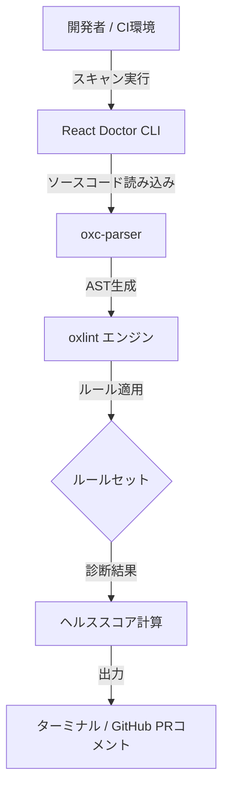

# **React Doctor 調査レポート**

## **1. 基本情報**

* **ツール名**: React Doctor
* **ツールの読み方**: リアクトドクター
* **開発元**: millionco
* **公式サイト**: [https://react.doctor/](https://react.doctor/)
* **関連リンク**:
  * GitHub: [https://github.com/millionco/react-doctor](https://github.com/millionco/react-doctor)
  * ドキュメント: [https://github.com/millionco/react-doctor](https://github.com/millionco/react-doctor)
* **カテゴリ**: 開発者ツール
* **概要**: Reactコードの健全性を0から100のスコアで評価し、状態管理やパフォーマンスに関する問題を診断する静的解析ツール。1つのコマンドで実行可能。

## **2. 目的と主な利用シーン**

* **解決する課題**: Reactのバッドプラクティスやアンチパターンの検出。コード品質の可視化。
* **想定利用者**: React開発者、フロントエンドチーム
* **利用シーン**:
  * コードレビュー時の自動チェック（CI/CDパイプライン）
  * リファクタリング対象の特定
  * AIコーディングエージェントにReactのベストプラクティスを学習させる

## **3. 主要機能**

* **ヘルススコアの算出**: コードベース全体を診断し、0から100までのスコアを算出（75以上: Great, 50-74: Needs work, 50未満: Critical）。
* **複数フレームワーク対応**: Next.js、Vite、React Nativeなどに対応。
* **CIインテグレーション**: GitHub Actions用のアクションを提供し、PRに対して自動的に診断・コメント。
* **AIエージェント統合**: Claude CodeやCursorなどのAIエージェントにReactのベストプラクティスを学習させる設定ファイルを自動生成。
* **差分スキャン**: `--diff`や`--staged`オプションで、変更されたファイルやコミット待ちのファイルのみを高速にスキャン。
* **設定の柔軟性**: `react-doctor.config.json`による詳細な除外ルールの設定。

## **4. 動作原理・システム構成**

* **アーキテクチャ**: ローカル環境で実行される静的解析ツール
* **主要コンポーネントとデータフロー**:
  * 高速なLinterである `oxlint` と `oxc-parser` を基盤エンジンとして採用。
  * プロジェクトのディレクトリをスキャンし、Reactコードに対して定義済みのベストプラクティスルール群を適用する。
* **特筆すべき要素技術**:
  * **oxlint エンジン統合**: 解析エンジンとして Rust 製の高速ツール `oxlint` を組み込み、大規模リポジトリにおける静的解析を極めて高速に処理（`--baseline` モードや差分スキャンと併用）。



## **5. 開始手順・セットアップ**

* **前提条件**:
  * Node.js環境
* **インストール/導入**:

  ```bash
  # プロジェクトルートで実行
  npx -y react-doctor@latest .
  ```

* **初期設定**:
  * コマンド一つで実行可能であり、初期設定は不要。必要に応じて`react-doctor.config.json`を作成。
* **クイックスタート**:
  * 上記のコマンドを実行するだけで、診断結果とスコアがターミナルに出力される。

## **6. 特徴・強み (Pros)**

* コマンド一つで実行できる手軽さ（Zero-config）。
* スコアとして数値化されるため、改善のモチベーションが維持しやすい。
* 差分スキャン機能により、大規模なコードベースでも高速にフィードバックが得られる。
* AIエージェントへのルールインストール機能（`npx react-doctor install`）により、AIが生成するコードの品質向上に寄与する。

## **7. 弱み・注意点 (Cons)**

* ルールが意見的（Opinionated）であり、プロジェクトの規約に合わない場合は設定で無効化する手間が必要。
* 新しいルールの追加に伴い、アップデート後にスコアが低下する可能性がある。
* 日本語のドキュメントや公式サポートは存在しない。

## **8. 料金プラン**

| プラン名 | 料金 | 主な特徴 |
|---------|------|---------|
| **オープンソース** | 無料 | 完全無料、全機能利用可能 |

* **課金体系**: なし
* **無料トライアル**: なし

## **9. 導入実績・事例**

* **導入企業**: オープンソースプロジェクトでの利用が中心
* **導入事例**: executor (Score: 94), nodejs.org (Score: 86), tldraw (Score: 70) などのリポジトリで利用実績あり。
* **対象業界**: ソフトウェア開発全般

## **10. サポート体制**

* **ドキュメント**: GitHubのREADMEが主要なドキュメント。
* **コミュニティ**: GitHub Issuesでのバグ報告や機能要望。
* **公式サポート**: なし（オープンソースプロジェクトとしての対応）。

## **11. エコシステムと連携**

### **11.1 API・外部サービス連携**

* **API**: Node.js向けにプログラマティックAPI (`react-doctor/api`) を提供。
* **外部サービス連携**: GitHub Actions (PRコメント機能)、Claude Code、Cursor等のAIコーディングエージェント。

### **11.2 技術スタックとの相性**

| 技術スタック | 相性 | メリット・推奨理由 | 懸念点・注意点 |
|:---|:---:|:---|:---|
| **Next.js** | ◎ | ルールが自動的に調整される | 特になし |
| **Vite** | ◎ | ルールが自動的に調整される | 特になし |
| **React Native** | ◎ | React Native固有のルールに対応 | `rn-no-raw-text`の対応が必要な場合あり |

## **12. セキュリティとコンプライアンス**

* **認証**: オープンソースのCLIツールのため該当せず。
* **データ管理**: 基本的にローカルで静的解析を行う。`--offline`オプションを使用することで、スコア計算もローカルで完結し、テレメトリを無効化可能。
* **準拠規格**: 該当せず。

## **13. 操作性 (UI/UX) と学習コスト**

* **UI/UX**: ターミナル上で見やすい出力。GitHub ActionsによるPRのインラインアノテーションに対応。
* **学習コスト**: 非常に低い。導入はコマンド一つで完了する。カスタム設定もJSONで容易に記述可能。

## **14. ベストプラクティス**

* **効果的な活用法 (Modern Practices)**:
  * CIパイプライン（GitHub Actions）に組み込み、PR作成時に自動的にスコアと診断結果をコメントとして付与する。
  * `--staged`フラグを使用してpre-commitフックで実行し、コミット前に問題を検知する。
  * `npx react-doctor install`を実行してAIエージェントにルールを学習させる。
* **陥りやすい罠 (Antipatterns)**:
  * スコアが100でないことにこだわりすぎること。プロジェクトの特性上、無視しても問題ない警告もあるため、必要に応じて設定で除外する。

## **15. ユーザーの声（レビュー分析）**

* **調査対象**: GitHubのスター数やSNS等
* **総合評価**: GitHub Star 9.5k
* **ポジティブな評価**:
  * 導入の手軽さとスコアによる可視化が好評。
  * AIエージェントにルールのコンテキストを与えられる点が革新的。
* **ネガティブな評価 / 改善要望**:
  * カスタムルールの追加要望。
  * 既存のESLint設定との競合に関する調整要望。
* **特徴的なユースケース**:
  * リーダーボードにプロジェクトを掲載してスコアを競う。

## **16. 直近半年のアップデート情報**

（詳細な更新履歴はGitHubのReleasesを参照）

* **2026-10-12**: (v0.9.18) 非ブロック警告のための `--warning-exit-code` オプションの追加。
* **2026-10-05**: (v0.9.17) 既存のフラグ付きコードのフォーマット後における `--baseline` および `--scope` 比較時の問題修正。
* **2026-10-04**: (v0.9.16) `--baseline <report.json>` オプションによるベースライン比較のサポート追加。
* **2026-09-12**: (v0.9.14) `oxlint` エンジンのv1.81へのアップグレード、`@vitejs/plugin-react` を利用したプロジェクトでのReact Compiler検知の追加、および大規模リポジトリにおけるスキャンの高速化。
* 継続的に新しいルールやAIエージェント向けのインテグレーションが追加されている。

(出典: [GitHubリポジトリ](https://github.com/millionco/react-doctor/releases))

## **17. 類似ツールとの比較**

### **17.1 機能比較表 (星取表)**

| 機能カテゴリ | 機能項目 | 本ツール | ESLint (v10.13.0) | Biome (v2.5.15) |
|:---:|:---|:---:|:---:|:---:|
| **基本機能** | 静的解析 | ◎ | ◎ | ◎ |
| **カテゴリ特定** | Reactのベストプラクティス | ◎ | ◯<br><small>プラグインが必要</small> | ◯<br><small>標準ルールに一部内包</small> |
| **エンタープライズ** | AIエージェント統合 | ◎ | × | × |
| **非機能要件** | 設定不要での利用 | ◎ | △<br><small>設定ファイルが必要</small> | ◯<br><small>デフォルト設定で利用可能</small> |

### **17.2 詳細比較**

| ツール名 | 特徴 | 強み | 弱み | 選択肢となるケース |
|---------|------|------|------|------------------|
| **本ツール** | Reactに特化したスコアリングツール | 設定不要、スコア化、AIエージェント統合 | 汎用的なLintには不向き | Reactプロジェクトで手軽にコード品質を可視化したい場合 |
| **ESLint** | JavaScript/TypeScriptの標準Linter | エコシステムの広さ、カスタマイズ性 | 設定が複雑になる傾向 | プロジェクト固有の詳細なルールを定義したい場合 |
| **Biome** | フォーマッタとLinterを兼ねる高速ツール | 高速な実行速度、フォーマッタ統合 | プラグインエコシステムが存在しない | 大規模なコードベースでLintやフォーマット処理を単一のツールで高速化したい場合 |

## **18. 総評**

* **総合的な評価**:
  * React Doctorは、Reactプロジェクトの健全性を手軽に評価できる優れたツール。特に、設定不要で実行でき、スコアとして結果が得られる点は開発者のモチベーション向上に繋がる。また、AIエージェントへのルールインストール機能は、現在のAI支援開発のトレンドに合致した強力な機能である。
* **推奨されるチームやプロジェクト**:
  * 全てのReact（Next.js、Vite、React Native）プロジェクト。特にAIコーディング支援ツールを積極的に活用しているチーム。
* **選択時のポイント**:
  * 既存のESLint設定と併用可能であり、置き換えるものではなく、補完するツールとして導入するのが望ましい。
