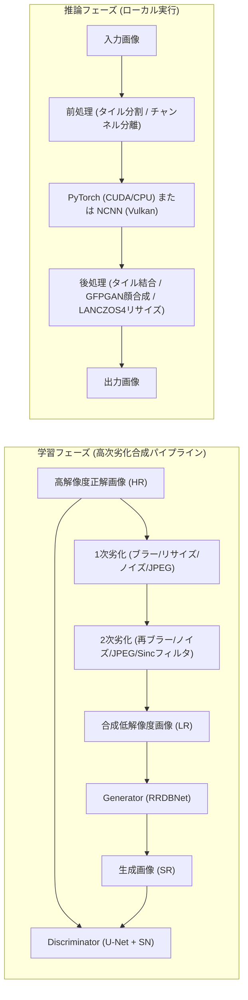

# **Real-ESRGAN 調査レポート**

## **1. 基本情報**

* **ツール名**: Real-ESRGAN
* **ツールの読み方**: リアル・イーエスアールガン
* **開発元**: Xintao Wang (Tencent ARC Lab / 中国科学院深圳先進技術研究院)
* **公式サイト**: [https://github.com/xinntao/Real-ESRGAN](https://github.com/xinntao/Real-ESRGAN)
* **関連リンク**:
  * GitHub: [https://github.com/xinntao/Real-ESRGAN](https://github.com/xinntao/Real-ESRGAN)
  * CodeWiki: [https://codewiki.google/github.com/xinntao/Real-ESRGAN](https://codewiki.google/github.com/xinntao/Real-ESRGAN)
  * 論文 (arXiv): [https://arxiv.org/abs/2107.10833](https://arxiv.org/abs/2107.10833)
* **カテゴリ**: AI画像生成
* **概要**: Real-ESRGANは、従来のESRGANを拡張し、実世界の複雑な劣化（ブラー、ノイズ、JPEG圧縮劣化など）を含む画像や動画を実用的に復元・超解像するためのオープンソースAIアルゴリズムおよび推論ツール群である。ペアとなる実写の高・低解像度データセットに頼らず、独自の高次劣化プロセス（High-Order Degradation Process）で生成した純粋な合成データのみを用いて学習している点が最大の特徴である。Python/PyTorchスクリプトに加え、クロスプラットフォームで動作する軽量なNCNN/Vulkan実行バイナリも提供されている。

## **2. 目的と主な利用シーン**

* **解決する課題**: 従来の超解像モデル（バイキュービック縮小などの単純な劣化を前提としたモデル）は、実際のカメラ撮影やWeb上の再圧縮によって生じた複合的な劣化画像に適用すると、ノイズが増幅されたり不自然なアーティファクトが発生したりする課題があった。Real-ESRGANは、実世界の複雑な劣化を模擬した学習手法により、劣化した低解像度画像・動画をクリーンかつ鮮明に高解像度化する。
* **想定利用者**: 画像・動画処理パイプラインを構築するソフトウェア開発者、AI研究者、アニメ・イラストやレトロ素材のアップスケールを行うクリエイター・映像制作者。
* **利用シーン**:
  * Web上で取得・圧縮された古い写真や低解像度画像の2倍〜4倍高画質化
  * アニメーションイラストやアニメ動画（SD画質からHD/4Kへのアップコンバート）の鮮明化
  * ポートレート写真における、顔領域の自動修復（GFPGAN連携）を伴うアップスケーリング
  * Stable Diffusionなどの画像生成AIワークフロー（Hires.fixやComfyUIノード）における後段アップスケーラーとしての組み込み

### **2.1 代表的な利用フロー**

```mermaid
swimlane-beta TB
  subgraph User["ユーザー / 開発者"]
    A["入力画像・動画を用意"]
    B["モデル・倍率・オプションを指定して実行"]
    F["高解像度化された出力を確認・保存"]
  end
  subgraph RealESRGAN["Real-ESRGAN (推論エンジン)"]
    C["入力の読み込みとタイル分割"]
    D["RRDBNet等による超解像推論"]
    E["タイル結合と任意倍率リサイズ"]
  end
  subgraph OptionalExt["外部連携モジュール (任意)"]
    G["GFPGANによる顔領域の修復・合成"]
    H["FFmpegによる動画フレーム分解・再結合"]
  end
  A --> B
  B --> C
  B -->|動画入力時| H
  H --> C
  C --> D
  D -->|face_enhance有効時| G
  G --> E
  D --> E
  E -->|動画入力時| H
  H --> F
  E --> F
```

* **代表的な流れ**: ユーザーまたは開発者が画像・動画ファイルとモデル（汎用・アニメ等）を指定して実行すると、Real-ESRGANがVRAM負荷を抑えるためのタイル分割とニューラルネットワークによる超解像推論を行う。必要に応じてFFmpegによる動画のフレーム分解・再結合や、GFPGANによる顔領域の精密修復を挟み込み、最終的な高解像度メディアを出力する。

## **3. 主要機能**

* **汎用画像超解像（RealESRGAN_x4plus / x2plus）**: 実写写真や一般的なWeb画像を対象に、ノイズやJPEGブロックノイズを除去しながら2倍または4倍に高解像度化する。`--outscale` オプションにより任意の最終倍率へのリサイズにも対応する。
* **アニメ・イラスト特化モデル（RealESRGAN_x4plus_anime_6B）**: アニメ画像やイラスト向けに最適化された6ブロック構成の軽量モデル。輪郭線をくっきり保ちつつ、平坦な塗りの破綻を抑えて高速にアップスケールする。
* **アニメ動画向け軽量モデル（realesr-animevideov3）**: 動画処理の高速化のために設計された超軽量（XSサイズ）モデル。1x/2x/3x/4xの各倍率に対応し、複数GPU・マルチプロセスでの並列推論をサポートする。
* **顔修復連携（GFPGAN統合）**: `--face_enhance` フラグを指定することで、人物の顔領域を自動検出し、Tencent ARC Labの顔修復モデル「GFPGAN」で目鼻立ちや肌質を自然に補正した上で背景と合成する。
* **ノイズ除去強度の調整（realesr-general-x4v3）**: 汎用小型モデル `realesr-general-x4v3` では、`-dn`（denoising strength）パラメータを用いてノイズ除去とディテール保持のバランスを動的に調整できる。
* **省メモリ・特殊画像フォーマット対応**: `--tile` オプションによる画像分割処理で限られたVRAM環境でも巨大画像を処理できるほか、透過情報（アルファチャンネル）、グレースケール画像、16-bit画像に対応する。
* **ポータブル実行環境（NCNN / Vulkan）**: PyTorchやCUDA環境を持たないユーザー向けに、Intel・AMD・NVIDIA等のGPUで動作する単体実行バイナリ（`realesrgan-ncnn-vulkan`）をWindows/Linux/macOS向けに提供している。
* **カスタムデータセットでのファインチューニング**: BasicSRをベースとした学習・ファインチューニング用スクリプトと事前学習済みDiscriminator（識別器）モデルが公開されており、独自ドメイン画像への適応が可能。

## **4. 動作原理・システム構成**

* **アーキテクチャ**: ローカル完結型（スタンドアロンCLI / Pythonライブラリ）の推論・学習パイプライン。クライアント・サーバー通信を前提とせず、ユーザーのローカルCPU/GPU上でPyTorchまたはNCNN（Vulkan）ランタイムを用いて完結動作する。



* **主要コンポーネントとデータフロー**:
  * **Generator（RRDBNet / SRVGGNetCompact）**: 汎用モデルではBatch Normalization層を排除したRRDBNet（Residual-in-Residual Dense Block Network）を採用し、特徴抽出とテクスチャ復元を行う。動画向けや軽量版では高速な `SRVGGNetCompact` アーキテクチャを採用している。
  * **Discriminator（U-Net with Spectral Normalization）**: 従来のVGG型識別器に代わり、局所的なテクスチャと大域的な構造の両方を評価できるU-Net構造の識別器にSpectral Normalizationを適用し、学習の安定性とシャープな輪郭復元を両立している。
  * **推論バックエンド**: Python版（`inference_realesrgan.py`）は `basicsr` / `torch` 上で動作し、デフォルトでFP16（半精度）推論による高速化を行う。NCNN版（`realesrgan-ncnn-vulkan`）はモデルを `.param` / `.bin` 形式に変換し、Vulkan API経由でベンダーを問わずGPUアクセラレーションを実行する。
* **特筆すべき要素技術**:
  * **高次劣化モデル（High-Order Degradation Process）**: 1回の劣化シミュレーションではなく、ぼかし（Gaussian/Anisotropic）・リサイズ・ノイズ（Gaussian/Poisson）・JPEG圧縮のサイクルを2回連続で適用し、さらに仕上げに **2D Sincフィルタ** を用いることで、現実のデジタル画像で頻発するリンギング（輪郭の二重線）やオーバーシュート・アーティファクトを忠実に再現している。

## **5. 開始手順・セットアップ**

* **前提条件**:
  * **Python版**: Python 3.7以上、PyTorch 1.7以上、および推奨環境としてCUDA対応NVIDIA GPU（CPU実行時は `--fp32` 指定が必要）。動画処理を行う場合は `ffmpeg` が必要。
  * **NCNN実行ファイル版**: PythonやCUDAは不要。Vulkan対応GPU（Intel / AMD / NVIDIA / Apple Silicon等）を搭載したWindows、Linux、またはmacOS環境。
  * アカウント登録やクレジットカード登録は一切不要。
* **インストール/導入**:

  ```bash
  # リポジトリのクローン
  git clone https://github.com/xinntao/Real-ESRGAN.git
  cd Real-ESRGAN

  # 依存パッケージと開発モードでのセットアップ
  pip install basicsr
  pip install facexlib
  pip install gfpgan
  pip install -r requirements.txt
  python setup.py develop
  ```

  *(Python環境を構築しない場合は、GitHub Releasesから `realesrgan-ncnn-vulkan` のZIPアーカイブをダウンロード・展開するだけで利用できる)*

* **初期設定**:
  * 使用したい学習済みモデル（`.pth` ファイル）を `weights/` ディレクトリへダウンロードするか、初回推論時の自動ダウンロード機能を利用する。APIキー等の設定は不要。
* **クイックスタート**:

  ```bash
  # 学習済みモデル(RealESRGAN_x4plus)の取得
  wget https://github.com/xinntao/Real-ESRGAN/releases/download/v0.1.0/RealESRGAN_x4plus.pth -P weights

  # 汎用画像の4倍アップスケール（顔修復オプション付き）
  python inference_realesrgan.py -n RealESRGAN_x4plus -i inputs -o results --face_enhance
  ```

  NCNNポータブル版での実行例:

  ```bash
  ./realesrgan-ncnn-vulkan -i input.jpg -o output.png -n realesrgan-x4plus
  ```

## **6. 特徴・強み (Pros)**

* **実世界の劣化画像に対する圧倒的な実用性**: 従来の学術的ベンチマーク用モデルと異なり、JPEGノイズや手ブレ・ピンボケが複合した現実の画像に対しても、破綻が少なくクリーンな出力を得られる。
* **軽量・高速かつ優れた移植性**: Diffusionベースの最新超解像モデル（SUPIR等）が十数GBのVRAMと数分単位の推論時間を要するのに対し、Real-ESRGANは数GBのVRAM（またはNCNN経由の一般GPU）で高速にバッチ処理できる。
* **BSD-3-Clauseライセンスによる商用利用の容易さ**: 著作権表示・ライセンス条文の保持および無断での推奨表記禁止という緩やかな条件のもと、商用製品・SaaS・プロプライエタリソフトウェアへの組み込みが可能である。
* **充実した派生エコシステム**: 単体CLIにとどまらず、Upscaylなどの無料GUIアプリ、ComfyUI/AUTOMATIC1111などの生成AI環境、VapourSynthプラグイン等に広く採用されており、導入手段の選択肢が極めて多い。

## **7. 弱み・注意点 (Cons)**

* **細部の「塗り絵感（プラスチック質感）」とハルシネーション**: 激しく劣化した実写写真に適用すると、肌の質感や草木・砂利などの微細な粒子が過度に平滑化され、ワックスやイラストのような不自然な質感になることがある。また、失われた真のディテールを文脈から復元する能力は最新のDiffusion系モデルに劣る。
* **動画利用時の時間的一貫性（フリッカー）の課題**: 動画に対してフレーム単位で超解像を適用する仕様上、実写動画などではフレーム間の微細なテクスチャがちらつく（フリッカー現象）が発生しやすい。
* **上流リポジトリのメンテナンス停止**: 公式リポジトリ（`xinntao/Real-ESRGAN`）は2022年9月のv0.3.0以降メジャーリリースがなく、2024年4月を最後にコミットも停止している。新しいPyTorch/Python環境との依存関係（特に `basicsr` と最新の `torchvision` 間の互換性問題など）では手動パッチが必要になるケースがある。
* **日本語対応の状況**: 公式のUI・ドキュメント・FAQは英語および簡体字中国語のみで提供されており、日本語の公式サポートや日本語GUIは存在しない。

## **8. 料金プラン**

| プラン名 | 料金 | 主な特徴 |
|---------|------|---------|
| **オープンソース版 (BSD-3-Clause)** | 無料 | 全ソースコード、学習済みモデル、NCNN実行ファイルを制限なくローカル環境で無制限に利用可能 |
| **Replicate等のクラウドAPI経由** | 従量課金 (外部サービス依存) | 公式が提供するReplicateデモやサードパーティAPIを利用する場合、実行時間に応じた各プラットフォームの課金が発生 |

* **課金体系**: ツール自体は完全無料・オープンソースであり、ライセンス費用やサブスクリプション料金は発生しない。
* **無料トライアル**: 該当なし（全機能が永続的に無料で利用可能）。

## **9. 導入実績・事例**

* **導入企業・採用プロジェクト**:
  * **Tencent Video（騰訊ビデオ）**: 公式ドキュメント内でも言及されている通り、旧作アニメーション映像の画質復元・リマスター用途での活用例が公開されている。
  * **Upscayl / Waifu2x-Extension-GUI / Real-GUI**: 多数のオープンソースデスクトップGUIアップスケーラーが、コア推論エンジンとしてReal-ESRGAN（および `realesrgan-ncnn-vulkan`）を組み込んでいる。
  * **Stable Diffusion WebUI (AUTOMATIC1111) / ComfyUI**: 画像生成AIの標準的なアップスケーラー選択肢として世界中のクリエイター・企業に利用されている。
* **導入事例**: 公開されている企業個別の詳細導入事例は限られるが、BSD-3-Clauseライセンスを活かして、ECプラットフォームの商品画像自動補正マイクロサービス、メディア・ストリーミング企業のアーカイブSD映像のHD/4Kリマスターパイプライン、VFXスタジオ（Foundry Nuke等へのノード統合）などの実務パイプラインに組み込まれていることが報告されている。
* **対象業界**: アニメ・映像制作、メディア・配信、EC・デジタルアセット管理、ゲーム開発（低解像度テクスチャのアップスケール）、AIクリエイティブSaaS。

## **10. サポート体制**

* **ドキュメント**: GitHubリポジトリ内の `README.md`（英語・簡体字中国語）、`docs/model_zoo.md`、`docs/Training.md`、`docs/FAQ.md` が整備されている。
* **コミュニティ**: GitHub Issues / Discussions（数千件以上のQ&A蓄積）や、Reddit（r/StableDiffusion, r/upscaling）、OpenModelDB（コミュニティ学習済みモデルの共有ハブ）を中心に活発な情報交換が行われている。
* **公式サポート**: 商用サポート窓口（メール・電話・チャット）は提供されていない。連絡先として開発者のメールアドレスがREADMEに記載されているものの、原則としてコミュニティベースのベストエフォート対応となる。

## **11. エコシステムと連携**

### **11.1 API・外部サービス連携**

* **API**: 公式リポジトリ単体ではREST APIサーバーを提供していないが、Pythonモジュール（`RealESRGANer` クラス）として他アプリケーションに容易に組み込める。また、ReplicateやHugging Face Spaces（Gradio）上にホストされた推論エンドポイントが利用可能。
* **外部サービス・ツール連携**:
  * **GFPGAN / facexlib**: 顔検出・顔修復の自動パイプライン連携
  * **FFmpeg**: 動画からのフレーム抽出およびアップスケール後フレームの動画再結合
  * **BasicSR**: 学習・評価パイプラインの基盤フレームワーク
  * **NCNN / Vulkan**: モバイル・マルチベンダーGPU向けの高速推論バックエンド
  * **VapourSynth (`vs-realesrgan`)**: 動画エンコード・フィルタリングパイプラインへの組み込み
  * **ONNX Runtime / TensorRT**: 商用バックエンドでの低遅延・高スループット推論への変換対応

### **11.2 技術スタックとの相性**

| 技術スタック | 相性 | メリット・推奨理由 | 懸念点・注意点 |
|:---|:---:|:---|:---|
| **Python (PyTorch / FastAPI)** | ◎ | 公式コード・`RealESRGANer` クラスを直接インポートして組み込み可能 | 依存ライブラリ（`basicsr`等）のバージョン整合性に注意が必要 |
| **C++ / Vulkan (NCNN)** | ◎ | 公式の `Real-ESRGAN-ncnn-vulkan` 実装が存在し、軽量・高速 | タイル分割仕様によりPyTorch版と微小な出力差異が出る場合がある |
| **ONNX / TensorRT** | ◯ | モデル構造（RRDBNet等）が標準的なCNNであり変換が容易 | 公式の変換済みパイプラインではなく自前でのエクスポート検証が必要 |
| **Node.js / Web (ブラウザ)** | △ | NCNNバイナリを子プロセス実行するか、ONNX Web等への変換で対応可能 | クライアントサイド単体での高速推論はVRAM・演算負荷の面で工夫が必要 |

## **12. セキュリティとコンプライアンス**

* **認証**: スタンドアロンのローカルCLI/ライブラリであるため、ユーザー認証やSSO機能は存在しない（外部クラウドAPIを利用する場合は各プラットフォームの認証に従う）。
* **データ管理**: すべての画像・動画処理がユーザーのローカル環境内で完結し、外部サーバーへのデータ送信やテレメトリ収集は行われないため、機密画像や未公開クリエイティブ素材の処理にも適している。ただし、初回実行時のモデル自動ダウンロード機能を利用する場合はGitHub ReleasesへのHTTPS通信が発生する。
* **準拠規格**: OSSライブラリであるため、SOC2やISO27001などのSaaS向け第三者認証は該当しない。ソースコードはBSD-3-Clauseライセンスで公開されており、コードの監査が可能。なお、Hugging FaceやReplicateなどの外部ホスティング環境を利用する場合は、それぞれの提供事業者のセキュリティ・プライバシー規約が適用される。

## **13. 操作性 (UI/UX) と学習コスト**

* **UI/UX**: 公式リポジトリが提供するのはコマンドラインインターフェース（CLI）のみであり、標準でグラフィカルUIは付属しない（ColabやGradioデモを除く）。GUIでの直感的な操作を求める場合は、Real-ESRGANを内部エンジンとして採用している「Upscayl」などのサードパーティ製デスクトップアプリを利用するのが一般的である。
* **学習コスト**:
  * **NCNNポータブル版**: ZIPを展開して1行のコマンドを実行するだけであるため、CLI操作に抵抗がなければ学習コストは非常に低い。
  * **Python環境 / ファインチューニング**: Python仮想環境の構築、PyTorchとCUDAバージョンの整合、BasicSRを用いた独自データセット学習を行う場合は、機械学習エンジニアリングの相応の知識が求められる。

## **14. ベストプラクティス**

* **効果的な活用法 (Modern Practices)**:
  * **用途に応じた厳密なモデル選定**: 実写には `RealESRGAN_x4plus`、アニメ・イラストには `RealESRGAN_x4plus_anime_6B`、アニメ動画には `realesr-animevideov3` を使い分けることで、画質と推論速度を最適化できる。
  * **VRAMに応じた `--tile` 設定**: 高解像度入力でCUDA Out of Memoryエラーが発生する場合、`--tile 400` や `--tile 256` のようにタイルサイズを指定して分割処理を行う。
  * **コミュニティカスタムモデルの活用**: 人物肌や特定ジャンル（ゲームテクスチャ、写真フィルム等）で「塗り絵感」を抑えたい場合は、OpenModelDB等で公開されているコミュニティ学習済みのESRGAN/Real-ESRGAN互換モデル（`.pth`）を組み合わせて利用する。
* **陥りやすい罠 (Antipatterns)**:
  * **アニメ画像への `--face_enhance` 適用**: GFPGANは実写の人間顔向けに学習されているため、アニメやイラストに適用すると顔だけがリアル調になり不自然に破綻する（公式FAQでも非推奨とされている）。
  * **CPU環境でのFP16実行**: デフォルトの半精度（FP16）モードのままCPUで推論を実行すると `"slow_conv2d_cpu" not implemented for 'Half'` エラーが発生するため、CPU環境では必ず `--fp32` オプションを付与する。
  * **最新Python/PyTorch環境での `basicsr` 依存エラー放置**: 上流更新が止まっているため、最新の `torchvision`（0.18+等）と組み合わせると `functional_tensor` のインポートエラーが起きることがある。再現性の高い仮想環境（Python 3.10前後）を固定するか、メンテナンスされたフォーク/GUIツールを利用するのが安全である。

## **15. ユーザーの声（レビュー分析）**

* **調査対象**: Reddit（r/StableDiffusion, r/upscaling, r/software）、GitHub Discussions / Issues
* **総合評価**: GitHubリポジトリは37,700以上のスターを獲得しており、OSS画像超解像のデファクトスタンダードとして極めて高い評価を得ている（G2/Capterra/ITreviewには単体OSSライブラリとしての登録なし）。
* **ポジティブな評価**:
  * 「Upscaylなどの無料GUIツールの裏側で動いており、完全ローカル・無料で制限なくバッチ処理できるのが最高」（Reddit）
  * 「アニメ画像や輪郭のはっきりしたグラフィック、JPEG圧縮で劣化したWeb画像の修復において、今でも非常に高速で綺麗な結果を出してくれる」（Reddit）
  * 「NCNN Vulkan版のおかげでPyTorch環境を構築せずにAMDやIntelのGPUでもサクサク動くのが助かる」（GitHub）
* **ネガティブな評価 / 改善要望**:
  * 「実写写真や人物の肌・細かい砂利などに使うと、過度に滑らかでプラスチック（蝋人形）のような質感になりやすい」（Reddit）
  * 「生の動画フレームにそのままかけると時間的なちらつき（フリッカー）が出やすく、実写動画のアップスケールには向かない」（Reddit）
  * 「SUPIRのような最新のDiffusion系アップスケーラーと比べると、失われた複雑なディテールを自然に補完する力では見劣りする」（Reddit）
* **特徴的なユースケース**:
  * レトロゲームの低解像度テクスチャパック（HD Texture Pack）作成における一括アップスケール処理
  * Stable Diffusion等の生成AIで作った512x512画像を、高解像度化（Hires.fix）する際のファーストチョイスとしての利用

## **16. 直近半年のアップデート情報**

上流の公式GitHubリポジトリ（`xinntao/Real-ESRGAN`）は成熟・安定フェーズに入っており、**直近6ヶ月間（2026年5月〜2026年11月）における新規リリースやコードコミットは確認されていない**。参考として、公式リポジトリにおける直近の主な更新履歴と、本エンジンを採用するエコシステムの最新動向を以下に記載する。

* **2024-04-02**: 上流リポジトリの最新コミットとして、GitHub Actionsの不要な自動応答ワークフロー（`.github/workflows/no-response.yml`）を削除。以降、上流コードはメンテナンス凍結状態となっている。
* **2022-09-20**: `v0.3.0` リリース（現時点での最新安定版タグ）。動画推論スクリプトにおけるモデル自動ダウンロード機能のサポートや、GUIアプリ一覧へのUpscayl追加などを実施。
* **2022-04-24**: `v0.2.5.0` リリース。汎用小型モデル `realesr-general-x4v3`（ノイズ除去強度 `-dn` オプション対応）およびアニメ動画用小モデル `realesr-animevideov3` を追加し、NCNN Vulkan向けポータブル実行ファイルを公開。
* *(エコシステム動向)*: 上流リポジトリの更新停止後も、Real-ESRGANのアーキテクチャと学習済みウェイトは **Upscayl**（デスクトップ版および2026年に拡充されたクラウド/API環境）や **ComfyUI** 等の主要ツールの基盤エンジンとして継続的に組み込まれ、利用され続けている。

(出典: [GitHub Releases](https://github.com/xinntao/Real-ESRGAN/releases) / [GitHub Commits](https://github.com/xinntao/Real-ESRGAN/commits/master))

## **17. 類似ツールとの比較**

### **17.1 機能比較表 (星取表)**

| 機能カテゴリ | 機能項目 | 本ツール (Real-ESRGAN) | waifu2x | Upscayl | Topaz Photo AI | SUPIR |
|:---:|:---|:---:|:---:|:---:|:---:|:---:|
| **基本機能** | 汎用実写超解像 | ◯<br><small>高速だが塗り絵感に注意</small> | △<br><small>イラスト特化で実写は弱い</small> | ◯<br><small>Real-ESRGAN等を内蔵</small> | ◎<br><small>RAW対応・自然な質感</small> | ◎<br><small>Diffusionによる超高精細復元</small> |
| **特化機能** | アニメ・イラスト適性 | ◎<br><small>専用モデル6Bで鮮明</small> | ◎<br><small>アニメ超解像の元祖</small> | ◎<br><small>アニメ向けモデル選択可</small> | ◯<br><small>実写向け中心</small> | △<br><small>実写指向で計算負荷大</small> |
| **推論性能** | 軽量性・処理速度 | ◎<br><small>低VRAM・NCNNで高速</small> | ◎<br><small>非常に軽量</small> | ◎<br><small>Vulkanで高速動作</small> | ◯<br><small>ローカルGPU最適化</small> | ×<br><small>12GB〜16GB超VRAM必須</small> |
| **導入性** | GUIの使いやすさ | ×<br><small>公式はCLIのみ</small> | △<br><small>非公式GUI多数</small> | ◎<br><small>洗練された無料GUI</small> | ◎<br><small>プロ向け商用GUI・プラグイン</small> | △<br><small>ComfyUI等の構築が必要</small> |
| **コスト** | 無料・商用利用可否 | ◎<br><small>完全無料 (BSD-3-Clause)</small> | ◎<br><small>完全無料 (MIT)</small> | ◯<br><small>デスクトップ版無料 (AGPL等)</small> | ×<br><small>サブスクリプション課金</small> | △<br><small>非商用ライセンス制限に注意</small> |
| **非機能要件** | 日本語対応 | ×<br><small>英語・中国語のみ</small> | ◎<br><small>日本語UI・解説が豊富</small> | ◯<br><small>多言語対応</small> | ◯<br><small>日本語対応</small> | ×<br><small>英語中心</small> |

### **17.2 詳細比較**

| ツール名 | 特徴 | 強み | 弱み | 選択肢となるケース |
|---------|------|------|------|------------------|
| **Real-ESRGAN** | 高次劣化合成データで学習した実用的GAN超解像基盤 | 軽量・高速、BSD-3-Clauseで商用組み込みしやすい、NCNN対応 | 上流開発が停止中、実写で過平滑化しやすい、公式GUIなし | 自社サービスへの組み込み、CLIでの大量バッチ処理、省リソース環境での高速超解像 |
| **waifu2x** | 畳み込みニューラルネットワークを用いたアニメ超解像の先駆的OSS | 非常に軽量、ノイズ除去と拡大の制御が自然、日本語コミュニティが厚い | 実写写真の復元力や複合劣化への耐性はReal-ESRGANに劣る | 軽量環境でのイラスト・二次元画像の単純な拡大やノイズ除去を行いたい場合 |
| **Upscayl** | Real-ESRGAN NCNN等をバックエンドに採用したOSSデスクトップGUI | 直感的なGUIで誰でも即座に利用可能、クラウド版やAPIも展開 | 細かい学習やPythonパイプラインへの直接統合には向かない | プログラムを書かずにローカルPCで手軽にReal-ESRGAN等の高画質化を使いたい場合 |
| **Topaz Photo AI** | 写真家・プロ向けの商用オールインワンAI画像修復ソフト | RAW対応、自然な実写ディテール復元、Lightroom/Photoshop連携 | 年間サブスクリプション費用が高め、OSS組み込み不可 | 商業写真・ポートレートの品質を最優先し、予算をかけても自然な仕上がりを求める場合 |
| **SUPIR** | SDXLとMLLMを活用した最新世代のDiffusion型超解像モデル | 破綻した低解像度写真からでも驚異的なリアリティでディテールを再生成 | 膨大なVRAMと処理時間が必要、商用ライセンスの制約あり | 強力なGPU環境があり、処理時間をかけてでも最高峰の実写復元品質を得たい場合 |

## **18. 総評**

* **総合的な評価**:
  * Real-ESRGANは、オープンソースのAI超解像分野における歴史的かつ実用的なマイルストーンであり、2026年現在においても「高速・軽量・商用利用可能」という強力な強みを持つ定番エンジンである。最新のDiffusionベース超解像モデル（SUPIR等）と比較すると、極端な劣化写真からリアルな細部を創造する力では一歩譲るものの、計算コストの圧倒的な低さと安定した品質から、実務のバッチ処理やGUIアプリ（Upscayl等）の基盤として依然として高い価値を維持している。
* **推奨されるチームやプロジェクト**:
  * 画像・動画処理パイプラインに低コストかつ高スループットな超解像機能を組み込みたいソフトウェア開発チーム。
  * アニメ・イラスト・ゲームテクスチャなどの大量アセットをローカル環境で高速にアップスケールしたいクリエイティブチーム。
  * 機密性やプライバシー保護の観点から、外部クラウドAPIに画像を送信せずに完全オンプレミス／ローカルで画像修復を完結させたい組織。
* **選択時のポイント**:
  * 上流リポジトリ（`xinntao/Real-ESRGAN`）自体の機能追加やメンテナンスは終了しているため、新規でアプリケーションに組み込む場合はPython依存関係（`basicsr` 等）のバージョン固定、あるいはONNX/NCNN形式での運用を前提に設計することが重要である。また、非エンジニアが単体で手軽に利用したい場合は、本ツールを直接セットアップするよりも「Upscayl」などの成熟したGUIラッパーを選択するのが最も効率的である。
