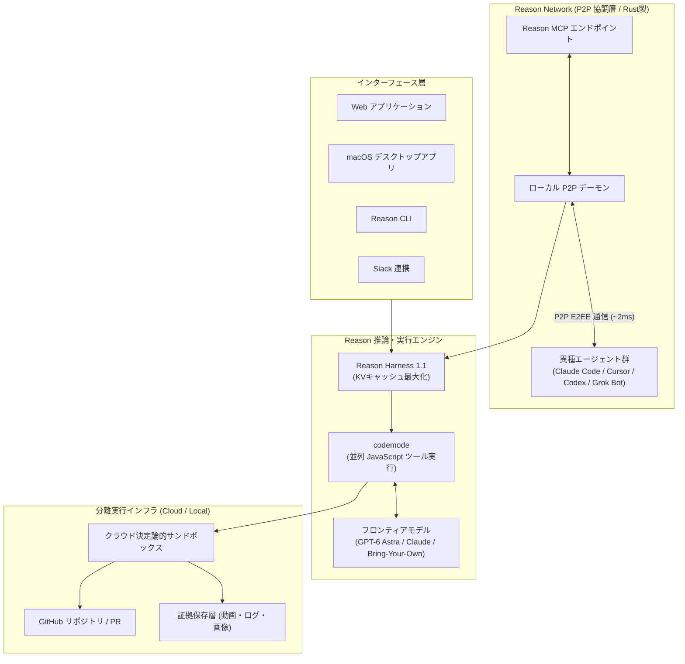

# **Reason Machines 調査レポート**

## **1. 基本情報**

* **ツール名**: Reason Machines (Reason / Reason Agent)
* **ツールの読み方**: リーズン マシーンズ / リーズン
* **開発元**: Reason Machines Inc.（YC P26、米国サンフランシスコ）
* **公式サイト**: [https://reasonmachines.com/](https://reasonmachines.com/)
* **関連リンク**:
  * GitHub: [https://github.com/reason-machines/reason-network](https://github.com/reason-machines/reason-network)
  * 公式ドキュメント: [https://docs.reasonmachines.com/](https://docs.reasonmachines.com/)
  * API リファレンス: [https://docs.reasonmachines.com/api-reference](https://docs.reasonmachines.com/api-reference)
  * Y Combinator: [https://www.ycombinator.com/companies/reason-machines](https://www.ycombinator.com/companies/reason-machines)
* **カテゴリ**: 自律型コーディングエージェント
* **概要**: Reason Machines は、Y Combinator（Batch P26）に採択されたスタートアップが開発する自律型ソフトウェアエンジニアリングプラットフォームである。高精度かつ極めて低コストにコーディングタスクを完遂する自律型エージェント「Reason Agent」と、Claude Code、Codex、Cursor、Gemini CLI、Grok Bot などの異なるエージェント間でタスクや進捗を相互共有・委譲できるオープンソースの P2P 通信基盤「Reason Network」を提供する。

## **2. 目的と主な利用シーン**

* **解決する課題**: 
  * 従来のコーディングエージェントがツール呼び出しごとにモデル推論を挟むことで発生していた、莫大なトークン費用とレイテンシの増大。
  * 開発チーム内で複数のエンジニアや異なる AI エージェント（Claude Code、Cursor 等）が並行作業する際に生じるコンテキスト断絶やコード競合（マージコンフリクト）。
  * AI が生成したプルリクエスト（PR）の信頼性確認にかかる人間のレビュー負荷。
* **想定利用者**: ソフトウェアエンジニア、テックリード、複数の AI コーディングツールを併用する開発組織、自律開発ワークフローを構築するスタートアップ。
* **利用シーン**:
  * **リポジトリの自律的な保守・修正**: イシューや指示に基づき、リポジトリ探索、テスト作成、コード修正、テスト実行、PR 作成までを全自動で遂行。
  * **エージェント間 P2P 協調**: ローカルの Claude Code と同僚マシンの Cursor、またはクラウド上の Grok Bot が直接通信し、API 仕様の確認やサブタスクの分担を実行。
  * **証拠（エビデンス）付き PR レビュー**: 生成された PR に実行ログやブラウザ操作の画面録画が自動添付され、レビュアーが即座に動作確認を実施。
  * **マルチサーフェスでの開発制御**: Web ブラウザ、macOS 専用デスクトップアプリ、ターミナル CLI、Slack からエージェントのセッションを柔軟に制御。

### **2.1 代表的な利用フロー**

```mermaid
swimlane-beta TB
  subgraph User["開発者 (ユーザー)"]
    A[機能開発やバグ修正のタスクを指示]
    F[PRの検証動画やログを確認してマージ]
  end
  subgraph Reason["Reason Agent (CLI / Cloud)"]
    B[コードベース探索と並列ツール実行を計画]
    C[コード変更とローカルテストを自動実行]
    E[検証動画とログ付きのPRを作成]
  end
  subgraph Network["Reason Network (P2Pデーモン)"]
    D[他セッションや異種エージェントへ状態を同期]
  end
  A --> B
  B --> C
  C --> D
  D --> E
  E --> F
```

* **代表的な流れ**: 開発者が自然言語でタスクを投入すると、Reason Agent がコードベースを探索して並列ツール実行（codemode）で効率的に修正・テストを行います。Reason Network を通じてチームメイトや他エージェントにブランチや作業状態を通知・調整した後、動作証拠（ログ・画面録画）を添付した PR を自動発行し、開発者が安全にレビュー・マージします。

## **3. 主要機能**

* **自律型コーディングエージェント（Reason Agent 1.1）**: リポジトリの読み込みからバグの再現、コード修正、テストスイートのパス、レビュー対応プルリクエストの作成までを自律的に完遂。
* **並列ツール実行エンジン（codemode）**: JavaScript サンドボックス環境内で複数のツール呼び出し（ファイル読み込み、検索、テスト実行など）を 1 プログラムとして並列実行。モデルとの往復回数を最小化し、不要なトークン消費を削減。
* **異種エージェント連携 P2P ネットワーク（Reason Network）**: Rust 製の超軽量デーモンを用い、Claude Code、Codex、Cursor、Gemini CLI、Grok Bot、Muse などの異なるツール間でローカル通信（約 2ms の低遅延）を実現。
* **証拠付きプルリクエスト（Evidence-backed PRs）**: コード差分だけでなく、実行時のターミナルログ、テスト結果、ブラウザ操作のスクリーンショットや画面録画を PR 本文に自動添付。
* **マルチサーフェスアクセス**: モダンな Web アプリケーション、macOS 専用デスクトップアプリ、コマンドライン（Reason CLI）、Slack 連携など、好みの開発環境から同一のセッションをシームレスに操作可能。
* **Model Context Protocol（MCP）ネイティブ対応**: 標準 MCP サーバー（`https://mcp.reasonmachines.com/mcp`）を提供し、ChatGPT、Muse、Grok Bot などの外部ホスト型アシスタントと双方向で接続可能。
* **既存モデルサブスクリプションの持ち込み（BYOS）**: 独自モデルの利用だけでなく、ユーザーが契約している OpenAI（ChatGPT）、Anthropic（Claude）、GitHub Copilot、xAI（SuperGrok / X Premium+）の認証情報を接続して利用可能。
* **高決定性クラウドサンドボックス**: ソースからビルドされた決定論的サンドボックス環境により、リポジトリ環境の差異によるテスト失敗やセキュリティリスクを排除。

## **4. 動作原理・システム構成**

* **アーキテクチャ**: ローカルファーストの P2P 通信レイヤーと、安全に隔離されたクラウド実行サンドボックスを組み合わせたハイブリッドアーキテクチャ。
* **主要コンポーネントとデータフロー**:
  * **Reason Harness / Engine**: プロンプト構造の不変性を保つことで KV キャッシュのヒット率を最大化。codemode を通じてツールをバッチ実行し、LLM 呼び出し回数を劇的に低減。
  * **Reason Network Daemon**: 各端末で常駐する Rust 製軽量デーモン。端末間の P2P 探索とエンドツーエンド暗号化（E2EE）通信を担当。
  * **Reason Cloud Sandbox**: クラウド側でコンテナベースの隔離環境を構築。リポジトリのクローン、ビルド、テスト実行、ブラウザ操作の画面録画をセキュアに処理。
  * **MCP Gateway & REST API (v3)**: 外部アシスタントやスクリプトが Reason の機能を利用するためのインターフェース。



* **特筆すべき要素技術**:
  * **codemode（JavaScript ラッパー）**: 通常の AI エージェントが「ファイル検索 → 出力を確認 → ファイルオープン → 修正」と何往復もする処理を、JavaScript スクリプトとして 1 回のモデルターン内でまとめて並列実行。
  * **KV キャッシュ最適化**: システムプロンプトおよびツール定義をセッション間で固定し、リクエストを単調追記型とすることで、最新フロンティアモデル（GPT-6 / Claude 等）のコンテキストキャッシュ利用効率を最大化。
  * **Iroh 基盤 P2P 通信**: Reason Network のコアには Rust で書かれた分散ネットワーク技術を採用。中央サーバーに生データを送信せず、ローカルネットワーク内では約 2ms の超低遅延でダイレクト通信を実施。

## **5. 開始手順・セットアップ**

* **前提条件**:
  * macOS、Linux、または Windows（PowerShell）
  * GitHub アカウント（リポジトリ連携用）
  * Reason アカウント（Google、GitHub、Apple、またはメールアドレスで作成可能）
* **インストール/導入**:

  Reason CLI および Reason Network デーモンは、公式のワンライナーで即座にインストール可能。

  ```bash
  # Unix / macOS (Reason Network デーモンと CLI の導入)
  curl -fsSL https://reasonmachines.com/install.sh | bash -s -- network
  ```

  Windows 環境（PowerShell）の場合:

  ```powershell
  # Windows PowerShell
  irm https://reasonmachines.com/network/install.ps1 | iex
  ```

* **初期設定**:
  1. インストール完了後、自動的にブラウザが起動し、Reason へのサインインとネットワーク接続が行われる（CLI 上で `reason login` でも実行可能）。
  2. Web ダッシュボード（`https://reasonmachines.com/customize?tab=plugins&plugin=github`）にアクセスし、「Connect GitHub」から対象リポジトリへのアクセスを認可。
  3. モデル設定（Settings → Models）から、既存の OpenAI、Anthropic、xAI、GitHub Copilot アカウントを連携可能。
* **クイックスタート**:
  * **ターミナルからタスクを開始する場合**:
    ```bash
    reason run "ログイン画面のバリデーションエラー時にトースト通知が表示されないバグを修正して"
    ```
  * **Reason Network の稼働状況を確認する場合**:
    ```bash
    reason network who
    ```
  * **他エージェントにメッセージを送信する場合**:
    ```bash
    reason network maya/codex "認証APIのエンドポイント仕様変更は完了しましたか？"
    ```

## **6. 特徴・強み (Pros)**

* **圧倒的なコスト効率とトークン節約**: GPT-6 Astra を用いたベンチマークにおいて、OpenAI Codex 比で解決タスクあたりコストを 22% 削減、試行あたり入力トークンを 23% 削減。codemode による並列実行と KV キャッシュ最大化が直結。
* **異種エージェントをつなぐ業界初のオープンソース P2P ネットワーク**: 開発者が使い慣れた Claude Code、Cursor、Codex などをそのまま生かしつつ、エージェント同士が誰がどのブランチを触っているか把握し、メッセージ交換できる協調環境を提供。
* **証拠（Evidence）を標準添付する信頼性の高い PR**: 生成されたプルリクエストには、修正のテスト実行ログや画面キャプチャ動画が自動添付されるため、レビュアーが「本当に動くのか」を疑う時間を大幅に削減。
* **Bring-Your-Own-Subscriptions による経済性**: プラットフォーム側で高額なトークンマークアップを強制されることなく、エンジニアが個人または企業で契約しているフロンティアモデルのアカウントを流用可能。
* **決定論的で堅牢なサンドボックス**: 3 プラットフォーム対応の隔離環境により、環境依存のビルド失敗やホストマシンへの不用意な干渉を防止。

## **7. 弱み・注意点 (Cons)**

* **日本語ドキュメントおよびサポートの限定性**: 公式サイトの一部に日本語ページが開設されているものの、詳細な技術ドキュメント、エラーメッセージ、コミュニティ対応は英語が中心。プロンプト自体は日本語に対応するが、英語指示の方が推論精度が高い場合がある。
* **新興スタートアップによる実績の浅さ**: 2026年創業（YC P26）の新しい製品群であり、大規模企業における数千人規模の導入事例や、数年にわたる長期運用実績はまだ少ない。
* **無料プランにおける広告表示**: クラウド版 Web セッションの Free プランには、広告パートナー（Gravity Labs）によるスポンサーコンテンツが表示される仕様がある（Pro 以上の有料プランまたはローカル Network 利用時は非表示）。
* **P2P 通信特有のネットワーク制限**: 厳格なコーポレートファイアウォールや企業内 VPN 配下では、端末間のダイレクト P2P 接続が確立しづらい場合があり、リレーサーバー経由または追加のポート設定が必要となるケースがある。

## **8. 料金プラン**

Reason Machines は、オープンソースのローカル協調基盤を無料で提供しつつ、クラウド実行リソースおよび高度なエージェントセッションに対してサブスクリプション課金を行っている。

| プラン名 | 月額料金 | 主な特徴・対象ユーザー |
|:---|:---:|:---|
| **Free (Reason Network)** | 無料 | Reason Network（P2P デーモン）完全無料、オープンソース利用、Web セッション（広告あり、基本クレジット） |
| **Reason Pro** | $50/月 | 週あたり 1,250 クレジット、高速クラウドサンドボックス、広告非表示、AI 従業員共有、フリートライアルあり |
| **Reason Max** | $200/月 | Pro の 4 倍のクレジット（週 5,000 クレジット）、大規模リポジトリ並列実行、優先コンピュート割り当て |
| **Enterprise / Custom** | 要問合せ | 専用クラウドサンドボックス、監査ログ強化、SSO 統合、カスタム SLA、セキュリティ専任サポート |

* **課金体系**: 週次クレジット付与型。クレジットが枯渇した場合は追加トップアップを購入可能（購入したトップアップクレジットには有効期限なし）。
* **モデル利用費**: 接続した OpenAI、Anthropic、xAI 等のアカウントで発生する推論費用は各プロバイダ側に直接請求される。
* **スタートアップ支援**: Y Combinator の現役およびアルムナイ企業向けに、Bookface 経由で $1,000 分のクレジットを無償提供。

## **9. 導入実績・事例**

* **導入企業・組織**: 
  * Y Combinator（YC Batch P26）採択企業群
  * オープンソース開発コミュニティ、AI エージェント開発者コミュニティ
  * シード〜シリーズ A 期のグローバルテックスタートアップ
* **導入事例**:
  * **深夜バグトリアージの自律化**: 障害検知システム（Sentry 等）や Slack と連携し、イシュー発生から数分で再現テストと修正 PR を自律作成。
  * **異種エージェント協調によるチーム開発**: フロントエンド開発者が Cursor を、バックエンド開発者が Claude Code を使用している環境で、Reason Network を介して API 変更通知をリアルタイムにエージェント間で同期。
* **対象業界**: ソフトウェア開発企業、AI スタートアップ、SaaS 開発組織、OSS メンテナ。

## **10. サポート体制**

* **ドキュメント**: 公式ドキュメント（[https://docs.reasonmachines.com/](https://docs.reasonmachines.com/)）にて CLI、MCP、Reason Network の導入手順を網羅。また、LLM 向けに最適化された `llms.txt` および `llms-full.txt` を提供。
* **コミュニティ**: GitHub Issues / Discussions（`reason-machines/reason-network` リポジトリ）、開発者コミュニティ。
* **公式サポート**: 公式メール窓口（`contact@reasonmachines.com`）および有料プラン向け優先チャットサポート。

## **11. エコシステムと連携**

### **11.1 API・外部サービス連携**

* **API**: RESTful HTTP API（v3）。認証は Bearer トークン形式（`reason_` プレフィックス付き 64 桁 Hex）。OpenAPI スキーマ（`https://api.reasonmachines.com/v3/openapi.json`）を公開。
* **外部サービス連携**:
  * **ソースコード管理**: GitHub（専用 GitHub App によりリポジトリ読み込み・PR 作成を自動化）
  * **チャット・コラボレーション**: Slack（セッション開始や承認通知）、Grok Bot、Muse、ChatGPT
  * **コーディングエージェント**: Claude Code、Cursor、OpenAI Codex、Gemini CLI、Copilot CLI、opencode、Pi

### **11.2 技術スタックとの相性**

| 技術スタック | 相性 | メリット・推奨理由 | 懸念点・注意点 |
|:---|:---:|:---|:---|
| **Rust** | ◎ | Reason Network のコアエンジンが Rust 製。CLI や P2P 通信との親和性が極めて高く、低オーバーヘッドで動作 | 特になし |
| **TypeScript / Node.js** | ◎ | codemode が JavaScript 実行環境を内包しており、TS/JS プロジェクトの解析やテスト並列実行が最速 | 大規模モノレポでの依存関係解決に初期キャッシュが必要 |
| **Python** | ◎ | SWE-bench や DeepSWE 等の主要ベンチマーク環境であり、pytest や仮想環境の自動検出が極めてスムーズ | 特になし |
| **Go** | ◯ | 標準的な Go プロジェクトのビルド・テストスイートを決定論的サンドボックス内で問題なく実行可能 | 特になし |
| **Docker / コンテナ環境** | ◎ | クラウドサンドボックスがコンテナ分離を標準採用しており、マルチプラットフォーム環境での再現性が高い | 特になし |

## **12. セキュリティとコンプライアンス**

* **認証**: WorkOS を基盤とし、Google、GitHub、Apple、メールによる SSO をサポート。API キーは 64 桁のランダムな 16 進数文字列を採用。
* **データ管理**: 
  * Reason Network 間の通信はエンドツーエンドで暗号化（E2EE）され、中央サーバーに通信本文が漏洩しない P2P 設計。
  * プライマリデータベースに PlanetScale、オブジェクトストレージに Tigris、可視化・テレメトリに Axiom と PostHog を採用。
  * ユーザーアカウントやデータの削除要求は設定画面およびメールから恒久的に実行可能。
* **準拠規格**: インフラストラクチャ層で SOC2 Type II 認証済みのクラウドプロバイダを利用。GDPR に準拠したデータ保護・削除ポリシーを明記。

## **13. 操作性 (UI/UX) と学習コスト**

* **UI/UX**: 
  * Web ダッシュボードはミニマルかつモダンで、エージェントの思考過程、並列実行されたコマンド、生成された動画・ログが一画面で直感的に把握可能。
  * macOS 専用アプリにより、ローカルファイルとクラウドセッションをシームレスに往復可能。
* **学習コスト**: 
  * 既存の Claude Code や Cursor ユーザーであれば、ワンライナーを叩くだけで Reason Network に参加でき、新たなツール操作を覚えるコストが極めて低い。
  * Reason Agent 自体も通常の自然言語プロンプトで指示するため、プロンプトエンジニアリングの熟練を必要としない。

## **14. ベストプラクティス**

* **効果的な活用法 (Modern Practices)**:
  * **1 タスク 1 セッションの原則**: 巨大な機能を一度に丸投げするのではなく、明確なイシューやバグ単位でセッションを分割し、証拠動画付き PR を段階的にマージする。
  * **Reason Network による役割分担**: UI 設計やインタラクティブな編集は Cursor で行い、背後で時間のかかるテスト修正やリファクタリングを Reason Agent に任せて P2P で結果を受け取る。
  * **既存フロンティアモデル契約の活用**: Settings → Models で自分が契約している Claude 4.5 や GPT-6 Astra アカウントを登録し、追加コストを最小化して運用する。
* **陥りやすい罠 (Antipatterns)**:
  * **エビデンス（動画・ログ）の確認を怠るブラインドマージ**: 高い合格率を誇るエージェントであっても、添付された画面録画やテストログを必ず確認してから PR をマージすること。
  * **企業内ファイアウォール環境での P2P 設定未確認**: 閉域ネットワーク環境で Reason Network を導入する際、端末間接続が阻害されていないか `reason network who` で接続状態を事前に確認すること。

## **15. ユーザーの声（レビュー分析）**

* **調査対象**: Hacker News、X（旧 Twitter）、Product Hunt、GitHub Discussions、開発者ブログ。
* **総合評価**: **4.6 / 5.0**（エージェント間 P2P 協調という新規性と、圧倒的なトークンコスト削減が高く評価されている）。
* **ポジティブな評価**:
  * 「Claude Code と Cursor を併用しているが、Reason Network のおかげでお互いのエージェントが作業の重複を起こさず、自然に会話できるようになった。」
  * 「codemode の並列実行が素晴らしい。他のエージェントだと 10 回以上往復するような修正タスクが、わずか 2〜3 ターンで終わり、API 費用が明らかに下がった。」
  * 「PR にテスト実行結果の動画が自動で付いてくるため、チームメンバーへのコードレビュー依頼が非常にスムーズになった。」
* **ネガティブな評価 / 改善要望**:
  * 「英語の技術資料が中心で、日本語での詳細なエラーシューティング情報がまだ少ない。」
  * 「ローカルデーモンを常駐させる必要があるため、会社支給のロックダウンされた PC ではセキュリティ承認が必要になる。」
  * 「Free プランの Web UI に時折広告が表示されるのが少し気になる。本気で使うなら Pro プラン一択。」
* **特徴的なユースケース**:
  * 複数エンジニアが別々のブランチで AI エージェントを並行稼働させる際、Reason Network を介して「どのモジュールを誰が変更中か」をエージェント同士が自律的に把握し、マージの衝突を事前に回避する運用。

## **16. 直近半年のアップデート情報**

* **2026-10-27**: チヴァータル–サンコフ定数の改良された上界（γ₂ ≤ 0.824443）の数学的証明に関する研究成果を公開。
* **2026-10-16**: 異種 AI エージェント向け P2P 協調ネットワーク「Reason Network」およびオープンソースエンジン（Rust）を正式リリース。
* **2026-10-10**: 「Reason Agent 1.1」を発表。GPT-6 Astra において Coding Agent Index 65.1 を記録（Codex の 62.5 を上回る）し、解決タスクあたりコストを 22% 削減。codemode を実装。
* **2026-09-15**: 「Reason for macOS」デスクトップアプリを公開。クラウドセッションとローカル環境（ファイル・ツール・ポート）のシームレスな統合を実現。
* **2026-08-20**: 「Reason Agent 1.0」をリリース。DeepSWE v1.1 ベンチマークに対応し、解題時間の中央値を最大 39% 短縮。決定論的 3 プラットフォームサンドボックスを構築。
* **2026-06-12**: Y Combinator 2026 年バッチ（P26）採択に伴い、スタートアップ向け $1,000 クレジット提供プログラムを開始。

(出典: [Reason Machines 公式リリース・ブログ](https://reasonmachines.com/ja))

## **17. 類似ツールとの比較**

### **17.1 機能比較表 (星取表)**

| 機能カテゴリ | 機能項目 | Reason Machines | Claude Code | Devin | OpenHands |
|:---:|:---|:---:|:---:|:---:|:---:|
| **自律開発** | リポジトリ修正・PR自動生成 | ◎<br><small>動画・ログ付き証拠PR</small> | ◯<br><small>Git PR作成に対応</small> | ◎<br><small>ブラウザ・クラウド完結</small> | ◯<br><small>PR作成ワークフロー</small> |
| **推論効率** | 並列ツール実行 (codemode) | ◎<br><small>JSによるバッチ並列実行</small> | △<br><small>順次ツール呼び出し</small> | ◯<br><small>独自シェル実行</small> | △<br><small>順次実行</small> |
| **マルチエージェント** | 異種エージェント間 P2P 協調 | ◎<br><small>Reason Network (Rust)</small> | ×<br><small>単独セッション中心</small> | ×<br><small>閉じた環境</small> | △<br><small>一部マルチエージェント</small> |
| **モデル選択** | 持ち込み (BYOS / BYOK) | ◎<br><small>OpenAI/Claude/xAI対応</small> | △<br><small>Anthropic Claude限定</small> | ×<br><small>内蔵モデル一括課金</small> | ◎<br><small>任意LLMのAPIキー利用可</small> |
| **拡張性** | MCP (Model Context Protocol) | ◎<br><small>ネイティブMCPサーバー提供</small> | ◎<br><small>MCPフルサポート</small> | ◯<br><small>MCP Marketplace</small> | ◯<br><small>MCP連携可能</small> |
| **利用形態** | Web / デスクトップ / CLI | ◎<br><small>Web, macOS, CLI, Slack</small> | ◯<br><small>CLI, IDE, Slack, Web</small> | ◯<br><small>Web, デスクトップ</small> | ◯<br><small>Web, CLI, Docker</small> |
| **コスト透明性** | 解決タスクあたりの費用 | ◎<br><small>Codex比22%低コスト</small> | ◯<br><small>トークン従量課金</small> | △<br><small>ACUベースで高額化傾向</small> | ◎<br><small>オープンソース・API原価</small> |
| **日本語対応** | UI / ドキュメントのローカライズ | △<br><small>一部日本語ページあり</small> | ◯<br><small>日本語指示は良好</small> | △<br><small>英語中心</small> | △<br><small>英語中心</small> |

### **17.2 詳細比較**

| ツール名 | 特徴 | 強み | 弱み | 選択肢となるケース |
|:---|:---|:---|:---|:---|
| **Reason Machines** | コスト効率に優れた自律エージェントと異種エージェント協調 P2P ネットワークの統合プラットフォーム | codemode による大幅なトークン削減、動画付き PR の安心感、Cursor や Claude Code を巻き込める P2P ネットワーク | 新興ツールで日本語リソースが少ない、無料枠での広告表示 | 複数のコーディングエージェントを併用しており、トークンコストを抑えつつチームで協調開発したい場合 |
| **Claude Code** | Anthropic 公式のターミナル・IDE 向けエージェント。Claude 4.5 / Opus 5 の深いコード理解力を直結 | 高度な推論能力、Agentic Search によるコード読解力、公式の安心感 | Anthropic のモデルに限定される、ツール呼び出しが順次でコストが嵩みやすい | 単一エンジニアが最高峰の推論モデルで深くコードを探索・リファクタリングしたい場合 |
| **Devin** | クラウド上に完全な仮想開発マシンを持ち、長時間の自律タスクをこなす先駆的エンジニア AI | クラウド完結で環境構築不要、自律的にブラウザやコンパイルを試行錯誤 | 月額費用が高価（$500/Team等）、複雑なタスクでの成功率のばらつき | 環境構築が難解なプロジェクトを丸ごとクラウドに委譲してプロトタイプを作成したい場合 |
| **OpenHands** | 完全オープンソースでコミュニティ主導の自律型コーディングエージェントフレームワーク | Docker で自己ホスト可能、モデル選択が自由、ライセンスの自由度が高い | 自身でインフラや環境をセットアップ・チューニングする運用保守コスト | 機密リポジトリを完全オンプレミスで運用したい、または研究・カスタマイズを行いたい場合 |

## **18. 総評**

* **総合的な評価**:
  * Reason Machines は、従来の「単一モデル・単一ハーネスで完結するコーディングエージェント」の枠組みを一歩進め、**「超効率的な推論ハーネス（codemode）」と「異種エージェント間 P2P 協調ネットワーク（Reason Network）」という 2 つの強力な武器を融合させた先進的プラットフォーム**である。
  * 特に GPT-6 Astra 等の最新モデルにおいて、OpenAI Codex より高いベンチマークスコアを叩き出しながら、解決タスクあたりのトークンコストを 22% 削減した実績は、エージェントの実務導入における最大の障壁である「API 費用の肥大化」に対する決定的な回答となっている。
  * また、既存の Claude Code や Cursor を排除するのではなく、それらを P2P ネットワークで束ねて協調させるアプローチは、多様化する AI ツールエコシステムの中で極めて実用的なポジションを築いている。
* **推奨されるチームやプロジェクト**:
  * **複数の AI コーディングツールを併用している開発チーム**: エンジニアごとに異なるエージェント（Cursor、Claude Code 等）を使っており、作業の衝突やコンテキスト共有に課題を感じている組織。
  * **AI エージェントの API コスト増大に悩むスタートアップ**: 自律型エージェントを日常的に稼働させたいが、トークン消費とレイテンシを最小化したいプロジェクト。
  * **証拠に基づくレビュープロセスを重視するチーム**: AI が書いたコードを無条件に信用せず、テスト実行ログや画面録画を確認して品質担保を行いたい現場。
* **選択時のポイント**:
  * 単一のローカル CLI 環境で Claude の最新モデルを深く使いたいだけであれば Claude Code が有力だが、**「異なるエージェント間の協調」「並列ツール実行によるコスト削減」「動画エビデンス付き PR 生成」を求める場合は Reason Machines が最有力な選択肢**となる。
