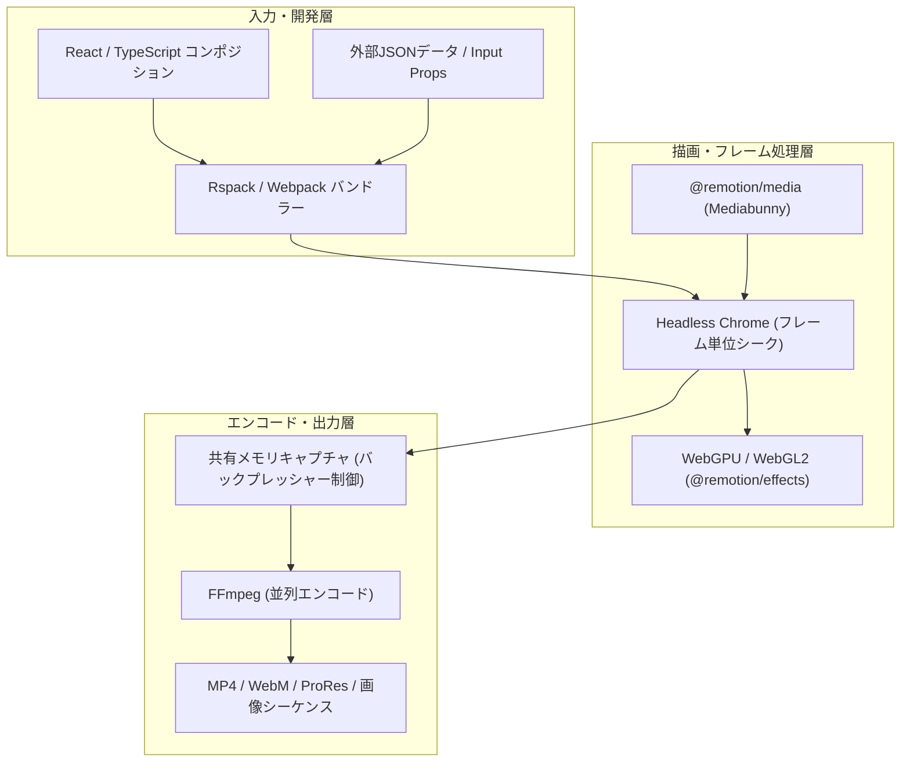

# **Remotion 調査レポート**

## **1. 基本情報**

* **ツール名**: Remotion
* **ツールの読み方**: リモーション
* **開発元**: Remotion AG
* **公式サイト**: [https://www.remotion.dev/](https://www.remotion.dev/)
* **関連リンク**:
  * GitHub: [https://github.com/remotion-dev/remotion](https://github.com/remotion-dev/remotion)
  * DeepWiki: [https://deepwiki.com/remotion-dev/remotion](https://deepwiki.com/remotion-dev/remotion)
  * ドキュメント: [https://www.remotion.dev/docs/](https://www.remotion.dev/docs/)
  * レビューサイト: [Product Hunt](https://www.producthunt.com/products/remotion) | [G2](https://www.g2.com/products/remotion/reviews)
* **カテゴリ**: 動画編集
* **概要**: Remotionは、Reactを使用してMP4やProRes等の動画をプログラムで作成できるフレームワークです。HTML、CSS、SVG、WebGPUなどの標準的なWeb技術で各フレームを描画し、FFmpegやMediabunnyを用いて動画ファイルとして出力します。データ駆動型の動的動画生成や、ブラウザ上のインタラクティブなプレビュー編集（Remotion Studio）、AIコーディングエージェントとの連携に特化しています。

## **2. 目的と主な利用シーン**

* **解決する課題**: 従来の手動による動画編集作業をコード化（Video as Code）することで、Gitによるバージョン管理、テンプレート化による再利用性、外部データに基づく大量自動生成（Personalized Video）を実現します。
* **想定利用者**: React/Web開発者、AIエージェントを活用して動画を生成したいクリエイター・開発チーム、動画自動生成システムを構築したいSaaS企業
* **利用シーン**:
  * ユーザーごとのデータに基づいた「Year in Review」のようなパーソナライズド動画の大量生成
  * SNS・プロダクトデモ向けのマーケティング動画の自動生成（Agent Skillsを活用したプロンプトからの生成を含む）
  * Webアプリケーション内での動的プレビュー・編集機能（Remotion Player / `@remotion/web-renderer`）の実装
  * コードの説明動画や技術チュートリアル、データ可視化アニメーションの作成

### **2.1 代表的な利用フロー**

```mermaid
swimlane-beta TB
  subgraph Developer["開発者・AIエージェント"]
    A["Reactコンポーネント・プロンプト作成"]
    E["Studio上で直感的に微調整・コード反映"]
  end
  subgraph Studio["Remotion Studio / CLI"]
    B["フレーム単位のプレビュー・WebMCP連携"]
    C["レンダリングジョブの起動"]
  end
  subgraph Renderer["Chrome / WebGPU / FFmpeg"]
    D["各フレーム描画と動画エンコード"]
  end
  subgraph Cloud["AWS Lambda / Vercel"]
    F["並列分散レンダリングとMP4出力"]
  end
  A --> B
  B --> E
  E --> C
  C -->|"ローカル出力"| D
  C -->|"クラウド並列出力"| F
```

* **代表的な流れ**: 開発者（またはAgent Skillsを組み込んだAIエージェント）がReactで動画コンポジションを作成すると、Remotion Studioがリアルタイムにプレビューし、キャンバス上の直接操作やWebMCPを通じたコード修正が可能です。完成したプロジェクトはローカルのChrome＋FFmpegでエンコードするか、AWS Lambda等のサーバーレス環境でチャンク並列レンダリングしてMP4等に出力します。

## **3. 主要機能**

* **Reactによる動画構成**: コンポーネントベースで動画のシーンや要素を管理し、`useCurrentFrame()` 等のフックでフレーム単位のアニメーションと再利用可能なテンプレートを構築可能。
* **インタラクティブな Remotion Studio**: ブラウザベースのプレビュー環境に加え、2026年6月以降はキャンバス上での要素選択・ドラッグ・リサイズ・クロップ等の操作を直接コードへ書き戻すインタラクティブ編集に対応。オーディオレベルメーターやOpenTimelineIOインポートも備えます。
* **Browser Studio (`remotion.new`)**: Rspack Browser APIを活用したブラウザ完結型Studioにより、ローカル環境構築なしで仮想ファイルシステム上の編集やRemotion Elementsの試用が可能。
* **Agent Skills & WebMCP連携**: Claude Code、Cursor、Codex等のAIエージェント向けに公式スキル群（`remotion-dev/skills`）およびStudioを操作・エラー取得できるWebMCPツールを提供。
* **Remotion Elements & 拡張パッケージ群**: インストール可能なUI/モーショングラフィックス集（Remotion Elements）に加え、`@remotion/effects`（全エフェクトWebGPU/WebGL2対応）、`@remotion/gsap`、`@remotion/whisper-webgpu`（ローカル音声文字起こし）、`@remotion/video-matting` などを提供。
* **Remotion Player & クライアントサイドレンダリング**: 生成した動画をReactアプリ内で再生・操作できるPlayerと、ブラウザ上で直接書き出す `@remotion/web-renderer`（Mediabunny採用）を搭載。
* **Remotion Lambda / Vercel**: AWS Lambdaで動画をチャンク分割・並列レンダリングし、ストリーミング出力（`renderMediaOnLambdaAndStream()`）にも対応するサーバーレス基盤。

## **4. 動作原理・システム構成**

* **アーキテクチャ**: ローカル実行およびサーバーレス（AWS Lambda / Google Cloud Run / Vercel）の双方で動作する「ヘッドレスブラウザ駆動型レンダリングパイプライン」と、ブラウザ内で完結する「クライアントサイドレンダリング（WebCodecs / Mediabunny）」のハイブリッド構成を採用しています。
* **主要コンポーネントとデータフロー**:
  * **バンドラー層（Webpack / Rspack 2.3）**: React/TypeScriptコードをバンドルし、StudioのFast Refreshやレンダリング用バンドルを生成します。
  * **描画・メディア層（Headless Chrome / WebGPU / `@remotion/media`）**: 指定フレーム時刻ごとにHeadless ChromeでHTML/CSS/SVG/WebGL/WebGPUを描画し、`<OffthreadVideo>` やMediabunnyベースの `@remotion/media` で映像・音声フレームを正確に同期・抽出します。
  * **エンコード層（Shared Memory Capture + FFmpeg）**: Chromeから取得したフレームデータを共有メモリ（Shared Memory Capture）経由でFFmpegへ並列受け渡しし、MP4（H.264/H.265）やProRes等にエンコードします。



* **特筆すべき要素技術**:
  * **フレーム同期と `premountFor`**: 非同期リソース読み込みによるフレーム落ちを防ぐ `delayRender()` 機構と、コンポーネントを事前にマウントしてメディアを準備する `premountFor`（2026年10月よりStudioでデフォルト2秒）を採用。
  * **WebGPU & 共有メモリ最適化**: 全エフェクトのWebGPUバックエンド化とChrome–FFmpeg間の共有メモリ転送・バックプレッシャー制御により、高解像度レンダリングのメモリ効率と速度を高めています。

## **5. 開始手順・セットアップ**

* **前提条件**:
  * Node.js（最新のLTS推奨）
  * FFmpeg（未導入の場合はRemotionが自動でバイナリを取得・管理可能）
  * アカウント登録・クレジットカード登録は不要（Free License対象の場合）
* **インストール/導入**:

  ```bash
  # 新規プロジェクトの作成
  npx create-video@latest
  # または
  npm init video
  ```

* **初期設定**:
  * `remotion.config.ts` で解像度、FPS、Rspackの有効化、並列度などを構成します。
  * AIコーディングエージェントと併用する場合は、公式Agent Skillsを追加できます。

  ```bash
  # Agent Skillsのインストール（任意）
  npx -y skills@latest add remotion-dev/skills
  ```

* **クイックスタート**:

  ```bash
  # プレビューサーバーの起動 (Remotion Studio)
  npm start

  # 動画のレンダリング (MP4出力)
  npx remotion render
  ```

  * 環境構築を行わずに試したい場合は、ブラウザ上で動作する `https://remotion.new`（Browser Studio）から即座にプロトタイピングが可能です。

## **6. 特徴・強み (Pros)**

* **Web技術のフル活用**: CSS Flexbox/Gridによるレイアウト、SVG、Three.js（`<ThreeWebGPUCanvas>`）、GSAP（`@remotion/gsap`）など、Web開発の資産をそのまま動画制作に応用できます。
* **バージョン管理・CI/CD・AI親和性**: 動画プロジェクトがテキスト（TSX/JSON）であるため、Gitによる差分管理やGitHub Actionsでの自動レンダリングに加え、AIエージェントによるコード生成・修正との相性が極めて良好です。
* **コードとGUIの両立**: 従来のコード専用ツールと異なり、Remotion Studio上で要素のドラッグ配置やカラーカーブ調整を行い、結果をソースコードへ反映できます。
* **スケーラブルな出力基盤**: ローカルでの単発出力から、AWS Lambdaを用いた数千〜数万本の並列バッチ生成、ブラウザ上のクライアントサイド書き出しまで同一コードで対応できます。

## **7. 弱み・注意点 (Cons)**

* **学習コストとエンジニア前提の設計**: ReactやTypeScriptの知識が前提となるため、非エンジニアの動画編集者には導入ハードルが高めです。
* **レンダリングリソース消費**: 複雑な動画や長時間の動画ではHeadless ChromeとFFmpegがCPU・メモリを多く消費するため、大量生成時はLambda等の外部計算資源の設計が必要です。
* **高度な3D/VFXの表現限界**: 映画レベルの高度なコンポジットや物理シミュレーションは、After EffectsやDaVinci Resolve Fusionなどの専用DCCツールに譲る面があります。
* **日本語対応の状況**: 公式ドキュメントやRemotion StudioのUIは基本的に英語で提供されています（動画内の日本語フォント描画や日本語字幕処理自体はUTF-8/Webフォントで問題なく対応可能）。

## **8. 料金プラン**

| プラン名 | 料金 | 主な特徴 |
|---------|------|---------|
| **Free License** | 無料 | 個人（商用・非商用問わず）、3人以下の営利法人、すべての非営利団体、評価目的の利用。全機能利用可・生成数無制限。 |
| **Company License (Creators)** | $25/月/席 | 4人以上の営利企業向け。StudioやAIエージェントを用いた手動・少部数制作向けの座席課金プラン。 |
| **Company License (Automators)** | $0.01/レンダー<br>（最低$100/月） | 4人以上の営利企業向け。バッチ処理、Prompt-to-Videoアプリ、Remotion Player組み込み等の自動生成プロダクト向け従量課金。 |
| **Enterprise License** | $500/月〜 | カスタム契約・請求書払い、専用Slack/Discord/Teamsサポート、コンプライアンス文書対応、月次コンサルティング、Editor Starter付属。 |

* **課金体系**: 企業規模（4人以上の営利組織か否か）と利用形態（Creators：制作者席数単位 / Automators：レンダリング実行回数単位）によるハイブリッドライセンス体系です。2026年11月に旧ライセンスポータル（`remotion.pro`）は廃止され、公式サイトの料金ページ（`https://www.remotion.dev/pricing`）へ統合されました。
* **無料トライアル**: 評価目的での利用は期間制限なくFree Licenseで検証可能です。

## **9. 導入実績・事例**

* **導入企業**: GitHub, Spotify, Meta, Google, Vercel など大手テック企業や多数のSaaSスタートアップで採用されています。
* **導入事例**:
  * **GitHub**: 「GitHub Unwrapped」などの開発者向けパーソナライズド振り返り動画キャンペーンの大量生成に活用。
  * **Spotify**: パーソナライズド体験のプロトタイピングや動的メディア生成に活用。
* **対象業界**: SaaS、マーケティングテック、デベロッパーツール、エンターテインメント、Eラーニングなど。

## **10. サポート体制**

* **ドキュメント**: 公式ドキュメント（[remotion.dev/docs](https://www.remotion.dev/docs/)）は非常に充実しており、APIリファレンス、チュートリアル、Elementライブラリ、AIエージェント連携ガイドが整備されています。
* **コミュニティ**: 公式Discordコミュニティ（6,000人以上が参加）やGitHub Discussionsが活発に運営されています。
* **公式サポート**: Companyプラン以上で商用サポートの対象となり、Enterpriseプラン（$500/月〜）ではプライベートなSlack/Discord/Microsoft Teamsチャンネルでの優先サポートや月次コンサルティングが提供されます。

## **11. エコシステムと連携**

### **11.1 API・外部サービス連携**

* **API**: `@remotion/renderer`（Node.js API）および `@remotion/lambda-client` / `@remotion/serverless-client` を提供しており、バックエンドやCLIからレンダリング・ストリーミング出力を制御できます。GoやPHP向けのLambda SDKも用意されています。
* **外部サービス連携**:
  * **AWS Lambda**: `@remotion/lambda` によりサーバーレス並列レンダリングとS3/R2出力に対応。
  * **Vercel**: `@remotion/vercel` によりVercel Functions / Vercel Sandboxでのレンダリングに対応。
  * **Google Cloud Run**: `@remotion/cloudrun` によりコンテナベースのサーバーレスレンダリングに対応。
  * **ElevenLabs**: `@remotion/elevenlabs` による音声合成・キャプション生成連携。
  * **AIエージェント（Claude Code / Cursor / Codex）**: `remotion-dev/skills` およびWebMCPによる開発・編集自動化。
  * **OpenTimelineIO / Figma**: タイムラインデータのインポートやデザインアセットの取り込みに対応。

### **11.2 技術スタックとの相性**

| 技術スタック | 相性 | メリット・推奨理由 | 懸念点・注意点 |
|:---|:---:|:---|:---|
| **React / Next.js** | ◎ | ベース技術であり公式テンプレートやPlayer統合が完備 | Next.jsのSSR環境ではクライアント境界の切り分けが必要 |
| **TypeScript** | ◎ | デフォルト推奨でZodスキーマ等と連携し型安全に構成可能 | 型定義の学習コストがある |
| **Tailwind CSS** | ◯ | 公式サポートがあり高速にレイアウト構築可能 | 動画特有の絶対配置やフレームアニメーションとの併用設計が必要 |
| **Three.js / GSAP** | ◎ | `@remotion/three`（WebGPU対応）や `@remotion/gsap` が公式提供 | 3Dシーンはレンダリング負荷が高くなりやすい |
| **Python / Go / PHP** | △ | Lambda SDK（Go/PHP等）やCLI呼び出しで連携可能 | コンポジション定義自体はNode.js/React記述が必須 |

## **12. セキュリティとコンプライアンス**

* **認証**: 商用利用時のライセンスキー認証およびEnterprise向けの利用レポート機能を備えています（v5.0に向けてAutomators向けテレメトリ/ライセンス管理の強化が予告されています）。
* **データ管理**: レンダリング処理はユーザー自身のインフラ（ローカルPC、自社AWS Lambda、Cloud Run等）で完結するため、動画素材や顧客データがRemotion社のサーバーに送信・保存されることはありません（Browser Studio利用時やライセンス検証通信を除く）。
* **準拠規格**: セルフホスト型の実行モデルのため、ユーザー企業のAWS/GCP環境におけるSOC2、ISO27001、GDPR等のコンプライアンス要件に準拠した運用が可能です。Enterpriseプランではベンダーセキュリティチェックシートやカスタム契約にも対応します。

## **13. 操作性 (UI/UX) と学習コスト**

* **UI/UX**: Remotion Studioはタイムライン、インスペクター、アセットブラウザーを備えた本格的な動画エディタに近い操作感へ進化しています。2026年のアップデートにより、キャンバス上でのスナップ付きドラッグ配置、カラーカーブのGUI編集、音声レベルメーター、コンポジションのタブ切り替え、ハイコントラストモードが実装され、コードとビジュアル編集をシームレスに行き来できます。
* **学習コスト**: ReactとTypeScriptの経験者であれば数時間で基礎を習得できますが、フレームベースの時間軸制御（`useCurrentFrame` / `interpolate` / `spring`）や動画レンダリング特有の非同期処理制御には一定の慣れが必要です。

## **14. ベストプラクティス**

* **効果的な活用法 (Modern Practices)**:
  * **フレーム購読の局所化と `premountFor` の活用**: `useCurrentFrame()` の呼び出しを末端コンポーネントに局所化して不要な再レンダリングを防ぎ、`premountFor` で動画・音声要素を事前マウントしてシークや再生を滑らかにする。
  * **Remotion Lambdaでのチャンク並列レンダリング**: 長尺や大量生成時はローカルではなくLambdaの並列処理・ストリーミングAPIを活用する。
  * **Agent Skillsの併用**: `remotion-dev/skills` を導入し、AIエージェントにベストプラクティスに沿ったコンポジションやアニメーションを生成させる。
* **陥りやすい罠 (Antipatterns)**:
  * **非同期処理の未制御**: データ取得やフォント読み込みに `delayRender()` を使わずに `useEffect` 等で処理すると、描画未完了のままフレームがキャプチャされる原因になる。
  * **Web向けCSSトランジションの使用**: CSSの `transition` や `animation` はブラウザの実時間に依存するため、フレーム単位でシークするRemotionのレンダリングでは正しく動作しない（必ず `useCurrentFrame()` と `interpolate()` 等で駆動する）。

## **15. ユーザーの声（レビュー分析）**

* **調査対象**: Product Hunt、G2、Reddit、X（Twitter）
* **総合評価**: 約 5.0 / 5.0（Product Hunt・約70件のレビュー基準）など、特に開発者コミュニティから極めて高い評価を獲得しています。
* **ポジティブな評価**:
  * 「Reactの知識だけでフレーム単位の精密な動画が作れる体験は唯一無二。」
  * 「コードベースなのでGitでレビューやバージョン管理ができ、チームでの動画制作パイプラインが劇的に改善した。」
  * 「Claude CodeなどのAIコーディングエージェントと組み合わせると、プロンプトだけで高品質なモーション動画が生成できる。」
* **ネガティブな評価 / 改善要望**:
  * 「CSSアニメーションとフレーム駆動アニメーションの考え方の違いに慣れるまで戸惑う。」
  * 「非エンジニアが単体で使いこなすのは難しく、GUI専用ソフトのような直感的なVFX編集には向かない。」
  * 「4人以上のチームで自動生成を行う場合のライセンス費用や、AWS Lambda等のインフラ構築・保守コストの考慮が必要。」

## **16. 直近半年のアップデート情報**

* **2026-11-11 (v4.0.543)**: Studioにオーディオレベルメーターを追加。CLIに `open-timeline import` / `canvas-capture import` を追加し、`remotion.pro` を廃止して `remotion.dev/pricing` へ統合。`@remotion/skills` でStudioインタラクティブ編集をデフォルト化。
* **2026-11-09 (v4.0.542)**: `@remotion/lambda-client` にストリーミング出力API（`renderMediaOnLambdaAndStream()` 等）とチャンク指定（`chunks`）を追加。StudioのOpenTimelineIOインポートや `@remotion/effects` の `magnify()` / `lightning()` を追加。
* **2026-11-02 (v4.0.540)**: `@remotion/effects` の全エフェクトがWebGPU（およびWebGL2）バックエンドに対応。Chrome 158、Rspack 2.3、Mediabunny 1.64.0へアップデート。
* **2026-10-26 (v4.0.539)**: `@remotion/effects` に `curves()` とStudio上のグラフィカルなカラーカーブ操作UIを追加。3D破片アニメーション `shatter()` を実装。
* **2026-10-12 (v4.0.535)**: Studioでコンポーネントのデフォルト事前マウント（`premountFor` 2秒）を有効化。`@remotion/lambda-client` に画像シーケンス出力 `renderFramesOnLambda()` を追加。
* **2026-10-07 (v4.0.534)**: Chromium 157へ更新し、ChromeとFFmpeg間の共有メモリキャプチャ（Shared Memory Capture）および並列エンコードの適用範囲を拡大。SSR時のネストされたHTML-in-canvasに対応。
* **2026-08-26 (v4.0.518)**: ローカルWebGPU文字起こしパッケージ `@remotion/whisper-webgpu` をリリース。`@remotion/studio` にAIエージェント連携用のWebMCPツールを追加。
* **2026-08-25 (v4.0.517)**: GSAP連携用公式パッケージ `@remotion/gsap` をリリース。
* **2026-08-04 (v4.0.506)**: インストール可能な動画要素ギャラリー「Remotion Elements」を公開。
* **2026-07-18 (v4.0.491)**: ブラウザ完結のクライアントサイドレンダリング（`@remotion/web-renderer`）とMediabunnyベースの `@remotion/media` を安定版として推奨化。
* **2026-06-10 (v4.0.475)**: Remotion Studioのインタラクティブ編集機能をリリースし、キャンバス操作からのコード直接更新に対応。
* **2026-05-22 (v4.0.465)**: 専用のエフェクトシステム `@remotion/effects` をリリースし、ブラー等の視覚効果が追加しやすくなった。
* **2026-05-01 (v4.0.455)**: `<HtmlInCanvas>` コンポーネントを追加し、キャンバス内でのHTML要素の描画をサポート。
* **2026-03-31 (v4.0.443)**: ElevenLabsの出力をキャプションに変換する専用パッケージ `@remotion/elevenlabs` を追加。
* **2026-02-20 (v4.0.427)**: 音声スケジューリングの修正とStudioでの無限ループバグの修正により、安定性が向上。
* **2026-02-20 (v4.0.426)**: Web Renderer向けに新しいVercelパッケージ `@remotion/vercel` を追加し、Vercel Sandboxでのレンダリングをサポート。Zod v4スキーマのサポートを追加。

(出典: [Remotion Releases](https://github.com/remotion-dev/remotion/releases))

## **17. 類似ツールとの比較**

### **17.1 機能比較表 (星取表)**

| 機能カテゴリ | 機能項目 | Remotion | DaVinci Resolve | AviUtl (ExEdit2) | OpenCut |
|:---:|:---|:---:|:---:|:---:|:---:|
| **制作手法** | アプローチ | コード (React) + GUI | プロ向けGUI (NLE) | 軽量GUI + スクリプト | Web/デスクトップGUI |
| **動的生成** | データ駆動・大量生成 | ◎<br><small>API/Lambdaで自動化</small> | △<br><small>Python/Lua連携</small> | ×<br><small>手動編集中心</small> | ×<br><small>手動編集中心</small> |
| **AI連携** | エージェント/AI自動編集 | ◎<br><small>Agent Skills / WebMCP</small> | ◎<br><small>AIアシスタント/IntelliSearch</small> | ×<br><small>標準機能なし</small> | △<br><small>開発中</small> |
| **表現力** | カラー/VFX | ◯<br><small>WebGPUエフェクト</small> | ◎<br><small>業界最高峰Fusion</small> | ◯<br><small>豊富なプラグイン</small> | △<br><small>基本機能中心</small> |
| **開発体験** | Git管理・CI/CD | ◎<br><small>完全テキスト管理</small> | ×<br><small>プロジェクトDB</small> | ×<br><small>独自バイナリ</small> | ×<br><small>プロジェクト形式</small> |
| **コスト** | 個人/小規模無料枠 | ◎<br><small>3人以下・個人無料</small> | ◎<br><small>無料版が高機能</small> | ◎<br><small>完全無料</small> | ◎<br><small>完全無料(OSS)</small> |

### **17.2 詳細比較**

| ツール名 | 特徴 | 強み | 弱み | 選択肢となるケース |
|---|---|---|---|---|
| **Remotion** | Reactベースの動画生成フレームワーク。 | Web技術とReactエコシステム活用、AIエージェント連携、サーバーレス大量自動生成。 | 高度なVFX・映画級カラーグレーディングは苦手。React知識が必須。 | Web開発者が動画生成アプリを作る場合や、データ駆動で動画を大量生成する場合。 |
| **DaVinci Resolve** | 編集・カラー・VFX・音声を統合したプロ向け環境。 | 圧倒的なカラーグレーディング・VFX表現力、無料版の充実、対話型AI連携（v21）。 | Gitでのテキスト差分管理やWebアプリ組み込み型の自動量産には不向き。 | 高品質な実写・映像作品を手動で仕上げたいクリエイターやスタジオ。 |
| **AviUtl** | 64bit化された国産無料動画編集ソフト（ExEdit2）。 | 完全無料・商用可、軽量動作、長年のコミュニティによるスクリプト・プラグイン資産。 | Windows専用で、サーバーサイドでの自動バッチ生成やクラウド連携には不向き。 | Windows環境で手軽に実況・解説・MAD動画などを無料制作したい場合。 |
| **OpenCut** | Rust/WASMコアを採用したOSS動画編集ソフト。 | 完全無料・OSS、クライアントサイド処理による高いプライバシー性、直感的なUI。 | 開発途上の機能があり、プログラムによる動画量産パイプライン用途ではない。 | プライバシーを重視しつつブラウザやデスクトップで手軽に手動編集したい場合。 |

## **18. 総評**

* **総合的な評価**:
  Remotionは、「動画をコードで書く（Video as Code）」というパラダイムをReactエコシステム上で確立しただけでなく、2026年に入りインタラクティブStudio、Browser Studio、WebGPUエフェクト、そしてAgent Skills / WebMCPによるAIエージェント連携へと大きく進化しました。データ駆動の大量動画生成やWebサービスへの動画生成機能組み込みにおいて、他のツールの追随を許さない存在です。
* **推奨されるチームやプロジェクト**:
  * React / TypeScriptを採用しており、動画生成をプロダクトやCI/CDに組み込みたい開発チーム。
  * AIコーディングエージェントを活用して、プロモーション動画や解説動画を効率的に生成したいスタートアップ。
  * パーソナライズド動画の大量生成基盤を構築したいSaaS・マーケティング企業。
* **選択時のポイント**:
  * 「1本の映画・CMレベルの映像美を手動で作り込む」ならDaVinci Resolve、「テンプレート化やAIエージェント連携で動画を自動生成・Web統合する」ならRemotionという棲み分けが明確です。開発チームにReactの知見があるか、4人以上の営利企業におけるライセンス条件（Creators / Automators）に適合するかを確認した上で導入を検討するのが最適です。
