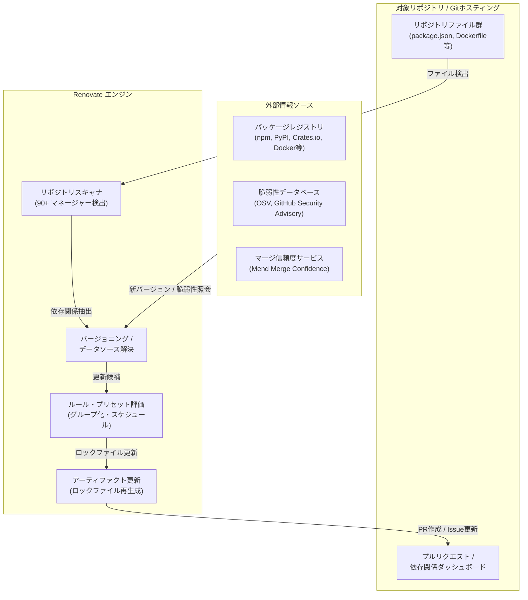

# **Renovate 調査レポート**

## **1. 基本情報**

* **ツール名**: Renovate (Mend Renovate CLI)
* **ツールの読み方**: リノベート
* **開発元**: Mend.io (旧 WhiteSource)
* **公式サイト**: [https://github.com/renovatebot/renovate](https://github.com/renovatebot/renovate)
* **関連リンク**:
  * GitHub: [https://github.com/renovatebot/renovate](https://github.com/renovatebot/renovate)
  * ドキュメント: [https://docs.renovatebot.com/](https://docs.renovatebot.com/)
* **カテゴリ**: 依存関係更新/管理
* **概要**:
  GitHub、GitLab、Bitbucket、Azure DevOps、Gerrit など多数のGitプラットフォームに対応したオープンソースの依存関係自動更新ツール。
  npm、Maven、Gradle、PyPI、Cargo、NuGet、Go Modules、Julia、Docker、Helm など90以上のパッケージマネージャーやIaC定義をサポートし、極めて柔軟なルール設定とグループ化、オートマージ機能を提供する。

## **2. 目的と主な利用シーン**

* **解決する課題**:
  * ライブラリやフレームワーク、ランタイムの更新作業にかかる開発工数の肥大化
  * 古い依存関係の放置に起因するセキュリティ脆弱性（CVE）や技術的負債の蓄積
  * 依存パッケージ更新によるCI破壊リスクや検証負荷の増大（Dependency Hell）
  * モノレポ環境における関連パッケージ間のバージョン不整合
* **想定利用者**:
  * ソフトウェア開発者・エンジニアリングリード
  * DevOps / プラットフォームエンジニア / SRE
  * オープンソースソフトウェア（OSS）のメンテナ
* **利用シーン**:
  * 日々のマイナー・パッチアップデートの自動PR作成とCIテスト通過後の自動マージ
  * 既知の脆弱性が公表された依存関係に対する緊急セキュリティパッチの自動適用
  * モノレポ構成（Lerna、Nx、Turborepo、Cargo Workspaces等）における一括バージョン同期
  * Dockerfile内のベースイメージやLinuxシステムパッケージ（apt/apk）の定期更新

### **2.1 代表的な利用フロー**

```mermaid
swimlane-beta TB
  subgraph Developer["開発者 / レビュアー"]
    A["設定ファイルの定義 (renovate.json)"]
    G["PR内容・マージ信頼度の確認"]
    H["PRのマージ (または自動マージ承認)"]
  end
  subgraph Platform["Gitプラットフォーム"]
    B["リポジトリのWebhook・スケジュール"]
    F["依存関係ダッシュボード / PRの作成"]
    I["ブランチの統合・CIパイプライン実行"]
  end
  subgraph RenovateBot["Renovate Bot"]
    C["リポジトリ走査・マニフェスト抽出"]
    E["更新ルール判定・ブランチ作成"]
  end
  subgraph Registries["外部レジストリ・脆弱性DB"]
    D["最新バージョン・脆弱性情報の取得"]
  end
  A --> B
  B --> C
  C --> D
  D --> E
  E --> F
  F --> G
  G --> H
  H --> I
```

* **代表的な流れ**: 開発者がリポジトリに `renovate.json` を配置すると、Renovate Botが定期的にリポジトリを走査して依存ファイルを特定し、外部パッケージレジストリや脆弱性DB（OSV等）から最新バージョンを照会する。更新が必要な場合はブランチとプルリクエストを作成し、依存関係ダッシュボードに反映する。開発者はマージ信頼度バッジやCI結果を確認してマージ（または自動マージ条件充足による自動統合）を行う。

## **3. 主要機能**

* **依存関係ダッシュボード (Dependency Dashboard)**: リポジトリのIssue上に保留中の更新、エラー、レート制限、将来のアップデート予定を一覧表示し、チェックボックス操作で手動PR再生成や承認が可能。
* **柔軟なグループ化更新 (Package Grouping)**: 関連するパッケージ（例: `@types/*`、Monorepo群、同一フレームワーク系ライブラリ）の更新を1つのPRに集約し、PR通知の乱立とCI実行負荷を抑制。
* **マージコンフィデンス (Merge Confidence)**: コミュニティ全体のテスト成功率、公開後経過日数（Age）、採用率（Adoption）をバッジ表示し、アップデートの安全性を定量的に提示。
* **オートマージ & Merge Queue連携**: 単体テスト通過や条件合致時に自動マージを実行。GitHub Merge Queue等とも密連携し、直列マージの破綻を防止。
* **最低リリース経過期間の制御 (Minimum Release Age)**: パッケージ公開から指定期間（例: 3日〜7日）経過するまで更新を保留することで、サプライチェーン攻撃（公開直後の悪意あるバージョン配信）を未然に防止。PoetryやGoなどパッケージマネージャー側での強制適用にも対応。
* **90種類以上のパッケージマネージャー対応**: npm、pnpm、yarn、pip、poetry、uv、pixi、Maven、Gradle、Cargo、rust-toolchain、Go modules、Julia、NuGet、Composer、CocoaPods、SwiftPM、Homebrew、vcpkg など広範なエコシステムをネイティブ解釈。
* **コンテナ & IaC更新**: Dockerfile（ベースイメージだけでなく `RUN apt install` / `apk add` パッケージも抽出更新）、Kubernetesマニフェスト、Helm charts、Kustomize、Terraform / OpenTofuプロバイダの自動追跡。
* **OSVオフライン脆弱性データベース連携**: `@renovatebot/osv-offline` をローカルキャッシュ（`cacheDir`）で運用し、APIレート制限を回避しながら高速かつセキュアに脆弱性修正PRを優先生成。
* **共有プリセット設定 (Config as Code)**: 組織共通の推奨設定（`config:best-practices` やプライベートプリセット）を集中管理し、各リポジトリから継承・共有可能。

## **4. 動作原理・システム構成**



* **アーキテクチャ**:
  RenovateはNode.js上で動作するステートレスなバッチ実行型CLI / ワーカーアーキテクチャを採用している。Gitリポジトリを浅くクローン（shallow clone）し、ファイルを静的解析して依存関係を特定、外部レジストリからメタデータを取得して差分を算出する。SaaS版（Mend Renovate App）とセルフホスト版（Dockerイメージ / CLI実行）で同一のコアエンジンが稼働する。
* **主要コンポーネントとデータフロー**:
  1. **リポジトリスキャナ (Managers)**: 対象リポジトリ内のマニフェストファイル（`package.json`, `Cargo.toml`, `go.mod`, `Dockerfile` 等）を各言語別マネージャーが検出し、現在のバージョン制約を抽出。
  2. **データソース & バージョニングエンジン (Datasources & Versioning)**: 各パッケージレジストリのAPIやOSV脆弱性DB、各言語仕様に応じたバージョニング規則（SemVer、PEP 440、Cargo、Julia等）を用いて最新候補バージョンを選定。
  3. **ポリシー・ルールエンジン (Config / Presets)**: リポジトリおよびグローバルの `renovate.json` に基づき、グループ化、メジャー/マイナー分離、スケジュール（営業日のみ等）、最低リリース経過日数（`minimumReleaseAge`）などのフィルタを適用。
  4. **アーティファクトアップデータ (Artifacts)**: 必要に応じてパッケージマネージャーのCLI（npm、cargo、pip-compile等）やコンテナ環境を呼び出し、ロックファイル（`package-lock.json`, `Cargo.lock` 等）を正確に再生成。
  5. **プラットフォームアダプタ (Platforms)**: GitHub、GitLab、Azure DevOps、Bitbucket、Gerrit等のAPIを経由して、Gitブランチのプッシュ、PRの作成・更新、Issueダッシュボードの更新を実施。
* **特筆すべき要素技術**:
  * **Secure by Default（安全な実行分離）**: セキュリティリスクの高いカスタムシェルコマンドや未信頼のスクリプト実行を制限し、コンテナ（Containerbase）による安全なツールチェーン管理を実施。
  * **OSVオフラインスキャン**: GoogleのOSVデータベースをローカルキャッシュ化し、ネットワーク負荷を最小化しながら脆弱性修正を迅速化。

## **5. 開始手順・セットアップ**

* **前提条件**:
  * Node.js v24以上（CLI直接実行時。Docker運用の場合は不要）
  * Git
  * 対象Gitプラットフォームのアカウント / 権限（GitHub Appインストール権限、またはPAT: Personal Access Token）
* **インストール/導入**:

  ```bash
  # npm経由でグローバルインストール
  npm install -g renovate

  # または npx / pnpm dlx で直接実行
  npx renovate

  # Dockerコンテナでの実行（推奨）
  docker run --rm -v /path/to/cache:/tmp/renovate \
    -e RENOVATE_PLATFORM=github \
    -e RENOVATE_TOKEN="your-github-token" \
    renovate/renovate:latest
  ```

* **初期設定**:
  * 最も手軽な導入方法は、GitHub MarketplaceまたはGitLabインテグレーションから「Mend Renovate」公式Appをインストールすること。
  * リポジトリルートに `renovate.json` または `renovate.json5` を配置。
  * 組織共通の設定を持つ場合は `extends: ["github>my-org/renovate-config"]` を指定。
* **クイックスタート**:
  1. GitHub等でMend Renovate Appをインストール。
  2. 自動的に `Configure Renovate` というオンボーディングPRが届く。
  3. PR内に検出された依存関係や初期設定内容がプレビューされるため、確認してマージする。
  4. マージ完了後、設定されたスケジュールやルールに従って依存関係更新PRおよび「Dependency Dashboard」Issueが作成される。

## **6. 特徴・強み (Pros)**

* **圧倒的な言語・プラットフォーム網羅性**: 90以上のパッケージマネージャーに対応し、GitHub/GitLab/Bitbucket/Azure DevOps/Gerrit等あらゆる環境で同一の運用が可能。マルチクラウド・ハイブリッド環境でもツールを統一できる。
* **きめ細やかな設定自由度 (Config as Code)**: パッケージ名や更新種別（patch/minor/major）、ディレクトリパスに応じたルール分岐、正規表現マッチング、スケジュール制御など、組織の要件に応じたカスタマイズが自在。
* **インテリジェントなノイズ削減**: 関連パッケージの自動グループ化や、指定期間経過を待つ「パッケージクールダウン（Minimum Release Age）」により、不要なPR乱立や公開直後の不具合取り込みを抑制。
* **マージコンフィデンスとオートマージ**: コミュニティ実績に基づく安全性指標（Adoption/Passing等）を提供し、信頼できるマイナー/パッチ更新を自動マージすることで、開発者のレビュー負荷を劇的に削減。
* **Dockerfile内のOSパッケージまで追跡**: ベースイメージのみならず、`RUN apt-get install` や `apk add` で導入されるLinuxパッケージのバージョン固定・更新まで自動化可能。

## **7. 弱み・注意点 (Cons)**

* **設定の学習コストと複雑性**: 機能とオプションが極めて豊富な反面、ドキュメントの全体量が多く、理想的な設定を構築するまでに一定の試行錯誤を要する。
* **デフォルト状態でのPRスパムリスク**: 初期設定のまま大規模プロジェクトに導入すると、数百件のPRが一挙に生成される危険があるため、グループ化や `prConcurrentLimit`、スケジュールの事前設計が不可欠。
* **セルフホスト運用時のリソース設計**: 大規模モノレポで多数のロックファイル再生成（pnpm、Cargo、Gradle等）を頻繁に行う場合、CI/CDランナーやコンテナのCPU・メモリリソースを相大に消費する。
* **日本語ドキュメントの不足**: 公式ドキュメントおよび最新のリリースノートは英語のみで提供されており、トラブルシューティングには英語情報の参照が必要。

## **8. 料金プラン**

| プラン名 | 料金 | 主な特徴 | 対象ユーザー |
|---------|------|---------|-------------|
| **Community (Cloud Hosted)** | **無料** | GitHub.com、Bitbucket Cloud向けMendホスト版。全主要機能、ダッシュボード、マージコンフィデンス利用可能。 | オープンソース、個人開発者、パブリック/プライベートGitHubユーザー |
| **Community (Self-hosted)** | **無料** (OSS) | Dockerイメージ、npmパッケージ、Helmチャート等で提供。社内GitLab/Azure DevOps/オンプレミス等に自由配備。 | 自社インフラやプライベートネットワーク内で運用したい企業 |
| **Mend Renovate Enterprise** | 要問い合わせ | 集中管理コンソール、全社ポリシーガバナンス、エンタープライズSLAサポート、大規模クラスタ運用支援。 | 多数のリポジトリと厳格なガバナンスを求めるエンタープライズ企業 |

* **課金体系**: コミュニティ版（クラウド・セルフホスト）は完全無料・機能制限なし。エンタープライズ版はサポート契約やリポジトリ規模に応じた個別見積もり。
* **無料トライアル**: コミュニティ版は永続的に無償利用可能。

## **9. 導入実績・事例**

* **導入企業**:
  * Microsoft
  * Uber
  * Atlassian
  * Red Hat
  * Mozilla
  * Googleオープンソースプロジェクト群
* **導入事例**:
  * **大規模モノレポの自動更新**: 数百のマイクロサービスを抱えるテック企業で、共有ライブラリのパッチ適用をグループ化＆オートマージし、年間数百時間のエンジニア工数を削減。
  * **サプライチェーンセキュリティの標準化**: 全社的なConfigプリセットを配布し、脆弱性を含む旧バージョンライブラリを最短数時間で一括パッチ適用。
* **対象業界**: IT/Webサービス、金融、通信、自動車、ゲームなど、継続的なソフトウェアデリバリーとDevSecOpsを実践するすべての組織。

## **10. サポート体制**

* **ドキュメント**: [公式ドキュメント](https://docs.renovatebot.com/)が詳細に整備されており、設定項目リファレンス、マネージャー別仕様、トラブルシューティング、豊富なプリセット設定例が提供されている。
* **コミュニティ**: [GitHub Discussions](https://github.com/renovatebot/renovate/discussions)が非常に活発で、メンテナや世界中のコントリビューターによる迅速なQ&Aや議論が行われている。
* **公式サポート**: セルフホストOSS版はコミュニティベース。Mend Renovate Enterprise契約企業向けには専任サポート窓口およびSLA付きエンタープライズサポートが提供される。

## **11. エコシステムと連携**

### **11.1 API・外部サービス連携**

* **API**: Gitプラットフォーム（GitHub REST/GraphQL、GitLab API、Azure DevOps API、Bitbucket API、Gerrit）と直接連携。セルフホスト時はWebhook受信やジョブキューによるトリガーが可能。
* **外部サービス連携**: Slack、Microsoft Teams、Discord、Mattermost への通知連携（PR作成・エラー発生時）。OSV（Open Source Vulnerabilities）データベース、Mend Merge Confidence APIとのデータ連携。

### **11.2 技術スタックとの相性**

| 技術スタック | 相性 | メリット・推奨理由 | 懸念点・注意点 |
|:---|:---:|:---|:---|
| **JavaScript / TypeScript (npm, pnpm, yarn, bun)** | ◎ | lockfileの更新精度が高く、Monorepo（pnpm workspace, Turborepo）も完全対応。`devEngines` も追跡可能。 | 特になし |
| **Python (pip, poetry, uv, pipenv, pixi)** | ◎ | `uv` 高速リゾルバや `pixi.lock`、PEP 691 JSON API、Poetryの最低リリース期間連携に対応。 | 複雑なコンパイル拡張を伴うパッケージはCIビルド時間要考慮 |
| **Rust (Cargo, rust-toolchain)** | ◎ | `Cargo.lock` の正確な更新に加え、`rust-toolchain.toml` のチャンネル/ツールチェーン更新もサポート。 | 特になし |
| **Go (Go Modules)** | ◎ | `go.mod` / `go.sum` の更新、プライベートプロキシ対応、モノレポ間の一括更新（`gomodTidyAll`）に対応。 | プライベートモジュール参照時はGit認証設定が必要 |
| **Java / Kotlin (Maven, Gradle)** | ◎ | Gradle WrapperやKotlin DSLのrich version constraintsに対応。 | ビルドスクリプトの実行を許可する場合はセキュリティ設定に配慮 |
| **Containers & K8s (Docker, Helm, Kustomize)** | ◎ | Dockerfile内のベースイメージや `apt`/`apk` パッケージ、Helm OCIレジストリまで網羅。 | タグのミュータブル運用時はハッシュ固定（digest pinning）を推奨 |
| **Julia (Julia General Registry)** | ◎ | 2026年最新のv44系でJuliaデータソースおよび独自バージョニング規則をネイティブサポート。 | 特になし |

## **12. セキュリティとコンプライアンス**

* **認証**: GitHub App（きめ細かな権限分離）、またはGitプラットフォームのPersonal Access Token（PAT）による最小権限アクセス。
* **データ管理**: SaaS版（Mend Renovate App）はコードを自社サーバーに永続保存せず、依存関係ファイルの解析・PR作成時のみメモリ上で処理。セルフホスト版を利用すれば、社内イントラネット外へソースコードを一切持ち出さずに運用可能。
* **Secure by Default方針**:
  * 悪意あるパッケージによるスクリプト注入を防ぐため、外部プロセスの実行や危険なコマンド（Unsafe commands）はデフォルトで遮断。
  * `postUpgradeTasks` は許可された管理者設定下でのみ実行可能。
* **サプライチェーン攻撃対策**: `minimumReleaseAge` により、悪意のあるパッケージが公開された直後の感染（ゼロデイ潜入）を防止。また、コミットハッシュ（SHA）固定とバージョン注記の自動追記にも対応。

## **13. 操作性 (UI/UX) と学習コスト**

* **UI/UX**: 開発者が普段利用しているGitHub / GitLabの「プルリクエスト」と「Issue」のみで完結。Issue上の「Dependency Dashboard」により、チェックボックスをONにするだけで手動リトライや保留中PRの発行ができる極めて優れたUXを実現。
* **学習コスト**: 基本的な導入（App追加のみ）は数分で完了するが、チーム固有の複雑なルール、正規表現によるグルーピング、共有プリセットの設計などを極めようとすると一定の習得期間を要する。公式プリセット（`config:best-practices` 等）を基点にカスタマイズしていくアプローチが推奨される。

## **14. ベストプラクティス**

* **効果的な活用法 (Modern Practices)**:
  * **組織共通プリセットの運用 (Config as Code)**: 中央リポジトリ（例: `org/renovate-config`）に全社共通ルールを定義し、各リポジトリからは数行の継承設定のみで統一ポリシーを適用する。
  * **パッケージのスマートグルーピング**: 同一フレームワークやテストツール群をグループ化し、PRの総数を抑制してレビュアーの疲弊を防ぐ。
  * **安全なオートマージの活用**: パッチバージョンかつCIテストが通過し、マージコンフィデンスが高いものに限定してオートマージを有効化する。
  * **Minimum Release Age（最低リリース期間）の導入**: パッケージ公開から数日間（例: 3日〜7日）待機させてからPRを作成するルールを適用し、サプライチェーン攻撃や初期バグのリスクを最小化する。
* **陥りやすい罠 (Antipatterns)**:
  * **デフォルト設定のまま大規模導入**: 何十ものPRが一気に押し寄せ、エンジニアが対応しきれずに放置され形骸化する（`prConcurrentLimit` やスケジュールの設定が必須）。
  * **メジャーアップデートの無検証オートマージ**: 破壊的変更（Breaking Changes）を含むメジャー更新を自動マージして本番障害を引き起こす（メジャー更新は必ず個別PRかつ手動レビューに限定すべき）。

## **15. ユーザーの声（レビュー分析）**

* **調査対象**: GitHub Stars（20,000+）、開発者コミュニティ、テックブログ、SNS
* **総合評価**: 柔軟性と対応言語の広さにおいて「依存関係管理ツールのデファクトスタンダード」として圧倒的な高評価を獲得している。
* **ポジティブな評価**:
  * 「Dependabotでは実現できなかった『複数パッケージのグループ化』や『営業日の夜間のみPR作成』といった柔軟な制御が完璧にできる。」
  * 「Dependency Dashboardのおかげで、リポジトリ内の依存関係の健康状態が一目でわかり、必要なPRだけをオンデマンドで生成できるのが快適。」
  * 「Dockerfile内のパッケージやGitHub Actionsのバージョン固定まで一元管理でき、ツールの乱立を防げた。」
  * 「完全オープンソースでセルフホストでき、オンプレミスGitLab環境でもクラウドと全く同じ恩恵を受けられる。」
* **ネガティブな評価 / 改善要望**:
  * 「設定オプションが膨大すぎて、意図通りの挙動をさせるためのJSON記述に慣れるまで時間がかかる。」
  * 「大規模なモノレポで実行すると、各ブランチごとのロックファイル再生成に時間がかかり、CIランナーの消費リソースが増える。」

## **16. 直近半年のアップデート情報**

Renovateは高頻度なリリースサイクルを維持しており、2026年7月のメジャーバージョン v44.0.0 リリース以降、2026年11月現在に至るまで継続的な機能強化が行われている。

* **2026-11 (v44.210.0〜v44.200.0)**:
  * **Juliaエコシステムの完全サポート**: `julia-general-metadata` データソースおよび独自バージョニング仕様 `julia` を新規追加（v44.210.0）。
  * **vcpkgバージョニングの追加**: C/C++パッケージマネージャーvcpkgのバージョン比較をネイティブサポート。
  * **OSVオフライン脆弱性キャッシュの強化**: `@renovatebot/osv-offline` データベースを `cacheDir` 内に保持・最適化し、脆弱性スキャンの安定性と速度を大幅向上。
  * **Gerrit PRキャッシュの実装**: プラットフォーム対応の最適化。
* **2026-10 (v44.196.0〜v44.120.0)**:
  * **Minimum Release Ageのマネージャー側強制**: 各言語マネージャー（Poetry、Go等）における最低リリース経過日数の検証ロジックを統合し、`minimumReleaseAgeBuffer` オプションを追加。
  * **Dockerfileマネージャーの機能拡張**: `RUN apt install ...` および `RUN apk add ...` でインストールされるLinuxパッケージの自動抽出・バージョン更新をネイティブサポート。
  * **Goモジュール運用強化**: プライベートプロキシ解決の最適化およびGoモノレポ向け `gomodTidyAll` オプションを追加。
  * **Gradle Kotlin/Groovy DSL**: rich version constraints のパース・更新に対応。
  * **Node.js devEngines対応**: `package.json` の `devEngines.runtime` および `devEngines.packageManager` に基づくランタイム制約管理をサポート。
* **2026-09 (v44.96.0〜v44.40.0)**:
  * **GitHub Merge Queue連携の進化**: オートマージを伴わないマージキュー単独利用や、マージキュー却下時のブランチオートマージ再試行フローを実装。
  * **Alpine Linux (APK) サポート**: APKデータソースおよび `apk` バージョニングのネイティブ対応。
  * **GitHub Actions各種アクション対応**: `slsa-framework/actions/*`、`actions-rust-lang/setup-rust-toolchain`、`abatilo/actions-poetry` 等のバージョン追跡を拡充。
  * **Forgejoサポート**: `forgejo>` プリセット参照やデータソース自動検出を強化。
* **2026-08 (v44.30.0〜v44.25.0)**:
  * **PyPI PEP 691対応**: JSONベースのSimple API仕様をサポートし、Pythonパッケージのメタデータ取得を高速化。
  * **TOML 1.1対応**: TOMLファイルのパースエンジンをTOML 1.1仕様にデフォルトアップデート。
  * **OpenTofuロックファイル連携**: `terraform-provider` においてOpenTofuパッケージAPIを活用したハッシュ解決をサポート。
* **2026-07 (v44.0.0 メジャーリリース)**:
  * **v44系メジャーリリース開始**: 内部アーキテクチャの整理と次世代パッケージマネージャー（`pep621` での `pixi.lock` サポート等）への対応強化。
* **2026-05 (v43.195.0〜v43.186.0)**:
  * `rust-toolchain` パッケージマネージャーのサポート追加。
  * `mise` のロックファイルサポートおよび `pip-compile` での `uv` 統合強化。

(出典: [Renovate GitHub Releases](https://github.com/renovatebot/renovate/releases))

## **17. 類似ツールとの比較**

### **17.1 機能比較表 (星取表)**

| 機能カテゴリ | 機能項目 | Renovate | Dependabot | Snyk Open Source | pinact |
|:---:|:---|:---:|:---:|:---:|:---:|
| **基本機能** | 自動PR作成 | ◎ | ◎ | ◎ | △<br><small>手動またはCI実行</small> |
| **対応範囲** | プラットフォーム | ◎<br><small>GitHub, GitLab, Bitbucket, Azure DevOps等</small> | ◯<br><small>GitHub中心 (他は要自前)</small> | ◯<br><small>主要Gitホスティング</small> | △<br><small>GitHub Actions専用</small> |
| **言語・ツール数** | パッケージマネージャー | ◎<br><small>90以上 (IaC, OSパッケージ含む)</small> | ◯<br><small>主要25+言語</small> | ◯<br><small>主要エコシステム</small> | △<br><small>GitHub Actionsのみ</small> |
| **管理機能** | 依存関係ダッシュボード | ◎<br><small>Issueベースで手動操作可能</small> | × | ◯<br><small>SaaS Webコンソール</small> | - |
| **効率化** | グループ化更新 | ◎<br><small>極めて柔軟なルール設計</small> | △<br><small>簡易設定のみ</small> | ◯ | - |
| **信頼性・安全性** | マージ信頼度 & クールダウン | ◎<br><small>Merge Confidence & 最低待機日数</small> | ◯<br><small>パッケージクールダウン機能</small> | ◯<br><small>Snyk独自脆弱性スコア</small> | - |
| **セキュリティ** | コミットSHA固定 | ◯<br><small>PRとして提案可能</small> | × | ◯ | ◎<br><small>ローカルで即座に実行可能</small> |

### **17.2 詳細比較**

| ツール名 | 特徴 | 強み | 弱み | 選択肢となるケース |
|---------|------|------|------|------------------|
| **Renovate** | 圧倒的な柔軟性と広範な対応力を誇るオープンソースの自動化ツール | 90以上のマネージャー対応、マルチプラットフォーム、グループ化・スケジュール・最低待機日数など自在な設定。 | 設定ファイルが複雑化しやすく、学習コストが必要。 | GitHub以外（GitLab等）を利用している、または大規模モノレポで高度な自動更新ポリシーを適用したい場合。 |
| **Dependabot** | GitHub公式の依存関係管理・脆弱性修正ツール | GitHub完全ネイティブ統合によるゼロ設定導入、CodeQL連携の到達可能性分析、完全無料。 | 設定のカスタマイズ性に制限があり、GitHub以外では運用が困難。 | 主にGitHubを利用しており、設定の手間をかけずに標準的な依存関係管理を行いたい場合。 |
| **Snyk Open Source** | 脆弱性検知とガバナンスに特化したセキュリティプラットフォーム | 業界最高水準の独自脆弱性データベース、詳細な修正ガイダンス、IDE/CI統合。 | バージョン自動更新機能単体としてはRenovateほど柔軟な設定ができない。商用利用でコスト増。 | 開発現場での脆弱性検知・修正ガイダンスや全社セキュリティガバナンスを最優先したい場合。 |
| **pinact** | GitHub Actionsのバージョン固定（SHA pinning）に特化したCLIツール | ローカルで即座に実行可能。PRマージ前にActionのコミットSHA固定を強制できる。 | GitHub Actions以外の言語やライブラリの依存関係管理には使えない。 | 開発フローの中でActionのバージョン固定を即座に行い、サプライチェーン攻撃を防ぎたい場合。 |

## **18. 総評**

* **総合的な評価**:
  Renovateは、現代の多様化・大規模化するソフトウェアエコシステムにおいて最も包括的で柔軟な依存関係自動更新プラットフォームである。2026年のv44系への進化により、Juliaやvcpkg、Dockerfile内のOSパッケージ（apt/apk）の追跡、OSVオフライン脆弱性スキャンのキャッシュ化、GitHub Merge Queueとの高度な連携など、最前線の開発要件に応える機能がさらに充実した。
* **推奨されるチームやプロジェクト**:
  * GitHub、GitLab、Azure DevOps、Bitbucketなど多様なプラットフォームを活用するマルチクラウド・エンタープライズ組織
  * モノレポ構成（npm/pnpm workspaces, Cargo workspaces, Go monorepo）を採用するプロジェクト
  * PRの乱立を防ぎ、マージコンフィデンスや最低リリース期間を活用して安全に自動マージを運用したいDevOpsチーム
  * DockerfileやHelm、Kubernetesマニフェストなどインフラコードも含めて一元的に依存関係を更新したいチーム
* **選択時のポイント**:
  * GitHubのみでシンプルかつ手軽に始めたい場合はDependabotが手軽だが、複数パッケージのグループ化、詳細なスケジュール管理、他プラットフォームへの展開を視野に入れるならRenovateが最適である。
  * また、GitHub ActionsのPRマージ前SHA固定に特化したpinactや、全社的な脆弱性ガバナンスを担うSnyk Open Sourceと併用・補完関係を築くことで、盤石なDevSecOpsパイプラインを確立できる。
