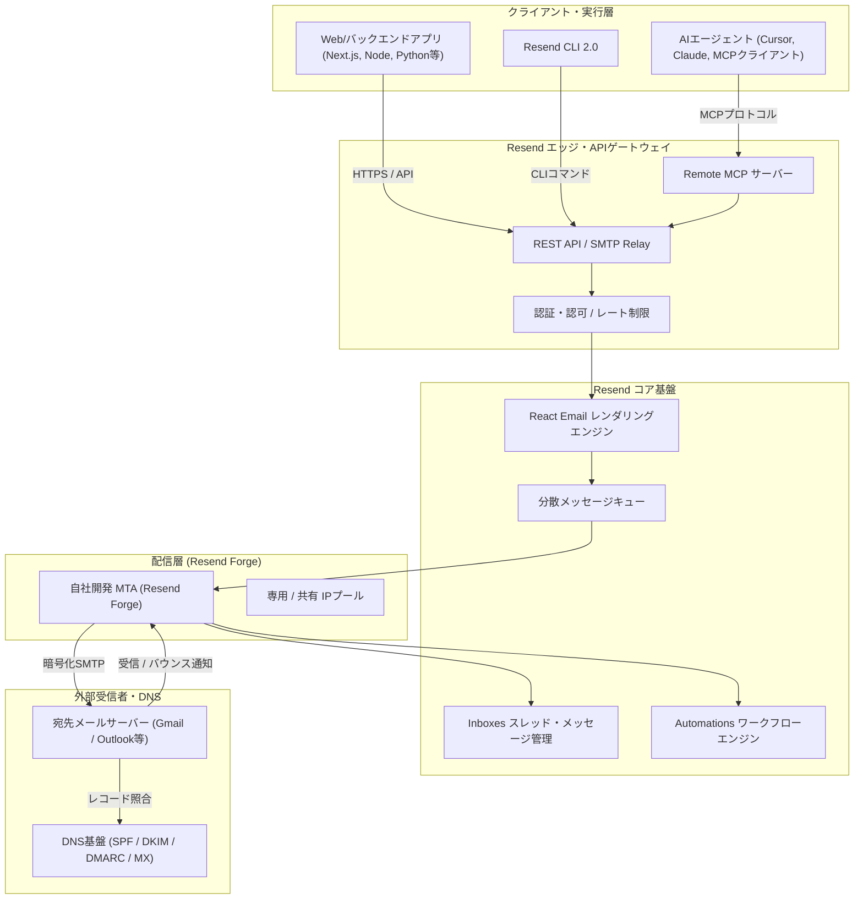

# **Resend 調査レポート**

## **1. 基本情報**

* **ツール名**: Resend
* **ツールの読み方**: リセンド
* **開発元**: Resend Inc.（共同創業者: Zeno Rocha / Bu Kinoshita、米国カリフォルニア州サンフランシスコ）
* **公式サイト**: [https://resend.com/](https://resend.com/)
* **関連リンク**:
  * GitHub: [https://github.com/resend/resend-node](https://github.com/resend/resend-node)
  * ドキュメント: [https://resend.com/docs](https://resend.com/docs)
  * レビューサイト: [G2](https://www.g2.com/products/resend/reviews) | [Product Hunt](https://www.producthunt.com/products/resend)
* **カテゴリ**: メール配信基盤
* **概要**: Resendは、開発者ファーストで設計されたモダンなクラウドメール配信プラットフォームである。従来の複雑でレガシーなメール配信サービスとは一線を画し、TypeScript/Reactエコシステムと親和性の高いAPI、ReactコンポーネントでHTMLメールを記述できる「React Email」、自社開発の次世代MTA「Resend Forge」によるミリ秒単位の配送性能、そしてAIエージェントやチーム協調に対応した受信トレイ「Resend Inboxes」を提供している。

## **2. 目的と主な利用シーン**

* **解決する課題**:
  * レガシーなメール配信SaaSにおける煩雑なセットアップ、UIの使いにくさ、突然のアカウント制限
  * HTMLメール特有の複雑なテーブルレイアウト崩れやインラインCSS管理に伴う保守コストの肥大化
  * トランザクションメール送信にとどまらず、受信メールのトリアージやAIエージェントとの連携を行うためのインフラ不足
  * 配信失敗（バウンス）や迷惑メール振り分けのトラブルシューティングにおける可視性の低さ
* **想定利用者**:
  * フルスタックエンジニア、フロントエンドエンジニア（Next.js / React / TypeScript 等）
  * スタートアップおよびSaaSプロダクトの開発・運用チーム
  * 自律型AIエージェントや自動化ワークフローを構築するエンジニア
  * プロダクトマネージャー、グロース担当エンジニア
* **利用シーン**:
  * **トランザクションメール配信**: ユーザー登録確認、二段階認証コード、パスワード再設定、決済完了・領収書通知
  * **マーケティング配信・プロダクトアップデート**: React Emailでデザインされたニュースレターや一斉お知らせ（Broadcasts）
  * **AIエージェントによる問い合わせ対応**: Resend InboxesとRemote MCPサーバーを連動させ、受信メールの自動分類、ドラフト作成、人間承認ワークフローの構築
  * **イベント駆動型システム連携**: Webhooksを用いたリアルタイムの配信成功・開封・クリック・バウンス検知とデータベース同期

### **2.1 代表的な利用フロー**

```mermaid
swimlane-beta TB
  subgraph UserActor["エンドユーザー"]
    A[パスワード再設定や登録を操作]
    G[配信されたメールを受信して確認]
  end
  subgraph AppAgent["アプリ / AIエージェント"]
    B[イベントを検知しメールデータを生成]
    C[Reactコンポーネントでテンプレート構築]
    F[Webhookイベントを受信してDB同期]
  end
  subgraph ResendEngine["Resend 配信基盤"]
    D[API受信とResend ForgeによるMTA処理]
    E[DKIM・SPF署名検証と宛先配送]
    H[開封・クリックを検知しWebhook送信]
  end
  subgraph RecipientMTA["受信側メールサーバー"]
    I[メールを受信しスパム判定を通過]
  end

  A --> B
  B --> C
  C --> D
  D --> E
  E --> I
  I --> G
  G --> H
  H --> F
```

* **代表的な流れ**: ユーザー操作を起点にアプリケーションがReactコンポーネントを用いて型安全なメールデータを構築し、Resend APIへリクエストを送信する。Resendの次世代MTA「Resend Forge」が瞬時に宛先メールサーバーへセキュアに配送し、受信後の開封やクリックイベントがWebhooks経由でアプリケーションへリアルタイムにフィードバックされる。

## **3. 主要機能**

* **開発者ファーストなEmail API & 多言語SDK**: TypeScript/Node.js、Python、Go、Ruby、PHP、Java、Elixir、Rustに対応。直感的なインターフェースにより数行のコードで送信処理を実装可能。
* **React Emailネイティブ統合**: ReactコンポーネントとTailwind CSSを用いて美しく崩れにくいHTMLメールを記述。ローカルプレビュー環境と型安全なProps設計を提供。
* **次世代自社MTA「Resend Forge」**: 外部サードパーティを介さず自社専用のIPプールとメール転送エージェント（MTA）で運用される高速配送基盤。P99ミリ秒台の低遅延配送と高い到達率を実現。
* **双方向メール受信・管理「Resend Inboxes」**: MXレコード設定により独自ドメインでのメール受信、スレッド管理、フォルダ整理（Inbox, Sent, Archive, Spam等）、返信対応が可能。
* **AIエージェント・MCP連携（Remote MCP / Agent Workflows）**: Model Context Protocol（MCP）サーバーを公式提供。AIエージェントがメールの検索、ドラフト作成、送信、自動トリアージを実行可能。
* **マーケティング配信・Broadcasts & Audiences**: 連絡先（Contacts）のリスト管理、セグメント抽出、一括配信、配信予約スケジュール機能を提供。
* **Automations（自動化ワークフロー）**: 登録イベントや日程トリガーに応じた自動ステップメールやオンボーディングシーケンスをGUI上で設定可能。
* **Webhooks & リアルタイム配信ログ**: 配信、配信完了、開封、リンククリック、バウンス、スパム苦情等のイベントをリアルタイムにWebhook通知。管理画面で各イベントの詳細ヘッダーや送受信ログを即座に確認可能。
* **ワンクリックDNSドメイン認証**: SPF、DKIM、DMARC、カスタムReturn-Path、カスタムトラッキングドメインの設定状態を自動検証し、送信元ドメインの信頼性を担保。
* **Resend CLI 2.0**: ターミナルから直接メールテスト送信、ドメイン検証、テンプレートパース、AIエージェント向けJSON出力を実行可能。

## **4. 動作原理・システム構成**

* **アーキテクチャ**: クラウド完結型の分散型高可用性SaaSアーキテクチャ。エッジAPIゲートウェイ、React Emailレンダリングレイヤー、分散キューイングシステム、自社開発MTA「Resend Forge」、インバウンドMXプロキシ、イベントストリーミング基盤で構成される。
* **主要コンポーネントとデータフロー**:
  * **API / MCPレイヤー**: アプリケーションやAIクライアントからのRESTリクエストをエッジで検証。APIキーの認証・権限管理およびレート制限を実施。
  * **レンダリングエンジン**: React EmailのSSRエンジンにより、JSX構造とインラインCSSをメールクライアント互換のHTML/プレーンテキストに高速変換。
  * **キューイング & Resend Forge MTA**: 生成されたメッセージを分散キューに投入し、自社運用のMTA「Resend Forge」が宛先MXレコードを解決してTLS 1.3暗号化通信で送信。
  * **インバウンド受信プロキシ**: 独自ドメイン宛の受信メールをMX経由で受領し、MIMEパースを経てInboxesのデータストアへ永続化およびWebhooksを発火。
  * **イベントアナリティクス**: 送信後のステータス遷移（Delivered, Opened, Clicked, Bounced）を分散イベントバス経由でリアルタイム集計し、登録されたWebhookエンドポイントへ自動配信。
* **特筆すべき要素技術**:
  * **Resend Forge**: サードパーティのクラウドMTA依存を脱却し、自社専用IPブロックと最適化されたSMTP配信パイプラインを持つ独自MTA。
  * **Remote MCP (Model Context Protocol)**: ステートレスな単一URLでAIツールカタログから直接連携可能な次世代AIインターフェース。
  * **TruffleHog連携セキュリティ**: Docker HubやHugging Face等で公開誤認されたAPIキーを検知し即座に自動失効させる防御機能。



## **5. 開始手順・セットアップ**

* **前提条件**:
  * Node.js (v18以上推奨)、またはPython、Go、Ruby等のサポート言語環境
  * Resendアカウント（公式サイトからGitHubアカウントまたはメールアドレスでサインアップ）
  * 送信元として使用する独自ドメイン（テスト用途のみなら提供される `onboarding@resend.dev` が即座に使用可能）
* **インストール/導入**:

  ```bash
  # Node.js / TypeScriptプロジェクトの場合
  pnpm add resend
  # または npm install resend
  ```

* **初期設定**:
  * Resendダッシュボード（[https://resend.com/api-keys](https://resend.com/api-keys)）でAPIキーを発行し、環境変数に登録する。
  * 本番送信用にドメイン設定画面から独自ドメインを追加し、提示されるDNSレコード（DKIM, SPF）を登録して検証（Verify）を完了させる。

  ```bash
  # .env.local
  RESEND_API_KEY=process.env.RESEND_API_KEY
  ```

* **クイックスタート**:

  Node.js / TypeScriptでの送信コード例:

  ```typescript
  import { Resend } from 'resend';

  // 環境変数からAPIキーを読み込む
  const resend = new Resend(process.env.RESEND_API_KEY);

  async function main() {
    const { data, error } = await resend.emails.send({
      from: 'Acme <onboarding@resend.dev>', // 独自ドメイン検証後は info@yourdomain.com
      to: ['delivered@resend.dev'],
      subject: 'Hello from Resend',
      html: '<strong>Resendからのメール送信テストに成功しました！</strong>',
    });

    if (error) {
      console.error('送信エラー:', error);
      return;
    }

    console.log('送信成功 ID:', data?.id);
  }

  main();
  ```

  React Emailを用いたテンプレート送信例:

  
  ```tsx
  import { Resend } from 'resend';
  import * as React from 'react';

  const resend = new Resend(process.env.RESEND_API_KEY);

  interface WelcomeEmailProps {
    userName: string;
  }

  export const WelcomeEmail: React.FC<WelcomeEmailProps> = ({ userName }) => (
    <div style={{ fontFamily: 'sans-serif', padding: '20px' }}>
      <h1>ようこそ、{userName}さん！</h1>
      <p>アカウントの登録が正常に完了いたしました。</p>
      <a href="https://example.com/dashboard" style={{ color: '#0070f3' }}>
        ダッシュボードへ移動する
      </a>
    </div>
  );

  await resend.emails.send({
    from: 'Acme <hello@yourdomain.com>',
    to: ['user@example.com'],
    subject: 'アカウント登録完了のご案内',
    react: <WelcomeEmail userName="佐藤" />,
  });
  ```
  

## **6. 特徴・強み (Pros)**

* **圧倒的な開発者体験（DX）とReact Email親和性**: API構造が極めてシンプルかつクリーンに整理されており、Reactコンポーネントを用いた型安全なメール開発がネイティブで可能。CSSインライン化や複雑なtableタグの記述から解放される。
* **自社開発MTA「Resend Forge」による超高速配信と高到達率**: 外部プロバイダーに依存しない自前MTAと専用IPブロックにより、P99ミリ秒単位の配送レイテンシと優れた迷惑メール判定回避性能（Inbox Placement）を実現。
* **受信・スレッド管理「Inboxes」とAIエージェント対応**: 単なる送信APIにとどまらず、独自ドメインでのメール受信、スレッド管理、Remote MCP経由でのAIエージェント連携（自動トリアージ・ドラフト作成）を標準サポート。
* **寛容な無料枠と明瞭な従量課金体系**: 月3,000通の無料枠が永続提供され、有料のProプランも月額$20（50,000通、超過分は1,000通あたり$0.90）と初期〜成長フェーズでコスト予測が極めて容易。
* **モダンで視認性の高いダッシュボードと高機能CLI**: Vercelライクな洗練された管理UIで、メールの配信ステータス、バウンス理由、ヘッダー詳細をリアルタイムに確認可能。Resend CLI 2.0によりターミナル完結での検証も可能。

## **7. 弱み・注意点 (Cons)**

* **日本語対応および国内サポートの不在**: 管理画面、エラーメッセージ、公式ドキュメントはすべて英語であり、日本語での公式問い合わせ窓口は存在しない（※メール本文の日本語UTF-8送信やヘッダーの日本語表示自体は問題なく動作）。
* **エンタープライズ機能の個別アドオン費用**: SSO（シングルサインオン）の利用には月額$150の追加費用が必要であり、固定IPの割り当てにもScaleプラン以上（月額$90〜）＋月額$30が必要となるため、大企業での導入時はオプション費用の積算が必要。
* **無料プラン（Free）における日次送信制限**: 無料プランは月間3,000通の枠があるものの、「1日あたり100通」の日次上限が設定されており、一時的なバースト送信テストを行うにはProプランへの移行が必要となる。
* **レガシーMAツールの特化型機能との差別化**: MarketoやHubSpotのような極めて複雑なリードスコアリング、商談ステージ連動などの高度なBtoBマーケティング自動化機能そのものは内包しておらず、自社DBやiPaaS側でのロジック実装が必要。

## **8. 料金プラン**

| プラン名 | 月額料金 | 含まれる月間送信数 | 主な特徴・制限 |
|:---|:---:|:---:|:---|
| **Free** | 無料 ($0) | 3,000通 / 月 | 1日あたり100通の上限、3 Inboxes、共有IP、REST API、SMTP Relay、React Email対応 |
| **Pro** | $20 / 月 | 50,000通 / 月 | 日次制限なし、超過分は$0.90/1,000通、3 Inboxes、無制限Webhooks、詳細ログ（30日保持） |
| **Scale** | $90 / 月 | 100,000通 / 月 | 超過分は$0.90/1,000通（大量送信時は逓減）、1,000ドメイン、専用Slackチャンネル、固定IP追加可能 |
| **Enterprise** | 個別見積もり | カスタム | 大規模ボリューム対応、SLA保証、専任アカウントマネージャー、SSO標準搭載、セキュリティ監査対応 |

* **課金体系**: 基本月額料金 ＋ 超過送信数従量課金（$0.90 / 1,000通）＋ 各種アドオン
* **マーケティング（Broadcasts）料金**: 連絡先数（Contacts）に応じた課金（例: 5,000連絡先で月額$40〜）
* **主なアドオン・従量メーター**:
  * **Automations実行**: 月10,000回まで無料（以降$0.0015 / 回）
  * **追加Inboxes**: 最初の3個まで無料（以降$1 / 個 / 月）
  * **追加ドメイン（Extra Domains）**: $20 / 月（100ドメイン追加）
  * **専用固定IP（Dedicated IP）**: $30 / 月（Scaleプラン以上、3,000通/日以上の送信実績が必要）
  * **SSO（Single Sign-On）**: $150 / 月（Scaleプラン向けアドオン、Enterpriseは含む）
* **無料トライアル**: Freeプランが無期限で利用可能（クレジットカード登録不要）。

## **9. 導入実績・事例**

* **導入企業**:
  * **Nuxt**: 公式デプロイプラットフォームおよび各種通知基盤のメール送信にResendを採用
  * **Anghami**: 中東地域最大の音楽ストリーミングサービス。月間数百万通規模のトランザクション通知をResendで配信
  * **Gumroad**: クリエイター向けECプラットフォーム。購入完了通知やクリエイター向け重要連絡に採用
  * **Liveblocks**: リアルタイムコラボレーション基盤。プロダクトアラート通知やアップセル導線メールに活用
  * **Theya**: ビットコインカストディサービス。ローンチウィークキャンペーンや顧客エンゲージメントにBroadcastsを活用
* **導入事例から得られる効果**:
  * SendGrid等の従来型プロバイダーからの移行が数時間〜数日で完了し、配信遅延やバウンス率が大幅に改善
  * React Emailの導入により、デザイナー・フロントエンドエンジニア・バックエンドエンジニアが単一のコンポーネントコードでテンプレートを共同保守可能に
* **対象業界**:
  * モダンWebサービス、AIスタートアップ、SaaS事業者、開発者ツール、FinTech、クリエイターエコノミー

## **10. サポート体制**

* **ドキュメント**: 公式ドキュメント（[https://resend.com/docs](https://resend.com/docs)）が極めて充実。主要フレームワーク（Next.js, Remix, Nuxt, Laravel, Django, Express等）別の導入ガイド、対話型APIリファレンス、React Emailコンポーネントカタログを提供。
* **コミュニティ**: GitHub（Discussions / Issue）、公式Discordサーバー、X（Twitter）でのコミュニティが活発。共同創業者やコアエンジニアがユーザーからのフィードバックに迅速に反応する文化が定着。
* **公式サポート**:
  * 全有料プラン向けメールサポート
  * Scaleプラン向け専用共有Slackチャンネルサポート
  * Enterpriseプラン向け専任サポートエンジニアおよびSLA保証
  * 対応言語: 英語（日本時間対応の専門窓口はなし）

## **11. エコシステムと連携**

### **11.1 API・外部サービス連携**

* **API**: 完全なRESTful APIを公開（OpenAPI仕様準拠）。メール送信（即時/予約/バッチ）、受信トレイ（Inboxes）、ドメイン管理、APIキー管理、オーディエンス/連絡先管理、Webhooks設定などをプログラムから包括的に操作可能。
* **外部サービス連携**:
  * **Vercel**: マーケットプレイス公式統合。プロジェクトへのワンクリック環境変数設定およびv0（AI UIジェネレーター）でのReact Email直接生成に対応。
  * **Supabase**: Supabase AuthのカスタムSMTPトランスポートおよびSupabase Edge Functionsとの連携ガイドが公式整備。
  * **Stripe**: Stripe Projects CLIからの直接プロビジョニング、決済イベント連動レシートメール送信に対応。
  * **Laravel Cloud**: Laravelエコシステムでの公式トランスポート連携。
  * **AIツール / MCP**: Model Context Protocol（MCP）サーバー対応により、CursorやClaude等のAIエージェントからResendの操作が可能。
  * **Webhooks**: 配信完了、開封、クリック、バウンス等のイベントをSlack、Discord、自社バックエンドAPIへ瞬時に転送。

### **11.2 技術スタックとの相性**

| 技術スタック | 相性 | メリット・推奨理由 | 懸念点・注意点 |
|:---|:---:|:---|:---|
| **Next.js (Vercel)** | ◎ | 公式SDKとReact Emailの相性が完璧。Server ActionsやRoute Handlersから数行で送信可能 | 特になし |
| **Node.js / TypeScript** | ◎ | 第一級市民としての型定義が完備。APIレスポンスの型安全性が高い | 特になし |
| **Cloudflare Workers** | ◎ | Fetch API準拠の軽量SDKにより、エッジランタイム環境で超高速に動作 | Node固有モジュールの非依存性を意識する必要あり |
| **Python (FastAPI / Django)** | ◯ | 公式SDK（`resend-py`）が提供されており、シンプルな記述で導入可能 | React Email利用時はビルドパイプラインの分離が必要 |
| **Go / Ruby / PHP** | ◯ | 公式SDKが整備されており、Laravel等ではMailトランスポートとして即座に組み込み可能 | テンプレートはHTML文字列またはReact Emailのビルド成果物を使用 |

## **12. セキュリティとコンプライアンス**

* **認証**: 2要素認証（2FA / TOTP）、細粒度APIキー権限（送信専用、ドメイン限定など）、SSO（SAML / Okta等、ScaleアドオンまたはEnterpriseで対応）、ロールベースアクセス制御（RBAC）
* **データ管理**: 保存データのAES-256暗号化（機密テーブルへの行レベル暗号化含む）、通信時TLS 1.3以上、ポイントインタイムバックアップ（7日間保持）、TruffleHogと連携した公開露出APIキーの自動失効機能
* **準拠規格**:
  * **SOC 2 Type II 準拠**: Vantaによる継続的セキュリティ監視およびAdvantage Partners等による第三者監査レポートを発行
  * **GDPR 準拠**: 全アカウントにArticle 28 DPA（データ処理補足契約）が自動適用、EU-US Data Privacy Framework (DPF) / UK Extension認定を取得
  * **年次ペネトレーションテスト**: 独立した第三者セキュリティ監査法人による年次侵入テストを実施

## **13. 操作性 (UI/UX) と学習コスト**

* **UI/UX**: ダークモードを基調とした極めて洗練されたUI。VercelやLinearに匹敵する軽快な操作性を誇り、配信ログ、開封率・クリック率のグラフ、バウンス発生時のSMTPエラーコード、送信ヘッダー情報が数クリックで視覚的に把握できる。
* **学習コスト**: 非常に低い。開発者であれば公式ドキュメントを参照してから5分以内に最初のメール送信（Hello World）を完了できる。React Emailを併用する場合も、一般的なReact / Tailwind CSSの知識があれば即座にプロダクション品質のテンプレートを制作できる。

## **14. ベストプラクティス**

* **効果的な活用法 (Modern Practices)**:
  * **独自ドメイン認証の完全実施**: SPF、DKIM、DMARC、カスタムReturn-Pathを設定し、独自ドメインの評判（Reputation）を保護・育成する。
  * **React Emailによるコンポーネント共通化**: 企業ロゴ、フッター、ボタン等のデザインコンポーネントを共通化し、Webアプリ本体のデザインシステムと整合させる。
  * **Webhooksを活用したバウンス自動クレンジング**: バウンス（Permanent Bounce）やスパム苦情イベントを受信した際、自社データベースのユーザーレコードを自動更新して再送を防止する。
  * **Resend InboxesとAI MCPの連携**: 受信トレイ機能を有効化し、AIエージェントに問い合わせメールの要約・ドラフト作成を行わせることでカスタマーサクセス業務を効率化する。
* **陥りやすい罠 (Antipatterns)**:
  * **テスト用共有ドメインの本番利用**: 初期テスト用ドメイン（`onboarding@resend.dev`）はアカウント登録メールアドレス宛にしか届かないため、本番運用前に必ず独自ドメインを検証すること。
  * **クライアントサイドでのAPIキー露出**: Reactのフロントエンド（ブラウザ実行環境）から直接SDKを呼び出すとAPIキーが漏洩するため、必ずNext.jsのServer ActionsやバックエンドAPIエンドポイントを経由させること。
  * **Freeプランの日次制限オーバー**: 無料プランの日次100通上限を考慮せず、バッチ処理で一斉送信を行い429（Rate Limit）エラーを引き起こすこと。
  * **DMARC未設定によるスパム判定**: 2024年以降のGmail / Yahooの一括送信者ガイドラインに準拠するため、DMARCポリシー（`p=none` 以上）を必ず設定すること。

## **15. ユーザーの声（レビュー分析）**

* **調査対象**: G2、Product Hunt、X（Twitter）、Zenn / Qiita技術コミュニティ
* **総合評価**:
  * G2: 4.8 / 5.0（DX、クリーンなAPI、設定の容易さが高評価）
  * Product Hunt: 4.9 / 5.0（260件以上の高評価レビュー）
* **ポジティブな評価**:
  * **圧倒的な導入スピード**: 「SendGridのような複雑な設定や審査待ちがなく、アカウント作成から5分で本番メールが送信できた」
  * **React Emailの生産性**: 「HTMLメールの崩れに悩まされる時代が終わった。ReactとTailwindで型安全にメールを組めるのが最高」
  * **優れたデバッグ体験**: 「管理画面の配信ログがリアルタイムに更新され、ヘッダー情報やバウンスのエラー詳細が手に取るようにわかる」
  * **配信速度の向上**: 「自社MTA Resend Forgeの導入後、パスワードリセット等の通知が体感でも瞬時に届くようになった」
* **ネガティブな評価 / 改善要望**:
  * **日次送信制限の制約**: 「Freeプランの月3,000通枠はありがたいが、1日100通上限があるため、初期リリース直後のスパイクで引っかかりやすい」
  * **英語のみのインターフェース**: 「ドキュメントや管理画面が完全に英語であるため、非エンジニアチームや情シスへの引き継ぎに説明を要する」
  * **SSOなどのアドオン費用**: 「ScaleプランでのSSOアドオン（月額$150）など、企業規模が大きくなるとオプション費用がやや重くなる」
* **特徴的なユースケース**:
  * 「Next.js ＋ Supabase ＋ Clerk ＋ Resend」というモダンスタックの標準構成として、個人開発から急成長SaaSまで広く採用されている。
  * InboxesとMCPサーバーを活用し、Cursorや自社AIエージェントに直接メールのドラフト作成や顧客問い合わせトリアージを任せる先端ワークフローが構築されている。

## **16. 直近半年のアップデート情報**

* **2026-11-06**: TruffleHog Secrets Revocation Program（DockerイメージやHugging Faceデータセット等で公開露出したAPIキーを自動検知し即時失効させるセキュリティ機能を導入）
* **2026-10-24**: Resend Forwardカンファレンスにて大型発表
  * 次世代独自MTA「Resend Forge」を発表（サードパーティを介さない自社専用IP・独自メール転送エージェント基盤）
  * 双方向メール受信・スレッド管理「Resend Inboxes」を一般提供開始（AIエージェント対応の受信トレイ）
  * Remote MCPサーバー対応（Model Context ProtocolによるAIツールカタログ連携）
  * 画像自動圧縮およびWebP / HEIC / SVGの自動変換機能をメールエディターに追加
* **2026-10-15**: Laravel Cloud公式統合およびStripe Projects CLIプロビジョニング対応
* **2026-09-18**: Account Usage APIの提供（残通数やプラン制限値のプログラム取得に対応）
* **2026-08-22**: Link Checker機能の追加（配信前テンプレート内のリンク切れや未設定URLの自動検知）
* **2026-07-10**: Single Sign-On（SSO / SAML）エンタープライズ認証対応
* **2026-05-28**: Headless Webhook & Audience Segment APIの拡充
* **2026-04-18**: Launch Week 6（Automations自動化シーケンス、AI Email Editor、Resend CLI 2.0、React Email 6.0を発表）

(出典: [Resend Changelog](https://resend.com/changelog))

## **17. 類似ツールとの比較**

### **17.1 機能比較表 (星取表)**

| 機能カテゴリ | 機能項目 | Resend | SendGrid | Postmark | AWS SES |
|:---:|:---|:---:|:---:|:---:|:---:|
| **開発者体験** | API / SDK設計 | ◎<br><small>極めてモダンで型安全</small> | ◯<br><small>歴史があるがやや冗長</small> | ◎<br><small>シンプルで安定</small> | △<br><small>AWS SDK特有の複雑さ</small> |
| **テンプレート** | React Email連携 | ◎<br><small>ネイティブ統合・Tailwind対応</small> | △<br><small>HTML/GUIエディタ中心</small> | △<br><small>独自テンプレート言語</small> | ×<br><small>外部構築が必要</small> |
| **配送基盤** | 配信速度・到達率 | ◎<br><small>自社MTA Resend Forge</small> | ◯<br><small>老舗だが共有IPのブレあり</small> | ◎<br><small>高到達率で定評</small> | ◯<br><small>高い信頼性だが自己管理</small> |
| **AI・次世代機能** | MCP / エージェント連携 | ◎<br><small>Remote MCP公式提供</small> | ×<br><small>非対応</small> | ×<br><small>非対応</small> | △<br><small>Bedrock経由等で自作</small> |
| **受信機能** | Inboxes (スレッド管理) | ◎<br><small>Web画面・API・AI対応</small> | △<br><small>Inbound Parseのみ</small> | △<br><small>Inbound Webhookのみ</small> | △<br><small>S3/Lambda連携が必要</small> |
| **自動化** | Automations機能 | ◯<br><small>標準ワークフロー提供</small> | ◎<br><small>高度なMAマーケティング</small> | △<br><small>メッセージストリームのみ</small> | ×<br><small>Step Functions等で自作</small> |
| **無料枠** | 無料プラン | ◎<br><small>3,000通/月 (永続)</small> | △<br><small>100通/日</small> | ×<br><small>100通のお試しのみ</small> | ◯<br><small>EC2発信で一部無料枠</small> |
| **非機能要件** | 日本語サポート | △<br><small>英語のみ（国内代理店なし）</small> | ◎<br><small>構造計画研究所による日本語対応</small> | △<br><small>英語のみ</small> | ◯<br><small>AWS公式日本語サポート</small> |

### **17.2 詳細比較**

| ツール名 | 特徴 | 強み | 弱み | 選択肢となるケース |
|---------|------|------|------|------------------|
| **Resend** | モダンWeb開発者やAIエージェント向けに特化した次世代メール配信基盤 | React Email統合による圧倒的なDX、自社MTA「Resend Forge」の超高速配送、Inboxes/MCPによるAI連携 | 管理画面・サポートが英語のみ、SSOや固定IPなど大規模エンタープライズ機能は追加費用 | Next.js/React等のモダンスタックを採用しているチーム、AIエージェント連携を視野に入れているスタートアップ・SaaS |
| **SendGrid (Twilio)** | 世界最大級の導入実績を誇る老舗メール配信サービス | 大規模配信実績、高度なマーケティング自動化、国内代理店による手厚い日本語サポート | 管理画面やAPI設計のレガシー感、共有IPプールでの到達率変動、アカウント凍結リスク | 国内法人の手厚いサポートが必要な大企業、マーケティング部門主導での大規模キャンペーン配信 |
| **Postmark (ActiveCampaign)** | トランザクションメールの到達率と配信速度に特化したプロバイダー | トランザクション専用IPプールによる極めて高い受信箱到達率、詳細な配信速度メトリクス | 無料プランがなく初期費用が発生、マーケティング配信との分離設計が必要、Reactネイティブではない | とにかくパスワードリセットや認証メールの受信箱到達率を最優先したいB2Bプロダクト |
| **Amazon SES** | AWSが提供する従量課金制の大規模メール配信クラウドサービス | 1,000通あたり$0.10という圧倒的な低コスト、AWSインフラとの強固な親和性 | SDKのDXやUIが未整備、バウンス処理やテンプレート管理を自前で実装する必要があり学習コスト大 | 毎月数千万通以上の超大量メールを極限まで低コストで配信したい大規模インフラ構築チーム |

## **18. 総評**

* **総合的な評価**:
  * Resendは、長年イノベーションが停滞していたメール配信基盤の領域に「洗練された開発者体験」と「モダンフロントエンド親和性」を持ち込んだ画期的なサービスである。React Emailのネイティブ統合によってメール作成の保守性を劇的に向上させただけでなく、2026年には独自MTA「Resend Forge」による自社インフラ化や、AIエージェント対応の「Inboxes」「Remote MCP」を矢継ぎ早に投入し、次世代メールプラットフォームとしての地位を確固たるものにしている。
* **推奨されるチームやプロジェクト**:
  * Next.js、Remix、Nuxt等のモダンフレームワークを採用しているスタートアップおよびWeb開発チーム
  * 認証にClerkやSupabaseを採用し、迅速にプロダクション品質のWebサービスをローンチしたい開発者
  * AIエージェントにメール送受信や顧客対応ワークフローを統合したい先端AIプロダクト開発者
  * レガシーなメール配信サービスのUIやSDK、遅延に不満を抱えているエンジニアチーム
* **選択時のポイント**:
  * 国内代理店による日本語サポートや契約書締結、電話サポートが必須要件である場合はSendGrid（構造計画研究所）が適しているが、開発スピード、コードの保守性、最新のAIエージェント親和性を重視するならば、Resendが現代の開発スタックにおける最有力なファーストチョイスとなる。
