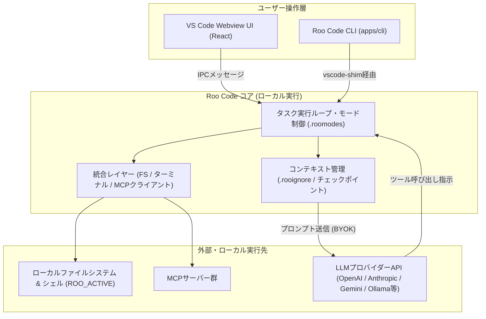

# **Roo Code 調査レポート**

## **1. 基本情報**

* **ツール名**: Roo Code
* **ツールの読み方**: ルーコード
* **開発元**: Roo Code Inc.（2026年5月15日をもって公式開発を終了し、開発チームはクラウドエージェント「Roomote」へ移行）
* **公式サイト**: [https://roocode.com/](https://roocode.com/)（現在は後継サービス [https://roomote.dev/](https://roomote.dev/) へリダイレクト）
* **関連リンク**:
  * GitHub: [https://github.com/RooCodeInc/Roo-Code](https://github.com/RooCodeInc/Roo-Code)（アーカイブ済み）
  * DeepWiki: [https://deepwiki.com/RooCodeInc/Roo-Code](https://deepwiki.com/RooCodeInc/Roo-Code)
  * CodeWiki: [https://codewiki.google/github.com/RooCodeInc/Roo-Code](https://codewiki.google/github.com/RooCodeInc/Roo-Code)
  * ドキュメント: [https://roocodeinc.github.io/Roo-Code/](https://roocodeinc.github.io/Roo-Code/)（旧 `docs.roocode.com` からのリダイレクト先）
* **カテゴリ**: AIコーディング支援
* **概要**: Roo Codeは、VS Code拡張機能およびCLIツールとして動作するオープンソース（Apache License 2.0）のAIコーディングエージェントです。Clineからのフォークとして誕生し、モデル非依存（BYOK）の設計と「Code」「Architect」「Debug」などの専用モードにより、ローカル環境での自律的なコーディングや設計支援を実現しました。2026年5月15日の最終リリース（v3.54.0）をもって公式リポジトリはアーカイブされ、現在はコミュニティ主導の後継フォーク（ZooCode）や、開発チームのクラウド製品（Roomote）、フォーク元のClineなどへの移行が案内されています。

## **2. 目的と主な利用シーン**

* **解決する課題**: 複雑な機能実装やリファクタリングにかかる時間の短縮、コンテキストスイッチの削減、外部クラウドに依存しないローカル環境での自律的な開発支援。
* **想定利用者**: ソフトウェアエンジニア、テックリード、QAエンジニア。
* **利用シーン**:
  * **自律的なコーディング・デバッグ**: 任意のLLM（GPT-5.5、Claude Opus 4.7、ローカルLLMなど）を使用して、エディタ内で直接コード生成、デバッグ、ファイル操作を行わせる。
  * **ターミナルワークフローへの統合**: CLIツールとしてセッションを保持しつつ、ターミナルから直接スクリプト実行やファイル修正を指示する。
  * **設計・要件定義の支援**: 「Architect Mode」を活用して、実装に入る前の移行計画策定やシステム設計の壁打ちを行う。

### **2.1 代表的な利用フロー**

```mermaid
swimlane-beta TB
  subgraph User["開発者"]
    A[モード選択とタスク指示]
    E[差分確認・チェックポイント復元/承認]
  end
  subgraph RooCode["Roo Code (VS Code拡張 / CLI)"]
    B[".rooignore 適用とコンテキスト構築"]
    D[ツール実行結果の統合と変更提案]
  end
  subgraph LocalEnv["ローカル環境 (FS / ターミナル / MCP)"]
    C2[ファイル読み書き・コマンド実行]
  end
  subgraph LLM["外部LLM / ローカルLLM (BYOK)"]
    C1[推論・実行計画・ツール呼び出し生成]
  end
  A --> B
  B --> C1
  C1 --> C2
  C2 --> D
  D --> E
```

* **代表的な流れ**: 開発者がモード（Code/Architect等）と指示を入力すると、Roo Codeが `.rooignore` に基づき安全にコンテキストを構築し、BYOKで接続したLLMへ直接送信します。LLMが生成したファイル操作やターミナル実行・MCP呼び出しをローカル環境で（必要に応じてユーザー承認を挟みつつ）実行し、結果を差分表示およびチェックポイント付きで開発者へ返却します。

## **3. 主要機能**

* **モデル非依存 (Model Agnostic / BYOK)**: OpenAI（GPT-5.5、GPT-5.4等）、Anthropic（Claude Opus 4.7等）、Google Gemini（Gemini 3.1 Pro等）、xAI（Grok-4.20等）、Amazon Bedrock、Vertex AI、Poeなど主要LLMプロバイダーに対応。Ollama等を経由したローカルLLMも利用可能です。
* **ロール別モード (Modes)**:
  * **Code Mode**: 日々のコーディングやファイル操作。
  * **Architect Mode**: 実装前の設計や移行計画の策定。
  * **Ask Mode**: コードベースに関する質問や解説の取得。
  * **Debug Mode**: ログ追加や原因切り分けによるトラブルシューティング。
  * **Custom Modes**: `.roomodes` 設定ファイルを用いて、チームやワークフローに合わせた専用モードを定義可能。
* **CLI (コマンドラインインターフェース)**: ターミナルから直接Roo Codeを呼び出し、`--create-with-session-id` によるセッション制御、標準入力ストリーミング（画像入力含む）、セッションの再開・履歴管理に対応。
* **スラッシュコマンドとスキル (`SKILL.md`)**: 頻繁に利用するプロンプトや手順をスキルとして定義し、スラッシュコマンド（`/`）で素早く呼び出すことが可能。
* **MCP (Model Context Protocol) 対応**: ローカルまたはリモートのMCPサーバーと標準化されたプロトコルで接続し、外部ツールやデータソースをエージェントへ統合可能。
* **コンテキスト管理・チェックポイント**: 前のチェックポイントへのナビゲーション・復元機能や、機密・不要ファイルを除外する `.rooignore`、大容量ファイル読み込み時の自動制限・意味抽出機能を搭載。

## **4. 動作原理・システム構成**

* **アーキテクチャ**: ローカルファーストのVS Code拡張機能（Extension Hostプロセス + React Webview UI）およびスタンドアロンCLI（`apps/cli`）による構成です。最終版（v3.54.0）においてRoo Code Cloud、テレメトリ、MDM（組織管理）基盤がすべて削除されたため、外部の仲介サーバーを介さず、ローカル環境とユーザーが指定したLLMプロバイダーAPI間のみで通信が完結します。
* **主要コンポーネントとデータフロー**:
  * **拡張機能コア (`src/core/` / `src/extension.ts`)**: タスクの実行ループ、`.roomodes` に基づくロール別プロンプト切替、Gitベースのチェックポイント管理、`.rooignore` フィルタリングを担います。
  * **Webview UI (`webview-ui/`)**: Reactで構築されたチャット画面、ファイル差分プレビュー、ツール実行承認UI、スキル管理パネルを提供し、VS Code内部メッセージング（IPC）を通じてコアと通信します。
  * **統合・サービス層 (`src/integrations/` / `src/services/`)**: ファイルシステム操作、ターミナルコマンド実行（`ROO_ACTIVE` 環境変数によるガードレール付き）、MCPクライアントによる外部ツール呼び出しを実行します。
  * **CLIランタイム (`apps/cli/`)**: VS CodeのAPIシム（`packages/vscode-shim`）を介してコアロジックを再利用し、ターミナル上で対話的またはバッチ的にタスクを実行・再開します。
* **特筆すべき要素技術**:
  * **BYOK直接通信と並列ツール呼び出し**: ユーザー設定のAPIキー（環境変数やVS Code SecretStorage管理）を用いて各LLM APIへ直接リクエストを送信し、複数のファイル読み込みや検索を1ターン内で並列実行（Parallel Tool Calling）します。
  * **ローカルスナップショット（チェックポイント）**: タスクの各ステップでワークスペースの状態を記録し、意図しない変更時に即座にロールバックできる安全機構を備えています。



## **5. 開始手順・セットアップ**

* **前提条件**:
  * VS Code（またはCursorなどの互換エディタ）
  * 利用するLLMプロバイダーのAPIキー（Anthropic、OpenAI等）またはOllama等のローカルLLM環境
  * CLIを利用する場合はNode.js環境
* **インストール/導入**:

  ```bash
  # VS Code Marketplaceからインストール
  code --install-extension RooVeterinaryInc.roo-cline
  ```

* **初期設定**:
  * 拡張機能の設定画面でAPIプロバイダーを選択し、`<YOUR_API_KEY>`（各自取得したAPIキー）を入力。
  * 必要に応じて `.rooignore` ファイルを作成し、AIに読み込ませたくないファイル（`.env` や認証情報等）を指定。
* **クイックスタート**:
  * VS CodeのサイドバーからRoo Codeを開き、モード（Code / Architect等）を選択して「Create a simple React component」のように指示を入力して実行。

## **6. 特徴・強み (Pros)**

* **圧倒的な柔軟性（BYOK・モデル非依存）**: 特定のモデルやプロバイダーにロックインされず、GPT-5.5、Claude Opus 4.7、Grok-4.20、ローカルLLMなどを自由に切り替えて利用可能。
* **高い透明性とプライバシー性**: Apache License 2.0のオープンソースであり、さらにv3.54.0でテレメトリ収集やクラウド基盤が完全に削除されたため、機密性の高いローカル開発環境でも挙動を検証しやすい。
* **洗練されたワークフロー機能**: 300万インストールを超える実績の中で磨かれたロール別モード（`.roomodes`）、チェックポイント、スキル機能、CLI統合により、エディタ・ターミナル双方で一貫した自律支援が可能。
* **MCPエコシステム対応**: 標準化されたMCPを通じて多様な外部ツールや社内リソースと連携可能。

## **7. 弱み・注意点 (Cons)**

* **公式開発の終了（アーカイブ済み）**: 2026年5月15日のv3.54.0をもって公式リポジトリがアーカイブされており、今後新しいLLMモデルの追加や脆弱性修正は公式からは提供されない。継続利用や最新モデル対応を求める場合は、後継フォークの「ZooCode」やフォーク元の「Cline」などへの移行が推奨される。
* **APIコストの自己管理**: BYOKモデルであるため、高価なモデルを長期間自律的に使用するとAPI利用料が高額になるリスクがある。
* **クラウド・チーム管理機能の廃止**: オリジナルチームが「Roomote」へ注力したことに伴い、Roo Code Cloud、MDM、Slack/Linear連携、MCPマーケットプレイス等の機能はv3.54.0で削除された。
* **日本語対応**: リポジトリやUIの多言語ロケール（`ja`）は用意されているものの、公式ドキュメントは英語が中心（AIとの対話自体はシステムプロンプトやユーザー指示により日本語で実施可能）。

## **8. 料金プラン**

| プラン名 | 料金 | 主な特徴 |
|---------|------|---------|
| **オープンソース版 (Extension / CLI)** | 無料 | すべてのローカル機能が無料で利用可能。API利用料はユーザー負担 (BYOK)。 |

* **課金体系**: ツール自体の利用は完全無料（Apache License 2.0）。各LLMプロバイダー（OpenAI、Anthropic等）へのAPIリクエスト料金のみユーザーが実費負担するモデル。
* **無料トライアル**: 提供なし（ツール自体が無料であり、ローカルLLMや各APIプロバイダーの無料枠を利用可能）。
* **備考**: 過去に提供されていたRoo Code Cloudやエンタープライズ向けプランはv3.54.0をもって廃止され、オリジナルチームによるクラウド自律エージェントサービス「[Roomote](https://roomote.dev/)」へ移行した。

## **9. 導入実績・事例**

* **導入実績**: VS Code Marketplaceにて300万回以上のインストールを達成し、GitHubリポジトリは24,000以上のスターを獲得。
* **利用企業・開発者層**: 個人開発者やスタートアップから大手テック企業のエンジニアまで幅広く利用された（公式サイト上ではかつてApple、Microsoft、Amazon、ByteDance、Rakuten等の開発者による利用が紹介されていた）。
* **対象業界**: Web開発、モバイルアプリ開発、AI開発などソフトウェアエンジニアリング全般。

## **10. サポート体制**

* **ドキュメント**: 公式ドキュメントはGitHub Pages（[https://roocodeinc.github.io/Roo-Code/](https://roocodeinc.github.io/Roo-Code/)）に静的アーカイブとして公開されている。
* **コミュニティ**: 開発終了に伴い公式のIssue受付やコミュニティチャンネルは縮小・アーカイブされており、有志コミュニティによる開発・サポートは後継フォークのZooCode等へ移行している。
* **公式サポート**: 提供終了（GitHubのヘルプパスやアーカイブ済みドキュメントの参照のみ。クラウド・エンタープライズサポートは廃止）。

## **11. エコシステムと連携**

### **11.1 API・外部サービス連携**

* **API / プロトコル**: MCP（Model Context Protocol）クライアント機能により、外部のMCPサーバーと標準化された形式で連携可能。
* **外部サービス連携**: CLI（`apps/cli`）を活用したシェルスクリプトやCI/CDパイプラインとの統合が可能。なお、以前は存在したSlack連携・Linear連携・MCPマーケットプレイスはv3.54.0で削除された。
* **対応モデル**: OpenAI（GPT-5.5 / GPT-5.4等）、Anthropic（Claude Opus 4.7等）、Google Gemini（Gemini 3.1 Pro等）、xAI（Grok-4.20等）、Amazon Bedrock、Vertex AI、Poe、Ollama（ローカル）等。

### **11.2 技術スタックとの相性**

| 技術スタック | 相性 | メリット・推奨理由 | 懸念点・注意点 |
|:---|:---:|:---|:---|
| **VS Code** | ◎ | ネイティブ拡張機能として動作し、差分表示やターミナルと完全に統合される。 | 公式開発終了のため、今後のVS Code大型アップデートでの互換性に注意。 |
| **CLI / ターミナル** | ◎ | Node.js環境があればどこでもCLIツールとして呼び出せる。 | 環境変数 `ROO_ACTIVE` などのガードレール設定・実行権限管理が必要。 |
| **Docker** | ◎ | エージェントがDockerコマンドを実行し、コンテナ内でのビルド・テストを行える。 | 破壊的コマンドの自動承認を避ける運用が必要。 |
| **Next.js / React** | ◯ | 一般的なWebフレームワークの知識を豊富に持つモデルをBYOKで選択可能。 | 複雑な依存関係の解決には「Architect Mode」の併用が推奨される。 |
| **Python** | ◯ | データ分析やスクリプト作成・デバッグタスクに適している。 | ローカルLLM使用時は推論速度・コンテキスト長に依存。 |

## **12. セキュリティとコンプライアンス**

* **認証**: スタンドアロン版のためRoo Code独自のアカウント認証やSSO/MDM（v3.54.0で削除）は存在しない。各LLMプロバイダーのAPIキーをVS CodeのSecretStorageやローカル環境変数で管理する。
* **データ管理**: コードやコンテキストはすべてローカル環境に留まり、ユーザーが指定したLLM APIプロバイダー（またはローカルLLM）にのみ送信される。`.rooignore` による機密ファイルの読み込み除外や、`ROO_ACTIVE` 環境変数によるターミナル実行ガードレールを備え、v3.54.0でテレメトリ送信処理も完全に削除された。
* **準拠規格**: スタンドアロンOSS拡張機能としての配布に移行したため、クラウドサービス前提の認証（SOC 2等）は対象外となっている（最新のセキュリティポリシーはアーカイブ済みリポジトリの `SECURITY.md` / `PRIVACY.md` を参照）。

## **13. 操作性 (UI/UX) と学習コスト**

* **UI/UX**: VS Codeのサイドバーに統合されたチャットUIを中心に、実行計画の確認、ファイルの差分（Diff）表示、コマンド実行の承認プロセス、チェックポイントへのロールバックが直感的に操作できる。
* **学習コスト**: 基本的なチャットによるコード生成は容易だが、ロール別モード（`.roomodes`）の設計、MCPサーバーの接続設定、CLIでのセッション制御など高度な機能を使いこなすには一定の学習が必要。

## **14. ベストプラクティス**

* **効果的な活用法 (Modern Practices)**:
  * **モードの使い分け**: 実装作業は「Code Mode」、設計相談やリファクタリング計画は「Architect Mode」、調査のみは「Ask Mode」と分けることで、コンテキスト汚染を防ぎ精度を高める。
  * **チェックポイントの活用**: 大規模な変更前にチェックポイントを確認し、意図しない編集が入った場合は即座に前の状態へ復元する。
  * **`.rooignore` の徹底**: `.env` や秘密鍵、ビルド成果物ディレクトリを `.rooignore` に登録し、APIコスト削減と情報漏洩防止を両立する。
* **陥りやすい罠 (Antipatterns)**:
  * **巨大なコンテキストの投入**: 関連性の低いファイルを大量に読み込ませると、トークンコストが増大し推論精度が低下する。
  * **無条件の自動承認**: 信頼できる読み取り専用操作以外で「Always Allow」を多用すると、意図しないファイル削除やコマンド実行が行われるリスクがある。

## **15. ユーザーの声（レビュー分析）**

* **調査対象**: VS Code Marketplace、GitHub、開発者コミュニティ（Reddit等）
* **総合評価**: VS Code Marketplaceにて300万回以上のインストール実績を獲得し、パワーユーザーを中心に高い評価を得た。
* **ポジティブな評価**:
  * 「モデルを自由に選べる点（BYOK）と、Architect/Code等のロール別モードによるワークフローの柔軟性が非常に優れている。」
  * 「他のAIエディタから乗り換えたが、文脈理解と編集の正確さが高く、複雑なリファクタリングでも破綻しにくい。」
  * 「オープンソースかつローカル完結で動作するため、挙動の透明性が高い。」
* **ネガティブな評価 / 改善要望**:
  * 「高機能ゆえに設定項目が多く、最初はモードやMCPの使い分けに戸惑う。」
  * 「APIの従量課金を自己管理する必要があり、大規模タスクを自律実行させるとコストが膨らみやすい。」
  * 「2026年5月の公式開発終了により、今後は後継フォーク（ZooCode）やCline等への移行作業が必要になった。」
* **特徴的なユースケース**:
  * Architect Modeで設計書とタスクリストを作成させた後、Code Modeへ切り替えて段階的に実装とテスト実行を行わせる「計画と実装の分離」ワークフロー。

## **16. 直近半年のアップデート情報**

* **2026-05-15 (v3.54.0 / 最終リリース)**: 公式リポジトリがアーカイブされ、Roo Codeとしての開発を終了。Roo Code Cloud・評価基盤・全テレメトリ・MDM/組織管理・MCPマーケットプレイスを削除してスタンドアロン拡張機能へ集約し、ドキュメントをGitHub Pagesへ移行。後継・移行先としてRoomote、ZooCode、Clineを案内。
* **2026-04-23 (v3.53.0)**: GPT-5.5（OpenAI Codexプロバイダー）およびClaude Opus 4.7（Vertex AI）のサポート追加。チャット内での前チェックポイントへのナビゲーションUIを追加。開発チームのRoomote注力とコミュニティチームへの引き継ぎ方針を発表。
* **2026-04-08 (v3.52.0)**: Poe AIプロバイダーの追加、xAIプロバイダーのResponses API移行およびGrok-4.20モデル追加、OpenAI GPT-5.4 mini / nanoモデル追加。
* **2026-03-05 (v3.51.0)**: OpenAI GPT-5.4およびGPT-5.3 Chat Latestサポート追加。スキルをスラッシュコマンドとして公開する機能、ターミナル実行時の `ROO_ACTIVE` 環境変数ガードレール、CLIでの `--create-with-session-id` やセッション再開・stdin画像入力などの大幅強化。
* **2026-01-23 (v3.42.0)**: 安定性の向上とバグ修正。

(出典: [Roo Code Releases](https://github.com/RooCodeInc/Roo-Code/releases), [Roo Code CHANGELOG.md](https://github.com/RooCodeInc/Roo-Code/blob/main/CHANGELOG.md))

## **17. 類似ツールとの比較**

### **17.1 機能比較表 (星取表)**

| 機能カテゴリ | 機能項目 | Roo Code | Cline | Cursor | GitHub Copilot |
|:---:|:---|:---:|:---:|:---:|:---:|
| **基本機能** | モデル選択の自由度 | ◎<br><small>完全自由 (BYOK/Local)</small> | ◎<br><small>完全自由 (BYOK/Local)</small> | △<br><small>プラン内モデル中心</small> | ◯<br><small>Copilot Fusionで複数対応</small> |
| **環境** | エディタ統合・形態 | ◯<br><small>VS Code拡張 / CLI</small> | ◯<br><small>VS Code拡張 / CLI</small> | ◎<br><small>独自IDE (VS Codeフォーク)</small> | ◎<br><small>主要IDE / App / CLI</small> |
| **エージェント** | 自律タスク実行 | ◯<br><small>ローカルエージェント (モード別)</small> | ◎<br><small>ローカル自律・CLI skill対応</small> | ◎<br><small>Composer / Self-hosted対応</small> | ◎<br><small>Copilot App / Computer Use</small> |
| **拡張性** | 外部ツール連携 | ◎<br><small>MCP完全対応</small> | ◎<br><small>MCP完全対応</small> | ◯<br><small>MCP・App Marketplace対応</small> | ◯<br><small>MCP・GitHubエコシステム統合</small> |
| **継続性** | 開発・メンテナンス | ×<br><small>2026年5月にアーカイブ済み</small> | ◎<br><small>活発に継続開発中</small> | ◎<br><small>商用プロダクトとして活発</small> | ◎<br><small>GitHub/Microsoftにより継続</small> |

### **17.2 詳細比較**

| ツール名 | 特徴 | 強み | 弱み | 選択肢となるケース |
|---------|------|------|------|------------------|
| **Roo Code** | 拡張機能型 + CLIエージェント（アーカイブ済み） | Apache 2.0のOSS、テレメトリなしのローカル完結構成、ロール別モード | 2026年5月15日で公式開発終了、クラウド機能廃止 | 既存の `.roomodes` 資産を活かしつつ、後継フォーク（ZooCode）へ移行するまでの過渡期利用 |
| **Cline** | Roo Codeのフォーク元であるOSSエージェント | 継続的に活発な開発、Claude Fable 5やGPT-5.5対応、CLIの `skill` コマンド | ロール別モード等のUI構造がRoo Codeと一部異なる | 既存のVS Code環境を維持したまま、現在も活発に開発されているOSSエージェントを使いたい場合 |
| **Cursor** | VS CodeフォークのAIネイティブIDE | 高度な補完体験、ProjectsやSelf-hosted machines等の充実した機能（$8/月〜） | エディタごとの乗り換えが必要、クローズドソース | IDE全体で最適化されたAI体験とチーム機能を求める場合 |
| **GitHub Copilot** | GitHub公式のAI開発プラットフォーム | Copilot FusionやスタンドアロンApp、エンタープライズガバナンス（無料枠あり） | クローズドソースであり内部挙動の完全なカスタマイズは不可 | GitHub組織管理下で統一されたセキュリティ・課金体系のもと導入したい場合 |

## **18. 総評**

* **総合的な評価**:
  Roo Codeは、Clineからのフォークとして登場して以降、ロール別モード（`.roomodes`）、チェックポイント、MCP統合、高機能なCLIを武器に300万インストールを超える支持を集めた、ローカルファーストAIコーディングエージェントの代表格です。2026年5月15日のv3.54.0をもって公式開発を終了しリポジトリはアーカイブされましたが、最終版ではクラウド依存・テレメトリ・MDMを完全に切り離し、純粋なスタンドアロンBYOKツールとしての完成形を残しました。
* **推奨されるチームやプロジェクト**:
  * 既存のRoo Code設定（`.roomodes` やスキル）を運用しており、段階的に後継フォークへ移行したい開発チーム。
  * 完全にテレメトリのないローカル完結型OSS拡張機能のアーキテクチャを参照・検証したいエンジニア。
* **選択時のポイント**:
  * 公式のアップデートとセキュリティメンテナンスが終了しているため、これから新規に導入する場合は、Roo Codeの設計を引き継ぐコミュニティフォーク「ZooCode」、フォーク元で現在も開発が活発な「Cline」、あるいはオリジナルチームが移行したクラウドエージェント「Roomote」を第一候補として比較検討することを推奨します。
