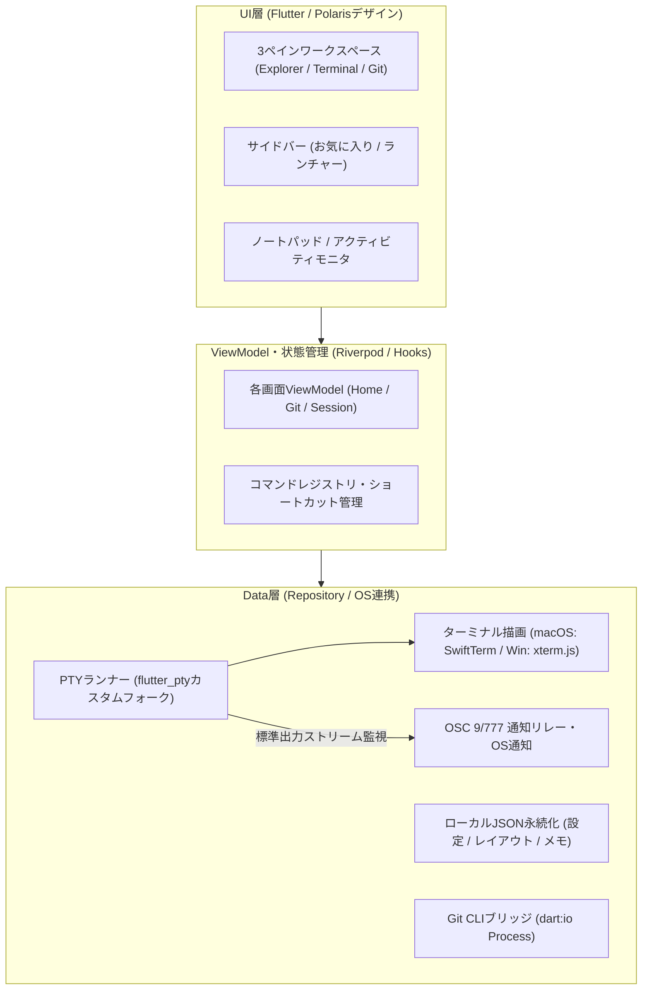

# **Roola 調査レポート**

## **1. 基本情報**

* **ツール名**: Roola
* **ツールの読み方**: ルーラ
* **開発元**: Yahiro
* **公式サイト**: [https://yahiro.tech/roola](https://yahiro.tech/roola)
* **関連リンク**:
  * GitHub: [https://github.com/yahir0/Roola](https://github.com/yahir0/Roola)
  * DeepWiki: [https://deepwiki.com/yahir0/Roola](https://deepwiki.com/yahir0/Roola)
  * ドキュメント: [https://yahiro.tech/roola/usage](https://yahiro.tech/roola/usage)
* **カテゴリ**: デスクトップ/環境操作
* **概要**: 開発者のためのmacOS/Windows対応ファイルエクスプローラ・ランチャー。3ペインのタブ式ワークスペースにファイルブラウズ、内蔵PTYターミナル、Gitビューを統合し、よく使う「ディレクトリ＋動作（シェル起動・任意コマンド・Claude Code Skill）」をワンクリックで起動できる。

## **2. 目的と主な利用シーン**

* **解決する課題**: ファイルブラウズ、ターミナルでのコマンド実行、Git操作、AIアシスタント（Claude Code）の起動といった作業間のコンテキストスイッチと移動コストを短縮する。
* **想定利用者**: ローカル環境で複数プロジェクトを横断して開発するエンジニア、Claude Codeを日常的に活用する開発者。
* **利用シーン**:
  * 頻繁に作業するプロジェクトディレクトリと開発コマンド（ビルド・テスト起動等）をランチャーに登録し、ワンクリックで起動する。
  * プロジェクトディレクトリをブラウズしながらコードやPDFをプレビューし、そのまま内蔵ターミナルやGitビューで作業を完結させる。
  * Claude CodeのSkillに実行時引数を渡して起動し、許可待ちや入力待ちをOS通知（OSC 9/777）で受け取りながら並行作業を進める。

### **2.1 代表的な利用フロー**

```mermaid
swimlane-beta TB
  subgraph User["開発者"]
    A[サイドバーからランチャーを起動]
    F[OS通知をクリックし応答・確認]
  end
  subgraph Roola["Roola (UI・ランチャー)"]
    B[対象ディレクトリでPTYセッション生成]
    E[OSC 9/777を検出しOS通知を表示]
  end
  subgraph PTY["内蔵PTY・シェル"]
    C[ログインシェル経由でコマンド実行]
  end
  subgraph Claude["Claude Code / CLI"]
    D[タスク処理・許可待ちや入力待ち時にOSC送出]
  end
  A --> B
  B --> C
  C --> D
  D --> E
  E --> F
```

* **代表的な流れ**: 開発者がサイドバーのランチャーエントリを起動すると、Roolaが対象ディレクトリをスコープとした内蔵PTYセッションを立ち上げ、ログインシェル経由でコマンドやClaude Code Skillを実行する。実行中のCLIツールが許可待ちや入力待ちでOSC 9/777エスケープシーケンスを出力すると、RoolaがOSネイティブ通知（macOS通知センター / Windowsトースト通知）へ中継し、通知クリックで該当ペインへ即座にフォーカスを戻せる。

## **3. 主要機能**

* **3ペインタブ式ワークスペース**: Explorer / Terminal / Git の3種類のタブを3ペイン（左上・右上・下）に自由にドラッグ配置でき、タブごとの状態とレイアウトを再起動後も復元する。
* **ワンクリック・ランチャー**: 「ディレクトリ + 動作（シェルを開く / コマンドを実行 / Claude Code Skill）」のペアを登録し、1階層のフォルダで整理してサイドバーからワンクリックで起動できる。お気に入りの右クリック起動にも対応。
* **内蔵PTYターミナル**: macOSではSwiftTerm、WindowsではWebView2上のxterm.jsを採用し、ANSI制御やリサイズ、`Shift+Enter`による複数行改行入力、コピペに対応。ログインシェル（`-l` / `-ilc`）経由で `.zshrc` 等のPATHを継承して実行する。
* **Gitビュー**: Diff表示、コミット履歴グラフ、ブランチ操作、stash管理をワークスペースタブとして内蔵。
* **読み取り専用ファイルプレビュー**: ファイル選択時に右ペインで自動開閉し、シンタックスハイライト付きコード（テキスト選択・コピー可）、画像、PDFをプレビュー表示する。
* **Claude Code連携**: `.claude/skills/` の自動検出、実行時引数（プロンプト）を指定したSkill起動、バージョンヘルスチェック、ローカルJSONLから集計する当日消費トークン・推定コストメーターを搭載（Claude Code未インストール環境でも汎用ランチャーとして動作）。
* **設定ゼロのタスク通知（OSC 9/777）**: ターミナルペイン内のCLIツールが出力するOSC 9 / OSC 777通知シーケンスをOS通知へ中継。フック登録不要で動作し、フォーカス中のペインは通知を抑制、連続通知にはレート制限をかける。
* **ノートパッド・アクティビティモニタ**: ワークスペース外のタブ付きフローティングノートパッドと、CPU/メモリ使用率および上位プロセス・Claude Code使用量を確認できるアクティビティモニタをトップバーに搭載。

## **4. 動作原理・システム構成**

* **アーキテクチャ**: Flutter（Dart）で構築されたローカルファーストのデスクトップアプリケーション。Flutter公式のApp Architecture GuideをベースにしたMVVMパターン（View/ViewModelはRiverpod + flutter_hooks、状態モデルはFreezed）を採用し、`app/`、`ui/`、`data/`、`core/` の構成でレイヤーを分離している。
* **システム構成図**:



* **主要コンポーネントとデータフロー**:
  * **永続化とローカル完結処理**: ランチャーエントリ、ワークスペースレイアウト、キーバインド、ノートパッド本文などはOSのApplication Support配下にローカルJSONとして保存される。Claude Codeの使用量メーターもローカルのJSONLファイルを直接読み取って集計する。
  * **PTYとターミナル描画の橋渡し**: `TerminalRunner` インターフェース配下の `pty_terminal_runner.dart` が `flutter_pty` を通じて子プロセスを起動し、バイトストリームをmacOSのSwiftTermネイティブビューまたはWindowsのWebView2（xterm.js）へブリッジする。
  * **アナリティクスと自動更新**: 配布バイナリの自動更新にはSparkle（macOS）/ WinSparkle（Windows）を使用。v0.0.46以降はユーザー同意のもとでAptabaseへ匿名利用統計を送信する仕組みを備える（設定画面からオプトアウト可能）。
* **特筆すべき要素技術**:
  * **カスタムフォーク版 `flutter_pty`**: Windows環境でのターミナル起動時に発生していた1秒間のブロック（`Sleep(1000)`）を除去したローカルフォークを組み込んでいる。
  * **OSCエスケープシーケンス方式（ADR-0066）**: 旧来のStopフック＋ローカルHTTP受信口方式（ADR-0057）を廃止し、モダンターミナル互換のOSC 9/777監視へ一本化している。
  * **プレビュー描画**: コードハイライトは `highlight` パッケージのパース結果を自前で `TextSpan` 化することで `SelectionArea` によるテキスト選択・コピーを可能にし、PDF表示には `pdfrx`（PDFium）を使用している。

## **5. 開始手順・セットアップ**

* **前提条件**:
  * macOS 14（Sonoma）以降（Apple Silicon / Intel）
  * Windows 10 / 11（64-bit）
  * アカウント登録・クレジットカード登録: 不要
  * Claude Code CLI: 任意（未導入でも汎用ファイルエクスプローラ・ランチャーとして動作）
* **インストール/導入**:
  * **macOS**: [GitHub Releases](https://github.com/yahir0/Roola/releases) から最新の公証済みDMGを取得し、`Roola.app` を `Applications` フォルダへドラッグする。
  * **Windows**: [GitHub Releases](https://github.com/yahir0/Roola/releases) から `RoolaSetup-x.x.x.exe` を取得してインストーラを実行する。
  * **ソースビルド**:

    ```bash
    # macOS / Windows 共通のコード生成・起動例
    flutter pub get
    dart run build_runner build
    flutter run -d macos --dart-define-from-file=dart_defines/prod.json
    ```

* **初期設定**: 初回起動時に利用規約および匿名利用統計（Aptabase）の同意ダイアログが表示される（利用統計は同意画面または設定画面からいつでも無効化可能）。
* **クイックスタート**: アプリ起動後、サイドバーの「ランチャー」セクションにある「+」ボタンから対象ディレクトリと動作（シェル起動・コマンド実行・Claude Code Skill）を登録し、クリックしてPTYセッションを起動する。

## **6. 特徴・強み (Pros)**

* **作業導線の一体化**: ファイルブラウズ、プレビュー、Git操作、PTYターミナル、ランチャーが3ペインワークスペースに統合されており、アプリ間の切り替えが不要。
* **設定ゼロのClaude Code統合**: Skillの自動検出や引数付き起動、使用量メーターに加え、OSC 9/777による許可待ち・入力待ち通知がフック設定なしで利用できる。
* **クロスプラットフォーム対応とネイティブ品質**: macOS/Windowsの双方でネイティブインストーラと自動更新（Sparkle/WinSparkle）を提供し、日本語・英語のUIやカスタムキーバインドにも対応している。
* **透明性の高いOSS開発**: MITライセンスで公開されており、詳細な設計判断（ADR）やアーキテクチャドキュメントがリポジトリ内に整備されている。

## **7. 弱み・注意点 (Cons)**

* **非公式ツールである点**: Anthropic社の公式製品ではないため、Claude Code CLIの仕様や出力形式の変更による影響を受ける可能性がある。
* **対応OSの制約**: macOS 14以降およびWindows 10/11のみに対応しており、Linuxおよびモバイル環境（iOS/Android）には対応していない。
* **macOS App Sandboxの無効化**: 任意のディレクトリへのアクセスやPTY起動を実現するため、macOS版ではApp Sandboxが無効化されている。
* **日本語対応状況**: アプリUIは日本語・英語のバイリンガルに対応しており、公式サイトの使い方ガイドやリポジトリ内ドキュメントも日本語で充実している。

## **8. 料金プラン**

| プラン名 | 料金 | 主な特徴 |
|---------|------|---------|
| **無料プラン** | 無料 | オープンソース（MIT License）として全機能が利用可能 |

* **課金体系**: なし（現在完全無料。利用規約上、将来的に一部機能を有償化する場合は事前通知と同意のうえで提供する旨が記載されている）
* **無料トライアル**: なし（全機能を制限なく利用可能）

## **9. 導入実績・事例**

* **導入企業**: 個人開発のオープンソースツールのため、公式な企業導入事例は公開されていない。
* **導入事例**: GitHubリポジトリでスター数8を獲得（2026年11月時点）。
* **対象業界**: ソフトウェア開発全般。

## **10. サポート体制**

* **ドキュメント**: [公式サイト](https://yahiro.tech/roola) および [使い方ガイド](https://yahiro.tech/roola/usage) にスクリーンショット付きの解説が掲載されているほか、GitHubリポジトリ内の `docs/` にアーキテクチャやADRが公開されている。
* **コミュニティ**: GitHubのIssues / Pull Requests。
* **公式サポート**: 個別サポートなし（利用規約上に開発者のお問い合わせ窓口メールアドレスおよびHPの記載あり）。

## **11. エコシステムと連携**

### **11.1 API・外部サービス連携**

* **API**: 外部公開APIなし（デスクトップローカル完結型）。
* **外部サービス連携**: Claude Code CLI（Skill実行、使用量JSONL集計、OSC通知）、ローカルGit CLI、任意のOSC 9/777対応CLIツール、Aptabase（匿名利用統計・オプトアウト可）。

### **11.2 技術スタックとの相性**

| 技術スタック | 相性 | メリット・推奨理由 | 懸念点・注意点 |
|:---|:---:|:---|:---|
| **Claude Code** | ◎ | Skill検出、引数実行、使用量モニタ、OSC通知がシームレスに統合 | 公式製品ではないためCLI更新に追従が必要 |
| **Git** | ◎ | ワークスペース内にDiff・履歴グラフ・ブランチ・stashタブを内蔵 | ローカルに `git` CLIが必要 |
| **Node.js / Python / Go 等CLI** | ◯ | ログインシェル経由で `.zshrc` 等のPATHを継承しランチャーから即実行可能 | 対話以外の完全非同期バックグラウンド管理は対象外 |
| **Linux / コンテナ環境** | × | Linux版バイナリは非提供 | コンテナ内GUIとしては利用不可 |

## **12. セキュリティとコンプライアンス**

* **認証**: 不要（ローカルデスクトップアプリとして動作）。
* **データ管理**: ファイル操作、ランチャー設定、メモ、Claude Code使用量集計はすべてローカル端末内で完結する。v0.0.46以降、品質向上のためAptabase（米国リージョン）へ匿名利用統計（イベント名、OS種別・バージョン、アプリバージョン、ロケール、起動ごとの匿名セッションID）を送信するが、個人情報、デバイスID、ファイルパス、実行コマンド、入力テキストは一切送信されない。送信は初回同意画面および設定画面からいつでもオプトアウト可能。
* **準拠規格**: ISO27001やSOC2等の認証取得はない（macOS配布用DMGはAppleによる公証＋ステープリング済み）。

## **13. 操作性 (UI/UX) と学習コスト**

* **UI/UX**: ダーク専用の「Polarisデザインシステム」を採用し、暖色ゴールドまたはアイスブルーの単一アクセント、透過/不透明の切替に対応。3ペインの自由なタブ配置に加え、十字キー主体のキーボードナビゲーションやカスタマイズ可能なショートカットを備える。
* **学習コスト**: 低。一般的なファイルエクスプローラとターミナルを直感的に統合しており、基本的な操作はすぐに習得できる。

## **14. ベストプラクティス**

* **効果的な活用法 (Modern Practices)**:
  * 頻繁に使うプロジェクトディレクトリと起動コマンド（`pnpm dev` 等）やClaude Code Skillをフォルダ分けしてランチャーに登録し、ワンクリックで作業を開始する。
  * Claude Code以外の独自スクリプトやビルドコマンドでも、`printf '\e]9;完了\a'` やOSC 777を出力させることでRoolaのOS通知機能を活用する。
  * エクスプローラのファイルプレビュー機能を使い、外部エディタを開かずにコードやPDFを素早く確認する。
* **陥りやすい罠 (Antipatterns)**:
  * 現在フォーカスしているペインからの通知は仕様上抑制されるため、タスク通知のテスト時は別ペインまたは別アプリへフォーカスを移して確認する。
  * v0.0.47以前（旧ADR-0057方式）のフックを `~/.claude/settings.json` の `hooks.Stop` に残している場合、旧ローカルHTTP受信口は撤去済みのため、不要エントリを手動整理することが推奨される。

## **15. ユーザーの声（レビュー分析）**

* **調査対象**: GitHub Repository（G2、Capterra、ITreviewにレビューの登録なし）
* **総合評価**: 主要レビューサイトへの登録なし（GitHubで8スターを獲得）
* **ポジティブな評価**:
  * macOSとWindowsの双方で動作する開発者向け統合ファイルエクスプローラ・ランチャーとして公開されている。
* **ネガティブな評価 / 改善要望**:
  * GitHub Issues上での目立った不満報告はまだ少ない（初期公開フェーズの個人開発OSS）。
* **特徴的なユースケース**: macOSとWindowsを併用する開発環境において、同一のキーバインドやClaude Code連携ワークフローを維持するための統合ランチャーとして活用。

## **16. 直近半年のアップデート情報**

* **2026-08-06**: Windows環境で失敗していたキーバインド関連テスト10件を修正 (v0.0.49)
* **2026-08-06**: タスク通知の旧フック経路（ADR-0057 / ローカルHTTP受信口）を完全撤去 (v0.0.48)
* **2026-06-11**: タスク通知をフック設定不要のOSCエスケープシーケンス（OSC 9/777）方式へ移行 (v0.0.47)
* **2026-06-11**: Aptabaseによる匿名アナリティクスと利用規約の同意フローを導入 (v0.0.46)
* **2026-06-08**: Windows向けショートカット設計・ターミナルコピペ対応、およびノートパッドのタブ機能を追加 (v0.0.45)
* **2026-06-08**: macOSタイトルバーのワードマークを廃止し信号灯を上下中央へ配置調整 (v0.0.44)
* **2026-06-05**: 素のシェル起動時にログインシェル（`-l`）を使用するよう修正 (v0.0.43)
* **2026-06-05**: サイドバーお気に入り右クリック起動メニュー、プレビューのテキスト選択・コピー対応、Claude Skillへの実行時引数渡しに対応 (v0.0.42)
* **2026-06-04**: Claude Code 使用量メーター（トークン・推定コスト）を追加 (v0.0.41)
* **2026-06-03**: 待受ポートをユーザーが設定画面で変更できるように機能追加 (v0.0.39)
* **2026-06-02**: Windows版でのClaude Code Skill起動を正式サポート (v0.0.38)
* **2026-06-02**: macOSに加えWindows版を公式リリースし、マルチプラットフォーム対応 (v0.0.37)

(出典: [GitHub Releases](https://github.com/yahir0/Roola/releases))

## **17. 類似ツールとの比較**

### **17.1 機能比較表 (星取表)**

| 機能カテゴリ | 機能項目 | Roola | Opcode | 標準ファイルマネージャ | Warp / 高機能ターミナル |
|:---:|:---|:---:|:---:|:---:|:---:|
| **基本機能** | ファイルブラウズ・プレビュー | ◎<br><small>3ペイン統合・コード/PDF対応</small> | ×<br><small>セッション管理中心</small> | ◎<br><small>OS標準統合</small> | ×<br><small>CLI操作のみ</small> |
| **カテゴリ特定** | ワンクリックランチャー | ◎<br><small>ディレクトリ＋動作を登録</small> | ◯<br><small>エージェント/セッション起動</small> | ×<br><small>非対応</small> | △<br><small>ワークフロー/エイリアスで代替</small> |
| **AI連携** | Claude Code連携 | ◎<br><small>Skill引数・使用量・OSC通知</small> | ◎<br><small>GUI操作・MCP管理・Web対応</small> | ×<br><small>非対応</small> | △<br><small>汎用AI支援あり</small> |
| **非機能要件** | 導入の容易さ（配布バイナリ） | ◎<br><small>公証済DMG / Winインストーラ</small> | △<br><small>環境によりソースビルド必要</small> | ◎<br><small>OS標準搭載</small> | ◎<br><small>公式インストーラ提供</small> |

### **17.2 詳細比較**

| ツール名 | 特徴 | 強み | 弱み | 選択肢となるケース |
|---------|------|------|------|------------------|
| **Roola** | ファイルブラウズ・ターミナル・Gitを統合したランチャー | ディレクトリ起点のワンクリック実行、設定ゼロのOSC通知、配布バイナリが整備 | Linux非対応、大規模エコシステムは未成熟 | ファイル確認とコマンド・Claude Code実行を1画面で完結させたい場合 |
| **Opcode** | Claude Code CLI向けの専用GUIツールキット | セッション管理、カスタムエージェント作成、MCPサーバー管理が強力 | ファイルエクスプローラや汎用ターミナル用途ではない | Claude CodeのセッションやMCP設定をGUIで集中的に管理したい場合 |
| **OS標準ファイルマネージャ** | Finder / エクスプローラ等のOS標準機能 | OSとの深い統合、追加インストール不要、安定性 | ターミナル統合や特定コマンドのワンクリック実行が弱い | 一般的なファイル管理やOS設定操作を行う場合 |
| **高機能ターミナル (Warp等)** | AI支援やブロックUIを備えたモダンターミナル | 高度なコマンド補完、高速描画、チーム共有機能 | GUIベースのファイルツリー・PDFプレビューを持たない | CLI操作を中心に開発作業を完結させたい場合 |

## **18. 総評**

* **総合的な評価**:
  * Roolaは、ファイルエクスプローラ・内蔵PTYターミナル・Gitビュー・Claude Code連携を洗練された3ペインUIに凝縮した実用性の高い開発者ツールである。v0.0.47以降のOSC 9/777方式への移行により、フック設定不要でタスク通知を受け取れる完成度に達している。
* **推奨されるチームやプロジェクト**:
  * ローカル環境で複数プロジェクトを切り替えながら開発するエンジニア、macOSとWindowsの両環境で統一された作業導線を求める開発者、Claude Codeを日常的に利用するユーザー。
* **選択時のポイント**:
  * エディタ（VS Code等）を立ち上げるほどではない日常的なディレクトリ移動・プレビュー・コマンド実行・Claude Code Skill起動を高速化したい場合、Roolaは非常に有力な選択肢となる。
