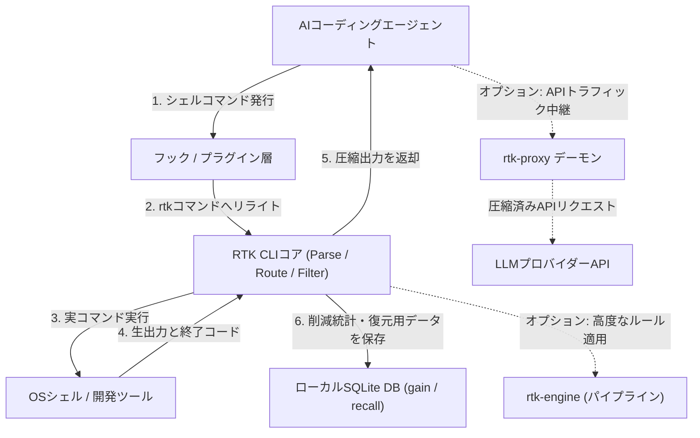

# **RTK 調査レポート**

## **1. 基本情報**

* **ツール名**: RTK (Rust Token Killer)
* **ツールの読み方**: アールティーケー
* **開発元**: Patrick Szymkowiak（および200名以上のコントリビューター）
* **公式サイト**: [https://www.rtk-ai.app/](https://www.rtk-ai.app/)
* **関連リンク**:
  * GitHub: [https://github.com/rtk-ai/rtk](https://github.com/rtk-ai/rtk)
  * DeepWiki: [https://deepwiki.com/rtk-ai/rtk](https://deepwiki.com/rtk-ai/rtk)
  * CodeWiki: [https://codewiki.google/github.com/rtk-ai/rtk](https://codewiki.google/github.com/rtk-ai/rtk)
  * ドキュメント: [https://www.rtk-ai.app/docs/](https://www.rtk-ai.app/docs/)
* **カテゴリ**: CLI拡張/プロキシ
* **概要**: AIコーディングエージェントが実行するシェルコマンドの出力やAPIトラフィックをフィルタリング・圧縮し、LLMのトークン消費量を60〜90%削減するRust製の高速CLIプロキシおよびコスト削減エンジン。v1.x以降は単なるコマンド出力圧縮にとどまらず、カスタムパイプライン（`rtk-engine`）、API通信最適化デーモン（`rtk-proxy`）、組織向けガバナンス基盤（RTK Pro）へと機能を拡張している。

## **2. 目的と主な利用シーン**

* **解決する課題**: Claude Code、Cursor、GitHub Copilot、Gemini CLIなどのAIコーディングエージェントがシェルコマンドを実行した際に発生する膨大な冗長出力（進捗バー、パスしたテスト一覧、ANSI装飾、重複ログなど）を削減し、API利用コストの抑制とコンテキストウィンドウの有効活用を実現する。
* **想定利用者**: AIコーディングアシスタントや自律型エージェントを日常的に利用する開発者、およびチーム全体のAIコスト・セキュリティを統制したい開発組織。
* **利用シーン**:
  * AIエージェントにプロジェクト構造（`ls`, `tree`）やファイル内容（`cat`, `grep`）を読み込ませる際
  * `git status`, `git diff`, `git log`, `git ls-tree` などのGit操作結果を要約して渡す際
  * `cargo test`, `pytest`, `jest`, `go test`, `dotnet test` などのテスト・ビルド結果から失敗箇所のみを抽出させる際
  * 大規模ファイルの読み込みや汎用ツール出力をパイプライン（`pipeline.toml`）で軽量モデルへ委譲・圧縮する際

### **2.1 代表的な利用フロー**

```mermaid
swimlane-beta TB
  subgraph User["ユーザー"]
    A["AIエージェントへ開発タスクを指示"]
    F["圧縮された結果に基づく回答を確認"]
  end
  subgraph Agent["AIエージェント"]
    B["シェルコマンドやツール実行を要求"]
    E["圧縮済み出力を受け取り推論を続行"]
  end
  subgraph RTK["RTK (フック・エンジン)"]
    C["フックでコマンドを自動リライトし実行・圧縮"]
  end
  subgraph Backend["シェル / ローカルDB"]
    D["実コマンド実行とSQLiteへの履歴・全文保存"]
  end
  A --> B
  B --> C
  C --> D
  D --> C
  C --> E
  E --> F
```

* **代表的な流れ**: ユーザーがAIエージェントに指示を出すと、エージェントが実行しようとしたシェルコマンドをRTKのフックが透過的に傍受・リライトして実コマンドを実行します。RTKはコマンド固有のフィルタやパイプラインで出力を60〜90%圧縮してエージェントへ返却しつつ、削減量と元の出力をローカルのSQLiteデータベースへ記録します。

## **3. 主要機能**

* **スマートフィルタリング・構造化圧縮**: コメント、空白、進捗バー、ANSIエスケープシーケンスなどのノイズを除去し、ディレクトリごとのファイル集約、ルール・ファイル単位のエラーグルーピング、重複ログ行の集約、冗長部分のトランケーションを実行。100以上の開発コマンド（Git, GitHub CLI, Cargo, npm/pnpm, pytest, ruff, Go, .NET, Gradle, Docker, Kubernetes, AWS, Terraform等）に対応する。
* **18種類のAIエージェントへの透過的統合**: `rtk init -g` 等のコマンドにより、フック方式（Claude Code, GitHub Copilot, Cursor, Gemini CLI, Codex, Mistral Vibe, Factory Droid, Trae）、プラグイン方式（OpenCode, OpenClaw, Pi / Oh My Pi, Hermes）、ルールファイル方式（Windsurf / Devin Desktop, Cline / Roo Code, Kilo Code, Google Antigravity, Kimi AI）の計18ツールと連携可能。
* **パイプラインエンジン (`rtk-engine`)**: v1.0.0で導入された宣言的設定ファイル（`pipeline.toml`）ベースの拡張機構。シェル以外の内蔵ツール（Claude Codeの`Read`/`Grep`/`Glob`等）の圧縮、大容量ファイル読込の低コストモデルへの委譲、簡潔出力（terse prose）の強制などを記述でき、`rtk pipeline add` / `rtk pipeline eval` / `rtk pipeline share publish` による共有・検証が可能。
* **APIトラフィック最適化プロキシ (`rtk-proxy` / `rtk llm-proxy`)**: AIエージェントとLLMプロバイダーAPI間にローカルHTTPデーモンとして介在し、プロンプトキャッシュを壊さずに会話履歴・ツール実行結果の正規化やルール適用を行う。
* **削減効果の計測・発見・学習・復元**:
  * `rtk gain`: 日別・グラフ・履歴・JSONエクスポートで削減トークン量と金額換算を可視化
  * `rtk discover`: 過去セッションからRTK未適用で見逃された削減機会を検出
  * `rtk session`: 直近セッションにおけるRTK適用率を表示
  * `rtk learn`: セッション内のCLIエラーや誤用パターンをスキャンし改善を提案
  * `rtk recall`: 圧縮・省略された出力の全文をローカルDBから復元
  * `rtk bypass`: フィルタを介さず生の出力を取得（v1.0.0で `rtk proxy` から改名）
* **RTK Pro（エンタープライズ制御層）**: チーム・企業向けに提供される上位管理基盤。一元化されたAIゲートウェイ、チーム・個人・モデル別のコスト予算管理、Shield機能によるシークレット・PII（個人情報）の自動マスキング、危険コマンドのポリシー遮断、チームカタログ配布、SSO・監査ログを提供する。

## **4. 動作原理・システム構成**

* **アーキテクチャ**: ローカルファーストの単一Rustバイナリ（CLIプロキシ）を中核とし、必要に応じてローカルHTTPデーモン（`rtk-proxy`）およびローカルSQLiteデータベース（計測・復元用）を組み合わせる多層構成。外部LLMに依存せず決定論的ルールで圧縮するため、オーバーヘッドはコマンドあたり25ms未満に抑えられている。
* **主要コンポーネントとデータフロー**:
  1. **Parse / Hook層**: エージェントのPreToolUseフック等がコマンドを `rtk <cmd>` へ自動リライト（またはヒント提示）、Clapパーサーでサブコマンドとフラグを解析。
  2. **Execute / Filter層**: `std::process::Command` で実コマンドを実行し、`stdout` / `stderr` / 終了コードを取得。コマンド別の最適化フィルタ（失敗テスト抽出、統計要約など）または `rtk-engine` パイプラインを適用。フィルタが失敗しても元の出力と終了コードをそのまま返すフェイルセーフ設計。
  3. **Recall / Tracking層**: 圧縮前の出力参照や削減統計（`bytes / 4` 換算のトークン数）をローカルのSQLite DBに保存。
  4. **Proxy層（オプション）**: `rtk-proxy` デーモンがLLM APIリクエストを中継し、リクエスト単位の圧縮とキャッシュ整合性を維持。



* **特筆すべき要素技術**:
  * **Rust単一バイナリ & 静的muslビルド**: 外部ランタイム依存なしで高速起動し、Linux（deb/rpm/aarch64静的musl）、macOS、Windows向けにネイティブ配布。
  * **エディション分離設計**: Apache-2.0のみで完結する `rtk-oss` と、`rtk-engine`（BUSL-1.1）をリンクした標準 `rtk` バイナリ、`rtk-proxy`（BUSL-1.1）を分離して提供し、同一コマンド体系で切り替え可能。

## **5. 開始手順・セットアップ**

* **前提条件**:
  * macOS、Linux、またはWindows（ネイティブ / WSL2、フック全機能利用にはWSL推奨）
  * CLI単体利用ではアカウント登録・クレジットカード登録不要
* **インストール/導入**:

  Homebrew（macOS / Linux）の場合:

  ```bash
  brew install rtk
  # Apache-2.0版のみを利用する場合:
  # brew install rtk-ai/tap/rtk-oss
  ```

  Windows（winget）の場合:

  ```powershell
  winget install rtk-ai.rtk
  ```

  インストールスクリプト（Linux / macOS / WSL）の場合:

  ```bash
  curl -fsSL https://raw.githubusercontent.com/rtk-ai/rtk/refs/heads/master/install.sh | sh
  ```

* **初期設定**:
  利用するAIコーディングツールに合わせてフックまたは設定を初期化する。

  ```bash
  rtk init -g                    # Claude Code向けグローバル設定
  rtk init -g --copilot          # GitHub Copilot (VS Code / CLI)
  rtk init -g --agent cursor     # Cursor
  rtk init -g --gemini           # Gemini CLI
  rtk init -g --codex            # OpenAI Codex CLI
  rtk init -g --opencode         # OpenCode (プラグイン)
  ```

* **クイックスタート**:
  エージェントを再起動した状態で通常のコマンドを実行すると透過的にRTKが動作し、`rtk gain` で削減効果を確認できる。

  ```bash
  rtk git status
  rtk gain
  ```

## **6. 特徴・強み (Pros)**

* **大幅なトークン・コスト削減**: `git status`, `cargo test`, `cat`, `grep` などの日常的な開発コマンドで出力トークンを60〜90%削減し、さらにパイプライン活用でセッション全体のコストも追加削減できる。
* **透過的な導入とフェイルセーフ設計**: 既存ワークフローやプロンプトキャッシュを壊さずに動作し、万が一フィルタが失敗しても元の出力と終了コードをそのまま返す。
* **極めて高速な動作**: Rust製単一バイナリにより25ms未満の低オーバーヘッドで処理が完了する。
* **18種類のエージェントと100以上のコマンドに対応**: 主要なAIコーディングエージェント・IDE拡張を幅広くカバーし、`rtk discover` や `rtk recall` など運用を支える周辺コマンドも充実している。

## **7. 弱み・注意点 (Cons)**

* **ネイティブWindows環境でのフック制約**: WSL環境では全機能が動作するが、ネイティブWindowsでは一部エージェントのフック機能が制限され、ルールファイル経由（モデルへの利用指示）へのフォールバックが必要となる場合がある。
* **内蔵ツールへの適用範囲**: デフォルトのコマンド圧縮はシェル経由の実行が対象であり、Claude Codeの内蔵ツール（`Read`, `Grep`, `Glob`）まで圧縮するには `rtk-engine` のパイプライン設定が必要となる。
* **デュアルライセンス構成への注意**: v1.0.0以降、標準バイナリに含まれる `rtk-engine` および別バイナリの `rtk-proxy` には **BUSL-1.1** が適用されている。自社開発での本番利用は無料だが、RTK自体や派生品を第三者向け商用サービスとして再提供する場合は商用ライセンス契約が必要（完全Apache-2.0を求める場合は `rtk-oss` を選択する）。
* **日本語対応状況**: GitHubの `README_ja.md` や公式サイトドキュメント（`rtk-ai.app/docs/`）は日本語版が用意されている一方、CLIの出力メッセージやエラー表示自体は主に英語ベースとなっている。

## **8. 料金プラン**

| プラン / エディション | 料金 | ライセンス | 主な特徴 |
|---|---|---|---|
| **RTK OSS (`rtk-oss`)** | 無料 | Apache-2.0 | コアフック・全100以上のコマンドフィルタ、`rtk gain` 等の分析機能（パイプラインエンジンなし） |
| **RTK 標準版 (`rtk`)** | 無料（本番利用可） | Apache-2.0 + BUSL-1.1 | コアフック・全コマンドフィルタに加え、パイプラインエンジン（`rtk-engine`）を搭載 |
| **RTK Proxy (`rtk-proxy`)** | 無料（本番利用可） | BUSL-1.1 | APIトラフィック圧縮用ローカルHTTPデーモン |
| **RTK Pro（Dev / Teams / Business / Enterprise）** | 個別見積もり（公式サイト要確認・7日間無料トライアルあり） | 商用ライセンス | 個人向けDevプランおよび組織向け制御層（一元ゲートウェイ、予算管理、Shield PII/シークレット保護、ポリシー制御、SSO、監査ログ、オンプレミス対応） |

* **課金体系**: オープンソース／ソースアベイラブル版（`rtk`, `rtk-oss`, `rtk-proxy`）は自社利用・個人利用において完全無料。RTK Proは個人向けDevおよび組織規模（Teams / Business / Enterprise）に応じた商用プラン体系を採用（詳細価格は [pro.rtk-ai.app/pricing](https://pro.rtk-ai.app/pricing) にて案内）。
* **無料トライアル**: RTK Proでは7日間の無料トライアルが提供されている。

## **9. 導入実績・事例**

* **導入企業・コミュニティ規模**: GitHubリポジトリは **87,200以上** のスターと200名以上のコントリビューターを獲得しており、個人開発者から大規模開発組織まで急速に普及している。公式READMEでは、Microsoft、Google、Amazon、Meta、Apple、NVIDIA、IBM、Shopify、Datadog、Netflix、Toyota、Salesforce、Uber、Spotifyなど1,100社以上の開発者からスターや利用実績を得ていることが紹介されている。
* **導入事例**: Claude CodeやCursorを用いた大規模リポジトリ開発におけるテストログ・ビルドログ圧縮や、コミュニティ共有パイプラインによるセッション総コスト約20%削減のベンチマーク事例などが公開されている。

## **10. サポート体制**

* **ドキュメント**: 公式サイトの包括的なガイド（[https://www.rtk-ai.app/docs/](https://www.rtk-ai.app/docs/)）に加え、日本語版README、技術アーキテクチャ解説（`ARCHITECTURE.md`）が整備されている。
* **コミュニティ**: 公式 [Discordサーバー](https://discord.gg/RySmvNF5kF) および GitHub Discussions にて活発な質疑応答やパイプライン共有が行われている。
* **公式サポート**: バグ報告・機能要望は [GitHub Issues](https://github.com/rtk-ai/rtk/issues) で受付。商用利用やRTK Proエンタープライズ契約では専用問い合わせ窓口（`contact@rtk-ai.app` / `pro.rtk-ai.app/contact`）およびカスタムSLAが提供される。

## **11. エコシステムと連携**

### **11.1 API・外部サービス連携**

* **API / インターフェース**: CLIツールとして標準入出力および `config.toml` / `pipeline.toml` による設定を提供。`rtk-proxy` デーモンはAnthropic等のLLM APIエンドポイントと互換性のあるローカルHTTPプロキシとして動作する。
* **外部サービス連携**: Claude Code、GitHub Copilot（VS Code / CLI）、Cursor、Gemini CLI、OpenAI Codex CLI、Windsurf（Devin Desktop）、Cline、Roo Code、Kilo Code、Google Antigravity、OpenCode、OpenClaw、Pi、Oh My Pi、Hermes、Factory Droid、Mistral Vibe、Trae、Kimi AI といった主要AIエージェント群と連携。

### **11.2 技術スタックとの相性**

| 技術スタック | 相性 | メリット・推奨理由 | 懸念点・注意点 |
|:---|:---:|:---|:---|
| **AIコーディングエージェント (Claude Code等)** | ◎ | `rtk init` 1コマンドでフックやプラグインを自動構成 | エージェントごとにフックAPIの制約差あり |
| **Unix系OS (macOS / Linux / WSL2)** | ◎ | 全機能および静的muslビルド（deb/rpm）を制限なく利用可能 | 特になし |
| **ネイティブWindows** | △ | `winget` で簡単導入でき単体動作は高速 | 一部エージェントのフックが制限されWSL推奨 |
| **主要開発ツール (Git / Rust / JS / Python / Go / .NET)** | ◎ | 100以上のコマンドに専用最適化フィルタを標準搭載 | 独自カスタムCLIにはパイプライン設定が必要 |

## **12. セキュリティとコンプライアンス**

* **認証**: OSS / CLI単体は完全ローカル実行のため認証不要。RTK ProのTeams / Business / EnterpriseプランではSSO（シングルサインオン）に対応。
* **データ管理**: CLI版はソースコード、ファイルパス、コマンド引数、シークレット、環境変数を外部へ送信・収集しない。テレメトリー機能は匿名・集計ベースかつデフォルト無効の完全オプトイン方式（GDPR第6条・第7条の明示的同意に基づき `rtk telemetry enable` で有効化）。さらにRTK Proの「Shield」機能は、LLMへ送信される前のローカル境界でAPIキーやPII（個人情報）を自動マスキングし、機密値がマシン外へ流出するのを防ぐ。
* **準拠規格**: GDPR準拠のテレメトリー設計およびセキュリティポリシー（`SECURITY.md`）を公開。SOC2やISO27001などの認証取得状況については公式サイト上での明記はなく、エンタープライズ要件については個別問い合わせが必要。

## **13. 操作性 (UI/UX) と学習コスト**

* **UI/UX**: 一度 `rtk init` で登録すれば普段のAIエージェント利用の裏側で透過的に動作するため、日常操作でのUIを意識する必要がない。`rtk gain --graph` によるターミナル上のASCIIグラフ表示やJSON出力など、開発者にとって直感的な計測UIを備える。
* **学習コスト**: 基本的なコマンド圧縮機能は導入後すぐ使えるため極めて低い。パイプライン（`pipeline.toml`）や `rtk-proxy` の高度なカスタマイズを行う場合のみ、公式ドキュメントのルール・ジャッジ構文の理解が必要となる。

## **14. ベストプラクティス**

* **効果的な活用法 (Modern Practices)**:
  * 導入直後は `rtk discover --all --since 7` を実行し、過去7日間で取りこぼしていたトークン削減機会を洗い出す。
  * `rtk gain` で削減率を定期的に確認し、圧縮によって詳細が必要になった場合のみ `rtk recall` や `rtk bypass <cmd>` を使って全文を確認する。
  * パイプラインを導入する際は `rtk pipeline eval <name> --start` を用い、本番トラフィックへ影響を与えずにトークン削減効果を事前検証する。
* **陥りやすい罠 (Antipatterns)**:
  * `rtk`（BUSL-1.1含む）と `rtk-oss`（Apache-2.0のみ）はどちらも `rtk` という同一バイナリ名でインストールされるため、混在・重複インストールを避け、切り替える際は必ず片方をアンインストールすること。
  * ネイティブWindows環境でフックが動作しない状態のまま放置せず、WSL2環境を利用するかルールファイル方式の適用を確認すること。

## **15. ユーザーの声（レビュー分析）**

* **調査対象**: GitHub、X (Twitter)、Reddit（G2・Capterra・ITreviewには現時点で専用レビューページの登録なし）
* **総合評価**: 開発者コミュニティで極めて高い評価を獲得しており、GitHubスター数は87,200を超えている。
* **ポジティブな評価**:
  * 「`rtk init -g` を打つだけでClaude CodeやCursorのトークン消費とAPIコストが目に見えて下がった」
  * 「Rust単一バイナリで25ms未満と非常に高速なため、プロキシを挟んでも体感遅延がまったくない」
  * 「v1.0以降のパイプライン機能により、大容量ファイルの読込やテスト出力の整理まで柔軟に制御できるようになった」
* **ネガティブな評価 / 改善要望**:
  * 「ネイティブWindows環境でもWSLなしで全フック機能が完全に動作してほしい」
  * 「v1.0.0でのBUSL-1.1導入に伴い、純粋なApache-2.0環境でパイプライン機能が使えない点に留意が必要」
  * 「一部マイナーなCLIツールや独自ラッパーでは出力が過度に省略されることがあり、`rtk bypass` の併用が必要」
* **特徴的なユースケース**:
  * `cargo test` や `pytest` の大量の成功ログを隠蔽し、失敗したテストのパニック箇所とアサーションだけをエージェントに読ませることで、コンテキスト溢れを防ぎながら修正ループを高速化する用途で広く活用されている。

## **16. 直近半年のアップデート情報**

* **2026-11-19**: `v1.2.1` リリース — `cargo` のツールチェイン指定やグローバルプレフィックス付き呼び出しのフィルタ・除外対応を強化、`rtk-proxy` の上流リクエストタイムアウト制御・ストリーミングエラー保持・Windows上での自動再起動を改善、DBマイグレーションのバージョニングやOpenCode/Copilotフック解決を修正
* **2026-11-08**: `v1.2.0` リリース — `git ls-tree` パス一覧のディレクトリ単位折りたたみ機能を追加、Linux向け静的muslビルド（deb/rpm/aarch64）に対応、`rtk gain` におけるパススルー計測の分離や `analytics` 月次集計精度を改善
* **2026-10-25**: `v1.1.0` リリース — `fish` スクリプトを `rtk run --shell fish` として安全にラップする機能や、Angularビルド出力のコンパクト化を追加
* **2026-10-14**: `v1.0.1` リリース — `rtk llm-proxy start` での `RTK_PROXY_BIND` 環境変数尊重および `rtk gain` のサジェスト条件を修正
* **2026-10-13**: `v1.0.0` リリース — 大規模メジャーアップデート。パイプラインエンジン（`rtk-engine`）、APIトラフィック最適化デーモン（`rtk-proxy` / `rtk llm-proxy`）を正式導入し、標準バイナリ（Apache-2.0 + BUSL-1.1）と `rtk-oss`（Apache-2.0のみ）のデュアルエディション構成へ移行。`rtk proxy <cmd>` を `rtk bypass <cmd>` へ改名
* **2026-10-13**: `v0.52.0` リリース — OpenCode V2 / Desktop / Windows フック対応、`fish -c` 内部コマンドのリライト対応
* **2026-06-03**: `v0.42.1` リリース — OpenClawプラグインでの危険なコマンド実行を回避する修正などを実施
* **2026-05-13**: `v0.40.0` リリース — Android/Kotlin向けのGradleサポート、Hermes Agentサポートを追加
* **2026-04-29**: `v0.38.0` リリース — GitLab CLIサポート追加などを実施

(出典: [GitHub Releases](https://github.com/rtk-ai/rtk/releases) / [CHANGELOG.md](https://github.com/rtk-ai/rtk/blob/develop/CHANGELOG.md))

## **17. 類似ツールとの比較**

### **17.1 機能比較表 (星取表)**

| 機能カテゴリ | 機能項目 | RTK | Headroom | TokenEconomizer |
|:---:|:---|:---:|:---:|:---:|
| **圧縮方式** | コマンド出力の構造化圧縮 | ◎<br><small>100+コマンド対応</small> | ◎<br><small>ログ・JSON・コード圧縮</small> | ×<br><small>履歴学習・ツール削減型</small> |
| **拡張機能** | パイプライン / モデル委譲 | ◎<br><small>rtk-engine / pipeline.toml</small> | ◯<br><small>コンテキスト最適化層</small> | ◎<br><small>Micro-skills / Pruning</small> |
| **API中継** | LLM APIプロキシ動作 | ◯<br><small>rtk-proxy (任意)</small> | ◎<br><small>透過HTTPプロキシ標準</small> | ×<br><small>フック/プラグイン型</small> |
| **連携** | 対応AIエージェント数 | ◎<br><small>18ツール対応</small> | ◯<br><small>Claude Code / Cursor等</small> | ◯<br><small>10ツール対応</small> |
| **パフォーマンス** | 実行速度・依存関係 | ◎<br><small>Rust単一バイナリ (&lt;25ms)</small> | ◯<br><small>Pythonベース</small> | ◯<br><small>Python標準ライブラリ</small> |
| **企業向け** | 組織ガバナンス・予算管理 | ◎<br><small>RTK Pro提供</small> | ×<br><small>OSS単体</small> | ×<br><small>OSS単体</small> |

### **17.2 詳細比較**

| ツール名 | 特徴 | 強み | 弱み | 選択肢となるケース |
|---|---|---|---|---|
| **RTK** | Rust製の決定論的CLI出力圧縮プロキシおよびパイプライン・プロキシ基盤 | 超高速（25ms未満）、18ツール対応、RTK Proによる企業統制まで一貫対応 | v1.0以降はエンジン/プロキシがBUSL-1.1、Windowsネイティブフックに制限 | ほぼすべてのAIコーディング環境で即座に60〜90%のコマンド出力削減を得たい場合 |
| **Headroom** | LLMへ渡すコンテキスト全般（ログ・RAG・JSON・コード）を圧縮するレイヤー | 透過プロキシや `headroom wrap` によりAPI通信・RAG出力まで包括的に圧縮 | Rust単一バイナリのCLIほど超低遅延なコマンド単位最適化には特化していない | SREの大量ログ解析やRAG検索結果を含むAPIペイロード全体を圧縮したい場合 |
| **TokenEconomizer** | Microsoft & UC Berkeley発のセッション履歴学習型コスト制御プラグイン | 過去の成功・失敗パターン（Micro-skills）や未使用MCPツール除外で18〜31%の総コスト削減 | リポジトリごとの履歴学習が必要なため初期（コールドスタート）は効果が出にくい | 同一リポジトリで反復作業が多く、MCPツール定義や失敗ループの浪費を抑えたい場合 |

## **18. 総評**

* **総合的な評価**:
  RTKは、AIコーディングエージェント利用時の最大のペインである「冗長なターミナル出力によるトークン浪費とコンテキスト圧迫」を、導入障壁ほぼゼロ・25ms未満の低遅延で解決する極めて完成度の高いツールである。v1.x世代では単なるコマンドフィルタから、パイプラインエンジン（`rtk-engine`）、API通信プロキシ（`rtk-proxy`）、さらにエンタープライズ向け統制基盤（RTK Pro）へと進化しており、個人から大企業まで幅広いニーズに対応できるポジションを確立している。
* **推奨されるチームやプロジェクト**:
  Claude Code、Cursor、GitHub Copilot CLI、Gemini CLIなどを日常的に活用し、テスト実行やGit操作を頻繁に行うすべての開発者・開発チーム。従量課金APIのコスト削減はもちろん、サブスクリプションプランにおけるコンテキスト制限・レート制限の緩和にも直結する。
* **選択時のポイント**:
  コマンド単位の出力圧縮を最速・最小構成で導入したい場合は、まず `rtk`（または完全Apache-2.0の `rtk-oss`）を `rtk init -g` で導入するのが最も効果的である。さらにRAGやAPIトラフィック全体の圧縮を重視する場合はHeadroom、MCPツール定義や失敗ループの学習的削減を狙う場合はTokenEconomizerとの併用・比較検討も有効となる。
