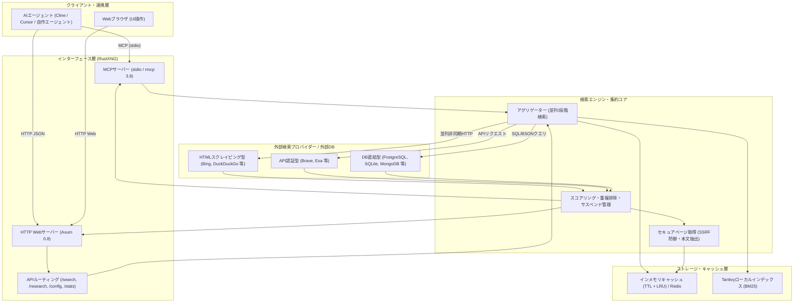

# **RustXNG 調査レポート**

## **1. 基本情報**

* **ツール名**: RustXNG (Rust eXtended Next Generation)
* **ツールの読み方**: ラストエックスエヌジー
* **開発元**: sahenjp / RustXNG オープンソースコミュニティ
* **公式サイト**: [GitHub リポジトリ](https://github.com/sahenjp/RustXNG)
* **関連リンク**:
  * GitHub: [sahenjp/RustXNG](https://github.com/sahenjp/RustXNG)
  * ドキュメント: [AI-INFRA.md](https://github.com/sahenjp/RustXNG/blob/main/docs/AI-INFRA.md) | [AGENT-SETUP.md](https://github.com/sahenjp/RustXNG/blob/main/docs/AGENT-SETUP.md) | [PROVIDERS.md](https://github.com/sahenjp/RustXNG/blob/main/docs/PROVIDERS.md)
* **カテゴリ**: AI検索/ブラウザ拡張
* **概要**: RustXNGは、オープンソースの代表的なプライバシー指向メタ検索エンジン「SearXNG」をRust言語で完全再実装したセルフホスト型のメタ検索・グラウンディング基盤である。数十〜数百の外部検索ソースから並列に検索結果を統合取得し、AIエージェント向けに最適化された軽量JSONやModel Context Protocol（MCP）形式でスニペットおよびWebページ本文を提供する。

## **2. 目的と主な利用シーン**

* **解決する課題**:
  * **商用検索APIのコスト・課金制約**: ExaやTavily、Brave Search APIなどの商用検索APIは従量課金であり、自律型AIエージェントが反復的にWeb検索を行うとAPIコストが急増する。
  * **Python製SearXNGのリソース負荷**: 従来のSearXNGはPython製であり、起動時間やメモリ消費、同時リクエスト処理能力においてコンテナ運用やローカル環境でのリソース負担が大きかった。
  * **LLMコンテキスト溢れとグラウンディング不足**: 単純なWeb検索結果だけではAIのハルシネーションを防止できず、逆に全Webページをそのまま流し込むとコンテキスト長制限やトークンコストが超過する。
  * **プライバシーとクエリ漏洩**: 開発中のコードや社内ナレッジに関する検索クエリが商用検索エンジン事業者のログに永続保存・学習利用されるリスクを排除する。
* **想定利用者**:
  * 自律型AIエージェント（Cline、Cursor、Codex、AutoGPT等）の開発者・運用者
  * ローカルLLM（Ollama、vLLM、LM Studio等）を用いた完全オンプレミスRAGシステムの構築者
  * プライバシーとセルフホスト環境を重視するリサーチャーおよびソフトウェアエンジニア
* **利用シーン**:
  * **ローカルAIエージェントの動的情報補完**: コーディング支援エージェントが最新ライブラリの仕様やエラー解決法をローカルでWeb検索し、必要な段落だけをグラウンディング材料として取得する。
  * **ディープリサーチ・反復調査**: 複合的な問いに対してサブクエリを段階的に自動生成・並列検索し、上位ページの本文から引用付きの調査レポートを自動生成する（`/research` API活用）。
  * **IDE/エディタからのMCP経由検索**: Claude DesktopやClineなどのMCP対応クライアントから `rustxng mcp` を起動し、標準入出力経由で安全かつトークン効率の高いWeb検索・ページ閲覧を行う。

### **2.1 代表的な利用フロー**

```mermaid
swimlane-beta TB
  subgraph User["ユーザー"]
    A[調査要求・開発タスクを入力]
    F[グラウンディング済み回答を確認]
  end
  subgraph Agent["AIエージェント (Cline / LLM)"]
    B[サブクエリを生成しMCP/HTTPで検索要求]
    E[スニペット・本文を根拠に回答を合成]
  end
  subgraph RustXNG["RustXNG (ローカル常駐)"]
    C[複数検索エンジンへ並列/段階問い合わせ]
    D[重複排除・スコアリング・安全な本文抽出]
  end
  subgraph Providers["外部検索プロバイダー"]
    P[各Web検索エンジンの結果を返却]
  end
  A --> B
  B --> C
  C --> P
  P --> D
  D --> E
  E --> F
```

* **代表的な流れ**: ユーザーから調査タスクを受け取ったAIエージェントが、ローカルで稼働するRustXNGのREST APIまたはMCPインターフェースに検索を要求する。RustXNGは背後で複数の外部プロバイダーへ並列に問い合わせて結果を統合・スコアリングし、必要に応じて安全対策（SSRF防御）を施した上でWebページの主要本文を抽出して返却する。エージェントはコンパクト化されたコンテキストを用いて根拠ある回答を生成しユーザーへ提示する。

## **3. 主要機能**

* **高速メタ検索統合エンジン**: 200以上のエンジン型（上流SearXNG互換の352エントリ）に対応し、多数の検索エンジンに対して非同期並列（または段階的 starget）にクエリを送信、重複排除と高精度な再ランキングを行う。
* **AIエージェント向けグラウンディング出力**: `max_results` による件数制御や、`include_raw_content=1` による上位ページ本文（デフォルト約8,000文字/件）の抽出・キャッシュ機能を備え、エージェントが1リクエストで根拠テキストまで取得可能。
* **組み込みModel Context Protocol（MCP）サーバー**: `rustxng mcp` コマンドにより、Anthropic提唱のMCPサーバーとして標準入出力（stdio）で稼働。`search`（スニペット検索）および `read_page`（同一セッションでヒットしたページの部分読み取り）ツールを提供し、トークン溢れを抑制。
* **堅牢なSSRF防御とセキュアフェッチ**: ローカルネットワークやプライベートIPアドレス、ループバックアドレスへの不正接続をブロックし、パブリックIPのみへの接続を強制。危険なURIスキームの排除やメディアレスポンスのサイズ上限管理を実装。
* **自動エンジン休止・サスペンド機能**: 応答がない、または空の検索結果を連続して返すエンジンを一時的に自動休止（Resting）させ、システム全体のタイムアウトや遅延を防止。`/stats` や `/metrics`（Prometheus形式）で状態を可視化。
* **ディープリサーチ機能（`GET /research`）**: 質問文から自動的にサブクエリを計画し、複数回検索と本文取得を実行して、証拠バンドル（クエリ・ソース・本文）および引用付きMarkdownレポートを自動生成。
* **Tantivyベースのローカル全文検索・BM25インデックス**: 外部Web検索だけでなく、ローカルドキュメントやクロール結果をTantivyエンジンによってBM25検索できる機能（`rustxng-index`）を内包。
* **SearXNG完全互換のクエリ構文と設定**: `!engine` や `!category`、`:lang`、`<timeout` などのbang構文、SearXNGの `settings.yml`（YAML）およびTOML設定ファイルをそのまま読み込み可能。

## **4. 動作原理・システム構成**



* **アーキテクチャ**:
  RustXNGは、ローカルファーストの高スループット・クライアントサーバー構成を採用している。Tokio非同期ランタイムとAxum 0.8フレームワークを中核とし、軽量な単一静的バイナリとして動作する。AIエージェントのローカルプロセスとして標準入出力で常駐するMCPモードと、ポートをバインドしてREST APIを提供するHTTPモードの双方が同一のコアエンジン（`Searcher`）を共有する設計となっている。
* **主要コンポーネントとデータフロー**:
  * **インターフェース層**: AxumによるHTTPエンドポイント（`/search`, `/config`, `/research`, `/stats`, `/metrics`）と、`rmcp` クレートによるModel Context Protocol（MCP）ハンドラーを提供する。
  * **アグリゲーター（Aggregator）**: Tokioの並列タスクにより、指定されたカテゴリまたは全対象エンジンへ同時にリクエストを発行する。プロキシ環境向けには負荷を抑える段階的実行モード（`strategy = "staged"`）も備える。
  * **スコアリング・重複排除（Ranker）**: URLの正規化と重複排除を行い、SearXNG互換の重み付け計算に加えてURL・タイトルとクエリ語の一致度に応じたランキング補正（`search.relevance_weight`）を行う。
  * **本文抽出とSSRF防御（Fetcher）**: `include_raw_content` やMCPの `read_page` が要求された場合、`PageReader` がHTMLを取得し、主要本文をテキスト化する。この際、DNS解決結果を精査し、プライベートIP（127.0.0.0/8, 10.0.0.0/8, 172.16.0.0/12, 192.168.0.0/16, IPv6 ULA等）への接続を厳密に遮断する。
* **特筆すべき要素技術**:
  * **Axum 0.8 & Tokio**: 高度な非同期I/O処理により、数百の外部エンジンへ接続する際のコンテキストスイッチとメモリ消費を極小化。
  * **Reqwest & rustls-tls**: OpenSSL等の外部Cライブラリ依存を排除し、完全なメモリ安全性を保ちながらHTTP/2および最新暗号通信を処理。
  * **rmcp 3.8**: Anthropicが策定したModel Context Protocolの公式Rust実装を採用し、安定したMCP通信を実現。
  * **Tantivy 0.27**: Luceneライクな純Rust製全文検索エンジンを組み込み、外部サーバー不要で高速なローカルBM25インデックスを提供。
  * **self-replace**: CLIからのワンライナー自己更新（`rustxng --update`）をプラットフォーム透過にサポート。

## **5. 開始手順・セットアップ**

* **前提条件**:
  * 対応OS: Linux（x86_64, aarch64 / ARM64）、macOS（Apple Silicon / Intel）、Windows（x86_64）
  * アカウント登録やAPIキーは不要（一部の商用APIプロバイダーをオプトイン利用する場合のみ個別キーが必要）
* **インストール/導入**:

  **1. ビルド済みバイナリのダウンロード（推奨）**:
  GitHub Releasesからプラットフォームに一致するバイナリとチェックサムを取得し配置する。

  ```bash
  # Linux x86_64 の例
  mkdir -p ~/.local/bin
  curl -L -o ~/.local/bin/rustxng \
    https://github.com/sahenjp/RustXNG/releases/download/v0.27.1/rustxng-v0.27.1-x86_64-unknown-linux-musl
  chmod +x ~/.local/bin/rustxng
  ```

  **2. Cargoによるソースビルド**:
  Rust 1.88以上のツールチェーンがインストールされている場合：

  ```bash
  cargo install --git https://github.com/sahenjp/RustXNG.git --tag v0.27.1
  ```

  **3. Dockerコンテナでの実行**:

  ```bash
  docker run -d --name rustxng -p 29483:29483 ghcr.io/sahenjp/rustxng:latest
  ```

* **初期設定**:
  設定ファイル（`settings.toml` または `settings.yml`）は任意であり、指定しない場合は安全な組み込みデフォルト設定（ポート29483、ループバックバインド）で起動する。

  ```bash
  # 環境変数による基本設定
  export SEARXNG_PORT=29483
  export SEARXNG_BIND_ADDRESS="127.0.0.1"
  ```

* **クイックスタート**:

  **HTTPサーバーの起動と検索確認**:

  ```bash
  # サーバーの起動
  rustxng --bind 127.0.0.1 --port 29483

  # ヘルスチェック
  curl -s http://127.0.0.1:29483/healthz

  # JSON検索の実行（上位5件）
  curl -s --get 'http://127.0.0.1:29483/search' \
    --data-urlencode 'q=Rust tokio async' \
    --data 'format=json' --data 'max_results=5' | jq .results
  ```

  **Claude Desktop / Cline 向け MCP 設定例**:
  `claude_desktop_config.json` に以下を追記するだけで、MCPツールとして利用可能：

  ```json
  {
    "mcpServers": {
      "rustxng": {
        "command": "rustxng",
        "args": ["mcp"]
      }
    }
  }
  ```

## **6. 特徴・強み (Pros)**

* **圧倒的な実行速度と省リソース性**: Python製のオリジナルSearXNGと比較して起動速度が数秒からミリ秒単位へ短縮され、メモリ使用量も数十MB程度に抑えられるため、常駐ツールやCI/CD環境、省スペック環境にも容易に組み込める。
* **AIエージェント完全最適化（MCP & 本文取得）**: 検索結果のスニペットだけでなく、`include_raw_content=1` やMCPの `read_page` ツールにより、エージェントが必要とするWebページの主要テキストを直ちにグラウンディング情報として供給できる。
* **完全無料でセルフホスト可能**: 商用検索APIサービス（ExaやTavily等）のようにクエリ数ごとの課金やクレジットカード登録を必要とせず、手元のマシンで自由かつ無制限に検索パイプラインを運用できる。
* **SearXNG資産の高い互換性**: 上流SearXNGのクエリ文法（`!bang`）、URL形式、設定ファイル構造（YAML/TOML）を忠実に踏襲しており、既存のSearXNG設定やスクリプトをそのまま移行可能。
* **コンプライアンスとセキュリティへの透明な姿勢**: 外部サービスの利用規約確認状況を管理する台帳（`providers.csv`）を公開し、規約上問題のあるプロバイダー（Yahoo! JAPANやMojeekのHTMLスクレイピング等）を既定で無効化するなど、法令遵守と持続可能性を重視した開発体制が採られている。

## **7. 弱み・注意点 (Cons)**

* **外部プロバイダーの規約および仕様変更リスク**: RustXNG自体は独自のWebクローラーを持たないメタ検索エンジンであるため、外部検索エンジン側のHTML構造変更やBot遮断、スクレイピング禁止規約の影響を直接受ける。安定した本番運用にはAPI認証型エンジンの併用や利用規約の事前確認が推奨される。
* **短時間の集中アクセスによるIPブロック懸念**: 自律型エージェントが無制限に高速検索リクエストを発行すると、上流の検索サービスからIPアドレス単位で一時的なアクセス制限（429 Too Many RequestsやCAPTCHA）を受ける可能性がある。
* **UIテンプレートの選択肢が限定的**: 上流のSearXNGに存在する多彩なHTMLテーマ（OSCAR等）や細かなカスタマイズ機能は移植されておらず、シンプルな単一テーマのみが提供されている（Web UIではなくAPI/MCP利用が主眼）。
* **日本語検索エンジンの既定制限**: 日本語の主要な検索エンジンであったYahoo! JAPAN（HTMLアダプター）が利用規約審査のため既定で無効化されており、日本語クエリのメタ検索ではGoogle系も削除されているため、BingやDuckDuckGo、またはBrave API等の設定が重要となる。

## **8. 料金プラン**

RustXNGはオープンソースソフトウェア（AGPL-3.0-or-later）として公開されており、完全無料で利用できる。

| プラン名 | 料金 | 主な特徴 |
|---|---|---|
| **オープンソース (Self-Hosted)** | **完全無料** | すべての機能（メタ検索、MCPサーバー、ディープリサーチ、ローカルインデックス）を無制限に利用可能 |
| **外部商用API併用 (任意)** | 各プロバイダー実費 | Exa、Brave Search APIなどの商用検索エンジンを上流として追加する場合のみ、各サービスの契約料金が発生 |

* **課金体系**: ソフトウェア自体は無料。APIキーなしで動作するエンジンのみを利用する場合、運用コストはサーバー実行環境のインフラ費用のみ。
* **無料トライアル**: 該当なし（全機能が無期限で無料開放）。

## **9. 導入実績・事例**

* **導入企業・プロジェクト**:
  * オープンソースの個人開発プロジェクトおよびAIエージェント研究グループでの採用。
  * ローカルLLMコミュニティ（OllamaやLocalAIの利用者）におけるWebグラウンディング層としての検証と組み込み。
  * プライベートな自律型コーディングエージェント（Cline / Cursorワークフロー）でのWeb検索ツールとしての活用。
* **導入事例**:
  * **ローカルコーディング支援**: 開発者がClineやClaude Desktopに `rustxng mcp` を登録し、外部の有償検索API（Tavily等）を契約することなく、最新のRust/TypeScriptドキュメントをIDE内で高速に検索・参照させる事例。
  * **プライベートRAG基盤**: 企業内の機密性の高いプロンプトやクエリを外部SaaS検索に送信せず、自社LAN内のセルフホストRustXNG経由で安全に外部情報を取得するパイプラインの構築。
* **対象業界**: AI技術スタートアップ、受託開発・受託研究組織、セキュリティ・プライバシーを重視するIT企業、個人開発者。

## **10. サポート体制**

* **ドキュメント**: GitHubリポジトリ内に詳細なドキュメント群が完備されている。[AI-INFRA.md](https://github.com/sahenjp/RustXNG/blob/main/docs/AI-INFRA.md)（設計思想）、[AGENT-SETUP.md](https://github.com/sahenjp/RustXNG/blob/main/docs/AGENT-SETUP.md)（エージェント導入手順）、[COMPATIBILITY.md](https://github.com/sahenjp/RustXNG/blob/main/docs/COMPATIBILITY.md)（SearXNG互換性一覧）、[PROVIDERS.md](https://github.com/sahenjp/RustXNG/blob/main/docs/PROVIDERS.md)（プロバイダー利用条件台帳）など。
* **コミュニティ**: [GitHub Discussions](https://github.com/sahenjp/RustXNG/discussions) での質疑応答・アイデア共有や、[GitHub Issues](https://github.com/sahenjp/RustXNG/issues) によるバグ報告・メンテナー公募が行われている。
* **公式サポート**: 商用ベンダーによるSLA保証付きサポートは提供されていない。OSSコミュニティベースでの保守対応となる。

## **11. エコシステムと連携**

### **11.1 API・外部サービス連携**

* **API**:
  * REST API: `/search`（JSON, CSV, RSS, HTML形式に対応）、`/config`、`/healthz`、`/stats`、`/metrics`（Prometheus互換指標）。
  * ディープリサーチAPI: `/research`（クエリ自動分解・要約レポート生成）。
* **外部サービス連携**:
  * **MCP対応クライアント**: Claude Desktop、Cline、Cursor、Windsurfなどのエディタ・エージェントから標準入出力（stdio）経由で直接接続可能。
  * **キャッシュストア**: インメモリキャッシュのほか、Valkey / Redis による分散キャッシュに対応。
  * **データベース直結検索**: PostgreSQL、MySQL、SQLite、MongoDBなどの社内DBをメタ検索ソースとして統合可能（`db-engines` 機能）。
  * **商用検索API連携**: `exaapi`、`braveapi` などの商用APIキーを設定することで、単一のメタ検索ハブとして透過的にマージ可能。

### **11.2 技術スタックとの相性**

| 技術スタック | 相性 | メリット・推奨理由 | 懸念点・注意点 |
|:---|:---:|:---|:---|
| **AIエージェント (Cline / Cursor)** | ◎ | 組み込みMCPサーバーにより設定ファイル数行で即座に連携可能 | 特になし |
| **Python (LangChain / LlamaIndex)** | ◎ | 標準的なSearXNGラッパーやREST APIをそのまま流用可能 | JSONの `max_results` や `raw_content` は独自パラメータのため要確認 |
| **TypeScript / Node.js** | ◎ | MCP SDKやFetch API経由で極めてスムーズに統合可能 | 特になし |
| **Rust アプリケーション** | ◎ | 同一言語エコシステムであり、シングルバイナリの運用・管理が容易 | ライブラリとしての直結ではなくCLI/API連携が基本 |
| **Docker / Kubernetes** | ◯ | 公式Dockerイメージ（GHCR）が提供されておりコンテナ化が容易 | プロキシやDNS設定のSSRF防御挙動に注意 |

## **12. セキュリティとコンプライアンス**

* **認証**:
  * ローカル利用（127.0.0.1）を前提とした設計であり、APIキーなしで即座に動作。
  * 公開環境向けには `SEARXNG_SECRET` やリバースプロキシによる認証、リクエストリミッター（Bot検知、IP単位のスライディングウィンドウ制限）をサポート。
* **データ管理**:
  * 検索ログの永続化を行わないプライバシーファースト設計。検索クエリやIPアドレスはディスクに保存されない。
  * キャッシュはTTLおよびLRUによりインメモリまたは指定されたキャッシュサーバー内でのみ一時保持。
* **準拠規格・セキュリティ設計**:
  * **厳格なSSRF防御**: `PageReader` はDNS解決後に接続先IPを検証し、プライベートIP範囲やリンクローカルアドレスへのリクエストを強制拒否。
  * **レスポンス上限とスキーム制限**: 巨大なメディアファイルやSVG、実行可能スキーム（`javascript:`, `file:`, `data:` 等）をブロックし、クライアント保護を徹底。
  * **ライセンス**: GNU Affero General Public License v3.0（AGPL-3.0-or-later）。ネットワーク経由で改変版をサービス提供する場合もソースコード公開義務が適用される。

## **13. 操作性 (UI/UX) と学習コスト**

* **UI/UX**:
  * ユーザー向けには無駄を削ぎ落としたミニマルなWeb検索UIを提供。ダークモードやカテゴリタブを備える。
  * 一方で、本ツールの真価はAPIおよびMCPインターフェースにあり、開発者やAIエージェントにとっては極めて明快で統一されたJSONスキーマが出力される。
* **学習コスト**:
  * **極めて低い**: 導入手順に従ってバイナリを実行するだけで即座に稼働し、SearXNGのクエリ構文や設定ファイルがそのまま通用するため、メタ検索の経験があれば学習コストはほぼゼロである。

## **14. ベストプラクティス**

* **効果的な活用法 (Modern Practices)**:
  * **段階的なコンテキスト取得**: 初回検索では `max_results=5` でスニペット（title, url, content）のみを取得し、モデルが真に深掘りを必要とした場合のみ該当URLの本文（`include_raw_content=1` や `read_page`）を取得することで、トークン消費と推論コストを最小化する。
  * **MCPのネイティブ活用**: CursorやCline等のエージェント環境では、HTTP経由ではなく `rustxng mcp` を起動してstdio接続を行うことで、ポート競合やネットワーク管理の手間を完全に排除する。
  * **商用APIとのハイブリッド運用**: 重要なWeb情報収集において、無料のHTML検索エンジンと `braveapi` や `exaapi` などの商用APIを併用設定することで、耐障害性と検索精度を両立させる。
* **陥りやすい罠 (Antipatterns)**:
  * **安易な外部公開（`0.0.0.0` バインド）**: 認証やリバースプロキシのレート制限を設けずにインターネットへ公開すると、第三者からの不正なメタ検索プロキシとして悪用されるリスクがある。
  * **利用規約未確認のプロバイダー強制有効化**: `disabled = false` を多用してスクレイピング禁止規約を持つ検索エンジンを無理に有効化することは避け、公式に提供されるAPI型エンジンやオープンなソースを活用すべきである。
  * **短時間の過剰リクエスト発行**: エージェントのループ処理で毎秒何十回もクエリを投げると、外部プロバイダーから即座にIP BANされるため、エージェント側で適切なバックオフ制御を設けること。

## **15. ユーザーの声（レビュー分析）**

* **調査対象**: GitHub Issues / Discussions、開発者コミュニティ、SNS（X / Reddit）の技術スレッド
* **総合評価**: リポジトリ公開から短期間でGitHub Star数760件超を獲得しており、特にローカルAIエージェント開発者の間で「SearXNGの待望されていたRustリライト」として非常に高い関心と評価を得ている。
* **ポジティブな評価**:
  * 「Python版SearXNGに比べて起動が一瞬で、メモリ消費が極めて小さいため、MacBook上のローカル開発環境で常駐させても全く気にならない。」
  * 「MCPサーバーが最初から組み込まれているため、Claude DesktopやClineへの接続が信じられないほど簡単だった。」
  * 「ExaやTavilyの課金メーターを気にすることなく、自作の自律型エージェントにWeb検索能力を与えられるのが最高。」
* **ネガティブな評価 / 改善要望**:
  * 「SearXNGにあったような派手なUIテーマや検索詳細カスタマイズ画面が少なく、一般ユーザー向けの検索ポータルとしては物足りない。」
  * 「Yahoo! JAPANなどの馴染み深い検索エンジンが規約対応で既定無効化されており、日本語の検索結果を充実させるには設定の調整が必要。」
  * 「外部サイトのスクレイピング対策が厳しくなる中、プロバイダーの死活監視やメンテナンスがどれだけ継続されるかが鍵になる。」
* **特徴的なユースケース**:
  * 完全オフラインまたは隔離された社内LAN環境において、Tantivyローカルインデックス機能と組み合わせて社内Wiki・コードベース・限定された外部ミラーサイトを横断検索する「セキュア社内調査エージェント」の基盤としての利用。

## **16. 直近半年のアップデート情報**

* **2026-11-03**: **v0.27.1**
  * プロキシされたSVGレスポンスのセキュリティ強化（XSS防止ハードニング、Issue [#82](https://github.com/sahenjp/RustXNG/issues/82)）。
* **2026-11-03**: **v0.27.0**
  * エージェント導入ガイドの整備および既定ポートの29483への移行。
  * プロバイダー利用規約の遵守強化（Yahoo! JAPANおよびMojeekのHTMLアダプターを既定無効化、全プロバイダー台帳 `providers.csv` の新設）。
  * MCPサーバー（`rustxng mcp`）の出力上限制御およびLinux ARM64（`aarch64-unknown-linux-gnu`）バイナリの公式提供開始。
  * SSRF対策の強化、実行可能URIスキームの排除、脆弱な依存クレートの更新。
* **2026-11-01**: **v0.26.0**
  * Linux（musl / glibc）、macOS（Intel / Apple Silicon）、Windows向けのマルチプラットフォーム公式バイナリの配布開始。
* **2026-10-31**: **v0.24.0 / v0.23.0**
  * Tantivyベースのローカルインデックス機能（`rustxng-index`）の統合。
  * 応答のないエンジンを自動休止するサスペンド機構（`empty_result_limit` / `empty_result_cooldown`）の実装。
  * ディープリサーチAPI（`GET /research`）の初期導入。
* **2026-10-29**: **v0.8.0**
  * パブリックリリースの開始。SearXNG互換のメタ検索エンジンの初期公開。

(出典: [GitHub Releases](https://github.com/sahenjp/RustXNG/releases) / [CHANGELOG.md](https://github.com/sahenjp/RustXNG/blob/main/CHANGELOG.md))

## **17. 類似ツールとの比較**

### **17.1 機能比較表 (星取表)**

| 機能カテゴリ | 機能項目 | RustXNG | SearXNG | Exa (旧Metaphor) | Tavily Search |
|:---:|:---|:---:|:---:|:---:|:---:|
| **基本仕様** | 実装言語 / ランタイム | ◎<br><small>Rust (静的バイナリ)</small> | △<br><small>Python (依存多)</small> | -<br><small>クラウドSaaS</small> | -<br><small>クラウドSaaS</small> |
| **基本仕様** | セルフホスト対応 | ◎<br><small>完全セルフホスト</small> | ◎<br><small>完全セルフホスト</small> | ×<br><small>不可 (APIのみ)</small> | ×<br><small>不可 (APIのみ)</small> |
| **料金** | ソフトウェア / API利用料 | ◎<br><small>完全無料 (OSS)</small> | ◎<br><small>完全無料 (OSS)</small> | △<br><small>従量課金 (無料枠小)</small> | △<br><small>従量課金 (無料枠小)</small> |
| **エージェント親和性** | MCPネイティブ対応 | ◎<br><small>組み込み (stdio)</small> | ×<br><small>非対応 (要外部プロキシ)</small> | △<br><small>外部MCPラッパー要</small> | ◯<br><small>公式MCPサーバーあり</small> |
| **エージェント親和性** | ページ本文取得 (グラウンディング) | ◎<br><small>raw_content抽出内包</small> | ×<br><small>スニペットのみ</small> | ◎<br><small>高品質テキスト/要約</small> | ◎<br><small>RAG特化クリーン抽出</small> |
| **検索品質** | 意味検索 (ニューラル検索) | △<br><small>BM25/単語一致補正</small> | ×<br><small>メタ検索合算順</small> | ◎<br><small>独自Embedding意味検索</small> | ◯<br><small>LLM最適化ランキング</small> |
| **運用性** | リソース消費 (メモリ/CPU) | ◎<br><small>極小 (数十MB)</small> | △<br><small>中 (数百MB〜)</small> | ◎<br><small>サーバーレス</small> | ◎<br><small>サーバーレス</small> |
| **プライバシー** | クエリ送信先の匿名性 | ◯<br><small>各エンジンへ直送信</small> | ◯<br><small>各エンジンへ直送信</small> | ×<br><small>Exaサーバーへ集約</small> | ×<br><small>Tavilyサーバーへ集約</small> |

### **17.2 詳細比較**

| ツール名 | 特徴 | 強み | 弱み | 選択肢となるケース |
|---|---|---|---|---|
| **RustXNG** | SearXNGをRustでフルリライトした、AIエージェント向けのセルフホスト型メタ検索基盤 | 極めて高速・省メモリ、組み込みMCPサーバー、本文自動取得（raw_content）、APIキー不要で完全無料 | 外部プロバイダーのスクレイピング対策や規約の影響を受ける、意味検索自体は外部依存 | ローカルLLMやコーディングエージェント（Cline等）に無料かつ高速なWebグラウンディング能力を持たせたい場合 |
| **SearXNG** | Pythonで長年開発されているオープンソース・メタ検索エンジンの代表格 | 膨大な稼働実績、多彩なテーマUI、数多くの公開インスタンスと成熟したプラグイン群 | Python環境によるリソース消費（メモリ・CPU）、エージェント向けの本文抽出やMCPは自作が必要 | 人間がブラウザから利用するプライベートなWeb検索ポータルを自前運用したい場合 |
| **Exa (旧Metaphor)** | AIエージェント・LLM向けにゼロから設計されたニューラルWeb検索API | 強力な意味検索（セマンティック検索）、クリーンな本文・ハイライト抽出、高い安定性 | 有償サービスでありクエリごとにコストが発生、オンプレミス環境には非対応 | 高い検索精度が求められる本番商用エージェントで、APIコストを許容できる場合 |
| **Tavily Search** | 自律型AIリサーチやLLMグラウンディングに特化した商用検索プラットフォーム | 検索結果の自動キュレーション、回答生成に最適化されたクリーンテキストの即時返却 | 有償API（無料枠月1,000回等）、プロプライエタリで内部構造はブラックボックス | LangChain等のエコシステムで迅速にRAGエージェントをプロトタイピングしたい場合 |

## **18. 総評**

* **総合的な評価**:
  RustXNGは、既存のSearXNGが持つ「広範な検索エンジンからのメタ検索能力」と「プライバシー性」という美点を維持したまま、Rust言語の持つ圧倒的なパフォーマンスとメモリ効率を注入し、さらに現代のAIエージェントの要求（MCP対応、軽量コンテキスト、本文グラウンディング）に完璧に応えた傑作ソフトウェアである。商用検索APIの従量課金に頭を悩ませていたAI開発者にとって、救世主となり得るポテンシャルを持つ。
* **推奨されるチームやプロジェクト**:
  * **自律型AIエージェント/IDE拡張（Cline, Cursor等）を日常的に活用する開発者**: `rustxng mcp` をローカル常駐させることで、API料金ゼロで最新Web情報にアクセスする開発環境を構築できる。
  * **ローカルLLM/オンプレミスRAGを開発するエンジニア**: 外部SaaSに社内情報や検索クエリを漏洩させることなく、完全閉域網または自社サーバー内で完結するWebグラウンディング基盤を構築したいチーム。
  * **軽量・セキュアなメタ検索インスタンスを自前運用したいインフラエンジニア**: Pythonのランタイム管理や高負荷から脱却し、単一バイナリまたは省リソースコンテナで堅牢な検索プロキシを運用したいチーム。
* **選択時のポイント**:
  * 商用APIのような「高精度な意味検索（Embedding検索）」を最優先する場合はExaやTavilyに軍配が上がるが、「コストゼロ」「完全セルフホスト」「MCP直接連携」「省リソース」を重視するならば、RustXNGが現在最も有力な選択肢となる。
