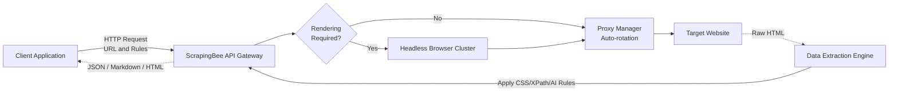

# **ScrapingBee 調査レポート**

## **1. 基本情報**

* **ツール名**: ScrapingBee
* **ツールの読み方**: スクレイピングビー
* **開発元**: ScrapingBee
* **公式サイト**: [https://www.scrapingbee.com/](https://www.scrapingbee.com/)
* **関連リンク**:
  * ドキュメント: [https://www.scrapingbee.com/documentation/](https://www.scrapingbee.com/documentation/)
  * レビューサイト: [Capterra](https://www.capterra.com/p/195060/ScrapingBee/)
* **カテゴリ**: Webスクレイピング
* **概要**: ScrapingBeeは、開発者がプロキシやヘッドレスブラウザの管理を気にすることなく、Webスクレイピングを行えるようにするAPIサービスです。JavaScriptのレンダリングやプロキシの自動ローテーションに対応しており、ブロックされることなく効率的にデータを抽出できます。

## **2. 目的と主な利用シーン**

* **解決する課題**: 複雑化するアンチボットシステムによるスクレイピングのブロックや、ヘッドレスブラウザ・プロキシプール管理といったインフラ運用のコストと手間の削減。
* **想定利用者**: ソフトウェアエンジニア、データサイエンティスト、競合調査を行うマーケターやプロダクトチーム。
* **利用シーン**:
  * Eコマースサイトでの競合製品の価格やレビューのモニタリング
  * 検索エンジン結果ページ (SERP) のデータ収集によるSEOモニタリング
  * LLMやAIツール向けのWebデータ収集（RAGシステム等）

## **3. 主要機能**

* **プロキシの自動ローテーション**: ブロックを回避するため、リクエストごとにプレミアムプロキシやステルスプロキシを自動で切り替えます。
* **JavaScriptレンダリング**: ヘッドレスChromeを使用してJavaScriptを実行し、動的なコンテンツをロードした後の状態を抽出します。
* **特定の要素を待機・カスタムシナリオ**: ページの特定の要素が表示されるまで待機したり、クリックやスクロール、フォームへの入力といったカスタムアクションを実行してから抽出することが可能です。
* **データ抽出ルール (CSS/XPath)**: CSSセレクタやXPathを指定することで、APIレスポンスから直接特定のテキストや属性をJSON形式などで抽出できます。
* **AIデータ抽出**: 抽出ルールを記述する代わりに、自然言語で必要なデータを指示（AI Query）することで、構造化されたJSONデータを取得できます。
* **Markdown・クリーンHTML抽出**: LLMでの学習や読み込みに適した、不要なタグを除去したクリーンなMarkdownやプレーンテキストとしてページ内容を出力します。
* **専用API**: Amazon、Google Search、YouTube、Walmartなどの主要サイトに対して、複雑な処理なしで構造化データを直接取得できる専用エンドポイントを提供しています。


## **4. 動作原理・システム構成**

* **アーキテクチャ**: クラウド完結型のWebスクレイピングAPIサービス。ユーザーが提供するURLに対して、ScrapingBeeのインフラストラクチャが代理でリクエストを行い、対象サイトからデータを抽出します。
* **主要コンポーネントとデータフロー**:
  * クライアントは抽出対象のURL、CSSセレクタ、抽出ルール（AI含む）などのパラメータを指定してScrapingBee APIにリクエストを送信します。
  * **プロキシマネージャー**: 対象のサイトやブロック状況に応じて、利用可能な大量のプロキシプール（データセンター、住宅用、モバイルプロキシ）から最適なものを自動で選択し、ルーティングします。
  * **ブラウザレンダリングエンジン**: JavaScriptの実行が必要な場合（`render_js=true`）、ヘッドレスブラウザクラスターがリクエストを受け取り、動的コンテンツをレンダリングします。
  * **抽出・整形エンジン**: 対象ページのHTMLが取得されると、指定された抽出ルール（XPath、CSSセレクタ、Markdown変換、またはAIによる構造化抽出）に従ってデータを抽出し、JSONやプレーンテキスト等の形式に整形してクライアントに返します。
* **特筆すべき要素技術**:
  * **AIデータ抽出（AI Query）**: LLMを活用して自然言語のプロンプトから構造化データ（JSON等）を直接抽出する機能。
  * **自動ブロック回避（Auto mode）**: CAPTCHAやアンチボットシステムを回避するための最適なパラメータを動的に決定し、スクレイピング成功率を最大化します。



## **5. 開始手順・セットアップ**

* **前提条件**:
  * クレジットカード登録不要でアカウント作成可能（1,000回の無料APIクレジットが付与されます）。
* **インストール/導入**:
  * APIへのHTTPリクエストを利用するため、基本的にはcurlや各種言語のHTTPクライアントを利用します。
  * Pythonの場合は専用のライブラリも提供されています：

  ```bash
  pip install scrapingbee
  ```

* **初期設定**:
  * アカウント作成後、ダッシュボードでAPIキーを取得します。

* **クイックスタート**:
  * 取得したAPIキーを使って、APIエンドポイントにリクエストを送信します。

  ```bash
  curl "https://app.scrapingbee.com/api/v1?api_key=YOUR_API_KEY&url=https://httpbin.org/html&render_js=false"
  ```

## **6. 特徴・強み (Pros)**

* プロキシプールやヘッドレスブラウザなどのインフラを自前で用意・運用する必要がなく、メンテナンスコストを大幅に削減できます。
* 高度なアンチボット対策が施されたウェブサイトでも、ステルスプロキシ機能等を利用することで高確率でスクレイピングを成功させることができます。
* LLM向け機能が充実しており、構造化データ(JSON)の抽出や、LLMが解釈しやすいMarkdown形式での出力に対応しているため、AIプロジェクトのデータソースとして最適です。
* Make、n8n、Zapierなどのノーコード/ローコードツール向けに連携機能が提供されており、エンジニアでなくても自動化ワークフローに組み込むことが容易です。

## **7. 弱み・注意点 (Cons)**

* JavaScriptのレンダリングやプレミアムプロキシの使用など、高度な機能を利用すると1リクエストあたりのAPIクレジット消費量が増加するため、大規模なスクレイピングではコストが高くなる可能性があります。
* 公式サイトやダッシュボード、ドキュメント、サポートはすべて英語であり、日本語でのネイティブなサポートは提供されていません。
* クライアントサイドでの複雑なシナリオ実行（ログイン後の複数画面遷移など）は可能ですが、高度なブラウザ操作が必要な場合はPuppeteerやPlaywrightなどを用いた自社運用システムに比べて自由度が制限される場合があります。

## **8. 料金プラン**

| プラン名 | 料金 | 主な特徴 |
|---------|------|---------|
| **無料トライアル** | 無料 | 1,000 APIクレジット。クレジットカード登録不要。 |
| **Freelance** | $49/月 | 250,000 APIクレジット。同時リクエスト数10。 |
| **Startup** | $99/月 | 1,000,000 APIクレジット。同時リクエスト数50。 |
| **Business** | $249/月 | 3,000,000 APIクレジット。同時リクエスト数100。専用アカウントマネージャー。 |
| **Business +** | $599/月 | 8,000,000 APIクレジット。同時リクエスト数200。 |

* **課金体系**: リクエストごとにAPIクレジットを消費。標準リクエストは1クレジットですが、JavaScriptレンダリングやプレミアムプロキシ、ジオターゲティング等の機能を使用すると倍率が加算され、1回あたりのクレジット消費量が増えます。

## **9. 導入実績・事例**

* **導入企業**: SAP、Zapier、Deloitte、Zillow、KAYAKなど。3,500以上の開発者やチームに利用されています。
* **導入事例**:
  * **Eコマース企業**: 競合他社の価格や製品カタログを日々モニタリングし、自社の価格戦略に活用。
  * **マーケティングツール**: SEOランキングやキーワードの順位を定期的に取得するためのインフラとして利用。
* **対象業界**: Eコマース、Fintech、サイバーセキュリティ、マーケティング（SEO/SEM）、市場調査など、ウェブデータの収集を必要とする幅広い業界。

## **10. サポート体制**

* **ドキュメント**: APIのリファレンス、各種言語別のコードスニペット、特定のプラットフォームのスクレイピング方法を解説したチュートリアルが豊富に用意されています。
* **コミュニティ**: 公式ブログでWebスクレイピングの技術情報やベストプラクティスが発信されています。
* **公式サポート**: Business以上のプランで専任のアカウントマネージャーがつき、優先的なメールサポートが提供されます。

## **11. エコシステムと連携**

### **11.1 API・外部サービス連携**

* **API**: ScrapingBeeのコアはRESTfulなHTTP APIであり、任意の環境から利用できます。
* **外部サービス連携**: Zapier、Make、n8nといった主要なiPaaS / ノーコードオートメーションツールとのネイティブインテグレーションが提供されています。また、MCP Serverとの統合により、AIエージェントに直接ウェブスクレイピング機能を持たせることが可能です。

### **11.2 技術スタックとの相性**

| 技術スタック | 相性 | メリット・推奨理由 | 懸念点・注意点 |
|:---|:---:|:---|:---|
| **Python** | ◎ | 公式のPython SDKが提供されており、APIの利用が非常に容易。 | 特になし |
| **Node.js** | ◎ | 公式SDKあり。非同期処理と親和性が高く、大量のリクエストを捌きやすい。 | 特になし |
| **Java** | ◯ | 公式SDKが提供されている。 | 特になし |
| **Ruby** | ◯ | 公式SDKが提供されている。 | 特になし |
| **PHP** | ◯ | 公式SDKが提供されている。 | 特になし |
| **Go** | ◯ | 公式SDKが提供されている。 | 特になし |

## **12. セキュリティとコンプライアンス**

* **認証**: APIリクエストはAPIキーによって認証されます。
* **データ管理**: スクレイピングされたデータはキャッシュやプロキシを経由しますが、セキュリティとプライバシーを考慮したインフラで運用されています。
* **準拠規格**: SOC 2 Type II に準拠しており、厳格なセキュリティ・可用性・機密性の基準を満たしています。また、GDPRにも準拠しています。

## **13. 操作性 (UI/UX) と学習コスト**

* **UI/UX**: ダッシュボードは非常にシンプルで、APIキーの取得、使用量（APIクレジット）の確認、成功率などの統計情報を直感的に把握できます。また、ダッシュボード上にAPIのリクエストビルダーがあり、パラメータを選択すると各種言語のコードスニペットが自動生成されるため使い勝手が良いです。
* **学習コスト**: シンプルなAPIベースのサービスであるため、HTTPリクエストの基礎知識があれば数分で使い始めることができます。カスタムシナリオなど高度な機能を利用する場合でも、ドキュメントのチュートリアルが充実しているため学習コストは低めです。

## **14. ベストプラクティス**

* **効果的な活用法 (Modern Practices)**:
  * 単にHTMLを取得するだけでなく、データ抽出ルール（CSS/XPath）をAPIリクエストに含めることで、ScrapingBee側で必要なデータのみをJSONとして抽出させ、自社サーバー側のパース処理負荷を軽減する。
  * LLMでウェブコンテンツを処理させる場合は、Markdownフォーマットでの出力機能を利用することで、不要なHTMLタグを排除しコンテキストウィンドウを節約する。
* **陥りやすい罠 (Antipatterns)**:
  * 全てのリクエストで無条件にJavaScriptレンダリングやプレミアムプロキシを有効にしてしまうこと。APIクレジットの消費が激しくなるため、ブロックされた場合やSPA（シングルページアプリケーション）の場合など、必要なときのみオプションを有効にする設定を実装することが推奨されます。

## **15. ユーザーの声（レビュー分析）**

* **調査対象**: Capterra, G2, 公式サイト掲載レビュー
* **総合評価**: 全体的に高い評価を得ており、Capterra等のレビューサイトでも概ね4.5〜5.0の高スコアを記録しています。
* **ポジティブな評価**:
  * 「プロキシやヘッドレスブラウザのメンテナンスから解放され、本来のデータ抽出業務に集中できるようになった。」
  * 「ドキュメントが分かりやすく、APIのインテグレーションが非常に簡単。」
  * 「サポートの対応が迅速で、問題解決に協力的。」
* **ネガティブな評価 / 改善要望**:
  * 「クレジットの消費システム（JavaScript有効化などでコストが数倍になる）が少し分かりにくく、想定より早くクレジットが枯渇することがある。」
  * 「高度なカスタムシナリオを構築する際のデバッグが難しい場合がある。」
* **特徴的なユースケース**:
  * エンジニアがいないマーケティングチームが、MakeやZapierなどのノーコードツールとScrapingBeeを連携させ、競合の価格モニタリングシステムを自前で構築している事例。

## **16. 直近半年のアップデート情報**

* **2026-09-01**: Python SDK v2.2.0 および Node.js SDK v2.0.0 リリース。HeaderベースのAPIキー認証への移行と、APIリファレンスの型ヒントの完全整備を実施。
* **2026-08-06**: Python SDK v2.1.1 および Node.js SDK v1.9.0 等で `mode=auto` (Auto Mode) のサポートを追加。アンチボット回避などのパラメータ設定をシステムが自動最適化可能に。
* **2026-07-20**: Python SDK v2.1.0 でサポートされていなかった残りのScrapingBee APIエンドポイント（Google, Amazon, YouTube等）への完全対応を実施。

(出典: [ScrapingBee Python GitHub Releases](https://github.com/ScrapingBee/scrapingbee-python/releases) / [Node.js GitHub Releases](https://github.com/ScrapingBee/scrapingbee-node/releases) 等)

## **17. 類似ツールとの比較**

### **17.1 機能比較表 (星取表)**

| 機能カテゴリ | 機能項目 | ScrapingBee | Scrapling | ScraperAPI |
|:---:|:---|:---:|:---:|:---:|
| **基本機能** | プロキシ管理 | ◎<br><small>自動ローテーション・ステルス対応</small> | -<br><small>自己管理が必要（プロキシ連携自体は可能）</small> | ◎<br><small>4000万IPと強力なバイパス</small> |
| **基本機能** | JSレンダリング | ◎<br><small>APIのオプションで簡単有効化</small> | ◎<br><small>Playwright等との連携による高度な操作</small> | ◯<br><small>APIオプションで対応</small> |
| **データ抽出** | 構造化データ抽出 | ◎<br><small>CSS/XPathでの抽出やAI抽出対応</small> | ◎<br><small>柔軟なXPath/CSS抽出機能</small> | ◯<br><small>主要ドメイン向けの専用APIあり</small> |
| **開発体験** | ノーコード連携 | ◎<br><small>Zapier/Make/n8n対応</small> | -<br><small>コードベースのライブラリ</small> | ◯<br><small>LangChain/MCPサポート等</small> |
| **非機能要件** | 日本語対応 | ×<br><small>UI/ドキュメント英語のみ</small> | ×<br><small>英語のみ</small> | ×<br><small>UI/ドキュメント英語のみ</small> |

### **17.2 詳細比較**

| ツール名 | 特徴 | 強み | 弱み | 選択肢となるケース |
|---------|------|------|------|------------------|
| **ScrapingBee** | APIベースのシンプルなスクレイピングサービス | セットアップが極めて簡単。LLMやノーコードツールとの連携に優れる。 | 高度なブラウザ操作の自由度はコードベースのツールに劣る。 | インフラ管理を完全に外部化し、手軽にスクレイピングを行いたい場合。AI/LLMシステムにデータソースを連携したい場合。 |
| **ScraperAPI** | 大規模プロキシネットワークに強みを持つAPI | プロキシの品質とプールの規模。特定のサイトに特化したAPIエンドポイント。 | 抽出ルールの柔軟性や機能面ではScrapingBeeにやや劣る場合がある。 | とにかく強力なアンチボットにブロックされずに生データを取得することに特化したい場合。 |
| **Scrapling** | 軽量かつ柔軟なPythonスクレイピングライブラリ | インフラを自前で構築するため完全にカスタマイズ可能であり、学習コストが低い。 | プロキシ管理やブロック回避の運用コストを自社で負担する必要がある。 | 簡単なスクリプトで柔軟にデータを抽出したい場合や、コストを抑えて小規模から始めたい場合。 |

## **18. 総評**

* **総合的な評価**:
  * ScrapingBeeは、開発者が最も頭を悩ませる「プロキシのブロック回避」と「ヘッドレスブラウザのインフラ管理」を見事に抽象化した、非常に完成度の高いAPIサービスです。
* **推奨されるチームやプロジェクト**:
  * インフラ管理の専任担当者がいないスタートアップや小規模な開発チーム。
  * RAG（検索拡張生成）システムなど、LLMにウェブから最新のコンテキストを提供したいAI開発プロジェクト。
  * ZapierやMakeを活用してデータ収集の自動化を行いたいマーケティングやリサーチチーム。
* **選択時のポイント**:
  * 大量の生HTMLだけが必要で自前でパースを行う場合は、プロキシのコスト効率が良い他のAPIサービスも選択肢になります。一方で、API側でJSONやMarkdownに整形して返してほしい場合や、インテグレーションの容易さを重視する場合はScrapingBeeが有力な候補となります。
