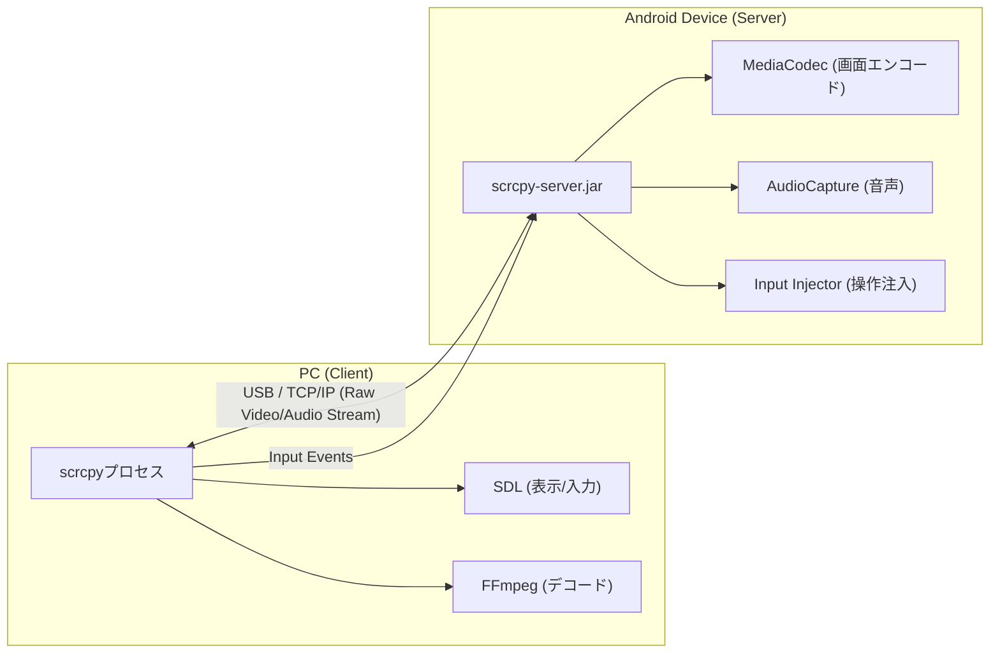

# **scrcpy 調査レポート**

## **1. 基本情報**

* **ツール名**: scrcpy
* **ツールの読み方**: スクリーンコピー
* **開発元**: Genymobile
* **公式サイト**: [https://github.com/Genymobile/scrcpy](https://github.com/Genymobile/scrcpy)
* **関連リンク**:
  * GitHub: [https://github.com/Genymobile/scrcpy](https://github.com/Genymobile/scrcpy)
* **カテゴリ**: 開発ツール
* **概要**: Androidデバイスの画面と音声をUSBまたはTCP/IP経由でPCにミラーリングし、コンピューターのキーボードとマウスを使用して操作できるようにするオープンソースアプリケーション。デバイスへのアプリのインストールやroot権限を必要としない。

## **2. 目的と主な利用シーン**

* **解決する課題**: 実機テストにおける操作の煩雑さの解消、画面キャプチャ・録画の効率化
* **想定利用者**: Androidアプリ開発者、QAエンジニア、AndroidデバイスをPC上でシームレスに操作したい一般ユーザー
* **利用シーン**:
  * アプリケーションのデバッグや動作確認
  * デバイスの画面録画やプレゼンテーションでの画面共有
  * デバイスのカメラをPCのWebカメラとして利用

## **3. 主要機能**

* **画面ミラーリング**: 30〜120fpsの高性能、35〜70msの低遅延で画面を表示
* **音声転送**: デバイスの音声をPCに転送（Android 11以降）
* **画面録画**: ミラーリング中の画面と音声をMP4等で録画
* **仮想ディスプレイ**: デバイスの物理ディスプレイとは別の仮想ディスプレイを作成
* **OTGモード**: 画面ミラーリングなしで物理キーボード・マウスとしてデバイスを操作
* **カメラミラーリング**: デバイスのカメラ映像をミラーリング（Android 12以降）
* **Webカメラ機能 (V4L2)**: Linuxにおいて、デバイスのカメラをWebカメラとしてエクスポート
* **HIDシミュレーション**: 物理キーボード、マウスのシミュレーション

## **4. 動作原理・システム構成**

* **アーキテクチャ**: ローカルファーストのクライアント・サーバー構成（サーバー側アプリはデバイスRAM上に動的展開されるためインストール不要）
* **主要コンポーネントとデータフロー**:
  * PC（クライアント）側で実行された `scrcpy` プロセスが `adb` コマンドを通じてAndroidデバイスへサーバー（Javaベースの.jarファイル）を転送し、起動する。
  * デバイス上のサーバーが画面をH.264/H.265/AV1でエンコードし、PCへローカルネットワークまたはUSB経由で送信する。
  * PCは受信したストリームをデコードして表示し、ユーザーからの入力（マウス、キーボード）をキャプチャしてデバイスのサーバーへ送信、サーバーがそれをAndroidの入力イベントとして注入する。
* **特筆すべき要素技術**:
  * **MediaCodec API**: Android標準のハードウェアエンコーダを利用し、極低遅延の画面取得を実現。
  * **FFmpeg**: PC側での動画・音声ストリームのデコードに使用。
  * **SDL (Simple DirectMedia Layer)**: PC側でのウィンドウ表示とハードウェアアクセラレーションによる描画、入力処理に使用。



## **5. 開始手順・セットアップ**

* **前提条件**:
  * API 21（Android 5.0）以上のAndroidデバイス
  * デバイスの「USBデバッグ」が有効になっていること
  * 音声転送にはAPI 30（Android 11）以上が必要
* **インストール/導入**:

  Linux (例: apt):

  ```bash
  sudo apt install scrcpy
  ```

  macOS (例: Homebrew):

  ```bash
  brew install scrcpy
  ```

  Windows: GitHubのReleaseページからzipファイルをダウンロードして解凍

* **クイックスタート**:
  ターミナル（またはコマンドプロンプト）で以下のコマンドを実行する。

  ```bash
  scrcpy
  ```

## **6. 特徴・強み (Pros)**

* 軽量・ネイティブ実装による非常に優れたパフォーマンスと低遅延
* デバイス側にエージェントアプリをインストールする必要がなく、クリーンに利用可能
* アカウント作成、インターネット接続が一切不要
* 完全無料のオープンソースソフトウェア
* Linux、Windows、macOSのクロスプラットフォーム対応

## **7. 弱み・注意点 (Cons)**

* CUI（コマンドラインインターフェース）ベースのため、GUI操作に慣れたユーザーには初期ハードルがある
* iOSデバイスには非対応
* 音声転送やカメラミラーリングなど、一部機能は比較的新しいAndroid OSバージョン（Android 11/12以降）を要求する

## **8. 料金プラン**

| プラン名 | 料金 | 主な特徴 |
|---------|------|---------|
| **無料プラン** | 無料 | すべての機能が利用可能なオープンソース |

* **課金体系**: 完全無料
* **無料トライアル**: なし（すべて無料）

## **9. 導入実績・事例**

* **導入企業**: 具体的な企業名は公開されていないが、GitHubのスター数が141,000を超えており、世界中の開発現場で広く利用されている。
* **導入事例**: 個人開発者からエンタープライズのモバイルアプリ開発チームまで、日々のデバッグや検証作業の標準ツールとして利用されている。
* **対象業界**: ソフトウェア開発、QA・テスト

## **10. サポート体制**

* **ドキュメント**: GitHubリポジトリ内に機能ごとの詳細なMarkdownドキュメントが整備されている
* **コミュニティ**: Reddit (`r/scrcpy`) などのユーザーコミュニティが活発
* **公式サポート**: GitHub Issuesでのバグレポートや機能要望への対応

## **11. エコシステムと連携**

### **11.1 API・外部サービス連携**

* **API**: 外部公開APIはないが、コマンドライン引数で高度な制御が可能
* **外部サービス連携**: 単体で動作するため特定のSaaS連携はないが、シェルスクリプトなどと組み合わせて自動化フローに組み込むことが容易

### **11.2 技術スタックとの相性**

| 技術スタック | 相性 | メリット・推奨理由 | 懸念点・注意点 |
|:---|:---:|:---|:---|
| **Android SDK (adb)** | ◎ | adbコマンドとシームレスに統合可能 | scrcpyを使用するにはadbのセットアップが必須 |
| **Shell Script** | ◎ | コマンドラインツールのため、スクリプトからの呼び出しや自動化が容易 | OS間のスクリプトの差異に注意 |

## **12. セキュリティとコンプライアンス**

* **認証**: アカウント登録不要
* **データ管理**: 画面データ等はネットワーク外部に送信されず、すべてローカルのUSBまたはローカルネットワーク（TCP/IP）内で完結する
* **準拠規格**: 公式サイトで公開されていない。オープンソースとして透過的に開発されている

## **13. 操作性 (UI/UX) と学習コスト**

* **UI/UX**: 起動するとデバイス画面がそのままウィンドウとして表示される。マウスの右クリックが「戻る」、中クリックが「ホーム」に割り当てられているなど、直感的な操作が可能。
* **学習コスト**: 単純なミラーリングであれば `scrcpy` と入力するだけなので非常に低い。高度なオプション（解像度変更、ビットレート制限など）を活用する場合はドキュメントの参照が必要。

## **14. ベストプラクティス**

* **効果的な活用法 (Modern Practices)**:
  * 無線接続 (TCP/IP) を使用して、ケーブルの煩わしさなしにデバイスを操作する
  * `scrcpy --record=file.mp4` を使用して、バグ報告用の高品質な画面録画を簡単に取得する
  * パフォーマンスが落ちる場合は解像度を下げる (`scrcpy -m1024` など)
* **陥りやすい罠 (Antipatterns)**:
  * 古いバージョンの `adb` を使用し続けることで接続エラーが発生する

## **15. ユーザーの声（レビュー分析）**

* **調査対象**: Reddit (`r/scrcpy` や `r/androidapps` など), GitHub Stars
* **総合評価**: 非常に高い。GitHubのスター数141,000以上。
* **ポジティブな評価**:
  * 「パフォーマンスにおいて他の選択肢より圧倒的に速い」
  * 「オープンソースで無料、そしてローカルで動く点が素晴らしい」
* **ネガティブな評価 / 改善要望**:
  * デフォルトでGUIが提供されていないため、コマンドラインが苦手なユーザーからGUIラッパーの要望がある
* **特徴的なユースケース**:
  * デバイスの画面が割れてしまった際のデータ救出や操作用ツールとしての利用

## **16. 直近半年のアップデート情報**

* **2026-10-08**: v5.0.1 リリース - NV12クロマプレーンに対するDRM_FORMAT_RG88の受け入れ、WindowsでのH.265ハードウェアデコードの修正、VA-APIデコード時のGPUレンダラー利用の改善など
* **2026-10-05**: v5.0 リリース - ハードウェアデコードのサポート追加、ビデオバッファリングの改善、音声再生キャプチャモードにおける全音声用途のキャプチャなど
* **2026-07-12**: v4.1 リリース - VP8およびVP9ビデオエンコーダのサポート追加、実行中のターミナルタイトルの更新、ファイルプッシュ後のメディアスキャン実行など
* **2026-05-12**: v4.0 リリース - SDL2からSDL3への移行、Flex Displayサポート追加、カメラトーチおよびズームサポート追加など
* **2025-12-17**: v3.3.4 リリース - Androidアップデート後の権限拒否エラー修正、特定デバイスでの状態復元問題修正など

(出典: [GitHub Releases](https://github.com/Genymobile/scrcpy/releases))

## **17. 類似ツールとの比較**

### **17.1 機能比較表 (星取表)**

| 機能カテゴリ | 機能項目 | 本ツール (scrcpy) | SlothMon | Mobile Next |
|:---:|:---|:---:|:---:|:---:|
| **基本機能** | 画面ミラーリング | ◎<br><small>極低遅延</small> | ◯<br><small>仮想ディスプレイとして</small> | ◯<br><small>自動化プラットフォームの一部</small> |
| **カテゴリ特定** | 録画・配信 | ◯<br><small>コマンドで対応</small> | ×<br><small>対応なし</small> | ◯<br><small>テスト結果の記録等</small> |
| **非機能要件** | ローカル動作 | ◎<br><small>完全オフライン</small> | ◎<br><small>完全オフライン</small> | △<br><small>AI機能はクラウド依存</small> |
| **非機能要件** | オープンソース | ◎<br><small>無料</small> | ◎<br><small>無料</small> | ◎<br><small>無料 (SaaS版あり)</small> |
| **自動化連携** | 操作自動化 | ◯<br><small>adb/スクリプト経由</small> | ×<br><small>操作は手動</small> | ◎<br><small>AIエージェントによる自動化</small> |

### **17.2 詳細比較**

| ツール名 | 特徴 | 強み | 弱み | 選択肢となるケース |
|---------|------|------|------|------------------|
| **本ツール (scrcpy)** | コマンドラインベースの高パフォーマンスなAndroidミラーリングツール | 圧倒的な低遅延、無料、オープンソースでカスタマイズ性が高い | CUIベースのため初期設定のハードルが若干ある、iOS非対応 | Android開発者やパフォーマンス・自動化を重視するユーザー |
| **SlothMon** | スマホやタブレットをPCのサブディスプレイ化する仮想ディスプレイツール | GUIで直感的に操作可能、手軽にセカンドモニタとして使える | 高度なカスタマイズやスクリプト連携には不向き | 開発用・作業用の手軽なサブディスプレイが欲しい場合 |
| **Mobile Next** | AIエージェントを活用したモバイルアプリの操作・テスト自動化プラットフォーム | 自動テスト、MCPサーバーとの連携などAIによる自律操作に強い | 単なる画面ミラーリング用途としては過剰、セットアップが複雑 | モバイルアプリのE2EテストやQA自動化を行いたい場合 |

## **18. 総評**

* **総合的な評価**:
  * Androidデバイスのミラーリング・操作ツールとして最高峰のパフォーマンスを誇る。オープンソースでありながら、商用ツールを凌駕する低遅延と安定性を実現している。
* **推奨されるチームやプロジェクト**:
  * Androidアプリの開発チーム、QAチーム、モバイルデバイスを活用したテスト自動化を行うプロジェクト
* **選択時のポイント**:
  * 高パフォーマンスかつセキュア（ローカル完結）なミラーリングが必要な場合はscrcpy一択。GUIでの直感的な操作を重視する一般ユーザーは、目的に応じて別のツールかサードパーティ製のGUIラッパーを検討する必要がある。
