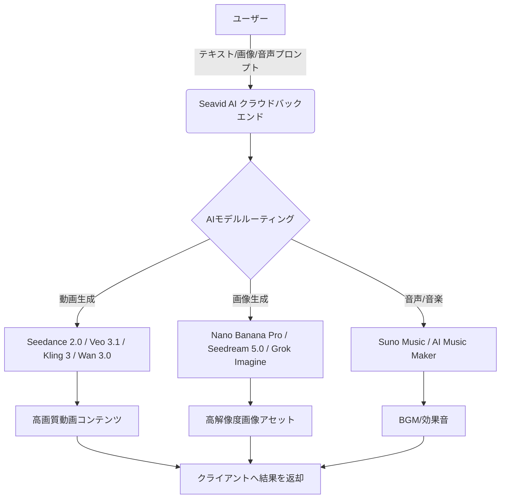

# **Seavid AI 調査レポート**

## **1. 基本情報**

<!--
【ガイドライン】
- 必須: ツール名、開発元、公式サイト、カテゴリ、概要
- 概要は2-3文で簡潔に記述
-->

* **ツール名**: Seavid AI
* **ツールの読み方**: シービッド エーアイ
* **開発元**: Seavid AI
* **公式サイト**: [https://seavidgen.com/](https://seavidgen.com/)
* **関連リンク**:
  * ドキュメント: 公式サイト内にFAQあり
* **カテゴリ**: 動画/メディア
* **概要**: Text-to-Video、Image-to-Videoなどに対応する、オールインワンのAI画像・動画生成プラットフォーム。Seedance 2.0を中核とし、Veo 3.1、Kling 3、Wan 3.0、MiniMax H3、Gemini Omni、Nano Banana Proなど複数の最先端AIモデルを統合し、高品質なビジュアルコンテンツの生成から編集までをワンストップで提供する。

## **2. 目的と主な利用シーン**

<!--
【ガイドライン】
- 3-5項目を箇条書きで記述
- 想定利用者を具体的に記載
-->

* **解決する課題**: 複数のAIツールを使い分ける手間を省き、単一のプラットフォームで高品質な画像と動画を生成したいというニーズに応える。また、商用利用可能な高品質な素材を低コストで入手可能にする。
* **想定利用者**:
  * デジタルアーティスト、イラストレーター
  * マーケター、広告制作者
  * コンテンツクリエイター (YouTuber, TikTokerなど)
  * ビジネスオーナー
* **利用シーン**:
  * SNS向けのバイラル動画や画像の作成（TikTok, Instagram Reels, YouTube Shorts）
  * 広告キャンペーン用の高品質なビジュアル素材の生成
  * ブランドの一貫性を保ったマーケティング素材の作成
  * プロトタイピングやコンセプトアートの作成

## **3. 主要機能**

<!--
【ガイドライン】
- 5-10項目の主要機能を箇条書きで記述
- 各機能は1-2文で概要を説明
-->

* **マルチモデル統合**: Seedance 2.0をはじめ、Wan 3.0、Kling 3、Veo 3.1、MiniMax H3、Grok Imagine Image 2.0など、複数のトップクラスのAIモデルを一つのプラットフォームで利用可能。
* **Text to Video AI**: テキストプロンプトからAI動画モデルを利用し、一貫したマルチショットの動画を生成する機能。
* **Image to Video AI**: 参照となる写真をアップロードして、対象のアイデンティティやスタイルを維持しながら短いAI動画を生成する機能。
* **Text to Image AI**: Nano Banana ProやSeedream 5.0などのモデルを用いて、テキストプロンプトから高解像度の画像を生成する機能。
* **Image to Image AI**: 参照画像を基に、AIを用いて画像の再スタイル化や変換を行う機能。
* **AI Tools & Effects**: AI Background Changer（背景変更）、Watermark Remover（Gemini/Nano Banana/Sora透かし削除）、AI Music Maker（Suno等）の各種ツール。
* **商用利用権**: 有料プランにおいて、生成された画像の完全な商用利用権が付与される（無料プランの商用利用については最新の規約確認を推奨）。

## **4. 動作原理・システム構成**

<!--
【ガイドライン】
- ツールの動作原理、システム構成（アーキテクチャ）、データの流れ、通信フローなどを記述
- クライアント・サーバー型、ローカルファースト、クラウド完結など、ツールのアーキテクチャ特性を明記
- 可能であればMermaidによる構成図やフロー図を含めること（Mermaid内のノードや説明テキストは原則日本語表記で作成する）
- 要素技術や内部で使われている仕組み（例：Docker、Git worktree、WebSockets、E2EEなど）を解説
- SaaS等の場合はわかる範囲で記述し、公開されていない場合は「非公開」とし、分かる範囲の処理フロー等を記載
-->

* **アーキテクチャ**: クラウド完結型SaaS（Webブラウザベースのアプリケーション）。
* **主要コンポーネントとデータフロー**:
  * ユーザーはブラウザからテキストプロンプト、画像、または音声を入力として送信する。
  * リクエストはSeavid AIのクラウドバックエンドへルーティングされ、ユーザーが選択したAIモデル（Seedance 2.0, Kling 3, Wan 3.0等）のAPIへと渡される。
  * モデルが生成処理を行い、クラウド上でエンコードされた高解像度（最大1080p）の動画や画像がフロントエンドへストリーミング/ダウンロード用に返却される。

* **特筆すべき要素技術**:
  * 異なるベンダーの多数のAIモデルを統一的なインターフェースで扱えるAPI統合レイヤー。
  * Seedance 2.0によるマルチショット動画生成とキャラクター・スタイルの一貫性保持機能。

## **5. 開始手順・セットアップ**

<!--
【ガイドライン】
- アカウント作成から「Hello World」的な最初の動作確認までの手順
- 主要なコマンドや設定項目を記載
-->

* **前提条件**:
  * Webブラウザ環境
  * アカウント登録
* **インストール/導入**:
  * ブラウザベースのためインストール不要。[https://seavidgen.com/](https://seavidgen.com/) にアクセスして利用開始。
* **初期設定**:
  * 特になし。サインアップ後すぐに生成機能を利用可能。
* **クイックスタート**:
  1. 公式サイトにアクセスしログインする。
  2. 生成したいコンテンツ（動画または画像）とAIモデル（例：Seedance 2.0）を選択。
  3. テキストプロンプトを入力（例: "A cinematic shot of a vintage red convertible driving along a coastal highway at sunset, drone follow shot"）。
  4. 参照画像があればアップロードする。
  5. "Generate"ボタンをクリックして生成開始。

## **6. 特徴・強み (Pros)**

<!--
【ガイドライン】
- 3-5項目を箇条書きで記述
- 競合との差別化ポイントを明確に
-->

* **最先端マルチモデルの結集**: Seedance 2.0、Wan 3.0、Kling 3など、単体でも強力なモデルを一つのプラットフォームで利用できる利便性は非常に高い。
* **1080pのHD動画出力**: 高解像度での動画生成が可能で、そのままSNSや広告素材として利用しやすい。
* **寛大な権利関係**: 有料プランで商用利用が可能であり、ビジネス用途での利用がしやすい。
* **使いやすい統合UI**: ツールごとに異なる操作を覚える必要がなく、一つのワークスペースから全てのモデルにアクセスできる。

## **7. 弱み・注意点 (Cons)**

<!--
【ガイドライン】
- 3-5項目を箇条書きで記述
- 日本語対応の状況は必ず含める
-->

* **機能や料金の透明性**: ログイン前には無料プランの詳細な利用枠や、有料プラン（Premium Plans）の詳細な価格体系が見えにくい。
* **実績と信頼性**: 比較的新しいプラットフォームであるため、長期的なサービス継続性やサポート体制については未知数な部分がある。
* **Web完結型**: ローカル環境での実行はできず、インターネット接続が必須。
* **日本語対応**: UIは公式サイトで日本語を選択可能だが、プロンプトの日本語対応精度についてはモデルごとに異なる（英語でのプロンプト入力が推奨される）。

## **8. 料金プラン**

<!--
【ガイドライン】
- 表形式で整理することを推奨
- 最新の料金情報であることを確認
- 価格は通貨を明記（例: $10/月、¥1,000/月）
-->

| プラン名 | 料金 | 主な特徴 |
|---------|------|---------|
| **Free Tier** | 無料 | デイリー生成クレジット付与。基本機能のお試し利用。 |
| **Premium Plans** | 要確認 | ヘビーユーザー向け。商用利用権付与、優先生成スピードなどが提供される。 |

* **課金体系**: クレジット制またはサブスクリプションモデル（詳細はログイン後に確認推奨）。
* **無料トライアル**: Free Tierが実質的な無期限トライアルとして機能。

## **9. 導入実績・事例**

<!--
【ガイドライン】
- 具体的な企業名を3-5社挙げる
- 導入事例がない場合は「公開事例なし。ただし、〜の分野での利用が報告されている」等
-->

* **導入企業**: 公開された具体的な企業名のリストは現時点で見当たらない。
* **導入事例**: ソーシャルメディアマーケティング、個人のクリエイティブプロジェクト（TikTokやYouTube向けのショート動画制作）での利用が想定される。
* **対象業界**: 広告、メディア、エンターテインメント、インフルエンサーマーケティング。

## **10. サポート体制**

<!--
【ガイドライン】
- ドキュメント、コミュニティ、公式サポートの3項目を必ず含める
- URLがあれば記載
-->

* **ドキュメント**: 公式サイト内にFAQセクションがあり、基本的な使い方や権利関係について説明されている。
* **コミュニティ**: Discordコミュニティサーバーが存在し、ユーザー同士の交流が可能。
* **公式サポート**: メールでの問い合わせ窓口が用意されている。

## **11. エコシステムと連携**

<!--
【ガイドライン】
- API、外部連携、技術スタックとの相性を包括的に記述
-->

### **11.1 API・外部サービス連携**

<!--
【ガイドライン】
- APIの有無と公開状況を明記
- 主要連携サービスを5-10個リストアップ
-->

* **API**: 公式サイト上に開発者向けAPIの明確な公開情報は少ないが、一部機能でAPIアクセスが提供されている可能性がある（要確認）。
* **外部サービス連携**: 現時点でSlackやZapierなどとの標準連携に関する情報は公開されていない。Chrome拡張機能が提供されている。

### **11.2 技術スタックとの相性**

<!--
【ガイドライン】
- 主要なフレームワークや言語との相性を表形式で整理
- 相性: ◎ (非常に良い), ◯ (良い), △ (工夫が必要/一部非対応), × (非推奨)
-->

| 技術スタック | 相性 | メリット・推奨理由 | 懸念点・注意点 |
|:---|:---:|:---|:---|
| **Web Browser** | ◎ | 特別な環境構築不要で利用可能 | オフライン利用不可 |
| **Chrome拡張機能** | ◎ | ブラウザから直接アクセス可能 | - |

## **12. セキュリティとコンプライアンス**

<!--
【ガイドライン】
- 認証、データ管理、準拠規格の3項目を必ず調査
- 情報が見つからない場合は「公式サイトで公開されていない。問い合わせが必要。」と記載
- 「不明」「見つからず」のみの記載は避ける
-->

* **認証**: 一般的なWebサービスの認証方式を採用（詳細な規格は未公開）。
* **データ管理**: ユーザーのプロンプトおよび生成された動画は安全に処理され、アカウント内でプライベートに保たれると記載されている。
* **準拠規格**: プライバシーポリシーおよび利用規約に基づき運営。安全性フィルターなどの実装については組み込まれた各モデル（Google Gemini等）の基準に依存する。

## **13. 操作性 (UI/UX) と学習コスト**

<!--
【ガイドライン】
- 実際の使用感や、類似ツールとの比較を含める
-->

* **UI/UX**: シンプルなプロンプト入力欄とモデル選択、生成ボタンを中心とした分かりやすいインターフェース。生成された動画や画像のダウンロード、再生成も直感的。
* **学習コスト**: 非常に低い。一般的なチャットAIや画像・動画生成ツールを使ったことがあれば、マニュアルなしで利用可能。プロンプトエンジニアリングの知識があればより高品質な結果が得られる。

## **14. ベストプラクティス**

<!--
【ガイドライン】
- ツールを効果的に活用するための推奨事項や、避けるべきアンチパターンを記述
- 公式ドキュメントのBest Practicesや、熟練エンジニアの知見を参考にする
-->

* **効果的な活用法 (Modern Practices)**:
  * **具体的なプロンプト記述**: 被写体、照明、アングル、スタイル、カメラの動きなどを詳細に記述することで品質が向上する。
  * **マルチショット生成の活用**: Seedance 2.0の特性を活かし、単一のシーンだけでなく一連のシーケンスを意識したプロンプトで一貫性のある動画を作る。
  * **マルチモデルの使い分け**: 用途に応じて最適なモデル（シネマティックな動画ならVeo 3.1、モーション制御ならKling 3など）を選択する。
* **陥りやすい罠 (Antipatterns)**:
  * **抽象的すぎる指示**: "Cool video"のような曖昧な指示では、意図しない結果になりやすい。
  * **モデルの特性を無視**: 各AIモデルには得意不得意があるため、目的に合わないモデルを選択するとクオリティが下がる。

## **15. ユーザーの声（レビュー分析）**

<!--
【ガイドライン】
- 必須調査サイト: G2, Capterra, ITreview（日本語レビュー）のうち該当するもの
- 追加調査サイト: App Store, Google Play, X(Twitter), Reddit等
- 総合評価スコアがあれば必ず記載
- ポジティブ・ネガティブ各3項目以上
-->

* **調査対象**: 公式サイトのFAQやSNS、コミュニティ。
* **総合評価**: (レビューサイト等のデータは限定的のためスコア化なし)
* **ポジティブな評価**:
  * 「複数の最新モデルを一度に試せるのが非常に便利」
  * 「Seedance 2.0での動画の一貫性が素晴らしい」
  * 「一つのプラットフォームで画像も動画も音楽も作れるのは時短になる」
* **ネガティブな評価 / 改善要望**:
  * 「プレミアムプランの価格体系を登録前にもっと明確にしてほしい」
  * 「APIの公開や外部連携をもっと充実させてほしい」
* **特徴的なユースケース**:
  * SNSマーケティング用の即席ビジュアルコンテンツ作成やショートフィルムのプロトタイピング。

## **16. 直近半年のアップデート情報**

<!--
【ガイドライン】
- 日付の降順（新しいものが上）
- 3-10項目をリストアップ
- 各項目に日付と概要を含める
- **情報源の優先順位**:
  1. GitHubリポジトリの `CHANGELOG.md`
  2. GitHub Releases
  3. 公式ブログ / ニュース
- 情報源のURLを記載
-->

* **2026-10-19**: **最新モデル群の大規模統合**: Seedance 2.0を中心に、Wan 3.0、Kling 3、MiniMax H3、Veo 3.1などの動画生成モデル、およびNano Banana Pro等の画像生成モデルをプラットフォームに統合。
* **2026-05-13**: **Seavid AIとしてリニューアル**: Seedance 2.0から名称変更し、Veo 3.1、Kling 2.5、Sora 2などの最新モデルを追加するとともに、多様なAIツールを統合した。
* **2026-01-XX**: **Seedance 2.0 リリース**: 新しいプラットフォームとしてローンチ。Sora 2 pro, Kling 3.0, FLUX.2などの最新モデルを統合。

(出典: [公式サイト製品情報](https://seavidgen.com/))

## **17. 類似ツールとの比較**

<!--
【ガイドライン】
- 3-5個の類似ツールと比較
- **機能比較表（星取表）**と**詳細比較**の2つの観点で記述する
-->

### **17.1 機能比較表 (星取表)**

| 機能カテゴリ | 機能項目 | 本ツール (Seavid AI) | Stable Diffusion | Luma AI | updream |
|:---:|:---|:---:|:---:|:---:|:---:|
| **基本機能** | 動画・画像生成 | ◎ <small>両対応</small> | ◯ <small>画像生成特化</small> | ◎ <small>動画生成特化</small> | ◯ <small>動画生成</small> |
| **モデル** | マルチモデル | ◎ <small>複数ベンダー統合</small> | × <small>独自モデル</small> | × <small>独自モデル(Dream Machine)</small> | × <small>独自モデル</small> |
| **環境** | ローカル実行 | × <small>クラウドのみ</small> | ◎ <small>可能</small> | × <small>クラウドのみ</small> | × <small>クラウドのみ</small> |
| **開発** | API/SDK | △ <small>要確認</small> | ◎ <small>充実したAPI/ライブラリ</small> | ◎ <small>SDK完備</small> | × <small>非公開</small> |

### **17.2 詳細比較**

<!--
【ガイドライン】
- 定性的な違いや、どのようなユーザーに向いているかを記述
-->

| ツール名 | 特徴 | 強み | 弱み | 選択肢となるケース |
|---------|------|------|------|------------------|
| **Seavid AI** | マルチモデル統合プラットフォーム | Seedance 2.0, Wan 3.0, Kling 3等の最新複数モデルを一箇所で使える。UIが統一されている。 | プラットフォーム固有の詳細なモデル調整（LoRA等）は難しい。 | コストや手間を抑えつつ、最新の複数ベンダーのモデルを横断的に試したい場合。 |
| **Stable Diffusion** | オープンウェイトの画像生成の標準 | ローカル実行可能で、プライバシー確保とLoRA等の圧倒的なカスタマイズ性。 | 高価なGPUが必要で、環境構築やプロンプトの学習コストが高い。 | 機密性が高く、自社専用の画風などに細かくチューニングしたい場合。 |
| **Luma AI** | 高品質な動画生成とAPI | 高品質な動画生成に加え、指示による編集（Modify）機能や開発者向けSDKが充実している。 | 動画生成が中心で、画像生成プラットフォームとしての統合度はSeavid AIに譲る。 | 開発者が自社アプリに動画生成や高度な編集機能を組み込む場合。 |
| **updream** | Bilibili特化型クリエイターツール | Bilibiliエコシステムとの親和性が高く、UP主向けの軽量なUI。 | 日本語非対応で、汎用的な動画生成やAPI連携には不向き。 | 中国市場・Bilibili向けに特化したコンテンツを制作する場合。 |

## **18. 総評**

<!--
【ガイドライン】
- 総合評価、推奨チーム、選択ポイントの3項目を必ず含める
- 客観的で中立的な評価を心がける
-->

* **総合的な評価**:
  Seavid AIは、Seedance 2.0、Wan 3.0、Kling 3、Veo 3.1といった、市場における最高峰のAI動画・画像生成モデルを一つのプラットフォームに統合した強力なサービスです。ユーザーは各ツールごとに別々のアカウントや課金を用意する手間を省き、一つのUIから最適なモデルを選択してコンテンツ制作が行えます。
* **推奨されるチームやプロジェクト**:
  * トレンドの移り変わりが早いAIモデルの特性を比較・検証したいマーケティングチームやR&Dチーム。
  * SNS運用担当者など、日々大量のビジュアルコンテンツを生成し、かつプラットフォームを一本化して効率化を図りたいクリエイター。
  * 手軽に商用利用可能な動画・画像素材を必要とするスタートアップ。
* **選択時のポイント**:
  「特定のオープンソースモデル（Stable Diffusionなど）を自社のGPUで細かくカスタマイズ・ローカル実行したい」場合や、「開発者としてAPI（Luma AIなど）をシステムに深く組み込みたい」場合には他ツールが適していますが、「Webブラウザ上で、とにかく手軽に最新かつ多様なモデルを使って高品質な動画・画像を作りたい」のであれば、Seavid AIは非常に魅力的なソリューションです。
