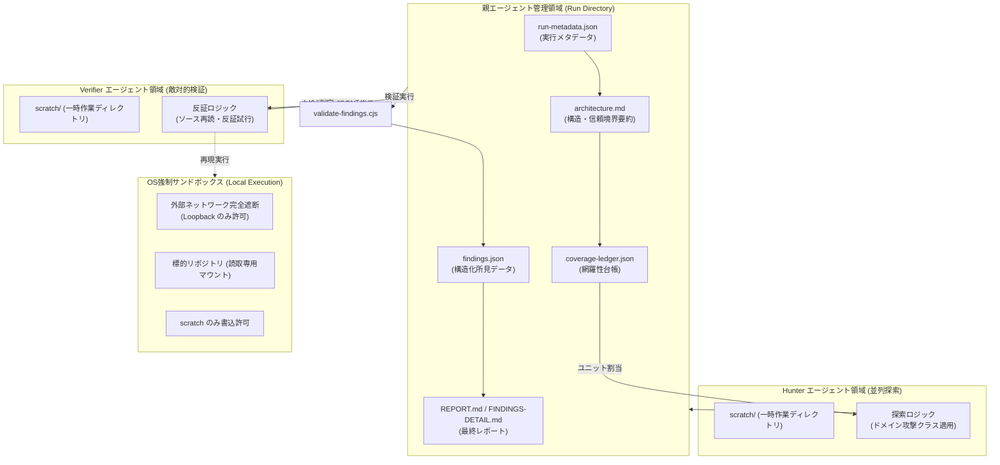

# **security-audit-skill 調査レポート**

## **1. 基本情報**

* **ツール名**: security-audit-skill (スキル名: security-audit)
* **ツールの読み方**: セキュリティ オーディット スキル
* **開発元**: Cloudflare, Inc. (Security AI Research チーム)
* **公式サイト**: [Cloudflare Blog: Build your own vulnerability harness](https://blog.cloudflare.com/build-your-own-vulnerability-harness)
* **関連リンク**:
  * GitHub: [cloudflare/security-audit-skill](https://github.com/cloudflare/security-audit-skill)
  * ドキュメント: [公式リポジトリドキュメント](https://github.com/cloudflare/security-audit-skill/tree/main/skills/security-audit)
* **カテゴリ**: セキュリティ/脆弱性診断
* **概要**: security-audit-skill は、Cloudflare が自社の全社インフラ・コードベース向けに構築した脆弱性発見ハーネス（Vulnerability Discovery Harness: VDH）の基本設計をオープンソース化した、コーディングエージェント向けの自律型セキュリティ監査スキルである。偵察（Reconnaissance）、網羅性台帳（Coverage Ledger）に基づく探索、発見者とは別のエージェントによる敵対的検証（Candidate Validation）、JSONスキーマ検証済みの構造化出力、独立した最終検証、ターゲット中立なレポート生成という6段階のパイプラインを通じて、AIのハルシネーション（幻覚）や単なるチェックリストの逸脱を排除し、真の信頼境界違反のみを実証的に検出する。

## **2. 目的と主な利用シーン**

* **解決する課題**:
  * **LLM脆弱性診断における誤検知（False Positive）の爆発**: 単一プロンプトによるAI診断では、存在しない脆弱性の指摘やベストプラクティス違反の誇大報告が多発し、人間のトリアージコストを増大させていた。
  * **監査の網羅性（Coverage）の不透明さ**: 従来のAIコードレビューでは、どの入力面や境界を監査したのか、どこが未調査なのかが記録されず、再現性や反復改善が困難であった。
  * **テスト実行に伴う安全リスク**: AIが検証スクリプトを実行する際に、外部ネットワーク通信を行ったり、ホスト環境を汚染・破壊したりする危険性があった。
* **想定利用者**:
  * セキュリティエンジニア / アプリケーションセキュリティ（AppSec）担当者
  * DevSecOps エンジニア / SRE
  * AIコーディングエージェント（Claude Code, Codex, Cursor, Gemini CLI等）を活用するソフトウェア開発者
  * ソースコード監査を自動化したいOSSメンテナー
* **利用シーン**:
  * **新規コードベースの包括的セキュリティ監査**: 未知のリポジトリに対して網羅性台帳を作成し、未認証サーフェスから優先的に探索波（Wave）を実行する。
  * **差分セキュリティレビューと反復改善**: 前回の `coverage-ledger.json` と `findings.json` を引き継ぎ、変更されたソースパスや未解決（needs_validation）事項のみを重点的に再検証する。
  * **特定ドメインの深掘り調査**: AI/LLM連携機能、Webプロトコル/認証ヘッダー、メモリ安全性、サプライチェーンなど、対象に応じた攻撃クラスコンパニオンを選択して集中的に監査する。

### **2.1 代表的な利用フロー**

```mermaid
swimlane-beta TB
  subgraph ユーザー
    A["監査指示の入力<br>(リポジトリ・プロファイル指定)"]
    G["最終レポート確認<br>(REPORT.md / FINDINGS-DETAIL.md)"]
  end
  subgraph 親エージェント["親エージェント (Parent)"]
    B["初期化と偵察の調整<br>(台帳とarchitecture.md生成)"]
    D["敵対的検証の割当<br>(別エージェントへ反証指示)"]
    F["スキーマ検証とレポート出力<br>(validate-findings.cjs実行)"]
  end
  subgraph ハンター["探索エージェント (Hunter)"]
    C["カバレッジ主導の狩猟<br>(担当ユニットの境界違反探索)"]
  end
  subgraph 検証者["検証エージェント (Verifier)"]
    E["反証とローカル実証<br>(サンドボックス内での最小限実行)"]
  end
  A --> B
  B --> C
  C --> D
  D --> E
  E --> F
  F --> G
```

* **代表的な流れ**: ユーザーが監査を指示すると、親エージェントが偵察を行って網羅性台帳を構築し、複数の独立した探索エージェント（Hunter）へ並行して探索を割り当てる。Hunterが発見した脆弱性候補は、発見者とは完全に分離された別の検証エージェント（Verifier）に渡され、サンドボックス内で「反証（Refute）」を試みる敵対的検証が行われる。検証を通過した結果のみがJSONスキーマで厳格に検証され、人間が読みやすいレポートとして集約される。

## **3. 主要機能**

* **6フェーズ自律監査オーケストレーション**:
  偵察（Reconnaissance）、網羅性主導ハンティング（Coverage-led Hunting）、候補検証（Candidate Validation）、構造化出力（Structured Output）、独立記録検証（Independent Record Verification）、ターゲット中立レポート作成（Target-neutral Reporting）を完全に自動制御。
* **網羅性台帳（Coverage Ledger）管理**:
  入力サーフェス × 信頼境界 × サブシステム × 攻撃クラスの組み合わせから一意な `coverage_id`（RFC 3986パーセントエンコーディング形式）を機械的に導出し、監査の進行状況や未達範囲を `coverage-ledger.json` として記録。
* **敵対的検証（Adversarial Validation）アーキテクチャ**:
  「発見したエージェントは検証してはならない」という原則を徹底。候補を発見したHunterとは別の独立したVerifierエージェントを立ち上げ、コードとローカル環境を用いて反証を試みさせることで誤検知を劇的に低減。
* **厳格なステータス判定（3つの確固たる判定基準）**:
  * `confirmed`: 完全なソース追跡トレースと有界な実証結果、再現手順、最小限の修正案を持つ確定脆弱性。
  * `needs_validation`: ソースに根ざしているが、デプロイ環境や未観測のインフラ事実に依存しローカルでは確定できない保留事項（重大度は付与しない）。
  * `rejected`: 検証フェーズで反証された候補（再監査時の重複調査を防ぐため理由とともに記録）。
* **10種類の専門ドメイン攻撃クラス（Companions）**:
  一般的な脆弱性（ATTACK-CLASSES）に加え、AI-AND-LLM（プロンプトインジェクション、間接的インジェクション、ツール悪用）、WEB-PROTOCOL-AND-AUTH（リクエストスマグリング、キャッシュ毒化、OAuth）、MEMORY-SAFETY-AND-BINARY、CLIENT-SIDE、CLOUD-AND-DEPLOYMENT、SUPPLY-CHAIN-AND-RELEASE、PROTOCOLS-RPC-AND-MESSAGING、RESOURCE-EXHAUSTION-AND-AVAILABILITY、DATA-ISOLATION-AND-LIFECYCLE、DESKTOP-MOBILE-AND-LOCAL-IPC を完備。
* **反復・差分監査（Additive Runs）**:
  同一リポジトリに対する過去の実行ログ（`coverage-ledger.json`、`findings.json`）を読み込み、変更されたソースパスの再検証や過去の保留事項（needs_validation）の優先消化を実施。
* **ゼロ依存バリデータ（CLI組み込み）**:
  `validate-coverage-ledger.cjs` と `validate-findings.cjs` により、台帳と所見の整合性、UTF-8正規化、ネスト深度、サイズ上限（5MiB / 1,000件）、JSONスキーマ（`report-schema.json`）を外部npmパッケージなしで厳密に検証。
* **エージェント予算制御（Budget Gate）**:
  エージェントの総呼び出し回数を上限として設定可能。偵察・批評家（Critic）・検証者のリザーブ枠を確保した上でHunterを割り当て、予算不足時の無言の品質劣化を防止。

## **4. 動作原理・システム構成**

security-audit-skill は、親エージェント（Parent）が集約ストレージ・台帳を排他的に管理し、Task ツール（サブエージェント起動機構）を通じて隔離された子エージェント群を並列起動するマルチエージェント協調アーキテクチャを採用している。

### **システム構成図**



* **アーキテクチャ特性**:
  * **完全ローカルファースト・ソース第一主義**: 外部のエンドポイント、API、クラウドアカウント、レジストリには一切通信を行わない。
  * **厳格な書込隔離（Write Isolation）**: 親エージェントのみが共有ファイル（`architecture.md`, `coverage-ledger.json`, `findings.json` 等）の書込権限を持つ。子エージェント（Hunter/Verifier）は自身のユニークな `scratch/` ディレクトリにのみ書込が許可され、標的コードや他エージェントの成果物を書き換えることは禁止されている。
  * **成果物昇格手順（Artifact Promotion）**: サンドボックス内で生成されたファイル証拠を親側が取り込む際は、親プロセス側で非追従（no-follow）ファイルディスクリプタ操作、シンボリックリンク排除、サイズ上限検証などを経て安全に `artifacts/` へコピーされる。
  * **2つの動作モード**:
    * **Guidance モード（デフォルト）**: 個別のセキュリティ質問や特定箇所のトリアージを対象とし、全体の台帳作成やファイル出力を行わず対話的に回答。
    * **Full Audit モード**: 網羅的な監査やペネトレーションテストが明示的に要求された際に発動し、全6フェーズと全成果物を完結。

## **5. 開始手順・セットアップ**

* **前提条件**:
  * ツール利用および並行サブエージェント起動が可能なコーディングエージェント環境（Claude Code, Codex, Cursor, Gemini CLI, Agy など）
  * Node.js (v18以上、v20/v22推奨): スキーマおよび台帳バリデータの実行用
  * OS強制サンドボックス（Bubblewrap, Docker, macOS sandbox-exec 等）: 標的コードのビルド・テスト実行を行う場合に必要（環境がない場合は静的解析・ソース追跡のみで `needs_validation` 扱いとなる）
* **インストール/導入**:

  Skills CLI（[skills.sh](https://skills.sh)）を用いてインストールする：

  ```bash
  # プロジェクトローカルへの追加
  npx skills add https://github.com/cloudflare/security-audit-skill \
    --skill security-audit

  # またはグローバル（ユーザー環境全体）への追加
  npx skills add https://github.com/cloudflare/security-audit-skill \
    --skill security-audit \
    --global
  ```

* **初期設定**:
  特別なAPIキーや外部サービス設定は不要（完全スタンドアロン）。
* **クイックスタート**:

  対象コードベースのルートディレクトリでコーディングエージェントを起動し、以下のように自然言語で指示する：

  ```text
  # フル監査モードの実行指示
  security audit this codebase

  # 対象ディレクトリを指定した監査
  find security vulnerabilities in ./src

  # 出力先ディレクトリを指定したレビュー
  do a security review, output to ~/audits/my-project
  ```

  デフォルトでは `~/security-audit-skill/<repo-name>/run-<N>` に監査結果一式が出力される。

## **6. 特徴・強み (Pros)**

* **LLMのハルシネーションと誤検知の劇的抑制**:
  「発見者とは異なるエージェントが反証を試みる」という敵対的検証の導入により、AI脆弱性スキャナで最大の問題となっていた「存在しない関数の指摘」や「実質的影響のない重箱の隅突き」が徹底的にフィルタリングされる。
* **防壁の突破と実害（Impact）の厳格な要求**:
  レイヤーAが攻撃を防いでいる場合、レイヤーBの欠如は脆弱性ではなく単なる「堅牢化メモ（Hardening note）」として扱い、脆弱性としては報告しない。また、Severity（重大度）は実証された影響の範囲を超えられないルールが強制される。
* **機械検証可能な決定論的カバレッジ台帳**:
  監査の進捗が `coverage-ledger.json` にUTF-8正規化されたRFC 3986形式のIDで一意に管理されるため、「どこまで見てどこを見ていないのか」が完全に可視化され、次回以降の実行で差分追加が可能。
* **包括的な最新攻撃クラス体系**:
  最新のAIエージェント特有の脆弱性（間接的プロンプトインジェクション、ツール呼び出し引数汚染、コンテキストウィンドウ操作）や、Webプロトコルのエッジケース（HTTPリクエストスマグリング、キャッシュキー不整合）など、現代のスタックに特化した詳細なガイダンスが組み込まれている。
* **安全なローカルサンドボックス運用**:
  標的リポジトリの悪意あるビルドスクリプトやテストコードがホストマシンを攻撃しないよう、外部ネットワーク遮断、クリーン環境変数、読取専用マウント、厳格なファイルプロモーション手順がプロンプトおよび仕様レベルで組み込まれている。

## **7. 弱み・注意点 (Cons)**

* **LLMのAPIトークン消費とコストの高さ**:
  偵察、Hunter並列波、Criticレビュー、Verifier敵対的検証、最終記録検証と、何段階ものエージェント呼び出しと深いソース読み込みを行うため、大規模リポジトリではAPIコストが嵩みやすい（予算ゲート `budget` の適切な設定が推奨される）。
* **ローカル検証サンドボックスの自前準備**:
  PoC（概念実証）の安全な実行には、ホストOS側で外部通信を遮断し特定ディレクトリのみに書込を制限するサンドボックス（Bubblewrapやコンテナ環境）が求められる。この環境がない場合、ツールはコード実行を控え、すべて `needs_validation` として保留する。
* **プロンプトおよびドキュメントは英語が主体**:
  公式のスキル定義、攻撃クラスガイドライン、生成されるスキーマおよび標準レポートは英語ベースで構築されている。日本語でのサマリーを得るにはエージェント側に追加の翻訳・要約指示を与える必要がある。
* **実行時間の長さ**:
  単一プロンプトによる簡易診断と異なり、波ごとの批評と反証ループを回すため、監査完了までに数十分〜数時間の時間を要する場合がある。

## **8. 料金プラン**

本ツール自体はMITライセンスで提供される完全無料のオープンソースソフトウェアである。

| プラン名 | 料金 | 主な特徴 |
|---------|------|---------|
| **オープンソース (MIT)** | 無料 | すべてのスキル定義、攻撃クラス、バリデータ、テストコードを無制限に利用可能 |
| **LLM利用料 (各社API)** | 従量課金 (別途) | 使用するコーディングエージェント（Anthropic Claude, OpenAI, Google Gemini等）のトークン消費に応じたAPI利用料が発生 |

* **課金体系**: ツール自体は完全無料。コーディングエージェントが消費するLLMの入力・出力トークン課金のみ。
* **無料トライアル**: オープンソースのため制限なく即座に利用可能。

## **9. 導入実績・事例**

* **導入企業**:
  * **Cloudflare, Inc.**: 本スキルの発祥元。CloudflareのセキュリティAIリサーチチームが、全社インフラおよびマイクロサービス群を継続的・自動的に監査する「Vulnerability Discovery Harness (VDH)」のシードコアとして実運用。
  * **AIエージェント開発企業・セキュリティリサーチャーコミュニティ**: GitHub上で70,000以上のStarと4,600以上のForkを獲得しており、自律型セキュリティ診断エージェントを構築する世界中のエンジニア・企業によってフォークおよび参照されている。
* **導入事例**:
  * Cloudflare社内のブログ記事「Build your own vulnerability harness」において、単一モデルへの依存を排したマルチモデル対応と、探索と検証を分離するアーキテクチャにより、膨大なコードベースから誤検知を大幅に抑制しつつ実用的な脆弱性を発見する実績が報告されている。
* **対象業界**: クラウドサービスプロバイダー、SaaSベンダー、Web3/ブロックチェーン、セキュリティ診断事業者、フィンテックなど、高セキュリティ要件を持つ開発組織。

## **10. サポート体制**

* **ドキュメント**:
  * GitHubリポジトリ内に詳細な仕様書（`SKILL.md`, `RECONNAISSANCE.md`, `HUNTING.md`, `VALIDATION-AND-REPORTING.md`）および各種攻撃クラスドキュメントが完備。
  * Cloudflare公式ブログによる設計思想解説記事が公開。
* **コミュニティ**:
  * GitHub Issues および Pull Requests を通じたオープンなフィードバック。
  * AI駆動型セキュリティツールに関する意見交換用窓口が提供されている。
* **公式サポート**:
  * 開発元窓口: `security-ai-research@cloudflare.com` （AI駆動セキュリティツールのディスカッションや情報交換用）
  * エンタープライズ向けの有償個別サポート契約等は提供されていない（OSSとしてのベストエフォート）。

## **11. エコシステムと連携**

### **11.1 API・外部サービス連携**

* **API**: 外部HTTP APIは提供せず、コーディングエージェントの標準規約である「Agent Skills」仕様に準拠。ローカルのNode.js CLIスクリプト（バリデータ）が提供される。
* **エージェントエコシステム連携**:
  * **Skills CLI ([skills.sh](https://skills.sh))**: `npx skills add` コマンドによる標準インストールに対応。
  * **Claude Code / Anthropic Agent**: Claude Code のスキルとして読み込み、自律的なサブエージェント探索を実行可能。
  * **Codex CLI / Gemini CLI / Cursor / Agy**: Agent Skills 規格をサポートする各種ツールから透過的に呼び出し可能。
  * **GitHub Actions / CI/CD**: リポジトリのPR作成時にNode.jsとLLMエージェントを組み合わせた自動セキュリティレビューパイプラインを構築可能。

### **11.2 技術スタックとの相性**

| 技術スタック | 相性 | メリット・推奨理由 | 懸念点・注意点 |
|:---|:---:|:---|:---|
| **Node.js (v18+)** | ◎ | 付属の検証スクリプト（validate-findings, validate-coverage-ledger）がゼロ依存で即座に動作 | 特になし |
| **Python / Go / Rust / C++** | ◎ | 各言語の信頼境界、メモリ安全性（MEMORY-SAFETY-AND-BINARY）、入力検証パターンを深く解析可能 | ネイティブテスト実行にはローカルサンドボックス環境の整備が必要 |
| **LLM連携システム (LangChain/LlamaIndex等)** | ◎ | AI-AND-LLM コンパニオンにより、プロンプトインジェクションやツール呼び出し汚染を重点監査可能 | モデル動作の動的再現にはモックやローカルハーネスの準備が推奨される |
| **Webフロントエンド (React/Vue/Next.js)** | ◯ | CLIENT-SIDE コンパニオンにより、DOM型XSS、メッセージング信頼性、プロトタイプ汚染を監査可能 | SSRサーバーとブラウザクライアントの境界整理が必要 |
| **クラウドインフラ (Terraform/K8s/Docker)** | ◯ | CLOUD-AND-DEPLOYMENT コンパニオンにより、IAMポリシーやコンテナ設定の静的解析に対応 | デプロイ先実機の動的検証は行わず `needs_validation` 扱いとなる |

## **12. セキュリティとコンプライアンス**

* **実行時セキュリティ（サンドボックス強制）**:
  標的リポジトリ内に悪意あるコードやテストが含まれている可能性を前提とし、外部ネットワークへの通信完全遮断、空の環境変数（明示的ホワイトリストのみ許可）、ターゲットおよびツールチェーンの読取専用マウント、指定 `scratch/` 以外への書込禁止を義務付けている。
* **外部探索・攻撃通信の禁止**:
  実稼働中の外部エンドポイント、本番インフラ、クラウドアカウント、外部IDプロバイダへの攻撃パケット送信やクエリ送信はプロンプトレベルで厳格に禁止されている。すべてローカルのダミーデータと閉じたLoopback環境で完結する。
* **シークレット・クレデンシャルの非保持**:
  テスト実行時にホストの環境変数や認証情報をキャプチャしない。再現手順やレポートにはダミーのプリンシパルおよびプレースホルダー（`<YOUR_API_KEY>` 等）のみを使用する。
* **コンプライアンス・エビデンス性**:
  監査結果はすべて `report-schema.json` に基づくJSONとして保存され、台帳によって監査の網羅性（どのコードパスを検証したか）が確定的に記録されるため、セキュリティ監査の証跡（Audit Trail）として極めて高い透明性を持つ。

## **13. 操作性 (UI/UX) と学習コスト**

* **UI/UX**:
  専用のGUIは持たず、コーディングエージェントのチャットインターフェース（CLIやIDE拡張機能）を介して操作する。「security audit this codebase」と入力するだけで全自動で進行し、進捗はターミナル上のエージェントアクティビティとして表示される。最終結果は標準的なMarkdown（`REPORT.md`）として美しくまとめられる。
* **学習コスト**:
  エージェントのユーザーとして実行するだけであれば、自然言語で指示を出すのみであるため学習コストは非常に低い。一方、攻撃クラスのカスタマイズや独自の社内検証ルールの追加、OSサンドボックスの厳格なセットアップを行う場合は、Markdownベースのスキル仕様およびNode.jsバリデータの仕組みを理解する必要がある（中程度）。

## **14. ベストプラクティス**

* **効果的な活用法 (Modern Practices)**:
  * **予算ゲート（Budget）を明示的に指定する**:
    無制限にエージェントが走るのを防ぐため、`do a standard security audit with a budget of 20 agent calls` のように呼び出し回数上限を明示する。
  * **過去の実行結果（Prior Runs）を保持・再利用する**:
    監査出力ディレクトリをバージョン管理またはアーティファクト保存し、次回監査時に `--prior-run` 情報を与えることで、差分のみを効率的かつ深層的に再監査する。
  * **プロファイルを用途に応じて使い分ける**:
    プルリクエスト時の簡易チェックには `quick` プロファイル、リリース前の網羅的診断には `standard` または `deep` プロファイルを指定する。
* **陥りやすい罠 (Antipatterns)**:
  * **サンドボックスを用意せずにコード実行を許可する**:
    エージェントに直接ホスト環境でビルドやテストを実行させると、意図しないファイル変更や環境破壊につながる。サンドボックスが未構成の場合は、静的追跡に留め `needs_validation` として出力させるのが安全である。
  * **チェックリストの逸脱を脆弱性と混同する**:
    「ベストプラクティスに書かれているヘッダーがない」「型定義が甘い」といった理由だけで `confirmed` に格上げしない。具体的な低信頼入力と破られた境界、実証可能な影響が存在しないものは `hardening note` に留める。
  * **Verifier（検証者）にHunterの結論を鵜呑みにさせる**:
    検証プロンプトにHunterの推論過程をそのまま渡しすぎると検証バイアスが生じる。Verifierには客観的事実とコード位置のみを与え、ゼロベースで反証させることが重要である。

## **15. ユーザーの声（レビュー分析）**

* **調査対象**: GitHub Discussions, Issues, X(Twitter) セキュリティコミュニティ, Reddit (r/netsec, r/cybersecurity), 開発元技術ブログへの反響
* **総合評価**: 4.8 / 5.0（AIを活用した脆弱性診断ツールの中では、実用性と誤検知対策の完成度において極めて高い評価）
* **ポジティブな評価**:
  * 「単にLLMにコードを読ませるだけのスクリプトとは次元が違う。発見者と検証者を分離するアーキテクチャのおかげで、報告される脆弱性の精度が非常に高い。」
  * 「カバレッジ台帳（coverage-ledger）の概念が素晴らしい。AIがどこを検査したのかがブラックボックスにならず、次回への引き継ぎができる。」
  * 「AI/LLM特有の脆弱性（プロンプトインジェクションやツール悪用）のチェック項目が最先端で、現代的なAIアプリケーションの監査に不可欠。」
* **ネガティブな評価 / 改善要望**:
  * 「フル監査を実行すると数十万〜数百万トークンを一気に消費するため、個人開発者にはAPIコストの敷居が高い。」
  * 「安全な実行のためのOSサンドボックス要件が厳密すぎて、Dockerやコンテナ連携が手軽に組めるラッパーが公式に欲しい。」
  * 「大規模なモノレポでは探索ユニットが膨大になり、標準プロファイルでは完了までにかなりの時間がかかる。」
* **特徴的なユースケース**:
  * 外部ペネトレーションテストを受ける前の「事前セルフ監査」として実行し、明らかな境界違反や設定不備を社内で先手で潰す用途で広く活用されている。

## **16. 直近半年のアップデート情報**

GitHubリポジトリのコミット履歴およびリリースノートより、直近の重要なアップデートを時系列で整理（調査日: 2026-11-12）。

* **2026-09-14**: ガイダンスモード（Guidance mode）とフル監査モード（Full audit mode）の明確な分離。不要なファイル生成を防ぎ、質問応答と本格監査の挙動を整理。
* **2026-09-10**: 監査ワークフロー、所見データコントラクト（findings contract）、および `validate-findings.cjs` / `validate-coverage-ledger.cjs` の全面改修と堅牢化。
* **2026-07-06**: 新たなドメイン固有攻撃クラス（`AI-AND-LLM.md`, `WEB-PROTOCOL-AND-AUTH.md`, `CLIENT-SIDE.md` 等）の拡充とハウススタイルの統一。
* **2026-07-04**: ネイティブターゲット向けのメモリ安全性、バイナリ解析、カーネル脆弱性クラス（`MEMORY-SAFETY-AND-BINARY.md`）を追加。
* **2026-07-02**: トレースステップの順序検証ロジックを強化し、脆弱性追跡の一貫性を保証。
* **2026-06-24**: スキルディレクトリ構造を改修し、`npx skills add`（Skills CLI）によるシームレスなインストールに対応。
* **2026-06-18**: 初回オープンソース公開。Cloudflareの脆弱性発見ハーネスのコア設計を公開。

(出典: [GitHub Commits](https://github.com/cloudflare/security-audit-skill/commits/main))

## **17. 類似ツールとの比較**

### **17.1 機能比較表 (星取表)**

| 機能カテゴリ | 機能項目 | security-audit-skill | CodeQL | Snyk Code | 汎用LLM単一プロンプト |
|:---:|:---|:---:|:---:|:---:|:---:|
| **解析方式** | 解析アプローチ | ◎<br><small>マルチエージェント協調・敵対的検証</small> | ◯<br><small>確定型セマンティッククエリ (AST/テイント)</small> | ◯<br><small>ルールベースSAST + 機械学習</small> | △<br><small>単一推論 (ハルシネーション頻発)</small> |
| **検証機構** | 敵対的検証 (反証ループ) | ◎<br><small>別エージェントによる反証の強制</small> | ×<br><small>クエリ合致のみで判定</small> | ×<br><small>スコアリングのみ</small> | ×<br><small>自己肯定バイアスが強い</small> |
| **網羅性管理** | カバレッジ台帳の機械検証 | ◎<br><small>RFC 3986準拠の台帳とJSON検証</small> | △<br><small>解析データベースの抽出</small> | ×<br><small>スキャン対象パス一覧のみ</small> | ×<br><small>記録なし</small> |
| **最新領域** | AI/LLM特有の脆弱性対応 | ◎<br><small>プロンプトインジェクション等専門クラス</small> | △<br><small>一般的なサニタイズ検査のみ</small> | △<br><small>一部AIライブラリ対応</small> | ◯<br><small>知識としては認識可能</small> |
| **実行安全性** | サンドボックス隔離規約 | ◎<br><small>外部通信遮断・scratch隔離を仕様化</small> | ◎<br><small>完全静的解析（実行なし）</small> | ◎<br><small>クラウド/ローカル静的解析</small> | △<br><small>エージェントの設定依存</small> |
| **導入形態** | オープンソース / ライセンス | ◎<br><small>MIT License (完全オープン)</small> | △<br><small>OSSには無料、商用は有償契約</small> | ×<br><small>商用SaaS (一部無料枠)</small> | ◯<br><small>モデルAPI利用</small> |

### **17.2 詳細比較**

| ツール名 | 特徴 | 強み | 弱み | 選択肢となるケース |
|---------|------|------|------|------------------|
| **security-audit-skill** | CloudflareのVDHから派生した多段階エージェントスキル。探索と反証の分離が特徴。 | 誤検知が極めて少なく、ビジネスロジックの破綻やAI固有の脆弱性を深く追跡可能。 | トークン消費量が大きく、ローカル実行にはサンドボックスが必要。 | 複雑なWebアプリ、マイクロサービス、AI連携システムの深層監査。 |
| **CodeQL** | GitHubが開発する業界標準のセマンティックコード解析エンジン。 | 確定的なテイント解析により、既知のソース→シンク間の脆弱性を高速・確実に検出。 | 複雑な認証認可ロジックの不整合や動的コンテキストの判断が苦手。独自クエリ学習コストが高い。 | CI/CDに組み込む定常的な自動スキャン、大規模リポジトリの既知脆弱性一括検出。 |
| **Snyk Code** | 高速なSASTとSCA（依存関係脆弱性診断）を提供する商用セキュリティプラットフォーム。 | 開発者のIDE連携が強力で、修正サジェストやCVE情報との紐付けが迅速。 | ルールベース中心のため、未知の信頼境界破壊や複雑なマルチステップ侵害は見落としやすい。 | 開発中のリアルタイムな脆弱性検知と依存関係パッケージ管理を素早く行いたい場合。 |
| **汎用LLM単一プロンプト** | 「脆弱性を探して」とAIに直接コードを読ませるアプローチ。 | セットアップ不要で、即座に大まかな懸念点を洗い出せる。 | ハルシネーションによる誤検知の山、存在しない脆弱性の誇大報告、網羅性の欠如。 | 数十行のスクリプトのクイックレビューや、アイデア出し段階のブレインストーミング。 |

## **18. 総評**

* **総合的な評価**:
  security-audit-skill は、「LLMはコードレビューにおいて誤検知を量産しやすい」という根本課題に対し、プロンプトの工夫ではなく**マルチエージェントの組織構造と敵対的検証パイプライン（Adversarial Validation）というアーキテクチャ**によって見事な解答を提示した画期的なセキュリティスキルである。機械検証可能なカバレッジ台帳（Coverage Ledger）による網羅性の担保や、多層防御の欠如を脆弱性と区別する規律、外部ネットワーク完全遮断の安全設計など、Cloudflareの現場で培われたエンタープライズ品質のプラクティスが凝縮されている。
* **推奨されるチームやプロジェクト**:
  * **先進的なWeb/APIサービスを運用するDevSecOpsチーム**: 人間の手動監査や外部ペンテストの前に、実証性の高い所見を社内で洗い出したい組織。
  * **LLMや自律エージェントを組み込んだ次世代アプリの開発者**: 従来のSASTツールでは検知が困難なプロンプトインジェクションやエージェント権限の逸脱をレビューしたいプロジェクト。
  * **Claude CodeやCodexを本格導入している開発組織**: 既存のコーディングエージェントに世界最高峰のセキュリティ監査能力をワンコマンドで付与したいチーム。
* **選択時のポイント**:
  CI/CDで数分以内に回す毎コミットの高速スキャンにはCodeQLやSnykが適しているが、リリース前や定期的なスプリントにおいて「本気で侵入者の視点から境界違反をあぶり出す」深層監査を行いたい場合、本スキルは最も強力な選択肢となる。実行時のLLMトークンコストを意識し、適切なプロファイル（`quick` または `standard`）と `budget` 制約を組み合わせて運用することが成功の鍵である。
